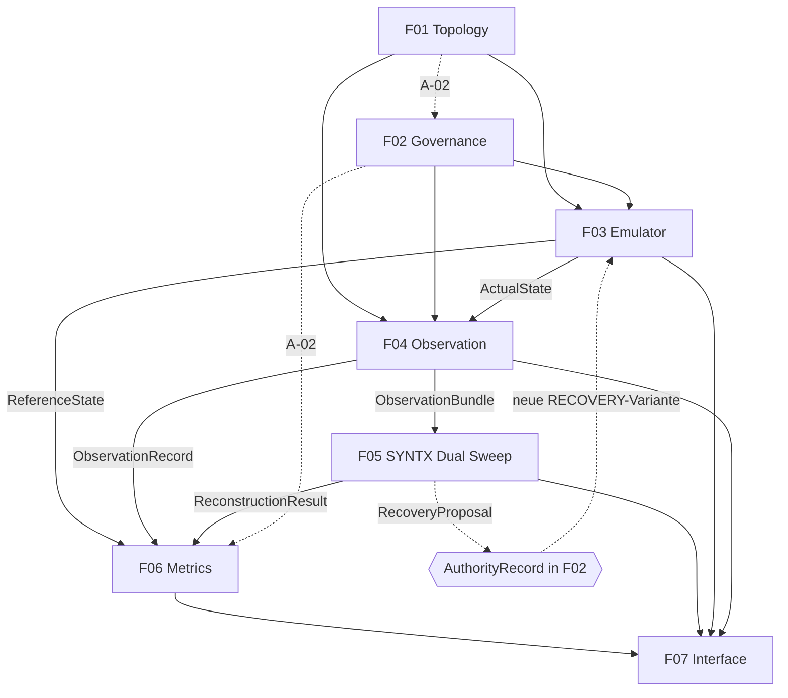
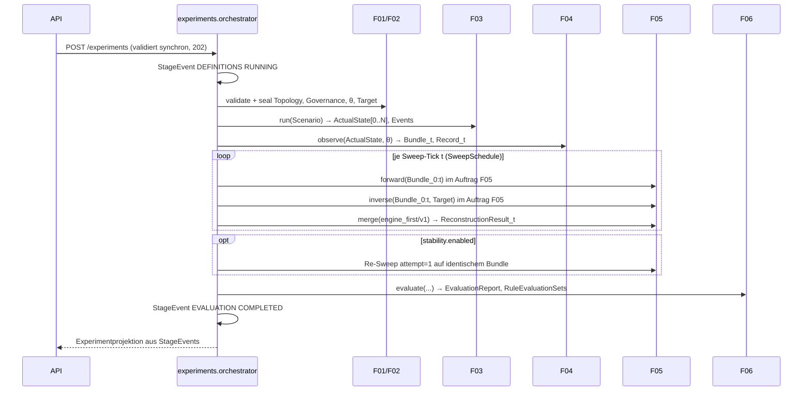
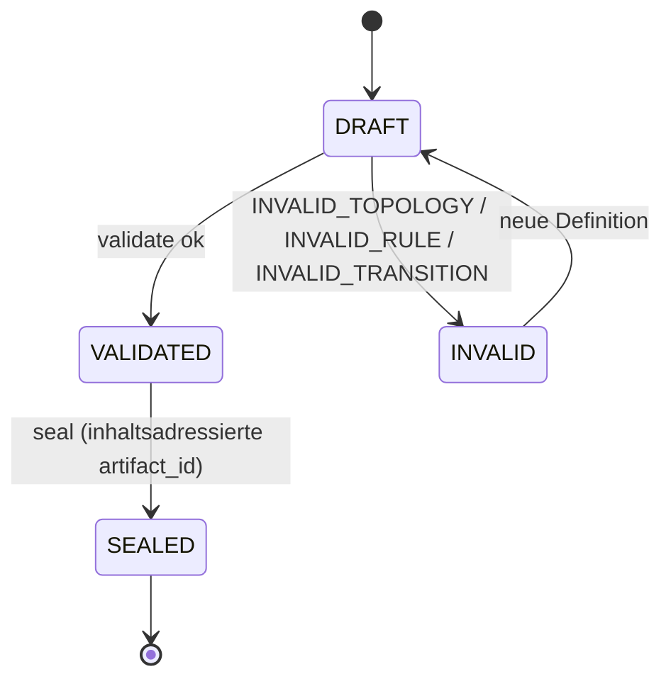
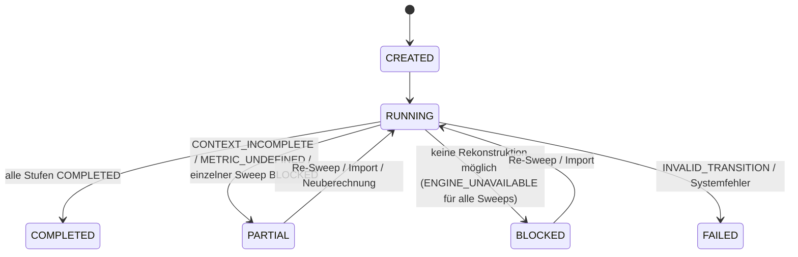
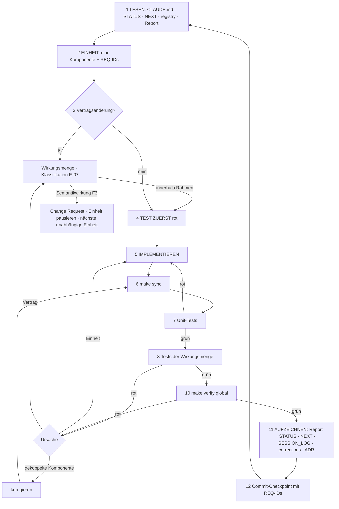
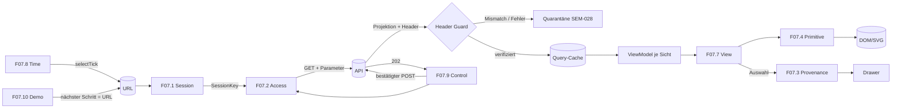
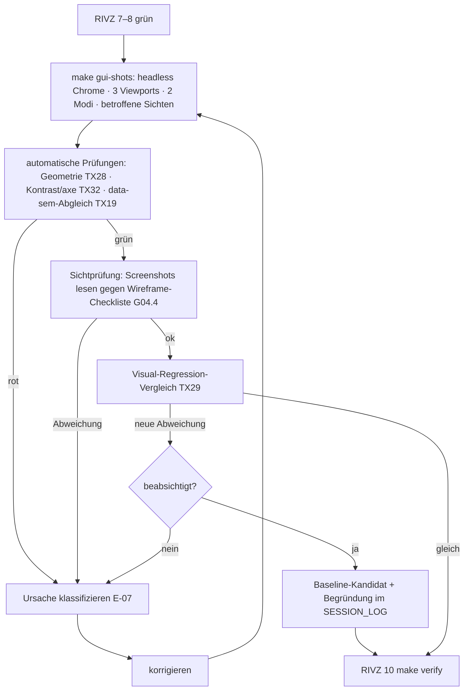

# SYNTX :: CIRA — Consolidated Architecture Package v1.0.2

**Structural Cognition and Resilience Engineering Architecture — selbsttragendes Master-Architekturpaket für den synthetischen Forschungsdemonstrator, einschließlich der F07-Interface-Architektur**

```text
STATUS   = READY FOR FINAL ARCHITECTURAL REVIEW
SCOPE    = ARCHITECTURE ONLY — NO CODE — NO IMPLEMENTATION RELEASE
RELEASE  = nicht Bestandteil dieses Pakets; erfolgt separat nach dem Final Architectural Review
```

| Kopf | Wert |
|---|---|
| Artefakt | `SYNTX_CIRA_Consolidated_Architecture_Package_v1.0.2.md` |
| Version | 1.0.2 (konsolidiert aus Paket v1.0.1 und F07 System Field Implementation Architecture v1.0.0) |
| Erstellt von | Claude (Opus 5.5), 2026-11-26 |
| Autor der Referenz | Ottavio Braun — System Field Engineering / SYNTX |
| Kontext | European Defense Tech Hackathon, Berlin 2026 · Structural Intelligence / Civil Infrastructure Resilience |
| Umgebung | vollständig synthetisches, abstraktes Service-Labor; keine realen Standorte, keine realen Infrastrukturmodelle |
| Produktidentität | CIRA (sichtbar); SYNTX ist interne Architekturgrundlage |
| Aufbau | Teil I: Systemarchitektur (Kap. 00–26) · Teil II: F07-Interface-Architektur (Kap. G00–G12) |
| Selbsttragend | ja — alle für die Implementierung nötigen Architekturinformationen sind enthalten |

---

# Teil I — Systemarchitektur

## 00 — Paketidentität, Eingangsfeld und Lesart

### 00.1 — Eingangsfeld

| Kürzel | Artefakt | Rolle | Prüfung beim Einlesen (v1.0.2) |
|---|---|---|---|
| PKG | `SYNTX_CIRA_Consolidated_Architecture_Package_v1.0.1.md` (+ PDF, 47 S.) | Basis von Teil I | PDF mit der früher gelieferten Fassung byte-identisch; Wortabgleich mit Markdown ohne inhaltliche Abweichung; keine PDF-Anmerkungen |
| GUI | `SYNTX_CIRA_Claude_GUI_System_Field_Implementation_Architecture_v1.0.0.md` (+ PDF, 46 S.) | Basis von Teil II | Wortabgleich: im PDF sind drei Komponentennamen abgeschnitten (`ClosureCard`, `OverlayToolbar`, `SideBySideTable`), weil Codezeilen über 100 Zeichen beim Rendern gekappt wurden → K-69; keine PDF-Anmerkungen |

Abstammung (in PKG und GUI vollständig verarbeitet, hier nicht erneut eingelesen):

| Kürzel | Artefakt |
|---|---|
| REF | SYNTX :: CIRA Referenzarchitektur (Kopf 1.0.1) |
| ARCH | Claude Implementation Architecture v1.0.0 |
| STRAT | Claude Implementation Strategy v1.0.0 |
| RET | Dual-Sweep Convergence Return (mit Gemini erstellt) |
| GREF | Systemic & Semiontic GUI Reference Architecture v1.0.0 |
| GSW | GUI Dual Deep Sweep Report |
| GHO | GUI Claude Architecture Handoff |

**Review-Entscheidungen.** Im Eingang lag kein Dokument mit Entscheidungen aus einem Review vor. Die beiden PDFs sind Renderings der Markdown-Fassungen und enthalten keine Anmerkungen. Die Vorschläge zu Produktsprache, semiontischer Formensprache, visueller Qualitätssicherung, automatisierter Prüfung und Browser-Abnahme sind deshalb in v1.0.2 **eingearbeitet und als `[PROPOSED]` markiert**. Bestätigt sind sie nicht. Kapitel 00.5 trennt die Klassen, Kapitel 26 führt alle Entscheidungen auf, die im Final Review fallen müssen.

Behandlung von RET (unverändert aus v1.0.1): Die SYNTX-Antworten S-01 bis S-08 sowie K-29 und K-30 sind eingearbeitet. Die Freigabeformulierungen in RET gelten nicht als Freigabe. Die Σ-Bezeichnungen Σ02–Σ29 liegen nicht vor (DEP-08).

### 00.2 — Herkunfts- und Zustandsmarken

| Marke | Bedeutung |
|---|---|
| `[REF]` | aus der Referenz, Semantik unverändert |
| `[ARCH]` | aus ARCH v1.0.0 |
| `[STRAT]` | aus STRAT v1.0.0 |
| `[RET]` | aus der Dual-Sweep-Rückgabe (S-01–S-08, K-29, K-30) |
| `[CONS]` | aus der Konsolidierung v1.0.1 (K-31–K-57) |
| `[GUI]` | aus der F07-Architektur v1.0.0 (GF, GK, K-58–K-68, SEM-031 ff., TERM, INV-LANG) |
| `[V102]` | aus dieser Konsolidierung (K-69–K-76, C-28–C-35) |
| `[PROPOSED]` | eingearbeiteter Vorschlag, **nicht bestätigt**; Entscheidung im Final Review |
| `[OPEN]` | offene Architekturentscheidung ohne eingearbeitete Lösung |
| `[REVIEW]` | entschieden, ausdrücklich zur Prüfung vorgelegt (aus v1.0.1) |
| `[MEASURED]` | Ergebnis einer tatsächlich ausgeführten Prüfung |
| `[DEP]` | externe Abhängigkeit |

Korrekturen stehen direkt in den Kapiteln, mit ihrer ID in eckigen Klammern. Das Korrekturregister (Kap. 20) führt alt · neu · Begründung · Herkunft · Kapitel.

### 00.3 — Registerübersicht

| Register | Umfang | Kapitel |
|---|---|---|
| Softwarefelder | F01–F07; F07 mit Teilfeldern F07.1–F07.11 | 04, G03.2 |
| Artefakttypen | 27 (unverändert; K-63/K-64 erweitern Payloads, keine neuen Typen) | 08.11 |
| Anforderungen | REQ-001–REQ-081 | 23 |
| Prinzipien | P01–P13 | 02 |
| Architekturentscheidungen | D-01–D-49 (D-40–D-49 `[PROPOSED]`) | 21.1 |
| SYNTX-Entscheidungen | S-01–S-08 | 21.2 |
| Abweichungen | A-01–A-14 | 22.1 |
| Erweiterungen | X-01–X-33 | 22.2 |
| Befunde | Q01–Q14, H-01–H-34, C-01–C-35, GF-01–GF-32 | 01, 19, 25, G07 |
| Korrekturen | K-01–K-76 (K-58–K-76 `[PROPOSED]`), GK-01–GK-29 (GUI-intern) | 20 |
| GAPs | G01–G39 | 18 |
| Metriken | M01–M11 (unverändert) | 07 |
| Tests | T01–T12 + T04b, TX01–TX33 | 13 |
| Abnahmekriterien | AK-01–AK-16b, AK-GUI-01–AK-GUI-20 | 17 |
| Execution Contract | E-01–E-19 (v1.0.2, nicht aktiviert) | 16 |
| Semiontik und Sprache | SEM-001–SEM-036, TERM-Register, INV-VIS/SEM/STR/FUN/LANG | G02, G03 |
| Offene Punkte | O-01–O-23, RV-01–RV-07, RV-GUI-01–RV-GUI-11 | 24, 26 |
| Abhängigkeiten | DEP-01–DEP-08 (DEP-07 geteilt in 07a/07b), DEP-GUI-01–02 | 24.2 |

### 00.4 — Dokumenthygiene `[CONS]` K-53

In Tabellenzellen steht kein senkrechter Strich. Alternativen werden mit „oder“ beziehungsweise „/“ geschrieben, reguläre Ausdrücke stehen in Codeblöcken außerhalb von Tabellen. Hintergrund: Im PDF-Rendering von STRAT hat ein Strich in einem Regex eine Tabellenzeile gekappt.

[K-69] Zeilen in Codeblöcken (Schemas, Bäume, Wireframes) sind höchstens 100 Zeichen lang. Im PDF-Rendering der GUI-Architektur wurden längere Zeilen gekappt.

### 00.5 — Quellenbefunde und vorgeschlagene Entscheidungen

| Klasse | Bedeutung | Bestand in v1.0.2 |
|---|---|---|
| QUELLE | Aussage der Referenz, Semantik unverändert | `[REF]`-Marken, Kap. 01 |
| ENTSCHIEDEN (SYNTX) | von SYNTX in RET als verbindlich übergeben | S-01–S-08 |
| GEMESSEN | von Claude tatsächlich ausgeführte Prüfung mit Ergebnis | Fixture-Arithmetik (07.10, 12.2); Konsistenzbilanz (25.4); Kontrast, Farbabstand, Glyphendarstellung, Laufzeitumgebung (G12); PDF-Abgleiche (00.1) |
| EINGEARBEITET v1.0.1 | Korrekturen und Entscheidungen bis v1.0.1 | K-01–K-57, D-01–D-39; deren offene Review-Punkte RV-01–RV-07 bestehen fort |
| VORGESCHLAGEN v1.0.2 | aus der F07-Architektur und dieser Konsolidierung, eingearbeitet, nicht bestätigt | K-58–K-76, GK-01–GK-29, D-40–D-49, A-14, X-28–X-33, TX22–TX33, AK-GUI-01–20, SEM-031–036, TERM-Register, INV-LANG, Token v1.0.1 |
| OFFEN | Entscheidung oder Abhängigkeit ohne Lösung | K-66 (F3), RV-Listen, DEP |

Regel für die Implementierungsfreigabe [K-73]: Kein Element der Klasse VORGESCHLAGEN darf implementiert werden, solange es nicht im Final Review angenommen ist. Abgelehnte Vorschläge werden mit Begründung im Korrekturregister geführt. Abgelehnt heißt: zurück auf den Stand v1.0.1 oder auf eine im Review benannte Alternative.

### 00.6 — Aufbau und Single Source

| Teil | Inhalt | Kapitel |
|---|---|---|
| Teil I | Systemarchitektur v1.0.1, fortgeschrieben; alle Register | 00–26 |
| Teil II | F07-Interface-Architektur: Verständnis, Produktsprache, Feldarchitektur, Semiontik, Wireframes, Demonstration, Strategie, GUI-Prüfung, Messprotokoll | G00–G07, G10, G12 |

Register stehen nur in Teil I. Die Register der GUI-Architektur (Korrekturen G08, Abnahme G09, Abhängigkeiten und Review G11) sind nach Kap. 13, 17, 20, 24 und 26 überführt. In Teil II stehen an ihrer Stelle Verweise.

Verweise: In Teil II bezeichnen Nummern mit `G` Abschnitte von Teil II; „Kap. NN“ ohne `G` bezeichnet Teil I. `GREF NN.N` verweist als Herkunftsangabe auf die GUI-Referenzarchitektur.

---

## 01 — Eingangsbefund der Referenz (fortgeschrieben)

| ID | Quellstelle REF | Beobachtung | Zustand v1.0.1 |
|---|---|---|---|
| Q01 | Z. 174–331 | fremder FCSD-arXiv-README-Block im Repository-Baum | **geschlossen** durch S-08: gehört nicht zu CIRA, verworfen. Der Repository-Baum ist aus den lesbaren Zeilen rekonstruiert (Kap. 09). Ob beim Einfügen Zeilen des Baums verloren gingen, hat S-08 nicht ausdrücklich beantwortet → RV-07 |
| Q02 | Kopf / Dateiname | Kopf 1.0.1, Dateiname v1.0.0 | **geschlossen** durch S-08: maßgebliche Basis ist ARCH v1.0.1 = dieses Paket |
| Q03 | F07 | elf bzw. zwölf benannte Sichten | geschlossen: elf Sichten + globale Exportfunktion (D-21, A-01) |
| Q04 | Metriken 5/6 | Definitionsspalte leer | geschlossen: aus Fixture 04.11 rekonstruiert (07.2); Gewichtung selbst entschieden (D-09) |
| Q05 | Metrik 4 | Servicefunktion undefiniert | geschlossen: FUNCTION-Regeln (X-06), je Funktion + gepoolt [K-19] |
| Q06 | Metrik 3 | Übergangsgültigkeit undefiniert | geschlossen: TRANSITION-Regeln mit Zeitindex `at` (A-03, [K-06]) |
| Q07 | Metrik 9 | Basis und Zeitpunkt offen | geschlossen durch S-05 |
| Q08 | Metrik 10 | Herkunft R1, R2 offen | geschlossen durch S-06; Auslöser ergänzt [K-44] |
| Q09 | 04 | GAP-Matching und Relationsidentität offen | geschlossen: S-01 (Matcher), [K-01] (Relations-ID), Präzisierung [K-47] `[REVIEW]` |
| Q10 | 05 | Kopplungen F01→F02, F02→F06 ohne Vertrag | geschlossen: A-02 |
| Q11 | 07 API | Endpunkte für F07 fehlen | geschlossen: A-04; Zählung korrigiert [K-37] |
| Q12 | 04 | Mergesemantik offen | geschlossen durch S-03 |
| Q13 | F07 | Semantik Closure Inspector | selbst entschieden: D-22 |
| Q14 | 06 | Original-Dual-Sweep abgeschnitten, Operator-/Σ-Zuordnung fehlt | teilweise: kanonische Σ-Identitäten und Operatorsymbole aus RET verankert (K-29, [K-31], [K-33]); R01–R18/I01–I19 bleiben opak (DEP-01) |

---

## 02 — Implementierungsprinzipien

| ID | Prinzip | Herkunft |
|---|---|---|
| P01 | **Vertrag vor Modul.** Felder kommunizieren ausschließlich über versionierte, unveränderliche Vertragstypen. | [REF]/[ARCH] |
| P02 | **Zustandsräume sind Typen.** Ω_A, Ω_O, Ω_R sind disjunkte Typfamilien ohne gemeinsamen Obertyp. | [ARCH] |
| P03 | **Zugriff ist Capability.** Eine maschinenlesbare Kopplungsmatrix erzeugt Importregeln, Store-Guards und Tests. | [ARCH] X-02 |
| P04 | **Determinismus ohne Uhr.** Keine Wanduhrzeit, kein ungeseedeter Zufall in Artefaktinhalten; IDs aus Inhalten. | [ARCH], [K-03] |
| P05 | **Exakte Arithmetik.** Metriken rechnen rational; `float` nur abgeleitet. | [ARCH] X-04 |
| P06 | **Offenheit ist Zustand.** UNKNOWN, UNDETERMINED, ⊥, UNDEFINED, OPEN, NOT_AVAILABLE_AT_TICK sind gültige Zustände mit eigener Zählung. | [REF]/[ARCH]/[K-24] |
| P07 | **Ausführungsstatus ≠ inhaltliche Offenheit.** | [REF] |
| P08 | **Keine erfundene Engine.** Jede F05-Ausgabe trägt `data_origin`. Fixture-Werte sind nie Engine-Werte. | [REF] |
| P09 | **Laufzeitzustände über Artefakte, Anfragefehler über HTTP.** | [ARCH] |
| P10 | **Write-once.** Artefakte werden einmal und in Endform geschrieben; Verlauf steht im Ereignisprotokoll. | [ARCH], [K-35] |
| P11 | **Mensch als dokumentierte Instanz.** Rekonstruktionsvorschläge werden nie automatisch angewendet. | [REF] |
| P12 | **Eine Quelle je Information.** Pydantic → Schema → TypeScript; Matrix → Capabilities/Importregeln; Registry → Status. | [REF]/[ARCH]/[STRAT] |
| P13 | **Status wird berechnet, nie gesetzt.** Implementierungs- und Nachweisstatus entstehen aus Code und tatsächlichen Testläufen. | [STRAT] X-16 |

### 02.1 — Zuschnitt auf Claude als implementierendes Modell `[ARCH]`/`[STRAT]`

| Eigenschaft | Architekturantwort |
|---|---|
| kein Gedächtnis zwischen Sitzungen | Das Repository trägt den Zustand (`CLAUDE.md`, `docs/STATUS.md`, `docs/NEXT.md`, `docs/SESSION_LOG.md`, `registry.yaml`, Testreports), Wiedereinstieg über `make resume` (15.8) |
| am stärksten in begrenzten Einheiten | kleine reine Module, eine Verantwortung je Datei, Feldfassaden mit Porttypen |
| prüft sich am besten gegen ausführbare Erwartungen | Golden Fixtures, unabhängiges Oracle, Test zuerst |
| kann Grenzen unbeabsichtigt durchlässig machen | fünf mechanische Grenzschichten (05.4) |
| Drift zwischen Sprachen | generierte Typen + Drift-Tests |

---

## 03 — System-Field-Grundlage in Implementierungsform

### 03.1 — Kern `[REF]`

S = C(J,R); CIRA: S_t = C(J_t, R_t). `[ARCH]` Dabei gilt:
- J_t: zum Tick t zugängliche Ströme (Beobachtungsquellen, Ereignisstrom).
- R_t: zum Tick t gültige Relationen (Topologie, Regeln, rekonstruierte Relationsaussagen).
- C: versionierte Konfiguration (θ, Regelversion, Gewichtsversion, Strategieauswahl, Adapterkonfiguration).

Ein `FieldConfigurationSnapshot` hält je Feld und Tick die Referenzen auf J_t, R_t und C. Er ist kein Artefakt, sondern wird aus dem Experimentindex projiziert (`/fields`).

### 03.2 — Strukturelle Unterscheidungen → Implementierungsträger

| Unterscheidung [REF] | Träger |
|---|---|
| Stream | `ObservationSource` (F04), `EventRecord`-Strom (F03), `StageEvent`-Strom (Experiment) [K-35] |
| Coupling | `Relation` (F01), `RelationAssertion` mit `CouplingStatus` (F05), Kopplungsmatrix |
| Interface | Feldports (Field Manifest, Feldfassade) |
| Weighting | `WeightSet` (F06) |
| Calibration | `ObservationConfig` θ, `StrategySelection` [K-45] |
| Coherence State | `RuleEvaluationSet` je Raum und Tick |
| Delta | `DeltaState` (raumspezifisch [K-13]), `DeltaCoupling` |
| Recursion | Re-Rekonstruktion versionierter Kontexte Ω_O(0:t); vermittelte Rückkopplung F05 → AuthorityRecord → RECOVERY-Szenario (05.5) |

### 03.3 — Geschlossene Kategorien (Enums)

| Enum | Werte | Herkunft |
|---|---|---|
| `CouplingStatus` | EFFECTIVE · POSSIBLE · UNKNOWN_OPEN | [REF] |
| `EpistemicClass` | SOURCE_OBSERVATION · SOURCE_STATEMENT · STRUCTURAL_DERIVATION · HYPOTHESIS · OPEN_REFERENCE | [REF] |
| `ObservationStatus` | KNOWN · UNKNOWN · NOT_APPLICABLE | [REF] |
| `ReconstructionStatus` | DETERMINED · UNDETERMINED · NOT_APPLICABLE | [ARCH] |
| `Applicability` | APPLICABLE · NOT_APPLICABLE | [ARCH] |
| `RuleResult` | TRUE · FALSE · UNEVALUABLE (⊥) | [REF] |
| `ReferenceStatus` | RESOLVED · UNRESOLVED · TRUNCATED · EXTERNAL | [ARCH] |
| `ExecutionStatus` | CREATED · RUNNING · COMPLETED · PARTIAL · FAILED · BLOCKED | [REF] |
| `DataOrigin` | SYNTHETIC · FIXTURE · ENGINE · IMPORTED · ILLUSTRATIVE | [ARCH] |
| `StateSpace` | A · O · R | [REF] |
| `ContentAvailability` | AVAILABLE · NOT_AVAILABLE_AT_TICK | [K-24] |

### 03.4 — Softwarefelder, Σ-Felder, Operatoren

`[REF]` F01–F07 sind Softwarefelder. Σ-Felder der MASTER ENGINE und die Operatoren sind Engine-Gegenstände. Ihre Semantik wird durch CIRA nicht neu definiert.

`[RET]` K-29 / `[CONS]` K-31–K-33 — Verankerung:

| Gegenstand | Herkunft | Vertragsform in CIRA | Semantik in CIRA |
|---|---|---|---|
| Σ-Identitäten Σ01–Σ30 | RET (Quelle laut RET: `SYNTX_SIGMA_STATE_ENGINE_v1.8.1_MASTER_ARCHITEKTUR.md § 2`, nicht im Eingangsfeld) | `SigmaRef { sigma_id, registry_version }`. Bei `registry_version = "v1.8.1"` gilt der Wertebereich Σ01–Σ30; andere Versionen bleiben opak [K-33] | keine; Bezeichnungen nur wörtlich aus der Registry (`label_from_source`). Belegt sind Σ01 „Active Carrier Nodes“ und Σ30 „Recursive Closure Threshold“; die übrigen 28 folgen mit DEP-08 |
| kanonische Operatorsymbole (13) | RET | `OperatorRef` mit `namespace = CANONICAL_V181`, `symbol` ∈ geschlossene Menge (Codepunkte 03.5) [K-32] | keine; CIRA verzweigt nie auf ein Symbol (TX11) |
| R01–R18, I01–I19 | REF; laut RET nicht in v1.8.1 enthalten | `OperatorRef` mit `namespace = R` oder `I`, `code` nach Muster (08.6) | keine; DEP-01 |
| fremde Engine-Operatoren | [K-32] | `namespace = EXTERNAL`, opaker `code` | keine |
| Σ-Kopplungen der Engine (RET nennt neun, u. a. „Σ03 > Σ14“, „Σ10 stabilizes Σ05“, „Σ30 → recursive closure“) | RET | Registry-Einträge `{ source, target?, operator?, relation_label_from_source }` [K-33] | keine; nur Anzeige. Zwei der neun Einträge verwenden Relationen außerhalb der 13 Symbole („stabilizes“, „recursive closure“), daher ist `operator` optional und `relation_label_from_source` Pflicht |

Weder Annahme noch Code verwenden „R = vorwärts, I = invers“ oder irgendeine Symbolbedeutung.

### 03.5 — Codepunkte `[CONS]` K-31

Σ- und Operatorzeichen haben verwechselbare Unicode-Doppelgänger. Verbindlich sind die Codepunkte, die in RET tatsächlich stehen:

| Zeichen | Codepunkt | Name | abgewiesene Doppelgänger |
|---|---|---|---|
| Σ (in Σ01–Σ30) | U+03A3 | GREEK CAPITAL LETTER SIGMA | U+2211 N-ARY SUMMATION, U+01A9 LATIN CAPITAL LETTER ESH (im PDF-Textauszug als „Ʃ“ aufgetreten) |
| > | U+003E | GREATER-THAN SIGN | U+FF1E, U+203A |
| < | U+003C | LESS-THAN SIGN | U+FF1C, U+2039 |
| ≈ | U+2248 | ALMOST EQUAL TO | U+223C, U+2243 |
| → | U+2192 | RIGHTWARDS ARROW | U+21D2, U+27F6 |
| ↔ | U+2194 | LEFT RIGHT ARROW | U+21D4, U+27F7 |
| ⊕ | U+2295 | CIRCLED PLUS | — |
| ⊖ | U+2296 | CIRCLED MINUS | — |
| ⊗ | U+2297 | CIRCLED TIMES | — |
| ⊘ | U+2298 | CIRCLED DIVISION SLASH | — |
| ∆ | U+2206 | INCREMENT | U+0394 GREEK CAPITAL LETTER DELTA |
| ∇ | U+2207 | NABLA | — |
| ∑ | U+2211 | N-ARY SUMMATION | U+03A3 GREEK CAPITAL LETTER SIGMA |
| ∂ | U+2202 | PARTIAL DIFFERENTIAL | — |

Regeln:
- Eingaben werden NFC-normalisiert und danach exakt gegen diese Codepunkte geprüft.
- Doppelgänger führen zu `SCHEMA_VIOLATION`. Es gibt keine stille Umwandlung.
- Kanonisches JSON wird UTF-8 mit `ensure_ascii = false` nach NFC serialisiert, damit Hashes stabil bleiben.
- Test: TX21.
- `[REVIEW]` RV-02: SYNTX bestätigt, dass die Quelle v1.8.1 dieselben Codepunkte verwendet, insbesondere ∆ = U+2206 und nicht Δ = U+0394.

---

## 04 — Feldverträge F01–F07

Feldtupel `[REF]`: F_i = ⟨C_i, R_i, X_i, U_i, Y_i, B_i, I_i, T_i, K_i, P_i⟩. Jedes Feld hat ein maschinenlesbares Field Manifest `contracts/fields/F0N.field.json` `[ARCH]` X-01 und genau eine öffentliche Feldfassade `app/<feld>/__init__.py`, die nur Manifest-Ports exportiert `[STRAT]`.

### F01_DOMAIN_TOPOLOGY

| Komponente | Inhalt |
|---|---|
| Zweck | typisierter gerichteter Graph G = (V, E, τV, τE) abstrakter Servicekomponenten `[REF]` |
| C Träger | `Node`, `Relation`, `NodeTypeDecl`, `ValueDomain`, `AttributeDecl` |
| R Relationen | `depends_on`, `reports_to`, `provides` (geschlossen in v1) `[REF]` |
| X Zustandsraum | Definitionslebenszyklus DRAFT → VALIDATED → SEALED; INVALID_TOPOLOGY |
| U / Y | `TopologyDefinition` → `ImmutableTopology` (versiegelt), `TopologyProjection` |
| B Grenze | keine Zustandswerte; keine Geodaten, keine Realnamen (TX09) |
| I Invarianten | eindeutige IDs je Klasse; Referenzen auflösbar; Relationstyp aus der geschlossenen Menge; pro Run unveränderlich; Domäne jedes Attributs deklariert; `attribute_id` beginnt mit dem lokalen Knotennamen; Relations-ID `rel:<type>:<src_local>:<tgt_local>` [K-01]; `applicability` je Attribut über den Run konstant [K-21] |
| T | validate, seal; Änderung erzeugt eine neue `version` |
| K | → F02 (Referenzvalidierung, A-02), → F03, → F04, → F06 (über ReferenceState), → F07 |
| P | `topology_id@version`, `artifact_id` (inhaltsadressiert [K-03]) |
| Fehler | INVALID_TOPOLOGY → Wiederherstellung durch gültige neue Definition |
| Serialisierung | JSON |

### F02_GOVERNANCE

| Komponente | Inhalt |
|---|---|
| Zweck | dokumentierte Regeln, Rollen, Sollbedingungen, Freigaben `[REF]` |
| C Träger | `Rule`, `RoleDecl`, `Predicate`, `ApprovalRecord` (synthetischer Freigabezustand im Szenario), `AuthorityRecord` (dokumentierte Entscheidung über eine Wiederherstellungsvariante) [K-08] |
| R Relationen | `applies_to`, `requires`, `permits` `[REF]`; `requires` als Auswertungsabhängigkeit (D-12) |
| X | Definitionslebenszyklus; Auswertung g_j ∈ {TRUE, FALSE, UNEVALUABLE} |
| U / Y | `GovernanceDefinition` → versiegelt; `RuleEvaluation` (getrennter Typ, erzeugt vom reinen K3-Evaluator), `ObservableRules` (über F04), `GovernanceProjection` |
| B | Regeln sind Sollbedingungen. F03 erzwingt sie nicht (D-14). Der Evaluator wird von F06 aufgerufen. |
| I | eindeutige `rule_id@version`; `applies_to` gegen F01 auflösbar; `requires` azyklisch; Prädikate referenzieren nur deklarierte Attribute; Blätter in TRANSITION-Regeln tragen `at` [K-06]; Zeitgültigkeit inklusiv, Paare beidseitig gültig [K-07] |
| Semantik | g_j: X → {0,1,⊥} `[REF]`; TRANSITION: g_j: X × X → {0,1,⊥} (A-03); Kleene K3 (D-11) |
| Fehler | INVALID_RULE → Rückkehr zur letzten gültigen Version |
| Serialisierung | JSON |

### F03_EMULATOR

| Komponente | Inhalt |
|---|---|
| Zweck | deterministische Fortschreibung vorab definierter abstrakter Testzustände `[REF]` |
| C Träger | `Experiment` (Projektion [K-35]), `Snapshot` (= `ActualState` je Tick), `EventRecord` |
| X | Ω_A(t), vollständig bestimmt: Wert aus der Domäne oder NOT_APPLICABLE |
| U | `ScenarioDefinition`, `ImmutableTopology`, `GovernanceDefinition` |
| Y | `ActualState` je Tick, `EventRecord` (JSONL), `ConsistencyAnnotationSet` (Ground Truth, X-07), `ReferenceState`, `StateProjection` |
| T | Ω_A(t+1) = T(Ω_A(t), u_t) `[REF]`; u_t in Sequenzreihenfolge (D-13); keine Propagationsregeln in v1 |
| B | keine Abhängigkeit von F04/F05 `[REF]` (TX03); keine Abhängigkeit von `contracts.f05` [K-08] |
| I | Tick und Sequenz streng monoton; Werte aus der deklarierten Domäne; Decl NOT_APPLICABLE ⇒ Wert NOT_APPLICABLE für alle t [K-21]; gleiche Eingabe ⇒ gleiche `artifact_id` [K-03] |
| Baseline / Recovery | `variant_kind`, gemeinsame `fixture_lineage_id`, gleiche Topologie- und Governance-Version (Vergleichbarkeit [K-43]) |
| Fehler | INVALID_TRANSITION ist strukturell (Wert außerhalb der Domäne, unbekanntes Attribut, Tick nicht monoton, Setzen eines NOT_APPLICABLE-Attributs) → Replay ab gültigem Initialzustand |
| Serialisierung | JSON (Snapshots), JSONL (Events) |

### F04_OBSERVATION

| Komponente | Inhalt |
|---|---|
| Zweck | Ω_O(t) = O_θ(Ω_A(t)), θ versioniert `[REF]` |
| C Träger | `Observation`, `ContextBundle`, `ObservationSource`, `SourceReferenceRegister` |
| R | `observes`, `references`, `derived_from` `[REF]` |
| U | `ActualState` (auch frühere Ticks bei `lag_ticks`), θ, Topologie, Governance |
| Y | `ObservationBundle` (für F05, ohne Ω_A-Bezüge), `ObservationRecord` (für F06, mit Ω_A-Verknüpfung) (D-16), `ObservableTopologyDefinition`, `ObservableRules`, `ObservationProjection` |
| Sichtbarkeit | Sichtbarkeit gilt auf Knotenebene. Die Attribute sichtbarer Knoten sind deklariert bekannt, ihre Werte kommen nur über Quellen [K-21]. Sichtbare Regeln referenzieren nur sichtbare Attribute, sonst INVALID_RULE bei der θ-Prüfung [K-21] |
| Erzeugungsregel | eine Observation je (Quelle, Attribut, Tick) aktiver Quellen; dazu für jedes Attribut ohne aktive Quelle eine Platzhalter-Observation UNKNOWN mit `source_id = null`; NOT_APPLICABLE aus der Deklaration (statisch, kein Ω_A-Bezug) [K-09] |
| Projektion ω(i,t) | KNOWN mit dem Wert der frischesten Beobachtung (max. `observed_at_tick`, Tie-Break `source_id`), sonst UNKNOWN oder NOT_APPLICABLE [K-09] |
| I | KNOWN genau dann, wenn `value` gesetzt; KNOWN ⇒ `source_id` gesetzt [K-09]; UNKNOWN ist weder falsch noch abwesend; `observed_at_tick ≤ tick`; Kontextversion streng monoton; `observation_id` hängt nur von (Quelle, Attribut, Tick) ab [K-38]; Bundle-Provenienz ohne F03-Bezüge [K-41] |
| Budget | auf Ebene des kumulativen `ObservationBundle` [K-12]; keine stille Kürzung (D-18) |
| Fehler | CONTEXT_INCOMPLETE → nächstes Serialisierungsprofil; sind alle Profile erschöpft, werden die SweepRuns dieses Ticks BLOCKED und das Experiment PARTIAL [K-12] |
| Serialisierung | JSON |

### F05_SYNTX_ENGINE

| Komponente | Inhalt |
|---|---|
| Zweck | Ω_R(t) = R(Ω_O(0:t)) über unabhängige Vorwärts- und Inversrekonstruktion `[REF]` |
| C Träger | `SweepRun`, `Reference`, `SweepTrace` |
| U | **ausschließlich** `ObservationBundle` und beobachtungsbasierte `TargetDefinition` (Pflicht [K-11], S-07) |
| Y | `ForwardResult` Q_F = R_F(O), `InverseResult` Q_I = R_I(O,Z), danach `ReconstructionResult` (Merge `engine_first/v1`, S-03); `RecoveryProposal`; `OperatorRegistry` (vom Adapter) |
| Attribute | Operator-ID, Σ-ID, Provenienz, Referenzstatus `[REF]`; `attempt` [K-22] |
| Delta | `DeltaState` (raumspezifisch [K-13]), `DeltaCoupling` |
| GAP | `StructuralGap` mit mindestens einem Quellbezug, `OpenRelation`, `TerminationRecord` |
| B | keine Kenntnis von Ω_A in keiner Form (T04b, TX04, TX05) |
| I | Forward ohne `target_ref`; Inverse ohne Forward-Bezug; getrennte `sweep_id` und Traces; jede Ausgabe mit `AdapterDescriptor` und `data_origin`; DETERMINED ⇒ Klasse ≠ OPEN_REFERENCE [K-14]; SweepRun wird einmal mit Endstatus geschrieben [K-35] |
| Adapter | FixtureAdapter (FIXTURE), ImportExportAdapter (IMPORTED, gegen das gebündelte Schema validiert), LocalAdapter und ApiAdapter als vertragstreue Stubs mit ENGINE_UNAVAILABLE (S-02) |
| Kontinuität | Sweep-Zeitplan je Experiment, Bezug auf eine Kontextversion; Stabilitätsversuch nach `stability` [K-44] |
| Fehler | ENGINE_UNAVAILABLE ⇒ SweepRun BLOCKED → Re-Sweep (neuer `attempt`) oder Import |
| Serialisierung | JSON |

### F06_METRICS

| Komponente | Inhalt |
|---|---|
| Zweck | M_t = M(Ω_A(t), Ω_O(t), Ω_R(t)) `[REF]` |
| C Träger | `MetricDefinition` (statische, versionierte Registry), `MetricResult`, `EvaluationReport`, `ReferenceSpace`, `WeightSet`, `GapMatch`, `ComparisonReport` |
| U | `ReferenceState`, `ObservationRecord` + `ObservationBundle`, `ReconstructionResult`, `GovernanceDefinition` (A-02), `ConsistencyAnnotationSet`, `ExperimentDefinition` (StrategySelection) |
| Y | `EvaluationReport`, `ComparisonReport`, `RuleEvaluationSet` je Raum |
| Kern | Sichtschicht `metrics.views` → Mengen → Zähler → Ergebnis → Aggregation [K-26 Bezug H-26]; Oracle X-18 |
| I | identischer Referenzraum je Auswertung (`space_hash`); Wert = Zähler/Nenner [K-15]; Nenner 0 ⇒ UNDEFINED/null; ⊥ und NOT_APPLICABLE getrennt gezählt; kein Gesamtindex `[REF]` |
| Fehler | METRIC_UNDEFINED, wenn Eingaben fehlen (`undefined_reason = INPUT_MISSING`, Report PARTIAL) → Neuberechnung als neue Revision |
| Serialisierung | JSON |

### F07_INTERFACE

| Komponente | Inhalt |
|---|---|
| Zweck | Darstellung und Experimentsteuerung `[REF]`; rechenfreies Projektionsfeld mit Steuerkanal `[GUI]` |
| C Träger | View, ExperimentSession `[REF]`; ViewState, ProjectionHeader, Block<T>, SemionticToken, SemEntry, TermEntry, ProvenanceSelection, ControlCommand, DemoStep `[GUI]` `[PROPOSED]` |
| Teilfelder | F07.1 Session · F07.2 Projection Access · F07.3 Provenance · F07.4 Semiontic Core · F07.5 Product Language · F07.6 Spatial Shell · F07.7 View Modules · F07.8 Time Navigation · F07.9 Control & Lifecycle · F07.10 Demonstration Layer · F07.11 Verification Harness (G03.2) `[PROPOSED]` |
| Attribute | Run-ID, Tick, Ansicht `[REF]`; Versuch, Revision, Vergleich, Aggregation, Fokus, Filter, Sprache, Modus, Demo-Schritt (G03.7) `[PROPOSED]` |
| I | eine Session-Quelle: die URL (D-20); jede Projektion wird nach ihrer Guard-Klasse gegen die Session geprüft (G03.14, K-58); Abweichung ⇒ VIEW_DATA_UNAVAILABLE; NOT_AVAILABLE_AT_TICK ist Inhalt, kein Fehler [K-24]; sichtbares `data_origin` an jedem Block; sichtbarer Text ausschließlich aus dem Terminologiekatalog (INV-LANG) |
| B | keine Kopplung zu F05; keine Domänenrechnung (Metrik, K3, Delta, Matching, δ, Regelzählung); keine automatische Anwendung; keine Rohfarben, Rohmaße, Rohtexte (G03.15) |
| Fehler | VIEW_DATA_UNAVAILABLE → erneuter Abruf; Quarantäne ohne Altdaten (G03.14) |
| Serialisierung | TypeScript (generiert) / JSON; Semiontik- und Terminologiequellen YAML (G04.1) |

---

## 05 — Kopplung und Zugriff

### 05.1 — Kopplungsmatrix (Feld → Feld)

| von \ nach | F01 | F02 | F03 | F04 | F05 | F06 | F07 |
|---|---|---|---|---|---|---|---|
| F01 | — | TopologyRefs [A-02] | TopologyDefinition | Topology → ObservableTopologyDefinition | — | über ReferenceState | TopologyProjection |
| F02 | — | — | GovernanceDefinition | Governance → ObservableRules | — | GovernanceDefinition [A-02] | GovernanceProjection |
| F03 | — | AuthorityRecord lesen [K-08] | — | ActualState | **verboten** | ReferenceState, ConsistencyAnnotationSet | StateProjection, EventProjection |
| F04 | — | — | — | — | ObservationBundle (+ ObservableTopology, ObservableRules, SourceRegister) | ObservationRecord (+ Bundle) | ObservationProjection |
| F05 | — | — | vermittelt (05.5) | — | — | ReconstructionResult | SweepTrace, Result-Projektionen, OperatorRegistry |
| F06 | — | — | — | — | **verboten** | — | EvaluationReport, ComparisonReport |
| F07 | — | — | Steuerung über API | — | **verboten** | — | — |

Jede Kopplung ist ein `ArtifactEnvelope` mit `experiment_id`, `schema_version`, `tick` (null bei zeitlosen Definitionen) und `provenance` `[REF]`.



### 05.2 — Zustandsraumzugriff `[REF]`

| Feld | Ω_A | Ω_O | Ω_R |
|---|---|---|---|
| F03 | erzeugt | — | — |
| F04 | liest | erzeugt | — |
| F05 | — | liest | erzeugt |
| F06 | liest | liest | liest |
| F07 | visualisiert | visualisiert | visualisiert |

### 05.3 — Artefakt-Capability-Matrix `[ARCH]` X-02, ergänzt `[K-20]`, `[K-36]`

W = schreibt · R = liest · — = kein Zugriff. Single Source: `contracts/coupling_matrix.json`. Daraus werden Store-Capabilities, `.importlinter` und Markdown generiert.

| Artefakttyp | F01 | F02 | F03 | F04 | F05 | F06 | F07 |
|---|---|---|---|---|---|---|---|
| topology_definition, immutable_topology | W | R | R | R | — | R | R |
| governance_definition | — | W | R | R | — | R | R |
| authority_record [K-08] | — | W (Mensch über API oder Fixture) | R | — | — | — | R |
| scenario_definition | — | — | W/R | — | — | R | R |
| consistency_annotation_set | — | — | W | — | **—** | R | R |
| experiment_definition [K-36] | — | — | R | R | **—** | R | R |
| actual_state | — | — | W | R | **—** | R | R |
| event_record | — | — | W | — | **—** | R | R |
| observation_config (θ) | — | — | — | W/R | — | R | R |
| observable_topology, observable_rules, source_register | — | — | — | W | R | R | R |
| observation_bundle | — | — | — | W | R | R | R |
| observation_record | — | — | — | W | **—** | R | R |
| target_definition | — | — | — | Validierung | R | R | R |
| sweep_run, forward_result, inverse_result | — | — | — | — | W | R | R |
| reconstruction_result, recovery_proposal | — | — | — | — | W | R | R |
| operator_registry [K-20] | — | — | — | — | W | — | R |
| weight_set [K-20] | — | — | — | — | — | R | R |
| rule_evaluation_set | — | — | — | — | — | W | R |
| evaluation_report, comparison_report | — | — | — | — | **—** | W | R |
| replay_report | Komposition (`experiments`) | | | | — | — | R |

Die Adapterkonfiguration erhält F05 nicht über `experiment_definition`. Sie kommt als eigener, schmaler Parameter `AdapterSelection` an die Feldfassade [K-36]. `MetricConfig` ist kein Artefakt, sondern Teil von `experiment_definition` [K-36].

### 05.4 — Mechanische Grenzdurchsetzung in fünf Schichten `[STRAT]`

| Schicht | Mechanismus | erkennt | Test |
|---|---|---|---|
| L1 Typ | disjunkte Vertragsfamilien; keine `Any`- oder `dict`-Payloads; Feldfassaden nur mit Porttypen; mypy strict | falsche Eingabetypen | TX05, X-24 |
| L2 Import | `.importlinter` (generiert aus der Matrix) mit forbidden- und layers-Verträgen; AST-Scan auf `importlib` und `__import__` in Feldpaketen | statische und dynamische Grenzverletzung | T04b, TX03 |
| L3 Store | `FieldReader(field)` / `FieldWriter(field)` laden die Capability-Matrix; ein verbotener Typ ergibt ACCESS_VIOLATION. Der Orchestrator handelt immer **im Auftrag** des Zielfelds: Eingaben für F05 lädt er über `FieldReader(F05)` [K-48] | Laufzeitzugriff auf verbotene Artefakte, auch in der Kompositionswurzel | TX04 |
| L4 Daten | Bundle-Provenienz ohne F03-Bezüge; `observation_id` = f(Quelle, Attribut, Tick); UNKNOWN ⇒ value null; sichtbare Regeln nur über sichtbare Attribute; TargetDefinition-Provenienz ohne F03/F06 | indirektes Leck über Inhalte | TX05, TX06 |
| L5 Verhalten | Mutationstest: Ω_A-Werte unbeobachteter Attribute ändern ⇒ Bundle-`artifact_id` unverändert ⇒ F05-Ausgabe unverändert | jeder Informationsfluss Ω_A → F05 | TX05 |

`tools/coupling_audit.py` `[STRAT]` liest die protokollierten Store-Zugriffe eines vollständigen Integrationslaufs (Feld, Typ, Richtung) und vergleicht den beobachteten Graphen mit der Matrix. Jede beobachtete Kante muss in der Matrix stehen. Matrixkanten, die im Lauf nie vorkommen, werden als tote Kopplung gemeldet. Zugriffe des Orchestrators werden dem Feld zugerechnet, in dessen Auftrag er handelt [K-48] (TX18).

### 05.5 — Vermittelte Rekursionskopplung `[ARCH]` X-11, korrigiert `[K-08]`

`RecoveryProposal` (F05) → `AuthorityRecord` (F02; Rolle aus F02, Entscheidung APPROVED oder REJECTED, dokumentiert) → neue `ScenarioDefinition` mit `variant_kind = RECOVERY`, `variant_of`, `derived_from_proposal`, `authority_ref` → neues Experiment. Die Richtung ist F05 → F02 → F03. Ω_A fließt nie zu F05. F03 liest den `AuthorityRecord` über `contracts.f02`. Die Proposal-Referenz ist eine reine `ArtifactRef` ohne Typimport aus `contracts.f05`.

### 05.6 — Steuerungsfluss `[REF]`

initialisieren → Definitionen laden → synthetische Zustände → Beobachtung → unabhängige Sweeps → Zusammenführung → Evaluation → Visualisierung → Export.



---

## 06 — Zustandsmodelle

### 06.1 — Definitionen (Topologie, Governance, θ, Szenario, Target, WeightSet)



### 06.2 — Experiment als Projektion aus StageEvents `[CONS]` K-35

Das Experiment ist kein veränderliches Artefakt. Sein Zustand ist eine **Projektion** über das Append-only-Protokoll `experiments/<id>/index.jsonl`. Dieses enthält Envelope-Einträge und `StageEvent`s `{seq, stage, status, error?}` und führt die Wanduhrzeit nur als Indexfeld `recorded_at`.



Ableitungsregel (D-24): FAILED vor BLOCKED vor PARTIAL vor COMPLETED. Die Stufen sind DEFINITIONS, EMULATION, OBSERVATION, FORWARD, INVERSE, MERGE, STABILITY, EVALUATION, EXPORT.

### 06.3 — SweepRun `[ARCH]`, präzisiert `[K-35]`

RUNNING existiert nur als StageEvent. Das `SweepRun`-Artefakt wird einmal mit Endstatus geschrieben:

| Endstatus | Bedingung |
|---|---|
| COMPLETED | TerminationRecord CONVERGED oder ENGINE_REPORTED_STOP |
| PARTIAL | BUDGET_EXHAUSTED oder TRUNCATED |
| FAILED | ERROR |
| BLOCKED | ENGINE_UNAVAILABLE oder CONTEXT_INCOMPLETE (ohne TerminationRecord) |

Wiederherstellung erzeugt einen neuen SweepRun mit `attempt + 1`.

### 06.4 — Kontext (F04)

`ctx` mit Sequenz n → n+1 je beobachtetem Tick. Ein Profilwechsel nach CONTEXT_INCOMPLETE erzeugt ein neues Bundle mit nächster `revision` desselben logischen Schlüssels [K-39]. Die Kontextsequenz bleibt monoton.

### 06.5 — Attributwerte über die drei Räume

| Raum | Zustände | Bemerkung |
|---|---|---|
| Ω_A | APPLICABLE(value) · NOT_APPLICABLE | vollständig bestimmt; Applicability konstant [K-21] |
| Ω_O | KNOWN(value) · UNKNOWN · NOT_APPLICABLE | über ω(i,t) [K-09]; KNOWN kann veraltet sein (`observed_at_tick < tick`, gezählt als `stale_known` [K-42]) |
| Ω_R | DETERMINED(value, Klasse) · UNDETERMINED · NOT_APPLICABLE | nur an Sweep-Ticks; sonst NOT_AVAILABLE_AT_TICK [K-24] |

### 06.6 — Strukturelle GAP und Relation

`StructuralGap.status` ∈ {OPEN, CLOSED_IN_RESULT}; `OpenRelation.reference_status` ∈ ReferenceStatus. Eine Schließung ist immer an ein späteres Ergebnisartefakt gebunden.

### 06.7 — Sicht (F07)

IDLE → LOADING → READY. Ein Fehler beim Abruf oder eine Header-Abweichung führt zu VIEW_DATA_UNAVAILABLE, erneuter Abruf führt zurück zu LOADING. Bei Tick- oder Experimentwechsel geht READY in LOADING über. Innerhalb von READY kann ein Inhaltsblock NOT_AVAILABLE_AT_TICK sein [K-24].

Präzisierung `[GUI]` `[PROPOSED]`: Bei LOADING nach einem Tickwechsel werden alle zeitabhängigen Blöcke sofort maskiert, bis ihr Header verifiziert ist. Die Guard-Klassen und die Quarantäneregeln stehen in G03.14.

---

## 07 — Mathematisches Modell in Implementierungsform

Alle Metriken sind CIRA-spezifische Entwürfe, keine Original-SYNTX-Operatoren `[REF]`.

### 07.1 — Mengen und Grundfunktionen

Für Tick t, Attributuniversum U (alle deklarierten Attribute) und Hypothesenpolitik h (S-04, Default `include/v1`):

```text
D_ref(t) = { i ∈ U : Ω_A(t)[i] ≠ NOT_APPLICABLE }                           [REF]
D_obs(t) = { i ∈ D_ref(t) : ω(i,t).status = KNOWN }                          [REF], ω nach [K-09]
D_det(t) = { i ∈ D_ref(t) : Ω_R(t)[i].status = DETERMINED
                            ∧ (h = include ∨ Ω_R(t)[i].class ≠ HYPOTHESIS) }  [REF], [S-04]
w_i ∈ ℚ>0 aus WeightSet (versioniert, Default 1)                              [REF]
δ(a,r) = 0 falls a = r, sonst 1                                               [REF]
W(S) = Σ_{i∈S} w_i
ratio(n,d) = n/d falls d ≠ 0, sonst UNDEFINED (value = null, undefined_reason = ZERO_DENOMINATOR)
undetermined_count(t)  = |D_ref(t) \ D_det(t)|                                [REF]
hypotheses_excluded(t) = |{ i : DETERMINED ∧ class = HYPOTHESIS }| bei h = exclude, sonst 0   [K-17]
```

Invariante: DETERMINED ⇒ Klasse ≠ OPEN_REFERENCE [K-14]. Damit wirkt die Hypothesenpolitik ausschließlich in D_det.

### 07.2 — Metriken M01–M11 in Einheitsform `[K-15]`

Jede Metrik hat die Form value = numerator / denominator, auch die komplementären. Dadurch ist POOLED für alle Metriken dieselbe Operation.

| ID | Metrik | numerator | denominator | Relation | Ziel | Zusatzzähler (`aux`) |
|---|---|---|---|---|---|---|
| M01 | Reconstruction Distance | Σ_{D_det} w·δ(a,r) | W(D_det) | A×R | 0 | undetermined_count, hypotheses_excluded |
| M02 | Relational Coherence | #(g_j = TRUE) | #(g_j ∈ {TRUE, FALSE}), j über gültige STATE-Regeln | A, O, R getrennt | 1 | unevaluable_count, not_in_validity |
| M03 | Temporal State Consistency | #(g_j(s_t, s_t+1) = TRUE) | #(… ∈ {TRUE, FALSE}), j über TRANSITION-Regeln, nur aufeinanderfolgende verfügbare Ticks | A, O, R | 1 | unevaluable_count |
| M04 | Functional Continuity | #(f(t) = 1) | #(f(t) ∈ {0,1}); je Servicefunktion und gepoolt über (Funktion, Tick) [K-19] | A (Default `A_only/v1`) | 1 | function_ref, ticks_excluded |
| M05 | Reconstruction Coverage | W(D_det) | W(D_ref) | A×R | 1 | — |
| M06 | Observation Completeness | W(D_obs) | W(D_ref) | A×O | 1 | stale_known [K-42] |
| M07 | GAP Detection Coverage | TP | TP + FN | Annotation×R; Teilmengen ALL und OBSERVABLE_CASES [K-46] | 1 | tp, fn, observable_cases |
| M08 | GAP Detection Precision | TP | TP + FP | Annotation×R | 1 | tp, fp |
| M09 | GAP Closure | #resolved | #original | Baseline×Recovery | 1 | persisting, new_inconsistencies, unevaluable_in_recovery [K-43] |
| M10 | Reconstruction Stability | W(S) − Σ_S w·δ(r1, r2) | W(S), S = D_det(R1) ∩ D_det(R2) | R1×R2 | 1 | shared_coverage = ratio(W(S), W(D_ref)) |
| M11 | Reconstruction Accuracy | W(D_det) − Σ_{D_det} w·δ | W(D_det) | A×R | 1 | — |

Die Gewichtung von M05/M06 ist selbst entschieden: gewichtet (D-09, `weighted/v1`). Bei w = 1 ist sie identisch zur ungewichteten Form.

### 07.3 — Tickmengen je Metrik `[K-19]`

| Metrik | Tickmenge | fehlt die Menge |
|---|---|---|
| M01, M05, M11 | Sweep-Ticks, `attempt = 0` | INPUT_MISSING |
| M06 | alle Ticks 0 … N−1 | — |
| M02 (A, O) | alle Ticks | — |
| M02 (R) | Sweep-Ticks | INPUT_MISSING |
| M03 (A, O) | alle Paare (t, t+1) | INPUT_MISSING bei N = 1 |
| M03 (R) | Paare (t, t+1), beide Sweep-Ticks | INPUT_MISSING (z. B. Zeitplan FINAL) |
| M04 | alle Ticks des gewählten Raums | — |
| M07, M08 | Sweep-Ticks; aktive Fälle je Tick | INPUT_MISSING ohne Rekonstruktion |
| M09 | `comparison_tick` (ein Wert) | COMPARISON_INCOMPATIBLE bei unvergleichbaren Experimenten |
| M10 | `stability.tick` (ein Wert) | INPUT_MISSING ohne `attempt = 1` |

### 07.4 — GAP-Matching `subjects_tickwindow_1to1/v1` (S-01), präzisiert `[K-47]` `[REVIEW]`

```text
N(x): Normalisierung eines Subjektbezugs auf Knotenebene
      attr:<n>/<a> → node:<n> ; node:<n> → node:<n> ; rule:<r> → applies_to-Knoten von r
      obs:…:<n>/<a>:t… → node:<n>
active(c, t) ⇔ c.tick_from ≤ t ∧ (c.tick_to = null ∨ t ≤ c.tick_to)
Klasse k(t) = { Fälle c aktiv in t mit N(c) = K } ∪ { Gaps g der Rekonstruktion an t mit N(g) = K }
in jeder Klasse: Fälle nach case_id, Gaps nach gap_id sortieren; i-ter Fall ↔ i-te Gap
TP = Σ_Klassen min(#Fälle, #Gaps) ; überzählige Fälle FN ; überzählige Gaps FP
```

Da die Zulässigkeit eine Äquivalenzrelation über die Knotenmengen ist, ist diese Zuordnung eine maximale 1:1-Zuordnung und deterministisch. TP hat für M07 und M08 dieselbe Einheit: Paare [K-18]. Gap-`kind` und Fall-`kind` werden nicht verglichen, bis ein Vokabular der Engine vorliegt (DEP-01).

`M07_observable` [K-46]: ein Fall ist beobachtbar, wenn alle Knoten aus N(c) unter θ sichtbar sind. Das berechnet F06 aus θ zur Auswertungszeit [K-57], nicht die Annotation.

### 07.5 — M09 `state_rules_A_final_tick/v1` (S-05), Vergleichbarkeit `[K-43]`

```text
original     = { (rule_id, scope) : g = FALSE in Ω_A(Baseline,
                 τ) }    τ = comparison_tick (Default: letzter gemeinsamer Tick)
resolved     = { k ∈ original : g = TRUE  in Ω_A(Recovery, τ) }
persisting   = { k ∈ original : g = FALSE in Ω_A(Recovery, τ) }
unevaluable_in_recovery = { k ∈ original : g = ⊥ in Ω_A(Recovery, τ) }
new          = { k ∉ original : g = FALSE in Ω_A(Recovery, τ) }
M09 = ratio(|resolved|, |original|)
```

Vergleichbar heißt:
- gleiche `fixture_lineage_id`, gleiche Topologie- und Governance-Version
- Baseline mit `variant_kind = BASELINE`, Recovery mit `variant_kind = RECOVERY` und `variant_of` = Baseline-Szenario
- τ kleiner als beide `tick_count`

Sonst gibt es keine Berechnung, sondern COMPARISON_INCOMPATIBLE mit Liste der Gründe.

### 07.6 — M10 `resweep_same_bundle/v1` (S-06), Auslöser `[K-44]`

`ExperimentDefinition.stability = { enabled: true, tick: null }`. Default ist der letzte Sweep-Tick. Der Orchestrator führt an diesem Tick einen zweiten Versuch (`attempt = 1`) auf dem identischen `ObservationBundle` aus. Bei W(D_ref) = 0 sind M10 und `shared_coverage` UNDEFINED. Mit FixtureAdapter ist M10 deterministisch 1 und als FIXTURE gekennzeichnet. Aussagekraft hat der Wert erst mit einer Engine (DEP-02).

### 07.7 — Zeitaggregation `[REF]`

- **PER_TICK**: Zähler und Nenner je Tick der Metrik-Tickmenge.
- **POOLED**: Σ numerator / Σ denominator über die Tickmenge.
- **TIME_MEAN_EXPLICIT**: Mittel der definierten Per-Tick-Werte, nur auf Anforderung und gekennzeichnet, mit `ticks_included` und `ticks_excluded`.

Für alle Metriken gilt exakt 1 − POOLED(M01) = POOLED(M11) [K-15].

### 07.8 — Delta

- Δ_S = D_S(S_t, S_t+1): raumspezifisch diskriminiert (`DeltaStateA`, `DeltaStateO`, `DeltaStateR`) mit Statustyp des Raums [K-13].
- Δ_K = D_K(K_t, K_t+1): kanonische Relationsschlüssel mit (before, after) ∈ (CouplingStatus ∪ {ABSENT})².
- Beide sind reine Funktionen in `core.delta`, sortiert nach Schlüssel. K bezeichnet die Kopplung, nicht das Delta `[REF]`.

### 07.9 — Regelauswertung (Kleene K3) `[ARCH]` X-05, korrigiert `[K-06]`, `[K-07]`

- **Prädikat-AST**: eq, in, not, and, or, implies; bei TRANSITION zusätzlich `transition_in` mit Paaren `{from, to}`.
- **Zeitindex**: Blätter in TRANSITION-Regeln tragen `at` ∈ {CURRENT, NEXT}. In STATE- und FUNCTION-Regeln ist `at` verboten.
- **⊥ entsteht** an jedem Blatt über einem UNKNOWN-, UNDETERMINED- oder NOT_APPLICABLE-Attribut (D-11).
- **requires**: Ist eine geforderte Regel ≠ TRUE, ergibt das ⊥ mit `reason = REQUIREMENT_NOT_MET` (D-12).
- **Gültigkeit** ist inklusiv. Paare gelten nur, wenn beide Ticks gültig sind. Ungültige Regeln werden nicht ausgewertet und als `not_in_validity` gezählt.

### 07.10 — Referenz-Fixture 04.11 (nachgerechnet)

| Größe | Rechnung | erwartet [REF] | nachgerechnet |
|---|---|---|---|
| C_obs (M06) | 6/10 | 0.60 | 0.60 ✓ |
| C_rec (M05) | 8/10 | 0.80 | 0.80 ✓ |
| d_R (M01) | 1/8 | 0.125 | 0.125 ✓ |
| A_R (M11) | 7/8 | 0.875 | 0.875 ✓ |
| undetermined_count | 10 − 8 | 2 | 2 ✓ |

Attribut 07 ist beobachtet UNKNOWN und rekonstruiert STANDBY und zählt zu D_det. Das stützt S-04. Die Fixture-Topologie zu 04.11 ist in 12.1 festgelegt [K-55].

### 07.11 — Oracle und Eigenschaftstests `[STRAT]` X-18

`tests/oracle/metrics_oracle.py` ist eine naive Zweitimplementierung auf `fractions.Fraction` ohne gemeinsamen Code außer den Sichttypen. Differenzielles Testen mit hypothesis: Kern = Oracle, exakt.

Eigenschaften:
- Wertebereich [0,1]
- M11 = 1 − M01
- UNDEFINED genau bei Nenner 0
- Permutationsinvarianz
- Skalierungsinvarianz der Gewichte (c > 0)
- Monotonie: ein zusätzliches korrekt bestimmtes Attribut erhöht M01 nicht
- POOLED-Identität 07.7
- Matching-Maximalität: kein weiteres zulässiges Paar bleibt ungebunden

---

## 08 — Schemaentwürfe (v1.0.2; Korrekturen bis K-57 eingearbeitet, Vorschläge `[PROPOSED]` markiert)

Notation: `name : Typ — Bedingung`. Alle Modelle verwenden `ConfigDict(extra='forbid', strict=True, frozen=True)` `[REF]`. Sequenzen sind `tuple[...]`, Zuordnungen sortierte Eintragstupel. `list` und `dict` kommen nicht vor (D-05). Export als gebündeltes Schema `contracts/schemas/cira.contracts.schema.json` mit allen `$defs` und zusätzlich je Typ [K-23 Bezug H-23].

Hinweise zur Implementierung:
- Strikter Modus: Enums aus Strings und Tupel aus Arrays werden im JSON-Modus akzeptiert, im Python-Modus nicht. Import und Export laufen deshalb ausschließlich über `model_validate_json`. T02 prüft beide Modi.
- Feldnamen, die Python-Schlüsselwörter sind (`from`), heißen intern `from_` mit Alias `from`. Serialisiert wird `by_alias=True`.

### 08.1 — Kern (`contracts.common`)

```text
LocalName       : str  — ^[a-z0-9][a-z0-9_\-]{0,62}$
StableId        : str  — ^[a-z]+:[a-z0-9][a-z0-9_.:/\-]{0,190}$                    [K-01]
                  Komposita aus lokalen Teilen (08.10):
                  node:<n> · attr:<n>/<a> · rel:<type>:<n1>:<n2> · rule:<r> · role:<r> · dom:<d>
                  src:<s> · obs:<s|none>:<n>/<a>:t<tick> · ctx:<seq> · tgt:<t> · scn:<s> · cfg:<c>
                  sweep:<fwd|inv>:t<tick>:a<attempt> · recon:t<tick>:a<attempt> · gap:<engine-local>
                  case:<c> · prop:<p> · auth:<d> · step:<sweep-local>:<n> · ws:<w> · exp:<e>
ArtifactId      : str  — ^art:[0-9a-f]{32}$
    ; = art: + sha256(artifact_type ‖ 0x00 ‖ canonical(payload))[:32]   [K-03]
SemVer          : str  — ^\d+\.\d+\.\d+$
SchemaVersion   : str  — ^cira\.[a-z_]+/\d+\.\d+\.\d+$
Tick, Seq       : int  — ≥ 0
Symbol          : str  — ^[A-Z][A-Z0-9_]{0,63}$
Rational        : { n: int ≥ 0, d: int ≥ 1 } — gekürzt
ContentHash     : str  — ^sha256:[0-9a-f]{64}$
FieldId         : enum F01 … F07
ArtifactType    : enum (27 Werte, 08.11)
ArtifactRef     : { artifact_id: ArtifactId, artifact_type: ArtifactType,
                    content_hash: ContentHash }   [K-02]
Provenance      : { source_field: FieldId, source_refs: tuple[ArtifactRef,...], producer_id: str,
                    producer_version: SemVer, data_origin: DataOrigin }
StrategyRef     : { point: str — ^[a-z_]+\.[a-z_]+$, variant: str — ^[a-z0-9_]+$,
                    version: int ≥ 1 }   [K-45]
                  Schreibweise: <point>:<variant>/v<version>,
                      z. B. metrics.hypothesis_policy:include/v1

Envelope_<T>    : { schema_version: SchemaVersion, experiment_id: StableId | null,
                    artifact_id: ArtifactId, artifact_type: Literal["<t>"],   [K-05]
                    revision: int ≥ 0  — logische Revision je (experiment, type, logical_key),
                    logical_key: str   — nach Tabelle 08.10,   [K-39]
                    tick: Tick | null  — gleich payload.tick, wo vorhanden,   [K-40]
                    provenance: Provenance, payload: T, content_hash: ContentHash }
AnyEnvelope     : Annotated[Union[Envelope_<T> …], Field(discriminator="artifact_type")]

StageName       : enum DEFINITIONS | EMULATION | OBSERVATION | FORWARD | INVERSE | MERGE |
                       STABILITY | EVALUATION | EXPORT
StageEvent      : { seq: Seq, stage: StageName, status: ExecutionStatus,
                    tick: Tick | null, error: ErrorRecord | null }   [K-35]
                  — im Index zusätzlich recorded_at (Wanduhr), nie im Export [K-52]
ContentOpenness : { undetermined, unknown_observations, open_references, open_relations,
                    structural_gaps_open, unevaluable_rules : int }
ErrorCode       : INVALID_TOPOLOGY | INVALID_RULE | INVALID_TRANSITION | CONTEXT_INCOMPLETE |
                  ENGINE_UNAVAILABLE | METRIC_UNDEFINED | VIEW_DATA_UNAVAILABLE          [REF]
                  SCHEMA_VIOLATION | NOT_FOUND | CONFLICT | ACCESS_VIOLATION |
                  IMPORT_INVALID | COMPARISON_INCOMPATIBLE                                 [ARCH]
RecoveryAction  : SUBMIT_VALID_DEFINITION | REVERT_TO_VERSION | REPLAY_FROM_INITIAL | RESERIALIZE |
                  RESWEEP | IMPORT_RESULT | RECOMPUTE | REFETCH
ErrorRecord     : { code, field: FieldId, message: str, subject_refs: tuple[StableId,...],
                    tick: Tick | null, recovery: RecoveryAction }
```

### 08.2 — F01 (`contracts.f01`)

```text
ValueDomain     : { domain_id: StableId, version: SemVer, symbols: tuple[Symbol,...] — ≥1,
                    eindeutig }
NodeTypeDecl    : { type_id: StableId, label: str }
AttributeDecl   : { attribute_id: StableId (attr:<n>/<a>), name: LocalName, domain_ref: StableId,
                    applicability: Applicability }      — <n> = lokaler Name des umgebenden Knotens
Node            : { node_id: StableId (node:<n>), node_type: StableId, version: SemVer,
                    label: str — generisch, attributes: tuple[AttributeDecl,...] }
RelationType    : enum depends_on | reports_to | provides
Relation        : { relation_id: StableId = rel:<type>:<src_local>:<tgt_local>,   [K-01]
                    relation_type, source: StableId, target: StableId, version: SemVer }
TopologyDefinition : { topology_id, version, node_types, value_domains, nodes, relations }
ImmutableTopology  : { definition: TopologyDefinition, attribute_universe: tuple[StableId,...]
                       — sortiert }
TopologyProjection : { header: ProjectionHeader, nodes: tuple[NodeView,...],
                       relations: tuple[RelationView,...] }
```

### 08.3 — F02 (`contracts.f02`)

```text
RuleKind        : enum STATE | TRANSITION | FUNCTION
TimeIndex       : enum CURRENT | NEXT   [K-06]
SymbolPair      : { from: Symbol, to: Symbol }   [K-06]
Predicate       : Union über op:
                  Eq{op:"eq", attr, value: Symbol, at: TimeIndex | null}
                  In{op:"in", attr, values: tuple[Symbol,...], at: TimeIndex | null}
                  Not{op:"not", arg} · And{op:"and", args ≥2} · Or{op:"or", args ≥2}
                  Implies{op:"implies", if_, then}
                  TransitionIn{op:"transition_in", attr, allowed: tuple[SymbolPair,...]}
                  — Invariante: kind=TRANSITION ⇒ alle Eq/In mit at ≠ null; sonst at = null;
                      TransitionIn nur bei TRANSITION
RoleDecl        : { role_id: StableId, label: str }
Rule            : { rule_id, version, kind, scope: tuple[StableId,...],
                    applies_to: tuple[StableId,...],
                    requires: tuple[StableId,...], permits: tuple[StableId,...],
                    valid_from_tick: Tick, valid_until_tick: Tick | null — inklusiv [K-07],
                    expression: Predicate, description: str }
ApprovalRecord  : { approval_id, role_ref, rule_ref | null, subject_refs,
                    decision: APPROVED | REJECTED | PENDING,
                    tick, rationale }                — synthetischer Zustand im Szenario
AuthorityRecord : { decision_id: StableId (auth:<d>), role_ref: StableId, proposal_ref: ArtifactRef,
                    decision: APPROVED | REJECTED, rationale: str,
                    created_scenario_ref: ArtifactRef | null }      — verschoben aus f05 [K-08]
GovernanceDefinition : { governance_id, version, topology_ref: ArtifactRef, roles, rules }
EvalReason      : OK | UNKNOWN_INPUT | UNDETERMINED_INPUT | NOT_APPLICABLE_INPUT |
                    REQUIREMENT_NOT_MET
RuleEvaluation  : { rule_ref, rule_version, space: StateSpace, tick, tick_to: Tick | null,
                    result: RuleResult, reason: EvalReason, input_attribute_refs }
RuleEvaluationSet : { governance_ref: ArtifactRef, space, tick, evaluations, not_in_validity: int,
                      summary: { true, false, unevaluable, not_in_validity : int } }
                    — summary [PROPOSED K-64]
GovernanceProjection : { header, rules: tuple[RuleView,...],
                         evaluations_by_space: tuple[RuleEvaluationSet,...] }
```

### 08.4 — F03 und Experimentdefinition (`contracts.f03`)

```text
InputEventKind  : SET_ATTRIBUTE | APPLY_APPROVAL
InputEvent      : { event_id, tick, seq, kind, attribute_ref | null, value: Symbol | null,
                    approval: ApprovalRecord | null }
ActualValue     : { attribute_ref, applicability: Applicability, value: Symbol | null }
                    — APPLICABLE ⇔ value ≠ null
ScenarioDefinition : { scenario_id, version, variant_kind: BASELINE | RECOVERY,
                       variant_of: ArtifactRef | null,
                       derived_from_proposal: ArtifactRef | null, authority_ref: ArtifactRef | null,
                       fixture_lineage_id: StableId, topology_ref, governance_ref,
                       initial_state: tuple[ActualValue,...], inputs: tuple[InputEvent,...],
                       tick_count: int ≥ 1, service_function_refs: tuple[StableId,...],
                           is_fixture: bool }
                     — RECOVERY ⇒ variant_of gesetzt; ohne is_fixture zusätzlich authority_ref
                         gesetzt
ConsistencyCase : { case_id, kind: str, subject_refs: tuple[StableId,...], rule_ref | null,
                    tick_from: Tick, tick_to: Tick | null }          — ohne observable-Feld [K-57]
ConsistencyAnnotationSet : { scenario_ref: ArtifactRef, cases: tuple[ConsistencyCase,...] }
AttributeChange : { attribute_ref, before: Symbol | null, after: Symbol | null }
EventRecord     : { seq, tick, event_ref, kind, status: APPLIED | REJECTED,
                    — REJECTED-Semantik [OPEN K-66]
                    effects: tuple[AttributeChange,...], error: ErrorRecord | null }
ActualState     : { scenario_ref: ArtifactRef, tick, last_seq: Seq | null,
                    values: tuple[ActualValue,...] — sortiert, vollständig über attribute_universe }
ReferenceState  : { actual_state_ref: ArtifactRef, annotation_ref: ArtifactRef | null }
StateProjection : { header: ProjectionHeader, values: tuple[ActualValue,...] }

AdapterSelection : { kind: AdapterKind, config_ref: StableId, merge_policy: StrategyRef }   [K-45]
SweepSchedule   : { mode: FINAL | EVERY_TICK | EXPLICIT, ticks: tuple[Tick,...] }
StabilityConfig : { enabled: bool = true, tick: Tick | null = null }   [K-44]
MetricConfig    : { weight_set_ref: StableId, comparison_tick: Tick | null,
                    hypothesis_policy: StrategyRef, coverage_weighting: StrategyRef,
                    service_function_spaces: StrategyRef, closure_basis: StrategyRef,
                    stability_source: StrategyRef, gap_matcher: StrategyRef }   [K-45]
ObservationStrategy : { budget_unit: StrategyRef }   [K-45]
ExperimentDefinition : { definition_version: SemVer, scenario_ref: ArtifactRef,
                         observation_config_ref: ArtifactRef,
                             target_definition_ref: ArtifactRef — Pflicht [K-11],
                         adapter: AdapterSelection, sweep_schedule: SweepSchedule,
                             stability: StabilityConfig,
                         metric_config: MetricConfig, observation_strategy: ObservationStrategy,
                         replay_of: StableId | null,
                             replay_mode: SYNTHETIC | PRESERVED_ENGINE | null,   [K-23]
                         label: str }   — Artefakttyp [K-36]
                       — Invariante: kein F03–F06-Payload referenziert experiment_definition [K-56]
ExperimentView  : { experiment_id, definition_ref: ArtifactRef, status: ExecutionStatus,
                    stage_status: tuple[{stage, status}], openness: ContentOpenness,
                    errors: tuple[ErrorRecord,...],
                    label: str, data_origin: DataOrigin, ticks: { first: Tick, last: Tick },
                    sweeps: tuple[{ sweep_id, direction, up_to_tick, attempt,
                                    execution_status, data_origin }],
                    comparisons: tuple[StableId,...] }
                  — Projektion aus StageEvents, kein Artefakt [K-35]
                  — Felder ab label [PROPOSED K-59]
```

### 08.5 — F04 (`contracts.f04_public`, `contracts.f04_record`)

`f04_public` (für F05 zulässig):

```text
TickRange       : { from_tick: Tick, to_tick: Tick | null }
ObservationSource : { source_id, label, observes: tuple[StableId,...],
                      active: tuple[TickRange,...], lag_ticks: int ≥ 0 }
ObservableTopologyDefinition : { nodes, relations, value_domains }      — Knotensichtbarkeit [K-21]
ObservableRules : { rules: tuple[Rule,...] }   — nur über sichtbare Attribute [K-21]
Observation     : { observation_id: StableId (obs:<s|none>:<n>/<a>:t<tick>),
                    source_id: StableId | null,
                    tick, observed_at_tick: Tick — ≤ tick, attribute_ref, status: ObservationStatus,
                    value: Symbol | null, references: tuple[StableId,...] }
                  — KNOWN ⇔ value ≠ null ; KNOWN ⇒ source_id ≠ null
                      ; source_id = null ⇒ status ≠ KNOWN   [K-09]
ContextBundle   : { context_version: StableId (ctx:<seq>), sequence: int, tick,
                    previous_context_ref: StableId | null, observations: tuple[Observation,...] }
SourceRegisterEntry : { source_id, first_tick, last_tick, continuity: CONTINUOUS | INTERRUPTED,
                        gaps: tuple[TickRange,...] }
SourceReferenceRegister : { entries: tuple[SourceRegisterEntry,...] }
BudgetUsage     : { observations: int, bytes: int }
ObservationBundle : { bundle_key: StableId, up_to_tick: Tick,
                      contexts: tuple[ContextBundle,...] — 0..t lückenlos,
                      observable_topology, observable_rules, source_register,
                      serialization_profile: str, budget_usage: BudgetUsage }   [K-12]
                    — Provenienz nur F01/F02/F04-Refs; Ω_A-Verknüpfung nur im ObservationRecord
                        [K-41]
TargetGoal      : { goal_id, subject_ref — ∈ observable_topology,
                    property: RULE_SATISFIED | ATTRIBUTE_EQUALS | GAP_CLOSED,
                    rule_ref | null, value: Symbol | null }
TargetDefinition : { target_id, version, goals: tuple[TargetGoal,...], authored_by: str }   [K-10]
                   — Provenienz ohne F03/F06-Refs; Validierung gegen ObservableTopology aus θ vor
                       Laufbeginn (S-07)
```

`f04_record` (nicht für F05):

```text
ObservationConfig : { config_id, version, sources, visible_nodes, visible_relations, visible_rules,
                      bundle_budget: { max_observations: int ≥ 1, max_bytes: int ≥ 1 },   [K-12]
                      serialization_profiles: tuple[str,...] ≥1 }
ObservationRecord : { bundle_ref: ArtifactRef, tick, actual_state_refs: tuple[ArtifactRef,...]
                      — inkl. lag-Ticks,
                      observation_config_ref: ArtifactRef }
ObservationProjection : { header, context: ContextBundle,
                          projected: tuple[{attribute_ref, status, value, stale: bool}],
                          register: SourceReferenceRegister,
                          bundle_budget: { max_observations, max_bytes }, budget_usage: BudgetUsage,
                          serialization_profile: str, revision: int,
                          visible_nodes: tuple[StableId,...], delta: DeltaStateO | null }
                        — Felder ab bundle_budget [PROPOSED K-65]
StateProjection (Ergänzung) : + delta: DeltaStateA | null                    [PROPOSED K-65]
```

### 08.6 — F05 (`contracts.f05`)

```text
AdapterKind     : FIXTURE | LOCAL | API | IMPORT
AdapterDescriptor : { adapter_id, kind, adapter_version: SemVer, engine_version: str | null,
                      is_fixture: bool,
                      capabilities: { forward, inverse, merge, trace : bool },
                                      operator_registry_ref: ArtifactRef | null }
CanonicalSymbol : enum der 13 Zeichen aus 03.5 (Codepunkte verbindlich)   [K-29][K-31]
OperatorRef     : Union über namespace   [K-32]
                  { namespace: "CANONICAL_V181", symbol: CanonicalSymbol,
                    registry_version: "v1.8.1" }
                  { namespace: "R", code: str — Muster unten, registry_version: str }
                  { namespace: "I", code: str — Muster unten, registry_version: str }
                  { namespace: "EXTERNAL", code: str — 1..64 Zeichen, registry_version: str }
SigmaRef        : { sigma_id: str, registry_version: str }
                  — registry_version = "v1.8.1" ⇒ sigma_id nach SigmaId-Muster; sonst opak,
                      1..64 Zeichen   [K-29][K-33]
OperatorRegistry : { registry_id, version, source: str,
                     operators: tuple[{ ref: OperatorRef, label_from_source: str,
                                        description_from_source: str }],
                     sigma_fields: tuple[{ ref: SigmaRef, label_from_source: str }],
                     sigma_couplings: tuple[{ source: SigmaRef, target: SigmaRef | null,
                                              operator: OperatorRef | null,
                                              relation_label_from_source: str }] }   [K-33]
TraceStep       : { step_id, step_seq, operator_ref | null, sigma_ref | null, input_refs,
                    output_refs,
                    epistemic_class, engine_note: str | null }
SweepTrace      : { sweep_id, steps, reference_status }
TerminationRecord : { reason: CONVERGED | ENGINE_REPORTED_STOP | BUDGET_EXHAUSTED | TRUNCATED |
                    ERROR | CANCELLED,
                      steps_executed, budget | null, last_step_seq | null, engine_message | null }
SweepRun        : { sweep_id (sweep:<fwd|inv>:t<tick>:a<attempt>), direction: FORWARD | INVERSE,
                    attempt: int ≥ 0,   [K-22]
                    adapter: AdapterDescriptor, input_bundle_ref: ArtifactRef,
                    target_ref: ArtifactRef | null — FORWARD ⇒ null, INVERSE ⇒ gesetzt,
                    up_to_tick, context_version, execution_status — nur Endstatus [K-35],
                    termination: TerminationRecord | null, error: ErrorRecord | null }
ReconstructedValue : { attribute_ref, status: ReconstructionStatus, value: Symbol | null,
                       epistemic_class: EpistemicClass | null, derived_from: tuple[StableId,...],
                           reference_status }
                     — DETERMINED ⇔ value ≠ null ; DETERMINED ⇒ class ∉ {null,
                         OPEN_REFERENCE}   [K-14]
RelationAssertion : { relation_key: StableId (rel-Format), relation_type | null, source, target,
                      coupling_status, epistemic_class, derived_from }
StructuralGap   : { gap_id, kind: str — Engine-Bezeichnung, subject_refs, source_refs — ≥1,
                    epistemic_class, status: OPEN | CLOSED_IN_RESULT }
OpenRelation    : { relation_key, subject_refs, reason, reference_status }
SweepOutput     : { values, relations, gaps, open_relations }
ForwardResult   : { sweep: SweepRun, output: SweepOutput, trace: SweepTrace }
InverseResult   : { sweep: SweepRun, output: SweepOutput,
                    target_assessment: tuple[{ goal_id, status: MET | NOT_MET | UNDETERMINED,
                                               derived_from }], trace }
MergeConflict   : { attribute_ref, forward: Symbol | null, inverse: Symbol | null,
                    resolution: UNDETERMINED | ENGINE_RESOLVED }
MergeRecord     : { policy: StrategyRef — Default merge.policy:engine_first/v1 (S-03),
                    engine_merged: bool,
                    forward_ref: ArtifactRef, inverse_ref: ArtifactRef — Pflicht [K-11], conflicts }
DeltaStateA/O/R : { space: Literal["A"/"O"/"R"], from_tick, to_tick,
                    changes: tuple[{ attribute_ref, before: <Status des Raums, value>,
                                     after: … }] }   [K-13]
DeltaCoupling   : { from_tick, to_tick, changes: tuple[{ relation_key,
                    before: CouplingStatus | "ABSENT", after: … }] }
ReconstructionResult : { reconstruction_id (recon:t<tick>:a<attempt>), attempt, up_to_tick,
                         context_version,
                         merge: MergeRecord, output: SweepOutput,
                             previous_reconstruction_ref | null,
                         delta_state: DeltaStateR | null, delta_coupling: DeltaCoupling | null,
                             openness }
RecoveryProposal : { proposal_id, reconstruction_ref, subject_refs, description_from_engine,
                     status: PROPOSED }
```

Muster:

```text
SigmaId (v1.8.1) : ^Σ(0[1-9]|[12][0-9]|30)$        Σ = U+03A3
R-Code           : ^R(0[1-9]|1[0-8])$
I-Code           : ^I(0[1-9]|1[0-9])$
```

### 08.7 — F06 (`contracts.f06`)

```text
MetricId        : M01 … M11
EvaluatedRelation : A | O | R | A_O | A_R | ANNOTATION_R | R1_R2 | BASELINE_RECOVERY
CaseSubset      : ALL | OBSERVABLE_CASES   [K-46]
MetricDefinition : { metric_id, version: SemVer, name, formula, target_value: Rational,
                     relations: tuple[EvaluatedRelation,...], tick_set: str — nach 07.3,
                         unit: "ratio" }
WeightEntry     : { attribute_ref, weight: Rational — > 0 }
WeightSet       : { weight_set_id, version, default_weight: Rational = 1/1, weights }
ReferenceSpaceKind : ATTRIBUTE | RULE | TRANSITION | TICK | CASE | RULE_KEY   [K-16]
ReferenceSpace  : { reference_space_id, kind, tick: Tick | null, members: tuple[str,...] — sortiert,
                    weight_set_ref: StableId | null, space_hash: ContentHash }
Aggregation     : PER_TICK | POOLED | TIME_MEAN_EXPLICIT
MetricAux       : { undetermined_count, hypotheses_excluded, unevaluable_count, not_in_validity,
                    not_applicable_excluded, stale_known, tp, fp, fn, observable_cases,
                        shared_coverage: Rational,
                    persisting, new_inconsistencies, unevaluable_in_recovery,
                        function_ref: StableId,
                    ticks_included, ticks_excluded }
                        — alle Felder optional (null)   [K-17][K-42][K-43]
MetricResult    : { metric_id, value: float | null, status: EVALUATED | UNDEFINED,   [REF]
                    undefined_reason: ZERO_DENOMINATOR | INPUT_MISSING | null, unit,
                        version: SemVer, [REF]
                    reference_space: StableId, numerator: Rational | null,
                        denominator: Rational | null,
                    tick: Tick | null, relation: EvaluatedRelation, case_subset: CaseSubset | null,
                    aggregation: Aggregation, aux: MetricAux }   [K-15][K-25]
                  — EVALUATED ⇔ value ≠ null ⇔ denominator > 0
                      ; value = float(numerator/denominator) ∈ [0,1]
GapMatch        : { tick, case_id | null, gap_id | null, verdict: TP | FN | FP,
                    observable: bool | null, matcher: StrategyRef,
                    class_key: tuple[StableId,...] }        — class_key [PROPOSED K-65]
AttributeMembership : { tick, attribute_ref, in_d_ref: bool, in_d_obs: bool, in_d_det: bool,
                        delta: 0 | 1 | null, weight: Rational }            [PROPOSED K-63]
EvaluationReport : { report_key: StableId, version, inputs: tuple[ArtifactRef,...],
                     reference_spaces, results, rule_evaluations: tuple[ArtifactRef,...],
                         gap_matches,
                     strategies: tuple[StrategyRef,...], errors, execution_status, data_origin,
                     attribute_membership: tuple[AttributeMembership,...] }
                   — ohne experiment_id (steht im Envelope) [K-56]
                   — attribute_membership [PROPOSED K-63]: Zerlegung von M01/M05/M06,
                       keine neue Metrik
ComparisonReport : { comparison_key, baseline_experiment_id, recovery_experiment_id,
                     fixture_lineage_id,
                     comparison_tick, compatible: bool, incompatibility: tuple[str,...],
                     original, resolved, persisting, unevaluable_in_recovery, new : tuple[str,...],
                     results: tuple[MetricResult,...], basis: StrategyRef }
```

`data_origin` eines Reports ist FIXTURE, sobald irgendeine F05-Eingabe FIXTURE ist (D-08).

### 08.8 — F07 und Projektionen (`contracts.f07`)

```text
ViewId          : SYSTEM_FIELD_OVERVIEW | TOPOLOGY_GRAPH | TEMPORAL_STATE_EXPLORER |
                  OBSERVATION_INSPECTOR | FORWARD_SWEEP_INSPECTOR | INVERSE_SWEEP_INSPECTOR |
                  STRUCTURAL_GAP_INSPECTOR | ARCHITECTURAL_CLOSURE_INSPECTOR |
                  STRUCTURAL_METRICS | SCENARIO_COMPARISON | EVENT_TIMELINE
GuardClass      : TIMED | TIMELESS | RANGE | COMPARISON | GLOBAL               [PROPOSED K-58]
QueryEcho       : { attempt: int | null, revision: int | null, direction: str | null,
                    aggregation: Aggregation | null, to_tick: Tick | null,
                    from: Tick | null, to: Tick | null,
                    comparison_id: StableId | null }                            [PROPOSED K-58]
ProjectionHeader : { experiment_id, tick: Tick | null, schema_version, data_origin,
                     source_refs: tuple[ArtifactRef,...],
                     guard_class: GuardClass, query_echo: QueryEcho }
                         — letzte zwei [PROPOSED K-58]
Block<T>        : { availability: ContentAvailability, content: T | null }               [K-24]
ExperimentSession : { experiment_id, view: ViewId, tick, attempt: int = 0,
                      revision: int | null, comparison_id: StableId | null,
                      aggregation: Aggregation | null, to_tick: Tick | null,
                      from: Tick | null, to: Tick | null, focus: StableId | null,
                      filter: str | null, lang: en | de,
                      mode: standard | presentation, demo_step: int | null }
                    — Felder nach tick: [PROPOSED GUI], URL-Abbildung G03.7
ViewState       : { status: IDLE | LOADING | READY | VIEW_DATA_UNAVAILABLE,
                    data_experiment_id | null, data_tick | null, error: ErrorRecord | null }
```

`query_echo` und `guard_class` sind Teil der Projektionsantwort. Sie gehören nicht zu Artefakt-Payloads und berühren weder Artefakt-IDs noch Replay [K-58].

### 08.9 — Experimente (`contracts.experiments`)

```text
ManifestEntry   : { artifact_id, artifact_type, content_hash }
ExperimentBundle : { bundle_version: SemVer, experiment_id,
                     definitions: { topology, governance, scenario, annotations | null,
                                    observation_config,
                                    target, weight_set, experiment_definition,
                                        operator_registry | null },  [K-36]
                     artifacts: tuple[AnyEnvelope,...] — sortiert (tick, artifact_type,
                         logical_key, revision),
                     stage_events: tuple[StageEvent,...] — ohne recorded_at,   [K-52]
                     events: tuple[EventRecord,...], manifest: tuple[ManifestEntry,...],
                         bundle_hash: ContentHash }
ReplayMatch     : { artifact_type, logical_key, original_id: ArtifactId, replay_id: ArtifactId,
                    equal: bool }
ReplayReport    : { original_experiment_id, replay_experiment_id,
                    mode: SYNTHETIC | PRESERVED_ENGINE,   [K-23]
                    compared_types, matches, verdict: IDENTICAL | DIVERGENT }
```

### 08.10 — Logische Schlüssel und ID-Ableitung `[CONS]` K-38, K-39

`artifact_id` ist inhaltsadressiert. IDs innerhalb von Payloads hängen nur von strukturellen Größen ab, nie von Ω_A-Werten oder von der `experiment_id`.

| Artefakttyp | logical_key | payload-interne ID |
|---|---|---|
| topology_definition, immutable_topology | topology_id@version | — |
| governance_definition | governance_id@version | — |
| authority_record | decision_id | auth:<d> |
| scenario_definition | scenario_id@version | — |
| consistency_annotation_set | scenario_id@version | case:<c> |
| experiment_definition | „definition“ (eine je Experiment) | — |
| actual_state | t<tick> | — |
| event_record | s<seq> | — |
| observation_config | config_id@version | — |
| observable_topology, observable_rules | config_id@version | — |
| source_register | t<up_to_tick> | — |
| observation_bundle | t<up_to_tick> (Revision bei Profilwechsel) | obs:… nach 08.1, ctx:<seq> |
| observation_record | t<tick> | — |
| target_definition | target_id@version | — |
| sweep_run, forward_result, inverse_result | <fwd/inv>:t<tick>:a<attempt> | sweep:… ; step:<sweep-local>:<n> |
| reconstruction_result | t<tick>:a<attempt> | recon:… |
| recovery_proposal | proposal_id | prop:<p> |
| operator_registry | registry_id@version | — |
| weight_set | weight_set_id@version | — |
| rule_evaluation_set | <space>:t<tick> | — |
| evaluation_report | „report“ (Revision bei Neuberechnung) | — |
| comparison_report | baseline:recovery:τ | — |
| replay_report | original:replay | — |

`revision` zählt je (experiment, type, logical_key) ab 0. Maßgeblich ist die höchste Revision. Ältere bleiben erhalten. Die API liest die höchste, außer `revision` wird angegeben.

### 08.11 — Artefakttypen (27)

`topology_definition, immutable_topology, governance_definition, authority_record, scenario_definition, consistency_annotation_set, experiment_definition, actual_state, event_record, observation_config, observable_topology, observable_rules, source_register, observation_bundle, observation_record, target_definition, sweep_run, forward_result, inverse_result, reconstruction_result, recovery_proposal, rule_evaluation_set, evaluation_report, comparison_report, weight_set, operator_registry, replay_report`

26 davon stammen aus ARCH v1.0.0. `experiment_definition` ist durch K-36 hinzugekommen, weil H-28 es als lesbares Artefakt voraussetzt.

### 08.12 — Beispiel: exportiertes JSON Schema `MetricResult` (Struktur, gekürzt)

```json
{
  "$schema": "https://json-schema.org/draft/2020-12/schema",
  "$id": "cira.metric_result/1.0.1",
  "type": "object",
  "additionalProperties": false,
  "required": ["metric_id","value","status","undefined_reason","unit","version","reference_space",
               "numerator","denominator","tick","relation","case_subset","aggregation","aux"],
  "properties": {
    "metric_id": {"$ref": "#/$defs/MetricId"},
    "value": {"anyOf": [{"type": "number","minimum": 0,"maximum": 1},{"type": "null"}]},
    "status": {"enum": ["EVALUATED","UNDEFINED"]},
    "numerator": {"anyOf": [{"$ref": "#/$defs/Rational"},{"type": "null"}]},
    "denominator": {"anyOf": [{"$ref": "#/$defs/Rational"},{"type": "null"}]}
  },
  "$defs": {
    "MetricId": {"enum": ["M01","M02","M03","M04","M05","M06","M07","M08","M09","M10","M11"]},
    "Rational": {"type": "object","additionalProperties": false,"required": ["n","d"],
                 "properties": {"n": {"type": "integer","minimum": 0},
                                "d": {"type": "integer","minimum": 1}}}
  }
}
```

Kreuzfeld-Invarianten liegen in Pydantic-Validatoren. T02 prüft Schema und Validatoren.

---

## 09 — Modulbaum und Abhängigkeitsregeln

```text
syntx-cira/
├─ CLAUDE.md                     Execution Contract (Kurzform), Sitzungsprotokoll   [STRAT X-20]
├─ Makefile                      sync · verify · resume · status · docs · gate     [STRAT X-17]
├─ contracts/
│  ├─ schemas/cira.contracts.schema.json        gebündelt, generiert
│  ├─ schemas/*.schema.json                     je Typ, generiert
│  ├─ fields/F01…F07.field.json                 Hand-SSOT Feldtupel; + stages  [ARCH X-01]
│  └─ coupling_matrix.json                      Hand-SSOT Kopplung             [ARCH X-02]
├─ synthetic_fixtures/
│  ├─ f01_topology/ f02_governance/ f03_scenarios/ f03_annotations/
│  ├─ f04_observation_configs/ f04_targets/
│  ├─ f05_reconstructions/        einziger Pfad des FixtureAdapters (Pfad-Guard)
│  ├─ f05_imports/ f05_registries/
│  ├─ f06_metric_fixtures/        Golden Fixtures (Kap. 12)
│  ├─ bundles/                    Vertrags-Durchstich (TX14), Regression (T11)
│  └─ README.md                   Kennzeichnung: Testdaten, keine Engine-Ergebnisse
├─ backend/
│  ├─ pyproject.toml
│  ├─ .importlinter               generiert aus coupling_matrix.json
│  ├─ app/
│  │  ├─ core/                    canonical_json · hashing · rational · ids · logic3
│  │  │                           delta · errors · unicode                       [K-31]
│  │  ├─ contracts/               common · f01 · f02 · f03 · f04_public · f04_record
│  │  │                           f05 · f06 · f07 · experiments · registry · invariants
│  │  ├─ store/                   cas · index · capabilities
│  │  ├─ strategies/              Strategie-Registry (Kap. 14)                   [X-26]
│  │  ├─ topology/ governance/ emulator/ observation/
│  │  ├─ syntx_adapter/           protocol · adapters/{fixture, local, api, import_export}
│  │  │                           sweep · merge · delta · registry
│  │  ├─ metrics/                 views · spaces · m01…m11 · matching · aggregation
│  │  │                           comparison · result
│  │  ├─ experiments/             orchestrator · bundle · replay
│  │  └─ api/                     routers · errors · projections (inkl. K-58–K-65)
│  ├─ scripts/export_schemas.py
│  └─ tests/{unit, architecture, fixtures, oracle, integration, regression}/
├─ frontend/                      Aufbau im Detail: G04.3                          [GUI]
│  ├─ semiontics/                 cira.semiontics.yaml · cira.terms.yaml · Schemas  [X-28, X-29]
│  ├─ src/{contracts/generated, session, access, provenance, semiontics, language,
│  │       shell, time, control, demo, views}/
│  └─ test/{snapshots, views, geometry, visual, e2e, generated}/
├─ tools/                         trace_check · impact · report · coupling_audit · status
│                                 resume · smoke.sh · lint_operators · gen_semiontics [X-28]
│                                 gui_shots (headless Chrome)                        [X-31]
├─ docs/
│  ├─ traceability/registry.yaml  Nachweisregister (Hand-SSOT)                      [X-16]
│  ├─ adr/ change-requests/ blocked/
│  ├─ STATUS.md (berechnet) · NEXT.md · SESSION_LOG.md · corrections.md
│  ├─ gui/                        generierte Register (Semiontik, Terminologie), Baselines
│  ├─ test-reports/               nur Runner
│  └─ architecture/               dieses Paket
├─ experiments/                   Laufzeit (gitignored)
└─ docker-compose.yml
```

### 09.1 — Erlaubte Importe

| Modul | darf importieren | darf nicht importieren |
|---|---|---|
| core | stdlib | alles in `app` |
| contracts.common | core | übrige contracts |
| contracts.f01 | common | f02 ff. |
| contracts.f02 (inkl. AuthorityRecord) | common, f01 | f03 ff. |
| contracts.f03 | common, f01, f02 | f04_record, f05, f06, f07 |
| contracts.f04_public | common, f01, f02 | f03, f04_record, f05 |
| contracts.f04_record | common, f01, f02, f03, f04_public | f05, f06 |
| contracts.f05 | common, f01, f02, f04_public | f03, f04_record, f06, f07 |
| contracts.f06, f07, experiments | alle contracts | — |
| store, strategies | core, contracts | Feldmodule |
| topology | core, contracts.f01 | übrige Felder |
| governance | core, contracts.f01/f02, topology | emulator ff. |
| emulator | core, store, strategies, contracts.f01–f03, topology, governance | **observation, syntx_adapter, metrics, contracts.f05** |
| observation | core, store, strategies, contracts.f01–f04, topology, governance | emulator (nur Vertragstyp), syntx_adapter, metrics |
| syntx_adapter | core, store (F05-Capability), strategies, contracts.common/f01/f02/f04_public/f05 | **emulator, observation, metrics, experiments, api, contracts.f03/f04_record/f06/f07** |
| metrics | core, store, strategies, alle contracts, governance (Evaluator) | syntx_adapter, emulator, observation |
| experiments | alles (Kompositionswurzel, handelt im Auftrag [K-48]) | — |
| api | experiments, contracts, store (Projektionen) | Feldinterna |

---

## 10 — API-Verträge

Grundregeln: JSON in UTF-8; Pfade exakt wie in der Referenz. Laufzeitzustände kommen als Artefakt- oder Projektionsstatus mit HTTP 200, HTTP-Fehler nur bei Anfragefehlern (P09).

```text
ErrorResponse : { error: { code: ErrorCode, message: str, field: FieldId | null,
                           details: tuple[{ path: str, issue: str }],
                                            experiment_id: StableId | null } }
```

| HTTP | Code |
|---|---|
| 404 | NOT_FOUND |
| 409 | CONFLICT (Import mit vorhandener ID, Re-Sweep oder Export während RUNNING) |
| 422 | SCHEMA_VIOLATION, INVALID_TOPOLOGY, INVALID_RULE, INVALID_TRANSITION (Vorprüfung), IMPORT_INVALID, COMPARISON_INCOMPATIBLE |
| 200 | Laufzeitzustände CONTEXT_INCOMPLETE, ENGINE_UNAVAILABLE, METRIC_UNDEFINED als ErrorRecord im Artefakt bzw. in der Projektion |

Umfang `[K-37]`: **21 Einträge mit 23 Operationen**. Die Einträge 17 und 19 umfassen je zwei Operationen. Eintrag 21 ist optional (O-19). Mit K-60 `[PROPOSED]` umfasst Eintrag 19 drei Operationen; dann sind es 24 Operationen [K-70].

Projektionserweiterungen `[PROPOSED]`: Jede Projektionsantwort trägt `guard_class` und `query_echo` (K-58).

### 10.1 — Referenzendpunkte `[REF]`

| # | Endpunkt | Request | Response 2xx | Fehler |
|---|---|---|---|---|
| 1 | GET /health | — | 200 `{ status, service_version, schema_versions, adapters: [{ descriptor, available }] }` | — |
| 2 | GET /scenarios | `variant_kind?` | 200 `{ scenarios: [{ scenario_id, version, variant_kind, variant_of, fixture_lineage_id, tick_count, is_fixture }] }`; je Szenario `observation_configs`, `targets` [PROPOSED K-61] | — |
| 3 | POST /experiments | `ExperimentCreateRequest { scenario_id, scenario_version, observation_config_id, target_definition_id (Pflicht [K-11]), adapter, sweep_schedule?, stability?, metric_config?, label? }` | 202 `{ experiment_id, status: CREATED, links }` | 404, 422 |
| 4 | GET /experiments/{experiment_id} | — | 200 `ExperimentView` (Projektion aus StageEvents [K-35]; Zeitachse, Sweeps, Vergleiche [PROPOSED K-59]) | 404 |
| 5 | GET /experiments/{experiment_id}/observations | `tick` (Pflicht), `revision?` | 200 `ObservationProjection` | 404 |
| 6 | GET /experiments/{experiment_id}/results | `tick?` (Default letzter Sweep-Tick), `direction?` (forward, inverse, merged), `attempt?` (Default 0) | 200 `{ header, forward: Block, inverse: Block, reconstruction: Block, proposals, authority_records }`; authority_records [PROPOSED K-65] | 404 |
| 7 | GET /experiments/{experiment_id}/metrics | `aggregation?` (Default POOLED); `tick` nur bei PER_TICK; `to_tick?` bei POOLED/TIME_MEAN [K-25] | 200 `{ header, report: EvaluationReport, definitions }`; definitions [PROPOSED K-65] | 404, 422 bei `tick` ohne PER_TICK |
| 8 | GET /experiments/{experiment_id}/export | `format?` = json | 200 `ExperimentBundle` | 404, 409 |

### 10.2 — Ergänzende Endpunkte `[ARCH]` A-04

| # | Endpunkt | Zweck | Response |
|---|---|---|---|
| 9 | GET /experiments | Auswahl | `{ experiments: [{ experiment_id, label, scenario_id, status, data_origin }] }` |
| 10 | GET /experiments/{id}/topology | Sicht 2 | `TopologyProjection` |
| 11 | GET /experiments/{id}/governance?tick&space | Regeln + Auswertungen | `GovernanceProjection` |
| 12 | GET /experiments/{id}/states?tick | Sicht 3 (Ω_A) | `StateProjection` |
| 13 | GET /experiments/{id}/events?from&to | Sicht 11 | `{ header, events, stage_events }` |
| 14 | GET /experiments/{id}/results/{sweep_id}/trace | Sichten 5/6 | `{ header, sweep, trace, registry_labels }` |
| 15 | POST /experiments/{id}/sweeps | Re-Sweep (neuer `attempt`) | 202 `{ sweep_ids }` |
| 16 | POST /experiments/{id}/results/import | ImportExportAdapter | 201 `{ artifact_refs }` |
| 17 | POST /experiments/{id}/replay · GET /experiments/{id}/replay-report | T03, Modus SYNTHETIC oder PRESERVED_ENGINE | 202 `{ experiment_id }` · 200 `ReplayReport` |
| 18 | POST /experiments/import | T10 | 201 `{ experiment_id }` |
| 19 | POST /comparisons · GET /comparisons/{comparison_id} · GET /comparisons?experiment_id | Sicht 10, M09; Liste [PROPOSED K-60] | 201/200 `ComparisonReport`; Liste `{ comparisons: [{comparison_id, baseline, recovery, comparison_tick, compatible}] }` |
| 20 | GET /fields · GET /fields?experiment_id&tick | Sicht 1; Experiment- und Tickbezug [PROPOSED K-62] | `{ manifests (mit stages), coupling_matrix, configuration_snapshot }` |
| 21 | POST /recovery-variants (optional) | AuthorityRecord → RECOVERY-Szenario | 201 `{ authority_ref, scenario_ref }` |

Ausführung: `POST /experiments` validiert synchron und führt die Pipeline in einem In-Process-Hintergrundworker aus (D-23). Der Fortschritt ist als StageEvent über Endpunkt 4 sichtbar.

---

## 11 — F07-Interface-Architektur (Überblick)

Die vollständige F07-Architektur steht in Teil II. Dieses Kapitel hält die Systemsicht fest.

| Thema | Festlegung | Teil II |
|---|---|---|
| Rolle | F07 sieht alle drei Zustandsräume, rechnet nichts, verändert nichts, wendet nichts an | G01.2 |
| Sichten | elf Sichten nach ViewId (08.8) + globale Exportfunktion (A-01, D-21) | G04.4 |
| sichtbare Namen | aus dem Terminologiekatalog; interne ViewIds bleiben Vertragswerte [A-14] `[PROPOSED]` | G02.3 |
| Session | URL `/exp/:experimentId/:view` mit Parametern (D-20) | G03.7 |
| Guard | Guard-Klassen und `query_echo` [K-58] `[PROPOSED]` | G03.14 |
| Semiontik | SEM-001–SEM-036 mit Bindung an Vertragszustände; Single Source `cira.semiontics.yaml` [X-28] `[PROPOSED]` | G03.12, G04.1 |
| Produktsprache | INV-LANG-01–06, TERM-Register EN/DE [X-29] `[PROPOSED]` | G02 |
| Tokens | v1.0.1, gemessen (Kontrast, Farbabstand) `[PROPOSED]` | G03.13, G12 |
| Demonstration | Demo als URL-Folge ohne POST, Präsentationsmodus [X-30] `[PROPOSED]` | G05 |
| Qualitätssicherung | visueller Prüfzyklus, Geometrieprüfung, Visual Regression, Barrierefreiheit, Offline [X-31] `[PROPOSED]` | G06, Kap. 13, 17 |

Sichtenzuordnung (interne ViewId → sichtbarer Name `[PROPOSED]` → Datenquellen):

| # | ViewId | sichtbar (EN) | Endpunkte |
|---|---|---|---|
| 1 | SYSTEM_FIELD_OVERVIEW | System overview | #20, #4 |
| 2 | TOPOLOGY_GRAPH | Topology | #10, #12, #5, #6 |
| 3 | TEMPORAL_STATE_EXPLORER | State comparison | #12, #5, #6, #11, #7 |
| 4 | OBSERVATION_INSPECTOR | Observation details | #5 |
| 5 | FORWARD_SWEEP_INSPECTOR | Forward reconstruction | #6, #14 |
| 6 | INVERSE_SWEEP_INSPECTOR | Target-guided reconstruction | #6, #14 |
| 7 | STRUCTURAL_GAP_INSPECTOR | Structural gaps | #6, #7 |
| 8 | ARCHITECTURAL_CLOSURE_INSPECTOR | Closure & recovery | #6, #19 |
| 9 | STRUCTURAL_METRICS | Metrics | #7 |
| 10 | SCENARIO_COMPARISON | Scenario comparison | #19, #9 |
| 11 | EVENT_TIMELINE | Timeline | #13 |
| — | Export (global) | Export bundle | #8 |

---

## 12 — Fixture-Architektur

### 12.1 — Fixture-Topologie zu 04.11 `[CONS]` K-55

| Attribut 04.11 | Knoten | attribute_id | Domäne | Actual | Quelle |
|---|---|---|---|---|---|
| 01 | node:n01 | attr:n01/state | dom:health | NOMINAL | src:s01 |
| 02 | node:n02 | attr:n02/state | dom:health | NOMINAL | src:s01 |
| 03 | node:n03 | attr:n03/state | dom:health | DEGRADED | src:s01 |
| 04 | node:n04 | attr:n04/state | dom:mode | ACTIVE | src:s01 |
| 05 | node:n05 | attr:n05/state | dom:gate | CLOSED | src:s01 |
| 06 | node:n06 | attr:n06/state | dom:health | NOMINAL | src:s01 |
| 07 | node:n07 | attr:n07/state | dom:mode | STANDBY | keine → UNKNOWN |
| 08 | node:n08 | attr:n08/state | dom:health | NOMINAL | keine → UNKNOWN |
| 09 | node:n09 | attr:n09/state | dom:authorization | AUTHORIZED | keine → UNKNOWN |
| 10 | node:n10 | attr:n10/state | dom:health | CRITICAL | keine → UNKNOWN |

Domänen:
- `dom:health` = {NOMINAL, DEGRADED, FAULTY, CRITICAL}
- `dom:mode` = {ACTIVE, STANDBY}
- `dom:gate` = {OPEN, CLOSED}
- `dom:authorization` = {AUTHORIZED, PENDING, DENIED}

Alle Knoten sind vom generischen Typ `type:component` mit Bezeichnung „Komponente NN“. Die rekonstruierten Werte kommen aus `f05_reconstructions/fx_04_11.json` (FIXTURE).

### 12.2 — Golden Fixtures

| Fixture | Zweck | Eingabe | Erwartet (exakt) |
|---|---|---|---|
| FX-04.11 [REF] | M01, M05, M06, M11 | 12.1, w = 1 | M06 = 3/5, M05 = 4/5, M01 = 1/8, M11 = 7/8, undetermined = 2 |
| FX-04.11-W | Gewichtung | w(n08) = 2 | M01 = 2/9, M11 = 7/9, M05 = 9/11, M06 = 6/11 |
| FX-04.11-NA | NOT_APPLICABLE | n10 NOT_APPLICABLE (Deklaration + Ω_A) | M06 = 2/3, M05 = 8/9, M01 = 1/8, undetermined = 1 |
| FX-04.11-HX | Hypothesenpolitik | wie 04.11, n07 rekonstruiert mit HYPOTHESIS, Politik exclude | D_det = 7: M05 = 7/10, M01 = 1/7, undetermined = 3, hypotheses_excluded = 1 |
| FX-M02 | Relational Coherence | 7 STATE-Regeln: 4 TRUE, 1 FALSE, 2 ⊥ | 4/5, unevaluable = 2 |
| FX-M03 | Temporal Consistency | 4 Paarauswertungen: 2 TRUE, 1 FALSE, 1 ⊥ | 2/3, unevaluable = 1 |
| FX-M03-R-FINAL | Tickmenge | Zeitplan FINAL | M03(R) UNDEFINED, INPUT_MISSING |
| FX-M04 | Functional Continuity | f über 6 Ticks: 1, 1, 0, ⊥, 1, 0 | 3/5, ticks_excluded = 1 |
| FX-M04-2F | zwei Funktionen | f1 wie FX-M04, f2: 1, 1, 1, 1, 1, 1 | f1 = 3/5, f2 = 6/6, gepoolt 9/11 |
| FX-M07/08 | GAP-Detektion | 4 Fälle, 6 Gaps, 3 Klassenpaare | M07 = 3/4 (TP 3, FN 1), M08 = 1/2 (FP 3) |
| FX-MATCH-CLASS | Klassenzuordnung [K-47] | eine Knotenmenge: 2 Fälle, 3 Gaps | TP 2, FP 1, FN 0 |
| FX-M07-OBS | beobachtbare Fälle | 4 Fälle, davon 1 auf unsichtbarem Knoten | M07(ALL) = 3/4, M07(OBSERVABLE_CASES) = 3/3 |
| FX-M09 | GAP Closure | Baseline 5 Verletzungen; Recovery: 3 gelöst, 2 bestehend, 1 neu | 3/5, persisting = 2, new = 1 |
| FX-M09-INCOMP | Vergleichbarkeit [K-43] | verschiedene Governance-Version | COMPARISON_INCOMPATIBLE |
| FX-M10 | Stability | D_det(R1) = {01..08}, D_det(R2) = {01..06, 09}, Abweichung bei 03 | 5/6, shared_coverage = 3/5 |
| FX-Z-M01/M11 | Nullnenner | D_det = ∅ | UNDEFINED |
| FX-Z-M05/M06 | Nullnenner | alle NOT_APPLICABLE | UNDEFINED |
| FX-Z-M02/M03/M04 | Nullnenner | nur ⊥ bzw. nichts anwendbar | UNDEFINED, unevaluable > 0 |
| FX-Z-M07 / FX-Z-M08 / FX-Z-M09 | Nullnenner | keine Fälle / keine Gaps / keine Basisverletzung | UNDEFINED |
| FX-Z-M10 | Nullnenner | S = ∅ bei W(D_ref) > 0; zusätzlich W(D_ref) = 0 | UNDEFINED, shared_coverage = 0 bzw. UNDEFINED |
| FX-AGG | Aggregation | M01 über 3 Ticks (1/8, 0/0, 2/4) | PER_TICK 1/8, UNDEFINED, 1/2; POOLED 1/4; TIME_MEAN 5/16 (2 Ticks, 1 ausgeschlossen) |
| FX-SIGMA [K-31] | Codepunkte | Σ01, Σ30 gültig; Σ00, Σ31, „∑01“ (U+2211), „Ʃ01“ (U+01A9) ungültig; ∆ (U+2206) gültig, Δ (U+0394) ungültig | Validierungsergebnisse wie angegeben |
| FX-SCN-BASE / FX-SCN-REC | Szenariopaar | gemeinsame lineage, 12.1-Topologie, 6 Ticks | Eingabe für Phase 02/03 |
| FX-BUNDLE-TX14 | Vertrags-Durchstich | alle 27 Artefakttypen | valide, roundtrip-fähig, alle Referenzen auflösbar |

Nachgerechnet für dieses Paket: FX-04.11, -W, -NA, -HX, FX-AGG, FX-M04-2F.
- FX-04.11-HX: D_det = {01–06, 08}, Abweichung bei 08, also 1/7; Coverage 7/10.
- FX-M04-2F: (3 + 6) / (5 + 6) = 9/11.

---

## 13 — Testzuordnung

### 13.1 — Referenztests (13 Tests: T01–T12 und T04b) `[REF]`, Zählung korrigiert `[K-50]`

| Test | Akzeptanzbedingung | Realisierung | Phase |
|---|---|---|---|
| T01 | gültige Topologie; ungültige Referenzen zurückweisen | topology/validate, ID-Format [K-01] | 01 |
| T02 | verlustfreier JSON-Roundtrip und Schemaexport | Property-Test je Typ; JSON- und Python-Modus; gebündeltes Schema | 01 |
| T03 | identische synthetische Replay-Ergebnisse | gleiche `artifact_id`-Folge je logical_key; ReplayReport IDENTICAL in beiden Modi | 02 (SYNTHETIC), 03 (PRESERVED_ENGINE) |
| T04 | getrennte Zustandsmodelle | kein gemeinsamer Obertyp; Validatoren | 01 |
| T04b | F05 ohne ActualState-/Emulator-Abhängigkeit | import-linter + AST-Scan; Vertrag ab 01 aktiv (D-33) | Abnahme 03 |
| T05 | Adapter-Vertragstreue | Suite je Adapter; Stubs liefern ENGINE_UNAVAILABLE ⇒ BLOCKED | 03 |
| T06 | auflösbare Quellenreferenzen | Auflösung über Bundle **und** Record (Split-Provenienz [K-41]) | 02 |
| T07 | elf Metriken, Referenz-Fixtures, Nullnenner | Golden-Fixture-Runner über 12.2 | 01 |
| T08 | unabhängige Sweep-Artefakte | getrennte sweep_ids, keine Kreuzreferenzen, attempt-Trennung | 03 |
| T09 | konsistente UI-Zeit- und Run-Referenzen | Vitest, Header-Prüfung | 04 |
| T10 | Experimentexport-Roundtrip | export → import → export mit gleichem bundle_hash, ohne Wanduhrzeit [K-52] | 03 |
| T11 | dokumentierte Regressionen | eingefrorene Bundles | 05 |
| T12 | dokumentierte Terminierung | jeder nicht-BLOCKED SweepRun hat einen TerminationRecord | 03 |

### 13.2 — Ergänzende Tests (TX01–TX33)

| Test | Bedingung | Herkunft | Phase |
|---|---|---|---|
| TX01 | Field Manifests vollständig und konsistent mit Code und Matrix | ARCH | 01 |
| TX02 | Schema- und TS-Drift | ARCH | 01 / 04 |
| TX03 | emulator ohne observation, syntx_adapter, contracts.f05 | ARCH, [K-08] | 02 |
| TX04 | Store-Capabilities inkl. Orchestrator im Auftrag | ARCH, [K-48] | 01 / 03 |
| TX05 | Leckfreiheit (Mutationstest L5) | ARCH | 03 |
| TX06 | TargetDefinition beobachtungsbasiert | ARCH, S-07 | 02 |
| TX07 | K3-Wahrheitstabellen, `requires`, Gültigkeit, `at` | ARCH, [K-06] | 01 |
| TX08 | keine Wanduhr und kein Zufall in Feldmodulen | ARCH | 01 |
| TX09 | Fixture-Lint (keine Geo- oder Realnamen, is_fixture) | ARCH | 01 |
| TX10 | data_origin-Propagation | ARCH | 03 |
| TX11 | Operator-/Σ-Lint: kein Vergleich oder Match auf `OperatorRef.symbol`, `.code`, `.namespace` oder `SigmaRef.sigma_id` außerhalb von `syntx_adapter/registry` und Tests (attributbasiert, nicht literalbasiert) | STRAT, [K-32] | 01 |
| TX12 | trace_check (REQ, Komponenten, Tests, ADR-Marker) | STRAT | 01 |
| TX13 | Oracle-Differenztest + Golden-Gegenrechnung | STRAT | 01 |
| TX14 | Vertrags-Durchstich über alle 27 Typen | STRAT, [K-36], [K-54] | 01 |
| TX15 | Frontend gegen Projection-Snapshots | STRAT | 04 |
| TX16 | Replay-Identität inhaltsadressierter IDs | STRAT | 02 |
| TX17 | Envelope-Diskriminierung über AnyEnvelope | STRAT | 01 |
| TX18 | beobachteter Kopplungsgraph ⊆ Matrix, keine toten Kanten | STRAT, [K-48] | 03 |
| TX19 | DOM-Render aller elf Sichten gegen Snapshots inkl. Tick-Synchronisation und OriginBadge | [K-49] | 04 |
| TX20 | Headless-Browser-End-to-End gegen laufendes Backend (AK-16b) | [K-49] | 05, umgebungsabhängig (DEP-07) |
| TX21 | Codepunkte, NFC und Hash-Stabilität (FX-SIGMA) | [K-31] | 01 |
| TX22 | Semiontik-SSOT vollständig: jeder darstellbare Enum-Wert ↦ genau ein SEM und ein TERM; keine Kanal-Kollision | GUI | 04 |
| TX23 | Farbregeln: Text ≥ 4,5 : 1, Grafik ≥ 3 : 1, gemeinsam auftretende semantische Farben ΔE00 ≥ 15 | GUI | 04 |
| TX24 | Produktsprache: kein Rohstring, Laufzeitscan gegen Sperrliste, Katalog EN und DE vollständig | GUI | 04 |
| TX25 | interne F07-Grenzen (dependency-cruiser, aus G03.3 generiert) | GUI | 04 |
| TX26 | Rechenverbot im Frontend (AST-Lint für ViewModels und Komponenten) | GUI | 04 |
| TX27 | Guard-Matrix: Mismatch je Klasse und Parameter ⇒ Quarantäne; NOT_AVAILABLE_AT_TICK bleibt READY | GUI, [K-58] | 04 |
| TX28 | Geometrie im Browser: Überlappung, Überlauf, Raster, Zonen, z-Reihenfolge, reduced-motion | GUI | 04, Browser (DEP-07b) |
| TX29 | Visual Regression gegen freigegebene Baselines | GUI | 04, Browser (DEP-07b) |
| TX30 | Glyphenabdeckung (Font-cmap) und Glyphen-Bounding-Boxes | GUI | 04 |
| TX31 | Demo-Skript-Durchlauf gegen laufendes Backend | GUI, [K-71] | 05, Browser (DEP-07b) |
| TX32 | Barrierefreiheit (axe-core, Tastatur, Fokus) | GUI | 04, Browser (DEP-07b) |
| TX33 | deterministisches Graph-Layout (reine Funktion, Koordinaten byte-identisch) | GUI | 04 |

Alle Tests: **NOT_EXECUTED**.

---

## 14 — Strategie-Registry (`app/strategies`) `[STRAT]` 09.2, Zustand v1.0.1

| Strategie | Variante v1 | Entscheidung | Zustand |
|---|---|---|---|
| merge.policy | engine_first/v1 | S-03 | bestätigt |
| metrics.hypothesis_policy | include/v1 (umschaltbar auf exclude/v1) | S-04 | bestätigt |
| metrics.coverage_weighting | weighted/v1 | D-09 | selbst entschieden |
| metrics.service_function_spaces | A_only/v1 | O-08 | selbst entschieden |
| metrics.closure_basis | state_rules_A_final_tick/v1 | S-05 | bestätigt |
| metrics.stability_source | resweep_same_bundle/v1 | S-06 | bestätigt |
| metrics.gap_matcher | subjects_tickwindow_1to1/v1 (Präzisierung 07.4) | S-01, [K-47] | bestätigt; Präzisierung `[REVIEW]` RV-04 |
| observation.budget_unit | items_bytes/v1 | O-14 | selbst entschieden |
| ui.closure_view | gaps_relations_termination_m09/v1 | O-11 | selbst entschieden |

Jede verwendete Strategie steht als `StrategyRef` in den Ergebnisartefakten. Ein Wechsel erzeugt neue Revisionen und überschreibt keine alten.

---

## 15 — Implementierungsstrategie

Leitsatz `[STRAT]`: Vertragsvollständigkeit vor Verhalten, Verhalten vor Integration, Integration vor Darstellung.

### 15.1 — Abhängigkeitsgraph und verbindliche Reihenfolge `[STRAT]` 02.1, harmonisiert `[K-54]`

```mermaid
flowchart TD
  N0[Nachweisfeld: CLAUDE.md · registry · Makefile · trace_check · impact · report] --> K0
  K0[core: canonical_json · hashing · rational · ids · unicode · logic3 · delta] --> C1
  C1[contracts.common]
  C1 --> C2[contracts f01 · f02 inkl. AuthorityRecord]
  C2 --> C3[contracts f03 · f04_public · f04_record · f05]
  C3 --> C4[contracts f06 · f07 · experiments]
  C4 --> SX[export_schemas · gebündeltes Schema · TX02 · TX17]
  SX --> WB[Vertrags-Durchstich TX14 über 27 Typen]
  WB --> CM[coupling_matrix → .importlinter · Capabilities · CAS-Store]
  CM --> TG[topology · governance K3]
  TG --> GF[Golden Fixtures · Oracle]
  GF --> MV[metrics.views → spaces → m01…m11 → aggregation · matching · comparison]
  MV --> G1{{Gate Phase 01}}
  G1 --> EM[emulator] --> OB[observation] --> G2{{Gate Phase 02}}
  G2 --> AD[syntx_adapter · sweep · merge · registry]
  AD --> ORC[orchestrator · bundle · replay]
  ORC --> API[FastAPI 21 Einträge]
  API --> SN[Projection-Snapshots]
  SN --> G3{{Gate Phase 03}}
  G3 --> FE[TS-Typen · Client · Session · Komponenten · 11 Sichten] --> G4{{Gate Phase 04}}
  G4 --> REL[Compose · Smoke · Demo-Flow · Regression · Browser-Abnahme] --> G5{{Systemabnahme}}
```



[K-54]: STRAT setzte den Vertrags-Durchstich ans Ende von Phase 01, RET direkt nach dem Schemaexport. Verbindlich ist jetzt die Stelle direkt nach dem Schemaexport, weil TX14 nur die Verträge braucht. TX14 läuft danach in jedem Gate erneut.

### 15.2 — Was vollständig vorliegen muss

| Baustein | vor | vollständig heißt |
|---|---|---|
| Nachweisfeld | allem | registry.yaml enthält alle Register dieses Pakets; trace_check läuft |
| core | allen Verträgen | canonical JSON (NFC, UTF-8), Hash, Rational, IDs, K3, Delta mit Tests |
| alle 27 Vertragstypen | jedem Feldverhalten | validiert, roundtrip-fähig, exportiert, TX14 und TX17 grün |
| Matrix, Importregeln, Store | erstem Feldverhalten | Regeln aktiv, TX04 grün auf Testdaten |
| topology, governance | Metriken M02–M04, Emulator, Beobachtung | T01, TX07 grün |
| Golden Fixtures + Oracle | Metrikkern | Oracle reproduziert alle Erwartungen exakt |
| emulator | observation | T03 (SYNTHETIC) auf Emulatorebene |
| observation | syntx_adapter | T06, TX06 |
| Adapterprotokoll + FixtureAdapter | Orchestrator | T05 für FixtureAdapter |
| Orchestrator + Referenzendpunkte | Frontend | POST → COMPLETED; Snapshots erzeugt |

### 15.3 — Wie Phase 01 die Phasen 02–05 trägt `[STRAT]`

1. **Vertrags-Durchstich** (TX14): Ein handgeschriebenes, vollständiges ExperimentBundle mit allen 27 Typen wird validiert, roundtrip-getestet und auf Referenzauflösung geprüft.
2. **Port-Vollständigkeit**: Die Feldfassaden der Phasen 02–05 existieren in Phase 01 als typisierte Signaturen, die NotImplementedError werfen. Die Importregeln greifen damit schon.
3. **Strategiepunkte**: Alles Umschaltbare liegt in der Strategie-Registry (Kap. 14).
4. **Projektionstypen**: `contracts.f07` ist in Phase 01 fertig. Die TS-Generierung ist ab Phase 01 prüfbar.

### 15.4 — Strukturentscheidungen, die früh fallen mussten (alle geschlossen)

| ID | Entscheidung | Schließung |
|---|---|---|
| U-01 | ID-Bildung | inhaltsadressiert [K-03] |
| U-02 | ID-Syntax | Komposita aus lokalen Teilen [K-01] |
| U-03 | Envelope-Diskriminator | Literal je Subtyp [K-05] |
| U-04 | Store-Layout | CAS + Index [K-04] |
| U-05 | Metrik-Eingabeform | Sichtschicht [STRAT H-26] |
| U-06 | Ω_O bei mehreren Quellen | ω(i,t) [K-09] |
| U-07 | Ort von AuthorityRecord | contracts.f02 [K-08] |
| U-08 | Pflichtigkeit Target | Pflicht [K-11] |
| U-09 | Budgetebene | Bundle [K-12] |
| U-10 | Referenzraum | kind + members [K-16] |
| U-11 | Zeitindex in TRANSITION | `at` [K-06] |
| U-12 | Schema-Bündelung | gebündelt [STRAT H-23] |
| U-13 | Paartypen | Objekt [K-06] |
| U-14 | Strategieschnittstellen | Registry [K-45] |
| U-15 | Experimentstatus bei write-once | StageEvents [K-35] |
| U-16 | Unicode der Σ/Operatoren | Codepunkte + NFC [K-31] |

### 15.5 — Rekursiver Implementierungs- und Validierungszyklus (RIVZ) `[STRAT]`



Wirkungsmenge (`tools/impact.py`) aus vier Graphen: Import, Vertragstypen, Kopplungsmatrix, Nachweis (REQ, Tests, Fixtures, ADR).

Abbruchregel: Scheitert derselbe Test nach drei Korrekturdurchläufen weiter, wird die Einheit BLOCKED mit Analyse in `docs/blocked/`. Kein Test wird abgeschwächt (E-09).

### 15.6 — Synchronität der Artefakte `[STRAT]`

| Artefakt | Single Source | abgeleitet durch | Drift-Prüfung |
|---|---|---|---|
| Pydantic-Verträge | ja | — | mypy strict, T02 |
| JSON Schemas | nein | export_schemas | Regeneration + Byte-Vergleich (TX02) |
| TypeScript-Verträge | nein | json-schema-to-typescript aus gebündeltem Schema | Regeneration + `tsc --noEmit` (TX02) |
| Field Manifests | ja (Semantik) | — | gegen Code und Matrix (TX01) |
| Kopplungs-/Capability-Matrix | ja | Store-Capabilities, Markdown | TX04, TX18 |
| Importregeln | nein | aus Matrix | Regeneration + lint-imports (T04b, TX03) |
| Golden Fixtures | ja | Doku-Tabelle | Schema + Oracle (T07, TX13) |
| Requirement-Mapping | ja (registry.yaml) | Markdown, Status | TX12 |
| Architekturentscheidungen | ja (docs/adr) | Register | Marker-Prüfung (TX12) |
| Implementierungsstatus | nein | aus Registry + letztem Report | Neuberechnung (TX12) |
| Testresultate | nein | nur Runner | Report-Hash im STATUS |

`make sync` regeneriert alles. `make verify` schlägt fehl, wenn danach noch Unterschiede im Arbeitsbaum bleiben.

### 15.7 — Statusleiter (berechnet) `[STRAT]`, angepasst `[K-51]`

| Status | Bedingung |
|---|---|
| DESIGNED | in registry.yaml mit Komponenten und Tests |
| IMPLEMENTED | alle Komponentenpfade existieren; kein NotImplementedError in zugeordneten Ports; mypy strict grün |
| INTEGRATED | vom Orchestrator oder der API erreichbar, belegt durch Integrationscoverage |
| VERIFIED | alle zugeordneten Tests im letzten vollständigen Report grün, keine Skips |
| BLOCKED_DEP | zugeordnete DEP offen |
| PROVISIONAL | VERIFIED, beruht aber auf einem Punkt, der im Architecture Review noch offen ist (RV-Liste, Kap. 26). Durch S-01 bis S-08 bestätigte Strategien sind nicht mehr PROVISIONAL [K-51] |

Architekturzustand eines Registerelements [K-73]: `PROPOSED`, `ACCEPTED`, `REJECTED`. Er ist vom Implementierungsstatus getrennt. Ein Element im Zustand `PROPOSED` erhält keinen Implementierungsstatus.

### 15.8 — Persistenter Entwicklungszustand und Wiedereinstieg `[STRAT]`

| Datei | Rolle | schreibt |
|---|---|---|
| CLAUDE.md | Contract-Kurzform, Sitzungsprotokoll, Befehle, verbotene Abkürzungen | Claude, nur über Change Request |
| docs/STATUS.md | berechneter Stand | `make status` |
| docs/NEXT.md | exakt nächste Einheit | Claude |
| docs/SESSION_LOG.md | append-only Verlauf | Claude |
| docs/traceability/registry.yaml | Nachweisregister | Claude, geprüft durch TX12 |
| docs/adr/, corrections.md, blocked/, change-requests/ | Entscheidungen, Korrekturen, Blockaden, Änderungsanträge | Claude |
| docs/test-reports/ | tatsächliche Testreports | nur Runner |

Sitzungsbeginn: CLAUDE.md → STATUS → NEXT → `make resume`. `make resume` zeigt Phase und Einheit, Git-Stand, frisches `make verify`, die Differenz zum letzten Report und offene Blocked- und Change-Request-Einträge. Uncommittete Änderungen bei rotem Verify bedeuten eine unvollständige Einheit; Wiedereinstieg bei RIVZ-Schritt 7. Der Zustand wird nur aus Dateien und einem frischen Testlauf rekonstruiert.

### 15.9 — Lückenerkennung `[STRAT]`

| Lücke | Erkennung |
|---|---|
| fehlende Implementierung | NotImplementedError-Scan in Ports |
| unvollständige Schnittstelle | Manifest-Port ohne Implementierung; Endpunktliste (Kap. 10) gegen Routen; Projektion ohne TS-Konsument |
| nicht angebundene Komponente | 0 % Integrationscoverage; Fassade ohne Aufrufer |
| unerfüllte Abhängigkeit | BLOCKED_DEP, PROVISIONAL |
| REQ ohne Test, Test ohne REQ | TX12 |
| Vertragsfeld nie befüllt | TX14: jedes optionale Feld in mindestens einer Fixture nicht null |

### 15.10 — End-to-End-Integration `[STRAT]`

1. Vertikaler Durchstich ab Phase 03: POST → COMPLETED → alle Referenzendpunkte → Export → Import → Export.
2. Projection-Snapshots: Der Backend-Integrationstest schreibt die echten Antworten. Die Frontend-Tests laufen nur gegen diese Snapshots (TX15, TX19).
3. Typkette Pydantic → Schema → TS mit Drift-Tests.
4. Laufzeitkette: Compose mit Healthcheck, `tools/smoke.sh`.
5. Demo als Test: `tests/integration/test_demo_flow.py` über Baseline, Recovery, Vergleich, Stabilität und Export.
6. Browser-Abnahme: AK-16a (DOM-Render, immer ausführbar) und AK-16b (Headless-Browser, umgebungsabhängig) [K-49].

### 15.11 — Phasen

| Phase | Inhalt | Tests im Gate (zusätzlich zu allen früheren) |
|---|---|---|
| 01 | Nachweisfeld, core, 27 Verträge (inkl. Feldern aus K-58, K-59, K-63–K-65, sofern angenommen), Schemaexport, Durchstich, Matrix/Store, topology, governance, Fixtures, Oracle, M01–M11 | T01, T02, T04, T07, TX01, TX02, TX04 (Store), TX07, TX08, TX09, TX11, TX12, TX13, TX14, TX17, TX21 |
| 02 | emulator, Szenariopaar, Annotationen, observation (ω, Budget, Bundle/Record), Target-Validierung, Replay SYNTHETIC | T03, T06, TX03, TX06, TX16 |
| 03 | Adapter, Registry, Sweeps, Merge, Stabilitätslauf, Orchestrator, Bundle, Replay PRESERVED_ENGINE, 21 API-Einträge inkl. Projektionserweiterungen K-58–K-65 (sofern angenommen), Snapshots | T04b, T05, T08, T10, T12, TX04, TX05, TX10, TX18 |
| 04 | F07 nach G06.1 (G01–G14): Semiontik- und Terminologie-SSOT, Lints, Schriften, Session, Access mit Guard, Primitive, Shell, Zeit, Drawer, elf Sichten, Control, Demo-Layer; Browserprüfungen gegen statischen Build mit Snapshot-Daten [K-71] | T09, TX02 (TS), TX15, TX19, TX22–TX30, TX32, TX33 |
| 05 | Compose, Smoke, Demo-Flow, Regression, End-to-End im Browser gegen laufendes Backend, Gesamtabnahme | T11, TX20, TX31, AK-01–AK-16b, AK-GUI-01–20 |

### 15.12 — Phasengates `[RET]` K-30, eingeordnet `[CONS]` K-34 `[REVIEW]`

Ein Gate ist bestanden, wenn alle folgenden Bedingungen gelten (`[RET]`):

1. `make sync` hinterlässt keine Drift.
2. `make verify` läuft mit 0 Fehlern und 0 Skips über alle Tests dieser und früherer Phasen. Dazu gehören mypy strict, tsc strict, import-linter, AST-Scans und trace_check.
3. Ein maschineller Report `docs/test-reports/phase-0N.json` mit Hash ist erzeugt, `docs/STATUS.md` ist neu berechnet.
4. Es gibt keine offenen F1- oder F2-Befunde.

Gate-Modus `gate_mode`:

| Modus | Verhalten nach bestandenem Gate | Herkunft |
|---|---|---|
| AUTO_INTERNAL | nächste Phase beginnt automatisch; Phasenreports werden gesammelt und am Ende übergeben | RET (K-30) |
| MANUAL_SYNTX | Phasenreport geht zur SYNTX-Validierung; nächste Phase nach Freigabe | REF §08 |

Die Referenz verlangt nach jeder Phase eine SYNTX-Validierung (REF §08, Z. 362). K-30 ersetzt das durch automatische Gates. Das ist eine Abweichung von der Referenz im Prozess (A-11). Sie bleibt der gemeinsamen Entscheidung vorbehalten (RV-01). Beide Modi sind vollständig spezifiziert. Welcher gilt, legt die separate Freigabe fest. In beiden Modi werden F3-Befunde als Change Request isoliert.

### 15.13 — F07-Strategie und visueller Prüfzyklus `[GUI]` `[PROPOSED]`

Die Einheiten G01–G16, ihre Voraussetzungen und der visuelle Prüfzyklus (VPZ) stehen in G06. Einordnung in den RIVZ (15.5): Für jede Einheit mit sichtbarem Ergebnis läuft der VPZ nach RIVZ-Schritt 8 und vor `make verify`.

Der VPZ umfasst:
- Screenshots in headless Chrome: drei Viewports, zwei Modi
- automatische Geometrie-, Kontrast- und Zeichenprüfungen
- Sichtprüfung der Screenshots gegen die Wireframe-Checkliste
- Visual-Regression-Vergleich

Baselines werden erst nach Freigabe gültig (RV-GUI-08).

Browserprüfungen ohne Backend (Phase 04) laufen gegen den statischen Build. Die Projektionen kommen dabei aus den eingecheckten Snapshots per Routenabfangung. End-to-End-Prüfungen gegen das laufende Backend laufen in Phase 05 [K-71].

---

## 16 — Execution Contract v1.0.2 `[STRAT]` E-01–E-19, ergänzt `[RET]`, eingeordnet `[CONS]`

**Zustand: SPEZIFIZIERT — NICHT AKTIVIERT.** Änderungen gegenüber v1.0.1: E-14, E-16, E-17 `[PROPOSED K-72]`. Der Contract wird mit der separaten Implementierungsfreigabe wirksam. Dieses Paket erteilt keine Freigabe.

### Rahmen

- **E-01 Rahmen.** Implementiert wird ausschließlich innerhalb der freigegebenen Architektur, also dieses Pakets nach Review, plus angenommener ADRs.
- **E-02 Keine erfundenen Ergebnisse.** Keine Engine-Ausführung, kein Testergebnis und keine Messung, die nicht tatsächlich entstanden ist. FIXTURE bleibt FIXTURE. Reports entstehen nur durch den Runner.
- **E-03 Beginn nur nach Freigabe.** Programmierung beginnt erst nach der separaten Implementierungsfreigabe. Die Freigabe legt den `gate_mode` fest (15.12). `[CONS]`: In RET enthaltene Freigabeformulierungen gelten nicht als Freigabe.

### Arbeitsreihenfolge

- **E-04 Phasenfolge** nach 15.1 und 15.11.
- **E-05 Einheit.** Gearbeitet wird in Einheiten (Komponente + REQ-IDs + Tests). Jede Einheit durchläuft den RIVZ vollständig.
- **E-06 Test zuerst.** Für Metriken gibt es Golden Fixtures und Oracle vor dem Kern.

### Konsistenz und Fehlerkorrektur

- **E-07 Klassifikation jedes Befunds:**

  | Klasse | Kennzeichen | Handlung |
  |---|---|---|
  | F1 Implementierungsfehler | Code weicht vom Vertrag ab | sofort korrigieren, Wirkungsmenge und Gate neu testen, SESSION_LOG |
  | F2 Vertragslücke ohne Semantikwirkung | Feld, Typpräzisierung oder Invariante, ohne Änderung an Feldrelation, Zustandsraumgrenze, Metrikbedeutung oder REF-Aussage | korrigieren, `make sync`, neu testen, Korrekturregister + kleine ADR |
  | F3 Abweichung mit Semantikwirkung | ändert Feldrelation, Kopplung, Zugriffsmatrix, Zustandsraumtrennung, Metrikdefinition, REF-Aussage oder Forschungsziel | nicht selbst umsetzen; Change Request; Einheit pausieren; unabhängige Einheiten fortsetzen |
  | F4 externe Abhängigkeit | DEP offen | Default oder Stub, BLOCKED_DEP, dokumentiert |

- **E-08 Rekursive Prüfung.** Nach jeder Einheit laufen die Wirkungsmenge und `make verify`.
- **E-09 Keine Abschwächung.** Kein Löschen, Überspringen oder xfail und keine gelockerte Erwartung ohne F2-Korrektur oder ADR.
- **E-10 Single Source.** Generierte Artefakte werden nie von Hand bearbeitet.

### Kontextpersistenz

- **E-11 Sitzungsbeginn** nach 15.8.
- **E-12 Einheits- und Sitzungsende:** NEXT, SESSION_LOG, corrections, STATUS (berechnet), Commit-Checkpoint.
- **E-13 Zustand aus Dateien,** nie aus Erinnerung.

### Gates und Integration

- **E-14 Phasengate** nach 15.12 im freigegebenen `gate_mode`. Der Phasenreport wird in beiden Modi erzeugt. Ab Phase 04 gehört der visuelle Prüfzyklus (15.13) zum Gate `[PROPOSED K-72]`.
- **E-15 Durchgehende Integration.** Ab Phase 03 bleibt der End-to-End-Test grün, ab Phase 04 auch die Snapshot-Kette.
- **E-16 Grenzen bleiben aktiv.** Importregeln, Capabilities, Leck-Mutationstest, Operator-Lint und Codepunkt-Test laufen in jedem Gate, ohne Ignore-Einträge ohne ADR. Ab Phase 04 zusätzlich TX22–TX27, TX30 und TX33 `[PROPOSED K-72]`.

### Abnahme

- **E-17 Systemabnahme** = AK-01 bis AK-16b und AK-GUI-01 bis AK-GUI-20, belegt durch maschinell erzeugte Reports `[PROPOSED K-72]`.
- **E-18 Offene Punkte bleiben sichtbar.** DEP und offene Review-Punkte stehen in STATUS und Registry.
- **E-19 Vertragsänderung** nur über Change Request mit gemeinsamer Entscheidung.

Abschlussübergabe nach Phase 05 `[RET]`:
1. STATUS und Registry-Zusammenfassung
2. gebündeltes Schema
3. alle Phasenreports mit Hash und AK-Status
4. End-to-End-Ergebnis einschließlich Browser- und Docker-Status bzw. DEP-07-Vermerk
5. Change Requests und offene DEP

---

## 17 — Abnahmekriterien

### 17.1 — Systemabnahme AK-01–AK-16b

| AK | Kriterium | Nachweis | Herkunft |
|---|---|---|---|
| AK-01 | `make verify` grün auf sauberem Checkout | Report | STRAT |
| AK-02 | alle umsetzbaren REQ VERIFIED, sonst BLOCKED_DEP oder PROVISIONAL mit Ursache | STATUS | STRAT, [K-51] |
| AK-03 | T01–T12, T04b und TX01–TX33 grün, keine Skips; TX20 und TX31 nur bei verfügbarer Browser-Laufzeit, sonst Vermerk DEP-07b | Report | STRAT, [K-49], [K-50], [K-70] |
| AK-04 | Golden Fixtures exakt (Kern = Oracle = Erwartung) | T07, TX13 | STRAT |
| AK-05 | Replay IDENTICAL für FX-SCN-BASE und FX-SCN-REC in beiden Modi | T03, TX16 | STRAT, [K-23] |
| AK-06 | Export → Import → Export mit identischem bundle_hash | T10 | STRAT |
| AK-07 | Leckfreiheit (L5) | TX05 | STRAT |
| AK-08 | beobachteter Kopplungsgraph ⊆ Matrix, keine toten Kanten | TX18 | STRAT |
| AK-09 | korrektes data_origin an jeder F05-Ausgabe und jedem angezeigten Wert | TX10, T09, AK-GUI-03 | STRAT |
| AK-10 | `docker compose up` → Healthcheck → `tools/smoke.sh` grün; ohne Docker-Daemon Vermerk „DEP-07a / EXTERN_AUSZUFÜHREN“, ohne Blockade der übrigen AK | Smoke-Report | STRAT, RET, [K-74] |
| AK-11 | Demo-Flow-Test grün | Report | STRAT |
| AK-12 | elf Sichten rendern mit Snapshots, Tickwechsel synchron | T09, TX15 | STRAT |
| AK-13 | Regressionsbundles reproduzieren | T11 | STRAT |
| AK-14 | Reports maschinell erzeugt, Hash im STATUS | Report | STRAT |
| AK-15 | offene DEP, Review-Punkte und nicht angenommene Vorschläge vollständig gelistet | STATUS | STRAT, [K-73] |
| AK-16a | DOM-Render aller elf Sichten gegen Snapshots; erfüllt, wenn AK-GUI-01–08 und AK-GUI-11–15 erfüllt sind [K-75] | TX19 und AK-GUI-Nachweise | RET, [K-49] |
| AK-16b | Browserlauf aller elf Sichten gegen laufendes Backend; erfüllt, wenn AK-GUI-09, -10, -18 und -20 erfüllt sind; ohne Browser-Laufzeit Vermerk DEP-07b [K-75] | TX20, TX31 | RET, [K-49] |

### 17.2 — F07-Abnahme AK-GUI-01–AK-GUI-20 `[GUI]` `[PROPOSED]`

| AK | Kriterium | Test |
|---|---|---|
| AK-GUI-01 | elf Sichten rendern gegen Snapshots; 0 Konsolenfehler; 0 fehlende Pflichtblöcke | TX15, TX19 |
| AK-GUI-02 | jeder Header-Mismatch (alle Guard-Klassen, alle gespiegelten Parameter) ⇒ Quarantäne ohne Altdaten | T09, TX27 |
| AK-GUI-03 | Herkunftskapsel an jedem Datenblock, korrekt, achromatisch kodiert | TX19, TX20 |
| AK-GUI-04 | Offenheitszeichen {SEM-006, 007, 008, 009, 012, 031} paarweise verschieden, nie Verletzungsfarbe | TX19 |
| AK-GUI-05 | Nicht-Sweep-Tick: Ω_R regulär „No reconstruction at t“, Ω_A und Ω_O vollständig | TX19 |
| AK-GUI-06 | Metriken: alle mit n/d, Gründe für Undefiniertheit, M07 ALL und OBSERVABLE, kein Gesamtwert, Definitionen vom Server | TX19 |
| AK-GUI-07 | kanonische Zeichen unverfälscht (Codepunkt und Glyph); fehlende Bezeichnungen als DEP-08 gekennzeichnet | TX19, TX30 |
| AK-GUI-08 | Graph-Layout byte-identisch | TX33 |
| AK-GUI-09 | Tickwechsel im Browser synchron über die Sichten 2, 3, 4, 11 | TX20 |
| AK-GUI-10 | Export im Browser: gültiges Bundle, bundle_hash vom Server angezeigt | TX20 |
| AK-GUI-11 | keine Domänenrechnung im Frontend (inkl. Symbolvergleich zwischen Räumen, Regelzählung) | TX26 |
| AK-GUI-12 | TS-Drift-Freiheit | TX02 |
| AK-GUI-13 | kein interner Begriff sichtbar; jeder Text aus dem Katalog; EN und DE vollständig | TX24 |
| AK-GUI-14 | Tokens erfüllen Kontrast- und Farbabstandsregeln | TX23 |
| AK-GUI-15 | keine Überlappung, kein abgeschnittener Text, Raster eingehalten, Zonen korrekt bei 1920 × 1080, 1440 × 900, 1280 × 720 in beiden Modi | TX28 |
| AK-GUI-16 | Visual Regression gegen freigegebene Baselines innerhalb der Toleranz | TX29 |
| AK-GUI-17 | Glyphenabdeckung der gebündelten Monospace für alle kanonischen Zeichen; einheitliche Glyphenhöhe | TX30 |
| AK-GUI-18 | Demo-Skript vollständig, jede Schritt-URL zeigt die erwarteten Zeichen, keine POSTs | TX31 |
| AK-GUI-19 | axe-core ohne schwere Befunde; vollständige Tastaturbedienung; sichtbarer Fokus | TX32 |
| AK-GUI-20 | App lädt und funktioniert ohne Netz außer zur lokalen API | TX20 (offline) |

Testreportformat `[STRAT]`, erweitert `[GUI]`: `{ report_id, phase, commit, started, environment { python, node, os, docker, browser, fonts }, suites [...], failures [...], req_coverage { verified, blocked_dep, provisional, missing }, ak_status [...], screenshots [{ view, viewport, mode, hash }], hash }`. Wanduhrzeit steht nur im Report.

---

## 18 — GAP-Register G01–G39

Zustände: **GESCHLOSSEN (Entwurf)** heißt architektonisch geschlossen, aber nicht implementiert und nicht getestet. **OFFEN** heißt, eine externe Abhängigkeit oder eine Review-Entscheidung steht aus.

| GAP | Herkunft | Schließung in v1.0.1 | Test | Zustand |
|---|---|---|---|---|
| G01 Experimentidentität | REF | experiment_id in Envelope, Index, ProjectionHeader | T09, T10 | GESCHLOSSEN (Entwurf) |
| G02 Zustandsreferenzen | REF | StableId-Komposita [K-01], ID-Ableitung [K-38] | T01, T06 | GESCHLOSSEN (Entwurf) |
| G03 Schema-Versionierung | REF | SchemaVersion je Typ, gebündeltes Schema | T02, TX02 | GESCHLOSSEN (Entwurf) |
| G04 Zustandsraumvermischung | REF | disjunkte Typen, fünf Grenzschichten | T04, T04b, TX04, TX05 | GESCHLOSSEN (Entwurf) |
| G05 Engine-Schnittstelle | REF | Adapterprotokoll (S-02) | T05 | GESCHLOSSEN (Entwurf), real → G15 |
| G06 Sweep-Vermischung | REF | getrennte Result-Typen, attempt | T08 | GESCHLOSSEN (Entwurf) |
| G07 Nullnenner | REF | Einheitsform, ratio(), undefined_reason | T07 | GESCHLOSSEN (Entwurf) |
| G08 Kontextprovenienz | REF | SourceReferenceRegister, Split-Provenienz [K-41] | T06 | GESCHLOSSEN (Entwurf) |
| G09 Replay | REF | inhaltsadressierte IDs, zwei Modi | T03, TX16 | GESCHLOSSEN (Entwurf) |
| G10 Ergebnisversionierung | REF | CAS, logical_key, revision [K-39] | T10 | GESCHLOSSEN (Entwurf) |
| G11 UI-Zeitreferenz | REF | URL-Session, Header-Prüfung | T09, TX19 | GESCHLOSSEN (Entwurf) |
| G12 Export | REF | ExperimentBundle, deterministisch [K-52] | T10 | GESCHLOSSEN (Entwurf) |
| G13 Terminierung | REF | TerminationRecord, terminale SweepRuns [K-35] | T12 | GESCHLOSSEN (Entwurf) |
| G14 Delta-Unterscheidung | REF | DeltaStateA/O/R, DeltaCoupling | Unit, T08 | GESCHLOSSEN (Entwurf) |
| G15 Engine-Verfügbarkeit | REF | Stubs mit ENGINE_UNAVAILABLE | T05 | **OFFEN** (DEP-02) |
| G16 Fremdinhalt | ARCH | verworfen (S-08) | — | GESCHLOSSEN; Restfrage RV-07 |
| G17 Definition M05/M06 | ARCH | rekonstruiert, gewichtet (D-09) | T07 | GESCHLOSSEN (Entwurf) |
| G18 Übergangsgültigkeit | ARCH | TRANSITION-Regeln mit `at` | TX07, T07 | GESCHLOSSEN (Entwurf) |
| G19 Servicefunktion | ARCH | FUNCTION-Regeln, je Funktion + gepoolt | T07 | GESCHLOSSEN (Entwurf) |
| G20 Closure-Basis | ARCH | S-05, Vergleichbarkeit [K-43] | T07 | GESCHLOSSEN (Entwurf) |
| G21 Mergesemantik | ARCH | S-03 | T08 | GESCHLOSSEN (Entwurf) |
| G22 F07-Versorgung | ARCH | 21 Einträge, 23 Operationen | Integration | GESCHLOSSEN (Entwurf) |
| G23 Leck über Annotationen | ARCH | eigenes Artefakt, F05 ohne Zugriff | TX04 | GESCHLOSSEN (Entwurf) |
| G24 Leck über Target | ARCH | S-07 (Subjekte + Provenienz) | TX06 | GESCHLOSSEN (Entwurf) |
| G25 Leck über Fixture-Pfade | ARCH | Pfad-Guard | TX05 | GESCHLOSSEN (Entwurf) |
| G26 Leck über Bundle-Provenienz | ARCH | Bundle/Record-Trennung | TX05, T06 | GESCHLOSSEN (Entwurf) |
| G27 abgeschnittene Referenzen | ARCH | ReferenceStatus TRUNCATED | T12 | GESCHLOSSEN (Entwurf) |
| G28 Kopplungen ohne Vertrag | ARCH | A-02 | TX18 | GESCHLOSSEN (Entwurf) |
| G29 Semantik Closure-Sicht | ARCH | D-22 | TX19 | GESCHLOSSEN (Entwurf) |
| G30 Operator-/Σ-Divergenz (DS-GAP-01) | RET | kanonische Σ01–Σ30 und 13 Symbole verankert (K-29, K-31–K-33); R/I opak | TX11, TX21 | teilweise: R/I **OFFEN** (DEP-01) |
| G31 Phasengate-Modus (DS-GAP-02) | RET | beide Modi spezifiziert (K-34) | — | **OFFEN** (RV-01) |
| G32 Σ-Bezeichnungen Σ02–Σ29 | CONS | Registry übernimmt nur Quellbezeichnungen | — | **OFFEN** (DEP-08) |
| G33 Unicode-Doppelgänger | CONS | Codepunkte + NFC (K-31) | TX21 | GESCHLOSSEN (Entwurf), Bestätigung RV-02 |
| G34 Guard- und Projektionslücken der GUI | GUI (GF-07–GF-12) | K-58–K-65 | TX27, TX15 | **OFFEN** bis Annahme (`[PROPOSED]`) |
| G35 Farbkollisionen, Kontraste | GUI (GF-01–GF-03) | GK-01–GK-03, Token v1.0.1 | TX23 | GESCHLOSSEN (Entwurf), `[PROPOSED]` RV-GUI-06 |
| G36 schriftabhängige Zeichendarstellung | GUI (GF-19) | GK-19, INV-VIS-11 | TX30 | **OFFEN** (DEP-GUI-01) |
| G37 Bedeutung von REJECTED-Ereignissen | GUI (GF-22) | K-66 (F3) | — | **OFFEN** (RV-GUI-10) |
| G38 Produktsprache | GUI (GF-06), AUF | GK-06, INV-LANG, TERM | TX24 | GESCHLOSSEN (Entwurf), `[PROPOSED]` RV-GUI-05 |
| G39 gekappte Codezeilen im PDF-Rendering | V102 (00.1) | K-69 | Skriptprüfung 25.4 | GESCHLOSSEN |

---

## 19 — Befundregister H-01–H-34 `[STRAT]` (eingearbeitet)

| H | Befund (Kurzform) | Korrektur | eingearbeitet in |
|---|---|---|---|
| H-01 | artifact_id aus experiment_id verhindert Replay-Gleichheit | K-02, K-03 | 08.1, 08.10 |
| H-02 | ID-Muster verbietet geforderte Komposita | K-01 | 08.1 |
| H-03 | ValueState-Union mehrdeutig | K-13 | 08.6 |
| H-04 | Applicability statisch/dynamisch ohne Kopplung | K-21 | 04 F01/F03 |
| H-05 | ObservableRules können verborgene Attribute verraten | K-21 | 04 F04 |
| H-06 | Beobachtbarkeit auf Attributebene unklar | K-21 | 04 F04 |
| H-07 | TRANSITION-Blätter ohne Zeitindex | K-06 | 07.9, 08.3 |
| H-08 | M04 bei mehreren Funktionen | K-17, K-19 | 07.2 |
| H-09 | Gültigkeitsgrenzen offen | K-07 | 07.9, 08.3 |
| H-10 | FX-Z-M10 bei W(D_ref) = 0 | (Fixture) | 12.2 |
| H-11 | eine Observation je Attribut vs. mehrere Quellen | K-09 | 04 F04, 08.5 |
| H-12 | Target optional vs. Dual Sweep | K-11 | 08.4 |
| H-13 | Budget je Kontext vs. kumulatives Bundle | K-12 | 04 F04, 08.5 |
| H-14 | TP-Einheiten M07/M08 | K-18 | 07.4 |
| H-15 | Kind-Vokabulare unvereinbar | K-18, K-47 | 07.4 |
| H-16 | exact_value redundant, M10/M11 ohne Zähler | K-15 | 07.2, 08.7 |
| H-17 | reference_space für Nicht-Attributmetriken | K-16 | 08.7 |
| H-18 | DETERMINED + OPEN_REFERENCE; Hypothesenzählung | K-14, K-17 | 07.1, 08.6 |
| H-19 | Tickmengen, M03(R) | K-19 | 07.3 |
| H-20 | F03 → contracts.f05 | K-08 | 05, 08.3, 09.1 |
| H-21 | Envelope-Diskriminator | K-05 | 08.1 |
| H-22 | Store-Layout bei experimentübergreifenden IDs | K-04 | 09 |
| H-23 | TS-Generierung aus Einzelschemas | (gebündeltes Schema) | 08 |
| H-24 | SymbolPair als festes Tupel | K-06 | 08.3 |
| H-25 | doppelte Versionsfelder | K-15 | 08.7 |
| H-26 | Phase-01-Metriken hängen an späteren Artefakten | (Sichtschicht) | 07, 09 |
| H-27 | based_on_bundle zur Autorenzeit unmöglich | K-10 | 08.5 |
| H-28 | Capability-Matrix unvollständig | K-20, K-36 | 05.3 |
| H-29 | Re-Sweep vs. Ω_R für M01 | K-22 | 08.6 |
| H-30 | Replay mit Engine-Ergebnissen | K-23 | 08.4, 08.9 |
| H-31 | Ω_R an Ticks ohne Sweep | K-24 | 06.5, 08.8 |
| H-32 | /metrics `tick` mehrdeutig | K-25 | 10.1 |
| H-33 | M10 mit Fixture trivial | (Hinweis) | 07.6 |
| H-34 | nicht beobachtbare Fälle ⇒ strukturelle FN | K-26 → ersetzt durch K-57, K-46 | 07.4, 08.4 |

---

## 20 — Korrekturregister

### 20.1 — Korrekturen K-01–K-76

Spalten: alt · neu · Begründung · Herkunft · Kapitel. Für K-01 bis K-28 ist die Begründung der jeweilige H-Befund aus Kapitel 19.

| K | alt | neu | Begründung | Herkunft | Kap. |
|---|---|---|---|---|---|
| K-01 | lokaler ID-Teil ohne `:`; `rel:<t>:<s>-><t>` | `:` erlaubt; Komposita aus lokalen Teilen; `rel:<type>:<src>:<tgt>` | H-02 | STRAT | 08.1 |
| K-02 | ArtifactRef mit revision | ohne revision | H-01 | STRAT | 08.1 |
| K-03 | artifact_id aus experiment_id | inhaltsadressiert | H-01 | STRAT | 08.1 |
| K-04 | Store je Experiment | CAS + Index | H-22 | STRAT | 09 |
| K-05 | generischer Envelope | Subtyp je Typ, Literal-Diskriminator | H-21 | STRAT | 08.1 |
| K-06 | Blätter ohne Zeitindex; Paare als Tupel | `at`; `{from, to}` | H-07, H-24 | STRAT | 08.3 |
| K-07 | Gültigkeit unspezifiziert | inklusiv, Paare beidseitig | H-09 | STRAT | 07.9 |
| K-08 | AuthorityRecord in f05 | in f02 | H-20 | STRAT | 08.3 |
| K-09 | source_id Pflicht; eine Observation je Attribut | nullable bei Platzhalter; je Quelle; Projektion ω | H-11 | STRAT | 04, 08.5 |
| K-10 | based_on_bundle | entfällt | H-27 | STRAT | 08.5 |
| K-11 | Target optional | Pflicht; MergeRecord.inverse_ref Pflicht | H-12 | STRAT | 08.4, 08.6 |
| K-12 | Budget je Kontext | je Bundle; BLOCKED bei erschöpften Profilen | H-13 | STRAT | 04, 08.5 |
| K-13 | ValueState-Union | DeltaStateA/O/R | H-03 | STRAT | 08.6 |
| K-14 | ohne Klasseninvariante | DETERMINED ⇒ Klasse ≠ OPEN_REFERENCE | H-18 | STRAT | 07.1 |
| K-15 | exact_value, metric_version | entfallen; Einheitsform | H-16, H-25 | STRAT | 07.2, 08.7 |
| K-16 | Referenzraum nur Attribute | kind + members | H-17 | STRAT | 08.7 |
| K-17 | MetricAux ohne Hypothesen-/Funktionszähler | + hypotheses_excluded, function_ref | H-18, H-08 | STRAT | 08.7 |
| K-18 | TP-Regel mehrdeutig | 1:1-Zuordnung über Subjekte + Tickfenster | H-14, H-15 | STRAT | 07.4 |
| K-19 | Tickmengen implizit | deklariert; INPUT_MISSING | H-19, H-08 | STRAT | 07.3 |
| K-20 | vier Typen fehlen in Matrix | ergänzt | H-28 | STRAT | 05.3 |
| K-21 | Applicability-/Sichtbarkeitsregeln implizit | Invarianten | H-04–H-06 | STRAT | 04 |
| K-22 | kein attempt | attempt ≥ 0 | H-29 | STRAT | 08.6 |
| K-23 | ein Replay-Modus | SYNTHETIC, PRESERVED_ENGINE | H-30 | STRAT | 08.4, 08.9 |
| K-24 | — | NOT_AVAILABLE_AT_TICK | H-31 | STRAT | 08.8 |
| K-25 | `tick` mehrdeutig | Semantik je Aggregation | H-32 | STRAT | 10.1 |
| K-26 | — | ConsistencyCase.observable | H-34 | STRAT | **ersetzt durch K-57** |
| K-27 | TX01–TX10 | + TX11–TX18 | STRAT 06, 08 | STRAT | 13 |
| K-28 | X-01–X-15 | + X-16–X-24 | STRAT 01–08 | STRAT | 22 |
| K-29 | OperatorRef nur R/I; SigmaRef opak | kanonische 13 Symbole + Σ01–Σ30 (v1.8.1) | S-01, DS-GAP-01 | RET | 03.4, 08.6 |
| K-30 | manuelle Phasenfreigabe (E-14) | automatische interne Gates; AK-16 | DS-GAP-02 | RET | 15.12, 17 |
| K-31 | Zeichen ohne Codepunktfestlegung | verbindliche Codepunkte, NFC, Doppelgänger abweisen | C-01 | CONS | 03.5 |
| K-32 | OperatorRef mit einem `code`-Feld | diskriminierte Union nach namespace; TX11 attributbasiert | C-02 | CONS | 08.6, 13 |
| K-33 | Registry nur Operatoren/Σ | + sigma_couplings mit freiem relation_label; Bereich nur bei v1.8.1 | C-03 | CONS | 03.4, 08.6 |
| K-34 | K-30 als Ersatz von E-14 | gate_mode mit zwei Modi; Freigabe außerhalb des Pakets | C-04 | CONS | 15.12, 16 |
| K-35 | Experiment und Status-Lebenszyklen als Artefakte | StageEvents; Projektion; Artefakte nur mit Endstatus | C-05 | CONS | 06, 08.1 |
| K-36 | 26 Typen; MetricConfig als Matrixeintrag | experiment_definition als 27. Typ; MetricConfig eingebettet; AdapterSelection als schmaler Parameter | C-06 | CONS | 05.3, 08.11 |
| K-37 | „21 Endpunkte“ | 21 Einträge, 23 Operationen, Nr. 21 optional | C-07 | CONS | 10 |
| K-38 | payload-interne IDs unspezifiziert | Ableitungstabelle | C-08 | CONS | 08.10 |
| K-39 | revision ohne Bezugsschlüssel | logical_key je Typ; höchste Revision maßgeblich | C-09 | CONS | 08.10 |
| K-40 | tick doppelt (Envelope, Payload) | Gleichheitsinvariante | C-10 | CONS | 08.1 |
| K-41 | Provenienz implizit vollständig | Split-Provenienz Bundle/Record; T06 über beide; actual_state_refs inkl. lag | C-11 | CONS | 04, 08.5 |
| K-42 | veraltete Werte in M06 ungezählt | aux.stale_known | C-12 | CONS | 07.2 |
| K-43 | M09 ohne Vergleichbarkeitsregel | Kriterien, COMPARISON_INCOMPATIBLE, unevaluable_in_recovery | C-13 | CONS | 07.5 |
| K-44 | M10 ohne Auslöser | StabilityConfig | C-14 | CONS | 07.6, 08.4 |
| K-45 | Politik als Enum, Strategien uneinheitlich | StrategyRef; MetricConfig/AdapterSelection/ObservationStrategy | C-15 | CONS | 08.1, 08.4 |
| K-46 | M07_observable ohne Ort im Vertrag | MetricResult.case_subset | C-16 | CONS | 07.2, 08.7 |
| K-47 | Matcher-Details offen | Knotennormalisierung, Klassen, Sortierpaarung | C-17 | CONS | 07.4 |
| K-48 | Orchestrator mit Vollzugriff | handelt im Auftrag; FieldReader des Zielfelds; TX18-Zuordnung | C-18 | CONS | 05.4 |
| K-49 | AK-16 einstufig | AK-16a DOM, AK-16b Browser; TX19, TX20 | C-19 | CONS | 13, 17 |
| K-50 | „12 Referenztests“ | 13 (inkl. T04b) | C-20 | CONS | 13.1 |
| K-51 | PROVISIONAL für unbestätigte SYNTX-Strategien | PROVISIONAL nur für offene Review-Punkte | C-21 | CONS | 15.7 |
| K-52 | Bundle-Hash-Determinismus nicht gesichert | StageEvents ohne recorded_at im Export | C-22 | CONS | 08.9 |
| K-53 | Regex mit senkrechtem Strich in Tabellenzellen | keine senkrechten Striche in Zellen | C-23 | CONS | 00.4 |
| K-54 | TX14-Position uneinheitlich | direkt nach Schemaexport, in jedem Gate wiederholt | C-24 | CONS | 15.1 |
| K-55 | 04.11 ohne Topologie | Fixture-Topologie 12.1 | C-25 | CONS | 12.1 |
| K-56 | EvaluationReport mit experiment_id | ohne; kein Payload referenziert experiment_definition | C-26 | CONS | 08.4, 08.7 |
| K-57 | ConsistencyCase.observable (K-26) | Beobachtbarkeit zur Auswertung aus θ berechnet | C-27 | CONS | 07.4, 08.4 |
| K-58 | ProjectionHeader nur mit experiment_id und tick | + `guard_class`, `query_echo`; Guard-Klassen | GF-07 | GUI `[PROPOSED]` | 08.8, 10, G03.14 |
| K-59 | ExperimentView ohne Zeitachse | + `label`, `data_origin`, `ticks {first, last}`, `sweeps [{sweep_id, direction, up_to_tick, attempt, execution_status, data_origin}]`, `comparisons` | GF-08 | GUI `[PROPOSED]` | 08.4, 10 |
| K-60 | #19 ohne Liste | + `GET /comparisons?experiment_id` | GF-09 | GUI `[PROPOSED]` | 10 |
| K-61 | #2 nur Szenarien | + je Szenario kompatible `observation_configs` und `targets` | GF-10 | GUI `[PROPOSED]` | 10 |
| K-62 | #20 ohne Bezug; Manifeste ohne Stufen | `/fields?experiment_id&tick` mit `configuration_snapshot`; Manifeste mit `stages` | GF-11 | GUI `[PROPOSED]` | 09, 10 |
| K-63 | EvaluationReport ohne Zerlegung | + `attribute_membership [{tick, attribute_ref, in_d_ref, in_d_obs, in_d_det, delta, weight}]`; Zerlegung von M01/M05/M06, keine neue Metrik | GF-12 | GUI `[PROPOSED]` | 08.7 |
| K-64 | RuleEvaluationSet ohne Zusammenfassung | + `summary {true, false, unevaluable, not_in_validity}` | GF-12 | GUI `[PROPOSED]` | 08.3 |
| K-65 | Projektionen nach v1.0.1 | ObservationProjection + `bundle_budget`, `budget_usage`, `serialization_profile`, `revision`, `visible_nodes`; State-/ObservationProjection + `delta`; `/results` + `authority_records`; GapMatch + `class_key`; `/metrics` + `definitions` | GSW, GF-12 | GUI `[PROPOSED]` | 08.5, 08.7, 10 |
| K-66 | REJECTED neben FAILED undefiniert | REJECTED nur bei `APPLY_APPROVAL` einer Rolle ohne `permits`; strukturell Ungültiges → 422 oder FAILED | GF-22 | GUI `[OPEN]` **F3**, nicht eingearbeitet | 04 F03, 08.4 |
| K-67 | TX01–TX21, AK-01–AK-16b | + TX22–TX33, AK-GUI-01–20 | G09 | GUI `[PROPOSED]` | 13, 17 |
| K-68 | Stack und DEP-07 | + dependency-cruiser, axe-core, playwright-core (gegen vorhandenen Chrome), @fontsource, pixelmatch; DEP-07 gemessen | G00.3 | GUI `[PROPOSED]` | 22.1, 24.2 |
| K-69 | keine Regel für Codezeilenbreite | Codezeilen in Blöcken ≤ 100 Zeichen; maschinell geprüft | C-28 | V102 | 00.4, 25.4 |
| K-70 | „21 Einträge, 23 Operationen“; AK-03 bis TX21 | mit K-60: 21 Einträge, 24 Operationen; AK-03 bis TX33 | C-29 | V102 `[PROPOSED]` | 10, 17 |
| K-71 | GUI-Prüfungen ohne Phasenzuordnung zur Systemphase | Vertragstypen Phase 01, Serializer Phase 03, F07 und Browserprüfungen gegen Snapshots Phase 04, End-to-End Phase 05 | C-30 | V102 `[PROPOSED]` | 15.11, 15.13, 13 |
| K-72 | E-14, E-16, E-17 ohne GUI-Gates | VPZ im Gate Phase 04; GUI-Lints und Guard-Tests in jedem Gate ab Phase 04; Abnahme inkl. AK-GUI | C-31 | V102 `[PROPOSED]` | 16 |
| K-73 | eingearbeitete Vorschläge ohne Zustandsmodell | PROPOSED, ACCEPTED, REJECTED; keine Implementierung von PROPOSED | C-32 | V102 | 00.5, 15.7, 26 |
| K-74 | DEP-07 als eine Abhängigkeit | DEP-07a Docker-Daemon, DEP-07b Browser-Laufzeit, je gemessen | C-33 | V102 | 17, 24.2 |
| K-75 | AK-16a/b und AK-GUI überlappend | AK-16a und AK-16b über AK-GUI-Nachweise definiert | C-34 | V102 `[PROPOSED]` | 17.1 |
| K-76 | `/fields` mit einer Guard-Klasse | ohne `experiment_id`: GLOBAL; mit `experiment_id` und `tick`: TIMED | C-35 | V102 `[PROPOSED]` | G03.14 |

### 20.2 — GUI-interne Korrekturen GK-01–GK-29 `[GUI]` `[PROPOSED]`

Korrekturen an den GUI-Eingangsartefakten (GREF, GSW, GHO). Sie ändern weder Verträge noch Mathematik noch Feldgrenzen.

| GK | Gegenstand | alt | neu | Befund |
|---|---|---|---|---|
| GK-01 | Herkunftsfarben | fünf chromatische `col.origin.*` | achromatische Rahmenmuster + Text; FIXTURE mit Streifenmuster und „TEST FIXTURE“ | GF-01 |
| GK-02 | Bewertungsfarben | blocked #FB7185, partial #EAB308; stale über partial | blocked entfällt (violation + Sperrglyph); partial #A3E635; stale über Halbfüllung | GF-02 |
| GK-03 | Lesbarkeit | muted #5F6E80, absent #475569, epistemic #94A3B8 | muted #8391A3; absent = muted; epistemic = secondary | GF-03 |
| GK-04 | Topologie-Linien | chromatisch | achromatisch; Kopplungsstatus chromatisch | GF-04 |
| GK-05 | Ausführungsstatus | Bewertungsfarben geteilt | ExecPill, nur Ebene 1 | GF-05 |
| GK-06 | Produktsprache | SYNTX-Begriffe sichtbar | Katalog, INV-LANG-01–06 | GF-06 |
| GK-07 | Guard | (experiment_id, tick) | Guard-Klassen + query_echo (mit K-58) | GF-07 |
| GK-13 | Sicht 10 | Differenzen im Frontend | Werte nebeneinander | GF-13 |
| GK-14 | Wireframes | Abweichungen von Verträgen und Fixtures | angeglichen | GF-14 |
| GK-15 | Zeichen | — | SEM-031 | GF-15 |
| GK-16 | Zeichen | — | SEM-032–036 | GF-16 |
| GK-17 | Raum | feste Breiten | Überlagerungsregel, Mindestviewport | GF-17 |
| GK-18 | Layout | DOM-gemessen | Token-Maße, reine Funktion | GF-18 |
| GK-19 | Schrift | Schriftfamilien als Option | eine gebündelte Monospace mit Abdeckungsnachweis | GF-19 |
| GK-20 | Herkunftstexte | Enum-Text | herkunftsabhängiger Katalogtext | GF-20 |
| GK-21 | Sicht 5/6 | Merge-Hinweis | Querverweis | GF-21 |
| GK-23 | AK-GUI-04 | SEM-006–012 | {006, 007, 008, 009, 012, 031} | GF-23 |
| GK-24 | Einstieg | — | Demo-Layer | GF-24 |
| GK-25 | Präsentation | — | Präsentationsskala | GF-25 |
| GK-26 | Grenzen | Text | generierte Regeln | GF-26 |
| GK-27 | Parameter | — | Abbildungstabelle | GF-27 |
| GK-28 | Drawer | „Raw Contract Fields“ | „Technical record“ | GF-28 |
| GK-29 | Cache | (experiment_id, tick) | alle gespiegelten Parameter + Revision | GF-29 |

GK-08 bis GK-12 und GK-22 sind nicht vergeben; die zugehörigen Befunde sind Paketänderungen (K-58 ff.).

---

## 21 — Entscheidungsregister

### 21.1 — Architekturentscheidungen D-01–D-39

| D | Entscheidung (Stand v1.0.1) | Zustand |
|---|---|---|
| D-01 | Python 3.12, FastAPI, Pydantic v2, pytest, uvicorn + import-linter, hypothesis, mypy strict, coverage.py | gültig (Versionen DEP-06) |
| D-02 | React, TS, Vite, Tailwind, SVG, Vitest + react-router, TanStack Query, json-schema-to-typescript, elkjs; optional Playwright | gültig; Playwright RV-05 |
| D-03 | Store je Experiment | **ersetzt** durch K-04 |
| D-04 | Docker Compose: backend, frontend, Volume, Profil engine | gültig |
| D-05 | keine list/dict in Verträgen | gültig |
| D-06 | artifact_id aus experiment_id | **ersetzt** durch K-03 |
| D-07 | Replay-Vergleich | **geändert**: artifact_id je logical_key, zwei Modi (K-23, K-39) |
| D-08 | data_origin konservativ | gültig |
| D-09 | M05/M06 gewichtet | gültig (selbst entschieden) |
| D-10 | kategoriale Symbolwerte | gültig |
| D-11 | Kleene K3, ⊥ über offene Attribute | gültig |
| D-12 | requires ⇒ ⊥ | gültig |
| D-13 | T wendet geplante u_t an | gültig |
| D-14 | Emulator erzwingt Governance nicht | gültig |
| D-15 | eine Observation je Attribut und Tick | **geändert** durch K-09 |
| D-16 | Bundle/Record-Trennung | gültig; ergänzt K-41 |
| D-17 | f04_public als F05-Vertragsteil | gültig |
| D-18 | keine stille Kürzung | gültig; Ebene K-12 |
| D-19 | epistemic_class / coupling_status | gültig |
| D-20 | URL als Session-Quelle | gültig |
| D-21 | elf Sichten + Export | gültig |
| D-22 | Inhalt Closure Inspector | gültig (selbst) |
| D-23 | Hintergrundworker, 202 + Polling | gültig |
| D-24 | Statusableitung FAILED > BLOCKED > PARTIAL > COMPLETED | gültig; Basis StageEvents (K-35) |
| D-25 | undefined_reason | gültig |
| D-26 | Hypothesen in D_det | **bestätigt** S-04; Invariante K-14 |
| D-27 | M10 über Re-Sweep | **bestätigt** S-06; Auslöser K-44 |
| D-28 | Matcher über exakten Schlüssel | **ersetzt** durch K-18, S-01, K-47 |
| D-29 | Relations-ID mit `->` | **geändert** durch K-01 |
| D-30 | M09-Basis | **bestätigt** S-05; K-43 |
| D-31 | deterministisches Layout | gültig |
| D-32 | Metrik-Sicht als Kette | gültig |
| D-33 | T04b-Vertrag ab Phase 01 | gültig |
| D-34 | Codepunkte und NFC für Σ/Operatoren | neu (K-31); RV-02 |
| D-35 | Experiment als StageEvent-Projektion | neu (K-35) |
| D-36 | Matcher-Präzisierung (Knoten, Klassen, Sortierung) | neu (K-47); RV-04 |
| D-37 | Fixture-Topologie 04.11 | neu (K-55) |
| D-38 | TX14 direkt nach Schemaexport | neu (K-54) |
| D-39 | zweistufige Browser-Abnahme | neu (K-49); RV-05 |
| D-40 | Produktsprachregeln INV-LANG-01–06; Bezeichnung und Datum getrennt; Engine-Zeichen als Daten | neu (GK-06); `[PROPOSED]` |
| D-41 | Oberflächensprache EN, DE als zweite Katalogsprache | neu; `[PROPOSED]` RV-GUI-05 |
| D-42 | Herkunft achromatisch kodiert | neu (GK-01); `[PROPOSED]` RV-GUI-06 |
| D-43 | Token v1.0.1 (muted, partial, Aliase, blocked entfällt) | neu (GK-02, GK-03); `[PROPOSED]` RV-GUI-06 |
| D-44 | Graph-Layout als reine Funktion mit Token-Maßen | neu (GK-18); `[PROPOSED]` |
| D-45 | genau eine gebündelte Monospace für kanonische Zeichen, kein Fallback | neu (GK-19); `[PROPOSED]` RV-GUI-11 |
| D-46 | Demo als URL-Folge, nie POST | neu (GK-24); `[PROPOSED]` RV-GUI-07 |
| D-47 | Guard-Klassen und query_echo | neu (K-58, K-76); `[PROPOSED]` |
| D-48 | visueller Prüfzyklus; Baselines erst nach Freigabe gültig | neu; `[PROPOSED]` RV-GUI-08 |
| D-49 | Endpunkt #21 in Phase 04 nur lesend | neu (GF-32); `[PROPOSED]` RV-GUI-04 |

### 21.2 — SYNTX-Entscheidungen S-01–S-08 `[RET]`

| S | Entscheidung | eingearbeitet in |
|---|---|---|
| S-01 | kanonische Σ01–Σ30 und 13 Operatoren aus v1.8.1; R01–I19 und Engine-Gap-Vokabular opak (DEP-01); Matcher subjects_tickwindow_1to1/v1 + M07_observable | 03.4, 03.5, 07.4, 08.6 |
| S-02 | AdapterProtocol; FixtureAdapter (FIXTURE), ImportExportAdapter (IMPORTED, validiert gegen gebündeltes Schema), Local/Api als ENGINE_UNAVAILABLE-Stubs | 04 F05, 13 T05 |
| S-03 | merge engine_first/v1 | 08.6, 14 |
| S-04 | include/v1, umschaltbar; aux.hypotheses_excluded; OPEN_REFERENCE bei DETERMINED verboten | 07.1, 14 |
| S-05 | state_rules_A_final_tick/v1 | 07.5, 14 |
| S-06 | resweep_same_bundle/v1 (attempt 0 vs. 1) | 07.6, 14 |
| S-07 | Target Pflicht, ohne based_on_bundle; Subjekt- und Provenienzprüfung | 04 F05, 08.5 |
| S-08 | FCSD-Block verworfen; Basis ARCH v1.0.1 | 01, dieses Paket |

---

## 22 — Abweichungen und Erweiterungen

### 22.1 — Abweichungen von der Referenz A-01–A-13

| A | Referenzaussage | Abweichung | strukturelle Wirkung | Herkunft |
|---|---|---|---|---|
| A-01 | elf bzw. zwölf Sichten | Export global | 11 View-Module | ARCH |
| A-02 | Kopplungstabelle | + F01→F02, F02→F06 | M02–M04 vertraglich versorgt | ARCH |
| A-03 | g_j: X → {0,1,⊥} | TRANSITION über X × X | M03 definierbar | ARCH |
| A-04 | API-Liste | 13 ergänzende Einträge | F07 versorgbar | ARCH |
| A-05 | Backend-Pakete | + core, store, strategies; contracts je Feld | neutrale Module, begrenzt durch Capabilities | ARCH, [K-45] |
| A-06 | MetricResult-Felder | + metric_id, relation, case_subset, aggregation, undefined_reason, aux, numerator/denominator/tick | Nachvollziehbarkeit | ARCH, [K-15], [K-46] |
| A-07 | ArtifactEnvelope-Felder | + content_hash, logical_key; Provenienz + producer_id, data_origin | Replay-, Export-, Herkunftsprüfung | ARCH, [K-39] |
| A-08 | METRIC_UNDEFINED / UNDEFINED | über undefined_reason getrennt | eindeutige Semantik | ARCH |
| A-09 | T04b ab Phase 03 | Vertrag ab 01 aktiv | frühere Sicherung | ARCH |
| A-10 | Dateiversion | Basis v1.0.1 (S-08) | — | ARCH |
| A-11 | REF §08: SYNTX-Validierung nach jeder Phase | gate_mode AUTO_INTERNAL möglich | Prozessänderung | RET, [K-34]; **RV-01** |
| A-12 | Stack REF §07 | + mypy, import-linter, hypothesis, coverage.py, json-schema-to-typescript, react-router, TanStack Query, elkjs, optional Playwright | Werkzeuge ohne Semantikwirkung | ARCH/STRAT/RET; RV-05 |
| A-13 | REF §02: Operatoren R01–R18, I01–I19 | + Namensräume CANONICAL_V181, EXTERNAL | Engine-Bezug erweitert, Semantik weiter opak | RET, [K-32] |
| A-14 | REF §03 F07: Sichtnamen „System Field Overview“ usw. | sichtbare Namen aus dem Terminologiekatalog; ViewIds unverändert | Benennung in der Oberfläche, keine Strukturwirkung | GUI; `[PROPOSED]` RV-GUI-05 |

### 22.2 — Erweiterungen X-01–X-27

| X | Erweiterung | Herkunft |
|---|---|---|
| X-01 | maschinenlesbare Field Manifests | ARCH |
| X-02 | Kopplungsmatrix als Single Source | ARCH |
| X-03 | kanonisches JSON (NFC, UTF-8) + SHA-256 | ARCH, [K-31] |
| X-04 | exakte rationale Arithmetik | ARCH |
| X-05 | geschlossenes Prädikat-AST mit K3 | ARCH |
| X-06 | FUNCTION-Regeln als Servicefunktion | ARCH |
| X-07 | ConsistencyAnnotationSet | ARCH |
| X-08 | DataOrigin | ARCH |
| X-09 | ComparisonReport | ARCH |
| X-10 | ReplayReport | ARCH |
| X-11 | RecoveryProposal + AuthorityRecord, vermittelte Rekursion | ARCH, [K-08] |
| X-12 | MergePolicy | ARCH |
| X-13 | observed_at_tick, lag_ticks | ARCH |
| X-14 | ReferenceStatus inkl. TRUNCATED | ARCH |
| X-15 | STATUS, ADR, Testreports | ARCH |
| X-16 | maschinenlesbares Nachweisregister, berechneter Status | STRAT |
| X-17 | Gate-Befehle sync, verify, resume, status | STRAT |
| X-18 | Metrik-Oracle, differenzielles Testen | STRAT |
| X-19 | Wirkungsanalyse über vier Graphen | STRAT |
| X-20 | CLAUDE.md, NEXT, SESSION_LOG, corrections, blocked, change-requests | STRAT |
| X-21 | Vertrags-Durchstich | STRAT |
| X-22 | Projection-Snapshots | STRAT |
| X-23 | Operator-/Σ-Lint | STRAT, [K-32] |
| X-24 | statische Typprüfung strict | STRAT |
| X-25 | StageEvent-Protokoll | CONS, [K-35] |
| X-26 | Strategie-Registry als Modul | CONS, [K-45] |
| X-27 | zweistufige Browser-Abnahme | CONS, [K-49] |
| X-28 | Semiontik-SSOT `cira.semiontics.yaml` mit Generator | GUI `[PROPOSED]` |
| X-29 | Terminologiekatalog `cira.terms.yaml` (EN/DE) | GUI `[PROPOSED]` |
| X-30 | Demo-Layer und Präsentationsmodus | GUI `[PROPOSED]` |
| X-31 | visueller Prüfzyklus mit Screenshots, Geometrieprüfung, Visual Regression | GUI `[PROPOSED]` |
| X-32 | Guard-Klassen und Abfragespiegelung | GUI `[PROPOSED]`, [K-58] |
| X-33 | generierte F07-Importgrenzen und Rechenverbot-Lint | GUI `[PROPOSED]` |

---

## 23 — Requirement-to-Component-Mapping (REQ-001–REQ-081)

Zustand im Architekturstand: **D** = DESIGNED (in v1.0.1 architektonisch realisiert) · **D·DEP** = DESIGNED mit offener Abhängigkeit · **D·RV** = DESIGNED mit offenem Review-Punkt · **P** = Prozessanforderung. Ab der Freigabe gilt die berechnete Statusleiter (15.7).

| REQ | Anforderung (Quelle REF) | Realisierung | Tests | Ph. | Zust. |
|---|---|---|---|---|---|
| 001 | sieben Feldidentitäten | Pakete F01–F07, Manifeste, Fassaden | TX01 | 01 | D |
| 002 | drei Zustandsräume getrennt | contracts f03/f04/f05, P02 | T04 | 01 | D |
| 003 | S_t = C(J_t,R_t) | 03.1, /fields | TX01 | 01 | D |
| 004 | strukturelle Unterscheidungen | 03.2 | TX01 | 01 | D |
| 005 | Kopplungsstatus getrennt | CouplingStatus | T02 | 01 | D |
| 006 | fünf epistemische Klassen | EpistemicClass, K-14 | T02 | 01 | D |
| 007 | Softwarefelder ≠ Σ-Felder | FieldId vs. SigmaRef, K-29/K-33 | TX11, TX21 | 01 | D·DEP (DEP-08) |
| 008 | Operatoren über Adapter, Semantik unverändert | OperatorRef-Union, Registry | T05, TX11 | 03 | D·DEP (DEP-01) |
| 009 | Feldtupel + Vertragsinhalte | 04, Manifeste | TX01 | 01 | D |
| 010 | typisierter gerichteter Graph | contracts.f01, topology | T01 | 01 | D |
| 011 | eindeutige IDs, auflösbare Referenzen | topology.validate, K-01 | T01 | 01 | D |
| 012 | Topologie je Run unveränderlich, Versionen | ImmutableTopology, CAS | T01, T10 | 01 | D |
| 013 | INVALID_TOPOLOGY + Wiederherstellung | ErrorRecord, 422 | T01 | 01 | D |
| 014 | g_j: X → {0,1,⊥} | governance.evaluator (K3) | TX07 | 01 | D |
| 015 | Definition ≠ Evaluation | GovernanceDefinition / RuleEvaluation | T02 | 01 | D |
| 016 | menschliche Freigaben als Zustände | ApprovalRecord, AuthorityRecord (f02) | T03 | 02 | D |
| 017 | versionierte Regeländerungen, INVALID_RULE | seal/version | TX07 | 01 | D |
| 018 | diskrete Zeit, monotone Tick/Seq | emulator.runner | T03 | 02 | D |
| 019 | Ω_A(t+1) = T(Ω_A(t), u_t) deterministisch | emulator.transition | T03, TX16 | 02 | D |
| 020 | vergleichbare Baseline-/Recovery-Fixtures | lineage, K-43 | T07 | 01/02 | D |
| 021 | Initialzustand, Konfiguration, Historie versioniert | ScenarioDefinition, EventRecord, StageEvents | T03, T10 | 02 | D |
| 022 | INVALID_TRANSITION + Replay | Runner-Validierung, Replay | T03 | 02 | D |
| 023 | F03 ohne F04/F05-Abhängigkeit | Importregeln, K-08 | TX03 | 02 | D |
| 024 | Ω_O = O_θ(Ω_A), θ versioniert | observation.observer | T06 | 02 | D |
| 025 | KNOWN/UNKNOWN/N.A.; UNKNOWN ≠ falsch | Validatoren, ω, K3 | T04, TX07 | 01 | D |
| 026 | Quellenkontinuität, Budget, Historie, Kontextversion | ContextBundle, Register, K-12 | T06 | 02 | D |
| 027 | CONTEXT_INCOMPLETE + Re-Serialisierung | Profile, Revision | T06 | 02 | D |
| 028 | F05-Eingabe nur Bundle + Target | Fassade, K-11, K-48 | T04b, TX05 | 03 | D |
| 029 | unabhängige Forward/Inverse, dann Reconstruction | sweep, merge (S-03) | T08 | 03 | D |
| 030 | Ω_R(t) = R(Ω_O(0:t)) | Bundle 0..t | T08 | 03 | D |
| 031 | DeltaState / DeltaCoupling getrennt | core.delta, K-13 | Unit | 01/03 | D |
| 032 | GAPs mit Quellbezug, offene Relationen, Terminierung | StructuralGap, OpenRelation, TerminationRecord | T06, T12 | 03 | D |
| 033 | kontinuierliche Beobachtung | SweepSchedule, context_version | T08 | 03 | D |
| 034 | ENGINE_UNAVAILABLE, Re-Sweep/Import | BLOCKED, Endpunkte 15/16 | T05 | 03 | D |
| 035 | keine Kenntnis des Actual State | 05.4 | T04b, TX04, TX05 | 01–03 | D |
| 036 | Adaptervarianten | adapters/* (S-02) | T05 | 03 | D·DEP (DEP-02) |
| 037 | keine erfundene Engine-Ausführung | is_fixture, data_origin | T05, TX10 | 03 | D |
| 038 | keine automatische Anwendung; Recovery separat | RecoveryProposal, AuthorityRecord, 05.5 | T08 | 03/05 | D |
| 039 | elf Metriken | metrics/m01…m11 | T07 | 01 | D |
| 040 | identischer Referenzraum | ReferenceSpace, space_hash | T07 | 01 | D |
| 041 | getrennte Metriken je Raum | EvaluatedRelation | T07 | 01 | D |
| 042 | Nullnenner ⇒ UNDEFINED/null | ratio() | T07 | 01 | D |
| 043 | Nicht auswertbares separat | aux | T07 | 01 | D |
| 044 | NOT_APPLICABLE ausgeschlossen | D_ref | T07 (FX-NA) | 01 | D |
| 045 | Gewichte versioniert, Default 1 | WeightSet | T07 (FX-W) | 01 | D |
| 046 | Stability + gemeinsame Coverage | M10 (S-06, K-44) | T07 | 01/03 | D |
| 047 | Closure + neue Inkonsistenzen | M09 (S-05, K-43) | T07 | 01 | D |
| 048 | Zeitaggregation | aggregation | T07 (FX-AGG) | 01 | D |
| 049 | kein Gesamtindex | bewusst nicht vorhanden | Review | — | D |
| 050 | MetricResult-Felder + numerator/denominator/tick | 08.7 | T02 | 01 | D |
| 051 | Fixture 04.11 | FX-04.11, 12.1 | T07 | 01 | D (nachgerechnet) |
| 052 | Fixtures übrige Metriken + Nullnenner | 12.2 | T07 | 01 | D |
| 053 | METRIC_UNDEFINED + Neuberechnung | undefined_reason, Revision | T07 | 01/03 | D |
| 054 | Sichten F07 | Kap. 11, G04.4 | T09, TX19 | 04 | D |
| 055 | gemeinsame Zeit- und Experimentreferenz | URL-Session G03.7, Guard-Klassen G03.14 (K-58) | T09, TX27 | 04 | D·RV (RV-GUI-10) |
| 056 | VIEW_DATA_UNAVAILABLE + erneuter Abruf | ViewState | T09 | 04 | D |
| 057 | illustrativ vs. gemessen | DataOrigin, achromatische Herkunftskapsel (GK-01) | T09, TX10, TX19 | 03/04 | D·RV (RV-GUI-06) |
| 058 | Kopplung mit Run-ID, Schema, Zeit, Provenienz | ArtifactEnvelope, K-40 | T02, T06 | 01 | D |
| 059 | Steuerungsfluss | orchestrator, StageEvents | Integration | 03 | D |
| 060 | Zugriffsmatrix | Capability-Matrix | TX04, TX18 | 01/03 | D |
| 061 | kein indirekter Ω_A-Fluss | 05.4, K-56 | TX05 | 03 | D |
| 062 | Pydantic-SSOT, keine Doppelschemas | export_schemas, TS-Generierung | TX02 | 01/04 | D |
| 063 | forbid/strict/frozen, tief unveränderlich | ConfigDict, Tupel | T02 | 01 | D |
| 064 | JSON-Roundtrip | Property-Test | T02 | 01 | D |
| 065 | JSON-Schema-Form | gebündelter Export | T02 | 01 | D |
| 066 | ArtifactEnvelope-Felder | 08.1 | T02, TX17 | 01 | D |
| 067 | typisierte Payloads | diskriminierte Union | TX17 | 01 | D |
| 068 | Ergebnisstatus; Offenheit separat | ExecutionStatus, ContentOpenness, K-35 | T02 | 01 | D |
| 069 | Repository-Struktur | 09 | Review | 01 | D·RV (RV-07) |
| 070 | Stack | D-01, D-02, A-12, K-68 | — | alle | D·RV (RV-05, RV-GUI-10) |
| 071 | API-Verträge und Fehlersemantik | 10 | Integration | 03 | D |
| 072 | Tests T01–T12 | 13.1 | — | 01–05 | D |
| 073 | Phasen mit Gates und tatsächlichen Ergebnissen | 15.11, 15.12 | — | alle | D·RV (RV-01) |
| 074 | ExperimentBundle-Inhalt | 08.9 | T10 | 03 | D |
| 075 | Replay synthetisch; Engine-Ausgaben erhalten | Replay-Modi | T03, T10 | 02/03 | D |
| 076 | Jury-Demo-Inhalte | Demo-Flow-Test, Demo-Layer G05 | T11, AK-11, TX31 | 05 | D·RV (RV-GUI-07) |
| 077 | Baseline vs. Recovery | ComparisonReport, Sicht 10 | T07 | 01/04 | D |
| 078 | separates Architekturartefakt mit Mapping, Register, Reihenfolge | ARCH, STRAT, dieses Paket | Review | 00 | P (erfüllt) |
| 079 | keine Implementierung vor Validierung | Execution Boundary, E-03 | — | 00 | P (eingehalten) |
| 080 | keine realen Standorte/Infrastrukturmodelle | Fixture-Lint, generische Namen | TX09 | 01 | D |
| 081 | GAP-Register erhalten | 18 | — | alle | D |

---

## 24 — Offene Punkte und Abhängigkeiten

### 24.1 — Offene Punkte O-01–O-23 (fortgeschrieben)

| O | Thema | Zustand v1.0.1 |
|---|---|---|
| O-01 | Operator-/Σ-Zuordnung | teilweise: kanonisch verankert (K-29); R/I offen (DEP-01); Σ-Bezeichnungen offen (DEP-08) |
| O-02 | Engine-Schnittstelle | Vertrag entschieden (S-02); reale Engine offen (DEP-02) |
| O-03 | GAP-Matching | entschieden (S-01); Präzisierung RV-04 |
| O-04 | Relationsidentität | geschlossen (K-01) |
| O-05 | Mergesemantik | geschlossen (S-03) |
| O-06 | Hypothesen in D_det | geschlossen (S-04) |
| O-07 | Gewichtung M05/M06 | geschlossen, selbst (D-09) |
| O-08 | Servicefunktion, Räume | geschlossen, selbst (A_only/v1) |
| O-09 | M09-Basis | geschlossen (S-05) |
| O-10 | M10-Herkunft | geschlossen (S-06, K-44) |
| O-11 | Closure-Sicht | geschlossen, selbst (D-22) |
| O-12 | Fremdinhalt | geschlossen (S-08); Restfrage RV-07 |
| O-13 | Referenzversion | geschlossen (S-08) |
| O-14 | Budgeteinheit | geschlossen, selbst (items_bytes/v1) |
| O-15 | Ausdrucksstärke des Prädikat-AST | geschlossen, selbst (ausreichend für v1) |
| O-16 | Sweep-Zeitplan | geschlossen, selbst: FINAL in Fixture-Tests, EVERY_TICK in Demo und Integration |
| O-17 | numerische Werte | geschlossen, selbst: nicht in v1 |
| O-18 | Target-Autorenschaft | geschlossen (S-07) |
| O-19 | Freigabe über API | geschlossen, selbst: Fixture in Phase 03, Endpunkt 21 optional |
| O-20 | Exportformat | geschlossen, selbst: JSON |
| O-21 | NOT_APPLICABLE in Regeln | geschlossen, selbst: ⊥ |
| O-22 | Frontend-Bibliotheken | geschlossen, selbst (D-02) |
| O-23 | Jury-Umgebung | geschlossen, selbst: offline-fähig mit FIXTURE und IMPORTED; Laufzeit DEP-07 |

### 24.2 — Externe Abhängigkeiten DEP-01–DEP-08

| DEP | Abhängigkeit | Zustand | Wirkung bei Ausbleiben |
|---|---|---|---|
| DEP-01 | Semantik und Registry R01–R18 / I01–I19; Vokabular der Engine-Gap-Arten | **offen** (laut RET nicht in v1.8.1) | Codes opak; Matching ohne `kind` |
| DEP-02 | reale MASTER-ENGINE-Schnittstelle | **offen** | F05 nur FIXTURE und IMPORTED; keine Engine-Messung |
| DEP-03 | Abschluss des ursprünglichen Dual Sweeps (R/I-Zuordnung) | teilweise: RET liefert einen Sweep über die Architekturartefakte; die ursprüngliche R/I-Rückgabe bleibt offen | wie DEP-01 |
| DEP-04 | SYNTX-Validierung | v1.0.0 durch RET validiert; **Review dieses Pakets ausstehend** | keine Freigabe |
| DEP-05 | annotierte Konsistenzfälle | Fixture-Autorenschaft durch Claude; SYNTX-Annotation optional | M07/M08 nur auf Fixtures |
| DEP-06 | Bibliotheksversionen | werden zu Beginn von Phase 01 gepinnt und geprüft; hier nicht verifiziert | — |
| DEP-07a | Docker-Daemon | gemessen 2026-11-26 in der Claude-Arbeitsumgebung: CLI vorhanden, Daemon nicht erreichbar; andere Umgebungen unbekannt [K-74] | AK-10 als EXTERN_AUSZUFÜHREN |
| DEP-07b | Browser-Laufzeit | gemessen 2026-11-26 in der Claude-Arbeitsumgebung: Chrome for Testing 153 headless lauffähig; andere Umgebungen unbekannt [K-74] | TX20, TX28, TX29, TX31, TX32 ausführbar |
| DEP-08 | Quelldokument `SYNTX_SIGMA_STATE_ENGINE_v1.8.1_MASTER_ARCHITEKTUR.md` (Σ02–Σ29-Bezeichnungen, Codepunkte) | **offen** [CONS] | Registry enthält nur Σ01, Σ30 mit Bezeichnung |
| DEP-GUI-01 | Monospace-Schrift mit Abdeckung aller kanonischen Zeichen; Kandidaten JetBrains Mono, IBM Plex Mono, DejaVu Sans Mono (vorhanden, deckt alle ab, eingekreiste Operatoren klein) | **offen**, Prüfung TX30 | INV-VIS-11 |
| DEP-GUI-02 | npm-Pakete (react, react-router, @tanstack/react-query, elkjs, tailwind, vitest, playwright-core, dependency-cruiser, axe-core, @fontsource, pixelmatch, json-schema-to-typescript) | Versionen bei Phasenbeginn pinnen und prüfen; nicht verifiziert | — |

---

## 25 — Globale rekonstruktive Abschlussprüfung `[CONS]`

Das ist eine Claude-seitige strukturelle Prüfung. Sie ist keine Ausführung der MASTER ENGINE und ersetzt das Architecture Review nicht. Die Aussagen von RET zu K1–K4 und Σ30 („14 CLOSED, 5 OPEN“) sind Zustände der RET-Prüfung. Ich habe sie hier nicht nachvollzogen und übernehme sie nicht als eigene Feststellung.

Vorgehen: drei Durchläufe.
1. Vorwärts über ARCH + STRAT + RET.
2. Rückwärts von den Abnahmekriterien.
3. Erneut vorwärts über das korrigierte Paket.

Nach jeder Korrektur wurde das betroffene Abhängigkeitsfeld neu durchlaufen. Das Ergebnis steht in Spalte „Nachprüfung“ von 25.3. Durchlauf 3 hat keine weiteren Widersprüche ergeben.

### 25.1 — Vorwärts: Verträge → Kopplungen → Verhalten → Integration → Abnahme

| Übergang | geprüft | Ergebnis |
|---|---|---|
| Verträge intern | jedes Feld jedes Typs gegen Invarianten, Enums, Muster; Unicode | C-01, C-02, C-08, C-10, C-15, C-26, C-27 |
| Verträge → Kopplungen | jeder Kopplungsvertrag existiert als Typ; jeder Typ in Capability-Matrix und Schlüsseltabelle | C-06, C-09 |
| Kopplungen → Verhalten | jede Feldfassade erhält nur ihre Porttypen; Orchestratorzugriff | C-18, C-11 |
| Verhalten intern | Lebenszyklen versus write-once; Metrikdefinitionen versus Tickmengen; Matching; Vergleichbarkeit | C-05, C-12, C-13, C-14, C-16, C-17 |
| Verhalten → Integration | Export-Determinismus, Replay, API-Umfang | C-07, C-22 |
| Integration → Abnahme | AK gegen Tests und Umgebung | C-19, C-20 |
| Herkunft und Prozess | RET-Aussagen gegen REF und Execution Boundary; Registry-Quelle; Reihenfolgen | C-03, C-04, C-21, C-24 |
| Dokumentform | Rendering der Eingangsartefakte | C-23 |
| Fixtures | Ausführbarkeit von FX-04.11 als vollständiges Szenario | C-25 |

### 25.2 — Rückwärts: Abnahme → Systemzustände → Abhängigkeiten → Verträge → Invarianten

| Abnahme | erforderlicher Systemzustand | Abhängigkeiten | tragende Verträge | fundamentale Invarianten |
|---|---|---|---|---|
| AK-05 Replay | gleiche artifact_id-Folge | CAS, deterministische IDs, kein experiment_id im Payload | ArtifactId, ID-Tabelle 08.10 | P04; K-03, K-38, K-56 |
| AK-06 Export-Roundtrip | identischer bundle_hash | Bundle ohne Wanduhrzeit; geordnete Artefakte | ExperimentBundle, StageEvent | K-52, K-39 |
| AK-07 Leckfreiheit | Bundle unabhängig von Ω_A unbeobachteter Attribute | ω-Regel, Observation-IDs, Split-Provenienz | Observation, ObservationBundle | K-09, K-38, K-41 |
| AK-08 Kopplungsgraph | protokollierte Zugriffe je Feld | Orchestrator im Auftrag | FieldReader/Writer, Matrix | K-48 |
| AK-04 Golden | exakte Rationals, Oracle | Sichtschicht, Einheitsform | MetricResult, ReferenceSpace | K-15, K-16, K-19 |
| M07/M08 in AK-04 | eindeutige TP-Einheit | Matcher-Klassen, Beobachtbarkeit aus θ | GapMatch, CaseSubset | K-18, K-47, K-57 |
| M09 in AK-04 | vergleichbare Experimente | Lineage, Versionen | ComparisonReport | K-43 |
| M10 in AK-04/AK-11 | attempt = 1 vorhanden | Stabilitätsauslöser | StabilityConfig, attempt | K-22, K-44 |
| AK-12/AK-16a Sichten | Projektionen mit Header und Verfügbarkeit | Snapshots | ProjectionHeader, Block | K-24 |
| AK-16b Browser | laufender Stack, Browser-Laufzeit | DEP-07 | — | K-49 |
| AK-01 verify | Drift-frei, Importregeln, Lint | generierte Artefakte, attributbasierter Lint | OperatorRef-Union | K-32, K-53 |
| AK-02 Traceability | Registry vollständig | alle Register dieses Pakets | registry.yaml | P13, K-51 |
| AK-09 data_origin | konservative Propagation | Adapter-Descriptor | DataOrigin | D-08 |
| Σ-/Operatoranzeige (Sichten 5/6) | Registry-Bezeichnungen | DEP-08, DEP-01 | OperatorRegistry | K-31, K-33 |

### 25.3 — Befunde der Konsolidierung C-01–C-27

| C | Kategorie | Befund | K | Nachprüfung des betroffenen Feldes |
|---|---|---|---|---|
| C-01 | Typkonsistenz | Σ und ∑, ∆ und Δ sind verwechselbare Codepunkte; RET legt sie nicht fest; im PDF-Textauszug erschien Σ als Ʃ (U+01A9) | K-31 | core.unicode, SigmaRef, CanonicalSymbol, Hashing, TX21 → konsistent |
| C-02 | Vertragswiderspruch | K-29 erweitert OperatorRef um Symbole, das Schema hatte nur `code`; der literalbasierte Lint (TX11) würde Zeichen wie „>“ im gesamten Code treffen | K-32 | OperatorRef-Union, TX11 attributbasiert, Registry → konsistent |
| C-03 | Architektur-GAP | Σ-Bezeichnungen Σ02–Σ29 liegen nicht vor; zwei der neun RET-Kopplungen liegen außerhalb der 13 Symbole | K-33 | Registry-Schema, Sichten 5/6, DEP-08 → konsistent |
| C-04 | Prozesswiderspruch | K-30 ersetzt die von REF §08 geforderte Validierung je Phase; RET enthält Freigabeformulierungen entgegen der Execution Boundary | K-34 | 15.12, E-03, E-14, A-11 → konsistent, Entscheidung RV-01 |
| C-05 | Vertragswiderspruch | ExecutionStatus-Lebenszyklen (Experiment, SweepRun, Report) widersprechen write-once und frozen | K-35 | Store-Index, Projektion, 06.2/06.3, API 4 → konsistent |
| C-06 | fehlende Kopplung | H-28 fordert ExperimentDefinition als lesbares Artefakt, die Typliste hatte es nicht; MetricConfig ist kein Artefakt | K-36 | 08.11, 05.3, TX14, Bundle → konsistent |
| C-07 | Integrationsproblem | RET nennt „21 API-Endpunkte“, tatsächlich 21 Einträge mit 23 Operationen | K-37 | 10, Routenprüfung 15.9 → konsistent |
| C-08 | Implementierungsabhängigkeit | payload-interne IDs (sweep_id, observation_id, context_version) unspezifiziert, aber tragend für CAS und L5 | K-38 | 08.10, TX05, TX16 → konsistent |
| C-09 | Vertragslücke | `revision` ohne Bezugsschlüssel unter CAS | K-39 | Envelope, API `revision`, Replay → konsistent |
| C-10 | Typkonsistenz | tick in Envelope und Payload ohne Gleichheitsregel | K-40 | Envelope-Validator → konsistent |
| C-11 | Vertragslücke | Bundle-Provenienz bewusst unvollständig; T06 hätte sie als nicht auflösbar gewertet; lag-Ticks im Record fehlten | K-41 | T06, ObservationRecord → konsistent |
| C-12 | math. Inkonsistenz | M06 zählt veraltete KNOWN-Werte ohne Ausweis | K-42 | MetricAux, ObservationProjection → konsistent |
| C-13 | math. Inkonsistenz | M09 ohne Vergleichbarkeitsregel; ⊥ in Recovery weder gelöst noch bestehend | K-43 | 07.5, FX-M09-INCOMP → konsistent |
| C-14 | Integrationsproblem | M10 setzt attempt = 1 voraus, nichts löst ihn aus | K-44 | StabilityConfig, Sequenz 05.6 → konsistent |
| C-15 | Typkonsistenz | hypothesis_policy als Enum, Strategie-IDs als Strings, Merge-Politik ohne Ort | K-45 | StrategyRef, MetricConfig, AdapterSelection, 14 → konsistent |
| C-16 | Vertragslücke | M07_observable ohne Platz im MetricResult | K-46 | case_subset, FX-M07-OBS → konsistent |
| C-17 | math. Inkonsistenz | „Subjekt-Mengengleichheit“ über verschiedene Bezugsebenen (Attribut, Knoten, Regel) trifft nie; Maximalität offen | K-47 | 07.4, FX-MATCH-CLASS, Oracle-Eigenschaft → konsistent, Review RV-04 |
| C-18 | Grenzintegrität | Kompositionswurzel mit Vollzugriff schwächt L3; TX18 ohne Zurechnungsregel | K-48 | 05.4, TX04, TX18 → konsistent |
| C-19 | Integrationsproblem | AK-16 verlangt Browser; Browser-Binaries brauchen Netz und Laufzeit | K-49 | AK-16a/b, TX19/TX20, DEP-07 → konsistent |
| C-20 | Zählfehler | „12 Referenztests“; mit T04b sind es 13 | K-50 | 13.1, AK-03 → konsistent |
| C-21 | Statussemantik | PROVISIONAL bezog sich auf unbestätigte SYNTX-Strategien, die nach S-01–S-08 bestätigt sind | K-51 | 15.7, AK-02 → konsistent |
| C-22 | Integrationsproblem | Bundle hätte Wanduhrzeiten aus dem Index übernehmen können | K-52 | 08.9, T10 → konsistent |
| C-23 | Dokumentform | ein senkrechter Strich in Tabellenzellen schneidet beim Rendern Text ab (STRAT 06.3) | K-53 | ganzes Paket ohne Striche in Zellen (maschinell geprüft) |
| C-24 | Reihenfolge | TX14 am Ende von Phase 01 (STRAT) vs. direkt nach dem Schemaexport (RET) | K-54 | 15.1, 15.11 → konsistent |
| C-25 | Fixture-GAP | 04.11 hat keine Topologie und kann so kein vollständiges Szenario sein | K-55 | 12.1, TX14, FX-SCN-* → konsistent |
| C-26 | Replay-Leck | EvaluationReport trug experiment_id im Payload, dadurch wäre die Report-ID je Replay verschieden | K-56 | 08.7, 08.4, AK-05 → konsistent |
| C-27 | Vertragswiderspruch | K-26 legt `observable` in die szenariobezogene Annotation, Beobachtbarkeit hängt aber von θ (experimentbezogen) ab | K-57 | 07.4, GapMatch, FX-M07-OBS → konsistent |

### 25.4 — Konsistenzbilanz (maschinell geprüft am fertigen Paket)

Die folgenden Zählungen wurden am zusammengesetzten Dokument per Skript erhoben. Abweichungen hätten eine weitere Korrektur ausgelöst.

| Prüfung | Soll | Ergebnis v1.0.2 `[MEASURED]` |
|---|---|---|
| REQ-Zeilen (Kap. 23) | 81 | 81 ✓ |
| K-Zeilen (20.1) / GK-Zeilen (20.2) | 76 / 23 | 76 / 23 ✓ |
| H-Zeilen (Kap. 19) / C-Zeilen (25.3, 25.5) / GF-Zeilen (G07.3) | 34 / 35 / 32 | 34 / 35 / 32 ✓ |
| D-Zeilen (21.1) | 49 | 49 ✓ |
| A-Zeilen / X-Zeilen (Kap. 22) | 14 / 33 | 14 / 33 ✓ |
| GAP-Zeilen (Kap. 18) | 39 | 39 ✓ |
| Referenztests / TX-Tests (Kap. 13) | 13 / 33 | 13 / 33 ✓ |
| Abnahmekriterien (Kap. 17) | AK-01–AK-15, AK-16a, AK-16b / AK-GUI-01–20 | 17 / 20 Zeilen ✓ |
| Abhängigkeitszeilen (24.2) | DEP-01–06, 07a, 07b, 08, GUI-01, GUI-02 | 11 ✓ |
| neue Semiontik-Zeichen | SEM-031–SEM-036 | 6 ✓ |
| Artefakttypen in 08.11 / in Capability-Matrix / in Schlüsseltabelle | 27 / 27 / 27 | 27 / 27 / 27 ✓ |
| Tabellen mit einheitlicher Spaltenzahl (keine senkrechten Striche in Zellen) | alle | alle ✓ |
| Codezeilen ≤ 100 Zeichen [K-69] | alle | alle ✓ (zuvor 149 Zeilen über 100, umgebrochen) |

### 25.5 — Konsolidierung v1.0.2: Befunde C-28–C-35 `[V102]`

Ablauf: Vorwärts durch Teil I mit den GUI-Änderungen, rückwärts von AK-GUI und AK-16 zu Verträgen und Phasen, danach erneut vorwärts.

| C | Kategorie | Befund | K | Nachprüfung |
|---|---|---|---|---|
| C-28 | Dokumentform | Im GUI-PDF fehlen drei Komponentennamen: Codezeilen über 100 Zeichen werden beim Rendern gekappt `[MEASURED]` | K-69 | alle Codezeilen dieses Pakets ≤ 100 Zeichen, maschinell geprüft (25.4) |
| C-29 | Zählung | K-60 fügt eine Operation hinzu; AK-03 nannte TX01–TX21 | K-70 | 10, 17 konsistent |
| C-30 | Reihenfolge | GUI-Tests ohne Zuordnung zu Systemphasen; Browserprüfungen bräuchten in Phase 04 sonst ein laufendes Backend | K-71 | 15.11, 15.13, 13.2 konsistent |
| C-31 | Execution Contract | E-14, E-16, E-17 kannten keine GUI-Gates | K-72 | 16 konsistent |
| C-32 | Zustandsmodell | eingearbeitete, aber unbestätigte Vorschläge wären von angenommenen nicht unterscheidbar | K-73 | 00.5, 15.7, 26 |
| C-33 | Abhängigkeiten | DEP-07 bündelte zwei Laufzeiten mit verschiedenem gemessenem Zustand | K-74 | 17, 24.2 |
| C-34 | Abnahme | AK-16a/b und AK-GUI prüften Überschneidendes doppelt | K-75 | 17.1 |
| C-35 | Guard | `/fields` ist nach K-62 zeitlos oder zeitgebunden | K-76 | G03.14 |

Geprüft und ohne Befund:

| Prüfung | Ergebnis |
|---|---|
| Datenverträge v1.0.1 | unverändert erhalten; alle Änderungen additiv und als `[PROPOSED]` markiert; K-66 nicht eingearbeitet |
| mathematische Definitionen (Kap. 07) | unverändert; K-63 zerlegt bestehende Zähler und Mengen, K-64 fasst bestehende Auswertungen zusammen |
| Feldgrenzen (Kap. 05) | unverändert; keine Kopplung F07 → F05, kein Schreibzugriff von F07 auf Artefakte |
| Artefakt-IDs und Replay | unberührt; `query_echo` und `guard_class` liegen außerhalb der Payloads |
| Fixtures (Kap. 12) | unverändert; Wireframes in G04.4 sind an FX-04.11 und die Golden Fixtures angeglichen |

### 25.6 — GUI-Prüfung

Die rekursive Prüfung der F07-Architektur (Vorwärts vom Vertrag bis zum Pixel, invers von der integrierten Oberfläche) mit den Befunden GF-01–GF-32 steht in G07.

---

## 26 — Freeze-Status und Final-Review-Agenda

```text
READY FOR FINAL ARCHITECTURAL REVIEW — v1.0.2

Architekturraum:      Teil I (System) + Teil II (F07) in einem Paket
Datenverträge:        v1.0.1 erhalten; additive Vorschläge K-58–K-65 [PROPOSED]
Mathematik:           unverändert (M01–M11, Kap. 07)
Feldgrenzen:          unverändert (Kap. 05)
Forschungsziel:       unverändert
Review-Entscheidungen im Eingang: keine — Vorschläge eingearbeitet, nicht bestätigt
Implementierung:      nicht freigegeben · kein Code · keine Programmierung
Offen (extern):       DEP-01 · DEP-02 · DEP-07a · DEP-08 · DEP-GUI-01 · DEP-GUI-02
                      (DEP-03 teilweise)
```

### 26.1 — Was im Final Review entschieden werden muss

**A — Paket-Review aus v1.0.1 (unverändert offen)**

| RV | Gegenstand | Bezug |
|---|---|---|
| RV-01 | gate_mode: AUTO_INTERNAL oder MANUAL_SYNTX | K-30, K-34, A-11 |
| RV-02 | Codepunkte für Σ und die 13 Symbole | K-31, DEP-08 |
| RV-03 | Typzahl 27 | K-36 |
| RV-04 | Matcher-Präzisierung | K-47 |
| RV-05 | Werkzeugerweiterungen | A-12, K-49 |
| RV-06 | K-57 ersetzt K-26 | K-57 |
| RV-07 | Repository-Baum nach Q01 | Q01 |

**B — F07 (aus GHO und der GUI-Architektur)**

| RV | Gegenstand | Bezug | Charakter |
|---|---|---|---|
| RV-GUI-01 | additive Projektionsfelder | K-65 | Bestätigung |
| RV-GUI-02 | URL-Parameter (inkl. revision, from, to, filter, lang, mode, demoStep) | G03.7 | Bestätigung |
| RV-GUI-03 | Raumfarben und -formen | G03.13 | Gestaltungsabnahme |
| RV-GUI-04 | Endpunkt #21 nur lesend | D-49 | Umfang |
| RV-GUI-05 | Produktsprache, Oberflächensprache EN, sichtbare Namen | D-40, D-41, A-14 | Entscheidung |
| RV-GUI-06 | achromatische Herkunft, Token v1.0.1 | D-42, D-43 | Gestaltungsabnahme |
| RV-GUI-07 | Demo-Zeitfenster und Hauptsequenz | D-46, G05.3 | Entscheidung |
| RV-GUI-08 | wer Visual-Baselines freigibt | D-48 | Prozess |
| RV-GUI-09 | CIRA-Wortmarke; SYNTX-Hinweis in der Oberfläche (Default: keiner) | INV-LANG-01 | Entscheidung |
| RV-GUI-10 | Paketänderungen K-58–K-68, insbesondere K-66 (F3) | 20.1 | gemeinsame Entscheidung |
| RV-GUI-11 | Monospace-Schrift | D-45, DEP-GUI-01 | nach TX30 |

**C — Konsolidierung v1.0.2**

| Gegenstand | Bezug |
|---|---|
| Annahme von K-70, K-71, K-72, K-75, K-76 | 20.1 |
| Zustandsmodell PROPOSED / ACCEPTED / REJECTED | K-73 |

### 26.2 — Execution Boundary

Dieses Paket enthält ausschließlich Architektur. Es erteilt keine Implementierungsfreigabe, enthält keinen Quellcode und startet keine Programmierung. Execution Contract (Kap. 16) und Gate-Modell (15.12) werden erst durch die separate Freigabe nach dem Final Architectural Review wirksam. Vorschläge der Klasse `[PROPOSED]` werden nur implementiert, wenn sie im Review angenommen sind (K-73).

---

# Teil II — F07-Interface-Architektur

Teil II übernimmt die F07 System Field Implementation Architecture v1.0.0 vollständig. Ausgenommen sind die Register, die in Teil I überführt sind (G08, G09, G11). Alle Inhalte von Teil II, die über Teil I v1.0.1 hinausgehen, sind `[PROPOSED]` (Kap. 00.5).

## G00 — Eingangsfeld, Lesart und Prüfgrundlage

### G00.1 — Eingangsfeld

| Kürzel | Artefakt | Rolle | Prüfung beim Einlesen |
|---|---|---|---|
| | `SYNTX_CIRA_Consolidated_Architecture_Package_v1.0.1.md` (+ PDF, 47 S.) | führende System-, Vertrags- und Phasenquelle | PDF per Wortabgleich gegen Markdown: inhaltsgleich |
| GSW | `SYNTX_CIRA_GUI_Dual_Deep_Sweep_Report.md` | Vorwärts-/Inversanalyse, GUI-GAP-01–14 | vollständig gelesen (205 Z.) |
| GREF | `SYNTX_CIRA_Systemic_Semiontic_GUI_Reference_Architecture_v1.0.0.md` | Formensprache, Tokens, SEM-001–030, Sichten, Wireframes | vollständig gelesen (662 Z.) |
| GHO | `SYNTX_CIRA_GUI_Claude_Architecture_Handoff.md` | Rekonstruktionsprotokoll, Invarianten, AK-GUI-01–12, RV-GUI-01–04 | vollständig gelesen (151 Z.) |
| AUF | Auftrag „F07 System Field Implementation Architecture“ | Fragen 01–09, Produktsprachregel | vollständig gelesen |

### G00.2 — Herkunfts- und Zustandsmarken

| Marke | Bedeutung |
|---|---|
| `[PKG]` | aus dem konsolidierten Paket v1.0.1 |
| `[GREF]` `[GSW]` `[GHO]` | aus Referenzarchitektur, Sweep-Bericht, Handoff |
| `[GUI]` | in diesem Dokument neu |
| `[OPEN]` | offene Entscheidung |
| `[REVIEW]` | hier entschieden, zur gemeinsamen Prüfung vorgelegt |
| `[DEP]` | externe Abhängigkeit |

Registerpräfixe dieses Dokuments:
- `GF` Befund der rekursiven GUI-Prüfung
- `GK` GUI-interne Korrektur an GREF, GSW oder GHO
- `K-58` ff. vorgeschlagene Änderung am Paket v1.0.1, in Teil I eingearbeitet und im Korrekturregister Kap. 20.1 geführt
- `TERM` Terminologieeintrag
- `SEM-031` ff. neue semiontische Zeichen
- `INV-…` Invarianten
- `TX22` ff. neue Tests
- `AK-GUI-13` ff. neue Abnahmekriterien
- `RV-GUI-05` ff. neue Review-Punkte

### G00.3 — Was ich gemessen habe statt anzunehmen

Drei Aussagen dieses Dokuments beruhen auf tatsächlichen Messungen in meiner Arbeitsumgebung. Das Protokoll steht in Kap. G12.

1. **Farbtokens aus GREF 01.1:** WCAG-Kontrast gegen die Flächen und paarweiser Farbabstand (CIEDE2000) berechnet. Ergebnis:
   - zwei exakte Kollisionen (ΔE 0)
   - drei Paare unter ΔE 10
   - drei Kontrastunterschreitungen
   Daraus folgen GF-01 bis GF-03.
2. **Kanonische Zeichen:** Die Zeichen aus Kap. 03.5 habe ich in headless Chrome gerendert.
   - Ohne UTF-8-Deklaration erscheinen sie als Zeichensalat.
   - Je nach Schrift erscheinen die eingekreisten Operatoren winzig (DejaVu Sans Mono) oder als große Kreissymbole (Inter-Fallback).
   Daraus folgt GF-19.
3. **Laufzeitumgebung:**
   - headless Chrome (Chrome for Testing 153) ist verfügbar
   - Node 22 ist verfügbar
   - die Docker-CLI ist vorhanden, der Daemon aber nicht erreichbar
   Für meine Umgebung ist DEP-07 damit für den Browser-Teil aufgehoben, für Docker nicht.

---

## G01 — Globales Architekturverständnis

### G01.1 — Wie ich die CIRA-Gesamtarchitektur verstanden habe

CIRA ist ein **Messinstrument für Rekonstruktionsleistung unter kontrollierter Information**. Der Forschungsgegenstand ist nicht die Infrastruktur, sondern die Frage: Wie gut rekonstruiert eine Engine einen Systemzustand, den sie nie direkt sieht?

Dafür erzeugt CIRA drei getrennte Wirklichkeitsebenen über diskreter Zeit:

| Ebene | erzeugt von | Bedeutung |
|---|---|---|
| Ω_A Referenzzustand | F03 Emulator | die synthetische Wahrheit, vollständig bestimmt |
| Ω_O Beobachtungszustand | F04 Beobachtung (θ) | was durch ein begrenztes Fenster davon sichtbar ist, inklusive Lücken und Verzögerung |
| Ω_R Rekonstruktionszustand | F05 Engine (Dual Sweep) | was die Engine allein aus der Beobachtung bestimmt |

F06 misst die Beziehungen zwischen den drei Ebenen exakt rational (M01–M11). F01 (Topologie) und F02 (Regeln) liefern die Struktur, auf der alle drei Ebenen liegen.

Die tragende Invariante ist die **Informationsbarriere**: F05 erreicht Ω_A in keiner Form. Fünf mechanische Schichten setzen das durch (Kap. 05.4). Alles andere hängt daran: Messung ist nur sinnvoll, wenn die Rekonstruktion blind ist.

### G01.2 — Wie ich F07 als eigenständiges, gekoppeltes Systemfeld verstanden habe

F07 ist das einzige Feld, das **alle drei Ebenen gleichzeitig sehen darf** (Kap. 05.2: „visualisiert“). Gerade deshalb darf es nichts von dem tun, was die anderen Felder tun:

| F07 tut | F07 tut nie |
|---|---|
| Projektionen lesen | Metriken, K3-Auswertungen, Deltas, Matchings berechnen |
| zeitlich synchronisieren (Tick, Versuch, Revision) | Daten zwischen Ebenen vermischen oder ineinander umrechnen |
| Herkunft und Offenheit sichtbar machen | Offenheit glätten, ausblenden oder als Fehler darstellen |
| Steuerbefehle an die API senden | Rekonstruktionsvorschläge anwenden |
| exportieren | Daten verändern |

F07 ist damit ein **Projektionsfeld mit Steuerkanal**. Lesend ist es an F01–F06 nur über API-Projektionen gekoppelt, steuernd nur über API → Orchestrator. Zu F05 hat es keinen Datenrückkanal.

### G01.3 — Wie ich die systemische und semiontische GUI-Architektur verstanden habe

Semiontisch heißt in GREF: **Jedes sichtbare Zeichen ist an genau einen Systemzustand gebunden**, und diese Bindung ist umkehrbar. Wer ein Zeichen sieht, kann den zugrunde liegenden Vertragszustand eindeutig ablesen. Wer einen Vertragszustand kennt, weiß, welches Zeichen erscheinen muss.

Das ist eine Bijektion zwischen zwei Mengen:
- darstellbare Vertragszustände (Enum-Werte, Zustandsräume, Herkunft, Verfügbarkeit)
- Zeichen (Farbe × Form × Glyph × Position × Linienstil × Bewegung)

Systemisch heißt: Die Oberfläche bildet die Feldstruktur selbst ab. Raumpositionen spiegeln Zustandsräume, Linien spiegeln Kopplungen, Schichten spiegeln Erkenntnisebenen (Rahmen → Struktur → epistemisches Detail → Tiefenprovenienz).

Für die Implementierung folgt daraus: Die Bijektion muss **maschinell** gelten, nicht nur in einer Tabelle. Sonst zerfällt sie bei der ersten Komponente, die eine Farbe direkt setzt (Kap. G04.1).

### G01.4 — Relationen zwischen Zeichen, Systemzuständen, Metriken und Funktionen

| Ebene | Systemgröße | Zeichenträger | Relation |
|---|---|---|---|
| Raum | Ω_A, Ω_O, Ω_R | Farbe + Geometrie + Spalte | dreifach redundant, nie nur Farbe |
| Status im Raum | KNOWN, UNKNOWN, DETERMINED, UNDETERMINED, NOT_APPLICABLE | Glyph + Füllung + Muster | innerhalb der Raumgeometrie |
| Zeitverfügbarkeit | AVAILABLE, NOT_AVAILABLE_AT_TICK | punktierte Zeitlücke | Block-Ebene, nicht Zell-Ebene |
| Regelwahrheit | TRUE, FALSE, ⊥ | Raute + Wert + Muster | Prädikatform, getrennt von Zuständen |
| Ausführung | ExecutionStatus | Kapsel (Pill), nur Ebene 1 | eigener Kanal, nie in Zellen [GK-05] |
| Herkunft | DataOrigin | Rahmenmuster + Text, achromatisch [GK-01] | an jedem Block |
| Metrik | MetricResult | Bruch n/d + Dezimal + Zielmarke | Zahl kommt vom Server, F07 formatiert nur |
| Undefiniertheit | UNDEFINED + Grund | schraffierter Slot + Grundtext | nie 0 |
| Kopplung | Relation, CouplingStatus | Linienstil + Marker | Topologie achromatisch, Kopplungsstatus chromatisch [GK-04] |
| Funktion | Steuerung, Inspektion, Export | Aktionen in Zone A / Drawer | explizit bestätigt (P11) |

Metriken sind für F07 **Werte mit Herkunft**, keine Formeln. Die strukturelle Funktion einer Metrik (was sie zwischen welchen Räumen misst) steht in ihrer Definition. Diese Definition liefert der Server mit (K-65), F07 zeigt sie an.

### G01.5 — Kopplungen zwischen GUI und übrigen Systemfeldern

| Richtung | Kanal | Inhalt | Grenze |
|---|---|---|---|
| F01 → F07 | `/topology` | TopologyProjection | zeitlos |
| F02 → F07 | `/governance` | GovernanceProjection, RuleEvaluationSets | je Raum getrennt |
| F03 → F07 | `/states`, `/events` | StateProjection (Ω_A), EventRecords | Ω_A nur hier und in F06 |
| F04 → F07 | `/observations` | ObservationProjection (Ω_O), Kontext, Budget, Register | Revision je Tick |
| F05 → F07 | `/results`, `/trace` | Forward, Inverse, Reconstruction, Proposals | Richtungen getrennt |
| F06 → F07 | `/metrics`, `/comparisons` | EvaluationReport, ComparisonReport | Werte, nie Formeln |
| Orchestrator → F07 | `/experiments/{id}` | ExperimentView aus StageEvents | Status ≠ Offenheit |
| F07 → API | POST-Endpunkte | Steuerbefehle | bestätigt, nie automatisch |
| F07 → F05 | — | — | **existiert nicht** |

### G01.6 — Architektonische Voraussetzungen für eine vollständige Implementierung

| Voraussetzung | Zustand in Paket v1.0.1 | Schließung |
|---|---|---|
| typisierte Projektionen für alle elf Sichten | lückenhaft (GSW: GUI-GAP-03–08) | K-65 |
| Guard-fähige Header (alle Abfrageparameter gespiegelt) | fehlt: nur experiment_id und tick | K-58 |
| Zeitachsen-Metadaten (Tickbereich, Sweep-Ticks, Versuche) | fehlt in ExperimentView | K-59 |
| Auswahllisten für Steuerung (Vergleiche, θ, Targets) | fehlt | K-60, K-61 |
| serverseitige Zerlegung von δ und Regelzählung | fehlt; F07 müsste sonst rechnen | K-63, K-64 |
| Single Source für Tokens, Zeichen, Produktsprache | in GREF als Tabellen, nicht maschinell | Kap. G04.1 |
| verbindliche Produktsprache | fehlt | Kap. G02 |
| deterministisches Graph-Layout ohne DOM-Messung | offen | GK-18 |
| Schrift mit nachgewiesener Glyphenabdeckung, offline | offen | GK-19, DEP-GUI-01 |
| Browser-Laufzeit für visuelle Prüfung | DEP-07 | in meiner Umgebung vorhanden (G00.3) |

---

## G02 — CIRA-Produktsprache `[PROPOSED]`

### G02.1 — Grundregeln

| Regel | Inhalt |
|---|---|
| INV-LANG-01 | SYNTX bleibt interne Architekturgrundlage. In der sichtbaren Oberfläche erscheinen weder „SYNTX“ noch SYNTX-interne Begriffe (Systemfeld, Sweep, Σ-Feld, Kopplungsfeld, Semiontik, Feldtupel, F01–F07 als Bezeichner). |
| INV-LANG-02 | Jeder sichtbare Text kommt aus dem Terminologiekatalog `cira.terms.yaml` (Schlüssel → EN/DE). Rohstrings in Komponenten sind verboten (TX24). |
| INV-LANG-03 | **Bezeichnung und Datum sind getrennt.** Bezeichnungen (Labels, Überschriften, Statusnamen, Erklärungen) kommen aus dem Katalog. Daten (IDs, Hashes, Symbolwerte, Ticks, Brüche, Engine-Bezeichnungen aus der Registry) werden unverändert in Monospace gerendert und sind als Daten erkennbar. |
| INV-LANG-04 | Enum-Werte aus Verträgen werden nie roh als Label gerendert, sondern über ihren TERM-Schlüssel. Der Rohwert erscheint nur im Provenienz-Drawer im Abschnitt „Technical record“. |
| INV-LANG-05 | Jede sprachliche Transformation erhält die strukturelle und mathematische Bedeutung. Jeder TERM-Eintrag führt dazu eine Spalte „Bedeutungserhalt“; Vereinfachungen, die Bedeutung verlieren, sind unzulässig (z. B. „Not observed“ statt „Unknown“, weil UNKNOWN in Ω_O genau „kein aktiver Quellwert“ bedeutet). |
| INV-LANG-06 | Engine-Provenienz (Σ-Identitäten, Operatorsymbole, R/I-Codes, Registry-Bezeichnungen) ist **Datum** der Engine, nicht CIRA-Terminologie. Sie erscheint nur im Engine-Trace (Sichten 5/6, Drawer), gerahmt durch die Produktbezeichnungen „Engine analysis field“ / „Engine operator“, und unverändert in Codepunkt und Wortlaut (K-31, INV-SEM-03/04). So vertragen sich Produktsprachregel und Zeichentreue [GK-06]. |

Konfliktauflösung [GK-06]: GREF zeigt „[SYNTX::CIRA]“, Feldcodes und Σ-Labels als Oberflächentext. AUF verlangt ausschließlich CIRA-Produktbegriffe. Gleichzeitig verbieten und GHO jede Übersetzung kanonischer Zeichen. INV-LANG-03 und INV-LANG-06 lösen das, indem sie Engine-Zeichen als Daten mit Produktrahmen behandeln. Sie werden nicht übersetzt und nicht als Oberflächenbegriff verwendet.

### G02.2 — Oberflächensprache `[OPEN]` RV-GUI-05

Default ist **Englisch** für das internationale Hackathon-Publikum, **Deutsch** ist als zweite Katalogsprache vollständig gepflegt. Die Sprache ist eine Präsentationseinstellung (URL-Parameter `lang`, Default `en`) und hat keine Wirkung auf Daten.

### G02.3 — Terminologieregister

Spalten: TERM-Schlüssel · intern (Architektur) · sichtbar EN · sichtbar DE · Bedeutungserhalt.

#### A — Produkt und Ebenen

| TERM | intern | EN | DE | Bedeutungserhalt |
|---|---|---|---|---|
| product.name | SYNTX :: CIRA | CIRA | CIRA | Produktidentität |
| product.tagline | Structural Cognition and Resilience Engineering Architecture | Structural reconstruction under controlled information | Strukturelle Rekonstruktion unter kontrollierter Information | benennt den Forschungsgegenstand (REF 01) |
| product.env | synthetisches Service-Labor | Synthetic service lab — no real sites or infrastructure | Synthetisches Service-Labor — keine realen Standorte oder Infrastrukturen | REQ-080 |
| layer.f01 | F01_DOMAIN_TOPOLOGY | Topology | Topologie | typisierter Graph |
| layer.f02 | F02_GOVERNANCE | Rules & roles | Regeln & Rollen | Sollbedingungen, Freigaben |
| layer.f03 | F03_EMULATOR | Scenario emulator | Szenario-Emulator | erzeugt Referenzzustand |
| layer.f04 | F04_OBSERVATION | Observation | Beobachtung | erzeugt Beobachtungszustand |
| layer.f05 | F05_SYNTX_ENGINE | Reconstruction engine | Rekonstruktions-Engine | erzeugt Rekonstruktionszustand |
| layer.f06 | F06_METRICS | Evaluation | Auswertung | exakte Metriken |
| layer.f07 | F07_INTERFACE | Workspace | Arbeitsoberfläche | Darstellung, Steuerung |
| layer.generic | Systemfeld | System layer | Systemschicht | ersetzt „Feld“ in der Oberfläche |

#### B — Zustandsräume

| TERM | intern | EN | DE | Bedeutungserhalt |
|---|---|---|---|---|
| space.a | Ω_A | Reference state · Ω_A | Referenzzustand · Ω_A | synthetische Grundwahrheit; Ω-Notation als Sekundärzeichen erhalten |
| space.a.hint | — | Synthetic ground truth — never visible to the engine | Synthetische Grundwahrheit — für die Engine nie sichtbar | Informationsbarriere |
| space.o | Ω_O | Observed state · Ω_O | Beobachteter Zustand · Ω_O | durch θ vermittelt |
| space.o.hint | — | What the observation window reveals | Was das Beobachtungsfenster zeigt | — |
| space.r | Ω_R | Reconstructed state · Ω_R | Rekonstruierter Zustand · Ω_R | Ergebnis der Rekonstruktion |
| space.r.hint | — | Determined by the engine from observations only | Von der Engine nur aus Beobachtungen bestimmt | Ω_R(t) = R(Ω_O(0:t)) |

#### C — Zustände in den Räumen

| TERM | intern | EN | DE | Bedeutungserhalt |
|---|---|---|---|---|
| obs.known | KNOWN | Observed | Beobachtet | Wert aus aktiver Quelle |
| obs.known.stale | KNOWN, observed_at_tick < tick | Observed · delayed (t={k}) | Beobachtet · verzögert (t={k}) | bekannter, verzögerter Wert, kein Fehler |
| obs.unknown | UNKNOWN | Not observed | Nicht beobachtet | kein aktiver Quellwert; nicht falsch, nicht abwesend |
| obs.outside | Knoten außerhalb θ | Outside observation window | Außerhalb des Beobachtungsfensters | nicht Teil der beobachtbaren Topologie [GK-15] |
| app.na | NOT_APPLICABLE | Not applicable | Nicht anwendbar | aus Deklaration, nicht gezählt |
| rec.determined | DETERMINED | Reconstructed | Rekonstruiert | bestimmter Wert mit Wissensklasse |
| rec.undetermined | UNDETERMINED | Not determined | Nicht bestimmt | Engine hat keinen Wert festgelegt |
| avail.none | NOT_AVAILABLE_AT_TICK | No reconstruction at t={t} | Keine Rekonstruktion bei t={t} | kein Sweep an diesem Tick, regulärer Zustand |
| dev.mismatch | δ(a,r) = 1 | Differs from reference | Weicht vom Referenzwert ab | serverseitig geliefert (K-63) |

#### D — Regeln, Ausführung, Herkunft

| TERM | intern | EN | DE | Bedeutungserhalt |
|---|---|---|---|---|
| rule.true | TRUE | Satisfied | Erfüllt | g_j = 1 |
| rule.false | FALSE | Violated | Verletzt | g_j = 0 |
| rule.unevaluable | UNEVALUABLE (⊥) | Not evaluable · ⊥ | Nicht auswertbar · ⊥ | g_j = ⊥, immer mit Grund |
| rule.reason.unknown_input | UNKNOWN_INPUT | input not observed | Eingabe nicht beobachtet | EvalReason |
| rule.reason.undetermined_input | UNDETERMINED_INPUT | input not determined | Eingabe nicht bestimmt | EvalReason |
| rule.reason.na_input | NOT_APPLICABLE_INPUT | input not applicable | Eingabe nicht anwendbar | EvalReason |
| rule.reason.requirement | REQUIREMENT_NOT_MET | prerequisite rule not satisfied | Voraussetzungsregel nicht erfüllt | EvalReason |
| rule.kind.state / transition / function | STATE / TRANSITION / FUNCTION | State rule / Transition rule / Service function | Zustandsregel / Übergangsregel / Servicefunktion | RuleKind |
| exec.created | CREATED | Queued | Eingereiht | ExecutionStatus |
| exec.running | RUNNING | Running | Läuft | — |
| exec.completed | COMPLETED | Completed | Abgeschlossen | — |
| exec.partial | PARTIAL | Partially completed | Teilweise abgeschlossen | — |
| exec.failed | FAILED | Failed | Fehlgeschlagen | — |
| exec.blocked | BLOCKED | Blocked — dependency unavailable | Blockiert — Abhängigkeit nicht verfügbar | — |
| origin.synthetic | SYNTHETIC | Synthetic | Synthetisch | Emulator/Beobachtung |
| origin.fixture | FIXTURE | Test fixture — not an engine result | Testdaten — kein Engine-Ergebnis | P08 |
| origin.engine | ENGINE | Engine result | Engine-Ergebnis | nur bei realem Adapter |
| origin.imported | IMPORTED | Imported result | Importiertes Ergebnis | schemavalidiert |
| origin.illustrative | ILLUSTRATIVE | Illustrative — not measured | Illustrativ — nicht gemessen | nie als Messwert |
| epi.src_obs | SOURCE_OBSERVATION | From observation | Aus Beobachtung | EpistemicClass |
| epi.src_stmt | SOURCE_STATEMENT | From source statement | Aus Quellaussage | — |
| epi.struct | STRUCTURAL_DERIVATION | Structurally derived | Strukturell abgeleitet | — |
| epi.hyp | HYPOTHESIS | Hypothesis | Hypothese | zählt nach S-04 zu D_det |
| epi.open_ref | OPEN_REFERENCE | Open reference | Offene Referenz | nie an „Reconstructed“ |
| cpl.effective | EFFECTIVE | Active coupling | Wirksame Kopplung | CouplingStatus |
| cpl.possible | POSSIBLE | Possible coupling | Mögliche Kopplung | — |
| cpl.unknown_open | UNKNOWN_OPEN | Unknown — open | Unbekannt — offen | — |
| cpl.absent | ABSENT | No coupling | Keine Kopplung | nur in Deltas |
| ref.resolved / unresolved / truncated / external | ReferenceStatus | Resolved / Unresolved / Truncated / External | Aufgelöst / Nicht aufgelöst / Abgeschnitten / Extern | — |

#### E — Rekonstruktion und Engine-Provenienz

| TERM | intern | EN | DE | Bedeutungserhalt |
|---|---|---|---|---|
| run.reconstruction | SweepRun | Reconstruction run | Rekonstruktionslauf | — |
| run.forward | FORWARD, Q_F = R_F(O) | Forward reconstruction | Vorwärtsrekonstruktion | ohne Ziel |
| run.inverse | INVERSE, Q_I = R_I(O,Z) | Target-guided reconstruction | Zielgeführte Rekonstruktion | mit beobachtungsbasiertem Ziel |
| run.merge | MERGE | Combined reconstruction | Zusammengeführte Rekonstruktion | engine_first/v1 |
| run.attempt | attempt | Run {n} | Lauf {n} | Versuchsnummer |
| run.stability | STABILITY, attempt 1 | Stability re-run | Stabilitäts-Wiederholung | gleiches Beobachtungspaket |
| merge.conflict | MergeConflict | Forward and target-guided results differ | Vorwärts- und zielgeführtes Ergebnis weichen ab | — |
| merge.engine_resolved | ENGINE_RESOLVED | Resolved by engine | Durch Engine aufgelöst | **nur** bei Herkunft ENGINE oder IMPORTED |
| merge.engine_resolved.fixture | ENGINE_RESOLVED bei FIXTURE | Resolved in test fixture | In Testdaten aufgelöst | P08 [GK-20] |
| term.converged … term.cancelled | TerminationReason | Converged / Stopped by engine / Budget exhausted / Output truncated / Error / Cancelled | Konvergiert / Von Engine beendet / Budget erschöpft / Ausgabe abgeschnitten / Fehler / Abgebrochen | — |
| target | TargetDefinition Z | Reconstruction target | Rekonstruktionsziel | beobachtungsbasiert |
| target.met / not_met / undetermined | TargetAssessment | Met / Not met / Not determined | Erfüllt / Nicht erfüllt / Nicht bestimmt | — |
| gap.structural | StructuralGap | Structural gap | Strukturelle Lücke | mit Quellbezug |
| gap.open / closed | OPEN / CLOSED_IN_RESULT | Open / Closed in later result | Offen / In späterem Ergebnis geschlossen | — |
| gap.open_relation | OpenRelation | Open relation | Offene Relation | — |
| match.tp | TP | Matched | Zugeordnet | annotierter Fall ↔ Lücke |
| match.fn | FN | Missed case | Verfehlter Fall | Fall ohne Lücke |
| match.fp | FP | Unmatched detection | Nicht zugeordnete Erkennung | Lücke ohne Fall |
| match.subset.all / observable | ALL / OBSERVABLE_CASES | All cases / Observable cases only | Alle Fälle / Nur beobachtbare Fälle | K-46 |
| proposal | RecoveryProposal | Recovery proposal | Wiederherstellungsvorschlag | nie automatisch angewendet |
| authority | AuthorityRecord | Authorization decision | Autorisierungsentscheidung | Mensch als Instanz |
| loop.recovery | vermittelte Rekursion | Recovery loop via human authorization | Wiederherstellungsschleife über menschliche Autorisierung | Kap. 05.5 |
| barrier | Ω_A ↛ F05 | Information barrier — the engine never sees the reference state | Informationsbarriere — die Engine sieht den Referenzzustand nie | Kerninvariante |
| engine.field | Σ-Feld (SigmaRef) | Engine analysis field | Engine-Analysefeld | Rahmen für Datum `Σnn` |
| engine.operator | OperatorRef | Engine operator | Engine-Operator | Rahmen für Symbol oder Code |
| engine.label_source | label_from_source | engine label | Engine-Bezeichnung | Wortlaut der Registry |
| engine.label_unavailable | LABEL_UNAVAILABLE [DEP-08] | Label not yet provided by the engine registry | Bezeichnung noch nicht von der Engine-Registry geliefert | DEP-08 |
| engine.code_opaque | R/I-Code [DEP-01] | Engine code — meaning not provided | Engine-Code — Bedeutung nicht geliefert | DEP-01 |

#### F — Beobachtung, Ablauf, Steuerung, Meldungen

| TERM | intern | EN | DE | Bedeutungserhalt |
|---|---|---|---|---|
| obs.setup | ObservationConfig θ | Observation setup | Beobachtungskonfiguration | — |
| obs.source | ObservationSource | Source | Quelle | — |
| obs.context | ContextBundle | Observation context | Beobachtungskontext | — |
| obs.budget | bundle_budget | Context budget | Kontextbudget | Bundle-Ebene (K-12) |
| obs.profile | serialization_profile | Serialization profile | Serialisierungsprofil | — |
| obs.continuous / interrupted | CONTINUOUS / INTERRUPTED | Continuous / Interrupted | Durchgehend / Unterbrochen | — |
| stage.* | StageName (9) | Load definitions / Emulate scenario / Observe / Forward reconstruction / Target-guided reconstruction / Combine results / Stability re-run / Evaluate / Export | Definitionen laden / Szenario emulieren / Beobachten / Vorwärtsrekonstruktion / Zielgeführte Rekonstruktion / Ergebnisse zusammenführen / Stabilitäts-Wiederholung / Auswerten / Exportieren | StageEvents |
| openness | ContentOpenness | Open information | Offene Information | getrennt vom Ausführungsstatus |
| event.applied / rejected | APPLIED / REJECTED | Applied / Not applied | Angewendet / Nicht angewendet | K-66 [REVIEW] |
| scenario.baseline / recovery | BASELINE / RECOVERY | Baseline / Recovery variant | Ausgangsszenario / Wiederherstellungsvariante | — |
| cmp.compatible / incompatible | compatible / COMPARISON_INCOMPATIBLE | Comparable / Not comparable | Vergleichbar / Nicht vergleichbar | K-43 |
| cmp.resolved / persisting / unevaluable / new | M09-Mengen | Resolved / Persisting / Not evaluable in recovery / New violation | Aufgelöst / Bestehend / In Wiederherstellung nicht auswertbar / Neue Verletzung | — |
| action.export | Export | Export bundle | Paket exportieren | A-01 |
| action.new | POST /experiments | New experiment | Neues Experiment | — |
| action.resweep | POST /sweeps | Re-run reconstruction | Rekonstruktion erneut ausführen | neuer Lauf |
| action.import_result | POST /results/import | Import result | Ergebnis importieren | IMPORTED |
| action.replay | POST /replay | Replay experiment | Experiment wiederholen | T03 |
| action.import_bundle | POST /experiments/import | Import bundle | Paket importieren | T10 |
| action.compare | POST /comparisons | Compare scenarios | Szenarien vergleichen | — |
| action.authorize | POST /recovery-variants | Record authorization decision | Autorisierungsentscheidung erfassen | optional, RV-GUI-04 |
| msg.unavailable | VIEW_DATA_UNAVAILABLE | Data for this time step could not be verified. Reload. | Daten für diesen Zeitschritt konnten nicht verifiziert werden. Neu laden. | Quarantäne |
| msg.undefined.zero | ZERO_DENOMINATOR | Undefined — nothing to measure (0 / 0) | Undefiniert — nichts zu messen (0 / 0) | nie 0 |
| msg.undefined.missing | INPUT_MISSING | Undefined — input not available | Undefiniert — Eingabe nicht verfügbar | nie 0 |
| msg.no_composite | REQ-049 | No overall score — each metric stands for itself | Kein Gesamtwert — jede Metrik steht für sich | REQ-049 |
| prov.drawer | Provenance Drawer | Provenance | Herkunft | — |
| prov.technical | Raw Contract Fields | Technical record | Technischer Datensatz | Rohwerte nur hier |

#### G — Sichten und Metriken

| TERM | intern | EN | DE |
|---|---|---|---|
| view.01 | SYSTEM_FIELD_OVERVIEW | System overview | Systemübersicht |
| view.02 | TOPOLOGY_GRAPH | Topology | Topologie |
| view.03 | TEMPORAL_STATE_EXPLORER | State comparison | Zustandsvergleich |
| view.04 | OBSERVATION_INSPECTOR | Observation details | Beobachtungsdetails |
| view.05 | FORWARD_SWEEP_INSPECTOR | Forward reconstruction | Vorwärtsrekonstruktion |
| view.06 | INVERSE_SWEEP_INSPECTOR | Target-guided reconstruction | Zielgeführte Rekonstruktion |
| view.07 | STRUCTURAL_GAP_INSPECTOR | Structural gaps | Strukturelle Lücken |
| view.08 | ARCHITECTURAL_CLOSURE_INSPECTOR | Closure & recovery | Schließung & Wiederherstellung |
| view.09 | STRUCTURAL_METRICS | Metrics | Metriken |
| view.10 | SCENARIO_COMPARISON | Scenario comparison | Szenariovergleich |
| view.11 | EVENT_TIMELINE | Timeline | Zeitleiste |

Die Metriknamen M01–M11 der Referenz sind bereits englische Fachbezeichnungen. Sie bleiben in EN unverändert; DE ergänzt Übersetzungen. Jede Metrik erhält einen Erklärungssatz, der genau ihre Relation benennt:

| TERM | EN | Erklärung EN (Bedeutungserhalt) |
|---|---|---|
| metric.m01 | Reconstruction distance | Share of reconstructed attributes that differ from the reference (weighted). Target 0. |
| metric.m02 | Relational coherence | Share of evaluable state rules that are satisfied, per state. |
| metric.m03 | Temporal state consistency | Share of evaluable transitions between consecutive steps that are valid. |
| metric.m04 | Functional continuity | Share of time steps in which a service function holds. |
| metric.m05 | Reconstruction coverage | Share of applicable attributes the engine determined. |
| metric.m06 | Observation completeness | Share of applicable attributes that are observed. |
| metric.m07 | Gap detection coverage | Share of annotated consistency cases the engine detected. |
| metric.m08 | Gap detection precision | Share of detected gaps that match an annotated case. |
| metric.m09 | Gap closure | Share of baseline violations resolved in the recovery variant. |
| metric.m10 | Reconstruction stability | Agreement of two runs on the same observations. |
| metric.m11 | Reconstruction accuracy | 1 − reconstruction distance. Target 1. |

---

## G03 — F07 System Field Implementation Architecture

### G03.1 — Feldtupel F07 (präzisiert)

| Komponente | Inhalt |
|---|---|
| C Träger | View (11), ExperimentSession, ViewState, ProjectionHeader, Block<T>, SemionticToken, SemEntry, TermEntry, ProvenanceSelection, ControlCommand, DemoStep |
| R Relationen | `projects_from` (API → View), `synchronizes_on` (SessionKey), `guards` (Header ↔ SessionKey), `signifies` (Vertragszustand → SEM), `labels` (TERM → Text), `inspects` (Block → Provenienz), `triggers` (Befehl → API) |
| X Zustandsraum | SessionKey × ViewState × ContentAvailability je Block × DrawerState × ControlState × DemoState |
| U Eingabe | ausschließlich generierte TS-Typen der API-Projektionen; Semiontik- und Terminologiekatalog (generiert) |
| Y Ausgabe | DOM/SVG der elf Sichten, Export-Download, bestätigte POST-Befehle |
| B Grenze | keine Kopplung zu F05-Interna; keine Domänenrechnung (Metrik, K3, Delta, Matching, δ, Regelzählung); keine automatische Anwendung; keine Rohfarben, Rohmaße, Rohtexte |
| I Invarianten | Kap. G03.14 |
| T Transitionen | navigate, selectTick, selectAttempt, selectRevision, setAggregation, setFocus, openProvenance, closeProvenance, refetch, export, submitCommand, demoNext, demoPrev |
| K Kopplungen | lesend über 17 GET-Operationen (inkl. K-60); steuernd über 7 POST-Operationen, davon #21 optional (Kap. G03.6) |
| P Provenienz | jeder Block trägt den Header seiner Quelle; Drawer zeigt source_refs |

### G03.2 — Interne Teilfelder

F07 ist intern selbst ein gekoppeltes Feld. Jedes Teilfeld ist ein Verzeichnis unter `frontend/src/` mit einer öffentlichen Fassade (`index.ts`).

| ID | Teilfeld | Verantwortung | Verzeichnis |
|---|---|---|---|
| F07.1 | Session | URL ↔ SessionKey, Parametervalidierung, Navigation | `session/` |
| F07.2 | Projection Access | typisierter Client, Header Guard, Query-Cache, Polling | `access/` |
| F07.3 | Provenance | Herkunftspropagation je Block, Drawer-Zustand, Technical record | `provenance/` |
| F07.4 | Semiontic Core | generierte Tokens, SEM-Bindung, Primitive (Zeichenkomponenten) | `semiontics/` |
| F07.5 | Product Language | generierter Katalog, `t()`, Plural/Parameter, Sprachwahl | `language/` |
| F07.6 | Spatial Shell | Zonen A–E, Raster, Schichtung, Responsivität | `shell/` |
| F07.7 | View Modules | elf Sichten, je eigene ViewModel-Abbildung | `views/` |
| F07.8 | Time Navigation | Tick-Scrubber, Sweep-/Ereignismarken, Versuch | `time/` |
| F07.9 | Control & Lifecycle | Befehlsdialoge, Bestätigung, 202-Polling, Export | `control/` |
| F07.10 | Demonstration Layer | Demo-Skript als URL-Folge, Erzählschlüssel, Präsentationsmodus | `demo/` |
| F07.11 | Verification Harness | Testhilfen, Snapshot-Loader, Geometrie- und Zeichenprüfungen | `../test/` |

### G03.3 — Interne Kopplungsmatrix (erlaubte Importe)

| von \ nach | 1 Session | 2 Access | 3 Prov. | 4 Semio. | 5 Lang. | 6 Shell | 7 Views | 8 Time | 9 Control | 10 Demo |
|---|---|---|---|---|---|---|---|---|---|---|
| 1 Session | — | — | — | — | — | — | — | — | — | — |
| 2 Access | R | — | — | — | — | — | — | — | — | — |
| 3 Provenance | R | R | — | — | — | — | — | — | — | — |
| 4 Semiontic | — | — | — | — | R | — | — | — | — | — |
| 5 Language | — | — | — | — | — | — | — | — | — | — |
| 6 Shell | R | R | R | R | R | — | — | R | R | R |
| 7 Views | R | R | R | R | R | — | — | — | R | — |
| 8 Time | R | R | — | R | R | — | — | — | — | — |
| 9 Control | R | R | — | R | R | — | — | — | — | — |
| 10 Demo | R | — | — | R | R | — | — | — | — | — |

R = darf importieren. `contracts/generated` darf nur von Access, Provenance und den ViewModel-Dateien in Views importiert werden. Primitive in Semiontic Core kennen keine Vertragstypen, sondern nur SEM-IDs und Werte. Durchgesetzt wird die Matrix mit dependency-cruiser; die Regeln werden aus dieser Tabelle generiert (TX25) [GK-26].

### G03.4 — Komponentenidentitäten und -relationen

| Teilfeld | Komponente | Eingaben | Ausgaben | SEM |
|---|---|---|---|---|
| F07.6 | `AppShell` | Session, ExperimentView | Zonen A–E | — |
| F07.6 | `ContextBar` (Zone A) | ExperimentView, Header | Wordmark, Experiment, Status, Herkunft, Tick, Aktionen | SEM-032, SEM-013–017 |
| F07.6 | `ViewRail` (Zone B) | Session | Navigation | — |
| F07.6 | `Workspace` (Zone C) | ViewState | View-Modul oder Quarantäne | SEM-028 |
| F07.8 | `TickScrubber` (Zone D) | ExperimentView.ticks, sweeps, Events | selectTick, selectAttempt | SEM-009 (Marken) |
| F07.3 | `ProvenanceDrawer` (Zone E) | ProvenanceSelection | Header, ArtifactRefs, Technical record | — |
| F07.9 | `ControlDrawer` | Kataloglisten (K-61), Befehle | bestätigte POSTs | SEM-020 |
| F07.9 | `ExportAction` | ExperimentView.status | Download, bundle_hash-Anzeige | — |
| F07.4 | `SpaceCell` | space, status, value, epistemic, stale, availability | Zelle | SEM-001–009, 018, 031 |
| F07.4 | `SpaceHeader` | space, origin, availability | Spaltenkopf | SEM-001–003, 013–017 |
| F07.4 | `RuleDiamond` | result, reason | Raute | SEM-010–012 |
| F07.4 | `RationalMetric` | MetricResult, Definition | Bruch, Dezimal, Ziel | SEM-021, 022 |
| F07.4 | `OriginBadge` | DataOrigin | Kapsel | SEM-013–017 |
| F07.4 | `ExecPill` | ExecutionStatus | Kapsel | SEM-032 |
| F07.4 | `EpistemicChip` | EpistemicClass | Kapsel | SEM-018 |
| F07.4 | `DeltaMark` | before, after, space | Pfeil | SEM-023 |
| F07.4 | `GapMark` | status, source_refs | Rahmen | SEM-024, 025 |
| F07.4 | `ConflictBracket` | MergeConflict, origin | Klammer | SEM-026 |
| F07.4 | `EngineToken` | OperatorRef oder SigmaRef, Registry-Label | Datum mit Rahmen | SEM-027 |
| F07.4 | `TerminationSeal` | TerminationRecord | Siegel | SEM-029 |
| F07.4 | `ContinuityBand` | SourceRegisterEntry | Band | SEM-030 |
| F07.4 | `BarrierLine`, `RecoveryGateLine` | — | Linien in Sicht 1 | SEM-019, 020 |
| F07.4 | `FocusRing` | focus aktiv | Hervorhebung | SEM-034 |
| F07.4 | `DeviationSeam` | dev.mismatch (Server) | Naht zwischen Ω_A und Ω_R | SEM-035 |
| F07.4 | `IdText`, `ValueText` | Datum | Monospace-Text | — |
| F07.7 | Sichtkomponenten | Kap. G04.4 | — | — |

Jede Primitive rendert `data-sem="SEM-0nn"` und, wo ein Label erscheint, `data-term="<key>"`. Darüber prüfen Tests die Zeichenbindung (AK-GUI-04).

### G03.5 — Datenverträge (Konsum je Sicht)

F07 konsumiert ausschließlich generierte Typen. Zwischen Projektion und Komponente liegt je Sicht genau eine **ViewModel-Abbildung** (`views/<n>/model.ts`). Sie ordnet um, filtert und wählt Terme. Sie rechnet nicht (TX26).

| Sicht | Endpunkte | benötigte Paketänderungen |
|---|---|---|
| 1 Systemübersicht | #20 `/fields?experiment_id&tick`, #4 | K-59, K-62 |
| 2 Topologie | #10, #12, #5 (Sichtbarkeit), #6 | K-58, K-65 (visible_nodes) |
| 3 Zustandsvergleich | #12, #5, #6, #11, #7 PER_TICK (δ) | K-58, K-63, K-64, K-65 (Deltas) |
| 4 Beobachtungsdetails | #5 | K-65 (Budget, Profil, Revision) |
| 5 Vorwärts | #6 (forward), #14 | K-58 (direction, attempt) |
| 6 Zielgeführt | #6 (inverse), #14 | K-58 |
| 7 Strukturelle Lücken | #6, #7 PER_TICK (GapMatch) | K-65 (class_key) |
| 8 Schließung & Wiederherstellung | #6, #19 GET | K-65 (authority_records) |
| 9 Metriken | #7 | K-58 (aggregation, to_tick), K-65 (definitions) |
| 10 Szenariovergleich | #19 (GET, Liste, POST), #9 | K-60 |
| 11 Zeitleiste | #13 | K-58 (from, to) |
| Zone A/D | #4 | K-59 |
| Control | #3, #15–#19, #21, #2, #1 | K-61 |

### G03.6 — Kopplungsarchitektur nach außen

Lesend: #1, #2, #4, #5, #6, #7, #8, #9, #10, #11, #12, #13, #14, #17 (GET), #19 (GET, GET-Liste nach K-60), #20.
Steuernd: #3, #15, #16, #17 (POST), #18, #19 (POST), #21 (optional).

Alle Aufrufe laufen über F07.2. Kein anderes Teilfeld kennt URLs.

### G03.7 — Zustandsarchitektur

| Zustand | Ort | Quelle der Wahrheit | Lebensdauer |
|---|---|---|---|
| SessionKey `{experimentId, view, tick, attempt, revision, comparisonId, aggregation, toTick, from, to, focus, filter, lang, mode, demoStep}` | URL | URL (INV-STR-01) | Navigation |
| Projektionsdaten | Query-Cache (TanStack Query) | Server | Cache-Schlüssel = Endpunkt + gespiegelte Parameter |
| ViewState je Sicht | abgeleitet | Cache-Status + Guard-Ergebnis | — |
| ContentAvailability je Block | Projektion | Server (Block<T>) | — |
| DrawerState `{open, selection}` | Komponentenstate | Interaktion | Sitzung |
| ControlState `{dialog, pending, result}` | Komponentenstate | Interaktion + 202-Polling | Dialog |
| Theme `{dark, presentation}` | URL `mode` | URL | Navigation |

Parameterabbildung URL → API [GK-27]: `comparisonId → comparison_id`, `toTick → to_tick`. `attempt`, `revision`, `aggregation`, `from`, `to` werden unverändert übertragen. `focus`, `filter`, `lang`, `mode` und `demoStep` bleiben in F07. `tick` wird bei `aggregation ≠ PER_TICK` nicht an `/metrics` gesendet (INV-FUN-05).

### G03.8 — Informationsströme



### G03.9 — Interaktionsarchitektur

| Interaktion | Auslöser | Wirkung | Schutz |
|---|---|---|---|
| Tickwechsel | Scrubber, Sicht 3, Sicht 11, Tastatur ← → | URL `tick`; alle zeitabhängigen Blöcke neu | Quarantäne bis Guard (INV-FUN-01) |
| Versuchswechsel | Scrubber, Sichten 5/6 | URL `attempt` | — |
| Revisionswechsel | Sicht 4 | URL `revision` | — |
| Fokus | Knoten, Zelle, Lücke, Regel | URL `focus`; FocusRing sichtenübergreifend | unbekannte ID → Hinweis, kein Fehler |
| Sichtwechsel mit Kontext | Doppelklick, Verknüpfungen | neue Sicht, Tick und Fokus bleiben | — |
| Provenienz | Klick auf Block oder Wert | Drawer mit Header und Technical record | — |
| Steuerung | ControlDrawer | Dialog → Bestätigung → POST → 202 → Polling | explizite Bestätigung (P11) |
| Export | Zone A | GET #8 → Download → bundle_hash vom Server | gesperrt bei RUNNING |
| Demo | Demo-Leiste, Tasten PageDown/PageUp | URL des nächsten Schritts | nur Navigation, keine POSTs |

Tastatur: Alle Interaktionen sind per Tastatur erreichbar. Die Fokusreihenfolge ist Zone A → B → C → D → E, der Fokus ist sichtbar (TX32).

### G03.10 — Raumarchitektur

Shell nach GREF 01.5 mit Präzisierungen [GK-17]:

| Zone | Maß | Regel |
|---|---|---|
| A Kontextleiste | 48 px | Wordmark links, sichtbar groß (`type.display`); Experiment, ExecPill, Herkunft, Tick, Aktionen |
| B Sichtenleiste | 220 px | einklappbar auf 56 px (nur Nummern und Zeichen) |
| C Arbeitsraum | Rest | Mindestbreite 760 px |
| D Zeitleiste | 52 px | immer sichtbar außer in Sicht 10 (zeitpunktfrei, τ im Kopf) |
| E Drawer | 360 px | ab 1600 px Viewport schiebend, darunter überlagernd |

Mindest-Viewport 1280 × 720 (Projektor). Darunter zeigt die App einen Hinweis statt eines gebrochenen Layouts. Prüfviewports: 1920 × 1080, 1440 × 900, 1280 × 720 (TX28).

Schichtung: `z.canvas 10`, `z.chrome 20`, `z.drawer 30`, `z.quarantine 40`, `z.demo 50` [GUI].

Visuelle Hierarchie nach GREF 01.5 (Ebenen 1–4) mit fester Zuordnung: Ebene 1 nur Zone A und Sichtkopf; Ebene 4 nur im Drawer.

### G03.11 — Visuelle Architektur

Drei Kanäle tragen Bedeutung. Keiner trägt sie allein (INV-VIS-10):

1. **Farbe** für Raum, Bewertung und Teilzustand (Tokens G03.13)
2. **Geometrie** für Entitätsklasse und Raum (GREF 01.2)
3. **Glyph und Text** für Status und Herkunft (GREF 01.3, Katalog)

Herkunft ist **achromatisch** kodiert (Rahmenmuster + Text) [GK-01]. Ausführungsstatus erscheint nur als Kapsel auf Ebene 1 [GK-05]. Topologie-Relationen sind achromatisch, Kopplungsstatus chromatisch [GK-04].

### G03.12 — Semiontisches Register

Die Einträge SEM-001 bis SEM-030 aus GREF gelten mit den folgenden Änderungen und sind je einer Primitive zugeordnet (G03.4).

| SEM | Änderung | Grund |
|---|---|---|
| SEM-005 (stale) | Farbe bleibt Raumfarbe Ω_O; Kennzeichnung über Halbfüllung + Lag-Tag, nicht über `col.eval.partial` | Ω_O-Amber und Partial-Gelb kaum unterscheidbar (ΔE 9,9) [GK-02] |
| SEM-013 (FIXTURE) | achromatisches Streifenmuster + Text „TEST FIXTURE“ + 2 px Rahmen | `col.origin.fixture` lag 12,2 ΔE neben Ω_O-Amber [GK-01] |
| SEM-014 (SYNTHETIC) | Haarlinie, Text, achromatisch | identisch mit Ω_A-Cyan (ΔE 0) [GK-01] |
| SEM-015 (ENGINE) | gefüllter Punkt + Text, achromatisch | identisch mit Kohärenz-Teal (ΔE 0) [GK-01] |
| SEM-016 (IMPORTED) | Doppelrahmen + Importpfeil, achromatisch | 5,5 ΔE neben Ω_R-Violett [GK-01] |
| SEM-017 (ILLUSTRATIVE) | gestrichelter Rahmen, Text in `ink.secondary` | Kontrast 3,88 < 4,5 [GK-03] |
| SEM-019 (Barriere) | Farbe `col.eval.violation` + Sperrglyph | `col.eval.blocked` entfällt (ΔE 9,5 zu violation) [GK-02] |
| SEM-010/011 | nur für Regelwahrheit und Abgleichsurteil; nie für Ausführung | Kanaltrennung [GK-05] |

Neue Zeichen [GUI]:

| SEM | Zeichen | Funktion | Zustand | Ausschluss |
|---|---|---|---|---|
| SEM-031 | Ω_O-Slot mit Kreuzschraffur außerhalb des Rahmens + „outside window“ | außerhalb θ | Knoten nicht in ObservableTopology | nie gleich UNKNOWN (SEM-006) |
| SEM-032 | ExecPill: Kapsel, Glyph je Status, nur Ebene 1 | Ausführungsstatus | ExecutionStatus | nie in Zellen, nie als Regelwahrheit |
| SEM-033 | Erzählkarte mit Schrittzähler | Demo-Schritt | DemoStep | nie über Datenwerten, nie modal |
| SEM-034 | FocusRing: `ink.primary` 2 px + Eckmarken | sichtenübergreifender Fokus | URL `focus` | keine Raum- oder Bewertungsfarbe |
| SEM-035 | DeviationSeam: Naht zwischen Ω_A- und Ω_R-Zelle | Abweichung vom Referenzwert | δ = 1 (vom Server, K-63) | nie clientseitig berechnet |
| SEM-036 | Präsentationsrahmen um Zone C | Präsentationsmodus aktiv | `mode=presentation` | keine Bedeutungsänderung |

AK-GUI-04 bezieht sich präzise auf die Menge {SEM-006, SEM-007, SEM-008, SEM-009, SEM-012} sowie SEM-031 [GK-23].

### G03.13 — Design Tokens v1.0.1 (gemessen)

Single Source: `frontend/semiontics/cira.semiontics.yaml` (G04.1). Prüfregeln (TX23):
- Text ≥ 4,5 : 1 auf allen Flächen, auf denen er vorkommt
- Nicht-Text-Grafik ≥ 3 : 1
- semantische Farbtokens, die gemeinsam vorkommen können, paarweise ΔE00 ≥ 15

| Token | GREF | v1.0.1 | Kontrast auf field / panel / elevated | Änderung |
|---|---|---|---|---|
| col.surface.void / field / panel / elevated | #090B0E / #10141A / #161C24 / #1D2530 | unverändert | — | — |
| col.border.hairline / strong | #242E3B / #39475A | unverändert | — | — |
| col.ink.primary | #E6EDF5 | unverändert | 15,65 / 14,52 / — | — |
| col.ink.secondary | #9AA8B8 | unverändert | 7,62 / 7,07 / 6,38 | — |
| col.ink.muted | #5F6E80 | **#8391A3** | 5,76 / 5,34 / 4,81 | 3,54 < 4,5 [GK-03] |
| col.space.actual | #38BDF8 | unverändert | 8,62 / 8,00 | — |
| col.space.observed | #F59E0B | unverändert | 8,60 / 7,98 | — |
| col.space.reconstructed | #A78BFA | unverändert | 6,79 / 6,30 | — |
| col.space.*.tint | #0D2533 / #2C200B / #211A36 | unverändert; Text darauf nur `ink.primary` oder `ink.secondary` | — | muted auf Tints nur 3,0 |
| col.eval.coherent | #2DD4BF | unverändert | 9,92 / 9,20 | — |
| col.eval.violation | #F43F5E | unverändert | 5,03 / 4,67 | — |
| col.eval.blocked | #FB7185 | **entfällt** → violation + Sperrglyph | — | ΔE 9,5 zu violation [GK-02] |
| col.eval.partial | #EAB308 | **#A3E635** | 12,25 / — | ΔE 9,9 zu observed; neu ≥ 29 zu allen Raum- und Bewertungsfarben [GK-02] |
| col.open.epistemic | #94A3B8 | **Alias von ink.secondary** | 7,62 | ΔE 2,5 zu ink.secondary: Unterscheidung nur scheinbar; Träger ist Schraffur + Glyph [GK-03] |
| col.open.absent | #475569 | **Alias von ink.muted** | 5,76 | 2,44 < 3 [GK-03] |
| col.origin.* | fünf Farben | **entfallen** → achromatische Rahmenmuster + Text | — | [GK-01] |

Gemessene Mindestabstände der verbleibenden chromatischen Tokens (CIEDE2000): actual–coherent 25,9 · actual–reconstructed 29,2 · partial–coherent 29,0. Alle übrigen Paare liegen darüber.

Weitere Tokengruppen (aus GREF 01.4, 01.6, 01.7, 01.9, präzisiert):

| Gruppe | Tokens |
|---|---|
| Typografie | `type.display 18/24 600`, `type.section 13/18 600 caps +0.06em`, `type.body 13/19 400`, `type.mono.value 13/18 500 tabular`, `type.mono.id 11/16 400 tabular`, `type.mono.operator 14/18 500`, `type.micro 10/14 600 caps +0.08em` (nur für Kapseln, Kontrast ≥ 4,5 geprüft) |
| Präsentationsskala | alle Typo-Größen × 1,25; `space.unit` × 1,25; Tokens sonst identisch [GUI] |
| Abstand | `space.unit 4`; Raster 4, 8, 12, 16, 24, 32 |
| Rahmen | `border.width.base 1`, `border.width.emphasis 2` |
| Radius/Form | `radius.actual 0`, `radius.observed 0 + chamfer 6`, `radius.reconstructed 2 + double` |
| Muster | `pattern.open.hatch 45° 6 px @12 %`, `pattern.fixture.stripe 45° 4 px ink.secondary @30 %`, `pattern.outside.crosshatch 6 px @10 %` |
| Linien | `line.topology.depends_on solid 1.5 ink.secondary + Dreieck`, `line.topology.reports_to dash 6/3 ink.secondary + offener Winkel`, `line.topology.provides solid 1.5 ink.secondary + Quellpunkt` [GK-04]; `line.coupling.effective solid 2 reconstructed`, `line.coupling.possible dash 5/4 partial`, `line.coupling.unknown dot 2/4 ink.secondary + offener Kreis`, `line.barrier double 2 violation`, `line.recovery double 1.5 + Raute` |
| Bewegung | `motion.tick 180 linear-out`, `motion.loading 100`, `motion.quarantine 0`, `motion.drawer 160 ease-out`, `motion.stage 200`; reduced-motion ⇒ 0 |
| Graph | `graph.node.char_width 7.8`, `graph.node.padding 12`, `graph.node.min_width 160`, `graph.node.height 64`, `graph.layer_gap 72`, `graph.node_gap 32` (feste Maße statt DOM-Messung) [GK-18] |
| Schichtung | `z.canvas 10`, `z.chrome 20`, `z.drawer 30`, `z.quarantine 40`, `z.demo 50` |

### G03.14 — Synchronisationsbedingungen und Header Guard

Guard-Klassen [GK-07, K-58]:

| Klasse | Endpunkte | Prüfung |
|---|---|---|
| TIMED | #5, #6, #11, #12, #7 (PER_TICK) | `experiment_id` = Session, `tick` = Session, `query_echo` = gesendete Parameter (attempt, revision, direction, aggregation) |
| TIMELESS | #10, #20 ohne tick, #4 | `experiment_id` = Session, `tick = null` |
| RANGE | #13, #7 (POOLED, TIME_MEAN_EXPLICIT) | `experiment_id` = Session, `query_echo.from/to` bzw. `to_tick` = gesendet |
| COMPARISON | #19 | `comparison_id` = Session (`query_echo`), Header ohne experiment-tick |
| GLOBAL | #1, #2, #9 | kein Sessionbezug |

Regeln:
- Jeder Mismatch, jeder Netzwerkfehler und jede Schemaverletzung führt zu VIEW_DATA_UNAVAILABLE für den betroffenen Block. Betrifft es den Hauptblock einer Sicht, geht die ganze Sicht in Quarantäne.
- Bei einem Tickwechsel werden alle zeitabhängigen Blöcke sofort maskiert (`LOADING`, opacity 0,35, keine Interaktion), bis der neue Header verifiziert ist („No stale cross-tick bleed“).
- Cache-Schlüssel enthalten alle gespiegelten Parameter. Während RUNNING löst jedes neue StageEvent eine Invalidierung der betroffenen Endpunkte aus [GK-29].
- Ein NOT_AVAILABLE_AT_TICK-Block ist ein verifizierter Inhalt und bleibt READY (INV-SEM-08).

### G03.15 — Invarianten

Die Invarianten aus GHO 02 gelten vollständig:
- INV-VIS-01 bis 08
- INV-SEM-01 bis 08
- INV-STR-01 bis 06
- INV-FUN-01 bis 06

Anpassungen:

| Invariante | Anpassung |
|---|---|
| INV-VIS-01 | Oberflächenskala unverändert; im Präsentationsmodus größere Typografie, gleiche Farben |
| INV-VIS-03 | gilt auch für SEM-031 (außerhalb Fenster) |
| INV-VIS-04 | FIXTURE-Signet achromatisch mit Streifenmuster und Text „TEST FIXTURE“ (statt Farbe `col.origin.fixture`) |
| INV-FUN-01 | Guard prüft auch `query_echo` (G03.14) |

Neue Invarianten [GUI]:

| ID | Invariante |
|---|---|
| INV-VIS-09 | Alle Text-Token-Paare erfüllen ≥ 4,5 : 1, Grafiken ≥ 3 : 1, gemeinsam auftretende semantische Farben ΔE00 ≥ 15 (TX23). |
| INV-VIS-10 | Keine Bedeutung wird allein über Farbe getragen (WCAG 1.4.1). Jedes SEM hat mindestens zwei Kanäle. |
| INV-VIS-11 | Kanonische Zeichen werden mit genau einer gebündelten Monospace-Schrift gerendert; Fallback-Schriften für diese Zeichen sind unzulässig (TX30). |
| INV-VIS-12 | Keine Rohfarben, Rohmaße, Rohschatten im Code außerhalb der generierten Tokens (Lint). |
| INV-LANG-01–06 | Kap. G02.1 |
| INV-STR-07 | ViewModels und Komponenten enthalten keine Arithmetik und keine Vergleiche auf Domänenwerten (Symbolgleichheit zwischen Räumen, Zähler, Nenner, Regelzählung). Erlaubt ist Layout-Arithmetik in `shell/` und `semiontics/` (TX26). |
| INV-STR-08 | Graph-Layout ist eine reine Funktion von (TopologyProjection, Graph-Tokens) ohne DOM-Messung (TX33). |
| INV-FUN-07 | Demo-Schritte sind ausschließlich URLs plus Erzählschlüssel; ein Demo-Schritt löst nie einen POST aus. |
| INV-FUN-08 | Die App lädt ohne Netzwerkzugriff außer zur eigenen API (Schriften gebündelt, kein CDN) (AK-GUI-20). |

---

## G04 — Visuelle und semiontische Implementierung

### G04.1 — Single Source of Truth für die visuelle und semiontische Identität

Zwei handgepflegte Quellen, alles andere wird generiert:

| Quelle | Inhalt | Schema |
|---|---|---|
| `frontend/semiontics/cira.semiontics.yaml` | Tokens (G03.13); SEM-Einträge mit: ID, Kanäle (Farbe, Form, Glyph, Muster, Linie, Bewegung), gebundene Vertragszustände (Enum-Pfad + Werte), zulässige Sichten, Ausschlussregeln, Primitive, TERM-Schlüssel | `semiontics.schema.json` |
| `frontend/semiontics/cira.terms.yaml` | TERM-Einträge (Kap. G02): Schlüssel, intern, EN, DE, Bedeutungserhalt, Parameter | `terms.schema.json` |

Generator `tools/gen_semiontics` (Teil von `make sync`) erzeugt:

| Ziel | Zweck |
|---|---|
| `src/semiontics/generated/tokens.css` | CSS-Variablen (einzige Farb-, Maß- und Musterquelle) |
| `src/semiontics/generated/tailwind.theme.ts` | Tailwind-Theme ausschließlich aus Tokens; Standardpalette entfernt |
| `src/semiontics/generated/sem.ts` | typisierte SEM-Tabelle; Abbildung Vertragszustand → SEM als `satisfies Record<Enum, SemId>` (Vollständigkeit durch den Compiler erzwungen) |
| `src/language/generated/terms.ts` | typisierte Schlüssel; `t()` akzeptiert nur existierende Schlüssel |
| `docs/gui/semiontic-register.md`, `docs/gui/terminology.md` | Dokumentation aus derselben Quelle |
| `test/generated/sem-cases.json` | Testfälle je SEM (erwartete `data-sem`-Attribute) |

Prüfungen auf den Quellen:
- **Schema-Validierung**: Struktur der YAML-Dateien.
- **TX22 Vollständigkeit**: Jeder darstellbare Enum-Wert der generierten Vertragstypen hat genau ein SEM und genau einen TERM.
- **TX23 Farbregeln**: Kontrast- und Farbabstandsregeln, dieselbe Rechnung wie in Kap. G12.
- **Kollisionsprüfung**: Zwei SEM mit identischer Kanalkombination sind ein Fehler.

### G04.2 — Wie die Konsistenz während der Implementierung erhalten bleibt

| Element | Mechanismus | Prüfung |
|---|---|---|
| Farben und Bedeutungen | nur Tokens; Lint verbietet Hex, rgb(), Tailwind-Standardfarben; Farbe nur über Primitive | Lint, TX23 |
| geometrische Formen | Formen nur in Primitive; `clip-path`/Radius aus Tokens | TX19 (data-sem + berechnete Stile) |
| Symbole | CIRA-Glyphen als SVG-Sprite aus der SSOT; kanonische Engine-Zeichen nur in `EngineToken`; UI-Pfeile ausschließlich ▸ ▾ ◀ ▶ (U+25B8, U+25BE, U+25C0, U+25B6), nie → oder ↔ | TX11-Analogon im Frontend: Lint verbietet die 13 Zeichen und `Σ` als Literal außerhalb von `EngineToken` und Tests |
| Typografie | gebündelte Schriften (`@fontsource`), Typo-Tokens; Monospace für jedes Datum | TX30, Lint (keine font-family außerhalb Tokens) |
| Verbindungslinien | `line.*`-Tokens; Linien nur über `RelationEdgePath`, `BarrierLine`, `RecoveryGateLine` | TX19 |
| räumliche Hierarchien | Ebenen 1–4 an Zonen gebunden (G03.10) | TX28 (Elemente je Ebene in erlaubter Zone) |
| Abstände und Raster | nur `space.*`; Geometrieprüfung: Kanten auf 4-px-Raster | TX28 |
| Animationen | nur `motion.*`; reduced-motion global | TX28 mit emuliertem reduced-motion |
| Zustandsübergänge | ViewState-Maschine zentral in F07.2/F07.6 | TX27 |
| Interaktionen | Aktionen nur über `control/` und `session/` | TX25 (Importgrenzen) |
| sichtbare Produktsprache | `t()` aus Katalog; Lint verbietet Rohstrings in JSX; Laufzeitscan auf verbotene Begriffe | TX24 |

### G04.3 — Komponentenstruktur

```text
frontend/
├─ semiontics/                     cira.semiontics.yaml · cira.terms.yaml · Schemas
├─ src/
│  ├─ contracts/generated/         TS-Typen aus cira.contracts.schema.json
│  ├─ session/                     route.ts · params.ts (Validierung, Abbildung URL→API)
│  │                               navigate.ts
│  ├─ access/                      client.ts · endpoints.ts · guard.ts (Guard-Klassen) · queries.ts
│  │                               polling.ts
│  ├─ provenance/                  selection.ts · ProvenanceDrawer.tsx · TechnicalRecord.tsx
│  ├─ semiontics/
│  │  ├─ generated/                tokens.css · tailwind.theme.ts · sem.ts · sprite.svg
│  │  └─ primitives/               SpaceCell · SpaceHeader · RuleDiamond · RationalMetric
│  │                               UndefinedSlot
│  │                               OriginBadge · ExecPill · EpistemicChip · DeltaMark · GapMark
│  │                               ConflictBracket
│  │                               EngineToken · TerminationSeal · ContinuityBand · BarrierLine
│  │                               RecoveryGateLine
│  │                               FocusRing · DeviationSeam · IdText · ValueText · Quarantine
│  ├─ language/                    generated/terms.ts · t.ts · LanguageSwitch.tsx
│  ├─ shell/                       AppShell · ContextBar · Wordmark · ViewRail · Workspace
│  │                               ViewportGuard
│  ├─ time/                        TickScrubber · SweepMarks · EventMarks · AttemptSelect
│  ├─ control/                     ControlDrawer · NewExperimentDialog · ResweepDialog
│  │                               ImportResultDialog
│  │                               ReplayDialog · ImportBundleDialog · CompareDialog
│  │                               AuthorizeDialog (optional) · ExportAction
│  ├─ demo/                        script.ts (URL-Folge) · DemoBar · NarrationCard · presentation.ts
│  └─ views/
│     ├─ 01-overview/              model.ts · View.tsx · LayerChain · BarrierOverlay
│     │                            StagePipeline · ConfigSnapshot · OpennessStrip
│     ├─ 02-topology/              model.ts · layout.ts (rein, elkjs) · View.tsx · TopologyCanvas
│     │                            NodeTriplet · RelationEdgePath · OverlayToolbar · Legend
│     ├─ 03-state/                 model.ts · View.tsx · StateGrid · SpaceColumn · RuleRibbon
│     │                            Filters
│     ├─ 04-observation/           model.ts · View.tsx · ContextChain · BudgetGauge
│     │                            ContinuityMatrix · ObservationTable
│     ├─ 05-forward/               model.ts · View.tsx · RunHeader · TraceTimeline · OutputTabs
│     ├─ 06-inverse/               model.ts · View.tsx · RunHeader · TargetAssessment
│     │                            TraceTimeline · OutputTabs
│     ├─ 07-gaps/                  model.ts · View.tsx · MatchSummary · SubsetToggle · ClassList
│     │                            GapDetail
│     ├─ 08-closure/               model.ts · View.tsx · QuadrantGrid · OpenRelations
│     │                            ConflictPanel · RecoveryBridge · ClosureCard
│     ├─ 09-metrics/               model.ts · View.tsx · AggregationBar · StrategyStrip
│     │                            MetricBand · MetricCard
│     ├─ 10-comparison/            model.ts · View.tsx · ComparisonSelector · CompatibilityBanner
│     │                            BucketBoard · SideBySideTable
│     └─ 11-timeline/              model.ts · View.tsx · TimelineFilter · DualTrackList
└─ test/                           snapshots/ · views/ · geometry/ · visual/ · e2e/ · generated/
```

### G04.4 — Sichten, Wireframes und Zustände

Wireframes zeigen die sichtbare Produktsprache (EN). Beispielwerte stammen aus FX-04.11 (Kap. 12.1/12.2) beziehungsweise den Golden Fixtures. Im Betrieb zeigt jede Sicht ausschließlich tatsächliche Projektionen. Die Wireframes sind gegenüber GREF an die Verträge und Fixtures angeglichen (GF-14).

#### Shell

```text
+-----------------------------------------------------------------------------------------------+
| CIRA  Baseline · exp:demo_base  [● Completed]  [TEST FIXTURE ▨]  t = 3/5  [⋯ Control] [⇩ Export]|
+--------------+-------------------------------------------------------+------------------------+
| 01 Overview  |                                                       | PROVENANCE             |
| 02 Topology  |  ZONE C — active view                                 | Header                 |
| 03 States    |  (READY / LOADING / QUARANTINE)                       |  experiment · t · run  |
| 04 Observ.   |                                                       |  origin · schema       |
| 05 Forward   |                                                       | Sources (ArtifactRef)  |
| 06 Target    |                                                       |  art:… · sha256:…      |
| 07 Gaps      |                                                       | Strategies             |
| 08 Closure   |                                                       | ▸ Technical record     |
| 09 Metrics   |                                                       |                        |
| 10 Compare   |                                                       |   Zone E 360 (Drawer)  |
| 11 Timeline  |                                                       |                        |
+--------------+-------------------------------------------------------+------------------------+
| ◀ t0 ── t1 ── t2 ──[t3]── t4 ── t5 ▶   ◆ = reconstruction step   ▾ events   Run 0 ▾           |
+-----------------------------------------------------------------------------------------------+
Zone A 48 px · Zone B 220 px · Zone C flexibel · Zone D 52 px · Zone E 360 px (Drawer)
```

#### Sicht 01 — System overview

Zweck: die Architektur als lebendige Kette zeigen, mit der Informationsbarriere als zentraler Aussage.
Blöcke und Quellen: LayerChain + StagePipeline (#4 ExperimentView, #20 Manifeste mit Stufenabbildung K-62), ConfigSnapshot (#20 `?experiment_id&tick`), OpennessStrip (#4 `openness`).
Zustände: ExecPill je Stufe; Offenheit getrennt; Barriere immer sichtbar (INV-VIS-08).
Interaktion: Klick auf eine Schicht öffnet deren Hauptsicht; Klick auf eine Kante öffnet den Kopplungsvertrag im Drawer.

```text
+---------------------------------------------------------------------------------------------+
| SYSTEM OVERVIEW                                                   [● Completed] [TEST FIXTURE] |
+---------------------------------------------------------------------------------------------+
|  [Topology]──▶[Scenario emulator]──▶[Observation]──▶[Reconstruction engine]   [Evaluation]   |
|       │        ▭ Reference state    ◩ Observed state  ⬡ Reconstructed state       ▲          |
|       ▼             │                     │                  │                   │          |
|  [Rules & roles]    └──────────────reference─────────────────┼──────────────────▶┘          |
|       ▲                                                      │                              |
|       │      ║ INFORMATION BARRIER — the engine never sees the reference state ║            |
|       └──◇ authorization decision ◀── recovery proposal ─────┘   (recovery loop, human)     |
+------------------------------------------+--------------------------------------------------+
| PIPELINE                                 | OPEN INFORMATION (t = 3)                         |
| 1 Load definitions        [● Completed]  | not determined         2                         |
| 2 Emulate scenario        [● Completed]  | not observed           4                         |
| 3 Observe                 [● Completed]  | open references        0                         |
| 4 Forward reconstruction  [● Completed]  | open relations         1                         |
| 5 Target-guided recon.    [● Completed]  | structural gaps open   2                         |
| 6 Combine results         [● Completed]  | rules not evaluable    2                         |
| 7 Stability re-run        [● Completed]  |--------------------------------------------------|
| 8 Evaluate                [● Completed]  | CONFIGURATION  topology@1.0.0 · rules@1.0.0       |
| 9 Export                  [○ Queued]     | observation setup@1.0.0 · weights@1.0.0           |
+------------------------------------------+--------------------------------------------------+
```

#### Sicht 02 — Topology

Zweck: Struktur plus die drei Zustände je Knoten, ohne Vermischung.
Blöcke: Graph (#10, zeitlos), Overlays Ω_A (#12), Ω_O und Sichtbarkeit (#5, `visible_nodes` K-65), Ω_R (#6). Jedes Overlay hat ein eigenes OriginBadge und einen eigenen Guard.
Layout: reine Funktion `layout(TopologyProjection, graph tokens)` mit nach StableId sortierten Knoten und Kanten. Knotenmaße kommen aus Zeichenanzahl × `graph.node.char_width` (INV-STR-08).
Zustände: Ω_R-Slot NOT_AVAILABLE_AT_TICK an Nicht-Sweep-Ticks; Knoten außerhalb θ mit SEM-031; Abweichung nur über SEM-035 aus K-63.

```text
+---------------------------------------------------------------------------------------------+
| TOPOLOGY   Show: [x] Reference [SYNTH]  [x] Observed [SYNTH]  [x] Reconstructed [TEST FIXTURE] |
+---------------------------------------------------------------------------------------------+
|   ┌ node:n01 Component 01 ┐  depends on   ┌ node:n03 Component 03 ┐                          |
|   │ ▭ NOMINAL ◩ NOMINAL ⬡ NOMINAL │──────▶│ ▭ DEGRADED ◩ DEGRADED ⬡ DEGRADED │               |
|   └───────────────────────┘               └───────────────────────┘                         |
|            │ provides                               ┆ reports to                            |
|            ▼                                        ▼                                       |
|   ┌ node:n07 Component 07 ┐  ┄ unknown – open ┄▶ ┌ node:n08 Component 08 ┐                   |
|   │ ▭ STANDBY ◩ ○? ⬡ STANDBY │                  │ ▭ NOMINAL ◩ ○? ⬡ FAULTY ┆│ ← differs      |
|   └───────────────────────┘                     └───────────────────────┘ ◰ 1 gap          |
|  Legend: ── depends on · ┄ reports to · ●─ provides · ○? not observed · ▨ outside window     |
+---------------------------------------------------------------------------------------------+
```

#### Sicht 03 — State comparison

Zweck: der Kern von CIRA in einem Blick — Referenz, Beobachtung, Rekonstruktion nebeneinander.
Blöcke: Ω_A (#12), Ω_O (#5), Ω_R (#6, `attempt`), Regelstreifen je Raum (#11 mit Zusammenfassung K-64), Abweichungen und Mengenzugehörigkeit (#7 PER_TICK, K-63), Deltas (K-65).
Regeln: Spalten verschmelzen nie; Abweichung kommt nur vom Server; Ω_R-Spalte zeigt an Nicht-Sweep-Ticks den regulären Zustand mit Sprüngen zum vorigen und nächsten Rekonstruktions-Tick.

```text
+---------------------------------------------------------------------------------------------+
| STATE COMPARISON   t = 3 · run 0        Filter: [All] [Changed] [Open] [Differs]             |
+------------------+------------------------+------------------------+-------------------------+
| ATTRIBUTE        | ▭ REFERENCE · Ω_A      | ◩ OBSERVED · Ω_O       | ⬡ RECONSTRUCTED · Ω_R   |
|                  | [SYNTH]                | [SYNTH]                | [TEST FIXTURE]          |
+------------------+------------------------+------------------------+-------------------------+
| attr:n01/state   | NOMINAL                | ● NOMINAL  src:s01     | NOMINAL · from obs.     |
| attr:n03/state   | DEGRADED  NOMINAL▸DEG. | ● DEGRADED src:s01     | DEGRADED · from obs.    |
| attr:n07/state   | STANDBY                | ○? not observed        | STANDBY · struct. der.  |
| attr:n08/state   | NOMINAL               ┆| ○? not observed        |┆ FAULTY · struct. der.   |
| attr:n09/state   | AUTHORIZED             | ○? not observed        | ⬡/ not determined       |
| attr:n10/state   | CRITICAL               | ○? not observed        | ⬡/ not determined       |
+------------------+------------------------+------------------------+-------------------------+
| RULES            | ◆1 4  ◆0 1  ◇⊥ 2        | ◆1 2  ◆0 0  ◇⊥ 5        | ◆1 3  ◆0 1  ◇⊥ 3         |
+---------------------------------------------------------------------------------------------+
```

Die Regelzahlen im Streifen kommen aus `RuleEvaluationSet.summary` (K-64), nicht aus einer Zählung im Frontend.

#### Sicht 04 — Observation details

Blöcke (#5 mit K-65): Kontextkette, Kontextbudget mit Grenzen, Serialisierungsprofil und Revision, Quellenregister, Beobachtungsliste mit Projektion ω.

```text
+---------------------------------------------------------------------------------------------+
| OBSERVATION DETAILS   t = 3 · revision 0                                          [SYNTH]    |
+-----------------------------+-----------------------------+---------------------------------+
| CONTEXT                     | CONTEXT BUDGET              | SERIALIZATION                   |
| ctx:3   ◀ ctx:2             | items   18 / 500            | profile  compact_v1             |
|                             | bytes   4.2 kB / 64 kB      | within budget                   |
+-----------------------------+-----------------------------+---------------------------------+
| SOURCES                                    | OBSERVATIONS ▸ projected state at t = 3          |
| src:s01  ████████████ continuous  lag 0    | obs:s01:n01/state:t3   ● NOMINAL                 |
| src:s02  ███░░░░█████ interrupted lag 1    | obs:s02:n06/state:t3   ◐ NOMINAL  delayed t=2     |
|          gap t3                            | obs:none:n07/state:t3  ○? not observed · no source|
+--------------------------------------------+--------------------------------------------------+
```

Präzisierung gegenüber GREF: Die `observation_id` trägt den Beobachtungstick (t3), der verzögerte Messzeitpunkt steht in `observed_at_tick`. Eine Quelle mit Lücke bei t3 liefert bei t3 keine Beobachtung. Das Beispiel zeigt deshalb `src:s02` mit Lücke erst bei t4 und lag 1 (GF-14).

#### Sicht 05 — Forward reconstruction

Blöcke: Laufkopf mit Terminierung (#6 `direction=forward&attempt`), Trace (#14 mit Registry-Bezeichnungen), Ausgabe-Tabs.
Regeln: keine Werte der zielgeführten Rekonstruktion und keine Merge-Werte; nur ein Verweis „Compare in Closure & recovery“ (GF-21). Jeder Trace-Schritt hat höchstens einen Operator und höchstens ein Analysefeld (Vertrag TraceStep).

```text
+---------------------------------------------------------------------------------------------+
| FORWARD RECONSTRUCTION   sweep:fwd:t3:a0   [● Completed]                  [TEST FIXTURE]     |
| Adapter fixture_v1 (test fixture) · no target (by design) · context ctx:3                    |
| Termination ▣ Converged · 6 steps · references resolved                                      |
+--------------------------------------------+------------------------------------------------+
| TRACE                                      | OUTPUT  [Values] Relations  Gaps  Open relations|
| #1  engine field  Σ01 “Active Carrier Nodes”| attr:n01/state  NOMINAL   from observation     |
|     engine operator  →                     | attr:n07/state  STANDBY   structurally derived |
| #2  engine field  Σ14  label not yet       | attr:n08/state  FAULTY    structurally derived |
|     provided by the engine registry        | attr:n09/state  ⬡/ not determined · open ref.  |
|     engine operator  ∆                     |                                                |
| #3  engine operator  I04  code — meaning   |  ▸ Compare with target-guided result           |
|     not provided                           |    in Closure & recovery                       |
+--------------------------------------------+------------------------------------------------+
```

#### Sicht 06 — Target-guided reconstruction

Blöcke: Laufkopf mit Zielbindung, Zielbewertung, Trace, Ausgabe (#6 `direction=inverse`, #14).

```text
+---------------------------------------------------------------------------------------------+
| TARGET-GUIDED RECONSTRUCTION   sweep:inv:t3:a0   [● Completed]            [TEST FIXTURE]     |
| Target tgt:resilience_v1 · based on observable structure only · ▣ Converged · 5 steps        |
+---------------------------------------------------------------------------------------------+
| TARGET ASSESSMENT                                                                            |
| goal:g1  node:n03  rule rule:r01 satisfied     ◆0 Not met        ← trace #3                  |
| goal:g2  node:n07  attribute equals STANDBY     ◆1 Met            ← trace #4                  |
| goal:g3  node:n09  gap closed                   ⬡/ Not determined ← trace #5                  |
+--------------------------------------------+------------------------------------------------+
| TRACE (independent of forward run)         | OUTPUT  [Values] Relations  Gaps  Open relations|
| #1 engine field Σ30 “Recursive Closure     | attr:n07/state  STANDBY   hypothesis           |
|    Threshold” · engine operator ∇          | attr:n08/state  NOMINAL   structurally derived |
| #2 engine operator ⊖                       | gap:g02  open  node:n03   structurally derived |
+--------------------------------------------+------------------------------------------------+
```

#### Sicht 07 — Structural gaps

Blöcke: Lücken (#6), Zuordnungen mit Klassenschlüssel (#7 PER_TICK, `GapMatch.class_key` K-65), Zähler aus `MetricAux` (Server).
Regel: Der Umschalter ALL/OBSERVABLE filtert ausschließlich vorhandene GapMatch-Einträge. Die Zähler kommen aus dem jeweils passenden MetricResult (`case_subset`).

```text
+---------------------------------------------------------------------------------------------+
| STRUCTURAL GAPS   t = 3       Cases: (●) All  ( ) Observable only                [TEST FIXTURE]|
| Matching subjects_tickwindow_1to1/v1 · Matched 3 · Missed 1 · Unmatched detections 3          |
+--------------------------------------------+------------------------------------------------+
| BY NODE GROUP                              | GAP DETAILS                                    |
| {node:n03}  case:c01 ◆1 matched gap:g01    | gap:g01  ◰ open · structurally derived         |
| {node:n08}  case:c02 ◆1 matched gap:g02    | engine kind “state_rule_divergence” (engine label)|
|             ◆0 unmatched detection gap:g03 | subjects attr:n08/state, node:n08              |
| {node:n05}  case:c03 ◆1 matched gap:g04    | sources obs:none:n08/state:t3 · rule:r02       |
|             ◆0 unmatched detection gap:g05 |                                                |
| {node:n06}  ◆0 unmatched detection gap:g06 |                                                |
| {node:n10}  ▨ outside window               |                                                |
|             case:c04 ◆0 missed             |                                                |
+--------------------------------------------+------------------------------------------------+
```

#### Sicht 08 — Closure & recovery

Vier Quadranten nach GREF; Quadrant 3 mit `authority_records` (K-65); Quadrant 4 nur bei `comparisonId`, sonst Hinweis.

```text
+---------------------------------------------------------------------------------------------+
| CLOSURE & RECOVERY   t = 3                                                                   |
+--------------------------------------------+------------------------------------------------+
| 1 GAPS & RELATIONS                         | 2 DISAGREEMENTS & TERMINATION                  |
| structural gaps  2 open · 1 closed later   | combination engine_first/v1                    |
| open relation rel:depends_on:n07:n08       | ⟦FWD ≠ TGT⟧ attr:n08/state FAULTY vs NOMINAL   |
|   unresolved · output truncated            |   resolved in test fixture                     |
|                                            | forward ▣ converged · target-guided ▣ converged|
+--------------------------------------------+------------------------------------------------+
| 3 RECOVERY LOOP (human authorization)      | 4 GAP CLOSURE (comparison)                     |
| prop:p01  proposed                         | cmp:base_vs_rec · τ = 5                        |
|  “isolate degraded relation n03–n08”     | 3/5 = 0.600 · target 1                         |
|  ──◇ auth:d01 role:operator  Approved      | resolved 3 · persisting 2 · new 1              |
|      ▸ scn:recovery_v1 (recovery variant)  | ▸ open in Scenario comparison                  |
+--------------------------------------------+------------------------------------------------+
```

Hinweis zu Quadrant 2: Unter FIXTURE lautet der Text „resolved in test fixture“, nicht „resolved by engine“ (GF-20).

#### Sicht 09 — Metrics

Kette in drei Bändern (D-32), jede Karte mit Bruch, Dezimalwert, Ziel, Zusatzzählern; Definitionen vom Server (K-65); Strategien aus `EvaluationReport.strategies`; Hinweis „No overall score“ fest im Kopf.

```text
+---------------------------------------------------------------------------------------------+
| METRICS   aggregation (●) pooled ( ) per step ( ) explicit time mean   up to t = 5 [TEST FIXTURE]|
| strategies  hypotheses included/v1 · weighted/v1 · matching 1to1/v1 · No overall score        |
+---------------------------------------------------------------------------------------------+
| 1 OBSERVATION  (reference vs observed)                                                        |
| M06 Observation completeness  6/10 = 0.600 · target 1  delayed observations 0                   |
| M02 Relational coherence   ▭ 4/5 = 0.800  ◩ 2/2 = 1.000 (⊥ 5)  ⬡ 3/4 = 0.750 (⊥ 3)            |
| M03 Temporal consistency   ▭ 2/3 = 0.667  ◩ …           ⬡ ▨ undefined — input not available  |
| M04 Functional continuity  pooled 9/11 = 0.818 · f1 3/5 (1 step excluded) · f2 6/6           |
+---------------------------------------------------------------------------------------------+
| 2 RECONSTRUCTION  (reference × reconstructed)                                                |
| M05 Reconstruction coverage  8/10 = 0.800 · target 1  not determined 2                          |
| M01 Reconstruction distance  1/8  = 0.125 · target 0  ┐                                         |
| M11 Reconstruction accuracy  7/8  = 0.875 · target 1  ┘ M11 = 1 − M01                           |
+---------------------------------------------------------------------------------------------+
| 3 GAPS · STABILITY · CLOSURE                                                                 |
| M07 Gap detection coverage   all 3/4 = 0.750 · observable only 3/3 = 1.000                   |
| M08 Gap detection precision  3/6 = 0.500 · target 1  matched 3 · unmatched 3                    |
| M10 Reconstruction stability 5/6 = 0.833 · target 1     shared cov. 3/5 · fixture: deterministic |
| M09 Gap closure  3/5 = 0.600 · target 1  persisting 2 · new 1 · not evaluable 0                 |
+---------------------------------------------------------------------------------------------+
```

Die Klammer „M11 = 1 − M01“ ist ein Erklärungstext aus dem Katalog, keine Berechnung.

#### Sicht 10 — Scenario comparison

Auswahl aus `GET /comparisons` (K-60) oder neuer Vergleich (POST nach Bestätigung). Bei Unvergleichbarkeit erscheint nur die Begründungsliste. Metrikwerte stehen nebeneinander; **es gibt keine im Frontend berechnete Differenz** (GF-13).

```text
+---------------------------------------------------------------------------------------------+
| SCENARIO COMPARISON   baseline exp:base_01  vs  recovery variant exp:rec_01   τ = 5          |
| ✓ Comparable · lineage lin:fx0411 · topology@1.0.0 · rules@1.0.0                             |
+-------------------+-------------------+------------------------------+-----------------------+
| RESOLVED 3        | PERSISTING 2      | NOT EVALUABLE IN RECOVERY 0  | NEW VIOLATION 1       |
| ◆1 rule:r01 n03   | ◆0 rule:r02 n08   |                              | ◆0 rule:r05 n07       |
| ◆1 rule:r03 n05   | ◆0 rule:r04 n09   |                              |                       |
| ◆1 rule:r06 n06   |                   |                              |                       |
+-------------------+-------------------+------------------------------+-----------------------+
| METRIC                        | BASELINE           | RECOVERY VARIANT                         |
| M09 Gap closure               | 3/5 = 0.600 (basis: state rules, reference state, final step)  |
| M02 Relational coherence ▭    | 2/7 = 0.286        | 4/7 = 0.571                              |
+---------------------------------------------------------------------------------------------+
```

#### Sicht 11 — Timeline

Zwei Spuren: Szenario-Ereignisse (F03) und Pipeline-Stufen. Ein Klick auf eine Tickgruppe setzt den globalen Tick. Die Wanduhrzeit erscheint nur als Diagnosehinweis.

```text
+---------------------------------------------------------------------------------------------+
| TIMELINE   tracks [x] scenario events [x] pipeline   range t = 0 … 5                         |
+------+-----+-----------+----------------------------+---------------+-----------------------+
| STEP | SEQ | TRACK     | TYPE                       | STATUS        | EFFECT                |
| t=1  | 002 | scenario  | set attribute              | ◆1 Applied    | n03 NOMINAL ▸ DEGRADED|
| t=2  | 003 | scenario  | apply approval             | ◆0 Not applied| role lacks permission |
|▶t=3  | 005 | pipeline  | Forward reconstruction     | [● Completed] | sweep:fwd:t3:a0       |
|▶t=3  | 006 | pipeline  | Target-guided recon.       | [● Completed] | sweep:inv:t3:a0       |
|▶t=3  | 007 | pipeline  | Combine results            | [● Completed] | recon:t3:a0           |
+------+-----+-----------+----------------------------+---------------+-----------------------+
```

„Not applied“ folgt der vorgeschlagenen Semantik K-66 (fehlende Berechtigung). Ein strukturell ungültiges Ereignis erscheint nie als Zeitleisteneintrag eines abgeschlossenen Experiments, weil es die Vorprüfung (422) oder den Lauf (FAILED) stoppt (GF-22).

#### Provenienz-Drawer, Steuerung, Quarantäne

```text
PROVENANCE (Zone E)                     CONTROL
+----------------------------------+    +-------------------------------------+
| Reconstructed state · t = 3      |    | New experiment                      |
| origin  [TEST FIXTURE ▨]         |    | Re-run reconstruction (run 1)       |
| experiment exp:demo_base         |    | Import result                       |
| run 0 · schema cira.recon…/1.0.1 |    | Replay experiment                   |
| SOURCES                          |    | Import bundle                       |
|  art:3f9c…  reconstruction_result|    | Compare scenarios                   |
|  sha256:91be…                    |    | (Record authorization — optional)   |
| STRATEGIES merge engine_first/v1 |    | each action: summary ▸ confirm ▸ 202|
| ▸ Technical record (raw fields)  |    +-------------------------------------+
+----------------------------------+

QUARANTINE (Zone C)
+-----------------------------------+
|  ⚠ Data for this time step could  |
|    not be verified. Reload.       |
|  requested  t = 4 · run 0         |
|  received   t = 3                 |
|  [ Reload ]                       |
+-----------------------------------+
```

---

## G05 — Demonstrationsarchitektur

### G05.1 — Ziel

Das Publikum soll in kurzer Zeit drei Dinge verstehen und überprüfen können:

1. Eine Engine rekonstruiert einen Systemzustand **blind**: Sie sieht den Referenzzustand nie.
2. CIRA misst das Ergebnis **exakt**, Bruch für Bruch, ohne Gesamtnote.
3. Jede Zahl ist **nachvollziehbar**: Herkunft, Testdatenstatus, Export mit Hash.

Daraus folgen drei Ehrlichkeitsregeln für die Demo:
- Jede gezeigte Zahl kommt aus einem tatsächlich ausgeführten Experiment, und ihre Herkunft ist sichtbar.
- Solange keine Engine angebunden ist (DEP-02), tragen alle Rekonstruktionswerte das Signet TEST FIXTURE. Die Erzählung sagt das ausdrücklich: „Measured on test fixtures — engine connection pending“.
- Die Demo zeigt keine illustrativen Werte und keine Werte, die nur in dieser Architektur als Beispiel stehen.

### G05.2 — Einstieg und Navigation

| Element | Gestaltung |
|---|---|
| Einstieg | `/` leitet auf die zuletzt gewählte oder eine konfigurierte Demo-URL weiter. Ohne Konfiguration erscheint eine Experimentauswahl (#9) in Zone C. Es gibt keine zwölfte Sicht; die Auswahl ist ein Zustand der Shell. |
| Demo-Modus | URL-Parameter `mode=presentation&demoStep=n`. Eine DemoBar am unteren Rand von Zone C (über Zone D) zeigt Schritt n/N, Titel und eine Erzählkarte (SEM-033). |
| Navigation | ViewRail, Querverweise, Tastatur. Im Demo-Modus zusätzlich PageDown/PageUp; jede Taste setzt die URL des nächsten oder vorigen Schritts. |
| Rückkehr | Jeder Demo-Schritt ist ein Deep Link. Fragen aus dem Publikum lassen sich durch freie Navigation beantworten, danach führt „Resume demo“ zum aktuellen Schritt zurück. |

### G05.3 — Demo-Skript als URL-Folge (INV-FUN-07)

`demo/script.ts` ist eine geordnete Liste von Schritten `{ url, narration_key, expect: SEM-Liste }`. Das Skript ist reine Navigation und wird in TX31 automatisch durchlaufen.

| # | Sicht und URL-Parameter | Aussage (Erzählschlüssel) | Was sichtbar wird |
|---|---|---|---|
| 1 | Overview, `tick=0` | demo.1 — Three states of one synthetic system, and a barrier between them | Schichtenkette, Barriere, Wiederherstellungsschleife |
| 2 | States, `tick=1, focus=attr:n03/state` | demo.2 — The reference changes; the observation window sees it | Delta in Ω_A, Beobachtung folgt |
| 3 | States, `tick=3, filter=open` | demo.3 — What the observation cannot see stays honestly open | „Not observed“, „Outside window“, nie rot |
| 4 | States, `tick=3, focus=attr:n08/state` | demo.4 — The engine fills gaps from observations alone, and we see where it differs | Rekonstruktion, Abweichungsnaht |
| 5 | Forward, dann Target-guided, `tick=3` | demo.5 — Two independent reconstruction paths, each with its own trace | getrennte Traces, Engine-Zeichen als Daten |
| 6 | Metrics, `aggregation=POOLED` | demo.6 — Exact fractions, no overall score | Kette, Brüche, Undefiniertheit mit Grund |
| 7 | Comparison, `comparisonId=…` | demo.7 — A recovery variant, approved by a human, measured against the baseline | Mensch-Gate, Schließung 3/5 |
| 8 | Overview + Export | demo.8 — Everything is exportable and reproducible | Export, bundle_hash, Herkunft |

Bei einem Zeitfenster von etwa drei Minuten bleiben rund 20 Sekunden je Schritt. Die Länge des Zeitfensters ist offen (RV-GUI-07).

Vertiefungspfade für Fragen, je als kurze URL-Folge:

| Pfad | Frage | Schritte |
|---|---|---|
| V1 | „How do you know the engine is blind?“ | Overview (Barriere) → Provenance einer Rekonstruktion (Quellen nur Beobachtungen) → Hinweis auf Architekturtests |
| V2 | „Are these real results?“ | OriginBadge → Drawer „Test fixture — not an engine result“ → Stability-Hinweis M10 |
| V3 | „How exact is the evaluation?“ | Metrics PER_TICK → Drawer: Referenzraum, Zähler/Nenner, Strategien |
| V4 | „What happens with recovery proposals?“ | Closure Quadrant 3 → AuthorityRecord → Comparison |
| V5 | „Where are the gaps?“ | Structural gaps → All / Observable only → Topology mit Fokus |

### G05.4 — Darstellung der drei Zustandsräume, der Rekonstruktion und der Ergebnisse

| Inhalt | Darstellung in der Demo |
|---|---|
| drei Räume | immer gleiche Spaltenreihenfolge Reference · Observed · Reconstructed, gleiche Form- und Farbkanäle, Ω-Notation als Zweitzeichen |
| Rekonstruktion | zwei Pfade getrennt, danach Zusammenführung nur in Closure & recovery |
| Metriken | Kette in drei Bändern; jede Zahl als Bruch; „No overall score“ fest sichtbar |
| Nachvollziehbarkeit | Provenienz-Drawer auf Klick an jedem Block; Export mit Hash vom Server |
| synthetische Daten | Produktzeile „Synthetic service lab — no real sites or infrastructure“ dauerhaft in Zone A (Tooltip) und auf der Erzählkarte von Schritt 1 |

### G05.5 — Präsentationsmodus

`mode=presentation` schaltet auf die Präsentationsskala (Typografie und Abstände × 1,25) und den Präsentationsrahmen (SEM-036) um. Farben, Formen und Bedeutungen bleiben unverändert. Geprüft wird bei 1920 × 1080 und 1280 × 720 (TX28, TX29).

### G05.6 — Ausfallsicherheit

- Die Demo-Experimente (Baseline, Recovery, Vergleich, Stabilitätslauf) werden vor der Vorführung ausgeführt und liegen im Store. Die Demo braucht keinen Live-POST.
- Die App läuft offline gegen den lokalen Backend-Prozess (INV-FUN-08).
- Ein Live-POST (z. B. Re-run) ist optional und bestätigungspflichtig.
- Fällt das Backend aus, zeigt jede Sicht Quarantäne mit Reload. Gespeicherte Altdaten werden nicht angezeigt.

---

## G06 — Autonome Implementierungsstrategie für F07

### G06.1 — Reihenfolge und Voraussetzungen

Die GUI-Einheiten laufen in Phase 04 des Pakets. Ihre Vertragsvoraussetzungen (K-58 bis K-65) gehören in Phase 01 (Typen) und Phase 03 (Serializer).

| # | Einheit | Voraussetzung | Ergebnis | Tests |
|---|---|---|---|---|
| G01 | Semiontik- und Terminologie-SSOT, Schemas, Generator | Paket-Enums generiert (TX02) | tokens.css, sem.ts, terms.ts, Doku | TX22, TX23 |
| G02 | Lint-Regeln (Farben, Maße, Rohstrings, Engine-Zeichen, Arithmetik) + dependency-cruiser-Regeln aus G03.3 | G01 | Gate-fähiger Lint | TX24, TX25, TX26 |
| G03 | Schriften gebündelt, Glyphenprüfung | G01 | Font-Assets, Coverage-Bericht | TX30 |
| G04 | Session (URL, Parameter, Abbildung) | — | SessionKey | Unit |
| G05 | Access: Client, Guard-Klassen, Cache, Polling | G04, K-58 im Backend | verifizierte Projektionen | TX27, T09 |
| G06 | Primitive (alle SEM) | G01–G03 | Zeichenbibliothek | TX19 (Primitive), TX22 |
| G07 | Shell, ViewRail, ContextBar, Workspace, ViewportGuard | G04–G06 | Zonen A–E | TX28 |
| G08 | Time (Scrubber) | G05, K-59 | Tick- und Versuchswahl | T09 |
| G09 | Provenance-Drawer | G05, G06 | Herkunftsinspektion | TX19 |
| G10 | Sichten 3, 4, 2 (Raum- und Beobachtungskern) | G05–G09, K-63–K-65 | — | TX15, TX19, TX33 |
| G11 | Sichten 5, 6, 7, 8 (Rekonstruktion und Lücken) | G10 | — | TX15, TX19 |
| G12 | Sichten 9, 10, 11, 1 | G10, K-60, K-62 | — | TX15, TX19 |
| G13 | Control & Export | G05, K-61 | Befehle | TX27, Integration |
| G14 | Demo-Layer, Präsentationsmodus | G07–G13 | Skript | TX31 |
| G15 | Browser-Ebene: Geometrie, Visual Regression, Barrierefreiheit, Offline | G07–G14, laufender Stack | Baselines, Berichte | TX20, TX28, TX29, TX32, AK-GUI-20 |
| G16 | Gesamtabnahme F07 | alle | Abnahmebericht | AK-GUI-01–20 |

### G06.2 — Integration in den rekursiven Implementierungs- und Validierungszyklus

Der RIVZ des Pakets (Kap. 15.5) gilt unverändert. Für jede Einheit mit sichtbarem Ergebnis kommt nach Schritt 8 ein **visueller Prüfzyklus (VPZ)** hinzu, bevor `make verify` läuft:



Baseline-Kandidaten werden erst nach Freigabe zur gültigen Baseline (RV-GUI-08). Bis dahin prüft TX29 gegen die letzte freigegebene Baseline und meldet die Kandidaten getrennt.

### G06.3 — Wie ich die Architektur im Kontext halte

- `docs/gui/` enthält dieses Dokument und den generierten Register-Stand. `docs/NEXT.md` nennt je Einheit die betroffenen SEM, TERM, Sichten und Verträge.
- Jede Sichtkomponente trägt im Kopf einen Verweis auf ihren Abschnitt in G04.4 und ihre SEM-Liste. `trace_check` prüft, dass jede Sicht die SEM rendert, die ihr im Register zugeordnet sind.
- Ich arbeite nie aus dem Gedächtnis an der Bedeutung eines Zeichens. Ich lese den generierten Eintrag in `sem.ts` oder die YAML-Quelle.

### G06.4 — Wie ich globale visuelle Konsistenz sicherstelle

Durch Konstruktion: Es gibt keinen Weg, Farbe, Form oder Text außerhalb der Primitive und des Katalogs zu setzen (Lint, Theme ohne Standardpalette, typisierte `t()`). Durch Prüfung: TX22–TX33 in jedem Gate.

### G06.5 — Wie ich semiontische Inkonsistenzen erkenne und korrigiere

| Inkonsistenz | Erkennung | Korrektur |
|---|---|---|
| Vertragszustand ohne Zeichen | TX22 (Compiler, Vollständigkeit) | SEM ergänzen (F2, ADR) |
| zwei Zustände mit gleichem Zeichen | Kollisionsprüfung im Generator | Kanal ergänzen |
| Zeichen in falscher Sicht | Laufzeitscan: `data-sem` je Sicht gegen zulässige Sichten | Komponente korrigieren (F1) |
| falsches Zeichen für Zustand | TX19 mit Snapshots: erwartetes SEM je Zelle aus Projektionsdaten | Mapping korrigieren (F1) |
| Farbe kollidiert oder zu kontrastarm | TX23 | Token ändern (F2, Review-Pflicht nach RV-GUI-06) |
| verbotener Begriff sichtbar | TX24 (Laufzeittext gegen Sperrliste: SYNTX, Sweep, F01–F07, StageEvent, ContentOpenness, Ω ohne Label …) | Katalog nutzen (F1) |
| Engine-Zeichen außerhalb EngineToken | Lint | F1 |

### G06.6 — Wie ich Komponenten gegen ihre Verträge prüfe

- **Typen:** ViewModels nehmen nur generierte Typen an; `tsc --noEmit` strict.
- **Snapshots:** Jede Sicht wird mit echten Projection-Snapshots aus dem Backend-Integrationslauf gerendert (TX15). Die Erwartung je Zelle (SEM, Wert, Herkunft) wird aus denselben Snapshot-Daten abgeleitet. Abgeleitet wird mit einem Test-Orakel, das nur Abbildungen nutzt, keine Rechnung.
- **Guard:** TX27 injiziert je Guard-Klasse und je gespiegeltem Parameter einen Mismatch und erwartet Quarantäne ohne Altdaten.
- **Keine Rechnung:** TX26 (AST): keine Arithmetik und keine Domänenvergleiche in `views/**/model.ts` und Komponenten.

### G06.7 — Wie ich die GUI mit dem Backend integriere

1. K-58 bis K-65 landen als Vertragsänderung in Phase 01 (Typen) und Phase 03 (Serializer). `make sync` erzeugt die TS-Typen.
2. Der Backend-Integrationstest erzeugt Projection-Snapshots für FX-SCN-BASE/REC, Vergleich und Stabilitätslauf, und zwar für jeden Endpunkt, jede Sicht und jeden Tick.
3. Frontend-Tests laufen gegen die Snapshots (TX15, TX19).
4. Ein End-to-End-Lauf startet das Backend lokal und den Vite-Build. Playwright (`playwright-core` mit vorhandenem Chrome, ohne Browser-Download) läuft gegen den echten Stack (TX20, TX31).

### G06.8 — Wie ich meine tatsächlichen visuellen Ergebnisse im Browser untersuche

In meiner Arbeitsumgebung ist headless Chrome vorhanden (G00.3). Ich kann damit:
- Screenshots je Sicht, Viewport und Modus erzeugen und sie als Bild lesen. Ich vergleiche sie mit der Wireframe-Checkliste: Zonen, Spaltenreihenfolge, Zeichen, Texte, Herkunft.
- Im Browser per Skript messen:
  - Bounding Boxes aller Text- und Bedienelemente
  - Überlappungen (Schnittfläche > 0 bei Geschwistern ohne erlaubte Überlagerung)
  - abgeschnittener Text (`scrollWidth > clientWidth` ohne Ellipsis-Regel)
  - Rasterabweichung (Kanten nicht auf 4 px)
  - Elemente außerhalb ihrer Zone
  - z-Reihenfolge
  - berechnete Farben gegen Tokens
- axe-core für Kontrast, Rollen und Fokus ausführen.
- Pixel-Vergleiche gegen Baselines mit fester Toleranz ziehen. Deterministisch wird das durch: reduced-motion, gebündelte Schriften, feste Viewports, deaktivierten Caret, feste Uhrzeit.

Grenzen:
- Meine Bildprüfung ersetzt keine menschliche Gestaltungsabnahme. Deshalb werden Baselines freigegeben (RV-GUI-08).
- Fehlt Chrome in einer anderen Ausführungsumgebung, greift DEP-07 wie im Paket.

### G06.9 — Wie ich Fehler eigenständig korrigiere

Nach E-07 des Pakets:

| Befund | Klasse | Handlung |
|---|---|---|
| Layout-, Überlappungs- oder Abstandsfehler | F1 | korrigieren, VPZ erneut |
| Tokenwert unzureichend | F2 | Token ändern, TX23 neu, Review-Pflicht |
| neue Zeichen- oder Termbindung nötig | F2 | SSOT ergänzen, ADR |
| Bedeutungsänderung (Zustandsmenge, Sichtzweck, Produktaussage) | F3 | Change Request, Einheit pausieren |

### G06.10 — Funktionale und visuelle Gesamtabnahme

G16 führt alle Tests in einem Lauf aus und erzeugt `docs/test-reports/phase-04-gui.json`. Der Bericht enthält AK-GUI-01–20, die Screenshots aller Sichten (je Viewport und Modus) mit Hash, den axe-Bericht und den Demo-Durchlauf. Der Bericht wird nie von Hand geschrieben (E-02).

---

## G07 — Globale rekursive Architekturprüfung

### G07.1 — Vorwärts: vom Datenvertrag bis zum Pixel

| Glied | geprüft | Befunde |
|---|---|---|
| Vertrag → Projektion | deckt jede Sicht ihren Bedarf aus Projektionen? | GF-07, GF-08, GF-09, GF-10, GF-11, GF-12 |
| Projektion → Guard | lässt sich jede Antwort eindeutig der Session zuordnen? | GF-07, GF-29 |
| Guard → ViewModel | entsteht irgendwo Domänenrechnung? | GF-12, GF-13 |
| ViewModel → Zeichen | ist jede Abbildung eindeutig und vollständig? | GF-15, GF-16, GF-20, GF-23 |
| Zeichen → Token | sind Kanäle unterscheidbar und lesbar? | GF-01, GF-02, GF-03, GF-04, GF-05 |
| Token → Text | ist die Sprache produkttauglich und bedeutungstreu? | GF-06, GF-28, GF-31 |
| Text/Form → DOM | ist das Layout raumtreu und deterministisch? | GF-17, GF-18 |
| DOM → Pixel | rendern Zeichen identisch, offline? | GF-19 |
| Pixel → Demo | ist die Vorführung ehrlich und robust? | GF-24, GF-25, GF-30 |

### G07.2 — Invers: von der fertig integrierten Oberfläche zurück

| Zielzustand | erforderlicher Zustand | Abhängigkeit | Vertrag | Grundinvariante |
|---|---|---|---|---|
| Tickwechsel ohne Altdaten | jede Antwort zuordenbar | Guard-Klassen | ProjectionHeader + query_echo (K-58) | INV-FUN-01 |
| Zeitleiste vollständig | Tickbereich, Sweep-Ticks, Versuche bekannt | ExperimentView | K-59 | D-20 |
| Abweichung sichtbar ohne Rechnen | δ je Attribut vom Server | F06 | K-63 | INV-STR-02 |
| Regelbilanz sichtbar ohne Zählen | Zusammenfassung je Set | F06 | K-64 | INV-STR-02 |
| Vergleich wählbar | Liste der Vergleiche | API | K-60 | — |
| Experiment anlegbar | Liste θ und Targets | API | K-61 | S-07 |
| Systemübersicht je Tick | Konfiguration je Tick, Stufenabbildung | API, Manifeste | K-62 | — |
| Lücken gruppiert ohne Matching | Klassenschlüssel | F06 | K-65 | K-47 |
| Herkunft je Block | Header je Endpunkt | API | bestehend | AK-09 |
| Engine-Zeichen exakt | gebündelte Schrift, UTF-8 | Frontend-Build | — | K-31 |
| Ereignissemantik eindeutig | Bedeutung von REJECTED | F03 | K-66 | — |

### G07.3 — Befunde GF-01 bis GF-32

E-07-Klassen:
- **F2-GUI**: GUI-intern, ohne Semantikwirkung
- **F2-PKG**: additive Vertrags- oder API-Änderung am Paket
- **F3**: Semantikwirkung, gemeinsame Entscheidung

| GF | Kategorie | Befund | Schließung | Klasse |
|---|---|---|---|---|
| GF-01 | visuelle Inkonsistenz | `col.space.actual` = `col.origin.synthetic`, `col.eval.coherent` = `col.origin.engine` (ΔE 0); IMPORTED 5,5 ΔE neben Ω_R; FIXTURE 12,2 ΔE neben Ω_O | Herkunft achromatisch (Muster + Text) | GK-01, F2-GUI, RV-GUI-06 |
| GF-02 | visuelle Inkonsistenz | violation/blocked 9,5 ΔE; observed/partial 9,9 ΔE | blocked entfällt (Glyph); partial #A3E635; stale über Halbfüllung | GK-02, F2-GUI |
| GF-03 | Lesbarkeit | ink.muted 3,54, open.absent 2,44, illustrative 3,88; open.epistemic ≈ ink.secondary (2,5 ΔE) | muted #8391A3; Aliase; illustrative-Text in secondary | GK-03, F2-GUI |
| GF-04 | semiontische Mehrdeutigkeit | `reports_to` in Ω_O-Farbe, `provides` in Kohärenzfarbe; `reports_to` (Strich 6/3) und POSSIBLE (Strich 5/4) fast gleich | Topologie-Relationen achromatisch, Unterscheidung über Strich und Marker | GK-04, F2-GUI |
| GF-05 | semiontische Mehrdeutigkeit | Ausführungsstatus und Regelwahrheit teilen Rot (FAILED wie FALSE) | eigener Kanal ExecPill (SEM-032), nur Ebene 1 | GK-05, F2-GUI |
| GF-06 | Produktsprache | GREF zeigt SYNTX, Feldcodes, Σ-Labels, Enum-Namen; Konflikt mit Zeichentreue | INV-LANG-01–06, Katalog, Engine-Zeichen als Daten | GK-06, F2-GUI |
| GF-07 | fehlender Vertrag | Header spiegelt nur experiment_id und tick; attempt, revision, direction, aggregation, to_tick, from/to, comparison_id nicht prüfbar; zeitlose Projektionen ohne Regel | `query_echo` + Guard-Klassen | K-58, F2-|
| GF-08 | fehlender Vertrag | ExperimentView (Kap. 08.4) ohne Tickbereich, Sweeps, Versuche, Label, Herkunft (ARCH-Endpunkt #4 hatte sie) | ExperimentView erweitert | K-59, F2-|
| GF-09 | unvollständige Kopplung | keine Liste der Vergleiche | `GET /comparisons?experiment_id` | K-60, F2-|
| GF-10 | unvollständige Kopplung | Experimentanlage ohne Liste von θ und Targets | `/scenarios` liefert kompatible θ und Targets | K-61, F2-|
| GF-11 | fehlender Vertrag | `/fields` ohne Experiment- und Tickbezug; Stufen→Schicht-Abbildung nicht als Datum | `/fields?experiment_id&tick`; Manifeste mit `stages` | K-62, F2-|
| GF-12 | Feldgrenze | Abweichungsnaht und Regelzahlen erfordern im Frontend δ bzw. Zählung | δ und Mengenzugehörigkeit je Attribut in EvaluationReport; summary in RuleEvaluationSet | K-63, K-64, F2-|
| GF-13 | Feldgrenze | Sicht 10 zeigt Metrikdifferenzen (+2/7) | entfällt; Werte nebeneinander | GK-13, F2-GUI |
| GF-14 | Vertragswiderspruch (Wireframes) | n10 N/A neben M06 = 6/10; n08 DEGRADED statt FAULTY; M08 3/4 statt Fixture 1/2; obs-ID mit Messtick; Quelle mit Lücke liefert Wert; ein Trace-Schritt mit zwei Operatoren | Wireframes an Verträge und Fixtures angeglichen (G04.4) | GK-14, F2-GUI |
| GF-15 | semiontische Lücke | Knoten außerhalb θ wird wie UNKNOWN gezeigt | SEM-031 „Outside observation window“ | GK-15, F2-GUI |
| GF-16 | semiontische Lücke | Fokus, Abweichungsnaht, Ausführungskapsel, Demo-Karte, Präsentationsrahmen ohne Registereintrag | SEM-032–036 | GK-16, F2-GUI |
| GF-17 | Raumarchitektur | bei 1280 px bleiben mit B und E nur 700 px für Zone C | Drawer überlagernd unter 1600 px; Rail einklappbar; Mindestviewport | GK-17, F2-GUI |
| GF-18 | Determinismus | elkjs-Knotengrößen aus DOM-Messung wären schriftabhängig; AK-GUI-08 dann nicht erfüllbar | feste Maße aus Zeichenanzahl; Layout als reine Funktion | GK-18, F2-GUI |
| GF-19 | Zeichentreue | gemessen: ohne UTF-8 Zeichensalat; eingekreiste Operatoren je Schrift sehr verschieden groß | gebündelte Monospace mit Abdeckungsnachweis, kein Fallback, `<meta charset>` | GK-19, F2-GUI, DEP-GUI-01 |
| GF-20 | Ehrlichkeit | „ENGINE_RESOLVED“ und „engine_merged“ bei FIXTURE lesen sich wie Engine-Arbeit | Label abhängig von Herkunft | GK-20, F2-GUI |
| GF-21 | Feldgrenze (visuell T08) | Merge-Hinweis im Vorwärts-Inspektor | nur Querverweis | GK-21, F2-GUI |
| GF-22 | Vertragswiderspruch (Paket) | REJECTED-Ereignisse vs. FAILED bei INVALID_TRANSITION (Kap. 06.2, 08.4) | REJECTED nur bei fehlender Berechtigung (`permits`); strukturelle Ungültigkeit → 422 oder FAILED | K-66, F3, RV-GUI-10 |
| GF-23 | Präzision | AK-GUI-04 nennt SEM-006–012, gemeint sind fünf Offenheitszeichen | exakte Menge | GK-23, F2-GUI |
| GF-24 | Demo | kein Einstieg, keine Demo-Struktur | Demo-Layer als URL-Folge, keine zwölfte Sicht | GK-24, F2-GUI |
| GF-25 | Demo | Projektorlesbarkeit | Präsentationsskala | GK-25, F2-GUI |
| GF-26 | Grenzdurchsetzung | interne F07-Grenzen und Rechenverbot nur als Text | dependency-cruiser aus G03.3, AST-Lint | GK-26, F2-GUI |
| GF-27 | Vertragslücke | camelCase in URL, snake_case in API | Abbildungstabelle G03.7 | GK-27, F2-GUI |
| GF-28 | Produktsprache | Drawer zeigt Rohfelder | Abschnitt „Technical record“ als erlaubter Datenraum (INV-LANG-03/04) | GK-28, F2-GUI |
| GF-29 | Synchronisation | während RUNNING ändern sich Revisionen | Cache-Schlüssel mit Revision; Invalidierung je StageEvent | GK-29, F2-GUI |
| GF-30 | Identität | keine CIRA-Wortmarke vorhanden | typografische Wortmarke als Token; Asset offen | RV-GUI-09 |
| GF-31 | Produktsprache | Oberflächensprache nicht festgelegt | EN Default, DE vollständig | RV-GUI-05 |
| GF-32 | Umfang | Endpunkt #21 in Phase 04 | Default nur lesend; Dialog vorbereitet, aber deaktiviert | RV-GUI-04 |

### G07.4 — Rückführung in die Gesamtarchitektur

| geprüft | Ergebnis |
|---|---|
| Feldgrenzen Kap. 05 | Keine Schließung erzeugt eine Kopplung F07 → F05 oder einen Schreibzugriff von F07 auf Artefakte. K-63/K-64 erweitern F06-Ausgaben, nicht F06-Eingaben. K-58–K-62 betreffen nur API und Projektionen. |
| Zustandsraumtrennung | K-63 liefert δ aus F06, das alle Räume lesen darf; keine Projektion mischt Räume. Abweichung erscheint als eigenes Zeichen zwischen den Spalten. |
| Mathematik Kap. 07 | K-63 ist die Zerlegung des Zählers von M01 und der Mengen von M05/M06; keine neue Metrik, kein Gesamtindex. K-64 zählt dieselben Auswertungen, die M02/M03 nutzen; die Metriken bleiben die einzige Quotientenbildung. |
| Determinismus | `query_echo` und neue Felder sind Teil der Projektionen, nicht der Artefakt-Payloads; Artefakt-IDs und Replay bleiben unberührt. K-63/K-64 erweitern Payloads deterministisch. |
| Tests | neue TX22–TX33 und AK-GUI-13–20 (Kap. 13 und 17); bestehende T09, TX15, TX19, TX20 geschärft |
| Paket-Register | Änderungen K-58–K-68 sind in v1.0.2 in Teil I eingearbeitet und als `[PROPOSED]` markiert (Kap. 20.1); K-66 ist nicht eingearbeitet |

---

## G08 — Architekturkorrekturen (überführt)

Die GUI-internen Korrekturen GK-01–GK-29 stehen in Kap. 20.2, die Paketänderungen K-58–K-68 im Korrekturregister Kap. 20.1 (eingearbeitet, `[PROPOSED]`; K-66 `[OPEN]`).

---

## G09 — Abnahmekriterien (überführt)

AK-GUI-01–AK-GUI-20 stehen in Kap. 17.2, die Tests TX22–TX33 in Kap. 13.2.

---

## G10 — Implementierungsbereitschaft

**Habe ich die gesamte systemische und semiontische GUI-Architektur verstanden?**
Ja, mit einer Einschränkung, die ich offen benenne. Ich verstehe:
- die Bijektion zwischen Vertragszuständen und Zeichen
- die dreifache Raumtrennung
- die Trennung von Ausführung und Inhalt, von Bezeichnung und Datum, von Herkunft und Wert
- die Rolle von F07 als rechenfreies Projektionsfeld

Die Einschränkung betrifft die Gestaltung: Ob die Formensprache auf einer Projektionsleinwand so wirkt, wie GREF sie beabsichtigt, kann ich messen (Kontrast, Abstände, Überlappungen) und in Screenshots prüfen. Die gestalterische Abnahme bleibt aber eine menschliche Entscheidung.

**Weiß ich konkret, wie ich Komponenten, Relationen, Zustände, Interaktionen und visuelle Identitäten implementiere?**
Ja. Jedes Zeichen hat eine Primitive, jede Primitive eine SEM-ID, jede Sicht ein ViewModel und eine Wireframe-Checkliste. Jede Interaktion ist eine URL- oder API-Transition. Die visuelle Identität entsteht ausschließlich aus einer generierten Quelle. Die Reihenfolge G01–G16 legt fest, was vor was fertig sein muss.

**Kann ich die GUI im bestehenden Entwicklungsprozess vollständig integrieren?**
Ja, als Phase 04 im RIVZ, ergänzt um den visuellen Prüfzyklus. Voraussetzung sind die Paketänderungen K-58 bis K-65 in Phase 01 und 03. Ohne sie müsste F07 entweder rechnen oder Lücken zeigen, die keine Systemlücken sind.

**Welche architektonischen Voraussetzungen fehlen noch?**
- die Paketänderungen K-58 bis K-65 (additiv)
- die Entscheidung zu K-66
- eine Monospace-Schrift mit nachgewiesener Abdeckung (DEP-GUI-01)
- freigegebene Visual-Baselines

**Welche Entscheidungen brauche ich von euch?**
RV-GUI-01 bis RV-GUI-11 (Kap. 26.1). Am wichtigsten:
- Freigabe der Paketänderungen (RV-GUI-10)
- die Farb- und Herkunftskodierung (RV-GUI-06)
- die Oberflächensprache (RV-GUI-05)
- die Länge des Demo-Zeitfensters (RV-GUI-07)

**Welche externen Abhängigkeiten bestehen?**
- DEP-02 (Engine): Solange sie fehlt, zeigt die Demo Testdaten, sichtbar gekennzeichnet.
- DEP-01 und DEP-08 (Engine-Codes und Σ-Bezeichnungen): werden als offen dargestellt.
- DEP-07: nur noch für Docker; Chrome ist in meiner Umgebung vorhanden.
- DEP-GUI-01 (Schrift) und DEP-GUI-02 (npm-Pakete, Versionen bei Phasenbeginn gepinnt).

**Welche zusätzlichen Architekturkorrekturen schlage ich vor?**
GK-01 bis GK-29 für die GUI-Artefakte und K-58 bis K-68 für das Paket (Kap. 20).

---

## G11 — Offene Relationen (überführt)

Abhängigkeiten (DEP-07a/b, DEP-GUI-01/02) stehen in Kap. 24.2, die Review-Punkte RV-GUI-01–RV-GUI-11 in Kap. 26.1.

---

## G12 — Prüfprotokoll

### G12.1 — Kontraste der GREF-Tokens (WCAG 2.x, gemessen)

| Token | Hex | auf field #10141A | auf panel #161C24 | Bewertung |
|---|---|---|---|---|
| ink.primary | #E6EDF5 | 15,65 | 14,52 | ok |
| ink.secondary | #9AA8B8 | 7,62 | 7,07 | ok |
| ink.muted | #5F6E80 | 3,54 | 3,29 | Text < 4,5 |
| open.absent | #475569 | 2,44 | 2,26 | auch Grafik < 3 |
| origin.illustrative | #64748B | 3,88 | 3,60 | Text < 4,5 |
| eval.violation | #F43F5E | 5,03 | 4,67 | ok |
| origin.fixture | #D97706 | 5,80 | 5,38 | ok |
| space.reconstructed | #A78BFA | 6,79 | 6,30 | ok |
| übrige chromatische Tokens | — | 6,86 bis 9,92 | 6,37 bis 9,20 | ok |
| ink.muted auf Raum-Tints | — | 3,03 / 3,06 / 3,18 | — | Text < 4,5 |

### G12.2 — Farbabstände der GREF-Tokens (CIEDE2000, gemessen)

| Paar | ΔE00 |
|---|---|
| eval.coherent / origin.engine | 0,00 |
| space.actual / origin.synthetic | 0,00 |
| space.reconstructed / origin.imported | 5,51 |
| eval.violation / eval.blocked | 9,54 |
| space.observed / eval.partial | 9,90 |
| open.absent / origin.illustrative | 11,47 |
| space.observed / origin.fixture | 12,22 |
| space.reconstructed / open.epistemic | 12,39 |
| open.epistemic / ink.secondary | 2,52 |

### G12.3 — Ersatz für eval.partial (gemessen gegen Raum- und Bewertungsfarben)

| Kandidat | min. ΔE00 | Kontrast auf field | Entscheidung |
|---|---|---|---|
| #FB923C | 9,4 (observed) | 8,16 | verworfen |
| #E879F9 | 13,1 (reconstructed) | 7,51 | verworfen |
| #FDE047 | 20,9 (observed) | 14,01 | möglich |
| **#A3E635** | **29,0** (coherent) | **12,25** | **gewählt** |
| #86EFAC | 14,8 (coherent) | 13,15 | verworfen |

Ersatz für ink.muted: #8391A3 mit 5,76 (field), 5,34 (panel), 4,81 (elevated), 4,96 (observed tint).

### G12.4 — Zeichendarstellung (headless Chrome 153, gemessen)

| Versuch | Beobachtung |
|---|---|
| HTML ohne Zeichensatzangabe | alle kanonischen Zeichen als Zeichensalat („Σ01 â^† …“) |
| UTF-8, Monospace-Fallback (DejaVu Sans Mono) | alle 13 Operatoren, Σ, ⊥ vorhanden; ⊕ ⊖ ⊗ ⊘ deutlich kleiner als übrige Zeichen |
| UTF-8, Inter | ⊕ und ⊗ als große eingekreiste Symbole, sichtbar andere Größe und Form |

Folgerung: Zeichentreue ist eine Eigenschaft von Zeichensatz und Schrift, nicht nur des Datenwerts (GF-19, INV-VIS-11, TX30).

### G12.5 — Umgebung

| Komponente | Befund |
|---|---|
| Browser | Google Chrome for Testing 153.0.8010.12, headless lauffähig |
| Node | v22 |
| Docker | CLI vorhanden, Daemon nicht erreichbar |
| Schriften | Inter, DejaVu vorhanden; JetBrains Mono und IBM Plex nicht installiert |
| PDF des Pakets | 47 Seiten, Wortabgleich mit Markdown ohne inhaltliche Abweichung |

— Ende des Artefakts —
