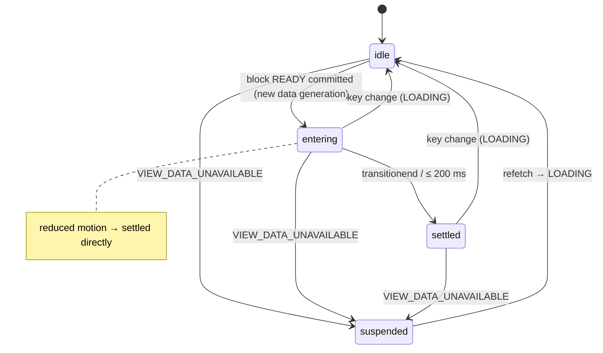
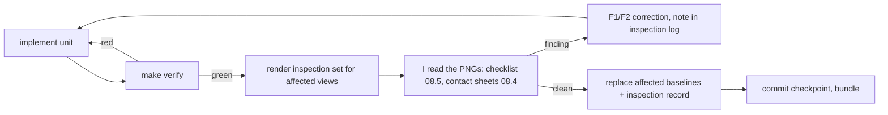

# SYNTX :: CIRA — Claude Neurovisual & Dynamic Semiontic GUI System Field Implementation Architecture v2.0.3

| Field | Value |
| :--- | :--- |
| Artifact | `SYNTX_CIRA_Claude_Neurovisual_Dynamic_Semiontic_GUI_System_Field_Implementation_Architecture_v2.0.3.md` |
| Supersedes | v2.0.2 (2026-11-27) — round-3 decisions (Q2-01–Q2-08 approved by GPT and Gemini), R11 and the one-source environment model, responsive closure of G3-40/G3-44 and the P0-R3 findings are integrated globally (00.6); history in 00.7 and 00.8 |
| Author | Claude (implementation architect), on behalf of Ottavio Braun — SYNTX / System Field Engineering |
| Product | CIRA (product identity); SYNTX is internal only |
| Reference | `SYNTX_CIRA_Neurovisual_Dynamic_Semiontic_GUI_Reference_Architecture_v2.1.1.md` (2026-11-27) |
| Baseline repository | `ottipc/syntx-cira`, branch `main`, **frozen at `ac5073b`** (GitHub HEAD, re-checked 2026-11-27); the local README/Makefile commit `5641f17` is outside this work |
| Last validated gate | Gate 05 at `216f5a6`/`b8f894f`: 730 passed, 0 failed, 0 skipped, report hash `sha256:7d6c48aa…d364` |
| Target branch | `feature/semiontic-gui-v2` (created only in implementation phase P0) |
| Status | `ARCHITECTURE v2.0.3 — FROZEN (2026-11-27): approved by Owner, GPT, Gemini and Claude (09.13) · Owner Implementation Release granted (DEP-V3-01, DEP-V3-07) · U00–U30 UNLOCKED on feature/semiontic-gui-v2 · main frozen at ac5073b` |
| Date | 2026-11-27 |

> Architecture first. Shared calibration second. Implementation third.

> **Freeze amendment (F01–F03).** This is the frozen v2.0.3. After the four-system approval the R11 isolation law
> was made precise (conditional independence, one bit per focus-state observation; 01.2a) and the owner decisions
> OD-08–OD-15 were locked for ADR-0008. No calibration value changed.

---

## 00 — Document control and execution record

### 00.1 What this document is

This is my implementation architecture for the next generation of the CIRA workspace (F07). It translates the
reference architecture v2.1.1 into fields, contracts, tokens, state machines, view specifications, tests and a work
sequence that I can execute in a later session on `feature/semiontic-gui-v2`. It is written against the repository as
it actually is, not against the repository the reference assumed.

### 00.2 Inputs that were read

| ID | Input | How it was used |
| :--- | :--- | :--- |
| IN-01 | Reference architecture v2.1.1 (996 lines, read completely) | Intent: 17 NV dimensions, focus fields, resonance, absence, logo geometry, L0–L10, MOT01–18, 11 views, G2-01–45, V2T01–25 |
| IN-02 | Task order "Neurovisual & Dynamic Semiontic System Field Implementation Architecture v2.0.0" | Scope, required chapters, four review findings, branch rule |
| IN-03 | Claude GUI System Field Implementation Architecture v1.0.0 (PDF, 46 pages; identical by hash to the copy used for phases 04–05) | TX22–TX33 definitions, G03.3 import matrix, AK-GUI-01–20 |
| IN-04 | Consolidated Presentation Architecture v1.0.1 (D01–D07) | Stage identity, 180-s timeline, separation of stage and product, signature rule |
| IN-05 | `CIRA_EDTH2026_SYNTX.pptx` (9 slides, rendered and inspected; notes read) | Visual language: navy field, hairlines, concentric rings, constellation, bottom progress rail, tile grids |
| IN-06 | SYNTX emblem image `IMG_0453.png` (same hash as the image used for ADR-0007) | Emblem geometry: double ring, bilateral calyx branches, central stem, axis |
| IN-07 | Repository `main` (read only: sources, registries, tests, ADRs, reports, baselines, snapshots) | Chapter 02 reconstruction; every repository statement in this document comes from a file |
| IN-08 | Consolidated release order "Architecture v2.0.1 + P0 hero-frame & motion study" (2026-11-27) with accepted decisions, three clarifications, P0 requirements and the 4-node stop gate | 00.5, 00.6, 04.12, 05.15, 05.16, 09.8 |
| IN-09 | Owner's emblem original (1024², re-attached) | high-resolution calyx crop and vector ring geometry (C08) |
| IN-11 | Order "Four-System Calibration Round 3 (P0-R3)" (GPT and Gemini approved Q2-01–Q2-08) with R11, G3-40, view 03 labels, `#546D86`, global environment relationships and autonomous calibration | 00.5, 00.6, 05.18, 07.7, 09.11, 09.12 |
| IN-10 | Order "Four-System Calibration Round 2 (P0-R2)" (GPT and Gemini approved the second calibration round) with corrections A–C, design evolution and the four-system gate | 00.5, 00.6, 03.13, 05.17, 07.6, 09.9, 09.10 |

### 00.3 What was computed, and what was not executed

| Kind | Status |
| :--- | :--- |
| WCAG 2.x contrast and CIEDE2000 values in this document | **Computed analytically** with the repository's own implementation (`tools/gen_semiontics.py: contrast, ciede2000`, which TX23 cross-checks against published reference data). Script: `calc/contrast.py` (kept outside the repository). Nominal sRGB token values; no browser compositing. |
| Transition contrast (intermediate frames) | Computed analytically for linear sRGB interpolation of foreground and background on one timing curve, 200 samples per path. |
| P0-R3 calibration round (v2.0.3) | **Executed in isolation** in the same scratch clone: 6 hero frames, 6 motion studies, responsive matrix (24 measurements), atmospheric-coupling, anchor and absence evidence. Record: 09.11; findings: 07.7; reflection: 09.12. |
| P0-R2 calibration round (v2.0.2) | **Executed in isolation** in the same scratch clone: 6 hero frames (1920×1080), 5 re-rendered motion studies, emblem-anchor evidence (13 scenarios) and absence evidence; composition fit and geometry measured in Chrome. Record: 09.9; findings: 07.6; reflection: 09.10. |
| P0 calibration study (v2.0.1) | **Executed in isolation**: a throw-away clone of `ac5073b` in `/tmp`, own backend with an empty temp store seeded through the public API (fixture data), production build, headless Chrome. 6 hero frames (1920×1080) and 5 motion studies rendered; one measured evidence file (absence continuity). Record: 09.8; findings: 07.5. |
| Browser rendering of the final v2, frame timing, perception | **Not executed.** Every V2T/V3T test in chapter 08 stays `NOT_EXECUTED`; P0 is calibration, not acceptance. Perceptual effects H01–H12 stay hypotheses. |
| Repository | **Not modified.** No branch, no file, no commit in `ottipc/syntx-cira`; `main` frozen at `ac5073b`. |

### 00.4 Precedence when sources disagree

1. Frozen architecture v1.0.2 and its contracts (API, enums, metrics, information barrier) — never changed by this work.
2. Repository SSOT files (`cira.semiontics.yaml`, `cira.terms.yaml`, G03.3 import matrix, ADR-0001–0007) — changed only
   through their generators and a new ADR (ADR-0008, class F2).
3. Reference v2.1.1 — governs perceptual intent. Where it states repository facts that are wrong or outdated, the
   repository wins and the discrepancy is recorded in chapter 07 with a closure.
4. This document — governs implementation.

### 00.5 Four-system architecture gate — passed (v2.0.3, frozen)

Owner, GPT and Gemini approved v2.0.3 and the P0-R3 artifacts; my own approval and final assessment are in 09.13. With
the owner's Implementation Release (DEP-V3-01) units U00–U30 are unlocked on `feature/semiontic-gui-v2`, branched
from `ac5073b`. `main` stays frozen at `ac5073b`; OD-11 applies the presentation-scale fixes on the branch only.

| # | Freeze amendment | Where |
| :--- | :--- | :--- |
| F01 | R11 isolation law stated as **conditional independence**: ∂B/∂P \|_{b, stage, occupancy, env} = 0 replaces the unconditional ∂B/∂P = 0; B's total dependence on P is mediated only by occupancy (R10), the scope bit b (R11) and the guard bit q inside env (R9) | 01.2a, 03.13.3, 11.1 |
| F02 | R11 defined as **one bit per focus-state observation**, distinguished from temporal sequences of observations and from the permitted geometric, occupancy and environmental inputs (R7, R9, R10, R12) | 01.2a, 08.3 V3T17 |
| F03 | Owner decisions OD-08–OD-15 **adopted** and locked for ADR-0008 | 10 |

### 00.6 Change log v2.0.2 → v2.0.3

| # | Change | Where |
| :--- | :--- | :--- |
| E01 | **R11 adopted** (attention bit N06 → N04) with revised isolation laws: B depends on F through exactly one boolean; ∂B/∂(focus target, resonant set, P, tick) = 0; propagated to N02–N04, N06, N07, N11, N12, 01.2, 03.13 | 01.2, 03, 05.18 |
| E02 | D12 attention damping (MOT19), D13 emblem light (DEC-08) and D14 depth shadow **adopted** (Q2-02, Q2-08) and unified into **one environment model** with a single light source at the anchor | 05.18, 04.7, 04.8, 05.7 |
| E03 | **Shadows fall away from the light:** shadow vector derived from the anchor (`−8, +4` px at every measured stage); absence carriers and cells never cast or receive shadows | 05.18, 03.3 |
| E04 | The glow breathes with the emblem (one body, one phase); damping holds both | 05.18, 05.7 |
| E05 | **Presentation scale law:** `scale = clamp(1, 1.25 × stage height / 1080, 1.25)` — projected type keeps its physical size on any projector; identical to ×1.25 at 1080 | 05.9, 03.11, 08.3 |
| E06 | **G3-40 closed:** view 01 chain rhythm independent of the composition fit; **short-stage triptych** (Zone C < 880 px: pipeline · open information · configuration side by side); fit rule scaled (`comp.min.info = 880 × scale`). Measured: 0 px overflow, one chain row, 0 clipped text at 1920×1080, 1600×900, 1440×900 and 1280×800 in both modes | 05.17, 06.01 |
| E07 | **G3-44 closed:** view 03 label composition — origin badge under the space title, deviation seam under the id, epistemic chips break below the term; every label one line at all four stages | 06.03 |
| E08 | **Projector edge `#546D86`** (≥ 3.07 : 1 against every surface, both profiles) | 05.15, 11.5 |
| E09 | Q2-01 (emblem scale), Q2-04 (axes 0.06), Q2-05 (plate occlusion), Q2-06 (collapsed emblem at 0.11) confirmed as specified | 05.17, 04.7 |
| E10 | P0-R3 executed: 6 hero frames, 6 motion studies (new S6 responsive), responsive, atmospheric-coupling, anchor and absence evidence; findings PF3-01…PF3-12, GAPs G3-45…G3-48; reflection 09.12 | 07.7, 09.11, 09.12 |

### 00.7 Change log v2.0.1 → v2.0.2 (history)


| # | Change | Where |
| :--- | :--- | :--- |
| D01 | **Canonical SEM-038 geometry:** solid **1.5 px** ink.secondary, **3 px outer offset**, applied identically in SEM-038, MOT11, MOT16, RES-02/RES-09, ResonanceMark, T3 tokens, views 02/03/09 and tests (V3T14). Every 1 px and every dashed resonance/provenance-echo outline removed | 04.2, 04.4, 05.1, 05.3, 05.7, 06, 08.3, 11.5, 12 |
| D02 | **Coupling reconstructed:** construction dependencies (acyclic), runtime data flow (acyclic per transaction), interaction coupling (cycles only through Q), verification feedback (out of band); field tables corrected (N06 no longer "depends on" N10; N04 no longer measures to place) | 03.2–03.13, 01.2 |
| D03 | **Deterministic emblem anchor:** pure function of the stage `(W0, H)`, identical for all views and both modes; the occupancy-based placement is removed; 0 displacement events measured | 05.17, 04.6, 04.7, 05.16, 11.5 |
| D04 | **Asymmetric stage composition:** 68 % information / 32 % reserve as the canonical candidate; rendered 69.4 / 30.6; composition classes `reserve` / `plate` / `collapsed` with a measured fit rule | 05.17, 06.01, 05.9 |
| D05 | Information boundary derived from the emblem: content ends one gutter left of the left ring tangent | 05.17, 04.6 |
| D06 | **Focus hierarchy:** focused = 2 px ink.primary outline (row frame element) + 6/8 px corner reticles (standard/presentation) + gutter attention axis + `surface.focus`; resonant = SEM-038; documented connecting edges +0.5 px; neutral; attenuated (unchanged architecture); exempt | 04.2, 04.12, 06.03 |
| D07 | Row focus and row resonance drawn by **frame elements over the grid area**, never by cell borders — absence cells stay untouched by construction | 04.5, 06.03 |
| D08 | View 03 resolver: attributes read by the same rule as the focused attribute (governance evaluations already loaded by the view); the ribbon is not outlined (it shows counts per space, not rule identities) | 04.4, 06.03 |
| D09 | **Number-first metric typography:** fraction 28/36 (35/45), weight 600, tabular numerals, ink.primary; decimal and target subordinate in ink.secondary; RationalBar 4 px beneath, max 256/320 px | 04.9, 06.09 |
| D10 | **Three emblem-derived axes** replace the twelve column hairlines (DEC-06 redefined): centre axis and both ring tangents, brand.core at 0.06, on reserve ground only | 04.6, 04.7, 05.10, 11.5 |
| D11 | Projector panel edge **`#526B84`** (superseded by E08: `#546D86`) (≥ 3.0 : 1 against void, field, panel and focus; 2.98 against elevated → derived alternative `#546D86`, OD-12) | 05.15 |
| D12 | *Proposal (adopted in v2.0.3, E01/E02):* attention damping — while a focus scope is active the reserve budget yields 0.20 → 0.14 and breathing holds (MOT19); needs one boolean from N06 to N04 | 03.13, 04.8, 05.7 |
| D13 | *Proposal (adopted in v2.0.3, E02):* emblem light (DEC-08) — a radial brand.core glow at 0.05 within 1.25 R; vignette centred on the anchor | 04.7, 04.8 |
| D14 | *Proposal (adopted in v2.0.3, E02/E03):* depth shadow — panels cast a soft shadow onto the field (darkens decor ground only; text contrast rises) | 04.8, 05.5 |
| D15 | Presentation scale completed: inherited text (rail, recovery line, pipeline, Zone D) now scales too (G3-37) | 07.6, 08.3 |
| D16 | P0-R2 calibration executed (6 hero frames, 5 studies, 2 evidence files); findings PF2-01…PF2-16, GAPs G3-37…G3-44; reflection 09.10 | 07.6, 09.9, 09.10 |

### 00.8 Change log v2.0.0 → v2.0.1 (history)

Entries C02 and C08 are superseded by D01 and D03; they are kept as history, not as specification.

| # | Change | Where |
| :--- | :--- | :--- |
| C01 | OD-01…OD-07 accepted as recommended (K1, `surface.focus #141D27`, gate via `make gate PHASE=05` on the branch once unlocked, DEC-04…07 emblem-only, `main` and film untouched); OD-04 perception study scheduled after implementation; OD-07 remains a separate owner approval | 10 |
| C02 | SEM-038 geometry: solid ink.secondary outline at 3 px outer offset instead of dashed (dashed collided with the absence frames SEM-006/024/022); stroke width superseded by D01 (1.5 px) | 04.2, 04.4, 05.3, 11.5 |
| C03 | Two-level decor budget: **0.11** over text-bearing ground, **0.20** only in text-free reserve areas (was a flat 0.08) | 04.7, 05.1, 05.5, 05.16 |
| C04 | Dynamic reserve areas derived from actual layout occupancy (text runs in EN/DE, data blocks, overlays, docked drawer, responsive state) — never from viewport width; occupied or overlaid area drops to 0.11 at once | 05.16 |
| C05 | Mesh lines never on text-bearing ground (P0 finding PF-02); rings and the emblem may appear there at ≤ 0.11 (axes: reserve ground only, D10/G3-41) | 04.7, 05.16 |
| C06 | Attention axis (vertical gutter line at the focused item) | 04.12 |
| C07 | Enhanced Projector Contrast profile with a computed surface set | 05.15 |
| C08 | Emblem asset: vector concentric rings (ratio 0.914) + high-resolution calyx raster from the owner's 1024² original; placement rule superseded by D03 (deterministic anchor) | 04.6, 04.7, 05.16 |
| C09 | MOT03 clarification: only the outer block translates; absence carriers have no own animation and no style/class/layout mutation during tick commit, focus change or ambient cycle (measured in P0) | 04.5, 05.7 |
| C10 | N06/N10 decoupling: `FocusScope` receives a pure generic `resolveResonance(focus, vm)` function via props; N06 never imports a view model | 03.6, 04.2 |
| C11 | P0 calibration study executed; findings PF-01…PF-12 and new GAPs G3-29…G3-36 | 07.5, 09.8 |
| C12 | Presentation scale defect on `main` found in P0 (×1.25 never applied) | 07.3 G3-29 |

---

## 01 — Objective, boundary and governing laws

### 01.1 Objective

Make the separation of Reference (Ω_A), Observation (Ω_O) and Reconstruction (Ω_R), the presence of absence, provenance
and documented relations perceptible at first glance, in a living, logo-derived visual environment — while every value,
sign and contract stays exactly what it is today.

### 01.2 State model

I keep the reference's state tuple and bind every component to the repository mechanism that already owns it:

| Component | Meaning | Owner in the repository | Rule |
| :--- | :--- | :--- | :--- |
| Q | URL session (`/exp/:id/:VIEW?tick&attempt&revision&comparisonId&aggregation&toTick&from&to&focus&filter&lang&mode&demoStep`) | `src/session/params.ts` | Single source of session state (INV-STR-01). Focus lives here. |
| P | Header-guarded projections from 24 API operations | `src/access/*` (`useProjection`, guard classes) | Only verified data is rendered. |
| S | Sign and term registries (SEM-001–037, DEC-01–03, 462 terms EN/DE) | `frontend/semiontics/*.yaml` → generated | Generated only; never hand-edited (E-10). |
| U | Ephemeral UI state (hover, open drawer, open dialog, scroll) | React local state, `provenance/selection.tsx` | Never data. |
| F | Focus/resonance/attenuation state | **new**: derived from Q.focus + view model relations | Pure function of (Q, P). Never written back except `focus` into Q. |
| M | Motion phase per block | **new**: `data-motion` attribute set by MotionBoundary | Subordinate to P's view state; never commits data. |
| B | Brand/ambient environment | `src/shell/NeuralField.tsx` (DEC-02), `Wordmark.tsx` (DEC-01) | No input from P, Q.focus, S data. Geometry only from the stage anchor (05.17); occupancy only for budgets; from F exactly one boolean "a focus scope is active" (R11, adopted), never the target or the resonant set. |

Isolation laws (each one has a test in chapter 08): ∂P/∂B = 0, ∂P/∂F = 0, ∂P/∂M = 0, ∂Q/∂M = 0, ∂S/∂B = 0,
∂B/∂P |_{b, stage, occupancy, env} = 0 (conditional, 01.2a), ∂(emblem position)/∂(content) = 0 (V3T11). F may write exactly one thing, `Q.focus`, and only as a user or demo action.
Revised isolation laws (v2.0.3, R11 adopted, made precise by F01/F02): see 01.2a. B never writes anything (no path
B → F, Q, P, S). b changes only the decor budget, the glow and the breath (MOT19). V3T17 proves the bit width.
Coupling kinds: 03.13; environment model: 05.18.

### 01.2a Formal statement of the environment's dependencies (freeze amendment F01, F02)

**Model.** Let one *focus-state observation* be the state of F after one committed render transaction (05.6.1), i.e.
one value of F = f(Q, P). The environment is

```text
B = Φ(stage, env, occupancy, b)
  stage     = (W0, H, mode, scale)                       → R7 anchor, R12 shadow vector      (independent of Q, P, F)
  env       = (visibility, reduced motion, modal, q)     → R9 governor; q = [∃ quarantined block] is a guard bit of P
  occupancy = rects(rendered blocks, text runs, overlays) → R10 budget masks only (never position, size, presence)
  b         = [∃ element with data-focus-scope="active"] ∈ {0, 1}
            = [Q.focus ≠ null ∧ Q.focus ∈ ids(vm(P)) ∧ no block of the view quarantined]   → R11
```

**Conditional independence (replaces the unconditional ∂B/∂P = 0).** Because F = f(Q, P), b depends on P (presence of
the focused id in the verified projection) and so do occupancy (rendered text lengths) and q (guard result). The
correct law is therefore

```text
∂B/∂P |_{b, stage, occupancy, env} = 0
∂B/∂(focus target) = ∂B/∂(resonant set) = ∂B/∂(values) = ∂B/∂(tick) = 0      (unconditionally)
```

P reaches B only through three named, bounded channels: occupancy (geometry of what is drawn, budget only), q (one
guard bit, suspends) and b (one scope bit, damps). No value, id, count, tick or relation of P enters Φ.

**One bit per observation.** For each focus-state observation R11 transmits exactly b ∈ {0, 1}; Φ has exactly two
R11-dependent states (undamped, damped), which P0-R3 measured (09.11). This is a statement about a single observation.

**Temporal sequences are not a wider channel.** A sequence of observations b₁ … bₙ (across focus changes, tick changes,
view changes) is just the sequence of those bits: it reveals *when* a scope was active, i.e. per transaction whether
the focused id was present in the view — never which id, which neighbours or which values. The sequence adds no state
to Φ (no counter, no history, no hysteresis: Φ at step n depends on bₙ only; MOT19's 480-ms settle is a rendering of
bₙ, not a memory of bₙ₋₁). Rapid alternation of b is bounded by user/demo actions and by the transaction rate.

**Distinction from the other permitted inputs.**

| Input | Carries | Depends on P? | Effect on B | Bound |
| :--- | :--- | :--- | :--- | :--- |
| R7 anchor, R12 shadow vector | stage geometry | no | position, size, light direction | pure function of (W0, H) |
| R9 env | visibility, reduced motion, modal, q | only q (guard) | ACTIVE / STATIC / SUSPENDED | q suspends, never animates |
| R10 occupancy | rectangles of drawn content | yes (layout only) | 0.11 / 0.20 budget masks | never position, size, presence |
| R11 b | scope active | yes (one bit per observation) | damping (MOT19) | two states; no memory |

V3T17 checks the single-observation property (two ambient states, scene hash identical across targets) and the
sequence property (Φ after a sequence equals Φ after the last observation alone).

### 01.3 Hard boundary

- No backend change, no new endpoint, no new request, no new POST path, no metric, no domain computation (TX26 stays).
- No change to contract types, enum values, SEM bindings to enums, term keys in use, frozen regression bundles,
  the product film, or `main`.
- Visible text only from `cira.terms.yaml`; `SYNTX` stays on the forbidden-visible list (TX24). The emblem image
  without wordmark is the only brand sign in the app (OB decision, ADR-0007).
- No geodata, real names or real infrastructure (REQ-080).

### 01.4 Placement law (new, binding)

All new modules live inside the existing F07 sub-field folders so that the generated import matrix (G03.3 → TX25)
does not change. A module that would need a new import edge is redesigned (props instead of imports) or becomes a
change request; it is never solved by an ignore entry (E-16).

| New module | Folder (sub-field) | Imports it needs | Allowed by G03.3 |
| :--- | :--- | :--- | :--- |
| `FocusScope`, `useFocusState`, `Attn` CSS contract | `semiontics/` (4) | Language only | yes (prop-driven) |
| `MotionBoundary`, motion phase hook | `semiontics/` (4) | Language only | yes |
| `ResonanceResolver` per view | `views/<n>/model.ts` (7) | contracts/generated (ViewModel files only) | yes |
| `AmbientField` (successor of `NeuralField`), `EmblemWatermark`, `RadialArcs`, `EmblemAxes`, `AmbientLight` (DEC-08), `AmbientGovernor` | `shell/` (6) | Session (visibility, mode) | yes |
| `stageAnchor(W0, H)` (pure geometry, 05.17: anchor, boundary, shadow vector), composition fit and stage class, presentation scale law | `shell/` (6) | none | yes |
| `TickRail` (Zone D successor) | `time/` (8) | Session, Access, Semiontic, Language | yes |
| `RationalBar` | `semiontics/primitives/` (4) | none | yes |
| `PresentationStage` additions | `demo/` (10) + `shell/` | Session, Semiontic, Language | yes |
| Test helpers (contrast audit, frame audit, perf trace) | `../test/` (11) | — | yes |

### 01.5 Change class and records

The whole evolution is class **F2** (design without semantic effect) under one umbrella record **ADR-0008 —
Neurovisual GUI generation**, extended per unit. Exceptions:

- A new SEM (SEM-038 Resonance, see 04.4) is an F2 register extension like DEC-01–03 in ADR-0007 (TX22 covers it).
- Any need to change contracts, the G03.3 matrix, the phase model or frozen bundles is **F3** → `docs/change-requests/`,
  unit paused.

---

## 02 — Reconstruction of the existing application (read-only)

### 02.1 Repository identity

| Item | Value |
| :--- | :--- |
| Remote main | `ac5073b` "Product film (80 s, recorded with Play demo)" |
| Local main | `5641f17` README film section + quiet `make run` (bundle delivered, push pending) |
| Last gate | phase-05 report, commit `216f5a6`, 730 tests (pytest 247 + vitest 483), 0 skipped, hash `sha256:7d6c48aa…` |
| Requirement ladder | 70 VERIFIED, 3 BLOCKED_DEP (REQ-007/008/036), 8 PROCESS |
| Frontend stack | React 19.3, React Router 7.18, TanStack Query 5.108, Vite 8.3, TypeScript 6.0, Tailwind 4.3 (tokens only), vitest 5.1 + jsdom, playwright-core 1.65 with system Chrome, axe-core 4.14, pixelmatch 8, dependency-cruiser 18.9, fontkit |
| Fonts | IBM Plex Sans 5.3.0, DejaVu Sans Mono 5.3.0 (both `@fontsource`, bundled offline) |
| Frontend sources | 142 files in `frontend/src` |

### 02.2 Frontend architecture (G03.1/G03.3 sub-fields)

| # | Sub-field | Folder | Content today |
| :--- | :--- | :--- | :--- |
| F07.1 | Session | `session/` | `params.ts` (URL ↔ SessionKey, 11 `VIEW_IDS`, StableId regex), `navigate.tsx` (`go`, `goUrl`) |
| F07.2 | Access | `access/` | `client.ts`, `endpoints.ts`, `guard.ts` (5 guard classes), `queries.ts` (`useProjection` → `Verified<T>`: LOADING / READY / VIEW_DATA_UNAVAILABLE), `polling.ts` |
| F07.3 | Provenance | `provenance/` | selection context (header, refs, strategies, raw) |
| F07.4 | Semiontic Core | `semiontics/` | generated `sem.ts`, `tokens.css`, `tokens.ts`, `tailwind.theme.css`; 21 primitives + helper (SpaceHeader, SpaceCell, OriginBadge, EpistemicChip, RuleDiamond, BarrierLine, RecoveryGateLine, RationalMetric, UndefinedSlot, DeltaMark, GapMark, ConflictBracket, EngineToken, Quarantine, TerminationSeal, ContinuityBand, ExecPill, FocusRing, DeviationSeam, IdText, ValueText, `_util`) |
| F07.5 | Language | `language/` | generated `terms.ts`, `t()`, context, LanguageSwitch |
| F07.6 | Shell | `shell/` | AppShell, ContextBar, ViewRail, Workspace, ProvenanceDrawer, TechnicalRecord, ViewportGuard, Wordmark (DEC-01), NeuralField (DEC-02), assets `cira-mark-{96,256}.png` |
| F07.7 | Views | `views/01…11`, `_common` | one folder per view: `View.tsx`, `model.ts` (pure ViewModel), parts; `_common`: Guarded/GuardedAll, MetricValue, ProvButton, RunParts |
| F07.8 | Time | `time/` | TickScrubber (Zone D), `ticks.ts` |
| F07.9 | Control | `control/` | ControlDrawer, Dialog, New/Compare/Replay/Resweep/Authorize/Import dialogs, ExportAction, `useCommand` |
| F07.10 | Demo | `demo/` | `demo.steps.json` (8 steps, `seconds_per_step: 10`), `script.ts`, DemoBar (Play/Stop, PageUp/PageDown), NarrationCard, `presentation.ts` |
| F07.11 | Verification harness | `frontend/test/` | 8 vitest files (see 02.8), 426 projection snapshots, 11 visual baselines (1440×900) |

Import matrix (G03.3, enforced by generated dependency-cruiser rules, TX25): Session imports nothing; Access → Session;
Provenance → Session, Access; Semiontic → Language; Shell → everything except Views; Views → Session, Access,
Provenance, Semiontic, Language, Control; Time → Session, Access, Semiontic, Language; Control → Session, Access,
Semiontic, Language; Demo → Session, Semiontic, Language. `contracts/generated` only from Access, Provenance and
`views/*/model.ts`.

### 02.3 Design tokens as they are (SSOT `cira.semiontics.yaml` v1.0.1 after ADR-0007)

| Group | Tokens |
| :--- | :--- |
| Surfaces | void `#05080B` · field `#090D11` · panel `#0F161D` · elevated `#16202A` |
| Borders | hairline `#1C2833` · strong `#33475A` |
| Ink | primary `#E6EDF5` · secondary `#9AA8B8` · muted `#8391A3`; aliases open.epistemic → secondary, open.absent → muted |
| Spaces | actual `#38BDF8` (tint `#0D2533`) · observed `#F59E0B` (tint `#2C200B`) · reconstructed `#A78BFA` (tint `#211A36`) |
| Evaluation | coherent `#2DD4BF` · violation `#F43F5E` · partial `#A3E635` |
| Brand (decor only) | brand.core `#BFEFF4` |
| Contrast rules | text ≥ 4.5 on field/panel/elevated; graphics ≥ 3.0; violation text only on field/panel; tint text only primary/secondary; ΔE00 ≥ 15 between co-occurring semantic colours and between decor and every semantic colour; text over the network at max opacity ≥ 4.5 |
| Type | display 18/24/600 · section 13/18/600 caps 0.06em · body 13/19 · mono.value 13/18/500 tabular · mono.id 11/16 · mono.operator 14/18/500 · micro 10/14/600 caps 0.08em; presentation scale ×1.25 |
| Space | unit 4; grid 4/8/12/16/24/32 |
| Border/Radius | width 1/2; radius actual 0, observed 0 + chamfer 6, reconstructed 2 |
| Patterns | open.hatch 45°/6/0.12 · fixture.stripe 45°/4/0.30 · outside.crosshatch 6/0.10 |
| Lines | topology depends_on solid 1.5 triangle · reports_to dash 6/3 open angle · provides solid 1.5 source dot · coupling effective solid 2 violet · possible dash 5/4 partial · unknown dot 2/4 open circle · barrier double 2 violation · recovery double 1.5 diamond |
| Motion (ms) | tick 180 · loading 100 · quarantine 0 · drawer 160 · stage 200 · network.pulse 9000 |
| Graph | char_width 7.8, slot_chars 12, padding 12, min_width 160, height 64, layer_gap 72, node_gap 32 |
| z | canvas 10 · chrome 20 · drawer 30 · quarantine 40 · demo 50 |
| Zones | A 48 · B 220/56 · C min 760 · D 52 · E 360 (docks ≥ 1600) · minimum viewport 1280×720 |
| Opacity | loading 0.35 · network.line 0.06 · network.max 0.08 · glow 0.45 |

### 02.4 Sign registry as it is

SEM-001 to **SEM-037** (the reference knows only 036). SEM-037 "Coupling line" (`RelationEdgePath`, colour
space.reconstructed, views 2/5/6/8) was added during phase 04. Decoration register DEC-01 brand mark, DEC-02 neural
field, DEC-03 chain connector (ADR-0007): no meaning, no `data-sem`, `aria-hidden`, colour brand.core only.

| SEM | Name | Primitive | Shape · colour · glyph · pattern |
| :--- | :--- | :--- | :--- |
| 001 | Space anchor reference | SpaceHeader | rect sharp · space.actual |
| 002 | Space anchor observed | SpaceHeader | rect chamfer · space.observed |
| 003 | Space anchor reconstructed | SpaceHeader | octagon double · space.reconstructed |
| 004 | Observed value | SpaceCell | dot filled · observed · ● |
| 005 | Observed delayed | SpaceCell | dot half · observed · ◐ · lag-tag |
| 006 | Not observed | SpaceCell | frame dashed · open.epistemic · ○? · open.hatch |
| 007 | Not determined | SpaceCell | octagon open slash · open.epistemic · ○/ · open.hatch |
| 008 | Not applicable | SpaceCell | rect dotted empty · open.absent · N/A |
| 009 | No reconstruction at tick | SpaceCell | gap dotted · open.absent · —@t |
| 010 | Satisfied | RuleDiamond | diamond · coherent · ◆1 |
| 011 | Violated | RuleDiamond | diamond · violation · ◆0 |
| 012 | Not evaluable | RuleDiamond | diamond hatched · open.epistemic · ◇⊥ |
| 013–017 | Origin fixture / synthetic / engine / imported / illustrative | OriginBadge | capsule striped / hairline / dot / double / dashed · ink.secondary |
| 018 | Epistemic class | EpistemicChip | capsule |
| 019 | Information barrier | BarrierLine | line double · violation · ‖ |
| 020 | Recovery loop | RecoveryGateLine | line double diamond · ◇ |
| 021 | Rational metric | RationalMetric | fraction · ink.primary |
| 022 | Undefined metric | UndefinedSlot | slot hatched · ∅ |
| 023 | State change | DeltaMark | arrow · ▸ |
| 024 / 025 | Open / closed structural gap | GapMark | frame open ◰ / closed ◼ (coherent) |
| 026 | Merge conflict | ConflictBracket | ⟦≠⟧ |
| 027 | Engine datum | EngineToken | frame code |
| 028 | Quarantine | Quarantine | frame warning · violation · ⚠ |
| 029 | Termination seal | TerminationSeal | ▣ |
| 030 | Continuity band | ContinuityBand | band · observed |
| 031 | Outside observation window | SpaceCell | slot crosshatch · open.absent · ▨ |
| 032 | Execution status | ExecPill | pill |
| 033 | Narration card | NarrationCard | card |
| 034 | Focus ring | FocusRing | ring · ink.primary |
| 035 | Deviation seam | DeviationSeam | seam · violation · ┆ |
| 036 | Presentation frame | PresentationFrame | frame · border.strong |
| 037 | Coupling line | RelationEdgePath | line · space.reconstructed |

20 signified enums, 27 labelled enums, 1 internal enum; unsigned values `ContentAvailability.AVAILABLE`,
`ViewStatus.{IDLE, LOADING, READY}`.

### 02.5 Language

`cira.terms.yaml` v1.0.2: 462 term keys, EN default + DE, `forbidden_visible` list (SYNTX, Sweep/sweep, Systemfeld,
system field, Σ-Feld, Kopplungsfeld, Semiontik, semiontic, Feldtupel, StageEvent, ContentOpenness, F01–F07, Dual
Sweep, dual-sweep). TX24 scans catalog, source AST and the rendered DOM of all 11 views in EN and DE.

### 02.6 Interaction and state management

| Concern | Mechanism today |
| :--- | :--- |
| Navigation | ViewRail links, `go()`/`goUrl()` rewrite the URL; browser history is the navigation stack |
| Tick | Zone D TickScrubber buttons and ←/→ keys; every timed block re-queries; GuardedAll masks until all match |
| Focus | Only via URL `focus=<StableId>` (demo steps 2 and 4 set it); `FocusRing` wraps the matching element (SEM-034). No click-to-focus yet. |
| Provenance | Clicking provenance buttons/cells opens Zone E with header, refs, strategies, raw record |
| Control | "Control" menu (Zone A) → dialogs, each POST confirmed; export downloads the bundle |
| Demo | DemoBar at the bottom of Zone C: Resume/Previous/Next (PageUp/PageDown), Play (8 × 10 s), Stop/Escape |
| Language/mode | `lang=de`, `mode=presentation` URL flags; presentation frame SEM-036 |
| Guard | `Verified<T>`: LOADING → `.loading-mask` with loading text; mismatch or error → block-level `Quarantine` (SEM-028) with reload; `NOT_AVAILABLE_AT_TICK` stays READY |

### 02.7 Rendering mechanisms

- DOM + CSS for all blocks; inline SVG for topology (deterministic `layout.ts`, TX33 — no elkjs), layer chain
  connectors, neural field, continuity bands.
- All colours, sizes, patterns and durations as CSS custom properties from generated `tokens.css`
  (INV-VIS-12; lint forbids raw values and undefined `var(--…)`).
- Hatches/stripes as `repeating-linear-gradient` with `color-mix` from pattern tokens.
- Neural field: one SVG, 64 seeded nodes, 3 neighbours each, 11 pulse paths; one group at opacity 0.08; pulses via
  CSS keyframes (9 s), off under reduced motion.
- Global reduced-motion rule collapses every transition/animation to 0 s.

### 02.8 Test infrastructure (all preserved)

| Suite | File(s) | IDs |
| :--- | :--- | :--- |
| Backend (pytest, 247) | `backend/tests/**` | T01–T12, T04b, TX01–TX18, TX21, T11 frozen regression bundles, IC-18 concurrent reads, demo flow, aggregation identity |
| Contract drift | `test/arch/arch.test.ts` | TX02 |
| Import boundaries | `test/arch/arch.test.ts` + depcruise | TX25 |
| Computation ban | `test/arch/arch.test.ts` (AST) | TX26 |
| Glyphs | `test/arch/arch.test.ts` (fontkit) | TX30 |
| Graph layout | `test/arch/arch.test.ts` | TX33 |
| Register completeness | `test/semiontics/register.test.ts` | TX22 |
| Colour rules | `test/semiontics/register.test.ts` | TX23 |
| Language | `test/language/language.test.tsx` | TX24 (catalog, AST, runtime EN+DE × 11 views) |
| Guard matrix | `test/access/guard.test.tsx` | TX27, T09 |
| Views | `test/views/views.test.tsx` (17 cases) | TX15, TX19, TX22 (decor) |
| Demo playback | `test/demo/autoplay.test.tsx` | TX31 |
| Browser geometry | `test/browser/browser.test.ts` | TX28: 11 views × 3 viewports × 2 modes, drawer docking, reduced motion |
| Visual regression | `test/browser/browser.test.ts` | TX29: 11 baselines 1440×900, `animations: "disabled"`, tolerance 0.1 % |
| Accessibility | `test/browser/browser.test.ts` | TX32 (axe-core, keyboard, focus; control panel) |
| Live end-to-end | `test/e2e/e2e.test.ts` + `live.ts` | TX20 (offline, tick sync, export, control path), TX31 (PageDown run, 80-s Play run) |

TX22 completeness · TX23 colour rules · TX24 visible language · TX25 import matrix · TX26 no computation in views ·
TX27 guard/quarantine · TX28 geometry · TX29 visual regression · TX30 glyph coverage · TX31 demo script ·
TX32 accessibility · TX33 deterministic graph layout. All twelve run in every gate and stay mandatory in v2.

### 02.9 API surface (review finding 2)

Repository routes: 17 GET + 7 POST = **24 operations** (`/health`, `/fields`, `/scenarios`, `/experiments` GET/POST,
`/experiments/import`, `/experiments/{id}` and its `events`, `export`, `governance`, `metrics`, `observations`,
`replay-report` (K-60), `results`, `results/{sweep_id}/trace`, `states`, `topology`, `results/import`, `replay`,
`sweeps`, `/comparisons` GET/POST, `/comparisons/{id}`, `/recovery-variants`). Package v1.0.2: "21 entries with 23
operations; with K-60, entry 19 has three operations, then 24" (K-70) and "17 GET + 7 POST" (chapter 15). Repository
and consolidated architecture agree on **24**; the reference's "21 entries / 23 operations" predates K-60. The GUI v2
uses the same 24 and adds none (V2T01 checks the request inventory per view against `main`).

### 02.10 Visual state today

Shell with five zones, CIRA emblem + name with soft glow (Zone A), numbered view rail, neural field behind Zone C,
opaque panels, three-column state comparison with tinted cells, hatched open cells, origin capsules, layer chain on
view 01 cut by the barrier, demo bar at the bottom of Zone C, tick buttons with violet ◆ sweep marks in Zone D.

### 02.11 Preserve · extend · transform

| Element | Decision | Reason |
| :--- | :--- | :--- |
| URL session, guard, `Verified<T>`, Quarantine semantics, all ViewModels' data selection | **Preserve** | Correctness core; tested by TX27/T09/TX19 |
| All 37 SEM bindings, glyphs, patterns, lines, term keys | **Preserve** | Canonical semantics (INV2-04) |
| Token values of surfaces, inks, spaces, evaluation, brand | **Preserve** | Changing them re-opens every contrast proof |
| Contrast rule set and generator | **Extend** | New surfaces (`surface.focus`, receded tints), attenuation pairs, transition paths, decor budget |
| Primitives | **Extend** | Focus/attenuation contract via CSS variables, `data-motion`, `RationalBar`, absence carriers hardened |
| FocusRing (SEM-034) | **Transform** | From wrapper span to focus field (surface lift + reticles + scope attenuation) |
| NeuralField (DEC-02) | **Transform** | Into `AmbientField` with drift, governor, exclusion masks, single decor alpha budget |
| Wordmark (DEC-01) | **Extend** | Emblem well in Zone A; stationary emblem watermark DEC-04 (no wordmark) |
| TickScrubber | **Transform** | Into a tick rail with neutral luminous ring and per-tick micro-marks |
| `.loading-mask` (opacity 0.35) | **Transform** | Defect: loading text at 1.72 : 1 (see G3-14) |
| z tokens | **Transform** | Demo (50) currently above quarantine (40); new depth order |
| Views 01–11 | **Transform in place** | Same folders, same models; composition, focus, motion added |
| Visual baselines | **Replace after review only** | ADR-0005 Nr. 10 |
| Product film, `main` | **Freeze** | INV2-13 |

---

## 03 — Implementation field architecture

I derived twelve implementation fields. The number follows from separations that must hold at runtime: data versus
decoration, signs versus their appearance states, focus versus motion, time versus numbers, views versus the stage,
and the evidence that ties them together. Fewer fields would merge two of these; more would split one mechanism
across owners.

| Field | Name | Owns | Main folder(s) |
| :--- | :--- | :--- | :--- |
| N01 | Register & Token | SSOT extension, generator rules, generated CSS/TS | `frontend/semiontics/*.yaml`, `tools/gen_semiontics.py`, `src/semiontics/generated/*` |
| N02 | Geometry & Space | logo-derived geometry, stage anchor and composition, grid, zones, responsive system | `shell/`, tokens |
| N03 | Depth Composition | L0–L10, z order, opacity laws, exclusion masks | `shell/`, `app.css` layer section |
| N04 | Ambient Environment | B: field, watermark, arcs, emblem axes, light, vignette, governor | `shell/ambient/*` |
| N05 | Sign Primitives | all SEM primitives, absence carriers, attenuation contract | `semiontics/primitives/*` |
| N06 | Focus & Resonance | F: focus scope, focus states, resonance, attenuation | `semiontics/focus/*`, `views/*/model.ts` |
| N07 | Motion Orchestration | M: MOT classes, MotionBoundary, state machines, reduced motion | `semiontics/motion/*`, `app.css` motion section |
| N08 | Temporal | Zone D tick rail, tick commit, temporal markers | `time/` |
| N09 | Mathematical Visualization | rational display, bars, scales, undefined slots | `semiontics/primitives/RationalMetric*`, `views/09`, `views/10` |
| N10 | View Composition | the 11 views | `views/01…11`, `views/_common` |
| N11 | Presentation & Demo | presentation mode, cinematic frame, demo parity | `demo/`, `shell/` |
| N12 | Verification & Inspection | tests, audits, screenshots, perf traces, evidence | `frontend/test/**`, `tools/` |

### 03.1 N01 — Register & Token Field

| Aspect | Specification |
| :--- | :--- |
| Purpose | One authority for every colour, size, pattern, depth, duration and decor budget; every derived value is computed by the generator, never typed by hand. |
| Components | `cira.semiontics.yaml` (version → 1.1.0), `cira.terms.yaml` (new keys only), `tools/gen_semiontics.py` (new derivations and checks), generated `tokens.css`, `tokens.ts`, `sem.ts`, `tailwind.theme.css`, `docs/gui/*` register pages. |
| Inputs | Hand-maintained YAML; contract enums (generated TS). |
| Outputs | CSS custom properties (`--col-*`, `--attn-*`, `--depth-z-*`, `--motion-*`, `--geo-*`, `--decor-*`), TS constants, colour report. |
| State | None (build-time). |
| Transformation rules | (1) Derived tokens are declared as formulas in YAML (`derive:` entries) and resolved by the generator: e.g. `surface.focus = lightest point on panel→elevated where contrast(eval.violation) ≥ 4.6` → `#141D27`. (2) Receded tints = sRGB mix 50 % of tint toward `surface.field`. (3) Every new token is checked against every rule before output. |
| Boundaries | No canonical colour changes; no new semantic colour; decor colours never used by a SEM; no raw values outside generated files. |
| Dependencies | None upstream (root of the DAG). |
| Coupling conditions | Any token change triggers `make sync` → drift check → full TX23 + V2T25 rerun. |
| Component contracts | `gen_semiontics.py check()` fails the build on: contrast < limit for any declared pair, ΔE00 < 15 for co-occurring semantic colours, decor ΔE00 < 15 to semantic colours, transition path minimum < limit, decor alpha budget exceeded, z order violating the depth law. |
| Responsibilities | Generator extension, YAML extension, colour report, register docs. |
| Verification | TX22, TX23 (extended), V2T25 (computed-style audit in browser), drift check in `make verify`. |
| Acceptance | `make sync` 0 drift; generator check 0 findings; independent test recomputation equals report. |

### 03.2 N02 — Geometry & Space Field

| Aspect | Specification |
| :--- | :--- |
| Purpose | Derive all compositional geometry (stage anchor, axes, rings, rhythm, grid, information boundary) from the emblem and the 4-px unit, and keep zones and layouts stable across viewports, languages and modes. |
| Components | Geometry tokens (`geo.axis`, `geo.ring.*`, `geo.arc.*`, `grid.columns`, `grid.gutter`, `layout.section.gap`), composition tokens (`comp.reserve` 0.32, `comp.ring.k` 0.40, `comp.ring.h` 0.30, `comp.anchor.cy` 0.50, `comp.min.info` 880 × scale, `stage.short` 880), pure `stageAnchor(W0, H)` (anchor, boundary, shadow vector), fit rule and stage class (05.17), CSS grid templates for the 11 views, responsive breakpoints (1920, 1600, 1440, 1280). |
| Inputs | N01 tokens; emblem measurements (05.4); viewport. |
| Outputs | Grid templates, zone sizes, view composition slots; stage anchor `(cx, cy, R, axes)` for N04, the information boundary `--comp-tangent` for N10 and the shadow vector `--light-dx/dy` for N03 (one function for all three). |
| State | Viewport class (`wide` ≥ 1600, `standard` 1440–1599, `compact` 1280–1439), mode (standard/presentation), presentation scale (law 05.9), composition fit (`reserve`/`collapsed`, a function of W0 and scale), stage class (`tall`/`short`, a function of H). |
| Transformation rules | All edges on the 4-px grid; presentation scale (law 05.9: ×1.25 at 1080, `clamp(1, 1.25 × H/1080, 1.25)` below) applied to type and spacing tokens, never to zone A/D heights (TX28 asserts zone sizes); triptych columns never stack. |
| Boundaries | Geometry never encodes data; rings never become gauges; axis never implies causality. |
| Dependencies | Construction: N01. |
| Coupling | Construction: provides G to N03, N04, N05, N08, N09, N10, N11. Runtime: R7 (anchor → N04), R8 (boundary → N10), R12 (shadow vector → N03); never reads content (03.13). |
| Contracts | Zone A 48, B 220/56, C ≥ 760, D 52, E 360; 12-column layout grid in Zone C with 16-px gutter (20 in presentation) — a layout grid, no longer drawn as decor (D10); `stageAnchor` pure and deterministic. |
| Responsibilities | Layout CSS, responsive rules, zone stability. |
| Verification | TX28 (66 cases + drawer + new DE cases), V2T05 matrix. |
| Acceptance | 0 clipped text, 0 overlapping signs, 0 off-grid zone edges in all cases; V3T11 (0 displacement events) and V3T12 (composition fit) green. |

### 03.3 N03 — Depth Composition Field

| Aspect | Specification |
| :--- | :--- |
| Purpose | Realise the eleven perceptual depth layers with a strict z order and opacity law, so that decoration never covers or imitates data and quarantine always wins. |
| Components | z tokens (05.5), layer classes, exclusion masks (opaque plot grounds in views 02 and 11), `isolation: isolate` stacking contexts per zone. |
| Inputs | N01 z tokens; N02 zones. |
| Outputs | Stacking order and compositing groups. |
| State | None; per-element layer assignment is static. |
| Transformation rules | (0) Light model (05.18): shadows of L3 blocks fall away from the anchor along `--light-dx/dy`, only onto decor ground; cells, absence carriers and frames cast none. (1) L0+L1 form one compositing scene rendered at two budgets: `decor.alpha.text` 0.11 over occupied (text-bearing) ground and `decor.alpha.reserve` 0.20 inside reserve areas only (05.16); members are opaque relative to their group. (2) Data panels (L3) are opaque (alpha 1). (3) No container opacity < 1 for focus (INV2-21). (4) Text-bearing elements never fade across a contrast limit (05.11). |
| Boundaries | Quarantine block is never overlaid by decor, focus, resonance, demo or drawer layers; the demo bar never covers data. |
| Dependencies | Construction: N01, N02. |
| Coupling | Construction: provides the depth law Z to N04–N07, N10, N11. Runtime: none of its own (static layer assignment). Defines where N04 may paint; constrains N06 (focus is surface/ink/frame, not opacity) and N07 (which properties may animate). |
| Contracts | Depth table 05.5; `decor.alpha.text` 0.11 (all text tokens allowed on decor ground ≥ 4.80 : 1 over field — `eval.violation` is excluded from decor ground by lint, it would fall to 4.20); `decor.alpha.reserve` 0.20 (text-free by construction). |
| Responsibilities | Layer CSS, masks, stacking contexts. |
| Verification | TX28 z-order checks extended; V2T04 ambient isolation; V2T22 quarantine supremacy; V2T19 no container opacity. |
| Acceptance | Elements-from-point probes over every data sign return the sign or its panel, never decor. |

### 03.4 N04 — Ambient Environment Field

| Aspect | Specification |
| :--- | :--- |
| Purpose | A living, logo-derived atmosphere that carries identity and calm, and carries no statement. |
| Components | `AmbientField` (seeded network, drift, pulses), `EmblemWatermark` (DEC-04, anchored), `RadialArcs` (DEC-05), `EmblemAxes` (DEC-06, three axes), `Vignette` (DEC-07, centred on the anchor), `AmbientLight` (DEC-08, breathes with the emblem), `AmbientGovernor` (visibility, reduced motion, frame budget). |
| Inputs | Stage anchor from N02 (position and size — nothing else places decor); DOM occupancy for the two budgets; mode, `prefers-reduced-motion`, `document.visibilityState`, frame-time samples, presence of quarantine/modal (from DOM state attributes, not from data); the scope-active bit b (R11). |
| Outputs | One SVG/CSS layer group at L0/L1 with `aria-hidden="true"`, `pointer-events: none`, no `data-sem`. |
| State | Ambient machine `STATIC ↔ ACTIVE ↔ SUSPENDED` (05.6.3). |
| Transformation rules | Emblem, rings, arcs, axes, light and vignette centre from `(cx, cy, R)` only (05.17); seeded mesh (`seed 0xc12a`), 28–48 visible nodes per 1920×1080 equivalent area (density scales with Zone C area, capped at 64), drift ≤ 8 px on a closed orbit over 36 s, pulse along at most 11 edges, breath of the watermark within the group budget; mesh lines and axes on reserve ground only. |
| Boundaries | No input from projections, focus target, tick or metrics; occupancy never moves or resizes anything; no arrows; no domain IDs; masked out of views 02 and 11 plot grounds; never inside L3 panels. |
| Dependencies | Construction: N01, N02 (anchor function), N03 (depth law). |
| Coupling | Runtime: R7, R9, R10, R11 (one bit). Interaction: yields to N07/environment priorities (suspends during quarantine and modal). Emits nothing to any field. One light source (05.18). |
| Contracts | `AmbientField({ anchor, mode, motion })`, no other props; pure `mesh(seed, area)`; pure `stageAnchor(W0, H)` imported from N02. |
| Responsibilities | Decor components, governor, static fallback. |
| Verification | TX22 (decor carries no sign), TX23 (decor ΔE, budget), V2T04, V2T09, V2T15/V2T23 performance, V2T18 frame audit (decor may move, signs may not). |
| Acceptance | Static fallback engages within 2 s when p95 frame time > 33.3 ms; identical pixels across reloads at a frozen clock; 0 emblem displacement events (V3T11). |

### 03.5 N05 — Sign Primitive Field

| Aspect | Specification |
| :--- | :--- |
| Purpose | Render every SEM exactly as registered, in every focus and motion state, with absence as a calm first-class sign. |
| Components | 21 existing primitives + `FocusScope` consumer contract + `RationalBar` + `ResonanceMark` (SEM-038) + absence carriers inside `SpaceCell`, `UndefinedSlot`, `GapMark`, `RuleDiamond`, `ContinuityBand`. |
| Inputs | SEM id + display value + appearance state (`data-focus-state`, `data-motion`). |
| Outputs | DOM/SVG with `data-sem`, `data-term`, appearance attributes. |
| State | Stateless (appearance comes from attributes set by N06/N07). |
| Transformation rules | Primitives use **role variables**, not raw tokens: `--ink-1/2/3`, `--surface-block`, `--border-block`, `--tint-A/O/R`. N06 remaps role variables on attenuated scopes; exempt primitives pin them back (`[data-attn="exempt"]`). |
| Boundaries | Primitives know no contract types (G03.3); no arithmetic except layout in `semiontics/` (TX26 allowance). |
| Dependencies | Construction: N01, N02, N03. |
| Coupling | Construction: provides S to N06–N12. Runtime: receives `data-focus-state` (R4) and `data-motion` (R6); N09 is a primitive family. Row focus/resonance frames are N06 elements laid beside primitives, never primitive state (D07). |
| Contracts | Exempt set (always canonical): OriginBadge (013–017), BarrierLine (019), RecoveryGateLine (020), RuleDiamond violated (011), DeviationSeam (035), Quarantine (028), every absence sign (006, 007, 008, 009, 012, 022, 024, 031) including labels and textures. |
| Responsibilities | Primitive refactor to role variables; absence carriers; new SEM-038 primitive. |
| Verification | TX19, TX22, TX23, V2T03, V2T08, V2T18, V2T19, V2T25. |
| Acceptance | Every primitive renders identically to `main` in neutral state except where a register change says otherwise (checked by per-primitive screenshots). |

### 03.6 N06 — Focus & Resonance Field

| Aspect | Specification |
| :--- | :--- |
| Purpose | Make the selected entity and its documented counterparts unmistakable while the rest stays readable. |
| Components | `FocusScope` (provider, in `semiontics/focus`), `useFocusState(id)`, view `resolveResonance(focus, model)` (pure, in each `model.ts`), focus input handlers (click/keyboard → `go({ focus })`), `FocusAbsentChip`, `AttentionAxis`, `FocusFrame` / `ResonanceFrame` (row-shaped items: frame elements over the grid area, D07). **Decoupling (v2.0.1):** `FocusScope<VM>` receives `{ focus, vm, resolveResonance: (focus: StableId, vm: VM) => readonly StableId[] }` as props; it is generic over VM and imports nothing from `views/` or `contracts/generated` (G03.3 unchanged). |
| Inputs | `Q.focus` (StableId or null), view model relation lists (from P), hover (CSS only). |
| Outputs | `data-focus-scope="active\|idle"` on the view root; `data-focus-state="focused\|resonant\|attenuated\|neutral"` and `data-attn` on items; URL writes of `focus`. |
| State | Focus machine (05.6.4): `NEUTRAL → FOCUS_LOCKED(target, resonant[])`, with `HOVER_PREVIEW` as a CSS-only overlay state and `SUSPENDED` under quarantine. |
| Transformation rules | (1) Target = element whose `data-focus-id` equals `Q.focus`. (2) Resonant = ids returned by the view resolver from explicit relation fields only (04.4). (3) All other focusable items in the scope are attenuated; exempt primitives stay canonical. (4) If the target is not in the view: no attenuation, chip "focus not in this view". |
| Boundaries | No similarity, no proximity, no inference; resonance never crosses the barrier (no Ω_A item resonates with an F05 output in views 05/06 — they are not in the same projection anyway); no container opacity. |
| Dependencies | Construction: N01 (role variables), N05 (attribute contract of primitives). **Not N10** — N06 is generic; N10 imports N06 (03.13.2). |
| Coupling | Runtime: receives focus id, vm and resolver as props (R3), emits `data-focus-state` (R4). Interaction: writes `Q.focus` (replace); N11 writes the same param; N08 tick change keeps it; N07 animates the change (120 ms). Runtime: exposes the scope-active bit b to N04 (R11) — the scope attribute it already writes; never the target. |
| Contracts | `resolveResonance(focus: StableId, vm): readonly StableId[]` is pure, deterministic, returns a subset of ids present in vm; unit-tested per view with snapshots. |
| Responsibilities | Focus provider, handlers, resolvers, chip. |
| Verification | V2T19, V2T20, V2T21, TX19 focus test, TX26 (resolvers stay selection-only), TX32 keyboard. |
| Acceptance | Exactly one focused element per scope; resonant ⊆ relations(P); contrast audit passes in focused scopes. |

### 03.7 N07 — Motion Orchestration Field

| Aspect | Specification |
| :--- | :--- |
| Purpose | Give movement a grammar: decoration, interaction feedback and experiment state transitions move in different channels and can never be confused. |
| Components | Motion tokens, `MotionBoundary` (sets `data-motion` from view state and request generation), CSS motion section, `useReducedMotion`, frame-audit hooks for tests. |
| Inputs | Block view state (`LOADING/READY/VIEW_DATA_UNAVAILABLE`), request generation id (TanStack query key + data update time), focus transitions, drawer state, environment (reduced motion, visibility). |
| Outputs | `data-motion="idle\|entering\|settled\|suspended"`; CSS transitions on permitted properties only. |
| State | Render transaction machine (05.6.1) owns data; motion machine is subordinate. |
| Transformation rules | Three channels (05.14): **D** decor (L0/L1, slow, cyclic), **I** interaction (hover/focus/drawer/scrub, 80–160 ms, reversible), **S** state (tick commit, view entry, stage tick, bar reveal, 120–200 ms, one-shot, only after verified commit). Quarantine 0 ms. Reduced motion: all 0 ms, decor static. |
| Boundaries | No motion on absence signs; no opacity/colour animation on text across a contrast limit; no animated numbers; no travelling particles on data edges; motion never delays the demo clock. |
| Dependencies | Construction: N01, N03, N05, N06. |
| Coupling | Construction: provides M to N08–N12. Runtime: R6 (`data-motion`). Interaction: environment priorities to N04 (governor). Consumers: N08 (tick commit reveal), N09 (bar reveal), N10 (view entry), N11 (demo cadence ≤ 200 ms inside 10-s steps). |
| Contracts | MOT table 05.7; animatable properties allow-list: `transform`, `border-color`, `outline-color`, `box-shadow` (reticle), `background-color` (surfaces, only on proven pairs), decor `opacity` inside the decor group (incl. MOT19). |
| Responsibilities | Motion CSS, MotionBoundary, state machines, reduced-motion equivalents. |
| Verification | V2T06, V2T09, V2T11, V2T18, frame audit (08.4), TX28 reduced motion. |
| Acceptance | Frame audit: absence nodes 0 mutations; text colours never below limit in sampled frames; quarantine appears in the first frame after the mismatch. |

### 03.8 N08 — Temporal Field

| Aspect | Specification |
| :--- | :--- |
| Purpose | Discrete experiment time made visible and navigable; every timed block shows the same tick or is masked. |
| Components | `TickRail` (successor of TickScrubber): nodes t0…tN, neutral luminous active ring, per-tick marks (◆ reconstruction step, existing), keyboard ←/→, run selector; `TickCommit` reveal in timed blocks. |
| Inputs | `Q.tick`, `Q.attempt`, experiment view (ticks, sweeps, status). |
| Outputs | URL writes of `tick`/`attempt`; ring position; commit reveal trigger. |
| State | Ring position = Q.tick (no own state); motion phase from N07. |
| Transformation rules | Tick change → URL → all timed blocks LOADING (masked) → each verified → MOT05 on cells whose server delta lists them. Never interpolate between ticks. |
| Boundaries | No autoplay of time outside the existing demo; ring colour neutral (ink.primary), never space.actual. |
| Dependencies | Construction: N01, N05, N07. |
| Coupling | Runtime: verified experiment view → ring and marks. Interaction: writes `Q.tick`; views 02/03/04/11 (timed blocks) re-enter LOADING; N06 keeps focus across ticks. |
| Contracts | `TickRail` props from Access/Session only; marks only from experiment view fields (`sweeps[].up_to_tick`). |
| Responsibilities | Zone D redesign, keyboard parity, timeless scope badge in views 09 (pooled/time mean) and 10. |
| Verification | T09, TX20 tick sync, V2T06, V2T17 (no cyan outside Ω_A). |
| Acceptance | Rapid scrubbing (20 changes in 2 s) never shows a block whose header tick ≠ Q.tick. |

### 03.9 N09 — Mathematical Visualization Field

| Aspect | Specification |
| :--- | :--- |
| Purpose | Number-first display of the eleven metrics: exact n/d, server decimal, target, scope; an optional 0–1 bar as pure layout. |
| Components | `RationalMetric` (existing), `RationalBar` (new), `UndefinedSlot` (existing), metric card layout, complement note M01/M11 (term only). |
| Inputs | `MetricResult` (status, numerator, denominator, value, target, aux, undefined_reason), definition, origin. |
| Outputs | Text fraction, decimal (formatting only), bar width via CSS `calc(var(--metric-value) * 100%)`. |
| State | None. |
| Transformation rules | Typographic hierarchy (D09): fraction `n/d` is the anchor (28/36, 35/45 presentation, weight 600, tabular numerals, ink.primary, own line); decimal (mono.value, ink.secondary) and target (mono.id, ink.secondary) share one subordinate line; bar 4 px beneath, max 256/320 px. Bar only if status EVALUATED and `value` is finite and within [0, 1]; otherwise no bar. The value enters CSS as a custom property string — no JS arithmetic. |
| Boundaries | No overall score, no client deltas, no division, no animated numbers (TX26). |
| Dependencies | Construction: N01, N05, N07. |
| Coupling | Runtime: `MetricResult` strings from N10 (R5). Consumers: views 08, 09, 10. |
| Contracts | `RationalBar({ value: string, target: Rat \| null })`; renders `role="img"` with an `aria-label` from the term catalog that repeats the exact n/d. |
| Responsibilities | Bar primitive, card layout, scale ticks (0, target). |
| Verification | TX19 metrics tests, TX26, V2T07. |
| Acceptance | Every card shows n/d + decimal; undefined shows reason and no bar; bar width equals `value × track` within 1 px. |

### 03.10 N10 — View Composition Field

| Aspect | Specification |
| :--- | :--- |
| Purpose | Rebuild the composition of all 11 views on the new primitives and fields without changing what they show or request. |
| Components | 11 view folders (chapter 06), `_common` (Guarded, GuardedAll, MetricValue, ProvButton, RunParts), new `ViewFrame` (title row, scope, origin, focus chip slot). |
| Inputs | Session, projections, view models. |
| Outputs | Zone C content. |
| State | View-local UI state only (filters live in Q). |
| Transformation rules | ViewModels stay pure selection (TX26); each view adds `resolveResonance` and `data-focus-id` on its focusable items; each view declares its composition class (`reserve`/`plate`, 05.17) and ends its information space at `--comp-tangent − gutter` when the fit is `reserve`. |
| Boundaries | Same endpoints and parameters as `main` per view (request inventory test); no new data. |
| Dependencies | Construction: N01, N02, N03, N05, N06, N07, N08, N09. |
| Coupling | Runtime: R1–R3, R5, R8. Interaction: writes `Q.view`, `Q.filter`, `Q.aggregation`. Consumers: N11 (demo expectations per step), N12 (inventory and snapshots). |
| Contracts | Request inventory per view (08.2, V2T01) equals `main`. |
| Responsibilities | View rebuilds, unit tests per view. |
| Verification | TX15, TX19, TX24, TX27, V2T01, V2T05, V2T10, V2T20, V2T21. |
| Acceptance | Every view passes its acceptance list in chapter 06. |

### 03.11 N11 — Presentation & Demo Field

| Aspect | Specification |
| :--- | :--- |
| Purpose | A cinematic presentation mode of the same application, and an 80-s demo that runs exactly as on `main`. |
| Components | `presentation.ts` (scale law: `clamp(1, 1.25 × H/1080, 1.25)`, 05.9), `PresentationFrame` (SEM-036), docked `NarrationCard` (SEM-033), DemoBar (Play/Stop/Resume/Prev/Next), stage atmosphere (radial arcs, vignette) via N04. |
| Inputs | `Q.mode`, `Q.demoStep`, `demo.steps.json`. |
| Outputs | Same URLs per step as `main`. |
| State | Demo playback state (existing `playing`, `idx`), single timer. |
| Transformation rules | Presentation type keeps its projected size (scale law, G3-45); steps, URLs, expectations and `seconds_per_step` unchanged; motion within a step ≤ 200 ms; playback stops on Escape, Stop or manual navigation. |
| Boundaries | No second clock, no POST, no text "SYNTX" (stage signature belongs to the separate presentation artifact, not to the app). |
| Dependencies | Construction: N01, N02, N04, N07, N10. |
| Coupling | Interaction: writes `Q.view/focus/tick/mode` per step (steps 2 and 4 set focus, like a user); N12 (TX31). |
| Contracts | `demo.steps.json` byte-identical to `main` unless an ADR changes it. |
| Responsibilities | Presentation styling, narration dock, parity. |
| Verification | TX31 (both e2e runs, autoplay test), V2T11, TX28 presentation cases. |
| Acceptance | 80-s Play run: 8 steps, each 10 s ± 0.5 s, expected signs per step present, 0 POST. |

### 03.12 N12 — Verification & Inspection Field

| Aspect | Specification |
| :--- | :--- |
| Purpose | Prove every invariant automatically, inspect what automation cannot judge, and keep evidence. |
| Components | Existing suites; new: contrast audit (computed styles), motion frame audit, request inventory, screenshot matrix runner, perf trace, perceptual protocol kit; `tools/report.py` evidence. |
| Inputs | Built app, snapshots, live backend (e2e), tokens. |
| Outputs | Test results, screenshots, diffs, perf JSON, inspection log. |
| State | Baselines (approved), candidate screenshots (unapproved). |
| Transformation rules | No test is weakened, skipped or marked xfail (E-09); new tests are added, never substituted. |
| Boundaries | Reports only by `tools/report.py`; baselines replaced only after owner review. |
| Dependencies | Construction: all fields (test code). |
| Coupling | Verification feedback only (03.13.5): findings become F1/F2 corrections in the source field; never a runtime path. |
| Contracts | Chapter 08. |
| Responsibilities | Test code, inspection runs, evidence. |
| Verification | `make verify`, `make gate PHASE=05` on the branch. |
| Acceptance | 0 failed, 0 skipped; all V2T automated tests green; perceptual and owner items recorded as pending or done, never claimed. |

### 03.13 Global implementation field coupling (v2.0.2: four coupling kinds)

v2.0.1 drew one matrix and called its order "runtime order". It mixed four kinds of coupling that obey different laws,
which produced two contradictions: N06 listed N10 as a dependency although N10 imports N06, and "runtime order" was
stated as acyclic although focus writes travel back through the URL. v2.0.2 separates them. Each kind has its own law,
its own carrier and its own test.

#### 03.13.1 The four kinds

| Kind | What couples | Carrier | Law | Checked by |
| :--- | :--- | :--- | :--- | :--- |
| **C** Construction dependency | a field needs another field's artifact to be built (import, generated token, CSS contract, attribute contract) | ES imports, generated files, CSS custom properties declared by N01 | **Acyclic.** Topological order N01 → N02 → N03 → N04 → N05 → N06 → N07 → N08 → N09 → N10 → N11 → N12; G03.3 import matrix unchanged | depcruise (TX25), lint-arch, `make sync` drift |
| **R** Runtime data flow | values flow during one render transaction (05.6.1) | props, DOM attributes, CSS custom properties set at runtime | **Acyclic within a transaction**; P never flows into B; F, M never flow into P | V2T01 inventory, V2T19/20, V3T05/06, V3T11 |
| **I** Interaction coupling | an event changes state that another field reacts to | URL writes (`go`, `replace`), environment signals (visibility, reduced motion, modal, quarantine), UI state (drawer) | **Cycles only through Q** (the URL), and every cycle crosses a verified render transaction; environment priorities are one-way | TX20, TX31, V2T06, V2T21, V2T22, V3T07 |
| **V** Verification feedback | evidence from N12 changes a source field | test results, audits, inspection records → F1/F2 corrections | **Out of band.** Process time only; never a runtime path; never weakens a test (E-09) | `make verify`, gate report, inspection records |

#### 03.13.2 Construction dependencies (C) — acyclic

Rows provide, columns consume. Payload codes: **T** tokens · **G** geometry (incl. stage anchor, 05.17) · **Z** layer/depth
law · **S** sign primitives and their attribute contract · **F** focus attribute contract · **M** motion contract ·
**K** tick primitives · **N** numeric primitives · **V** views · **A** ambient components · **·** none.

| Provider \ Consumer | N01 | N02 | N03 | N04 | N05 | N06 | N07 | N08 | N09 | N10 | N11 | N12 |
| :--- | :---: | :---: | :---: | :---: | :---: | :---: | :---: | :---: | :---: | :---: | :---: | :---: |
| N01 Register & Token | · | T | T | T | T | T | T | T | T | T | T | T |
| N02 Geometry & Space | · | · | G | G | G | · | · | G | G | G | G | G |
| N03 Depth Composition | · | · | · | Z | Z | Z | Z | · | · | Z | Z | Z |
| N04 Ambient Environment | · | · | · | · | · | · | · | · | · | · | A | A |
| N05 Sign Primitives | · | · | · | · | · | S | S | S | S | S | S | S |
| N06 Focus & Resonance | · | · | · | · | · | · | F | · | · | F | F | F |
| N07 Motion Orchestration | · | · | · | · | · | · | · | M | M | M | M | M |
| N08 Temporal | · | · | · | · | · | · | · | · | · | K | K | K |
| N09 Mathematical Visualization | · | · | · | · | · | · | · | · | · | N | N | N |
| N10 View Composition | · | · | · | · | · | · | · | · | · | · | V | V |
| N11 Presentation & Demo | · | · | · | · | · | · | · | · | · | · | · | D |
| N12 Verification | · | · | · | · | · | · | · | · | · | · | · | · |

The matrix is strictly upper-triangular, so the build order is a topological sort. Corrections against v2.0.1: N06 does
**not** depend on N10 at construction time (it is generic over the view model and receives the resolver by props, C10);
N04 no longer needs occupancy to *place* anything (05.17), only N02's anchor function; N10 depends on N06 (views mount
`FocusScope`), not the other way round.

#### 03.13.3 Runtime data flow (R) — one render transaction

```text
Q (URL) ──session key──▶ access (guards) ──verified P──▶ N10 view model (pure selection, TX26)
                                                          ├─ props: focus id, vm, resolveResonance ─▶ N06 ─ data-focus-state ─▶ N05 primitives
                                                          └─ MetricResult strings ─────────────────▶ N09 ─ text + --metric-value ─▶ N05
verified experiment view (ticks, sweeps) ─────────────────────────────────────▶ N08 ─ ring position, marks
block view state + request generation ─▶ N07 ─ data-motion ─▶ CSS (allow-listed properties only)
viewport + zone tokens ─▶ N02 stageAnchor(W0, H) ─┬─ cx, cy, R, axes ─▶ N04 (emblem, rings, arcs, axes, light)
                                                  └─ --comp-tangent ─▶ N10 (information-space boundary, 06.01)
mode, visibility, reduced motion, quarantine/modal presence ─▶ N04 governor (05.6.3)
DOM occupancy (boxes, text runs, overlays) ─▶ N04 budget masks only (0.11 / 0.20), never position
```

| Flow | From → To | Payload | Carrier | Forbidden |
| :--- | :--- | :--- | :--- | :--- |
| R1 | Q → N10 | session key | `useSession` | — |
| R2 | P → N10 | verified projections | `useProjection` (guards) | unverified data |
| R3 | N10 → N06 | focus id, vm, pure resolver | props | N06 reading P or importing views |
| R4 | N06 → N05 | `data-focus-state`, role-variable remap | DOM attribute + CSS | container opacity |
| R5 | N10 → N09 | `MetricResult` fields as strings | props | client arithmetic |
| R6 | N07 → CSS | `data-motion` | DOM attribute | committing data on animation end |
| R7 | N02 → N04 | stage anchor (cx, cy, R, axes) | pure function of (W0, H) | any DOM measurement of content |
| R8 | N02 → N10 | information-space boundary | `--comp-tangent` on Zone C | per-view anchors (would break continuity) |
| R9 | environment → N04 | ambient state | `data-ambient` | projections, tick, focus target |
| R10 | DOM occupancy → N04 | budget masks | SVG masks | position, size or presence of the emblem |
| R11 (adopted v2.0.3) | N06 → N04 | **one bit**: some focus scope is active | `:has([data-focus-scope="active"])` | focus target id, resonant set, any value |
| R12 (v2.0.3) | N02 → N03 | shadow vector from the anchor | `--light-dx/dy` on Zone C | any per-element or data-dependent light |

Isolation laws (01.2, 01.2a) restated in this vocabulary: no direct R path from P to B — P reaches B only mediated by
R10 (occupancy, budget only), the guard bit q in R9 and the scope bit b in R11, so ∂B/∂P |_{b, stage, occupancy, env} = 0;
no R path from F or M to P; B's runtime inputs are geometry (R7, R12), environment (R9), occupancy for budgets (R10) and
one boolean per focus-state observation (R11, measured: exactly two ambient states, 09.11).

#### 03.13.4 Interaction coupling (I) — cycles only through Q

| Event | Field | Writes | Reacting fields | Notes |
| :--- | :--- | :--- | :--- | :--- |
| click / Enter on a focusable item, Escape, empty click | N06 | `Q.focus` (`replace`) | N10 → N06 → N05/N07 in the next transaction | demo playback stops (existing) |
| tick rail, ←/→ | N08 | `Q.tick` (push) | all timed blocks LOADING → verified → MOT05 | focus kept (05.8) |
| rail link, chain card, jump link | N10 | `Q.view` (push) | MOT03; anchor unchanged (05.17) | `tick`, `lang`, `mode`, `focus` carried |
| filter chips, aggregation | N10 | `Q.filter`, `Q.aggregation` | N10 | — |
| demo step | N11 | `Q.view/focus/tick/mode` | as above | single clock |
| drawer open/close | `_common` ProvButton (U state) | none | N03 overlay order; N04 occupancy → budget 0.11 under the drawer | no Q write; anchor unchanged (W0 excludes the drawer) |
| quarantine, modal, hidden tab, reduced motion | environment | none | N07 priority → N04 SUSPENDED/STATIC | one-way |
| focus scope active ↔ idle | N06 | none | N04 damping (MOT19) | one-way, one bit (R11) |

Every cycle closes through Q and therefore through a new render transaction that only commits verified data
(05.6.1). There is no direct field-to-field write.

#### 03.13.5 Verification feedback (V) — out of band

| Evidence (N12) | Corrects | Example from P0-R2 |
| :--- | :--- | :--- |
| generator checks, contrast audit V2T25 | N01 | `#526B84` on elevated 2.98 : 1 (G3-43) → `#546D86` (E08) |
| responsive matrix V3T19, one-bit test V3T17 | N02, N04, N06, N11 | G3-40, G3-45, G3-46 closed; R11 proven (09.11) |
| anchor determinism V3T11, composition fit V3T12 | N02, N04, N10 | 0 displacement events (09.9) |
| absence frame audit V2T18 | N05, N07 | 0 mutations with row frames (09.9) |
| resolver snapshots V3T06 | N06 | view 03 co-input resolver (04.4) |
| computed scale test V3T13 | N01, N11 | inherited text did not scale (G3-37) |
| request inventory V2T01 | N10 | unchanged: view 03 resonance uses governance data it already loads |

Findings become F1/F2 corrections with records; a finding that would need a contract or matrix change becomes an F3
change request. Feedback never adds a runtime path.

#### 03.13.6 Summary matrix (kind per pair, provider → consumer)

| From \ To | N01 | N02 | N03 | N04 | N05 | N06 | N07 | N08 | N09 | N10 | N11 | N12 |
| :--- | :---: | :---: | :---: | :---: | :---: | :---: | :---: | :---: | :---: | :---: | :---: | :---: |
| N01 | · | C | C | C | C | C | C | C | C | C | C | C |
| N02 | · | · | C R | C R | C | · | · | C | C | C R | C | C |
| N03 | · | · | · | C | C | C | C | · | · | C | C | C |
| N04 | · | · | · | · | · | · | · | · | · | · | C | C |
| N05 | · | · | · | · | · | C | C | C | C | C | C | C |
| N06 | · | · | · | R | R | · | C R | · | · | C | C | C |
| N07 | · | · | · | I | R | · | · | C | C | C | C | C |
| N08 | · | · | · | · | · | I | · | · | · | C | C | C |
| N09 | · | · | · | · | R | · | · | · | · | C | C | C |
| N10 | · | · | · | · | R | R | · | · | R | · | C | C |
| N11 | · | · | · | · | · | I | I | · | · | I | · | C |
| N12 | V | V | V | V | V | V | V | V | V | V | V | · |

N06 → N04 is R11 (one bit, decor budget only); N02 → N03 R is the shadow vector (R12). Every C entry lies above the diagonal; every R entry belongs to
a single transaction; every I entry passes through Q or is a one-way environment priority; V entries are process-time.

### 03.14 Recursive consequence analysis of the key decisions

Each decision was followed through every coupled field until no new consequence appeared.

| # | Decision | First-order consequence | Propagation through fields | Terminal state |
| :--- | :--- | :--- | :--- | :--- |
| K1 | Chromatic semantic colours are **never attenuated** (rejects the reference's `#288BB8` family) | Space/evaluation hues stay canonical in every state | N05: no colour variants → no new ΔE pairs; N06: attenuation acts on surface, neutral ink, borders, tints only; NV-01 pre-attentive detection keeps full chroma; N12: V2T25 matrix shrinks to neutral inks × surfaces + chromatic tokens × receded surfaces | Closed; all pairs ≥ limits (07.1) |
| K2 | Attenuation by **role-variable remapping** in CSS, not by opacity | No container opacity anywhere | N05 primitives must read role variables → one refactor unit; exempt primitives pin variables; N07 animates `background-color`/`color` only between proven pairs; N12 adds computed-style audit | Closed |
| K3 | Focus surface `surface.focus #141D27` instead of `surface.elevated` | Violated rules stay ≥ 4.5 inside the focused block (4.63 vs 4.49 on elevated) | N01 derives it; N06 uses it; N07 transition panel→focus has min 4.63; perceptual lift is small (L ratio 1.146 to the attenuated field, 1.071 to a neutral panel) → H03 depends on reticles + ink step, tested in V2T24 | Closed analytically; perceptual hypothesis open |
| K4 | Resonance outline and focus ring use **existing neutral inks** (`ink.secondary`, `ink.primary`), not `#94A3B8`/`#CBD5E1` | No new colour; `#94A3B8` would be ΔE00 2.52 from ink.secondary (indistinguishable anyway); `#CBD5E1` would be ΔE00 13.49 from brand.core (< 15) | N01: no new colour rules; N05: focus vs resonance differ by geometry (solid 2 px outline + reticles vs solid 1.5 px at a 3 px gap) and by a new sign SEM-038 for resonance; N03: decor kept spatially out of L3, so ink.primary's ΔE00 13.17 to brand.core never co-occurs inside a panel | Closed with SEM-038 (solid 1.5 px ink.secondary, 3 px outer offset — continuous stroke plus gap, distinct from every dashed absence frame) + spatial rule |
| K5 | Text never animates opacity | View entry moves by `transform` only; content is opaque from frame 1 | N07: MOT03 redefined (07.1/05.7); N10: no fade-ins; N12: frame audit checks text colour per frame | Closed |
| K6 | Quarantine stays **block-level in flow** and gains the top depth | No overlay hides other valid blocks; mismatch block shows nothing old | N03: z order changed so that nothing paints over a quarantine block; N04: governor suspends ambient motion while any quarantine is present; N11: demo bar is in flow, never overlaps; N12: V2T22 rewritten for block-level supremacy | Closed |
| K7 | Two decor budgets (v2.0.1): 0.11 on text-bearing ground, 0.20 in reserve areas; one scene per budget | Decor gains real presence (stroke visibility 1.27 : 1 / 1.66 : 1 over field instead of 1.17 : 1 at 0.08) without lowering any text contrast below 4.80 : 1 | N04 renders the scene twice through occupancy masks; N01 checks both budgets against every text token allowed on decor ground; N12: TX23 network rule extended, occupancy probe V3T02 | Closed (P0 rendered) |
| K8 | Opaque plot grounds in views 02 and 11 | Ambient lines can no longer appear as graph edges or timeline links | N10 view 02 adds a `surface.void` canvas ground (view 11 already uses opaque panels); N04 needs no per-view mask logic; N12 elements-from-point probe | Closed (also fixes G3-15) |
| K9 | Click/keyboard focus writes the URL | One focus source for user and demo | N11 unchanged (already writes focus); browser history gains entries → use `replace` for focus changes so Back still means "previous view" | Closed |
| K10 | Keep the repository's own deterministic layout (no elkjs) | TX33 stays byte-identical | N10 view 02 visuals change only by styling; reference's elkjs mentions are mapped to `layout.ts` | Closed |
| K11 | Emblem position = pure function of the stage (v2.0.2, D03) | No displacement on load, navigation, focus or stabilisation | N02 gains a runtime output; N04 drops placement measurement; N10 shares the same source for its boundary (R8) so content and emblem cannot disagree; N12 adds V3T11 | Closed (0 events measured, 09.9) |
| K12 | Row focus/resonance as frame elements over the grid area (D07) | Cells are never restyled for focus | N05 primitives lose the focus-border channel; absence protection becomes structural; N07 animates frame `border-color` only; G3-42 grid span rule | Closed (0 absence mutations, 09.9) |
| K14 | One light source at the anchor (v2.0.3, 05.18) | Vignette, glow and shadows agree; light never carries meaning | N02 yields the shadow vector; N03 restricts where shadows fall; N04 breathes glow and emblem as one; N06 → N04 one bit; N08/N09 untouched by construction | Closed (measured 09.11) |
| K15 | Presentation scale as a law of the stage (v2.0.3, E05) | Projected type size constant across projectors | N01 emits clamp() tokens (G3-48); N02 fit rule scales `comp.min.info`; N10 short-stage triptych; N11 presentation semantics unchanged at 1080 | Closed (matrix 09.11); Q3-01 |
| K13 | Information boundary derived from the emblem's left tangent (D05) | Composition is one rule, not 11 percentages | Changing `comp.reserve` or `comp.ring.k` moves content and emblem together; fit rule decides `reserve`/`collapsed` (05.17) | Closed analytically; fit measured for view 01 |

---

## 04 — Neurovisual and semiontic implementation depth

### 04.1 The seventeen neurovisual dimensions (NV-01–NV-17)

Each dimension gets a mechanism I can build, the field that owns it, the tokens it uses and the test that checks the
part that can be checked automatically. The perceptual outcome itself stays a hypothesis (H-ID) until V2T24 is run
with people.

| NV | Dimension | Implementation mechanism | Field | Tokens / signs | Automated proxy test | Hypothesis |
| :--- | :--- | :--- | :--- | :--- | :--- | :--- |
| 01 | Pre-attentive perception | Three redundant channels per space (hue, silhouette, fixed column) and two textures for absence; hue never attenuated (K1) | N05 | SEM-001–003, 006/007/031; space.* | TX22 collision check; V2T03 (≥ 2 channels); ΔE00 ≥ 15 | H01 |
| 02 | Peripheral orientation | Zones A/B/D never attenuated, never animated except feedback; active view/tick by neutral luminance; emblem well in Zone A | N02, N08 | ink.primary ring; z chrome | V2T17 (no space.actual outside Ω_A); TX28 zones | H02 |
| 03 | Central attention | One focus target per scope: `surface.focus` + 2-px ink.primary outline + 6/8-px corner reticles + gutter attention axis; linked items carry SEM-038; siblings recede | N06 | SEM-034; `surface.focus` | V2T19 (exactly one `focused`) | H03 |
| 04 | Figure–ground | Opaque L3 panels on field/void; decor only behind; focus lift + sibling recession = two steps (focus/field L ratio 1.146) | N03, N06 | surfaces | elements-from-point probe; V2T25 | H04 |
| 05 | Gestalt grouping | Row alignment (03), relation bands (09), class groups (07), quadrants (08); common region by hairline frames; 24-px section gaps | N02, N10 | grid, section gap | TX28 geometry; band order test | H05 |
| 06 | Visual continuity | Fixed zones, fixed column polarity A→O→R, `focus` carried in URL across views, one emblem anchor for every view and mode (05.17) | N02, N04, N06 | — | V2T21 | H06 |
| 07 | Spatial depth | Four luminance steps void < field < panel < focus, eleven layers (05.5), drawer isolation; panel shadow cast away from the emblem light (05.18) | N03 | surfaces, z | TX28 z order; V2T22 | H07 |
| 08 | Contrast gradients | Three ink tiers; attenuation steps one tier down; muted never lower | N01, N06 | ink.* | V2T25 matrix | H08 |
| 09 | Salience order | Quarantine > barrier > focus > violation/deviation > values > openness > chrome > decor; enforced by z, border weight and the exempt set | N03, N05 | z, border widths | salience audit: decor never above a sign (probe) | H09 |
| 10 | Rhythm | 4-px unit, 16/24 gutters/sections, three emblem axes squaring the reserve column, harmonic durations 80/120/140/160/180/200 ms | N02, N07 | space.*, motion.* | TX28 grid; motion token lint | H10 |
| 11 | Memory & recognition | Fixed slot positions; deterministic layout (TX33); fixed band and quadrant order | N02, N10 | graph.* | TX33; order tests | H11 |
| 12 | Attention transitions | MOT03/04/05/08/14/17 one-shot, short, transform/border based; quarantine 0 ms | N07 | motion.* | frame audit | H12 |
| 13 | Information density | Three disclosure levels: values in panel, reasons inline secondary, hashes/refs/raw in Zone E | N10 | — | V2T01 field inventory | — |
| 14 | Breathing space | 16 px panel padding, 24 px section gap, 12 px at compact viewport before any truncation | N02 | space.* | TX28 clipping | — |
| 15 | Differentiation of information states | 8 absence states with distinct contour, texture, glyph, label; never violation colour; motionless | N05 | SEM-006/007/008/009/012/022/024/031 | TX22 openness test; V2T08; V2T18 | — |
| 16 | Temporal continuity | Discrete tick rail; masked commit; server deltas only | N08 | SEM-023, motion.tick | T09; V2T06 | — |
| 17 | Structural relations | Topology/coupling line grammar + resonance from explicit relations only | N06, N10 | SEM-037, SEM-038 | V2T20 | — |

### 04.2 Neurovisual focus fields

**Inputs.** `Q.focus` (one StableId), the active view's focusable items (`data-focus-id`), the view's resonance list.

**Focus scope.** Each view root renders `<FocusScope focus={session.focus} vm={vm} resolveResonance={resolveResonance}>`
(generic resolver passed as a prop, C10). The scope sets `data-focus-scope="active"` when the target is present, otherwise `"idle"`.

**Item states and their appearance (repository tokens, computed values):**

| State | Surface | Border | Ink | Tints | Extra |
| :--- | :--- | :--- | :--- | :--- | :--- |
| `focused` | `surface.focus #141D27` (row-shaped items: on the row head) | **2 px ink.primary outline** + 6-px corner reticles (8 px in presentation; arms 2 px thick, outer edge 6/7 px outside the item box, i.e. 2/3 px clear of the outline) + gutter attention axis (04.12); row-shaped items: outline drawn by a frame element over the grid area, never by cell borders (D07) | canonical | canonical | `aria-current="true"` on the focusable element |
| `resonant` | `surface.panel #0F161D` (unchanged) | **SEM-038: solid 1.5 px ink.secondary, 3 px outer offset**; row-shaped items: frame element + 1-px ink.secondary gutter segment; documented connecting edges +0.5 px | canonical | canonical | linked-ID echo tag in the focus header |
| `attenuated` | `surface.field #090D11` | hairline at 45 % toward field (structural only) | primary→secondary, secondary→muted, muted unchanged | receded 50 % toward field: A `#0B1922`, O `#1A160E`, R `#151424` | chromatic signs unchanged (K1) |
| `neutral` | `surface.panel` | hairline | canonical | canonical | — |
| exempt | canonical always | canonical | canonical | canonical | OriginBadge, barrier, recovery gate, violated diamond, deviation seam, quarantine, all absence signs |

**Perceptual hierarchy (D06).** Four relational classes plus one exempt class, separated on independent channels so that
no two classes differ by one channel only:

| Class | Stroke | Ink | Offset | Corner marks | Surface | Gutter | Text tier |
| :--- | :--- | :--- | :--- | :--- | :--- | :--- | :--- |
| selected (`focused`) | 2 px solid | ink.primary | 0 | reticles 6/8 px | `surface.focus` | 2-px bright segment | canonical |
| related (`resonant`) | 1.5 px solid | ink.secondary | 3 px | none | canonical | 1-px secondary segment | canonical |
| neutral (no focus locked, or outside the scope) | hairline | border tokens | — | none | canonical | none | canonical |
| attenuated | hairline at 45 % toward field | — | — | none | field / receded tints | none | one tier down |
| exempt (absence, provenance, barrier, gate, seam, violated rule, quarantine) | registered | registered | — | never | registered | never | registered |

Stroke width orders the classes (2 > 1.5 > hairline), ink orders them (primary > secondary > border), and the gap
(0 vs 3 px) plus reticles separate selected from related even in grayscale. Exempt signs keep their registered form in
every class — absence is never attenuated and never framed.

**Computed contrast in these states (WCAG 2.x, nominal sRGB):**

| Foreground | on `surface.focus` #141D27 | on attenuated `surface.field` #090D11 | on receded tint A / O / R | Requirement |
| :--- | :---: | :---: | :---: | :--- |
| ink.primary (focused, neutral) | 14.41 | — | — | text 4.5 |
| ink.secondary (focused; or attenuated primary) | 7.02 | 8.05 | 7.37 / 7.44 / 7.49 | text 4.5 |
| ink.muted (focused; attenuated secondary and muted) | 5.30 | 6.08 | 5.56 / 5.62 / 5.65 | text 4.5 |
| space.actual | 7.94 | 9.10 | 8.33 / 8.41 / 8.47 | text 4.5 |
| space.observed | 7.92 | 9.08 | 8.31 / 8.39 / 8.45 | text 4.5 |
| space.reconstructed | 6.25 | 7.16 | 6.56 / 6.62 / 6.67 | text 4.5 |
| eval.coherent | 9.14 | 10.47 | 9.59 / 9.68 / 9.75 | text 4.5 |
| eval.violation (exempt, shown for completeness) | 4.63 | 5.31 | 4.86 / 4.91 / 4.94 | text 4.5 |
| eval.partial | 11.28 | 12.93 | 11.84 / 11.96 / 12.03 | text 4.5 |
| ink.primary reticle/border (graphic) | 14.41 | — | — | graphic 3.0 |
| ink.secondary resonance outline (graphic) | — (on panel 7.52) | 8.05 | — | graphic 3.0 |

All pairs pass. The weakest is `eval.violation` on `surface.focus` at 4.63 : 1 — this is why the focus surface is not
`surface.elevated` (4.49 : 1, fails).

**Input paths.** Click on an item's focus handle (row header in 03/04/11, node in 02, card title in 01/05–10) →
`go({ focus: id }, { replace: true })`. Keyboard: items are in tab order; Enter/Space toggles focus; Escape clears;
clicking empty workspace clears. Hover is CSS only: border hairline → border.strong in 80 ms, no attenuation.

**Priority.** Quarantine suspends the scope (no attenuation while any block in the view is quarantined) → URL focus
(user or demo; last writer wins; manual input stops demo playback, existing behaviour) → hover preview.

**Absent target.** `data-focus-scope="idle"`, nothing attenuated, a dismissible chip `focus.absent` ("Selected item is
not shown in this view" / "Ausgewähltes Element ist in dieser Ansicht nicht enthalten") with the StableId in mono.

### 04.3 Token-dependent attenuation — implementation

Attenuation is a cascade remap of role variables, never opacity:

```css
/* contract, generated names shown symbolically */
[data-focus-scope="active"] [data-focus-state="attenuated"] {
  --surface-block: var(--col-surface-field);
  --ink-1: var(--col-ink-secondary);
  --ink-2: var(--col-ink-muted);
  --ink-3: var(--col-ink-muted);
  --border-block: var(--attn-border-hairline);
  --tint-A: var(--attn-tint-A); --tint-O: var(--attn-tint-O); --tint-R: var(--attn-tint-R);
}
[data-attn="exempt"] { /* pins every role variable back to canonical tokens */ }
```

Primitives consume only role variables (`color: var(--ink-1)` etc.). A lint rule (extension of the existing CSS token
lint) forbids raw `--col-ink-*`/`--col-surface-*` inside primitive and view styles, except in the exempt block and in
`tokens.css`. The generator computes every pair in the table above and fails on any value below its limit.

### 04.4 Relational resonance (RES-01–RES-09)

**New sign SEM-038 "Linked to selection"** — primitive `ResonanceMark`; channels: shape `outline offset solid`
(**1.5 px, 3 px outer offset**), colour ink.secondary, no glyph, no pattern (no dashed stroke — dashed frames are
absence signs); views 1–11; term `focus.linked` (EN "Linked to selection", DE "Mit Auswahl
verknüpft"); exclusion "never a similarity, never a value agreement". It is needed because "linked to the selected
item" is a statement, and every statement in CIRA has a sign (TX22).

**Canonical geometry (D01, binding everywhere SEM-038 or its echo appears):** one continuous stroke of 1.5 px in
ink.secondary whose inner edge lies 3 px outside the host's outer edge (the outer edge of the host's own border or
stroke). CSS: `outline: 1.5px solid var(--col-ink-secondary); outline-offset: 3px`, or a frame element with
`inset: -4.5px; border: 1.5px solid` for row-shaped hosts. SVG: a rectangle inflated on each side by
`3 + 0.75 + host-stroke / 2` with `stroke-width: 1.5` (`-4.25` for a 1-px host). Contrast ≥ 6.80 : 1 on every surface
(graphic limit 3.0). There is no other resonance or provenance-echo outline in the system.

**Resonance resolver per view (pure, selection only, TX26-safe: equality on ids, no arithmetic, no counting):**

| View | Focusable items | Resonance source field in P (verified in snapshots) | Resonant set |
| :--- | :--- | :--- | :--- |
| 01 | layer cards, pipeline stages | static field/stage mapping (catalog), `stage_status[]` | stages of the field; field of the stage |
| 02 | nodes, relations | `topology.relations[].source/target` | 1-hop neighbours and connecting relations |
| 03 | attribute rows | `governance.evaluations[].input_attribute_refs` (A/O/R sets the view already loads) | rows of the attributes read by the same rule as the focused attribute (D08); the ribbon shows counts per space, not rule identities, so it is not outlined |
| 04 | sources, observations | `observation.projected[].source_id`, `source_register.entries` | observations of the source; source of the observation |
| 05 | trace steps, outputs | `trace.steps[].input_refs/output_refs` | outputs of the step; steps producing the output |
| 06 | goals, steps, outputs | `target_assessment[].derived_from`, `trace.steps[].output_refs` | steps behind the goal; outputs of those steps |
| 07 | cases, gaps | server `GapMatch` pairs, gap `source_refs` | the paired case/gap; its source refs |
| 08 | proposals, gaps, conflicts | proposal/authority records, gap refs (as present in P) | affected gaps of the proposal |
| 09 | metric cards | catalog relation M01 ↔ M11 (static term), `reference_space` id | complementary card; cards sharing the same reference space id |
| 10 | rule entries | `(rule_id, scope)` in both experiments' buckets | the same rule in the other experiment's bucket |
| 11 | events, stage events | `tick`, `attribute_ref` of SET_ATTRIBUTE | events of the same tick |

| RES | Channel | Implementation |
| :--- | :--- | :--- |
| 01 | Shared rhythm | All resonant items switch in the same frame; one transition (120 ms) on border/outline; no stagger |
| 02 | Synchronized highlighting | SEM-038 (solid 1.5 px ink.secondary, 3 px outer offset) on all resonant items; they keep canonical surface and ink |
| 03 | Spatial proximity | Paired panels in 03, 05/06, 07 keep fixed sides; proximity never implies equality (no outline without relation) |
| 04 | Geometric correspondence | Space silhouettes identical across views (SpaceHeader/SpaceCell geometry from one primitive) |
| 05 | Directional orientation | Static arrowheads (SEM-037/topology lines), `before ▸ after` deltas (SEM-023); never animated along paths |
| 06 | Line structures | Existing line tokens; on resonance, connecting relation stroke +0.5 px (width token), style unchanged |
| 07 | Information identity | Focus header shows the exact StableId (mono.id); Zone E shows the same id |
| 08 | Temporal synchronization | Active tick ring (Zone D) and active tick group (11) share `Q.tick`; mismatch → quarantine, never resonance |
| 09 | Provenance resonance | Hover/click on an `ArtifactRef` in Zone E outlines blocks whose `header.source_refs` contain that artifact id with the canonical SEM-038 geometry (solid 1.5 px ink.secondary, 3 px outer offset; semantics "linked") — MOT16 |

Epistemic distinction of resonating relations stays with the existing line grammar: effective (solid 2, filled
arrow), possible (dash 5/4), hypothesis (EpistemicChip SEM-018), unresolved (dot 2/4, open circle). Resonance adds an
outline; it never changes a line's style class.

### 04.5 Perceptual presence of absence

The eight non-nominal display states keep their registered signs. v2 adds carriers, never motion:

| State | SEM | Contour | Ground | Texture | Glyph | Label ink (contrast on void / on texture line) |
| :--- | :--- | :--- | :--- | :--- | :--- | :--- |
| Not observed | 006 | dashed 4/3, open.epistemic | void | open.hatch 45° 6 px 12 % | ○? | secondary 8.29 / 7.14 |
| Outside window | 031 | dotted 1/3, open.absent | void | outside.crosshatch 6 px 10 % | ▨ | muted 6.26 / 5.66 |
| Not determined | 007 | open double octagon, dashed outer | void | open.hatch | ○/ | secondary 8.29 / 7.14 |
| Not applicable | 008 | dotted, open.absent | void | none | N/A | muted 6.26 |
| No reconstruction at tick | 009 | block-level dotted gap | void | none | —@t + jump links | muted 6.26 |
| Not evaluable | 012 | hatched diamond | void | open.hatch | ◇⊥ + reason | secondary 8.29 / 7.14 |
| Undefined metric | 022 | dashed inner slot | void | open.hatch | ∅ + reason; **no bar** | secondary 8.29 / 7.14 |
| Open gap | 024 | open bracket frame | void | open.hatch | ◰ + ref count | secondary 8.29 / 7.14 |

Carrier rules: (1) negative space — absence cells drop to `surface.void`, one step below panels; (2) same footprint as
a filled cell; (3) open/interrupted contour; (4) texture per class (hatch = epistemic, crosshatch = window); (5) label
always present; (6) **motionless** in every state, including focus and tick commit; (7) exempt from attenuation;
(8) never violation colour; (9) line terminations of unresolved relations are open circles; (10) grayscale-safe
(distinct by contour + texture + glyph without hue).

**Container translation (C09).** MOT03 translates only the outer view block. Absence carriers have zero own animations
(`element.getAnimations()` empty) and zero style, class or layout mutations of their own during tick commits, focus
changes and ambient cycles. Row focus and row resonance are drawn by separate frame elements placed over the grid
area outside the row box (D07) — no code path restyles a cell for focus, absence cells included. P0 measured this
(09.8, PF-05/PF-06) and P0-R2 re-measured it with the frames active: 0 animations, 0 mutations (09.9, PF2-07).

Current cells inside panels use the hatch over panel (secondary 6.16, muted 4.65 at the line pixel). Moving the ground
to void raises the minimum to 5.39 (muted on hatch over void) and makes absence the deepest surface in the view.

### 04.6 Logo-derived geometric architecture

Measured on the emblem raster (`IMG_0453.png`, 1024², brightness threshold 200, ±2 px): ring centre (512.5, 336.0),
outer ring radius R = 245.5 px, inner ring 224.5 px (ratio **0.914**), central stem from **0.24 R to 0.73 R** below the
centre, bilateral calyx branches symmetric about the vertical axis. Asset (v2.0.1, C08): the rings are **vector** (two SVG circles, ratio 0.914); the calyx comes from the owner's 1024²
original as a transparent raster at native resolution (535 × 535 px crop around the ring, luminance → alpha above a
noise floor, colour brand.core), used up to native size. The Zone A mark uses the same high-resolution crop (ring +
calyx). A true vector calyx remains optional (DEP-V3-03). Branches are never traced by hand.

| Law | Geometry token | Applied as | Boundary |
| :--- | :--- | :--- | :--- |
| Stage anchor | `comp.*` (05.17) | Emblem centre at the middle of the reserve column, `cy = 0.50 H`, `R = clamp(84, min(0.40 Wr, 0.30 H), 320)`; identical for all views and modes | Pure function of the stage; never of content |
| Three emblem axes (DEC-06) | `decor.axis.alpha 0.06` | Vertical lines at the ring centre `cx` and at both outer-ring tangents `cx ± R`, full Zone C height, brand.core, reserve ground only | Never under text (G3-41); never a gauge, never a column rule for data |
| Information boundary | `--comp-tangent` | Content ends one gutter left of the left tangent `cx − R` (D05) | Layout only |
| Vertical axis | `geo.axis` | Centre alignment of triptych (03), bands (09), comparison (10); emblem well axis in Zone A; gutter attention axis (04.12) | Compositional only |
| Double ring 0.914 | `geo.ring.ratio = 0.914` | Radial arcs DEC-05 drawn as ring pairs with this ratio; emblem well in Zone A as one ring | Never a gauge, never around a value |
| Bilateral branching | — | Paired panels with shared baselines (05/06, 07, 10) | Each side has its own origin badge |
| Stem convergence | — | View 01 field cascade converges to the workspace (existing layer chain, DEC-03) | Order only, not causality |
| Luminous contour over void | `decor.alpha.text 0.11` / `decor.alpha.reserve 0.20`, `opacity.glow 0.45` (Zone A mark only) | Mark glow in Zone A; everything else crisp | No glow on data text or badges |
| Constellation | `ambient.nodes 28–48 / 1920×1080`, cap 64 | AmbientField | No arrows, no IDs, masked from plots |

Decor never reuses sign silhouettes (sharp rect with space hue, chamfer, octagon, double border, diamond, capsule).
The axes are derived from the original's geometry (ring centre and outer ring radius 245.5 px on the 1024² raster),
scaled by the anchor's `R`; they replace the twelve evenly spaced column hairlines, which had no relation to the mark.

### 04.7 Living visual environment

Ambient composition (one scene, L0+L1, `aria-hidden`, `pointer-events: none`), rendered twice through occupancy masks —
at 0.11 over occupied ground and at 0.20 in reserve areas (05.16):

| Decor | ID | Form | Motion (D channel) | Static fallback |
| :--- | :--- | :--- | :--- | :--- |
| Neural field | DEC-02 | seeded mesh, 3 neighbours; **lines and pulses only in reserve areas** (PF-02) | closed drift ≤ 8 px over 36 s (`motion.ambient.drift`) + existing pulses (9 s) | stationary mesh |
| Emblem watermark | DEC-04 (new) | high-resolution calyx raster + vector rings at the **deterministic stage anchor** (05.17): reserve-column centre, `cy = 0.50 H`, `R = clamp(84, min(0.40 Wr, 0.30 H), 320)`; present in the first painted frame; never moves except with the stage | breath 14 s (relative 0.72 ↔ 1) within its budget; held while a focus scope is active (MOT19) | steady |
| Radial arcs | DEC-05 (new) | two concentric arcs, ratio 0.914, centred on the watermark | none (rotation would read as progress) | same |
| Emblem axes | DEC-06 (new, redefined v2.0.2) | three vertical lines at `cx − R`, `cx`, `cx + R`, brand.core at 0.06, reserve ground only | none | same |
| Vignette | DEC-07 (new) | radial darkening centred on the anchor (transparent to 28 %, rgba(0,0,0,0.40) at the edge) | none | same |
| Emblem light | DEC-08 (adopted v2.0.3) | radial brand.core glow, 0.05 at the centre → 0 at 1.25 R, inside the reserve column; the only light source (05.18) | breathes with the emblem (same keyframes and phase); ×0.6 and held while a focus scope is active (MOT19) | steady |

Proof of readability (v2.0.1): the maximum decor contribution under text is brand.core at 0.11. Over field the text
tokens allowed on decor ground keep ink.primary 13.06, ink.secondary 6.36, ink.muted **4.80**, space.reconstructed 5.66
(all ≥ 4.65 : 1); `eval.violation` would fall to 4.20 and is therefore excluded from decor ground (lint, G3-31). At 0.20
(reserve) ink.muted would fall to 3.66 — which is why reserve areas are text-free by construction. Panels stay opaque and
decor is only ever painted beneath them. Decor stroke visibility against its ground: 1.27 : 1 (0.11) and 1.66 : 1 (0.20)
over field, versus 1.17 : 1 at the former 0.08.

Axes (v2.0.2): brand.core at 0.06 over field gives a 1.12 : 1 line. Text over an axis alone would keep ink.muted 5.42 and
eval.violation 4.74 : 1, but where an axis crosses a ring stroke under text the sum (0.06 over 0.11) drops ink.muted to
4.10 : 1 — so axes render on reserve ground only, like mesh lines (G3-41). Decor budgets are checked as sums of
everything that can overlap. The light (0.05, luminance ratio 1.089 to field) stays inside the text-free reserve column.

### 04.8 Cinematic atmosphere

Atmosphere is light and space, not effects on data: deep void at the edges (vignette centred on the emblem), the field
in the middle, panels floating at one luminance step and casting a soft shadow away from the emblem (it darkens only decor ground,
so ink.muted rises from 6.07 to 6.32 : 1 under it), focus one more step, the mark breathing in its reserve column as
the single light source of the room, slow drift, three quiet axes. When the user locks a focus, the environment yields
— reserve budget 0.20 → 0.14, glow ×0.6, breath held — and returns on release (MOT19). The full model with its six
relationships and its deliberate non-couplings is 05.18. In presentation mode (SEM-036) type and spacing scale by the presentation law (×1.25 at 1080, 05.9), the arcs and watermark gain
negative space, and the narration card docks above Zone D. No blur, no parallax on data, no 3-D tilt, no glow on
values, no flashing (no element changes luminance more than 3 times per second; the fastest decor cycle is 9 s).

### 04.9 Mathematical visualization

- Number first (D09): the exact fraction `n/d` is the typographic anchor on its own line (`type.metric.hero` 28/36,
  35/45 in presentation, weight 600, tabular numerals, ink.primary 15.44 : 1 on panel); the decimal (`= 0.889`,
  mono.value, ink.secondary 7.52 : 1) and the target (mono.id, ink.secondary) share one subordinate line; the bar sits
  beneath (4 px, max 256/320 px). The decimal is the server's `value` formatted (`toFixed(3)` already used —
  formatting, not computation). Every value, definition and provenance distinction is unchanged; only the order of
  emphasis changed.
- Optional bar (`RationalBar`): 0–1 track, fill width `calc(var(--metric-value) * 100%)`, target tick at 0 or 1 from
  the definition; only for EVALUATED finite values in [0, 1].
- M01 and M11 stand side by side with a static catalog note "Accuracy is the complement of distance on the same
  determined subset" — a term, no calculation.
- M02/M03 per space (A/O/R) as separate mini-cards; M07 dual slot (ALL / OBSERVABLE_CASES); M09 as comparison card;
  M10 with shared coverage and the FIXTURE determinism note.
- UNDEFINED: SEM-022 slot with reason, no bar, motionless.
- "No overall score" remains a visible term in view 09.

### 04.10 Temporal synchronization

One clock per concern, never two:

| Concern | Clock | Rule |
| :--- | :--- | :--- |
| Experiment time | `Q.tick` | Discrete; changed only by user/demo navigation |
| Demo | existing DemoBar timer (10 s per step) | Motion inside a step ≤ 200 ms; no animation delays a step |
| UI motion | CSS transitions with motion tokens | One-shot; cancelled by the next commit |
| Ambient | CSS keyframes (36 s drift, 14 s breath, 9 s pulse) | Independent of all others; suspended on hidden tab, modal, quarantine, reduced motion |

Harmonic scale: 80 (hover) · 120 (focus, resonance) · 140 (scrub ring) · 160 (drawer, focus carry) · 180 (tick commit,
bar) · 200 (view entry, stage). All are multiples of 20 ms; all ≤ 200 ms for anything that touches data.

### 04.11 Cross-view perceptual continuity

- Fixed zones, fixed polarity A → O → R, fixed band and quadrant order.
- `focus` survives view changes (URL). Destination view: MOT14 scroll-into-view + reticle settle (160 ms) if present,
  chip if absent.
- Links that change view keep `tick`, `attempt`, `lang`, `mode` (existing `go`).
- Same entity, same silhouette, same id text everywhere (RES-04, RES-07).

### 04.12 Attention axis (C06, refined in v2.0.2)

The emblem's vertical axis used as an orientation cue in the left gutter of the focus scope:

- while a focus is locked, a 1-px `border.hairline` line runs the full height of the scope in the gutter, 8 px (10 px
  in presentation) left of the content — P0-R2 found that the former 16-px position coincided with the presentation
  frame outline (PF2-05);
- beside the focused item a 2-px ink.primary segment with transparent ends spans the item's height plus 18 px above and
  below; beside resonant row-shaped items a 1-px ink.secondary segment marks the linked rows;
- graphic only, no text behind it; settles in 160 ms (`motion.carry`, scaleY 0.6 → 1), instant under reduced motion,
  absent when no focus is locked. It is part of SEM-034 (bright segment) and SEM-038 (secondary segment), not a new
  sign. P0 and P0-R2 rendered it (S2).


---

## 05 — Global design and motion architecture

### 05.1 Design-token hierarchy

| Tier | Namespace | Content | Authority | Change rule |
| :--- | :--- | :--- | :--- | :--- |
| T0 Canonical | `color.*`, `type.*`, `space.*`, `border.*`, `radius.*`, `pattern.*`, `line.*`, `graph.*`, `zone.*` | Existing values (02.3), unchanged | YAML | ADR + full TX23 |
| T1 Derived | `derive.surface.focus`, `derive.attn.tint.{A,O,R}`, `derive.attn.border.hairline` | Formulas resolved by the generator: focus = lightest point on panel→elevated with violation ≥ 4.6 (`#141D27`); tints = 50 % sRGB mix toward field (`#0B1922`, `#1A160E`, `#151424`); hairline = 45 % toward field | Generator | Formula change = ADR |
| T2 Role | `--surface-block`, `--border-block`, `--ink-1/2/3`, `--tint-A/O/R` | Indirection consumed by primitives; remapped by focus state | Generated CSS | Never set in views |
| T3 Component | `focus.*`, `resonance.*`, `attention.*`, `rail.*`, `bar.*`, `metric.*`, `layout.*` | `focus.reticle.size` 6/8, `focus.reticle.gap` 4/5, `focus.border.width` 2, `resonance.outline` solid **1.5** / offset 3 / ink.secondary, `relation.linked.extra` +0.5, `attention.axis` 1 (hairline) / 2 (focused) / 1 (resonant), gutter offset 8 (10), `rail.ring.size` 20, `bar.track.height` 4, `bar.track.max` 256 (320), `metric.hero` 28/36 (35/45) weight 600, `metric.decimal` = mono.value ink.secondary, `metric.target` = mono.id ink.secondary, `layout.gutter` 16 (20), `layout.section.gap` 24 (30), `layout.panel.padding` 16 (20), `layout.compact.padding` 12 | YAML | ADR |
| T4 Depth | `depth.z.*` (05.5) | Layer order | YAML | Depth law check |
| T5 Decor & composition | `brand.*`, `decor.*`, `ambient.*`, `comp.*`, `geo.*`, `vignette`, `depth.shadow` | `brand.core`, `decor.alpha.text` 0.11, `decor.alpha.reserve` 0.20, `decor.alpha.damped` 0.14, `decor.light.damped` 0.6, `decor.axis.alpha` 0.06, `decor.light.alpha` 0.05 at r = 1.25 R, `decor.occupancy.pad` 14 px, `ambient.nodes.{min,max,cap}` 28/48/64, `ambient.drift.px` 8, `comp.reserve` 0.32, `comp.ring.k` 0.40, `comp.ring.h` 0.30, `comp.anchor.cy` 0.50, `brand.emblem.radius` 84–320 px, `comp.min.info` 880 × scale, `stage.short` 880 (Zone C height), `geo.ring.ratio` 0.914, `vignette` centred on the anchor, rgba(0,0,0,0.40) at the edge, `light.shadow` length 8, bias +4, blur 24, spread −6, rgba(0,0,0,0.55), direction from the anchor (05.18) | YAML | Decor rules (ΔE ≥ 15 to semantics, budgets checked as sums of overlapping decor, never in L3) |

### 05.2 Motion-token hierarchy

| Tier | Tokens |
| :--- | :--- |
| M0 Durations | `motion.0` 0 · `motion.hover` 80 · `motion.focus` 120 · `motion.scrub` 140 · `motion.drawer` 160 (exists) · `motion.tick` 180 (exists) · `motion.stage` 200 (exists) · `motion.loading` 100 (exists, onset) · `motion.quarantine` 0 (exists) · `motion.network.pulse` 9000 (exists) · `motion.brand.breath` 14000 · `motion.ambient.drift` 36000 · `motion.decor.yield` 480 |
| M1 Easing | `ease.settle` cubic-bezier(0.2, 0.8, 0.2, 1) · `ease.exit` cubic-bezier(0.4, 0, 1, 1) · `ease.linear` · `ease.sine` (decor) |
| M2 Classes | MOT01–MOT19 (05.7): each = (channel, trigger, properties, M0, M1, cancel, reduced) |
| M3 Channels | D decor · I interaction · S state (05.14) |
| M4 Reduced | every M0 except decor → 0; decor → static; quarantine already 0 |

### 05.3 Semantic component primitives

| Primitive | SEM | v2 change |
| :--- | :--- | :--- |
| SpaceHeader | 001–003 | role variables; header carries origin badge slot (exempt) |
| SpaceCell | 004–009, 031 | role variables; absence on void ground, motionless; `data-focus-id` on row owner, not cell |
| RuleDiamond | 010–012 | 011 exempt; 012 motionless |
| OriginBadge | 013–017 | exempt (always canonical), never animated |
| EpistemicChip | 018 | role variables |
| BarrierLine / RecoveryGateLine | 019 / 020 | exempt, static |
| RationalMetric + RationalBar (new) | 021 | fraction anchor 28/36 (35/45), decimal + target subordinate, bar 4 px as CSS layout |
| UndefinedSlot | 022 | void ground, motionless, exempt |
| DeltaMark | 023 | target of MOT05 border confirmation |
| GapMark | 024 / 025 | 024 exempt + motionless |
| ConflictBracket, EngineToken, TerminationSeal | 026, 027, 029 | role variables |
| Quarantine | 028 | top of Zone C depth; 0 ms |
| ContinuityBand | 030 | static |
| ExecPill | 032 | chrome level; never coloured by evaluation |
| NarrationCard | 033 | docked slot above Zone D |
| FocusRing → FocusField | 034 | surface.focus + 2-px ink.primary outline (frame element on row-shaped items) + reticles 6/8 + gutter segment |
| DeviationSeam | 035 | exempt |
| PresentationFrame | 036 | presentation chrome |
| RelationEdgePath | 037 | +0.5 px width on resonance |
| ResonanceMark (new) | 038 | solid 1.5 px ink.secondary outline, 3 px outer offset (canonical geometry 04.4); frame element on row-shaped items |
| FocusScope (new, non-visual) | — | provider |
| MotionBoundary (new, non-visual) | — | `data-motion` |

### 05.4 Logo-derived geometry

See 04.6 and 05.17. Tokens: `geo.axis`, `geo.ring.ratio 0.914`, `comp.*`, `brand.emblem.radius`, `decor.axis.alpha`
(05.1 T5). One function `stageAnchor(W0, H)` yields the emblem centre and radius, the three axes and the information
boundary; Zone A mark: 40 px, the high-resolution ring + calyx crop (P0 rendered).

### 05.5 Rendering layers (L0–L10) and depth order

Two stacking contexts: the **shell** (zones) and **Zone C** (`isolation: isolate`). Values are new `depth.z.*` tokens.

| Layer | Name | Context | z | Content | Opacity law |
| :--- | :--- | :--- | :---: | :--- | :--- |
| L0 | Ambient | Zone C | 0 | AmbientField, emblem axes (reserve ground), light (DEC-08), vignette | 0.11 occupied / 0.20 reserve (05.16); axes 0.06; vignette and panel shadow darken only |
| L1 | Brand | Zone C (watermark, arcs) / Zone A (mark) | 0 (same group) / chrome | DEC-04, DEC-05 / DEC-01 | inside the same decor group |
| L2 | Navigation chrome | shell | 20 | Zones A, B, D | opaque; never attenuated |
| L3 | Primary information | Zone C | 20 | panels, cells, nodes, cards | opaque (alpha 1) |
| L4 | Relational | Zone C | 25 | edges, seams, barrier, gate, resonance frames (SEM-038, 1.5 px) | static except MOT11 frame colour |
| L5 | Active focus | Zone C | 30 | focused item and its frame + reticles (raised so reticles are never cut by neighbours) | no opacity |
| L6 | Context | Zone C | 35 | sticky filter/scope bars, legend | opaque |
| L7 | Technical inspection | shell | 30 (drawer) | Zone E provenance drawer | opaque |
| L8 | Provenance | inside L3/L7 | — | OriginBadge, ArtifactRef | exempt |
| L9a | Overlays | shell | 40 (control panel) / 50 (modal) | Control menu, dialogs (focus trap) | opaque |
| L9b | Quarantine | Zone C | 60 | quarantined block (in flow) | opaque; nothing in Zone C paints above |
| L10 | Presentation frame + narration dock | Zone C | 35 (dock, in flow) / frame outline | SEM-036, SEM-033 | never over data |

Rules: (1) inside Zone C nothing exceeds z 60, and only quarantine uses 60; (2) the demo bar/narration dock is in flow
(no overlap possible) and below quarantine; (3) the drawer in overlay mode (< 1600 px) may cover Zone C because the user
opened it; if its source record becomes invalid it closes or marks the record unavailable (G2-16); (4) modals are the
only layer above everything and they trap focus.

### 05.6 Animation state machines

**05.6.1 Render transaction (authoritative, existing, unchanged).** Per block: `LOADING → READY | VIEW_DATA_UNAVAILABLE`;
`NOT_AVAILABLE_AT_TICK` is content inside READY. Key change → new query key → LOADING immediately; a response commits
only if the guard matches the active key; late responses for old keys are dropped by TanStack's keying; GuardedAll
commits a block only when all its projections are verified.

**05.6.2 Motion phase (subordinate, new).**



Animation completion never commits data; `data-motion` is appearance only.

**05.6.3 Ambient.** `STATIC → ACTIVE` when visible ∧ no-preference ∧ no modal ∧ no quarantine in Zone C ∧ frame budget
met; `ACTIVE → SUSPENDED` on hidden tab, modal open, quarantine present, reduced motion, or p95 frame time > 33.3 ms
over the last 120 frames; `SUSPENDED → ACTIVE` when all conditions hold again for 2 s; `SUSPENDED` by frame budget stays
for the session (no oscillation). Implementation: `data-ambient="static|active|suspended"` on the decor group;
`animation-play-state` toggled; no React re-render of the mesh.

**05.6.4 Focus.** `NEUTRAL ↔ FOCUS_LOCKED(target, resonant[])`; `FOCUS_ABSENT(id)` when Q.focus is set but not in view;
any state → `SUSPENDED` while a block in the view is quarantined (no attenuation), back on recovery. Hover is a CSS
state on top of any of these and never attenuates.

**05.6.5 Drawer.** `CLOSED → OPENING → OPEN → CLOSING → CLOSED` (existing behaviour, motion 160 ms transform); OPEN
binds to the selection's header identity; on invalidation → close or "record not available" (term).

**05.6.6 Demo (existing, unchanged).** `IDLE → PLAYING(idx) → IDLE`; timer keyed on `[playing, idx]`; Escape, Stop and
manual navigation end playback.

### 05.7 Motion classes (MOT01–MOT19)

| MOT | Channel | Trigger (source) | Properties | Duration / easing | Cancel / terminate | Reduced motion | Notes vs reference |
| :--- | :---: | :--- | :--- | :--- | :--- | :--- | :--- |
| 01 Ambient drift | D | ambient ACTIVE | `transform` of the decor group (closed orbit ≤ 8 px) | 36000 sine | pause on SUSPENDED | static | — |
| 02 Brand breath | D | ambient ACTIVE and no focus scope active | emblem `opacity` inside its budget level (relative 0.72 ↔ 1.0) and the glow group on the same keyframes and phase | 14000 sine | with MOT01; held by MOT19 | steady | one source, one body (05.18) |
| 03 View entry | S | view READY after route change | outer view block `transform: translateY(4px → 0)` only | 200 settle | new navigation | none | **no opacity** (K5); absence carriers carry no own animation (C09) |
| 04 Focus lock | I | Q.focus change | `background-color` (panel→focus / panel→field), `color` (ink tiers), focus frame `border-color` transparent → ink.primary (2 px), reticle `transform` (scale 0.985 → 1) | 120 settle | next focus change, Escape | instant | proven pairs only (07.1); frames never on cells (D07) |
| 05 Tick commit | S | block READY for new tick | border of cells listed in server delta: 2 px ink.primary → canonical | 180 settle | key change | none (delta mark stays) | no colour change of values |
| 06 Loading mask | S | block LOADING | instant swap to skeleton; 2-px indeterminate line under the block title | onset ≤ 100 | READY/UNAVAILABLE | static line | skeleton text at full contrast (G3-14) |
| 07 Quarantine | S | VIEW_DATA_UNAVAILABLE | none — immediate | 0 | refetch | identical | block-level, top of Zone C |
| 08 Drawer | I | open/close Zone E | `transform: translateX` | 160 settle/exit | reverse from current | instant | — |
| 09 Metric confirmation | S | new verified metric scope | bar rendered at final width in frame 1; end-cap tick border confirmation | 180 settle | scope/aggregation/experiment change | none | **no growing bar** (INV2-18 strict) |
| 10 Stage tick | S | new stage status while RUNNING (polling) | border confirmation on the stage row | 120 settle | next status | none | never on static fixture views |
| 11 Resonance | I | focus lock with resonant set | SEM-038 frame (solid 1.5 px, 3 px outer offset) `outline-color`/`border-color` transparent → ink.secondary; documented connecting relation stroke +0.5 px | 120 settle | focus change | instant | no particles; geometry canonical (04.4) |
| 12 Demo cadence | I | demo step navigation | uses 03 + 04 + 14 | ≤ 200 inside a 10-s slot | Stop/Escape/manual | instant | never extends 80 s |
| 13 Hover | I | pointer enter | `border-color` hairline → strong | 80 settle | leave/click | instant | never attenuates |
| 14 Focus carry | I | view mount with Q.focus present | `scrollIntoView` (instant) + reticle settle | 160 settle | user scroll/click | instant | chip if absent |
| 15 Overlay toggle | I | view 02 overlay chip | slots shown/hidden instantly; chip border confirmation | 120 | next toggle | instant | **no opacity on slot text** (K5) |
| 16 Provenance echo | I | hover/click ArtifactRef in Zone E | SEM-038 frame (solid 1.5 px ink.secondary, 3 px outer offset) on blocks with that source ref | 120 | unhover/close | instant | read-only; same geometry as MOT11 |
| 17 Scrub ring | I | Q.tick change | ring `transform: translateX` | 140 settle | snaps on rapid change | instant | data still gated by 05.6.1 |
| 18 Export confirmation | I | export finished (existing hash display) | `transform: translateY(-4px → 0)` of the hash chip | 160 settle | next export | instant | uses existing `export.hash` display |
| 19 Attention damping (adopted v2.0.3) | D | a focus scope becomes active / idle | reserve-level `opacity` 0.20 ↔ 0.14, light 1 ↔ 0.6, emblem breath held | 480 settle | next change | instant | decor only; reads one bit (R11); never touches signs |

Forbidden in every class: animating text `opacity`; animating `color` between pairs not proven; animating numbers;
looping glows on signs; any motion on absence signs (SEM-006/007/008/009/012/022/024/031) and on OriginBadge,
barrier, gate, deviation seam.

### 05.8 Focus synchronization

- One writer per frame: URL. `FocusScope` reads it; there is no second focus store.
- Demo steps 2 and 4 write `focus` exactly as today; user input during playback stops the demo (existing).
- Tick change keeps focus; re-resolution happens after the new projection is verified (focus state follows the
  render transaction; while LOADING the scope is idle).
- `replace: true` for focus writes so that Back still returns to the previous view (TX20 navigation remains as is).

### 05.9 Responsive spatial system

| Class | Width | Zone B | Zone E | Zone C grid | Notes |
| :--- | :--- | :--- | :--- | :--- | :--- |
| wide | ≥ 1600 | 220 | docks (push) | 12 col, 16 gutter | composition `reserve` while `tangent − 2 gutters ≥ 880 × scale` (measured: 1920×1080 and 1600×900 in both modes), else `collapsed` (05.17) |
| standard | 1440–1599 | 220 | overlay | 12 col, 16 gutter | `collapsed` at 1440 in both modes (measured) |
| compact | 1280–1439 | 56 (collapsed) | overlay | 8 col, 12 gutter, padding 12 | triptych never stacks; horizontal scroll with sticky attribute column; composition `collapsed` |
| below minimum | < 1280×720 | — | — | ViewportGuard (existing) | unchanged |

Presentation mode scales type/spacing via tokens — including text that inherits its size (G3-37) — by the **presentation
scale law** (v2.0.3, E05): `scale = clamp(1, 1.25 × viewport height / 1080, 1.25)` → 1.25 at 1080, 1.042 at 900, 1.0 at
≤ 864. A projector fills the same screen whatever its resolution, so each pixel of a 900-px signal is 1.2× larger than
one of a 1080-px signal; the law keeps the projected type size constant. Pure-CSS form (G3-48): every scaled token
becomes `clamp(B px, (1.25·B/10.8) vh, 1.25·B px)`. Zone heights A/D and widths B/E stay (TX28 checks them). The
emblem anchor is the same in both modes. **Stage class:** Zone C height < 880 px is `short` (view 01 lower band as a
triptych, 06.01), otherwise `tall`.
German strings: flexible pills (wrap allowed in chips, not in values), minimum row height 44 px in the triptych.

### 05.10 Background rendering

- One inline SVG, positioned by the stage anchor: the scene (mesh, rings, arcs, emblem `<image>`) appears twice — once
  in a group at `--decor-alpha-text` masked to occupied ground (without mesh lines), once at `--decor-alpha-reserve`
  masked to reserve areas; the three axes (0.06) and the light (DEC-08, inside a breath group) are drawn once, axes masked
  to reserve ground.
  The vignette is a CSS radial gradient centred on the anchor that only darkens (rgba(0,0,0,0.40) at the edge).
- The SVG is laid out in a layout effect, so the first painted frame already shows the emblem at its final position.
- Mesh generated once at module load (pure `mesh(seed, area-class)`); no per-frame JS.
- Drift and breath are compositor animations (`transform`, `opacity` on the wrapper's children).
- Views 02 and 11 paint their plot ground opaque (`surface.void` for the graph canvas, `surface.panel` for the timeline
  list), so decor cannot show through data plots.

### 05.11 Visual transition orchestration

Order on every key change: (1) URL commit → (2) all affected blocks LOADING (skeleton, instant) → (3) each block
verified → READY commit (values appear in their final form) → (4) MOT03/05/09/14 confirmations start in the same frame
→ (5) settle ≤ 200 ms. Quarantine at any point cancels (4) for that block. Focus (MOT04/11) runs after (3) of the
focused block. Ambient is independent.

Text contrast in transitions: every animated colour pair is listed in the generator with both endpoints and the
minimum of the interpolation path; the generator fails if a minimum drops below the limit. Computed paths (linear
sRGB, fg and bg on one curve):

| Path | Start | End | Minimum |
| :--- | :---: | :---: | :---: |
| ink.primary→secondary on panel→field (attenuate) | 15.44 | 8.05 | 8.05 |
| ink.secondary→muted on panel→field | 7.52 | 6.08 | 6.08 |
| ink.muted on panel→field | 5.68 | 6.08 | 5.68 |
| eval.violation on panel→field | 4.96 | 5.31 | 4.96 |
| ink.muted on tint A→receded tint A | 4.92 | 5.56 | 4.92 |
| ink.secondary→muted on tint A→receded tint A | 6.52 | 5.56 | 5.56 |
| eval.violation on panel→`surface.focus` (focus) | 4.96 | 4.63 | 4.63 |
| ink.muted on panel→`surface.focus` | 5.68 | 5.30 | 5.30 |
| for comparison: eval.violation on panel→`surface.elevated` | 4.96 | 4.49 | **4.49 (fails)** |

Opacity fades of text would cross the 4.5 limit at these alpha values over the panel: primary 0.49, secondary 0.72,
muted 0.86, actual 0.67, observed 0.68, reconstructed 0.77, coherent 0.62, violation 0.94, partial 0.56. Hence K5.

### 05.12 Reduced-motion equivalents

The existing global rule (all transitions/animations 0 s) stays. In addition: ambient `STATIC`; MOT03/05/09/10
confirmations removed (the delta mark, value and status remain); focus states switch instantly; ring jumps;
drawer opens instantly; loading line static. Meaning, values and controls are identical (V2T09 compares DOM text and
`data-sem` sets with and without reduced motion).

### 05.13 Performance architecture

| Budget | Value | Mechanism | Measurement |
| :--- | :--- | :--- | :--- |
| Frame time | median ≈ 16.7 ms, p95 < 33.3 ms over 30 s demo trace | compositor-only decor animation; no layout-triggering properties in motion | Playwright + `requestAnimationFrame` sampler (in test harness), Chrome tracing for long tasks |
| Long tasks from decor | 0 > 50 ms | mesh precomputed; no JS per frame | PerformanceObserver `longtask` |
| Ambient governor | static after p95 > 33.3 ms (120 frames) | 05.6.3 | forced-slow test (CPU throttling ×6 via CDP) |
| Asset budget | < 500 KiB compressed added (excluding approved mark/fonts) | no new fonts; SVG inline; PNG mark reused | build size diff vs `main` |
| DOM budget | decor ≤ 64 nodes + ≤ 11 pulse paths + 2 arcs | constants | unit test |
| Hidden tab | 0 animation frames | `visibilitychange` → SUSPENDED | test with `page.evaluate` visibility override |

### 05.14 Decorative movement vs interaction feedback vs state transitions

| Channel | What moves | Where | Tempo | Form | Never |
| :--- | :--- | :--- | :--- | :--- | :--- |
| D decor | ambient mesh, watermark breath | L0/L1 only | ≥ 9 s cycles | continuous, cyclic, non-directional | inside panels, near signs, with arrows, in data colours |
| I interaction | hover border, focus surfaces/reticles, resonance outline, drawer, scrub ring, export chip | chrome and focused scope | 80–160 ms | one-shot, reversible, neutral inks | on absence, provenance, barrier |
| S state | view entry, tick commit, stage tick, metric confirmation, loading line, quarantine cut | blocks that just committed data | 0–200 ms | one-shot, after verified commit, never looping | before the guard matches; on values themselves |

A viewer can tell them apart by tempo (seconds vs. a tenth of a second), place (background vs. focus scope vs. the
block that changed) and form (cyclic vs. reversible vs. one-shot). V2T18 checks place and form automatically.

### 05.15 Enhanced Projector Contrast profile (C07)

Projectors and bright rooms crush near-black luminance steps. Brighter surfaces are not possible: the brightest
blue-grey surface on which every text token keeps ≥ 4.6 : 1 is `#141D26` (limited by `eval.violation`), practically the
focus surface. The profile therefore deepens the lower steps and moves depth into edges:

| Token | Standard | Projector | Note |
| :--- | :--- | :--- | :--- |
| surface.void | `#05080B` | `#000000` | min text contrast 5.72 |
| surface.field | `#090D11` | `#04070A` | min text 5.50 |
| surface.panel | `#0F161D` | `#111A22` | min text 4.79 (violation) |
| surface.focus | `#141D27` | `#141D27` | min text 4.63 |
| panel/field luminance ratio | 1.070 | **1.149** | step doubled |
| panel and data-block edge | hairline `#1C2833` | **`#546D86`** (v2.0.3; v2.0.2 `#526B84`, v2.0.1 `#4B627A`) | 3.91 vs void, 3.76 vs field, 3.27 vs panel, 3.17 vs focus, 3.07 vs elevated — every pair ≥ 3.0 (G3-43 closed) |
| border.hairline / border.strong | `#1C2833` / `#33475A` | `#2A3A4B` / `#546D86` | `#4B627A` failed 3.0 against panel (2.79); `#526B84` failed against elevated (2.98); `#546D86` is the generator's derived value (darkest edge on that hue line with ≥ 3.0 against every adjacent surface) |
| receded tints A/O/R | `#0B1922 / #1A160E / #151424` | `#08161E / #18140A / #121020` | ink.muted on them 5.72 / 5.72 / 5.84 |
| open.hatch / outside.crosshatch opacity | 0.12 / 0.10 | 0.18 / 0.16 | texture survives projection |
| decor budgets | 0.11 / 0.20 | 0.11 / 0.20 | ink.muted 5.10 over decor at 0.11 |

Activation: UI-only flag `contrast=projector` (URL, never sent to the backend), intended with presentation mode. All
semantic colours unchanged; ΔE00 of `#546D86` to ink.secondary 21.93, to ink.muted 14.89 (no rule applies — an edge is
neither a sign nor a text colour), 0.76 to the v2.0.2 candidate.
P0 and P0-R2 rendered all three hero views in this profile; the depth shadow (D14) adds the step the profile cannot
get from brighter surfaces; the glow stays 0.05 (one source, 05.18).

### 05.16 Dynamic reserve areas and decor occupancy (C04, C05)

- **Occupancy** = union of (a) the boxes of every data block in Zone C (`section > *`, grids, panels, tables, the
  topology canvas, the demo dock), (b) the client rects of every rendered text run (TreeWalker over text nodes — the
  actual EN or DE length), (c) every overlay over Zone C (drawer in overlay mode, control panel, dialogs), each padded by
  14 px. Gutters *inside* a data block count as occupied (PF-03).
- **Reserve** = Zone C minus occupancy. Only there the scene renders at 0.20 and mesh lines appear. Any area that becomes
  occupied or overlaid drops to 0.11 in the same frame the mask updates (ResizeObserver + MutationObserver + scroll,
  one rAF).
- **Occupancy never places anything.** The emblem's position and size come from the stage anchor (05.17, D03);
  occupancy decides only the budget (0.11 / 0.20) and where mesh lines and the three axes may appear. (The v2.0.1
  placement in the largest free square is withdrawn: it depended on measurement timing, G3-35.)
- Reserve areas are still derived from actual occupancy (text runs in EN/DE, blocks, overlays), never from viewport
  width alone — but the reserve *column* of the composition is now guaranteed by layout, so in `reserve` views the
  emblem always stands on reserve ground.

### 05.17 Stage composition and deterministic emblem anchor (v2.0.2, D03–D05)

**Why the v2.0.1 rule had to go.** "Largest free square of the settled layout" made the emblem a function of the DOM at
the moment of measurement. P0 showed the consequence (S1, G3-35): a fallback position in the first frames and a jump
once the layout settled, and different positions after direct load and after navigation. Caching per key hid the
symptom on revisits but kept the cause. v2.0.2 removes the cause: **the emblem's position and size are a pure function
of the stage size and nothing else.**

**Stage.** `W0` = viewport width − Zone C's left edge (rail and frame are token-fixed), i.e. Zone C's width with the
drawer closed; `H` = Zone C's height. The drawer, scrollbars, fonts, data, language, focus and view never enter.
`scrollbar-gutter: stable` on the scroll container keeps the information boundary from moving by a scrollbar width.

**Anchor function (N02, `shell/stageAnchor.ts`, pure, unit-tested):**

```text
boundary = round(W0 × (1 − comp.reserve))                         comp.reserve   = 0.32
Wr       = W0 − boundary                                           (reserve column width)
R        = round(clamp(84, min(comp.ring.k × Wr, comp.ring.h × H), 320))   comp.ring.k = 0.40, comp.ring.h = 0.30
cx       = round(boundary + Wr / 2)                                (centre of the reserve column)
cy       = round(H × comp.anchor.cy)                               comp.anchor.cy = 0.50
axes     = [cx − R, cx, cx + R]                                    (left ring tangent, centre axis, right ring tangent)
tangent  = cx − R                                                  information space ends one gutter left of it
```

Rings (R, 0.914 R), arcs (1.62 R and 1.62 × 0.914 R over 200°–335°; 2.3 R over 215°–300°), the calyx raster
(width 535/245.5 × R, centred on the ring centre of the original), the three axes (04.6), the light (DEC-08)
and the vignette centre all derive from `(cx, cy, R)`. Mode does not enter: standard and presentation share the anchor,
so switching mode never moves the emblem.

**Measured geometry (P0-R2, production build, Chrome):**

| Viewport | Mode | Zone C (W0 × H) | Anchor (cx, cy, R) | Axes x | Composition | Information share |
| :--- | :--- | :--- | :--- | :--- | :--- | :---: |
| 1920×1080 | presentation | 1700 × 980 | 1428, 490, 218 | 1210 · 1428 · 1646 | reserve | 0.694 |
| 1920×1080 | standard | 1700 × 980 | 1428, 490, 218 | 1210 · 1428 · 1646 | reserve | 0.698 |
| 1600×900 | standard | 1380 × 800 | 1159, 400, 177 | 982 · 1159 · 1336 | reserve | 0.694 |
| 1600×900 | presentation (scale 1.042, v2.0.3) | 1380 × 800 | 1159, 400, 177 | 982 · 1159 · 1336 | reserve | 0.693 |
| 1440×900 | presentation | 1220 × 800 | 1025, 400, 156 | 869 · 1025 · 1181 | collapsed | 0.963 |
| 1280×800 | standard | 1060 × 700 | 891, 350, 136 | 755 · 891 · 1027 | collapsed | 0.963 |

The nominal 68/32 split is measured at the reserve column; because the information space ends one gutter before the
left ring tangent, the rendered split at 1920×1080 is **69.4 / 30.6**.

**Composition classes per view.**

| Class | Views | Information space | Emblem |
| :--- | :--- | :--- | :--- |
| `reserve` | 01, 03, 04, 05, 06, 07, 08, 09, 10 | ends at `tangent − gutter`; dense grids reflow (view 09: 2 card columns; view 01: chain rhythm 06.01) | full presence in the reserve column at 0.20 |
| `plate` | 02, 11 | full width; the plot ground is opaque (K8) | same anchor; occluded where the plate covers it, visible in the plate's unused area |
| `collapsed` (any view, by fit) | all, when the stage is too narrow | full width | same function; behind content at 0.11 only |

**Fit rule (v2.0.3).** `reserve` applies only while `tangent − 2 × gutter ≥ comp.min.info = 880 × scale` (880 px is the
view 01 chain at scale 1, the widest rhythm that must stay in one row). With `R` width-limited this is
`W0 ≥ (880 × scale + 48) / 0.712`: 1303 at scale 1, 1612 at 1.25. The fit state is a function of (W0, scale) only, and
the scale is a function of the viewport height, so it is as deterministic as the anchor. The view 01 chain rhythm no
longer depends on the fit (G3-40). The full stage × mode matrix is the contract of V3T19 (09.11).

**Continuity guarantees (tested by V3T11).** Across direct load, navigation between any views, focus acquire/move/
release, tick changes, drawer open/close, data arrival, font loading and mode switch, the emblem's rendered box does not
change. Only a change of the stage (window resize) moves it — and then to the position the function gives for the new
stage, never through an intermediate state. P0-R2 measured **0 displacement events** in 13 scenarios (11 at 1920×1080, 2 at smaller stages)
(evidence: `P0R2_emblem_anchor_evidence.json`). The emblem is present in the first painted frame (`useLayoutEffect`,
no placeholder position).

### 05.18 One environment model: light, atmosphere, depth, attention, geometry, resonance (v2.0.3)

v2.0.2 introduced light, shadow and damping as three separate proposals. Rendered together they turned out to be one
model with a single source and a single input. v2.0.3 states that model, so that every later change is checked
against all six relationships at once and not against one effect at a time.

**Axiom.** The emblem is the only light source of the workspace. It sits at the stage anchor `(cx, cy, R)` (05.17).
The information plane is lit by it but carries no light of its own. Data never emits, reflects or changes light.

**The six relationships.**

| Relation | Rule | Mechanism | Field | Evidence |
| :--- | :--- | :--- | :--- | :--- |
| Geometry → light | The source is the anchor: the vignette is centred on `(cx, cy)`, and the glow (DEC-08) is centred there with radius 1.25 R | `--amb-cx/cy`, radial gradient | N02 → N04 | vignette centre = anchor at 4 stages (09.11) |
| Light → depth | Shadows fall away from the source: a unit vector from the anchor toward the centre of the information space, ×8 px, plus 4 px downward (a constant top-light bias) → `(−8, +4)` at every measured stage; 24 px blur, −6 px spread, black 0.55 | `--light-dx/dy` on Zone C, panel `box-shadow` | N02 → N03 | computed shadow `-8px 4px 24px -6px` at 1920/1600/1440/1280 (09.11) |
| Depth → readability | Shadows only fall on decor ground and only darken it (ink.muted 6.07 → 6.32 : 1); never on cells, absence carriers, row frames or text-bearing ground inside blocks | shadow on panels, chain cards, metric cards and the topology plate only | N03 | rule (V3T18) |
| Attention → light | When a focus scope is active, the source dims and holds: reserve budget 0.20 → 0.14, glow ×0.6, emblem breath and light breath paused at their phase; on release they resume from that phase | R11 (one bit) + MOT19 | N06 → N04 | exactly two ambient states across 8 phases (09.11) |
| Light ↔ time of the environment | The glow breathes with the emblem (same keyframes, 14 s, same start) — the source pulses as one body; the mesh drifts independently (36 s) | `.amb-light-breath` shares `amb-breath` | N04, N07 | S1 |
| Resonance ↔ geometry | Resonance and focus use the emblem's vertical axis as their gutter cue (04.12) — the same axis the emblem stands on, translated to the focus scope; resonance never uses light, glow or brand colour | gutter segments (ink tiers only) | N06 | V3T14 |

**Semiontic consequences.**

1. *Absence stays unlit.* Absence carriers sit on `surface.void`: they receive no glow, cast no shadow and are not dimmed
   or framed. In this model the void is literally where the light does not reach, so it says "no information" without
   a single animated pixel. (C09, D07, V2T18.)
2. *Light never carries meaning.* The light changes only with the stage (geometry) and with the attention bit — never
   with data, tick, metrics, evaluation or the focus target. Two people looking at the same projection at the same
   moment cannot read any value from the light.
3. *Attention lowers the environment and nothing else.* Damping makes the scene quieter but never makes a sign
   stronger: the hierarchy of 04.2 is produced only by the signs themselves. With reduced motion the environment is
   static and damping still changes the budget, instantly.
4. *One source, one direction.* Because all shadows share one vector, no panel appears lifted "more" than another, so
   depth cannot be read as importance. Importance is shown by focus and resonance; depth only separates planes.

**What is deliberately not coupled.**

| Not coupled | Why |
| :--- | :--- |
| Light ↔ focus target or resonant set | would make the environment a second focus sign; R11 carries one bit (V3T17) |
| Shadow ↔ focus (lifting the focused row) | a shadow from a row frame would fall on neighbouring cells and lower their text contrast |
| Light ↔ tick, data arrival, quarantine | time and data belong to state signs; quarantine *suspends* the environment (governor), it never animates it |
| Emblem ↔ view | one position for all views and modes (05.17); views differ in content, not in where the light comes from |
| Glow ↔ projector profile | the projector profile deepens surfaces and strengthens edges; the glow stays 0.05 (it is the same source) |

**Recursive consequence check across the twelve fields.**

| Field | Consequence of the model | Status |
| :--- | :--- | :--- |
| N01 | Tokens: `light.shadow.length` 8, `light.shadow.bias` 4, `light.shadow` blur/spread/alpha, `decor.light.alpha` 0.05, `decor.light.radius` 1.25 R, `decor.alpha.damped` 0.14, `decor.light.damped` 0.6; the generator checks the shadow core against every text token on field (only rises) | specified |
| N02 | `stageAnchor` now also yields the shadow vector (pure, unit-tested) | prototyped |
| N03 | Shadow is part of L3's appearance but never painted over L3 content; z order unchanged | prototyped |
| N04 | Light group and emblem share one breath; damping pauses both; governor suspends both | prototyped, measured |
| N05 | Primitives unchanged; absence carriers explicitly excluded from shadows | prototyped |
| N06 | Emits the one bit (scope active) — derived from `data-focus-scope`, which it already writes | prototyped, measured |
| N07 | MOT19 adopted; MOT02 now covers emblem and glow; reduced motion: budget change instant, no breath | prototyped |
| N08 | None — time never reaches the environment | by construction |
| N09 | None — numbers never reach the environment | by construction |
| N10 | Composition classes keep the information space out of the lit reserve column | prototyped |
| N11 | Presentation mode uses the same model; the scale law (05.9) keeps projected type invariant; the light does not scale with type | prototyped |
| N12 | V3T17 (one bit), V3T18 (light model consistency), V3T19 (responsive matrix) | specified; evidence produced in P0-R3 |

---

## 06 — The eleven views

Common to every view: five-zone shell; `ViewFrame` (title row with view title, scope, tick/run, origin badge, focus
chip slot); `FocusScope`; Guarded/GuardedAll per block; MOT03 entry, MOT04/11 focus, MOT06/07 guard; EN/DE from the
catalog; acceptance always includes TX15, TX19, TX24 (EN+DE runtime scan), TX27, TX28 (3 viewports × 2 modes),
TX29 (approved baseline), TX32, V2T01 (request inventory equal to `main`), V2T19, V2T25, V3T11 (anchor), V3T14
(SEM-038 geometry).

Composition class per view (05.17): `reserve` — 01, 03, 04, 05, 06, 07, 08, 09, 10 (information space ends one
gutter left of the emblem's left tangent while the fit holds); `plate` — 02, 11 (full width, opaque plot ground,
same anchor). The emblem's position is identical in every view.

Wireframe legend: `▢A` reference cell (sharp, cyan), `◇O` observed cell (chamfer, amber), `⬡R` reconstructed cell
(octagon double, violet), `░` open hatch, `▒` crosshatch, `┊` deviation seam, `◆` rule diamond, `[FIX]` origin badge,
`⌜ ⌟` focus reticles, `▭` resonance frame (SEM-038, solid 1.5 px, 3 px gap), `‖` barrier, `│░ ◎ │` reserve column with
the emblem and its axes. All ids, counts and fractions in the
wireframes are layout placeholders (partly taken from the reference's wireframes), not results; the views show only
what the server returns.

### 06.01 SYSTEM_FIELD_OVERVIEW

- **Preserved:** layer chain 01–07 with the barrier cut before F05 (SEM-019, DEC-03), recovery loop (SEM-020),
  execution status (SEM-032), stage pipeline, openness strip, configuration snapshot (scenario, observation setup,
  target, adapter, schedule, strategies). Ordinals visible, field IDs invisible (TX24).
- **Requests:** `experiment`, `fields` (unchanged).
- **Hierarchy:** `View` → `ViewFrame` → `LayerChain` (cards + DEC-03 connectors + `BarrierOverlay`) → grid-2
  [`StagePipeline` | `OpennessStrip` + `ConfigSnapshot`].
- **Focus/resonance:** layer card ↔ its pipeline stages (catalog mapping); stage ↔ its layer. Barrier and recovery
  gate exempt.
- **Composition (D04, D05):** class `reserve`. Information space on the left (rendered 69.4 % at 1920×1080), reserve
  column on the right with the emblem at the stage anchor, its rings, arcs and three axes; the content ends one gutter
  left of the left ring tangent. Vertical rhythm for true presentation scale (G3-39): cascade steps halved (last step
  16/20 px), chain padding 16, block padding 8, head gap 12 — 0 px overflow at 1920×1080. In the reserve composition
  chain cards use 136/170 px basis with 8/10 px side padding so the seven fields stay in one row.
- **Motion:** MOT03; MOT10 only while the experiment is RUNNING (polling), never on completed/fixture data.

```
┌ Zone C ───────────────────────────────────────────────────────────────┬ reserve 32 % ───────────────┐
│ System overview · t=3 · Run 0                    [COMPLETED]  [FIX]   │   :          :          :   │
│ ┌01┐─┌02┐─┌03┐─┌04┐ ‖ ┌05┐─┌06┐─┌07┐   cascade, DEC-03 connectors     │   :    ╭─────:─────╮    :   │
│ └──┘ └──┘ └▢A┘ └◇O┘ ‖ └⬡R┘ └──┘ └──┘   ‖ = SEM-019 (exempt, static)   │   :  ╱       :       ╲  :   │
│ ══ information barrier — the engine never sees the reference ══       │   │       ◎ calyx       │   │
│ ◇ recovery: proposal → authority → new run (SEM-020) ◇                │   :  ╲       :       ╱  :   │
│ ┌ Pipeline ──────────────────┐ ┌ Open information ░ ───────────────┐  │   :    ╰─────:─────╯    :   │
│ │ 1 Load definitions  ●COMPL │ │ not determined 0 · not observed 2 │  │   :          :          :   │
│ │ … 9 Export          ○QUEUED│ ├ Configuration ────────────────────┤  │  tangent   centre  tangent  │
│ └────────────────────────────┘ └───────────────────────────────────┘  │  axes 0.06, reserve ground  │
└───────────────────────────────────────────────────────────────────────┴─────────────────────────────┘
```

- **Responsive (v2.0.3, G3-40 closed):** the chain rhythm (136/170 px basis, 16/20 px links, 8/10 px side padding)
  applies whatever the fit; below the fit threshold the composition collapses to full width (emblem behind content at
  0.11); on a **short stage** (Zone C < 880 px) the lower band becomes a triptych — pipeline · open information ·
  configuration — because a third column costs less than a scroll. Measured: 0 px overflow, one chain row, 0 clipped
  text at 1920×1080, 1600×900, 1440×900 and 1280×800 in both modes (09.11, V3T19). Compact (< 1280) keeps the
  horizontal chain scroll with the barrier sticky.
- **Acceptance:** exactly one barrier cut between 04 and 05; demo steps 1 and 8 show SEM-019/020/032 (TX31);
  no decor inside chain cards; seven chain cards in one row and 0 px vertical overflow at all four measured stages in
  both modes (V3T12, V3T19).

### 06.02 TOPOLOGY_GRAPH

- **Preserved:** deterministic layout (TX33), node triplet slots A/O/R, relation line grammar, coupling lines
  (SEM-037), outside-window crosshatch, open gaps, overlay toolbar, legend, deviation seam.
- **Requests:** `topology`, `states`, `observations`, `results`, `metricsTick` (unchanged).
- **Hierarchy:** `View` → `ViewFrame` → `OverlayToolbar` (L6, sticky) → `TopologyCanvas` (opaque `surface.void`
  ground) → `NodeTriplet` × n, `RelationEdgePath` × m → `Legend`.
- **Focus/resonance:** node → 1-hop neighbours and connecting relations (`relations[].source/target`); others
  attenuated (node box surface → field, label ink one tier down; slot colours canonical). Double-click → view 03 with
  `focus=attr:<node>/state` (existing link pattern) — only if a matching attribute exists in P; otherwise focus is the
  node id and view 03 shows the absent chip.
- **Composition:** class `plate` — full width; the opaque canvas occludes the emblem where it covers the anchor; the
  canvas's unused area shows it at the same position as every other view (PF2-16).
- **Focus geometry:** focused node: 2-px ink.primary stroke + reticles per mode (6/8 px; P0-R2 rendered 8 px) 6 px outside the box; resonant node: SEM-038
  rectangle inflated by 4.25 px with `stroke-width: 1.5`; connecting documented relations +0.5 px.
- **Motion:** MOT03, MOT04/11, MOT05 on nodes in the server delta, MOT15 (instant, chip confirmation).

```
│ Topology · t=3   Overlays: [■ Ω_A] [◆ Ω_O] [⬡ Ω_R] [▒ window]                          [FIX] │
│ ┌──────── opaque graph ground (no ambient) ─────────────────────────────────────────────┐ │
│ │  ⌜node n01⌝ ──depends_on──▶ ▭node n03▭                                                 │ │
│ │  ⌞▢ ◇ ⬡  ⌟                    ▢ ◇ ⬡                                                    │ │
│ │      ● provides                  ┆ reports_to                                           │ │
│ │  ▭node n07▭ ···unknown···○    node n08 (attenuated)  ◰ open gap   ┊ A≠R                 │ │
│ └────────────────────────────────────────────────────────────────────────────────────────┘ │
│ Legend: depends_on · reports_to · provides · effective · possible · unknown · not observed │
```

- **Responsive:** canvas scrolls; legend becomes a popover at compact.
- **Acceptance:** one node per topology node, one path per relation (TX19); probe: no decor pixel inside the canvas;
  resonance ⊆ relations (V2T20).

### 06.03 TEMPORAL_STATE_EXPLORER

- **Preserved:** attribute column + three space columns with headers and origin badges, cell signs per contract state
  (T09), filter chips (all/changed/open/differs), deviation seam, rule ribbon with counts per space, provenance
  buttons, `NOT_AVAILABLE_AT_TICK` block with jump links.
- **Requests:** `states`, `observations`, `results`, `governance` (A/O/R), `metricsTick` (unchanged).
- **Hierarchy:** `View` → `ViewFrame` → `Filters` (L6) → `StateGrid` (role="grid") → rows (`data-focus-id=attr:…`)
  → `SpaceColumn` × 3 → `SpaceCell`; `RuleRibbon` (3 columns) → `ProvButton` × 3.
- **Focus/resonance (D06–D08):** the focused row gets `surface.focus` on its row head and a **frame element** spanning
  the row's grid area (2-px ink.primary outline, reticles 6/8 px at the corners, `grid-row: n / span 1`, G3-42); rows of
  attributes read by the same rule as the focused attribute get a SEM-038 frame (1.5 px ink.secondary, 3 px outer
  offset) and a 1-px gutter segment; row gap 8/10 px so adjacent frames never touch; other rows attenuated; seam,
  badges and absence cells exempt and never restyled. The ribbon is not outlined (it shows counts per space).
- **Label composition (v2.0.3, G3-44 closed):** space header as a two-line grid — shape and title on line 1, origin
  badge under the title on line 2; attribute cell as a column — id on line 1, deviation seam label under it; cell
  terms and values never break inside, epistemic chips move below the term when the column is narrow. Measured: every
  space title, cell term and seam label on one line at all four stages in both modes.
- **Composition:** class `reserve`.
- **Motion:** MOT06 on tick change; MOT05 on cells in `delta.changes`; absence motionless.

```
│ State comparison · t=3 · Run 0   Filter: [All] [Changed] [Open] [Differs]                   │
│ ATTRIBUTE        │ ▢ Reference state [SYN] │ ◇ Observed state [SYN]  │ ⬡ Reconstructed state [FIX] │
│ attr:n01/state   │ NOMINAL                 │ ● NOMINAL  src:s01      │ NOMINAL  from observation  │
│⌜attr:n08/state ┊ │ NOMINAL                 │ ░ ○? Not observed       │ NOMINAL  structurally der.⌟│ ← focus frame
│ attr:n09/state   │ PENDING (attenuated)    │ ░ ○? Not observed       │ AUTHORIZED  hypothesis     │
│ attr:n10/state   │ CRITICAL                │ ▒ Outside window        │ ░ ○/ Not determined        │
│▭attr:n06/state   │ NOMINAL                 │ ● NOMINAL  src:s01      │ NOMINAL  from observation ▭│ ← resonant (co-input)
│ RULES            │ ◆1 6 ◆0 3 ◇⊥ 0          │ ◆1 5 ◆0 0 ◇⊥ 4          │ ◆1 8 ◆0 0 ◇⊥ 1             │
```

- **Responsive:** compact → horizontal scroll with sticky attribute column; spaces never stack.
- **Acceptance:** demo steps 2–4 (SEM-001/004/023/034, 006/007/031, 003/034/035) present; exactly one focused row;
  absence cells 0 mutations during focus and tick change (V2T18).

### 06.04 OBSERVATION_INSPECTOR

- **Preserved:** context chain, budget (items/bytes), serialization profile and revision, source continuity matrix
  (SEM-030), observation table with known/stale/unknown (SEM-004/005/006), revision switch.
- **Requests:** `experiment`, `observations` (unchanged).
- **Hierarchy:** `View` → `ViewFrame` → grid-3 [`ContextChain` | `BudgetGauge` | profile] → grid 5/7
  [`ContinuityMatrix` | `ObservationTable`].
- **Focus/resonance:** source → its observations (`projected[].source_id`); observation → its source; stale row →
  its observed-at segment in the band.
- **Motion:** MOT03, MOT04/11, MOT05 on rows in `delta.changes`; continuity bands static.

```
│ Observation details · t=3 · revision 0                                          [SYN]       │
│ ┌ Context ───────────┐ ┌ Budget ─────────────────────┐ ┌ Profile ──────────────────┐        │
│ │ ctx:0003 ← ctx:0002│ │ items 18 / 500 · bytes …    │ │ compact_v1 · within budget│        │
│ ┌ Sources (continuity) ───────────────┐ ┌ Observations at t=3 ─────────────────────────┐   │
│ │⌜src:s01  ███ ███ ███ [███] ███ ███ ⌟│ │ ▭attr:n01/state ● NOMINAL (s01)▭              │   │
│ │ src:s02  ███ ███ ███ [░░░] ███ ███  │ │  attr:n06/state ◐ NOMINAL lag 1 (attenuated)  │   │
│ └─────────────────────────────────────┘ │  attr:n07/state ░ ○? not observed             │   │
```

- **Responsive:** compact → metadata row 1×3 above, register above table.
- **Acceptance:** every context observation and every source rendered (TX19 counts); budget numbers are server values.

### 06.05 FORWARD_SWEEP_INSPECTOR (visible title "Forward reconstruction")

- **Preserved:** run header (adapter, fixture flag, target_ref null, termination seal, reference status, context),
  trace steps with Σ/operator code points and `LABEL_UNAVAILABLE` (DEP-08) note, output tabs (values, relations, gaps,
  open relations), merge notice, attempt selector, origin badges.
- **Requests:** `results`, `trace` (unchanged).
- **Hierarchy:** `View` → `ViewFrame` → run header card → split 6/6 [`TraceList` | `OutputTabs`].
- **Focus/resonance:** step → its `output_refs`; output → steps whose `output_refs` contain it; Σ/operator tokens
  (SEM-027) never restyled.
- **Motion:** MOT03, MOT04/11; no trace playback animation.

```
│ Forward reconstruction · t=3 · Run 0     [COMPLETED]  [TEST FIXTURE]                        │
│ adapter fixture_v1 · target none · ▣ converged · 6 steps · reference resolved              │
│ ┌ Trace ──────────────────────────────┐ ┌ Output  [Values] Relations Gaps Open relations ┐ │
│ │⌜#01 Σ01 → in obs:… → out n01…n06  ⌟│ │ ▭attr:n01/state NOMINAL from observation▭      │ │
│ │ #02 Σ14 label unavailable (attn.)  │ │  attr:n08/state DEGRADED structurally derived  │ │
│ └─────────────────────────────────────┘ └────────────────────────────────────────────────┘ │
```

- **Acceptance:** all trace steps, termination seal (TX19); code points exact (TX30, TX19 engine data); demo step 5
  shows SEM-013/027/029.

### 06.06 INVERSE_SWEEP_INSPECTOR (visible title "Target-guided reconstruction")

- **Preserved:** header with target, target assessment (MET/NOT_MET/UNDETERMINED with `derived_from`), trace with
  opaque I-codes (DEP-01), outputs, no references to forward results.
- **Requests:** `results`, `trace` (unchanged).
- **Hierarchy:** `View` → `ViewFrame` → header → `TargetAssessment` band → split 6/6 [`TraceList` | `OutputTabs`].
- **Focus/resonance:** goal → steps in `derived_from` and their outputs; step → outputs. Quick link to view 05 keeps
  tick and attempt.
- **Motion:** as 05.

```
│ Target-guided reconstruction · t=3 · Run 0   [COMPLETED] [TEST FIXTURE]                    │
│ ┌ Target assessment (against observation, independent of forward) ──────────────────────┐  │
│ │⌜goal g1 · node n03 · rule satisfied (r01)   ◆0 not met     derived: #03⌟             │  │
│ │ goal g3 · node n09 · gap closed             ░ ○/ undetermined  derived: #02          │  │
│ ┌ Trace ───────────────────────┐ ┌ Output ─────────────────────────────────────────────┐ │
│ │ ▭#03 Σ01 …▭                  │ │ ▭attr:n07/state STANDBY hypothesis▭                  │ │
```

- **Acceptance:** target assessment present (TX19); no forward reference rendered.

### 06.07 STRUCTURAL_GAP_INSPECTOR

- **Preserved:** subset toggle (ALL / OBSERVABLE_CASES), match summary (TP/FN/FP, matcher), class groups with 1:1
  pairs, non-observable marked (SEM-031), gap detail with subjects and mandatory source refs.
- **Requests:** `metrics`, `results` (unchanged).
- **Hierarchy:** `View` → `ViewFrame` → `MatchSummary` + `SubsetToggle` (L6) → split 6/6 [`ClassList` | `GapDetail`].
- **Focus/resonance:** case ↔ paired gap (server pair); gap → its source refs; links to 02/03 with `focus`.
- **Motion:** MOT03, MOT04/11; subset filter instant.

```
│ Structural gaps · t=3   Subset: (●) all ( ) observable cases    TP 3 · FN 1 · FP 1  [FIX]   │
│ ┌ Groups · 1:1 pairing ───────────────────────┐ ┌ Selected gap ───────────────────────────┐ │
│ │ group {n03}  ⌜case c01 ◀ ◆1 TP ▶ gap g01⌟   │ │ gap g01 ◰ open · subjects attr:n08/state│ │
│ │ group {n08}   case c02 ◀ ◆1 TP ▶ ▭gap g02▭  │ │ sources: ▭obs:…▭ ▭rule:r02@1.0.0▭       │ │
│ │ group {n10} ▒ not observable  case c04 ◆0 FN│ │ verdict TP (paired with case c01)       │ │
```

- **Acceptance:** one group per class key; toggle hides non-observable cases (TX19); no client matching (TX26).

### 06.08 ARCHITECTURAL_CLOSURE_INSPECTOR (visible title "Closure & recovery")

- **Preserved:** four quadrants in fixed order — gaps (`ui.quadrant.gaps`), disagreements (`ui.quadrant.disagreements`),
  closure (`ui.quadrant.closure`), recovery (`ui.quadrant.recovery`) with the human authorization boundary (SEM-020) and
  the confirmation-gated authorize action; one row per Ω_R rule evaluation; `avail.none` block.
- **Requests:** `governance`, `results` (unchanged). (The reference's M09 summary quadrant would need a comparison
  request this view does not make; it is not added — see G3-04.)
- **Hierarchy:** `View` → `ViewFrame` → `QuadrantGrid` (2×2, 24-px gutters) → four `Quadrant`s.
- **Focus/resonance:** proposal → affected gaps (as referenced in P); gate exempt.
- **Motion:** MOT03, MOT04/11; nothing implies automatic approval.

```
│ Closure & recovery · t=3                                                         [FIX]      │
│ ┌ 01 · Gaps & open relations ─────────┐ ┌ 02 · Disagreements (merge, termination) ───────┐ │
│ │ ▭◰ gap g01▭ · ◼ gap g02 · open rel… │ │ ⟦≠⟧ attr:n08 forward DEG ≠ target NOM · ▣ …    │ │
│ ┌ 03 · Closure (Ω_R rules) ───────────┐ ┌ 04 · Recovery (human decision) ◇══════════════┐ │
│ │ ◆1 r01 · ◆0 r02 · ◇⊥ r05 …          │ │⌜proposal p01 · status proposed ⌟ [Authorize…] │ │
```

- **Acceptance:** four quadrants, one row per Ω_R evaluation (TX19); authorize still requires confirmation (TX20).

### 06.09 STRUCTURAL_METRICS

- **Preserved:** aggregation bar (POOLED / PER_TICK / TIME_MEAN_EXPLICIT, to_tick), strategy strip, metric bands in
  the repository's order by evaluated relation: **reference** (A) · **observation** (O, A_O) · **reconstruction**
  (R, A_R, R1_R2) · **gaps** (ANNOTATION_R); every card n/d + decimal + target + scope + origin; undefined with reason;
  M07 both subsets; "No overall score".
- **Requests:** `experiment`, `metrics` (unchanged; `tick` omitted when pooled/time mean).
- **Hierarchy:** `View` → `ViewFrame` (timeless scope badge when pooled) → `AggregationBar` + `StrategyStrip` (L6) →
  `MetricBand` × 4 → `MetricCard` (`RationalMetric`, `RationalBar`, `UndefinedSlot`, aux list, `OriginBadge`).
- **Focus/resonance:** card → complementary card (M01 ↔ M11) and cards sharing the same reference-space id; card
  click also opens Zone E with the reference space (existing provenance).
- **Card (D09):** header (id, term, relation, subset/function ref) · value block: fraction on its own line (28/36,
  35/45), `= decimal · target` subordinate, RationalBar 4 px beneath · explanation · formula; card padding = panel
  padding (G3-38). Class `reserve`: two card columns inside the information space.
- **Motion:** MOT03, MOT09 (final width at frame 1 + end-cap confirmation); no number animation.

```
│ Metrics   Aggregation: [● pooled] [per tick] [time mean]  to t=5   No overall score  [FIX]  │
│ Strategies: hypotheses include · coverage weighted · matcher subjects 1:1                   │
│ REFERENCE      │ M02 coherence Ω_A 4/5 = 0.800 ▕████████░░▏→1 · M03 … · M04 …               │
│ OBSERVATION    │ M06 completeness 6/10 = 0.600 ▕██████░░░░▏→1 · aux stale known 1            │
│ RECONSTRUCTION │⌜M05 coverage 8/10 = 0.800 ▕████████░░▏→1⌟ ▭M11 accuracy 7/8 = 0.875▭       │
│                │ M01 distance 1/8 = 0.125 ▕█░░░░░░░░░▏→0 · M03 Ω_R ░ ∅ undefined: input missing│
│ GAPS           │ M07 all 3/4 · observable 3/3 · M08 3/4 · M10 5/6 · shared coverage 3/5      │
```

- **Responsive:** 2 cards per row in the `reserve` composition, 3 when collapsed at wide widths, 2 (standard), 1–2
  (compact).
- **Acceptance:** TX19 metrics tests unchanged and green; bar width = value × track ± 1 px; no bar for undefined;
  demo step 6 (SEM-013/021).

### 06.10 SCENARIO_COMPARISON

- **Preserved:** comparison selector, compatibility banner, four buckets (resolved, persisting, unevaluable in
  recovery, new inconsistency) with the server's members, side-by-side metric table (no client deltas), recovery
  lineage (SEM-020), confirmation-gated "compare" command.
- **Requests:** `comparisons`, `comparison` (unchanged).
- **Hierarchy:** `View` → `ViewFrame` (timeless τ badge) → `ComparisonSelector` → `ComparisonBanner` →
  `BucketBoard` (4 × 25 %) → `SideBySideTable`.
- **Focus/resonance:** rule entry → same (rule_id, scope) in other buckets/table row; Zone E shows both evaluations.
- **Motion:** MOT03, MOT04/11.

```
│ Scenario comparison   Baseline exp:… [FIX]  vs  Recovery exp:… [FIX]   at τ=5               │
│ Compatible · lineage …                                                    ◇══ recovery lineage│
│ ┌ Resolved (3) ──┐ ┌ Persisting (2) ─┐ ┌ Unevaluable (0) ┐ ┌ New inconsistency (1) ┐          │
│ │⌜◆1 r01 (n03)⌟  │ │ ◆0 r02 (n08)    │ │ (none)          │ │ ◆0 r05 (n07)          │          │
│ Server metric comparison (no computed differences): M09 3/5 · M02 Ω_A … · M04 Ω_A …          │
```

- **Acceptance:** four buckets with the server's members (TX19); demo step 7 (SEM-010/020/021).

### 06.11 EVENT_TIMELINE

- **Preserved:** two separate tracks (input events, stage events) with all records, filters, tick groups, before ▸
  after deltas, diagnostic note on recorded time, links to view 03 with focus for attribute events.
- **Requests:** `events` (unchanged).
- **Hierarchy:** `View` → `ViewFrame` → filter bar (L6) → `DualTrackList` on opaque ground (tick/seq mono spine).
- **Focus/resonance:** event → events of the same tick; active tick group carries a neutral band synchronized with
  the Zone D ring (RES-08).
- **Motion:** MOT03, MOT04, MOT17 auto-scroll to the active tick group (instant scroll + settle); nothing advances time.

```
│ Timeline   Tracks: [x] input events [x] stage events    range t=0..5                [SYN]   │
│ TICK │ SEQ │ TRACK  │ KIND / STAGE    │ STATUS    │ EFFECT                                  │
│ t=1  │ 002 │ input  │ set attribute   │ applied   │ attr:n03/state NOMINAL ▸ DEGRADED        │
│⌜t=3  │ 004 │ input  │ set attribute   │ rejected  │ attr:n10/state (not applicable)        ⌟│
│ ▭t=3 │ 005 │ stage  │ forward (t=3)   │ completed │ [FIX]▭                                   │
```

- **Acceptance:** two tracks with all events and stage events (TX19); probe: no decor inside the list ground.

---

## 07 — GAP register, closures and consequences

IDs `G3-xx` are new in this document. Each closure was followed through the coupling matrix (03.13); the last column
names the fields and tests that inherit it. Status of every closure: **design closed, implementation evidence
pending**, unless marked otherwise.

### 07.1 The four review findings

**Finding 1 — token-dependent contrast, including intermediate states; `#288BB8` on `#161C24`.**

| Pair | Reference claim | Recomputed |
| :--- | :---: | :---: |
| `#288BB8` on `#161C24` (reference panel) | 4.69 | **4.47** — passes 3.0 as a graphic, fails 4.5 as text |
| `#288BB8` on `#10141A` (reference field) | 5.06 | 4.82 |
| `#288BB8` on `#1D2530` (reference elevated, i.e. under a focused sibling) | — | 4.03 |
| `#288BB8` described as "0.70 toward `#10141A`" | — | that mix is `#2C8AB5`, not `#288BB8` |
| `#B97912` on `#10141A` / `#161C24` | 5.02 / 4.65 | 5.11 / 4.74 |
| `#856FD0` on `#10141A` / `#161C24` | 4.52 / 4.19 | 4.56 / 4.23 |
| `#24A092` on `#10141A` | 5.75 | 5.73 |
| ΔE00 canonical → attenuated: A / O / R / coherent | "≥ 15 pairwise" (between attenuated hues only) | 15.31 / **13.97** / **10.66** / **14.19** |
| Container opacity 0.58 over `#161C24`: secondary / muted / violet / rose | 3.26 / 2.68 / 2.99 / 2.37 | 3.26 / 2.68 / 2.98 / 2.31 (confirmed: fails) |
| Repository surfaces (ADR-0007) used by the reference | `#090B0E/#10141A/#161C24/#1D2530` | actual `#05080B/#090D11/#0F161D/#16202A` |

- **Closure.** (a) All contrast work is redone on the repository tokens (04.2, 05.11). (b) Chromatic semantic colours
  are never attenuated (K1): `#288BB8` and the whole attenuated-hue family are not adopted. Reason: three of four
  variants sit below ΔE00 15 from their canonical colour, so they read as "almost the same sign" — neither clearly the
  same nor clearly different — and `#288BB8` fails text contrast on the reference panel. (c) Focus uses
  `surface.focus #141D27` (violation 4.63) instead of `surface.elevated` (4.49). (d) Every animated colour pair is
  declared with both endpoints; the generator computes the interpolation minimum and fails below the limit.
  (e) Text never fades (K5); fade thresholds are recorded in 05.11.
- **Consequences.** N01 generator gains pair and path checks; N05 primitives move to role variables; N06 appearance
  table is fixed; N07 allow-list excludes text opacity; N12 V2T25 audits computed colours in the browser in rest,
  focus, attenuated and mid-transition (sampled) states.

**Finding 2 — API operation count.** Repository: 24 operations (17 GET + 7 POST). Package v1.0.2: 21 entries / 23
operations before K-60, 24 with K-60 (K-70). The reference's "21 entries / 23 operations" is outdated.
**Closure:** the GUI v2 uses exactly the 24 existing operations and adds none; per-view request inventory (V2T01)
must equal `main`. **Consequences:** N10 acceptance; N12 request-inventory test records method + path + query keys per
view in the browser harness and compares with a stored `main` inventory.

**Finding 3 — TX22–TX33 preservation.** The reference lists "T01–T12, T04b, TX01–TX21, AK-01–AK-16b" as mandatory and
omits TX22–TX33. **Closure:** every existing test stays mandatory and unweakened: pytest T01–T12, T04b, TX01–TX18,
TX21, T11 frozen bundles, IC-18; frontend TX02, TX15, TX19, TX20, **TX22–TX33**, T09; AK-01–AK-16b and AK-GUI-01–20.
V2T tests are added on top (chapter 08). **Consequences:** TX22 must accept SEM-038 and DEC-04–07; TX23 is extended
(not replaced); TX28 gains DE cases; TX29 baselines are replaced only after inspection; TX31 runs unchanged.

**Finding 4 — SEM registry, provenance distinctions, information barrier.** **Closure:** the repository register
SEM-001–037 is authoritative (the reference stops at 036 and describes SEM-003 as "double border radius 2" while the
register says "octagon double"); SEM-038 is the only new sign; DEC-04–07 extend the decoration register. Origin badges
(013–017) and the epistemic chip (018) are exempt from attenuation and motion; the barrier (019) and the human
authorization boundary (020) are static and exempt; no view gains access to data across the barrier (views 05/06
request only results/trace, as on `main`). **Consequences:** N05 exempt set; N06 resolvers never link Ω_A items to
engine outputs; N12 TX22 + V2T08 + V2T19.

### 07.2 Reference versus repository

| ID | Discrepancy | Closure | Inherited by |
| :--- | :--- | :--- | :--- |
| G3-01 | Reference tokens are pre-ADR-0007 (surfaces, hairlines) | Repository tokens authoritative; all numbers recomputed | N01, N12 |
| G3-02 | Demo schedule: reference step 5 = views 05 & 06, step 8 = export/final; repository step 5 = view 05, step 8 = overview t=5 | `demo.steps.json` unchanged (byte-identical) | N11, TX31 |
| G3-03 | View 09 bands: reference 3 bands; repository 4 relation bands (A · O/A_O · R/A_R/R1_R2 · ANNOTATION_R) | Keep repository bands (their order encodes the evaluated relation); adopt number-first card design | N10, TX19 |
| G3-04 | View 08: reference Q4 "M09 summary" needs a comparison projection that view 08 does not request; repository quadrants are gaps · disagreements · closure · recovery | Keep repository quadrants; link to view 10 for M09; no new request | N10, V2T01 |
| G3-05 | Reference relies on elkjs (D-31); repository uses its own pure layout (TX33) | Keep `layout.ts`; restyle only | N10, TX33 |
| G3-06 | Reference quarantine is a global overlay (z 60); repository quarantine is block-level in flow | Keep block-level (stronger: other valid blocks stay usable; no stale data anywhere); give it the top depth in Zone C | N03, N07, V2T22 |
| G3-07 | Reference watermark/co-brand "SYNTX" vs TX24 forbidden term and OB decision "emblem only" | DEC-04 emblem watermark without any text; the stage signature lives only in the separate presentation artifact | N04, TX24 |
| G3-08 | Reference neutrals `#CBD5E1` (focus) and `#94A3B8` (resonance) | Not adopted: `#CBD5E1` is ΔE00 13.49 from brand.core (< 15), `#94A3B8` is ΔE00 2.52 from ink.secondary; use ink.primary (focus) and ink.secondary + SEM-038 geometry (resonance) | N01, N05 |
| G3-09 | Reference MOT03 fades opacity 0→1 | Transform-only entry (K5) | N07 |
| G3-10 | Reference MOT09 grows the bar from 0 | Final width in frame 1 + end-cap confirmation (INV2-18 strict) | N07, N09 |
| G3-11 | Reference MOT15 toggles slot opacity (slots carry state text) | Instant toggle + chip confirmation | N07, N10 |
| G3-12 | Reference assumes an isolated vector emblem | Not available (DEP-V3-03); keep repository PNG mark; abstract geometry only | N04 |
| G3-13 | Reference "132 settled screenshots" are inspection evidence, not pixel baselines; repository TX29 has 11 pixel baselines at 1440×900 | Pixel baselines: 11 (1440×900 EN) + 11 (1920×1080 presentation EN) + 11 (1280×720 DE); the 132-state matrix is an inspection set (08.5) | N12 |

### 07.3 Defects found on `main` during this reconstruction

| ID | Finding (verified from code + computation) | Closure on the branch | Note |
| :--- | :--- | :--- | :--- |
| G3-14 | `.loading-mask { opacity: 0.35 }` wraps the loading text (`ink.muted`): **1.72 : 1** over field (ink.primary would be 2.85). No current test inspects contrast in the LOADING state (axe runs on settled pages). | MOT06: skeleton on void with open hatch, loading term in ink.secondary at full opacity (7.14 on the hatch line); `aria-busy` kept | `main` is frozen by the order; the owner decides whether a hotfix on `main` is wanted (OD-05) |
| G3-15 | `.topology svg` is not inside a panel and has no ground; the neural field (DEC-02) shows through the graph canvas — ambient lines can sit between nodes like edges. (View 11 is safe: its tracks are opaque `.panel`s.) | Opaque `surface.void` plot ground for the view 02 canvas; view 11 keeps opaque panels (K8) | Breaks the reference's INV2-17 on `main` for view 02 |
| G3-16 | z tokens put the demo bar (50) above quarantine (40) | New depth order (05.5); demo dock in flow below quarantine | No visible overlap today (different positions), but the law was inverted |
| G3-17 | Hatched absence cells sit on the panel: muted label on a hatch line 4.65 : 1 (thin margin) | Absence ground → void (min 5.39) | — |
| G3-18 | Text over decor over a panel would be 4.14 : 1 (violation) if decor were ever drawn above a panel | Opaque panels + decor only beneath; generator check of the decor budget against every surface decor can touch | Not a live defect; a guard for the new decor |

### 07.4 Ambiguities, dependencies and process gaps

| ID | Item | Closure | Inherited by |
| :--- | :--- | :--- | :--- |
| G3-19 | Click-to-focus is new interaction; writing `focus` with push would fill history | `replace: true` for focus; Back keeps its meaning | N06, TX20 |
| G3-20 | TX26 AST lint could flag resonance resolvers as "domain comparison" | Resolvers use the same selection forms already in use (`filter`, `includes`, `some` on ids); if the lint objects, the resolver moves to a form it accepts — never a lint exception (E-16) | N06, TX26 |
| G3-21 | TX28 runs English only | Add DE cases (11 views × 3 viewports × 2 modes) | N12 |
| G3-22 | The frozen phase model has no phase 06 | Evidence via `make gate PHASE=05` on the branch (as after ADR-0007); a separate phase would be an F3 change request | N12, OD-03 |
| G3-23 | Every view's pixels change → TX29 would stay red during the work | Per unit: render, inspect, replace the branch baseline with an inspection record (screenshots + notes in `docs/gui/inspection/`); owner approval before promotion to `main` | N12 |
| G3-24 | Frame-time budgets need real hardware; this environment renders without a GPU | Here: relative comparison branch vs `main` under identical conditions; absolute budgets on the owner's machine (DEP-V3-05) | N12 |
| G3-25 | V2T24 needs human participants | Protocol kit prepared; execution external (OD-04) | N12 |
| G3-26 | This environment cannot push to GitHub | Delivery as incremental git bundles; the owner pushes `feature/semiontic-gui-v2` | delivery |
| G3-27 | Ambient suspension "when quarantine present" needs a signal without reading data | Shell observes `[data-state="VIEW_DATA_UNAVAILABLE"]` presence in Zone C (DOM attribute already set by Guarded) via a MutationObserver — no data access | N04 |
| G3-28 | Presentation scale ×1.25 could push Zone C below 760 px at 1280 | Existing rule: rail collapses to 56 at compact; TX28 presentation cases at 1280×720 already exist and must stay green | N02 |

### 07.5 New GAPs and P0 findings (v2.0.1)

| ID | Finding | Closure | Inherited by |
| :--- | :--- | :--- | :--- |
| G3-29 | **Defect on `main`:** presentation mode never scales. Scaled tokens are declared on `:root` as `calc(… * var(--scale))`; custom properties resolve where they are declared, so `[data-mode='presentation'] { --scale: 1.25 }` has no effect. Measured in P0: `.view-title` 18 px in both modes on the unchanged build. TX28 presentation cases pass because they test geometry, not scale. | Generator emits scaled tokens under `:root, [data-mode]` so they resolve where `--scale` changes; P0 verified 18 → 22.5 px. New test: computed font size in presentation = 1.25 × standard. Owner decides about a hotfix on `main` (OD-05 analogue). | N01, N11, TX28 |
| G3-30 | SEM-038 dashed outline collided with dashed absence frames (SEM-006/022/024) | Solid outline at 3 px offset (C02), 1.5 px (D01) | N05, TX22 |
| G3-31 | `eval.violation` text over decor at 0.11 = 4.20 : 1 | Lint: violation text never on decor ground (only inside opaque blocks) | N01, N03 |
| G3-32 | Emblem raster 256 px would blur at watermark size | High-resolution crop at native size + vector rings (C08) | N04 |
| G3-33 | Focus lift alone is small (1.071 vs panel) | Attention axis (04.12) + reticles + 2-px outline frame (D06) | N06 |
| G3-34 | Near-black steps collapse on projectors | Projector profile (05.15) | N01, N11 |
| G3-35 | Emblem placement depended on measurement timing (direct load vs navigation gave different positions in P0) | **Closed in v2.0.2:** deterministic stage anchor (05.17, D03); P0-R2 measured 0 displacement events in 13 scenarios; V3T11 | N02, N04, N12 |
| G3-36 | Views with full occupancy (01 at 1920×1080 presentation) have almost no reserve area, so the environment is barely visible there | **Closed in v2.0.2:** reserve composition 68/32 (D04) — the reserve column is guaranteed by layout | N02, N04, N10 |

| PF | P0 finding (rendered / measured) | Consequence |
| :--- | :--- | :--- |
| PF-01 | Presentation scale defect (G3-29) | fixed in generator design |
| PF-02 | Mesh lines running past attribute ids read like relations between rows | lines only in reserve areas (C05) |
| PF-03 | Element-level occupancy left gutters inside the state grid "free"; lines appeared there | block-level occupancy (05.16) |
| PF-04 | Emblem placement varied between visits | superseded by the deterministic anchor (05.17, G3-35) |
| PF-05 | Focus band borders would restyle absence cells | superseded by frame elements over the grid area (D07) |
| PF-06 | `SpaceCell` toggled `is-focused` on absence cells (1 class mutation) | no focus class on absence carriers; re-measured: 0 |
| PF-07 | Projector surfaces cannot be brighter than `#141D26` | depth via darker field/void + edges (05.15) |
| PF-08 | View 02 canvas leaves a large free area — the emblem reaches full presence there | none (intended) |
| PF-09 | 0.11 keeps ink.muted at 4.80 : 1 over field | budget confirmed analytically; rendered contrast to be audited by V2T25 |
| PF-10 | 120-ms transitions are 3 frames in a 25-fps recording | studies include a "durations ×6" inspection segment |
| PF-11 | Old SEM-034 per-cell outline doubled the focus band | SEM-034 is the row frame + reticles + axis, not a per-cell ring |
| PF-12 | Attenuation is visible but quiet (tints receded, ink one tier down) | kept; perceptual strength is a review item for the 4 nodes |

### 07.6 New GAPs and P0-R2 findings (v2.0.2)

| ID | Finding | Closure | Inherited by |
| :--- | :--- | :--- | :--- |
| G3-37 | **Presentation scale incomplete even after the G3-29 fix:** text that inherits its size from `body` (rail labels, recovery line, pipeline rows, Zone D, configuration list) stayed at 13 px, because the body size resolves at `:root`. Measured: rail 13 → 13 px. | The shell re-reads the scaled token (`font-size: var(--type-body-size)` on `.shell`); measured 13 → 16.25 px. V3T13 asserts the 1.25 ratio on a sample of inherited and token-styled text. | N01, N11 |
| G3-38 | `main` overrides the panel padding of metric cards to `8px 0`; card text touches the card edge | Card padding = panel padding (16/20 px horizontal) | N09, N10 |
| G3-39 | View 01 at the true presentation scale overflows 1920×1080 by 46 px — independent of the reserve fraction (measured at 24/28/30/32/36 %) | Compacted vertical rhythm for view 01 only: cascade steps halved (last step 32 → 16 px, 40 → 20 px in presentation), chain padding 24 → 16, panel block padding 12 → 8, head gap 16 → 12; measured overflow 0 px | N10 |
| G3-40 | View 01 chain wraps F07 at 1440×900 presentation even at full width (true scale) | **Closed in v2.0.3:** chain rhythm independent of the fit + presentation scale law + short-stage triptych; measured at four stages (09.11) | N02, N10, N11, TX28 |
| G3-41 | Axes over a ring stroke under text would drop ink.muted to 4.10 : 1 (axis 0.06 + ring 0.11) | Axes render on reserve ground only (masked by occupancy, like mesh lines) | N04 |
| G3-42 | Absolutely positioned frame elements in a CSS grid with only a start line span to the container's edge (auto end = padding edge) | Frames carry an explicit span (`grid-row: n / span 1`) | N06 |
| G3-43 | `#526B84` reaches 2.98 : 1 against `surface.elevated` (drawer) | **Closed in v2.0.3:** `#546D86` adopted (≥ 3.07 everywhere) | N01 |
| G3-44 | In the reserve composition at presentation scale, three labels in view 03 wrap (Ω_A header, one "Not determined", the deviation seam label) | **Closed in v2.0.3:** label composition (06.03); all labels one line at four stages | N10 |

| PF2 | P0-R2 finding (rendered / measured; visual judgements are marked as mine) | Consequence |
| :--- | :--- | :--- |
| PF2-01 | 0 emblem displacement events in 13 scenarios; standard and presentation share one anchor | D03 confirmed; V3T11 |
| PF2-02 | Reserve fractions 28/32/36 % rendered; my reading: 28 crowds the emblem against the edge; 36 crowds the chain (cards narrow, labels wrap) | 32 % kept |
| PF2-03 | Vertical fit of view 01 does not depend on the reserve fraction (46 px at every fraction) — it depends on rhythm | G3-39 |
| PF2-04 | My reading: the emblem at R = 0.40 × reserve width (218 px at 1920) carries identity without touching content; at 0.20 it is clearly present, not dominant | kept; Q2-01 |
| PF2-05 | Gutter axis at 16 px coincided with the presentation frame outline (both at x ≈ 230) | moved to 8 px (10 px presentation) |
| PF2-06 | My reading: row frames separate the hierarchy cleanly: focused (2 px primary + reticles) ≫ resonant (1.5 px secondary at 3 px) ≫ attenuated rows; neutral chrome untouched | D06/D07 |
| PF2-07 | Absence cells: 0 own animations, 0 style/class mutations, identical signatures in all six phases with row frames active | C09 holds |
| PF2-08 | In view 03 the documented co-input relation yields exactly one resonant row for `attr:n08/state` (`attr:n06/state`) | resolver D08 |
| PF2-09 | My reading: the fraction at 35/45 px is read first; decimal and target on one subordinate line; 4-px bar reads as layout | D09 |
| PF2-10 | My reading: three axes at 0.06 are felt more than seen; they square the reserve column and frame the emblem | D10; Q2-04 |
| PF2-11 | My reading: `#526B84` edges are clearly visible on the projector set; the 1-px cell hairline `#2A3A4B` stays quiet | D11 |
| PF2-12 | Attention damping measured in S2: mean 8-bit grey of the reserve region 17.9 before focus → 14.4 one second after acquisition → 18.3 after release; one 480-ms transition each way, no oscillation. Whether it reads as "the environment steps back" is a perception question | D12 proposal; Q2-02 |
| PF2-13 | My reading: the light centred on the emblem gives the reserve column a source; the vignette now darkens the information side slightly (text contrast rises) | D13 proposal |
| PF2-14 | My reading: the depth shadow separates panels from the field on both profiles; on the projector it adds the step the surfaces cannot | D14 proposal |
| PF2-15 | Inherited text did not scale (G3-37) — visible only because the composition was judged at true scale | fixed in prototype; V3T13 |
| PF2-16 | Plate view 02 shows the emblem in the canvas's unused area at the same position as in every other view | accepted; Q2-05 |

### 07.7 New GAPs and P0-R3 findings (v2.0.3)

| ID | Finding | Closure | Inherited by |
| :--- | :--- | :--- | :--- |
| G3-45 | At ×1.25, a 900-px stage cannot hold view 01 even with a triptych (75 px overflow at 1440×900), and the projected type is *larger* than on a 1080 projector (each pixel is 1.2× larger on the same screen) | Presentation scale law (E05): `clamp(1, 1.25 × H/1080, 1.25)`; at 900 px → 1.042; projected type size constant | N01, N02, N11 |
| G3-46 | The reserve fit rule used fixed widths (1100/880) and therefore collapsed 1600×900 presentation unnecessarily | `comp.min.info = 880 × scale`; 1600×900 presentation is now `reserve` | N02 |
| G3-47 | The light breath could not be animated on the same element as the damped opacity (an animation overrides the static value) | Breath on an outer group, damping on the inner element; paused together | N04, N07 |
| G3-48 | The scale law needs a pure-CSS form for the implementation (the prototype sets it from JS) | Generator emits each scaled token as `clamp(B px, (1.25·B/10.8) vh, 1.25·B px)`; no script, no layout shift | N01 |

| PF3 | P0-R3 finding (rendered / measured; visual judgements are marked as mine) | Consequence |
| :--- | :--- | :--- |
| PF3-01 | R11 carries exactly one bit: across 8 phases (idle, acquire, two target moves, tick change with focus kept, release, view 02 with node focus, view 02 with absent focus) the ambient takes exactly two states; the decor scene hash is identical for every focus target | E01; V3T17 |
| PF3-02 | Damping follows scope presence, not focus presence: in view 02 with an attribute id carried from view 03 (target absent) the environment stays undamped | correct by 04.2 (absent target → scope idle) |
| PF3-03 | View 01 fits at all four stages in both modes (0 px overflow, one chain row, 0 clipped text) | G3-40 closed |
| PF3-04 | The triptych is worse than the two-column layout on a tall stage (pipeline labels wrap, empty space below) | triptych only on short stages (< 880 px) |
| PF3-05 | View 03 labels: every space title, cell term and seam label renders on one line at all four stages | G3-44 closed |
| PF3-06 | Shadow vector computed from the anchor is `(−8, +4)` at all measured stages — content always lies left of the light | stable; V3T18 |
| PF3-07 | Absence continuity holds with the new label layout: 0 animations, 0 mutations, identical signatures in 6 phases | C09 |
| PF3-08 | Emblem: 0 displacement events in 13 scenarios with the scale law active (the scale changes text size only) | D03 |
| PF3-09 | My reading: with one source, the reserve column reads as the lit side of a room and the panels as objects standing in it; the leftward shadow makes the information plane sit "in front of" the emblem | E02, E03 |
| PF3-10 | My reading: `#546D86` and `#526B84` are indistinguishable side by side on screen (ΔE00 0.76) | E08 |
| PF3-11 | 1280×800 presentation runs at scale 1.0 (the law's floor): identical to standard type, only the presentation frame remains | accepted: below 864 px stage height presentation adds framing, not size |
| PF3-12 | View 09 scrolls at every stage (long by design) — the composition rule applies to its width, not its height | unchanged |

---

## 08 — Verification architecture

### 08.1 Preserved suites (no removal, no weakening)

Everything in 02.8 stays in `make verify` and in the gate: pytest (T01–T12, T04b, TX01–TX18, TX21, T11, IC-18, demo
flow, aggregation identity), TX02, TX15, TX19, TX20, TX22–TX33, T09, AK-01–16b, AK-GUI-01–20. A test may be extended
(e.g. TX23 with new pairs, TX28 with DE cases); its existing assertions stay.

### 08.2 Reference acceptance tests mapped to implementation

| ID | Implementation | Kind | Gate |
| :--- | :--- | :--- | :--- |
| V2T01 | Request inventory per view (browser harness records method/path/query keys; compared to `main` inventory file) + field inventory per view (DOM `data-term` set ⊇ `main`) | automated | yes |
| V2T02 | Mark asset hash = repository hash; rendered aspect 1:1 (bounding box) | automated | yes |
| V2T03 | TX22 + TX23 extended + computed-style check that every `data-sem` element shows ≥ 2 channels (class/geometry + colour/glyph/pattern) | automated | yes |
| V2T04 | Decor probe (V3T02) + decor has `aria-hidden`, no `data-sem`, `pointer-events: none` | automated | yes |
| V2T05 | Geometry: TX28 (EN+DE, 3 viewports, 2 modes) + inspection matrix 08.5 | automated + inspection | automated part yes |
| V2T06 | Guard under rapid navigation: 20 tick changes in 2 s with randomized response delays; every READY block header tick = Q.tick | automated | yes |
| V2T07 | TX19 metrics + bar geometry (width = value × track ± 1 px) + no bar for UNDEFINED | automated | yes |
| V2T08 | TX19/TX22 openness tests + grayscale screenshot: absence states differ by contour/texture/glyph (pixel signature per state) | automated | yes |
| V2T09 | Reduced motion: DOM text + `data-sem` set identical with/without reduced motion; no running animations (`document.getAnimations()` empty) | automated | yes |
| V2T10 | Interaction parity: keyboard paths, drawers, filters, tick, language, dialogs, export (existing TX20/TX32 + new keyboard focus tests) | automated | yes |
| V2T11 | TX31 unchanged (PageDown run, 80-s Play run) + `demo.steps.json` hash = `main` | automated | yes |
| V2T12 | Scope guard: `git diff main --stat` limited to an allow-list (frontend/src, frontend/semiontics, frontend/test, tools/gen_semiontics.py, docs/, Makefile targets for inspection); backend, contracts, schemas, bundles untouched | automated (script) | yes |
| V2T13 | TX24 (EN/DE, catalog, AST, runtime) + TX30 | automated | yes |
| V2T14 | TX29 with the extended baseline set (07.2 G3-13), each replacement with an inspection record | automated + record | yes |
| V2T15 | Build size diff vs `main` (< 500 KiB compressed added) + perf comparison branch vs `main` | automated (relative) | report |
| V2T16 | Baseline perception pilot | external | no |
| V2T17 | DOM/CSS audit: computed colours equal to space.actual appear only inside Ω_A signs (`data-sem` 001, 004-in-A context, A slots) | automated | yes |
| V2T18 | Frame audit (08.4): 0 mutations on absence/provenance/barrier/seam nodes over 10 s with ambient active; no looping animation on any `data-sem` node | automated | yes |
| V2T19 | Focus audit: exactly one `focused`; no element with computed `opacity < 1` that contains text inside Zone C (decor group excepted); exempt set canonical | automated | yes |
| V2T20 | Resonance grounding: for each view, resonant ids ⊆ ids linked by the documented field in the snapshot (unit, per view) and in the browser | automated | yes |
| V2T21 | Cross-view focus: 02 (`focus=node:n08`) → 03 → 07 → chip when absent | automated | yes |
| V2T22 | Quarantine supremacy: inject header mismatch while ambient active, focus locked, drawer open, presentation mode → block quarantined in the first frame, nothing in Zone C painted above it, ambient SUSPENDED | automated | yes |
| V2T23 | 30-s demo trace: frame intervals + long tasks (relative here, absolute on reference hardware) | automated (relative) | report |
| V2T24 | Comparative perception study P1–P6 | external | no |
| V2T25 | Computed-colour contrast audit in the browser: every visible text node and every `data-sem` graphic in rest, focused, resonant and attenuated scopes, plus sampled mid-transition frames | automated | yes |

### 08.3 New tests from this architecture

| ID | Test | Field |
| :--- | :--- | :--- |
| V3T01 | Generator: transition-path minimum for every declared animated pair ≥ limit; independent recomputation in vitest | N01 |
| V3T02 | Decor probe: test-only override sets `--col-brand-core` to `#FF00FF` and the decor alpha to 1; screenshot; 0 magenta pixels inside any panel rectangle, the topology canvas, or any `data-sem` box | N03/N04 |
| V3T03 | Request inventory per view = `main` (V2T01 part) | N10 |
| V3T04 | Lint: primitives and views use role variables only; raw `--col-ink-*`/`--col-surface-*` allowed only in tokens and the exempt block | N05 |
| V3T05 | FocusScope unit tests: state per item for target present/absent/quarantine; Escape/empty-click clears; `replace` navigation | N06 |
| V3T06 | Resolver tests per view against projection snapshots | N06 |
| V3T07 | Ambient governor: hidden tab → 0 animations; modal → suspended; quarantine present → suspended; CPU throttle ×6 → static within 2 s and stays static | N04 |
| V3T08 | LOADING-state contrast: delayed responses; loading text ≥ 4.5 : 1 (closes G3-14) | N07 |
| V3T09 | Depth order: computed z of every layer matches 05.5; demo dock never intersects a quarantine block | N03 |
| V3T10 | Inspection record present for every replaced baseline (file name, unit, date, reviewer) | N12 |
| V3T11 | Emblem anchor determinism: rAF sampler on the emblem box from the first frame in direct load of all 11 views, rail navigation through all views, focus acquire/move/release, tick changes, drawer, mode switch → one position per stage, 0 changes after frame 1; `stageAnchor` unit table (05.17) | N02, N04 |
| V3T12 | Composition fit: view 01 at 1920×1080 in both modes → seven chain cards in one row, scroll overflow 0 px; information share within ±0.01 of the 05.17 table; fit state `reserve`/`collapsed` per the rule at 1920/1600/1440/1280 | N02, N10 |
| V3T13 | Presentation scale: computed font size in presentation = `clamp(1, 1.25 × H/1080, 1.25)` × standard for token-styled and inherited text (view title, rail label, Zone D label, pipeline row) at H = 1080, 900, 800 | N01, N11 |
| V3T14 | SEM-038 geometry audit: every `[data-sem="SEM-038"]` renders a solid 1.5 px ink.secondary stroke whose inner edge is 3 px outside the host (computed style for CSS, attribute geometry for SVG); no dashed outline anywhere in focus/resonance/provenance echo | N05, N06 |
| V3T15 | View 03 resolver: for each attribute in the fixture snapshot, resonant rows = attributes co-read by a rule that reads it (A/O/R evaluations), focused row excluded; request inventory unchanged | N06, N10 |
| V3T17 | R11 bit width (F02): (a) single observation — drive focus acquire, target moves, tick change with focus kept, release, cross-view focus present/absent → the ambient's computed state (reserve opacity, glow opacity, breath play states, anchor) takes exactly two values, and the decor scene (without occupancy masks) is byte-identical across focus targets; (b) sequence — after any sequence of observations the settled ambient state equals the state reached from a fresh load with only the last observation | N04, N06 |
| V3T18 | Light model consistency: vignette centre = anchor; panel shadow = `--light-dx/dy` derived from the anchor; no `box-shadow` on cells, absence carriers or frames; glow and emblem breath share one phase | N02, N03, N04 |
| V3T19 | Responsive composition matrix: views 01/03/09 × {1920×1080, 1600×900, 1440×900, 1280×800} × {standard, presentation} → fit, stage class, scale, overflow (0 for 01/03), chain rows (1), clipped text (0), view 03 label lines (1) as in 09.11 | N02, N10, N11 |
| V3T16 | Decor sum check: generator verifies every text token against the sum of all decor that can overlap under text (ring 0.11 + axis 0.06 must not co-occur under text) | N01, N04 |

### 08.4 Animation inspection

- **Frame audit (automated).** In the browser harness, a test-only script records per animation frame, for a selected
  node set, `transform`, `opacity`, `color`, `background-color`, `border-color`, `outline-color` via
  `getComputedStyle`, for N frames after a trigger. Assertions: forbidden nodes never change; text nodes' colour
  against their effective opaque background stays ≥ 4.5 in every frame; durations ≤ the class token + one frame.
- **Motion contact sheets (inspection).** CDP `Page.startScreencast` captures each motion class (MOT03–MOT18) at
  60 fps for 400 ms; frames are tiled into one PNG per class (12 frames) and reviewed for direction, tempo and
  channel separation. Contact sheets are evidence files, not baselines.
- **Reduced motion.** Same captures with `reducedMotion: "reduce"` must show the end state in frame 1.

### 08.5 Screenshot matrix and visual inspection

Matrix (inspection set): 11 views × {1920×1080, 1440×900, 1280×720} × {EN, DE} × {standard, presentation} = 132
settled states, plus per view: LOADING, VIEW_DATA_UNAVAILABLE, open-filter, focus-locked, drawer-open, long-DE
strings — about 200 PNGs per full run, written to `test-results/inspection/<run>/`.

Inspection checklist per screenshot (recorded in `docs/gui/inspection/<unit>.md`):

1. Three spaces separable at a glance (hue + silhouette + column).
2. Absence calm and distinct; no absence looks like an error or a zero.
3. Origin badge visible on every data block.
4. Focus target obvious; attenuated items readable.
5. Decor behind everything, never inside panels or plots.
6. Alignment on the grid; no clipped or overlapping text (also in DE).
7. Hierarchy: title → scope → primary block → detail → provenance.
8. Barrier and recovery gate legible and static.
9. Presentation mode: same content, larger, nothing covered.
10. Overall: calm, distinctive, consistent with the emblem's language.

### 08.6 Perceptual evaluation (V2T24) — protocol kit

Tasks P1–P6 from the reference (space triad, four-way absence discrimination, provenance audit, cross-view trace,
M05 vs M11 and no overall score, comfort/reduced motion), on fixture data, EN and DE, standard and presentation,
`main` vs branch. Records: participant count n, condition, accuracy, time, errors by sign. Acceptance: no regression in
critical accuracy, no new sign confusion; timings descriptive. Execution needs people (OD-04); I prepare the task
sheets and a script that opens each condition at the right URL.

### 08.7 Performance measurement

Harness adds a `perf` mode: launches Chrome with tracing, runs the 80-s demo (Play) with ambient active, collects
frame intervals (rAF sampler) and long tasks (PerformanceObserver), writes `test-results/perf/<run>.json`. Here:
relative comparison against `main` under the same container conditions (G3-24). On the owner's machine: absolute
budgets (05.13).

### 08.8 Functional regression

Unchanged suites + V2T01/V3T03 (requests), V2T10 (interaction parity), V2T11 (demo), V2T12 (scope guard). Any diff in
request inventory, demo file, contracts or backend is a failure, not a review item.

---

## 09 — Implementation strategy

### 09.1 Phases

| Phase | Goal | Fields | Exit checkpoint |
| :--- | :--- | :--- | :--- |
| P0a Calibration study (done, v2.0.1) | Hero frames + motion studies in an isolated scratch copy (09.8) | N04–N09 (prototype) | superseded by P0b |
| P0b Calibration round 2 (done, v2.0.2) | Corrections A–C, composition, hierarchy, typography, axes, projector edge; hero frames + studies + evidence (09.9) | N02–N10 (prototype) | superseded by P0c |
| P0c Calibration round 3 (done, v2.0.3) | R11, one-source environment model, presentation scale law, responsive closure, labels, `#546D86`; frames, studies, evidence (09.11) | N02–N11 (prototype) | 4-system approval of v2.0.3 + P0-R3 artifacts, then owner release (**stop gate**) |
| P0 Setup | Owner release after sign-off; branch from `ac5073b`; ADR-0008 skeleton; `main` inventories (requests, DOM terms, 132-state screenshot set, perf, build size) | N12 | inventories committed; `make verify` green |
| P1 Token foundation | YAML 1.1.0 (T1–T5 tokens, depth, motion), generator derivations and checks, role variables wired to canonical values | N01 | **pixel-identical** to `main` (TX29 unchanged green); V3T01 green |
| P2 Primitives | Role variables in all primitives; exempt set; absence on void; loading skeleton (G3-14); SEM-038 registered | N05 | TX19/22/23 green; inspection of primitives; baselines replaced with record |
| P3 Depth & ambient | Depth order; decor group; AmbientField (drift, governor), watermark, arcs, hairlines, vignette; opaque topology ground (G3-15) | N03, N04 | V2T04, V3T02, V3T07, V3T09 green; inspection |
| P4 Focus & resonance | FocusScope, input paths, chip; pilot on view 03; resolvers for all views | N06 | V2T19/20/21, V3T05/06 green; inspection of 03 then all |
| P5 Motion | Motion tokens, MotionBoundary, MOT01–18, reduced motion | N07 | V2T09, V2T18, frame audit, contact sheets reviewed |
| P6 Time & numbers | TickRail; RationalBar; metric cards | N08, N09 | T09, V2T06, V2T07, V2T17 |
| P7 Views & presentation | Recomposition of views 01, 02, 04–11 (03 done in P4); ViewFrame; presentation atmosphere; narration dock | N10, N11 | per-view acceptance (chapter 06); TX31 both runs |
| P8 Verification & review package | Full inspection matrix, perf runs, V2T25 complete, gate 05 on the branch, owner review package | N12 | `make gate PHASE=05` passed; review package delivered |

### 09.2 Units (each: test first → implement → `make sync` → `make impact` → `make verify` → record → commit)

| Unit | Phase | Content | Tests first | Depends on |
| :--- | :--- | :--- | :--- | :--- |
| U00 | P0 | Branch, ADR-0008 skeleton, NEXT/SESSION_LOG | — | release |
| U01 | P0 | Request inventory + DOM term inventory of `main` (stored JSON) | V3T03 (records) | U00 |
| U02 | P0 | Inspection runner (screenshot matrix, contact sheets), perf sampler | runner self-test | U00 |
| U03 | P1 | YAML 1.1.0: derived/role/component/depth/motion/decor tokens | generator checks | U00 |
| U04 | P1 | Generator: derivations, pair checks, path minima, decor budget, depth law; register docs | V3T01, TX23 ext. | U03 |
| U05 | P1 | Role variables in `app.css` mapped to canonical values (no visual change) | TX29 unchanged | U04 |
| U06 | P2 | Primitives → role variables; exempt attribute; V3T04 lint | V3T04 | U05 |
| U07 | P2 | Absence carriers on void; motionless guarantee | V2T08, V2T18 (partial) | U06 |
| U08 | P2 | Loading skeleton (G3-14) | V3T08 | U06 |
| U09 | P2 | SEM-038 + term `focus.linked` + `focus.absent` | TX22, TX24 | U06 |
| U10 | P3 | Depth tokens applied; stacking contexts; demo dock below quarantine | V3T09 | U05 |
| U11 | P3 | Decor group + AmbientField (drift, pulses) + governor | V3T07, V2T04 | U10 |
| U12 | P3 | `stageAnchor` + fit rule (05.17); DEC-04 anchored watermark, DEC-05 arcs, DEC-06 emblem axes, DEC-07 anchored vignette, DEC-08 light, shadow vector (05.18) (register entries) | V3T11, V3T16, V3T18, TX22 decor, V3T02 | U11 |
| U13 | P3 | Opaque topology ground (G3-15) | V3T02 | U12 |
| U14 | P4 | FocusScope + useFocusState + input handlers + chip | V3T05 | U06, U09 |
| U15 | P4 | View 03 focus/resonance frames + co-input resolver (pilot) | V3T06(03), V3T15, V3T14, V2T19 | U14 |
| U16 | P4 | Resolvers + focusable items for views 01, 02, 04–11 | V3T06, V2T20 | U15 |
| U17 | P4 | Cross-view carry (MOT14 without motion yet) | V2T21 | U16 |
| U18 | P5 | Motion tokens + MotionBoundary + phase attribute | unit tests | U10 |
| U19 | P5 | MOT03/04/05/06/07/08/11/13/14 | frame audit | U18, U16 |
| U20 | P5 | MOT09/10/12/15/16/17/18 (MOT16 with canonical SEM-038 geometry); reduced motion audit | V2T09, frame audit, V3T14 | U19 |
| U21 | P6 | TickRail (neutral ring, marks) | T09, V2T06, V2T17 | U19 |
| U22 | P6 | RationalBar + number-first metric cards (view 09 bands, card padding G3-38) | V2T07, TX19 | U06 |
| U23 | P7 | ViewFrame + composition classes + views 01 (reserve, rhythm G3-39), 02 (plate) | chapter 06 lists, V3T12 | U12, U16, U19 |
| U24 | P7 | Views 04, 05, 06 | chapter 06 | U23 |
| U25 | P7 | Views 07, 08 | chapter 06 | U23 |
| U26 | P7 | Views 09, 10, 11 | chapter 06 | U22, U23 |
| U27 | P7 | Presentation mode atmosphere + narration dock + scale law (G3-37, G3-45, G3-48); MOT19 + R11; responsive matrix | TX28 pres., TX31, V3T13, V3T17, V3T19 | U26 |
| U28 | P8 | TX28 DE cases; extended TX29 baseline set | TX28, TX29 | U27 |
| U29 | P8 | V2T25 full matrix; V2T22; V2T06 stress | V2T25 | U28 |
| U30 | P8 | Perf runs, size diff, perception kit, review package; gate | V2T15/23 | U29 |

### 09.3 Construction and integration sequence

Tokens → generator → role variables (no visual change) → primitives → depth → ambient → focus (one view) → focus (all
views) → motion → time → numbers → view compositions → presentation → full verification. Integration points where the
whole app is re-inspected: after U05 (must be pixel-identical), U13, U17, U20, U27, U30.

### 09.4 Architectural checkpoints

| CP | After | Must hold |
| :--- | :--- | :--- |
| CP1 | U05 | 0 pixel difference to `main` in TX29; generator 0 findings |
| CP2 | U09 | all SEM primitives on role variables; exempt set verified; TX22/23/24 green |
| CP3 | U13 | decor provably beneath data (V3T02); governor works (V3T07) |
| CP4 | U17 | focus/resonance in all views; V2T19/20/21 green; no TX26 finding |
| CP5 | U20 | frame audit green; reduced-motion parity |
| CP6 | U27 | all 11 views meet chapter 06; TX31 both runs green |
| CP7 | U30 | gate 05 passed on branch; review package delivered |

### 09.5 Iterative visual inspection and refinement loop



Rules: I look at every screenshot I replace a baseline with; I record what I checked and what I changed; at most three
correction passes per failing test before `docs/blocked/` (abort rule); perceptual judgements I cannot make reliably
(fatigue, comfort) are written as open questions for the owner, not as findings.

### 09.6 Rollback architecture

- `main` is never touched; the branch can be abandoned at any time.
- One commit per unit with REQ/test IDs; any unit can be reverted on its own because later units depend only on
  documented contracts (tokens, role variables, attributes).
- Checkpoint tags (local, `v2-cp1` … `v2-cp7`) and an incremental bundle per checkpoint.
- If a phase cannot reach its checkpoint: revert to the previous tag, record the analysis in `docs/blocked/`, and
  continue with independent units only.
- Promotion to `main` is a separate owner decision after the review package (OD-07).

### 09.7 Delivery

The environment cannot push (G3-26). After each checkpoint I deliver an incremental git bundle
(`<last-delivered>..feature/semiontic-gui-v2`) and one command line for the owner:
`git fetch ../<bundle> feature/semiontic-gui-v2:feature/semiontic-gui-v2 && git push origin feature/semiontic-gui-v2`.

### 09.8 P0 calibration study, round 1 — record (executed 2026-11-27, history)

**Isolation.** `git clone --no-hardlinks` of the local repository into `/tmp/cira-p0`, detached at `ac5073b`, remote
removed; own uvicorn backend on 127.0.0.1:8765 with an empty temporary store; baseline + recovery experiments and the
comparison created through the public API (fixture data, origin TEST FIXTURE everywhere); production build served on
127.0.0.1:4173; headless Chrome (system), `--force-color-profile=srgb`. Nothing was committed or pushed anywhere.

**Prototype scope (throw-away, not implementation).** AmbientField (two budgets, occupancy masks, mesh/rings/hairlines/
vignette, high-resolution emblem, settled placement), focus field on view 03 rows (surface.focus, band edges, reticles,
attention axis, attenuation with receded tints), SEM-038 resonance + focus on view 02 nodes, absence carriers on void,
RationalBar on view 09, MOT03 transform-only entry, projector profile, presentation-scale fix. Prototype values are
hard-coded CSS variables, not generator output; lints and the test suite were not run against the scratch copy.

| Artifact | Content |
| :--- | :--- |
| `HF_01_system_overview_{standard,projector}.png` | View 01, t = 3, presentation, 1920×1080 |
| `HF_03_state_comparison_{standard,projector}.png` | View 03, t = 3, focus `attr:n08/state`, presentation |
| `HF_09_structural_metrics_{standard,projector}.png` | View 09, pooled, presentation |
| `P0_S1_ambient_drift_emblem_breathing.mp4` | 37 s real recording shown as 4× time-lapse |
| `P0_S2_focus_acquisition_release.mp4` | n08 → n05 → Escape; real time + durations ×6 |
| `P0_S3_relational_resonance.mp4` | view 02: node:n04 (3 documented neighbours) → node:n05 → release; real time + ×6 |
| `P0_S4_view_transitions.mp4` | 01 → 03 → 09 → 02 → 01 via the rail; real time + ×6 |
| `P0_S5_absence_continuity.mp4` + `P0_S5_absence_evidence.json` | idle ambient, focus on/off (incl. a row with an absence cell), tick t3 → t4 → t3 |

**Measured (S5, after PF-06 fix):** in all six phases `element.getAnimations()` on absence cells = 0; style/class
mutations on absence cells = 0; computed signature (ground, texture, borders, colour, transform, opacity) identical for
every persisting cell; one signature per absence SEM (SEM-006, 007, 031) in every phase.

**Not covered by P0:** views 04–08, 10, 11; DE strings; 1280/1440 viewports; reduced-motion captures; tick rail
redesign beyond the active ring; performance (headless, no GPU); V2T acceptance tests.

**Questions for the 4-node review.** Q-01 Should view 01 reserve negative space for the environment (G3-36)? Q-02 Is the
attenuation strength right (PF-12)? Q-03 Emblem placement — dynamic (current) or one fixed anchor per view? Q-04 Are the
hairline columns wanted at all? Q-05 Is the projector profile's edge colour `#4B627A` the right weight?

**Answered by the consolidated round-2 order (v2.0.2):** Q-01 → reserve composition 68/32 (D04); Q-02 → attenuation
architecture preserved, hierarchy strengthened by outline, reticles, axis and SEM-038 (D06); Q-03 → deterministic
anchor (D03); Q-04 → three emblem-derived axes replace the twelve hairlines (D10); Q-05 → `#526B84` (D11).

### 09.9 P0-R2 calibration round — record (executed 2026-11-27)

**Isolation.** The same throw-away clone as round 1 (`/tmp/cira-p0`, detached at `ac5073b`, no remote), own backend on
127.0.0.1:8765 with an empty temporary store seeded through the public API (fixture data), production build on
127.0.0.1:4173, headless system Chrome with `--force-color-profile=srgb`. Nothing was committed, pushed or merged; the
production repository is untouched (`main` = `ac5073b`).

**Prototype scope (throw-away).** Deterministic stage anchor and composition classes (05.17); three emblem axes, light,
anchored vignette; row frames for focus and resonance in view 03 with the co-input resolver; SEM-038 at 1.5 px in views
02 and 03; reticles 6/8 px; gutter axis; attention damping; depth shadow; metric typography and 2-column reserve layout
in view 09; projector edge `#526B84`; inherited-text scale (G3-37); view 01 rhythm (G3-39). Values are hand-set CSS
variables, not generator output; lints and the test suite were not run against the scratch copy.

| Artifact | Content |
| :--- | :--- |
| `HF_01_system_overview_{standard,projector}.png` | View 01, t = 3, presentation, 1920×1080, reserve composition |
| `HF_03_state_comparison_{standard,projector}.png` | View 03, t = 3, focus `attr:n08/state` (resonant `attr:n06/state`), presentation |
| `HF_09_structural_metrics_{standard,projector}.png` | View 09, t = 3, pooled, presentation |
| `P0R2_S1_ambient_drift_emblem_breathing.mp4` | direct load of view 01 recorded from the first frame, settle, 34 s idle; shown as 4× time-lapse |
| `P0R2_S2_focus_acquisition_release.mp4` | view 03: n08 → n05 → Escape; real time + durations ×6 |
| `P0R2_S3_relational_resonance.mp4` | view 02 (plate): node:n04 → node:n05 → release; real time + ×6 |
| `P0R2_S4_view_transitions.mp4` | 01 → 03 → 09 → 02 → 01 via the rail; real time + ×6 |
| `P0R2_S5_absence_continuity.mp4` + `P0R2_S5_absence_evidence.json` | idle, focus on a row with absence, focus elsewhere, release, t3 → t4 → t3 |
| `P0R2_emblem_anchor_evidence.json` | rAF sampler on the emblem box in 13 scenarios |

S2 and S5 were re-rendered because focus appearance (row frames, reticles, axis, damping) changed. The studies were
recorded on the build before the fit rule (05.17) was added; at 1920×1080 the fit rule yields `reserve` and changes no
pixel, and the hero frames and the anchor evidence come from the final build.

**Measured.**

| Measurement | Result |
| :--- | :--- |
| Emblem displacement (13 scenarios: direct load of views 01, 02, 03, 09, 11, 04; rail navigation 01→03→09→02→11→01; focus acquire/move/release; tick t3→t4→t3; drawer open/close; standard mode; 1440×900; 1280×800) | **0 changes after the first frame** in every scenario; one position for all 11 scenarios at 1920×1080: box (1410.5, 300, 475.1) |
| Absence continuity (6 phases) | 0 own animations, 0 style/class mutations, identical signatures; one signature per SEM (006, 007, 031) |
| View 01 vertical fit, presentation, 1920×1080 | overflow 46 px at every reserve fraction before G3-39; 0 px after |
| Information share at 1920×1080 | 0.694 (presentation), 0.698 (standard) |
| Presentation scale | view title 18 → 22.5 px; inherited text 13 → 16.25 px after G3-37 |
| Attention damping (S2) | reserve-region mean grey 17.9 → 14.4 → 18.3 |

**Computed (analytical, `calc/r2.py`).** `#526B84` vs projector void 3.80, field 3.65, panel 3.18, focus 3.07,
elevated 2.98 (standard surfaces: 3.63 / 3.52 / 3.29 / 3.07 / 2.98); ΔE00 22.79 to ink.secondary, 15.72 to ink.muted,
3.30 to `#4B627A`. Axis at 0.06 over field: 1.12 : 1 visibility; text over the axis alone keeps muted 5.42 and violation
4.74 (standard), but axis + ring at 0.11 would drop muted to 4.10 → G3-41. Resonance outline ink.secondary ≥ 6.80 : 1 on
every surface (graphic limit 3.0); focus outline ink.primary ≥ 13.97. Damped reserve 0.14: stroke visibility 1.38 : 1
(0.20: 1.66). Light 0.05: luminance ratio 1.089 to field. Shadow core (field under 55 % black): muted 6.32, violation
5.53 — contrast only rises.

**Not covered by P0-R2:** views 04–08, 10, 11 composed (only their anchor was probed); DE strings; reduced-motion
captures; 1440/1280 hero frames; performance; any V2T acceptance test.

### 09.10 Independent architectural reflection (P0-R2)

**What I changed.** I made the emblem a consequence of the stage instead of a consequence of the content. In v2.0.1
the emblem looked for empty space; in v2.0.2 the space is reserved for it, and the information space is bounded by the
emblem's own left tangent. That single inversion closes three things at once: the displacement (G3-35), the missing
environment in view 01 (G3-36), and the arbitrariness of decorative columns (DEC-06 is now three lines with a
geometric reason). I also separated the coupling kinds (03.13), because the old matrix let me write "acyclic" about a
system whose interaction loop is a cycle — the honest statement is that it cycles only through the URL.

**What rendering taught me that the analysis did not.**

1. *The presentation scale was still incomplete.* After the G3-29 fix, every element that inherits its size kept 13 px.
   I only saw it because I judged the 68/32 composition at true scale — at the old, partly scaled size the chain fitted
   easily and I would have signed off a composition that breaks at the real size.
2. *Vertical fit is a rhythm problem, not a width problem.* View 01 overflowed by exactly 46 px at every reserve
   fraction from 24 to 36 %. Trading width for the emblem cost nothing vertically; the cascade steps did.
3. *A geometric line under text is never alone.* The axis at 0.06 is harmless by itself, but where it crosses a ring
   under text the sum fails. Decor budgets must be checked as sums of everything that can overlap, not per element.
4. *Absence is protected by construction, not by care.* Drawing row focus as a separate frame over the grid area makes
   "absence cells never change" true structurally — there is no code path that touches them — instead of being a rule
   each style has to remember.
5. *The grid has an edge case.* An absolutely positioned frame with only a start line spans to the container edge.
   Harmless to know, expensive to discover in the implementation.

**Which architectural relationships were affected.** N02 now owns a runtime output (the anchor) consumed by two fields
(N04 and N10); this is the first time decor geometry and information geometry share a source, and it is why they can
never disagree. N04 lost its dependency on content measurement for placement (it keeps occupancy for budgets only).
N06 → N05 gained a second channel (frame elements) and lost the cell-border channel. If D12 is accepted, N06 → N04
becomes the only runtime path into the environment from the interaction world — one bit wide, documented as R11.

**What I developed independently.**

- *Light has a source.* The vignette now centres on the emblem and a faint glow (0.05) sits inside 1.25 R. The reserve
  column reads as lit space, the information side as the calmer plane. (D13, proposal)
- *Depth without brighter surfaces.* The projector profile cannot brighten panels (violation text limits it); a soft
  shadow under panels gives the missing step on both profiles and only ever raises text contrast. (D14, proposal)
- *Attention economy.* When the user commits attention to one item, the environment yields: the reserve budget drops
  to 0.14 and the emblem holds its breath; on release both return. Motion that answers focus with less motion. (D12,
  proposal — it touches an isolation law, so I do not adopt it on my own.)
- *The resonant row gets a gutter mark too.* A 1-px ink.secondary segment in the gutter beside resonant rows, so the
  periphery shows where the linked rows are, as the bright segment shows the focus.
- *A rule that writes itself.* The information boundary is not a percentage written into each view; it is
  `tangent − gutter`, so changing the emblem's scale or the reserve fraction moves content and emblem together.

**Open questions for our shared calibration.**

| Q | Question | My recommendation |
| :--- | :--- | :--- |
| Q2-01 | Emblem scale R = 0.40 × reserve width (218 px at 1920) — right presence? | keep; adjust `comp.ring.k` only together with `comp.reserve` |
| Q2-02 | Adopt attention damping (D12 / MOT19 / R11)? | adopt — the bit is bounded and testable |
| Q2-03 | View 03 label wraps at presentation scale (G3-44): accept, widen the attribute column, or move the seam label under the id? | move the seam label under the id; accept the header break at "·" |
| Q2-04 | Are the three axes at 0.06 enough, or should the centre axis be stronger (e.g. 0.09) than the tangents? | keep 0.06 for all three until seen on a projector |
| Q2-05 | Plate views (02, 11) occlude the emblem where the plate is — accept, or shift the anchor for plates (costs continuity)? | accept; continuity outranks visibility |
| Q2-06 | Collapsed stages (< 1832 px presentation, < 1523 px standard): emblem behind content at 0.11, or hidden? | keep it at 0.11 — identity stays, contrast is proven |
| Q2-07 | Projector edge on elevated: accept `#526B84` at 2.98, or adopt the derived `#546D86`? | adopt `#546D86` through the generator formula (ΔE00 0.76, invisible difference, all pairs ≥ 3.0) |
| Q2-08 | Light (D13) and depth shadow (D14) — adopt? | adopt both; neither touches a sign |

**My assessment of the artifacts.** The hero frames show for the first time a composition I would put on a projector:
the information space is complete and readable at true scale, the reserve column gives CIRA a recognisable face, and the
focus hierarchy reads in the order it should — selected, linked, the rest — without colouring anything. The weakest
parts are honest ones: view 03 pays for the reserve with three label wraps, view 01 needed a compacted rhythm to fit,
and the chain at 1440 presentation is unsolved (G3-40). The motion studies show what I intended — the emblem is
present from the first frame and never moves — but perception claims stay hypotheses until people look at it.

### 09.11 P0-R3 calibration round — record (executed 2026-11-27)

**Isolation.** Same throw-away clone (`/tmp/cira-p0`, detached at `ac5073b`, no remote), own backend on 127.0.0.1:8765
with an empty temporary store seeded through the public API (fixture data), production build, headless system Chrome
(`--force-color-profile=srgb`). Nothing was committed, pushed or merged; `main` = `ac5073b`.

**Prototype scope (throw-away).** R11 + MOT19 + DEC-08 + shadow as one light model (05.18); shadow vector from the
anchor; glow breath on its own group; presentation scale law; scale-aware fit rule; short-stage triptych and chain
rhythm for view 01; view 03 label composition; projector edge `#546D86`. Hand-set CSS variables and a few lines of
JS in the scratch copy, not generator output; lints and the test suite were not run against the scratch copy.

| Artifact | Content |
| :--- | :--- |
| `HF_01/03/09_*_{standard,projector}.png` | 1920×1080, presentation, t = 3 (03: focus `attr:n08/state`, resonant `attr:n06/state`) |
| `P0R3_S1_ambient_drift_emblem_breathing.mp4` | direct load of view 01 from the first frame, 34 s idle; 4× time-lapse — emblem and glow breathe as one |
| `P0R3_S2_focus_acquisition_release.mp4` | view 03: n08 → n05 → Escape; damping of reserve and glow; real time + ×6 |
| `P0R3_S3_relational_resonance.mp4` | view 02: node:n04 → node:n05 → release; damping on node focus; real time + ×6 |
| `P0R3_S4_view_transitions.mp4` | 01 → 03 → 09 → 02 → 01; anchor and light constant; real time + ×6 |
| `P0R3_S5_absence_continuity.mp4` + `P0R3_S5_absence_evidence.json` | six phases with the new label layout |
| `P0R3_S6_responsive_composition.mp4` (new) | view 01, presentation: 1920×1080 → 1600×900 → 1440×900 → 1280×800 → 1920×1080, then mode switch to standard; smaller stages drawn at true size in the 1920×1080 frame |
| `R3_responsive_composition_evidence.json` + `R3_responsive_composition_sheet.png` | 24 measurements (4 stages × 2 modes × views 01/03/09) |
| `R3_atmospheric_coupling_evidence.json` | R11 phases + light model at 4 stages |
| `R3_emblem_anchor_evidence.json` | 13 scenarios, re-run with the scale law active |

**Measured.**

| Measurement | Result |
| :--- | :--- |
| Responsive composition, view 01 | 0 px overflow, one chain row, 0 clipped leaf text at 1920×1080 / 1600×900 / 1440×900 / 1280×800, presentation and standard |
| Fit and stage classes | 1920×1080: reserve · tall (scale 1.25 / 1); 1600×900: reserve · short (1.042 / 1); 1440×900: collapsed · short (1.042 / 1); 1280×800: collapsed · short (1.0 / 1) |
| View 03 labels | space titles, cell terms and seam label: 1 line each at all 8 stage/mode combinations; 0 px overflow |
| R11 | exactly 2 ambient states (idle: reserve 0.20, glow 1, breaths running; active: 0.14, 0.6, paused); decor scene hash identical across focus targets |
| Light model | vignette centre = anchor at all 4 stages; panel shadow `rgba(0,0,0,0.55) -8px 4px 24px -6px` at all 4 stages |
| Emblem anchor | 0 displacement events after the first frame in 13 scenarios; one box (1410.5, 300, 475.1) for all 1920×1080 scenarios |
| Absence continuity | 0 own animations, 0 style/class mutations, identical signatures in all 6 phases |

**Computed (`calc/r3.py`).** `#546D86`: projector void 3.91, field 3.76, panel 3.27, focus 3.17, elevated 3.07; standard
void 3.74, field 3.63, panel 3.39, focus 3.17, elevated 3.07 — every pair ≥ 3.0 : 1. ΔE00 0.76 to `#526B84`, 21.93 to
ink.secondary, 14.89 to ink.muted (no rule applies: an edge is neither a sign nor a text colour), 38.84 to brand.core,
27.87 to space.actual. Glow at its weakest (0.05 × 0.72 breath × 0.6 damping = 0.022) and strongest (0.05): `#0D1216`
to `#12181C` over the standard field — text-free ground in every case.

**Not covered by P0-R3:** views 04–08, 10, 11 composed; DE strings; reduced-motion captures; performance; any V2T
acceptance test.

### 09.12 Independent architectural and creative reflection (P0-R3)

**What I changed.** I stopped treating light, shadow and damping as three effects and wrote them down as one model with
one source (05.18). Once the emblem is *the* light source, three things follow without further design: the vignette
must be centred on it, shadows must fall away from it, and attention may dim it but nothing else may. I adopted R11 as
the single, one-bit doorway from the interaction world into the environment and measured that it really is one bit.
And I replaced the constant ×1.25 by a law, because the constant was the real cause of G3-40.

**What rendering taught me.**

1. *G3-40 was not a width problem.* The chain wrap disappeared as soon as the chain rhythm stopped depending on the
   composition fit. What remained at 1440×900 was vertical overflow, and that came from scaling type by 1.25 on a stage
   that is already projected 1.2× larger per pixel. The fix is physical: keep the projected type size constant.
2. *The triptych is a short-stage answer only.* On a tall stage it made the pipeline wrap and left empty space; on a
   short stage it is what makes the view whole. Composition now depends on two stage facts — width (fit) and height
   (short/tall) — and on nothing else.
3. *Animations and static values fight on the same element.* The glow could not breathe and be damped on one node; two
   nested groups solve it, and that separation (breath outside, budget inside) is now part of the model.
4. *Damping follows the scope, not the URL.* Carrying an attribute id into the topology view does not dim the
   environment, because nothing in that view is focused. That is the right behaviour and it falls out of 04.2.

**Which relationships were affected.** N02 now yields three outputs from one function — anchor, information boundary
and shadow vector — so geometry, composition and light can never disagree. N06 → N04 (R11) is the only path from
interaction into the environment, one bit wide. N11's presentation scale became a function of the stage, which also
feeds N02's fit rule (the information minimum scales with it). N03 gained a rule about *where* shadows may fall.

**What I developed independently.**

- *One-source light model* with its four semiontic consequences: absence is the unlit place; light never carries
  meaning; attention lowers the environment and strengthens nothing; one shadow direction means depth cannot be read
  as importance (05.18).
- *Projection-invariant presentation scale* (E05) — a reason for the number instead of a number.
- *Two-axis responsive composition* (fit × stage height) with a measured matrix as its contract (V3T19).
- *Explicit non-couplings* — the five relations I deliberately did not build (light ↔ focus target, shadow ↔ focus,
  light ↔ data, emblem ↔ view, glow ↔ projector), each with its reason.

**Open questions for our shared calibration.**

| Q | Question | My recommendation |
| :--- | :--- | :--- |
| Q3-01 | Adopt the presentation scale law (E05) instead of the constant ×1.25? At 1080 nothing changes; below, type shrinks toward 1.0 | adopt — it is the only version that keeps the projected size constant and makes 900-px stages fit |
| Q3-02 | Short-stage threshold 880 px Zone C height (≈ 980 px viewport) — right? | keep; the matrix shows no overflow on either side |
| Q3-03 | Shadow strength 0.55 at −6 px spread — enough on a real projector? | verify on the owner's projector (DEP-V3-05); the generator keeps it within the "only darkens decor ground" rule |
| Q3-04 | Should the glow keep breathing at all while no focus is locked, or be steady (breath only on the emblem)? | keep the shared breath: one source, one body |

**My assessment.** The frames at 1920×1080 change little from round 2, and that is intended: the round-3 work sits in
the relationships — the stage sizes where the view used to break now hold, the labels that wrapped now sit on one line,
and the light behaves like a single source instead of three effects. The weakest points are the remaining unknowns:
views 04–08, 10, 11 are composed only by rule, not by rendering, and whether the shadow and the damping read the way I
describe them on a real projector in a bright room is a perception question I cannot answer from a headless browser.

### 09.13 Claude — final architectural assessment and sign-off (freeze)

**What I checked before signing.** (1) The owner's R11 correction is right and my v2.0.3 text was wrong on this
point: with F = f(Q, P), b is a function of P, and so are occupancy and the guard bit, so an unconditional ∂B/∂P = 0
was false. 01.2a now states the conditional law and names the three mediated channels. (2) The bit is per
observation; I checked that the prototype holds no history (the damped state is a pure function of the current scope
attribute; MOT19 only renders it), so the sequence claim of 01.2a is true of the design and testable (V3T17 b).
(3) Every owner decision OD-08–OD-15 matches what P0-R3 rendered; none of them changes a contract, an endpoint, a
metric, a sign binding or `main`. (4) The remaining unknowns are implementation-phase items with named tests or
owner checks: views 04–08, 10, 11 composed by rule only (per-view acceptance, chapter 06, CP6), DE strings (TX28 DE
cases, U28), reduced-motion captures (V2T09), performance (V2T15/V2T23), projector appearance (DEP-V3-05), perception
(OD-04). None of them is a reason to change the architecture before implementation; each has a place where it will
be found if it is wrong.

**Approval.** I approve architecture v2.0.3 (frozen, with F01–F03) and the P0-R3 rendered artifacts, architecturally
and visually. This completes the four-system Architecture Freeze. The approval covers the specification and the
calibration evidence; it does not claim any implementation result — those exist only when the tests named in chapter
08 have run on the branch.

**Conditions I carry into implementation.** Pixel-identical CP1 before any visual change; every visual change through
the generator, never hand-edited generated files; baselines replaced only with an inspection record; any need to touch
contracts, the G03.3 matrix or frozen bundles becomes an F3 change request and pauses the unit.

---

## 10 — Open dependencies and owner decisions

| ID | Item | Needed for | Resolution |
| :--- | :--- | :--- | :--- |
| DEP-V3-01 | Owner implementation release (E-03) | P0 | **granted 2026-11-27** |
| DEP-V3-02 | Branch on GitHub | delivery | owner pushes the bundle (G3-26) |
| DEP-V3-03 | Isolated vector calyx (optional) | crisper mark beyond native size | rings are vector already; calyx from the 1024² original at native size (C08) |
| DEP-V3-07 | 4-system approval (Owner, GPT, Gemini, Claude) of v2.0.3 + P0-R3 artifacts, then the owner's implementation release | unlock U00–U30 | **granted 2026-11-27** (09.13) |
| DEP-V3-04 | Participants for V2T16/V2T24 | perception evidence | owner organizes; kit from U30 |
| DEP-V3-05 | Reference hardware run (owner's machine, Chrome) | absolute perf budgets | one command from the review package |
| DEP-V3-06 | Owner visual approval of the candidate baselines | promotion to `main` | review package (U30) |
| DEP-01/02/07a/08 | Existing (R/I semantics, real engine, Docker daemon, Σ labels) | unchanged | unchanged |

| ID | Decision for the owner | Status (v2.0.3) |
| :--- | :--- | :--- |
| OD-01 | Accept "no chromatic attenuation" (K1) instead of the reference's attenuated hues | **Accepted** (recommendation: Accept — computed reasons in 07.1) |
| OD-02 | Accept `surface.focus #141D27` and the new sign SEM-038 "Linked to selection" | **Accepted** (recommendation: Accept) |
| OD-03 | Gate evidence via `make gate PHASE=05` on the branch (no new phase) | **Accepted** (recommendation: Accept; a phase 06 would be an F3 change request) |
| OD-04 | Whether and when to run the perception study | **Scheduled** after implementation |
| OD-05 | Fix G3-14 (loading text 1.72 : 1) and G3-15 (decor visible in the graph canvas) also on `main` as a hotfix, or only on the branch | **Accepted** (recommendation: Branch only, unless `main` is used for public showings before promotion) |
| OD-06 | Accept the new decoration DEC-04 watermark, DEC-05 arcs, DEC-06 (v2.0.2: three emblem axes instead of hairlines), DEC-07 vignette (emblem only, no text) | **Accepted**; DEC-06 redefinition per round-2 order |
| OD-07 | Promotion of the branch to `main` and, separately, whether to record a new product film | **Open** — separate owner approval |
| OD-08 | Attention damping D12 (MOT19, one-bit runtime path R11 from N06 to N04) | **Adopted** (owner, freeze) |
| OD-09 | Emblem light DEC-08 and anchored vignette (D13) | **Adopted** (owner, freeze) |
| OD-10 | Depth shadow beneath panels (D14), cast away from the light (E03) | **Adopted** (owner, freeze) |
| OD-11 | Fix G3-29 + G3-37 (presentation scale) also on `main` as a hotfix, or only on the branch | **Adopted:** on `feature/semiontic-gui-v2` only; `main` untouched |
| OD-12 | Projector edge on elevated: `#526B84` (2.98 : 1) or the derived `#546D86` (≥ 3.07, ΔE00 0.76) | **Adopted** (owner, freeze) |
| OD-13 | Calibration questions Q2-01, Q2-03–Q2-06 (emblem scale, view 03 wraps, axis weight, plate occlusion, collapsed emblem) | **Adopted** (owner, freeze); G3-44 closed (06.03) |
| OD-14 | Presentation scale law instead of the constant ×1.25 (E05, Q3-01) | **Adopted** (owner, freeze) |
| OD-15 | Short-stage threshold 880 px, shadow 0.55 / −6 px, shared glow breath (Q3-02–Q3-04) | **Adopted** (owner, freeze); projector check stays DEP-V3-05 |

---

## 11 — Traceability

### 11.1 Invariants INV2-01–INV2-25

| INV | Statement (short) | Fields | Tests |
| :--- | :--- | :--- | :--- |
| 01 | All 11 views, routes, controls, filters, export survive | N10 | V2T01, V2T10, TX15, TX19 |
| 02 | No new backend call/endpoint/write path | N10 | V3T03, V2T12 |
| 03 | Three redundant channels per space | N05 | TX22, V2T03 |
| 04 | SEM register + inherited INV-* binding | N01, N05 | TX22, TX23, V2T03 |
| 05 | No stale data; open states distinct | N07, N05 | TX27, T09, V2T06, V2T08 |
| 06 | Metrics unchanged | N09 | TX19, V2T07, pytest |
| 07 | Data graphics only from server values; no client math | N09 | TX26, V2T07 |
| 08 | Barrier and authority boundary static, never crossed by motion | N05, N07 | V2T18, V2T19 |
| 09 | Ambient, focus, execution, rule, data change in separate channels | N07 | 05.14, V2T18 |
| 10 | EN/DE parity; all text from catalog | N10 | TX24, V2T13 |
| 11 | 8-step 80-s demo, single clock | N11 | TX31, V2T11 |
| 12 | Reduced motion, keyboard, focus, provenance, WCAG | N07, N06, N05 | V2T09, TX32, V2T25 |
| 13 | `main` and film unchanged; work only on the branch | N12 | V2T12, process |
| 14 | Attenuation by tokens with ≥ 4.5 text / ≥ 3.0 graphics; exemptions | N01, N06 | V2T25 (values 04.2) |
| 15 | Resonance only from documented relations | N06 | V2T20, V3T06 |
| 16 | Absence motionless | N05, N07 | V2T18 |
| 17 | Ambient excluded from plots in 02 and 11 | N03, N10 | V3T02 |
| 18 | Atomic frame truth | N07 | frame audit, G3-10 |
| 19 | Depth strictness; quarantine supersedes | N03 | V3T09, V2T22 (block-level, G3-06) |
| 20 | Canonical symbols never used as UI icons | N05 | TX30, lint (existing operator lint) |
| 21 | No container-level opacity for attenuation | N06 | V2T19 |
| 22 | (v2.0.2) Emblem position and size are a pure function of the stage; content, data, focus, view and mode never move it | N02, N04 | V3T11 |
| 23 | (v2.0.2) SEM-038 has exactly one geometry (solid 1.5 px ink.secondary, 3 px outer offset) everywhere | N05, N06 | V3T14 |
| 24 | (v2.0.3, F01/F02) The environment receives one bit per focus-state observation (R11) and no value, id, relation or tick from data: ∂B/∂P \|_{b, stage, occupancy, env} = 0 | N04, N06 | V3T17 |
| 25 | (v2.0.3) One light source: vignette, glow and every shadow derive from the anchor; light never carries meaning | N02, N03, N04 | V3T18 |

### 11.2 Reference GAPs G2-01–G2-45

| G2 | Status here | G2 | Status here | G2 | Status here |
| :--- | :--- | :--- | :--- | :--- | :--- |
| 01 | adopted (brand.core ΔE ≥ 15, decor beneath panels) | 16 | adopted | 31 | adopted |
| 02 | adopted (emblem only, G3-07) | 17 | adopted | 32 | adopted + DE in TX28 (G3-21) |
| 03 | adopted + defect fixed (G3-15) | 18 | closed (G3-02) | 33 | simplified: single URL writer |
| 04 | adopted (G3-12) | 19 | adopted | 34 | adopted |
| 05 | adopted (opaque panels) | 20 | adopted (governor) | 35 | checked: `budget_usage`, state and observation deltas present in snapshots; `subject_class_nodes` verified in U16 |
| 06 | adopted (no crossfades at all) | 21 | adopted (H01–H12 stay hypotheses) | 36 | adopted (chip) |
| 07 | adopted (CSS variable, no JS math) | 22 | adopted (V2T12) | 37 | adopted (dock in flow) |
| 08 | adopted | 23 | adopted (inspection records + owner approval) | 38 | adopted |
| 09 | adopted (void ground strengthens) | 24 | closed (chapter 02) | 39 | superseded (G3-10: no growing bar) |
| 10 | adopted | 25 | adopted (film frozen; OD-07) | 40 | adopted (08.6) |
| 11 | adopted strictly (G3-09/10/11) | 26 | adopted | 41 | adopted, recomputed on repository tokens |
| 12 | adopted | 27 | adopted (ink.primary ring) | 42 | modified (K1: no chromatic attenuation; rose exempt) |
| 13 | adopted | 28 | adopted | 43 | superseded (K1) |
| 14 | adopted | 29 | adopted | 44 | adopted with repository values `#0B1922/#1A160E/#151424` |
| 15 | adopted | 30 | modified (K1–K3) | 45 | adopted (absence exempt) |

### 11.3 Coverage of the task order

| Order section | Where |
| :--- | :--- |
| 01 Objective | 01 |
| 02 Existing application, migration | 02, 02.11, 09 |
| 03 Fields with 12 aspects, coupling matrix, recursive consequences | 03.1–03.14 |
| 04 17 NV, 18 MOT, 11 layers, focus, resonance, absence, logo geometry, environment, atmosphere, mathematics, time, continuity | 04.1–04.11, 05.5, 05.7 |
| 05 Design and motion system | 05.1–05.14 |
| 06 Eleven views with wireframes and component specifications | 06.01–06.11 |
| 07 GAPs incl. four review findings | 07.1–07.4 |
| 08 Strategy, tests, inspection, performance, rollback | 08, 09 |
| 09 Repository boundary | 01.3, 09.1 P0, 09.6 |
| 10 Deliverable + execution prompt | this file; computation method 11.4; registry entries 11.5; prompt 12 (final chapter) |
| R2-01 A Canonical resonance geometry | 04.4 (canonical geometry), 04.2, 05.1 T3, 05.3, 05.7 MOT11/MOT16, 06.02/06.03, 08.3 V3T14, 11.5, 12 |
| R2-01 B Global field coupling | 03.13 (four kinds), field tables 03.2–03.12, 01.2 |
| R2-01 C Deterministic emblem placement | 05.17, 04.6, 04.7, 05.16, 07.5 G3-35, 08.3 V3T11, 09.9 |
| R2-02 Composition, focus hierarchy, mathematics, axes, projector | 05.17 + 06.01; 04.2 + 04.12 + 06.03; 04.9 + 06.09; 04.6 + 04.7; 05.15 |
| R2-03 Independent creative development | 09.10, D12–D14, PF2-12–14 |
| R2-04 Deliverables A–D | this file; 09.9 artifacts; 09.10 reflection |
| R2-05 Four-system gate | 00.5, 10 DEP-V3-07, 12 precondition |
| R3 R11 coupling + isolation laws | 01.2, 03.4, 03.6, 03.13 (R11), 05.7 MOT19, 05.18, 08.3 V3T17, 11.1 INV2-24 |
| R3 G3-40 view 01 at 1440×900 presentation | 05.9 (scale law), 05.17 (fit rule), 06.01, 07.6, 09.11 matrix |
| R3 View 03 label composition | 06.03, 07.6 G3-44, 09.11 |
| R3 Projector edge `#546D86` | 05.15, 11.5 |
| R3 Global relationships (light, atmosphere, depth, attention, geometry, resonance) | 05.18 |
| R3 Autonomous development, deliverables, reflection | 07.7, 09.11, 09.12 |

---

### 11.4 Computation method

- Relative luminance and contrast: WCAG 2.x (sRGB linearization, L = 0.2126 R + 0.7152 G + 0.0722 B,
  CR = (L1 + 0.05)/(L2 + 0.05)); CIEDE2000 per Sharma, Wu, Dalal (2005). Implementation:
  `tools/gen_semiontics.py` (`contrast`, `ciede2000`, `luminance`), which TX23 checks against published reference
  data.
- Mixes: linear interpolation of 8-bit sRGB channels (the CSS default for colour transitions), rounded to 8 bit.
- Transition minima: 200 samples per path, foreground and background interpolated on the same parameter.
- Emblem geometry: brightness threshold 200 on the 1024² raster; ring radii from intensity peaks on the horizontal
  through the centre; stem from the bright run on the vertical axis; ±2 px.
- All values are nominal and analytical (round-2 values: `calc/r2.py`). Rendered composite contrast in Chrome is
  measured by V2T25 during implementation. Geometry, fit and displacement in 05.17 and 09.9 are browser measurements.

### 11.5 New and changed registry entries (proposed, ADR-0008)

| Entry | Kind | Content |
| :--- | :--- | :--- |
| SEM-038 | sign | "Linked to selection" · ResonanceMark · outline offset solid (**1.5 px, 3 px outer offset**) · ink.secondary · views 1–11 · term `focus.linked` · exclusion: never similarity, never value agreement |
| DEC-04 | decor | emblem watermark (high-resolution calyx raster + vector rings, no text) at the deterministic stage anchor (05.17) |
| DEC-05 | decor | radial arcs, ring ratio 0.914, static |
| DEC-06 | decor | three emblem axes (ring centre and both outer-ring tangents), brand.core 0.06, reserve ground only, static |
| DEC-07 | decor | vignette toward void, centred on the anchor, static |
| DEC-08 | decor | emblem light: radial brand.core 0.05 → 0 within 1.25 R; the only light source; breathes with DEC-04; ×0.6 and held under MOT19 |
| `focus.linked` | term | EN "Linked to selection" · DE "Mit Auswahl verknüpft" |
| `focus.absent` | term | EN "Selected item is not shown in this view" · DE "Ausgewähltes Element ist in dieser Ansicht nicht enthalten" |
| `derive.surface.focus` | token | `#141D27` (lightest on panel→elevated with violation ≥ 4.6) |
| `derive.attn.tint.{A,O,R}` | token | `#0B1922`, `#1A160E`, `#151424` (projector `#08161E`, `#18140A`, `#121020`) |
| `decor.alpha.text` / `decor.alpha.reserve` | token | 0.11 / 0.20 |
| `profile.projector.*` | token set | 05.15 |
| `depth.z.*`, `motion.*`, T3, T5 | tokens | as in 05.1, 05.2, 05.5 |
| `comp.*` | tokens | `comp.reserve` 0.32, `comp.ring.k` 0.40, `comp.ring.h` 0.30, `comp.anchor.cy` 0.50, `comp.min.info` 880 × scale (05.17) |
| `profile.projector.edge` | token | `#546D86` (derived: darkest edge on the hue line with ≥ 3.0 against every adjacent surface) |
| `light.shadow.*`, `decor.light.*`, `decor.alpha.damped`, `stage.short`, `scale.presentation` law | tokens | 05.1 T5, 05.9, 05.18 |

---

## 12 — Implementation execution prompt

```text
CIRA — NEUROVISUAL GUI GENERATION — IMPLEMENTATION RUN (Claude)

PRECONDITION
Start only after the architectural and visual approval of all four systems (Owner, GPT, Gemini, Claude) on v2.0.3
and the P0-R3 artifacts AND, after that, an explicit owner implementation release in this session (DEP-V3-07,
DEP-V3-01). If either is missing, stop and ask.
Branch from ac5073b (main stays frozen there).

READ FIRST (in this order, completely)
1. CLAUDE.md (execution contract v1.0.2) → docs/STATUS.md → docs/NEXT.md → `make resume`.
2. SYNTX_CIRA_Claude_Neurovisual_Dynamic_Semiontic_GUI_System_Field_Implementation_Architecture_v2.0.3.md
   and the consolidated four-system feedback on P0-R3, including the decisions OD-08–OD-15 (they may refine values;
   record every change in ADR-0008)
   (this architecture; it governs implementation). Reference v2.1.1 only for intent where this document is silent.
3. Rebuild state only from files and a fresh `make verify` (E-13). Record the main SHA you branch from.

BOUNDARY (never cross)
- No backend, contract, schema, endpoint, request, metric or domain change. No change to frozen regression bundles,
  demo.steps.json, the product film, or main. Work only on feature/semiontic-gui-v2.
- Generated files only via generators (E-10). No hand edits in tokens.css, sem.ts, terms.ts, .dependency-cruiser.cjs.
- Visible text only from cira.terms.yaml (EN+DE). "SYNTX" never visible. Emblem image only.
- No new import edge outside G03.3 (placement law 01.4). No ignore entries, no skipped/xfail tests, no loosened
  expectations without an F2 correction + ADR-0008 entry.
- Never claim a result you did not produce. Perception and owner approvals stay pending until they happen.

METHOD PER UNIT (units U00–U30, chapter 09.2, in dependency order)
1. Write or extend the tests named for the unit first; see them fail for the right reason.
2. Implement the smallest change in the owning field (chapter 03).
3. `make sync` (0 drift) → `make impact` → `make verify` (0 failed, 0 skipped).
4. If the unit changes pixels: run the inspection set for the affected views; open every PNG; apply checklist 08.5;
   for motion units, review contact sheets 08.4; fix and repeat; then replace affected baselines and write the
   inspection record (docs/gui/inspection/<unit>.md).
5. Record: docs/NEXT.md, docs/SESSION_LOG.md (append), docs/corrections.md (F2), ADR-0008 entry.
6. Commit with unit ID, test IDs and REQ IDs. At checkpoints CP1–CP7 tag locally and create an incremental bundle
   for the owner (this environment cannot push).
Abort rule: the same test red after three correction passes → docs/blocked/<unit>.md with analysis; continue with
independent units.

KEY RULES TO KEEP IN VIEW
- Attenuation = role-variable remap (surface → field, ink one tier down, tints receded); never opacity; chromatic
  semantic colours never change; exempt set always canonical (03.5).
- Focus surface #141D27; focus = 2-px ink.primary outline (row-shaped items: frame element over the grid area, never
  cell borders) + 6/8-px reticles + gutter attention axis; resonance = SEM-038 solid 1.5 px ink.secondary at 3 px outer
  offset — the only resonance/provenance-echo geometry; documented connecting edges +0.5 px.
- Emblem = pure function stageAnchor(W0, H) (05.17); never measured from content; one position for every view and
  mode; composition classes reserve/plate/collapsed; content ends one gutter left of the left ring tangent.
- Three emblem axes (0.06, reserve ground only) replace the column hairlines; decor budgets are checked as sums.
- One light source (05.18): vignette, glow and shadow vector from the anchor; shadows only on decor ground; the
  environment receives one bit from interaction (R11 → MOT19) and nothing from data.
- Metrics: fraction first (28/36, 35/45), decimal + target subordinate, 4-px bar beneath.
- Decor = one scene at two budgets: 0.11 on occupied ground (no mesh lines), 0.20 only in reserve areas computed
  from live occupancy; never above opaque panels, never in plots, suspended by governor; violation text never on decor.
- Presentation scale must actually apply, including inherited text (G3-29, G3-37), by the scale law (05.9, G3-48);
  responsive composition per the V3T19 matrix; projector profile per 05.15 (edge #546D86).
- Motion: three channels (decor / interaction / state); no text opacity; no growing bars; absence never moves;
  quarantine 0 ms; reduced motion = end state in frame 1.
- Every animated colour pair declared in YAML; the generator proves the path minimum.

DONE WHEN
- CP7 holds: `make gate PHASE=05` passed on the branch; V2T automated tests green; inspection records complete;
  review package delivered (screenshots, contact sheets, perf JSON, open owner decisions OD-01–OD-15, perception kit).
- Final report to the owner in German: what changed, evidence, what is pending, the bundle and the push command.
```

*End of document. Architecture v2.0.3 (frozen 2026-11-27, F01–F03) — approved by Owner, GPT, Gemini and Claude; implementation proceeds on `feature/semiontic-gui-v2` under the Owner Implementation Release.*

CIRA — Powered by SYNTX.
