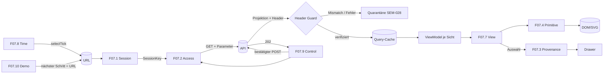
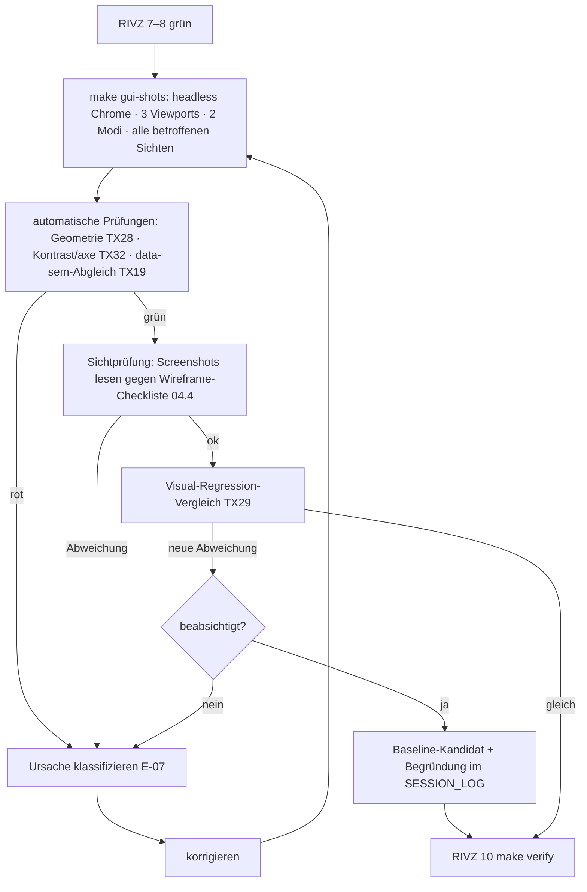

# SYNTX :: CIRA — Claude GUI System Field Implementation Architecture (F07)

**Implementierungsoptimierte System-Field-Architektur der CIRA-Benutzeroberfläche**

```text
STATUS             = READY FOR ARCHITECTURAL REVIEW
DESIGN PRINCIPLE   = SYSTEMIC & SEMIONTIC
PRODUCT IDENTITY   = CIRA
EXECUTION          = ARCHITECTURE ONLY — NO CODE — NO IMPLEMENTATION RELEASE
```

| Kopf | Wert |
|---|---|
| Artefakt | `SYNTX_CIRA_Claude_GUI_System_Field_Implementation_Architecture_v1.0.0.md` |
| Version | 1.0.0 |
| Systemfeld | F07_INTERFACE inkl. Projektionsschnittstelle (`api/projections`, `contracts.f07`) |
| Erstellt von | Claude (Opus 5.5), 2026-11-26 |
| Basis | Consolidated Architecture Package v1.0.1 (Freeze Candidate) |
| Selbsttragend | ja; die Eingangsartefakte werden zum Lesen nicht benötigt, Verweise nennen Herkunft |

---

## 00 — Eingangsfeld, Lesart und Prüfgrundlage

### 00.1 — Eingangsfeld

| Kürzel | Artefakt | Rolle | Prüfung beim Einlesen |
|---|---|---|---|
| PKG | `SYNTX_CIRA_Consolidated_Architecture_Package_v1.0.1.md` (+ PDF, 47 S.) | führende System-, Vertrags- und Phasenquelle | PDF per Wortabgleich gegen Markdown: inhaltsgleich |
| GSW | `SYNTX_CIRA_GUI_Dual_Deep_Sweep_Report.md` | Vorwärts-/Inversanalyse, GUI-GAP-01–14 | vollständig gelesen (205 Z.) |
| GREF | `SYNTX_CIRA_Systemic_Semiontic_GUI_Reference_Architecture_v1.0.0.md` | Formensprache, Tokens, SEM-001–030, Sichten, Wireframes | vollständig gelesen (662 Z.) |
| GHO | `SYNTX_CIRA_GUI_Claude_Architecture_Handoff.md` | Rekonstruktionsprotokoll, Invarianten, AK-GUI-01–12, RV-GUI-01–04 | vollständig gelesen (151 Z.) |
| AUF | Auftrag „F07 System Field Implementation Architecture“ | Fragen 01–09, Produktsprachregel | vollständig gelesen |

### 00.2 — Herkunfts- und Zustandsmarken

| Marke | Bedeutung |
|---|---|
| `[PKG]` | aus dem konsolidierten Paket v1.0.1 |
| `[GREF]` `[GSW]` `[GHO]` | aus Referenzarchitektur, Sweep-Bericht, Handoff |
| `[GUI]` | in diesem Dokument neu |
| `[OPEN]` | offene Entscheidung |
| `[REVIEW]` | hier entschieden, zur gemeinsamen Prüfung vorgelegt |
| `[DEP]` | externe Abhängigkeit |

Registerpräfixe dieses Dokuments:
- `GF` Befund der rekursiven GUI-Prüfung
- `GK` GUI-interne Korrektur an GREF, GSW oder GHO
- `K-58` ff. vorgeschlagene Änderung am Paket v1.0.1, separat geführt in Kapitel 08.2
- `TERM` Terminologieeintrag
- `SEM-031` ff. neue semiontische Zeichen
- `INV-…` Invarianten
- `TX22` ff. neue Tests
- `AK-GUI-13` ff. neue Abnahmekriterien
- `RV-GUI-05` ff. neue Review-Punkte

### 00.3 — Was ich gemessen habe statt anzunehmen

Drei Aussagen dieses Dokuments beruhen auf tatsächlichen Messungen in meiner Arbeitsumgebung. Das Protokoll steht in Kapitel 12.

1. **Farbtokens aus GREF 01.1:** WCAG-Kontrast gegen die Flächen und paarweiser Farbabstand (CIEDE2000) berechnet. Ergebnis:
   - zwei exakte Kollisionen (ΔE 0)
   - drei Paare unter ΔE 10
   - drei Kontrastunterschreitungen
   Daraus folgen GF-01 bis GF-03.
2. **Kanonische Zeichen:** Die Zeichen aus PKG 03.5 habe ich in headless Chrome gerendert.
   - Ohne UTF-8-Deklaration erscheinen sie als Zeichensalat.
   - Je nach Schrift erscheinen die eingekreisten Operatoren winzig (DejaVu Sans Mono) oder als große Kreissymbole (Inter-Fallback).
   Daraus folgt GF-19.
3. **Laufzeitumgebung:**
   - headless Chrome (Chrome for Testing 153) ist verfügbar
   - Node 22 ist verfügbar
   - die Docker-CLI ist vorhanden, der Daemon aber nicht erreichbar
   Für meine Umgebung ist DEP-07 damit für den Browser-Teil aufgehoben, für Docker nicht.

---

## 01 — Globales Architekturverständnis

### 01.1 — Wie ich die CIRA-Gesamtarchitektur verstanden habe

CIRA ist ein **Messinstrument für Rekonstruktionsleistung unter kontrollierter Information**. Der Forschungsgegenstand ist nicht die Infrastruktur, sondern die Frage: Wie gut rekonstruiert eine Engine einen Systemzustand, den sie nie direkt sieht?

Dafür erzeugt CIRA drei getrennte Wirklichkeitsebenen über diskreter Zeit:

| Ebene | erzeugt von | Bedeutung |
|---|---|---|
| Ω_A Referenzzustand | F03 Emulator | die synthetische Wahrheit, vollständig bestimmt |
| Ω_O Beobachtungszustand | F04 Beobachtung (θ) | was durch ein begrenztes Fenster davon sichtbar ist, inklusive Lücken und Verzögerung |
| Ω_R Rekonstruktionszustand | F05 Engine (Dual Sweep) | was die Engine allein aus der Beobachtung bestimmt |

F06 misst die Beziehungen zwischen den drei Ebenen exakt rational (M01–M11). F01 (Topologie) und F02 (Regeln) liefern die Struktur, auf der alle drei Ebenen liegen.

Die tragende Invariante ist die **Informationsbarriere**: F05 erreicht Ω_A in keiner Form. Fünf mechanische Schichten setzen das durch (PKG 05.4). Alles andere hängt daran: Messung ist nur sinnvoll, wenn die Rekonstruktion blind ist.

### 01.2 — Wie ich F07 als eigenständiges, gekoppeltes Systemfeld verstanden habe

F07 ist das einzige Feld, das **alle drei Ebenen gleichzeitig sehen darf** (PKG 05.2: „visualisiert“). Gerade deshalb darf es nichts von dem tun, was die anderen Felder tun:

| F07 tut | F07 tut nie |
|---|---|
| Projektionen lesen | Metriken, K3-Auswertungen, Deltas, Matchings berechnen |
| zeitlich synchronisieren (Tick, Versuch, Revision) | Daten zwischen Ebenen vermischen oder ineinander umrechnen |
| Herkunft und Offenheit sichtbar machen | Offenheit glätten, ausblenden oder als Fehler darstellen |
| Steuerbefehle an die API senden | Rekonstruktionsvorschläge anwenden |
| exportieren | Daten verändern |

F07 ist damit ein **Projektionsfeld mit Steuerkanal**. Lesend ist es an F01–F06 nur über API-Projektionen gekoppelt, steuernd nur über API → Orchestrator. Zu F05 hat es keinen Datenrückkanal.

### 01.3 — Wie ich die systemische und semiontische GUI-Architektur verstanden habe

Semiontisch heißt in GREF: **Jedes sichtbare Zeichen ist an genau einen Systemzustand gebunden**, und diese Bindung ist umkehrbar. Wer ein Zeichen sieht, kann den zugrunde liegenden Vertragszustand eindeutig ablesen. Wer einen Vertragszustand kennt, weiß, welches Zeichen erscheinen muss.

Das ist eine Bijektion zwischen zwei Mengen:
- darstellbare Vertragszustände (Enum-Werte, Zustandsräume, Herkunft, Verfügbarkeit)
- Zeichen (Farbe × Form × Glyph × Position × Linienstil × Bewegung)

Systemisch heißt: Die Oberfläche bildet die Feldstruktur selbst ab. Raumpositionen spiegeln Zustandsräume, Linien spiegeln Kopplungen, Schichten spiegeln Erkenntnisebenen (Rahmen → Struktur → epistemisches Detail → Tiefenprovenienz).

Für die Implementierung folgt daraus: Die Bijektion muss **maschinell** gelten, nicht nur in einer Tabelle. Sonst zerfällt sie bei der ersten Komponente, die eine Farbe direkt setzt (Kap. 04.1).

### 01.4 — Relationen zwischen Zeichen, Systemzuständen, Metriken und Funktionen

| Ebene | Systemgröße | Zeichenträger | Relation |
|---|---|---|---|
| Raum | Ω_A, Ω_O, Ω_R | Farbe + Geometrie + Spalte | dreifach redundant, nie nur Farbe |
| Status im Raum | KNOWN, UNKNOWN, DETERMINED, UNDETERMINED, NOT_APPLICABLE | Glyph + Füllung + Muster | innerhalb der Raumgeometrie |
| Zeitverfügbarkeit | AVAILABLE, NOT_AVAILABLE_AT_TICK | punktierte Zeitlücke | Block-Ebene, nicht Zell-Ebene |
| Regelwahrheit | TRUE, FALSE, ⊥ | Raute + Wert + Muster | Prädikatform, getrennt von Zuständen |
| Ausführung | ExecutionStatus | Kapsel (Pill), nur Ebene 1 | eigener Kanal, nie in Zellen [GK-05] |
| Herkunft | DataOrigin | Rahmenmuster + Text, achromatisch [GK-01] | an jedem Block |
| Metrik | MetricResult | Bruch n/d + Dezimal + Zielmarke | Zahl kommt vom Server, F07 formatiert nur |
| Undefiniertheit | UNDEFINED + Grund | schraffierter Slot + Grundtext | nie 0 |
| Kopplung | Relation, CouplingStatus | Linienstil + Marker | Topologie achromatisch, Kopplungsstatus chromatisch [GK-04] |
| Funktion | Steuerung, Inspektion, Export | Aktionen in Zone A / Drawer | explizit bestätigt (P11) |

Metriken sind für F07 **Werte mit Herkunft**, keine Formeln. Die strukturelle Funktion einer Metrik (was sie zwischen welchen Räumen misst) steht in ihrer Definition. Diese Definition liefert der Server mit (K-65), F07 zeigt sie an.

### 01.5 — Kopplungen zwischen GUI und übrigen Systemfeldern

| Richtung | Kanal | Inhalt | Grenze |
|---|---|---|---|
| F01 → F07 | `/topology` | TopologyProjection | zeitlos |
| F02 → F07 | `/governance` | GovernanceProjection, RuleEvaluationSets | je Raum getrennt |
| F03 → F07 | `/states`, `/events` | StateProjection (Ω_A), EventRecords | Ω_A nur hier und in F06 |
| F04 → F07 | `/observations` | ObservationProjection (Ω_O), Kontext, Budget, Register | Revision je Tick |
| F05 → F07 | `/results`, `/trace` | Forward, Inverse, Reconstruction, Proposals | Richtungen getrennt |
| F06 → F07 | `/metrics`, `/comparisons` | EvaluationReport, ComparisonReport | Werte, nie Formeln |
| Orchestrator → F07 | `/experiments/{id}` | ExperimentView aus StageEvents | Status ≠ Offenheit |
| F07 → API | POST-Endpunkte | Steuerbefehle | bestätigt, nie automatisch |
| F07 → F05 | — | — | **existiert nicht** |

### 01.6 — Architektonische Voraussetzungen für eine vollständige Implementierung

| Voraussetzung | Zustand in PKG v1.0.1 | Schließung |
|---|---|---|
| typisierte Projektionen für alle elf Sichten | lückenhaft (GSW: GUI-GAP-03–08) | K-65 |
| Guard-fähige Header (alle Abfrageparameter gespiegelt) | fehlt: nur experiment_id und tick | K-58 |
| Zeitachsen-Metadaten (Tickbereich, Sweep-Ticks, Versuche) | fehlt in ExperimentView | K-59 |
| Auswahllisten für Steuerung (Vergleiche, θ, Targets) | fehlt | K-60, K-61 |
| serverseitige Zerlegung von δ und Regelzählung | fehlt; F07 müsste sonst rechnen | K-63, K-64 |
| Single Source für Tokens, Zeichen, Produktsprache | in GREF als Tabellen, nicht maschinell | Kap. 04.1 |
| verbindliche Produktsprache | fehlt | Kap. 02 |
| deterministisches Graph-Layout ohne DOM-Messung | offen | GK-18 |
| Schrift mit nachgewiesener Glyphenabdeckung, offline | offen | GK-19, DEP-GUI-01 |
| Browser-Laufzeit für visuelle Prüfung | DEP-07 | in meiner Umgebung vorhanden (00.3) |

---

## 02 — Verbindliche CIRA-Produktsprache

### 02.1 — Grundregeln

| Regel | Inhalt |
|---|---|
| INV-LANG-01 | SYNTX bleibt interne Architekturgrundlage. In der sichtbaren Oberfläche erscheinen weder „SYNTX“ noch SYNTX-interne Begriffe (Systemfeld, Sweep, Σ-Feld, Kopplungsfeld, Semiontik, Feldtupel, F01–F07 als Bezeichner). |
| INV-LANG-02 | Jeder sichtbare Text kommt aus dem Terminologiekatalog `cira.terms.yaml` (Schlüssel → EN/DE). Rohstrings in Komponenten sind verboten (TX24). |
| INV-LANG-03 | **Bezeichnung und Datum sind getrennt.** Bezeichnungen (Labels, Überschriften, Statusnamen, Erklärungen) kommen aus dem Katalog. Daten (IDs, Hashes, Symbolwerte, Ticks, Brüche, Engine-Bezeichnungen aus der Registry) werden unverändert in Monospace gerendert und sind als Daten erkennbar. |
| INV-LANG-04 | Enum-Werte aus Verträgen werden nie roh als Label gerendert, sondern über ihren TERM-Schlüssel. Der Rohwert erscheint nur im Provenienz-Drawer im Abschnitt „Technical record“. |
| INV-LANG-05 | Jede sprachliche Transformation erhält die strukturelle und mathematische Bedeutung. Jeder TERM-Eintrag führt dazu eine Spalte „Bedeutungserhalt“; Vereinfachungen, die Bedeutung verlieren, sind unzulässig (z. B. „Not observed“ statt „Unknown“, weil UNKNOWN in Ω_O genau „kein aktiver Quellwert“ bedeutet). |
| INV-LANG-06 | Engine-Provenienz (Σ-Identitäten, Operatorsymbole, R/I-Codes, Registry-Bezeichnungen) ist **Datum** der Engine, nicht CIRA-Terminologie. Sie erscheint nur im Engine-Trace (Sichten 5/6, Drawer), gerahmt durch die Produktbezeichnungen „Engine analysis field“ / „Engine operator“, und unverändert in Codepunkt und Wortlaut (PKG K-31, INV-SEM-03/04). So vertragen sich Produktsprachregel und Zeichentreue [GK-06]. |

Konfliktauflösung [GK-06]: GREF zeigt „[SYNTX::CIRA]“, Feldcodes und Σ-Labels als Oberflächentext. AUF verlangt ausschließlich CIRA-Produktbegriffe. Gleichzeitig verbieten PKG und GHO jede Übersetzung kanonischer Zeichen. INV-LANG-03 und INV-LANG-06 lösen das, indem sie Engine-Zeichen als Daten mit Produktrahmen behandeln. Sie werden nicht übersetzt und nicht als Oberflächenbegriff verwendet.

### 02.2 — Oberflächensprache `[OPEN]` RV-GUI-05

Default ist **Englisch** für das internationale Hackathon-Publikum, **Deutsch** ist als zweite Katalogsprache vollständig gepflegt. Die Sprache ist eine Präsentationseinstellung (URL-Parameter `lang`, Default `en`) und hat keine Wirkung auf Daten.

### 02.3 — Terminologieregister

Spalten: TERM-Schlüssel · intern (Architektur) · sichtbar EN · sichtbar DE · Bedeutungserhalt.

#### A — Produkt und Ebenen

| TERM | intern | EN | DE | Bedeutungserhalt |
|---|---|---|---|---|
| product.name | SYNTX :: CIRA | CIRA | CIRA | Produktidentität |
| product.tagline | Structural Cognition and Resilience Engineering Architecture | Structural reconstruction under controlled information | Strukturelle Rekonstruktion unter kontrollierter Information | benennt den Forschungsgegenstand (REF 01) |
| product.env | synthetisches Service-Labor | Synthetic service lab — no real sites or infrastructure | Synthetisches Service-Labor — keine realen Standorte oder Infrastrukturen | REQ-080 |
| layer.f01 | F01_DOMAIN_TOPOLOGY | Topology | Topologie | typisierter Graph |
| layer.f02 | F02_GOVERNANCE | Rules & roles | Regeln & Rollen | Sollbedingungen, Freigaben |
| layer.f03 | F03_EMULATOR | Scenario emulator | Szenario-Emulator | erzeugt Referenzzustand |
| layer.f04 | F04_OBSERVATION | Observation | Beobachtung | erzeugt Beobachtungszustand |
| layer.f05 | F05_SYNTX_ENGINE | Reconstruction engine | Rekonstruktions-Engine | erzeugt Rekonstruktionszustand |
| layer.f06 | F06_METRICS | Evaluation | Auswertung | exakte Metriken |
| layer.f07 | F07_INTERFACE | Workspace | Arbeitsoberfläche | Darstellung, Steuerung |
| layer.generic | Systemfeld | System layer | Systemschicht | ersetzt „Feld“ in der Oberfläche |

#### B — Zustandsräume

| TERM | intern | EN | DE | Bedeutungserhalt |
|---|---|---|---|---|
| space.a | Ω_A | Reference state · Ω_A | Referenzzustand · Ω_A | synthetische Grundwahrheit; Ω-Notation als Sekundärzeichen erhalten |
| space.a.hint | — | Synthetic ground truth — never visible to the engine | Synthetische Grundwahrheit — für die Engine nie sichtbar | Informationsbarriere |
| space.o | Ω_O | Observed state · Ω_O | Beobachteter Zustand · Ω_O | durch θ vermittelt |
| space.o.hint | — | What the observation window reveals | Was das Beobachtungsfenster zeigt | — |
| space.r | Ω_R | Reconstructed state · Ω_R | Rekonstruierter Zustand · Ω_R | Ergebnis der Rekonstruktion |
| space.r.hint | — | Determined by the engine from observations only | Von der Engine nur aus Beobachtungen bestimmt | Ω_R(t) = R(Ω_O(0:t)) |

#### C — Zustände in den Räumen

| TERM | intern | EN | DE | Bedeutungserhalt |
|---|---|---|---|---|
| obs.known | KNOWN | Observed | Beobachtet | Wert aus aktiver Quelle |
| obs.known.stale | KNOWN, observed_at_tick < tick | Observed · delayed (t={k}) | Beobachtet · verzögert (t={k}) | bekannter, verzögerter Wert, kein Fehler |
| obs.unknown | UNKNOWN | Not observed | Nicht beobachtet | kein aktiver Quellwert; nicht falsch, nicht abwesend |
| obs.outside | Knoten außerhalb θ | Outside observation window | Außerhalb des Beobachtungsfensters | nicht Teil der beobachtbaren Topologie [GK-15] |
| app.na | NOT_APPLICABLE | Not applicable | Nicht anwendbar | aus Deklaration, nicht gezählt |
| rec.determined | DETERMINED | Reconstructed | Rekonstruiert | bestimmter Wert mit Wissensklasse |
| rec.undetermined | UNDETERMINED | Not determined | Nicht bestimmt | Engine hat keinen Wert festgelegt |
| avail.none | NOT_AVAILABLE_AT_TICK | No reconstruction at t={t} | Keine Rekonstruktion bei t={t} | kein Sweep an diesem Tick, regulärer Zustand |
| dev.mismatch | δ(a,r) = 1 | Differs from reference | Weicht vom Referenzwert ab | serverseitig geliefert (K-63) |

#### D — Regeln, Ausführung, Herkunft

| TERM | intern | EN | DE | Bedeutungserhalt |
|---|---|---|---|---|
| rule.true | TRUE | Satisfied | Erfüllt | g_j = 1 |
| rule.false | FALSE | Violated | Verletzt | g_j = 0 |
| rule.unevaluable | UNEVALUABLE (⊥) | Not evaluable · ⊥ | Nicht auswertbar · ⊥ | g_j = ⊥, immer mit Grund |
| rule.reason.unknown_input | UNKNOWN_INPUT | input not observed | Eingabe nicht beobachtet | EvalReason |
| rule.reason.undetermined_input | UNDETERMINED_INPUT | input not determined | Eingabe nicht bestimmt | EvalReason |
| rule.reason.na_input | NOT_APPLICABLE_INPUT | input not applicable | Eingabe nicht anwendbar | EvalReason |
| rule.reason.requirement | REQUIREMENT_NOT_MET | prerequisite rule not satisfied | Voraussetzungsregel nicht erfüllt | EvalReason |
| rule.kind.state / transition / function | STATE / TRANSITION / FUNCTION | State rule / Transition rule / Service function | Zustandsregel / Übergangsregel / Servicefunktion | RuleKind |
| exec.created | CREATED | Queued | Eingereiht | ExecutionStatus |
| exec.running | RUNNING | Running | Läuft | — |
| exec.completed | COMPLETED | Completed | Abgeschlossen | — |
| exec.partial | PARTIAL | Partially completed | Teilweise abgeschlossen | — |
| exec.failed | FAILED | Failed | Fehlgeschlagen | — |
| exec.blocked | BLOCKED | Blocked — dependency unavailable | Blockiert — Abhängigkeit nicht verfügbar | — |
| origin.synthetic | SYNTHETIC | Synthetic | Synthetisch | Emulator/Beobachtung |
| origin.fixture | FIXTURE | Test fixture — not an engine result | Testdaten — kein Engine-Ergebnis | P08 |
| origin.engine | ENGINE | Engine result | Engine-Ergebnis | nur bei realem Adapter |
| origin.imported | IMPORTED | Imported result | Importiertes Ergebnis | schemavalidiert |
| origin.illustrative | ILLUSTRATIVE | Illustrative — not measured | Illustrativ — nicht gemessen | nie als Messwert |
| epi.src_obs | SOURCE_OBSERVATION | From observation | Aus Beobachtung | EpistemicClass |
| epi.src_stmt | SOURCE_STATEMENT | From source statement | Aus Quellaussage | — |
| epi.struct | STRUCTURAL_DERIVATION | Structurally derived | Strukturell abgeleitet | — |
| epi.hyp | HYPOTHESIS | Hypothesis | Hypothese | zählt nach S-04 zu D_det |
| epi.open_ref | OPEN_REFERENCE | Open reference | Offene Referenz | nie an „Reconstructed“ |
| cpl.effective | EFFECTIVE | Active coupling | Wirksame Kopplung | CouplingStatus |
| cpl.possible | POSSIBLE | Possible coupling | Mögliche Kopplung | — |
| cpl.unknown_open | UNKNOWN_OPEN | Unknown — open | Unbekannt — offen | — |
| cpl.absent | ABSENT | No coupling | Keine Kopplung | nur in Deltas |
| ref.resolved / unresolved / truncated / external | ReferenceStatus | Resolved / Unresolved / Truncated / External | Aufgelöst / Nicht aufgelöst / Abgeschnitten / Extern | — |

#### E — Rekonstruktion und Engine-Provenienz

| TERM | intern | EN | DE | Bedeutungserhalt |
|---|---|---|---|---|
| run.reconstruction | SweepRun | Reconstruction run | Rekonstruktionslauf | — |
| run.forward | FORWARD, Q_F = R_F(O) | Forward reconstruction | Vorwärtsrekonstruktion | ohne Ziel |
| run.inverse | INVERSE, Q_I = R_I(O,Z) | Target-guided reconstruction | Zielgeführte Rekonstruktion | mit beobachtungsbasiertem Ziel |
| run.merge | MERGE | Combined reconstruction | Zusammengeführte Rekonstruktion | engine_first/v1 |
| run.attempt | attempt | Run {n} | Lauf {n} | Versuchsnummer |
| run.stability | STABILITY, attempt 1 | Stability re-run | Stabilitäts-Wiederholung | gleiches Beobachtungspaket |
| merge.conflict | MergeConflict | Forward and target-guided results differ | Vorwärts- und zielgeführtes Ergebnis weichen ab | — |
| merge.engine_resolved | ENGINE_RESOLVED | Resolved by engine | Durch Engine aufgelöst | **nur** bei Herkunft ENGINE oder IMPORTED |
| merge.engine_resolved.fixture | ENGINE_RESOLVED bei FIXTURE | Resolved in test fixture | In Testdaten aufgelöst | P08 [GK-20] |
| term.converged … term.cancelled | TerminationReason | Converged / Stopped by engine / Budget exhausted / Output truncated / Error / Cancelled | Konvergiert / Von Engine beendet / Budget erschöpft / Ausgabe abgeschnitten / Fehler / Abgebrochen | — |
| target | TargetDefinition Z | Reconstruction target | Rekonstruktionsziel | beobachtungsbasiert |
| target.met / not_met / undetermined | TargetAssessment | Met / Not met / Not determined | Erfüllt / Nicht erfüllt / Nicht bestimmt | — |
| gap.structural | StructuralGap | Structural gap | Strukturelle Lücke | mit Quellbezug |
| gap.open / closed | OPEN / CLOSED_IN_RESULT | Open / Closed in later result | Offen / In späterem Ergebnis geschlossen | — |
| gap.open_relation | OpenRelation | Open relation | Offene Relation | — |
| match.tp | TP | Matched | Zugeordnet | annotierter Fall ↔ Lücke |
| match.fn | FN | Missed case | Verfehlter Fall | Fall ohne Lücke |
| match.fp | FP | Unmatched detection | Nicht zugeordnete Erkennung | Lücke ohne Fall |
| match.subset.all / observable | ALL / OBSERVABLE_CASES | All cases / Observable cases only | Alle Fälle / Nur beobachtbare Fälle | K-46 |
| proposal | RecoveryProposal | Recovery proposal | Wiederherstellungsvorschlag | nie automatisch angewendet |
| authority | AuthorityRecord | Authorization decision | Autorisierungsentscheidung | Mensch als Instanz |
| loop.recovery | vermittelte Rekursion | Recovery loop via human authorization | Wiederherstellungsschleife über menschliche Autorisierung | 05.5 |
| barrier | Ω_A ↛ F05 | Information barrier — the engine never sees the reference state | Informationsbarriere — die Engine sieht den Referenzzustand nie | Kerninvariante |
| engine.field | Σ-Feld (SigmaRef) | Engine analysis field | Engine-Analysefeld | Rahmen für Datum `Σnn` |
| engine.operator | OperatorRef | Engine operator | Engine-Operator | Rahmen für Symbol oder Code |
| engine.label_source | label_from_source | engine label | Engine-Bezeichnung | Wortlaut der Registry |
| engine.label_unavailable | LABEL_UNAVAILABLE [DEP-08] | Label not yet provided by the engine registry | Bezeichnung noch nicht von der Engine-Registry geliefert | DEP-08 |
| engine.code_opaque | R/I-Code [DEP-01] | Engine code — meaning not provided | Engine-Code — Bedeutung nicht geliefert | DEP-01 |

#### F — Beobachtung, Ablauf, Steuerung, Meldungen

| TERM | intern | EN | DE | Bedeutungserhalt |
|---|---|---|---|---|
| obs.setup | ObservationConfig θ | Observation setup | Beobachtungskonfiguration | — |
| obs.source | ObservationSource | Source | Quelle | — |
| obs.context | ContextBundle | Observation context | Beobachtungskontext | — |
| obs.budget | bundle_budget | Context budget | Kontextbudget | Bundle-Ebene (K-12) |
| obs.profile | serialization_profile | Serialization profile | Serialisierungsprofil | — |
| obs.continuous / interrupted | CONTINUOUS / INTERRUPTED | Continuous / Interrupted | Durchgehend / Unterbrochen | — |
| stage.* | StageName (9) | Load definitions / Emulate scenario / Observe / Forward reconstruction / Target-guided reconstruction / Combine results / Stability re-run / Evaluate / Export | Definitionen laden / Szenario emulieren / Beobachten / Vorwärtsrekonstruktion / Zielgeführte Rekonstruktion / Ergebnisse zusammenführen / Stabilitäts-Wiederholung / Auswerten / Exportieren | StageEvents |
| openness | ContentOpenness | Open information | Offene Information | getrennt vom Ausführungsstatus |
| event.applied / rejected | APPLIED / REJECTED | Applied / Not applied | Angewendet / Nicht angewendet | K-66 [REVIEW] |
| scenario.baseline / recovery | BASELINE / RECOVERY | Baseline / Recovery variant | Ausgangsszenario / Wiederherstellungsvariante | — |
| cmp.compatible / incompatible | compatible / COMPARISON_INCOMPATIBLE | Comparable / Not comparable | Vergleichbar / Nicht vergleichbar | K-43 |
| cmp.resolved / persisting / unevaluable / new | M09-Mengen | Resolved / Persisting / Not evaluable in recovery / New violation | Aufgelöst / Bestehend / In Wiederherstellung nicht auswertbar / Neue Verletzung | — |
| action.export | Export | Export bundle | Paket exportieren | A-01 |
| action.new | POST /experiments | New experiment | Neues Experiment | — |
| action.resweep | POST /sweeps | Re-run reconstruction | Rekonstruktion erneut ausführen | neuer Lauf |
| action.import_result | POST /results/import | Import result | Ergebnis importieren | IMPORTED |
| action.replay | POST /replay | Replay experiment | Experiment wiederholen | T03 |
| action.import_bundle | POST /experiments/import | Import bundle | Paket importieren | T10 |
| action.compare | POST /comparisons | Compare scenarios | Szenarien vergleichen | — |
| action.authorize | POST /recovery-variants | Record authorization decision | Autorisierungsentscheidung erfassen | optional, RV-GUI-04 |
| msg.unavailable | VIEW_DATA_UNAVAILABLE | Data for this time step could not be verified. Reload. | Daten für diesen Zeitschritt konnten nicht verifiziert werden. Neu laden. | Quarantäne |
| msg.undefined.zero | ZERO_DENOMINATOR | Undefined — nothing to measure (0 / 0) | Undefiniert — nichts zu messen (0 / 0) | nie 0 |
| msg.undefined.missing | INPUT_MISSING | Undefined — input not available | Undefiniert — Eingabe nicht verfügbar | nie 0 |
| msg.no_composite | REQ-049 | No overall score — each metric stands for itself | Kein Gesamtwert — jede Metrik steht für sich | REQ-049 |
| prov.drawer | Provenance Drawer | Provenance | Herkunft | — |
| prov.technical | Raw Contract Fields | Technical record | Technischer Datensatz | Rohwerte nur hier |

#### G — Sichten und Metriken

| TERM | intern | EN | DE |
|---|---|---|---|
| view.01 | SYSTEM_FIELD_OVERVIEW | System overview | Systemübersicht |
| view.02 | TOPOLOGY_GRAPH | Topology | Topologie |
| view.03 | TEMPORAL_STATE_EXPLORER | State comparison | Zustandsvergleich |
| view.04 | OBSERVATION_INSPECTOR | Observation details | Beobachtungsdetails |
| view.05 | FORWARD_SWEEP_INSPECTOR | Forward reconstruction | Vorwärtsrekonstruktion |
| view.06 | INVERSE_SWEEP_INSPECTOR | Target-guided reconstruction | Zielgeführte Rekonstruktion |
| view.07 | STRUCTURAL_GAP_INSPECTOR | Structural gaps | Strukturelle Lücken |
| view.08 | ARCHITECTURAL_CLOSURE_INSPECTOR | Closure & recovery | Schließung & Wiederherstellung |
| view.09 | STRUCTURAL_METRICS | Metrics | Metriken |
| view.10 | SCENARIO_COMPARISON | Scenario comparison | Szenariovergleich |
| view.11 | EVENT_TIMELINE | Timeline | Zeitleiste |

Die Metriknamen M01–M11 der Referenz sind bereits englische Fachbezeichnungen. Sie bleiben in EN unverändert; DE ergänzt Übersetzungen. Jede Metrik erhält einen Erklärungssatz, der genau ihre Relation benennt:

| TERM | EN | Erklärung EN (Bedeutungserhalt) |
|---|---|---|
| metric.m01 | Reconstruction distance | Share of reconstructed attributes that differ from the reference (weighted). Target 0. |
| metric.m02 | Relational coherence | Share of evaluable state rules that are satisfied, per state. |
| metric.m03 | Temporal state consistency | Share of evaluable transitions between consecutive steps that are valid. |
| metric.m04 | Functional continuity | Share of time steps in which a service function holds. |
| metric.m05 | Reconstruction coverage | Share of applicable attributes the engine determined. |
| metric.m06 | Observation completeness | Share of applicable attributes that are observed. |
| metric.m07 | Gap detection coverage | Share of annotated consistency cases the engine detected. |
| metric.m08 | Gap detection precision | Share of detected gaps that match an annotated case. |
| metric.m09 | Gap closure | Share of baseline violations resolved in the recovery variant. |
| metric.m10 | Reconstruction stability | Agreement of two runs on the same observations. |
| metric.m11 | Reconstruction accuracy | 1 − reconstruction distance. Target 1. |

---

## 03 — F07 System Field Implementation Architecture

### 03.1 — Feldtupel F07 (präzisiert)

| Komponente | Inhalt |
|---|---|
| C Träger | View (11), ExperimentSession, ViewState, ProjectionHeader, Block<T>, SemionticToken, SemEntry, TermEntry, ProvenanceSelection, ControlCommand, DemoStep |
| R Relationen | `projects_from` (API → View), `synchronizes_on` (SessionKey), `guards` (Header ↔ SessionKey), `signifies` (Vertragszustand → SEM), `labels` (TERM → Text), `inspects` (Block → Provenienz), `triggers` (Befehl → API) |
| X Zustandsraum | SessionKey × ViewState × ContentAvailability je Block × DrawerState × ControlState × DemoState |
| U Eingabe | ausschließlich generierte TS-Typen der API-Projektionen; Semiontik- und Terminologiekatalog (generiert) |
| Y Ausgabe | DOM/SVG der elf Sichten, Export-Download, bestätigte POST-Befehle |
| B Grenze | keine Kopplung zu F05-Interna; keine Domänenrechnung (Metrik, K3, Delta, Matching, δ, Regelzählung); keine automatische Anwendung; keine Rohfarben, Rohmaße, Rohtexte |
| I Invarianten | Kap. 03.14 |
| T Transitionen | navigate, selectTick, selectAttempt, selectRevision, setAggregation, setFocus, openProvenance, closeProvenance, refetch, export, submitCommand, demoNext, demoPrev |
| K Kopplungen | lesend über 17 GET-Operationen (inkl. K-60); steuernd über 7 POST-Operationen, davon #21 optional (Kap. 03.6) |
| P Provenienz | jeder Block trägt den Header seiner Quelle; Drawer zeigt source_refs |

### 03.2 — Interne Teilfelder

F07 ist intern selbst ein gekoppeltes Feld. Jedes Teilfeld ist ein Verzeichnis unter `frontend/src/` mit einer öffentlichen Fassade (`index.ts`).

| ID | Teilfeld | Verantwortung | Verzeichnis |
|---|---|---|---|
| F07.1 | Session | URL ↔ SessionKey, Parametervalidierung, Navigation | `session/` |
| F07.2 | Projection Access | typisierter Client, Header Guard, Query-Cache, Polling | `access/` |
| F07.3 | Provenance | Herkunftspropagation je Block, Drawer-Zustand, Technical record | `provenance/` |
| F07.4 | Semiontic Core | generierte Tokens, SEM-Bindung, Primitive (Zeichenkomponenten) | `semiontics/` |
| F07.5 | Product Language | generierter Katalog, `t()`, Plural/Parameter, Sprachwahl | `language/` |
| F07.6 | Spatial Shell | Zonen A–E, Raster, Schichtung, Responsivität | `shell/` |
| F07.7 | View Modules | elf Sichten, je eigene ViewModel-Abbildung | `views/` |
| F07.8 | Time Navigation | Tick-Scrubber, Sweep-/Ereignismarken, Versuch | `time/` |
| F07.9 | Control & Lifecycle | Befehlsdialoge, Bestätigung, 202-Polling, Export | `control/` |
| F07.10 | Demonstration Layer | Demo-Skript als URL-Folge, Erzählschlüssel, Präsentationsmodus | `demo/` |
| F07.11 | Verification Harness | Testhilfen, Snapshot-Loader, Geometrie- und Zeichenprüfungen | `../test/` |

### 03.3 — Interne Kopplungsmatrix (erlaubte Importe)

| von \ nach | 1 Session | 2 Access | 3 Prov. | 4 Semio. | 5 Lang. | 6 Shell | 7 Views | 8 Time | 9 Control | 10 Demo |
|---|---|---|---|---|---|---|---|---|---|---|
| 1 Session | — | — | — | — | — | — | — | — | — | — |
| 2 Access | R | — | — | — | — | — | — | — | — | — |
| 3 Provenance | R | R | — | — | — | — | — | — | — | — |
| 4 Semiontic | — | — | — | — | R | — | — | — | — | — |
| 5 Language | — | — | — | — | — | — | — | — | — | — |
| 6 Shell | R | R | R | R | R | — | — | R | R | R |
| 7 Views | R | R | R | R | R | — | — | — | R | — |
| 8 Time | R | R | — | R | R | — | — | — | — | — |
| 9 Control | R | R | — | R | R | — | — | — | — | — |
| 10 Demo | R | — | — | R | R | — | — | — | — | — |

R = darf importieren. `contracts/generated` darf nur von Access, Provenance und den ViewModel-Dateien in Views importiert werden. Primitive in Semiontic Core kennen keine Vertragstypen, sondern nur SEM-IDs und Werte. Durchgesetzt wird die Matrix mit dependency-cruiser; die Regeln werden aus dieser Tabelle generiert (TX25) [GK-26].

### 03.4 — Komponentenidentitäten und -relationen

| Teilfeld | Komponente | Eingaben | Ausgaben | SEM |
|---|---|---|---|---|
| F07.6 | `AppShell` | Session, ExperimentView | Zonen A–E | — |
| F07.6 | `ContextBar` (Zone A) | ExperimentView, Header | Wordmark, Experiment, Status, Herkunft, Tick, Aktionen | SEM-032, SEM-013–017 |
| F07.6 | `ViewRail` (Zone B) | Session | Navigation | — |
| F07.6 | `Workspace` (Zone C) | ViewState | View-Modul oder Quarantäne | SEM-028 |
| F07.8 | `TickScrubber` (Zone D) | ExperimentView.ticks, sweeps, Events | selectTick, selectAttempt | SEM-009 (Marken) |
| F07.3 | `ProvenanceDrawer` (Zone E) | ProvenanceSelection | Header, ArtifactRefs, Technical record | — |
| F07.9 | `ControlDrawer` | Kataloglisten (K-61), Befehle | bestätigte POSTs | SEM-020 |
| F07.9 | `ExportAction` | ExperimentView.status | Download, bundle_hash-Anzeige | — |
| F07.4 | `SpaceCell` | space, status, value, epistemic, stale, availability | Zelle | SEM-001–009, 018, 031 |
| F07.4 | `SpaceHeader` | space, origin, availability | Spaltenkopf | SEM-001–003, 013–017 |
| F07.4 | `RuleDiamond` | result, reason | Raute | SEM-010–012 |
| F07.4 | `RationalMetric` | MetricResult, Definition | Bruch, Dezimal, Ziel | SEM-021, 022 |
| F07.4 | `OriginBadge` | DataOrigin | Kapsel | SEM-013–017 |
| F07.4 | `ExecPill` | ExecutionStatus | Kapsel | SEM-032 |
| F07.4 | `EpistemicChip` | EpistemicClass | Kapsel | SEM-018 |
| F07.4 | `DeltaMark` | before, after, space | Pfeil | SEM-023 |
| F07.4 | `GapMark` | status, source_refs | Rahmen | SEM-024, 025 |
| F07.4 | `ConflictBracket` | MergeConflict, origin | Klammer | SEM-026 |
| F07.4 | `EngineToken` | OperatorRef oder SigmaRef, Registry-Label | Datum mit Rahmen | SEM-027 |
| F07.4 | `TerminationSeal` | TerminationRecord | Siegel | SEM-029 |
| F07.4 | `ContinuityBand` | SourceRegisterEntry | Band | SEM-030 |
| F07.4 | `BarrierLine`, `RecoveryGateLine` | — | Linien in Sicht 1 | SEM-019, 020 |
| F07.4 | `FocusRing` | focus aktiv | Hervorhebung | SEM-034 |
| F07.4 | `DeviationSeam` | dev.mismatch (Server) | Naht zwischen Ω_A und Ω_R | SEM-035 |
| F07.4 | `IdText`, `ValueText` | Datum | Monospace-Text | — |
| F07.7 | Sichtkomponenten | Kap. 04.4 | — | — |

Jede Primitive rendert `data-sem="SEM-0nn"` und, wo ein Label erscheint, `data-term="<key>"`. Darüber prüfen Tests die Zeichenbindung (AK-GUI-04).

### 03.5 — Datenverträge (Konsum je Sicht)

F07 konsumiert ausschließlich generierte Typen. Zwischen Projektion und Komponente liegt je Sicht genau eine **ViewModel-Abbildung** (`views/<n>/model.ts`). Sie ordnet um, filtert und wählt Terme. Sie rechnet nicht (TX26).

| Sicht | Endpunkte | benötigte Paketänderungen |
|---|---|---|
| 1 Systemübersicht | #20 `/fields?experiment_id&tick`, #4 | K-59, K-62 |
| 2 Topologie | #10, #12, #5 (Sichtbarkeit), #6 | K-58, K-65 (visible_nodes) |
| 3 Zustandsvergleich | #12, #5, #6, #11, #7 PER_TICK (δ) | K-58, K-63, K-64, K-65 (Deltas) |
| 4 Beobachtungsdetails | #5 | K-65 (Budget, Profil, Revision) |
| 5 Vorwärts | #6 (forward), #14 | K-58 (direction, attempt) |
| 6 Zielgeführt | #6 (inverse), #14 | K-58 |
| 7 Strukturelle Lücken | #6, #7 PER_TICK (GapMatch) | K-65 (class_key) |
| 8 Schließung & Wiederherstellung | #6, #19 GET | K-65 (authority_records) |
| 9 Metriken | #7 | K-58 (aggregation, to_tick), K-65 (definitions) |
| 10 Szenariovergleich | #19 (GET, Liste, POST), #9 | K-60 |
| 11 Zeitleiste | #13 | K-58 (from, to) |
| Zone A/D | #4 | K-59 |
| Control | #3, #15–#19, #21, #2, #1 | K-61 |

### 03.6 — Kopplungsarchitektur nach außen

Lesend: #1, #2, #4, #5, #6, #7, #8, #9, #10, #11, #12, #13, #14, #17 (GET), #19 (GET, GET-Liste nach K-60), #20.
Steuernd: #3, #15, #16, #17 (POST), #18, #19 (POST), #21 (optional).

Alle Aufrufe laufen über F07.2. Kein anderes Teilfeld kennt URLs.

### 03.7 — Zustandsarchitektur

| Zustand | Ort | Quelle der Wahrheit | Lebensdauer |
|---|---|---|---|
| SessionKey `{experimentId, view, tick, attempt, revision, comparisonId, aggregation, toTick, from, to, focus, filter, lang, mode, demoStep}` | URL | URL (INV-STR-01) | Navigation |
| Projektionsdaten | Query-Cache (TanStack Query) | Server | Cache-Schlüssel = Endpunkt + gespiegelte Parameter |
| ViewState je Sicht | abgeleitet | Cache-Status + Guard-Ergebnis | — |
| ContentAvailability je Block | Projektion | Server (Block<T>) | — |
| DrawerState `{open, selection}` | Komponentenstate | Interaktion | Sitzung |
| ControlState `{dialog, pending, result}` | Komponentenstate | Interaktion + 202-Polling | Dialog |
| Theme `{dark, presentation}` | URL `mode` | URL | Navigation |

Parameterabbildung URL → API [GK-27]: `comparisonId → comparison_id`, `toTick → to_tick`. `attempt`, `revision`, `aggregation`, `from`, `to` werden unverändert übertragen. `focus`, `filter`, `lang`, `mode` und `demoStep` bleiben in F07. `tick` wird bei `aggregation ≠ PER_TICK` nicht an `/metrics` gesendet (INV-FUN-05).

### 03.8 — Informationsströme



### 03.9 — Interaktionsarchitektur

| Interaktion | Auslöser | Wirkung | Schutz |
|---|---|---|---|
| Tickwechsel | Scrubber, Sicht 3, Sicht 11, Tastatur ← → | URL `tick`; alle zeitabhängigen Blöcke neu | Quarantäne bis Guard (INV-FUN-01) |
| Versuchswechsel | Scrubber, Sichten 5/6 | URL `attempt` | — |
| Revisionswechsel | Sicht 4 | URL `revision` | — |
| Fokus | Knoten, Zelle, Lücke, Regel | URL `focus`; FocusRing sichtenübergreifend | unbekannte ID → Hinweis, kein Fehler |
| Sichtwechsel mit Kontext | Doppelklick, Verknüpfungen | neue Sicht, Tick und Fokus bleiben | — |
| Provenienz | Klick auf Block oder Wert | Drawer mit Header und Technical record | — |
| Steuerung | ControlDrawer | Dialog → Bestätigung → POST → 202 → Polling | explizite Bestätigung (P11) |
| Export | Zone A | GET #8 → Download → bundle_hash vom Server | gesperrt bei RUNNING |
| Demo | Demo-Leiste, Tasten PageDown/PageUp | URL des nächsten Schritts | nur Navigation, keine POSTs |

Tastatur: Alle Interaktionen sind per Tastatur erreichbar. Die Fokusreihenfolge ist Zone A → B → C → D → E, der Fokus ist sichtbar (TX32).

### 03.10 — Raumarchitektur

Shell nach GREF 01.5 mit Präzisierungen [GK-17]:

| Zone | Maß | Regel |
|---|---|---|
| A Kontextleiste | 48 px | Wordmark links, sichtbar groß (`type.display`); Experiment, ExecPill, Herkunft, Tick, Aktionen |
| B Sichtenleiste | 220 px | einklappbar auf 56 px (nur Nummern und Zeichen) |
| C Arbeitsraum | Rest | Mindestbreite 760 px |
| D Zeitleiste | 52 px | immer sichtbar außer in Sicht 10 (zeitpunktfrei, τ im Kopf) |
| E Drawer | 360 px | ab 1600 px Viewport schiebend, darunter überlagernd |

Mindest-Viewport 1280 × 720 (Projektor). Darunter zeigt die App einen Hinweis statt eines gebrochenen Layouts. Prüfviewports: 1920 × 1080, 1440 × 900, 1280 × 720 (TX28).

Schichtung: `z.canvas 10`, `z.chrome 20`, `z.drawer 30`, `z.quarantine 40`, `z.demo 50` [GUI].

Visuelle Hierarchie nach GREF 01.5 (Ebenen 1–4) mit fester Zuordnung: Ebene 1 nur Zone A und Sichtkopf; Ebene 4 nur im Drawer.

### 03.11 — Visuelle Architektur

Drei Kanäle tragen Bedeutung. Keiner trägt sie allein (INV-VIS-10):

1. **Farbe** für Raum, Bewertung und Teilzustand (Tokens 03.13)
2. **Geometrie** für Entitätsklasse und Raum (GREF 01.2)
3. **Glyph und Text** für Status und Herkunft (GREF 01.3, Katalog)

Herkunft ist **achromatisch** kodiert (Rahmenmuster + Text) [GK-01]. Ausführungsstatus erscheint nur als Kapsel auf Ebene 1 [GK-05]. Topologie-Relationen sind achromatisch, Kopplungsstatus chromatisch [GK-04].

### 03.12 — Semiontisches Register

Die Einträge SEM-001 bis SEM-030 aus GREF gelten mit den folgenden Änderungen und sind je einer Primitive zugeordnet (03.4).

| SEM | Änderung | Grund |
|---|---|---|
| SEM-005 (stale) | Farbe bleibt Raumfarbe Ω_O; Kennzeichnung über Halbfüllung + Lag-Tag, nicht über `col.eval.partial` | Ω_O-Amber und Partial-Gelb kaum unterscheidbar (ΔE 9,9) [GK-02] |
| SEM-013 (FIXTURE) | achromatisches Streifenmuster + Text „TEST FIXTURE“ + 2 px Rahmen | `col.origin.fixture` lag 12,2 ΔE neben Ω_O-Amber [GK-01] |
| SEM-014 (SYNTHETIC) | Haarlinie, Text, achromatisch | identisch mit Ω_A-Cyan (ΔE 0) [GK-01] |
| SEM-015 (ENGINE) | gefüllter Punkt + Text, achromatisch | identisch mit Kohärenz-Teal (ΔE 0) [GK-01] |
| SEM-016 (IMPORTED) | Doppelrahmen + Importpfeil, achromatisch | 5,5 ΔE neben Ω_R-Violett [GK-01] |
| SEM-017 (ILLUSTRATIVE) | gestrichelter Rahmen, Text in `ink.secondary` | Kontrast 3,88 < 4,5 [GK-03] |
| SEM-019 (Barriere) | Farbe `col.eval.violation` + Sperrglyph | `col.eval.blocked` entfällt (ΔE 9,5 zu violation) [GK-02] |
| SEM-010/011 | nur für Regelwahrheit und Abgleichsurteil; nie für Ausführung | Kanaltrennung [GK-05] |

Neue Zeichen [GUI]:

| SEM | Zeichen | Funktion | Zustand | Ausschluss |
|---|---|---|---|---|
| SEM-031 | Ω_O-Slot mit Kreuzschraffur außerhalb des Rahmens + „outside window“ | außerhalb θ | Knoten nicht in ObservableTopology | nie gleich UNKNOWN (SEM-006) |
| SEM-032 | ExecPill: Kapsel, Glyph je Status, nur Ebene 1 | Ausführungsstatus | ExecutionStatus | nie in Zellen, nie als Regelwahrheit |
| SEM-033 | Erzählkarte mit Schrittzähler | Demo-Schritt | DemoStep | nie über Datenwerten, nie modal |
| SEM-034 | FocusRing: `ink.primary` 2 px + Eckmarken | sichtenübergreifender Fokus | URL `focus` | keine Raum- oder Bewertungsfarbe |
| SEM-035 | DeviationSeam: Naht zwischen Ω_A- und Ω_R-Zelle | Abweichung vom Referenzwert | δ = 1 (vom Server, K-63) | nie clientseitig berechnet |
| SEM-036 | Präsentationsrahmen um Zone C | Präsentationsmodus aktiv | `mode=presentation` | keine Bedeutungsänderung |

AK-GUI-04 bezieht sich präzise auf die Menge {SEM-006, SEM-007, SEM-008, SEM-009, SEM-012} sowie SEM-031 [GK-23].

### 03.13 — Design Tokens v1.0.1 (gemessen)

Single Source: `frontend/semiontics/cira.semiontics.yaml` (04.1). Prüfregeln (TX23):
- Text ≥ 4,5 : 1 auf allen Flächen, auf denen er vorkommt
- Nicht-Text-Grafik ≥ 3 : 1
- semantische Farbtokens, die gemeinsam vorkommen können, paarweise ΔE00 ≥ 15

| Token | GREF | v1.0.1 | Kontrast auf field / panel / elevated | Änderung |
|---|---|---|---|---|
| col.surface.void / field / panel / elevated | #090B0E / #10141A / #161C24 / #1D2530 | unverändert | — | — |
| col.border.hairline / strong | #242E3B / #39475A | unverändert | — | — |
| col.ink.primary | #E6EDF5 | unverändert | 15,65 / 14,52 / — | — |
| col.ink.secondary | #9AA8B8 | unverändert | 7,62 / 7,07 / 6,38 | — |
| col.ink.muted | #5F6E80 | **#8391A3** | 5,76 / 5,34 / 4,81 | 3,54 < 4,5 [GK-03] |
| col.space.actual | #38BDF8 | unverändert | 8,62 / 8,00 | — |
| col.space.observed | #F59E0B | unverändert | 8,60 / 7,98 | — |
| col.space.reconstructed | #A78BFA | unverändert | 6,79 / 6,30 | — |
| col.space.*.tint | #0D2533 / #2C200B / #211A36 | unverändert; Text darauf nur `ink.primary` oder `ink.secondary` | — | muted auf Tints nur 3,0 |
| col.eval.coherent | #2DD4BF | unverändert | 9,92 / 9,20 | — |
| col.eval.violation | #F43F5E | unverändert | 5,03 / 4,67 | — |
| col.eval.blocked | #FB7185 | **entfällt** → violation + Sperrglyph | — | ΔE 9,5 zu violation [GK-02] |
| col.eval.partial | #EAB308 | **#A3E635** | 12,25 / — | ΔE 9,9 zu observed; neu ≥ 29 zu allen Raum- und Bewertungsfarben [GK-02] |
| col.open.epistemic | #94A3B8 | **Alias von ink.secondary** | 7,62 | ΔE 2,5 zu ink.secondary: Unterscheidung nur scheinbar; Träger ist Schraffur + Glyph [GK-03] |
| col.open.absent | #475569 | **Alias von ink.muted** | 5,76 | 2,44 < 3 [GK-03] |
| col.origin.* | fünf Farben | **entfallen** → achromatische Rahmenmuster + Text | — | [GK-01] |

Gemessene Mindestabstände der verbleibenden chromatischen Tokens (CIEDE2000): actual–coherent 25,9 · actual–reconstructed 29,2 · partial–coherent 29,0. Alle übrigen Paare liegen darüber.

Weitere Tokengruppen (aus GREF 01.4, 01.6, 01.7, 01.9, präzisiert):

| Gruppe | Tokens |
|---|---|
| Typografie | `type.display 18/24 600`, `type.section 13/18 600 caps +0.06em`, `type.body 13/19 400`, `type.mono.value 13/18 500 tabular`, `type.mono.id 11/16 400 tabular`, `type.mono.operator 14/18 500`, `type.micro 10/14 600 caps +0.08em` (nur für Kapseln, Kontrast ≥ 4,5 geprüft) |
| Präsentationsskala | alle Typo-Größen × 1,25; `space.unit` × 1,25; Tokens sonst identisch [GUI] |
| Abstand | `space.unit 4`; Raster 4, 8, 12, 16, 24, 32 |
| Rahmen | `border.width.base 1`, `border.width.emphasis 2` |
| Radius/Form | `radius.actual 0`, `radius.observed 0 + chamfer 6`, `radius.reconstructed 2 + double` |
| Muster | `pattern.open.hatch 45° 6 px @12 %`, `pattern.fixture.stripe 45° 4 px ink.secondary @30 %`, `pattern.outside.crosshatch 6 px @10 %` |
| Linien | `line.topology.depends_on solid 1.5 ink.secondary + Dreieck`, `line.topology.reports_to dash 6/3 ink.secondary + offener Winkel`, `line.topology.provides solid 1.5 ink.secondary + Quellpunkt` [GK-04]; `line.coupling.effective solid 2 reconstructed`, `line.coupling.possible dash 5/4 partial`, `line.coupling.unknown dot 2/4 ink.secondary + offener Kreis`, `line.barrier double 2 violation`, `line.recovery double 1.5 + Raute` |
| Bewegung | `motion.tick 180 linear-out`, `motion.loading 100`, `motion.quarantine 0`, `motion.drawer 160 ease-out`, `motion.stage 200`; reduced-motion ⇒ 0 |
| Graph | `graph.node.char_width 7.8`, `graph.node.padding 12`, `graph.node.min_width 160`, `graph.node.height 64`, `graph.layer_gap 72`, `graph.node_gap 32` (feste Maße statt DOM-Messung) [GK-18] |
| Schichtung | `z.canvas 10`, `z.chrome 20`, `z.drawer 30`, `z.quarantine 40`, `z.demo 50` |

### 03.14 — Synchronisationsbedingungen und Header Guard

Guard-Klassen [GK-07, K-58]:

| Klasse | Endpunkte | Prüfung |
|---|---|---|
| TIMED | #5, #6, #11, #12, #7 (PER_TICK) | `experiment_id` = Session, `tick` = Session, `query_echo` = gesendete Parameter (attempt, revision, direction, aggregation) |
| TIMELESS | #10, #20 ohne tick, #4 | `experiment_id` = Session, `tick = null` |
| RANGE | #13, #7 (POOLED, TIME_MEAN_EXPLICIT) | `experiment_id` = Session, `query_echo.from/to` bzw. `to_tick` = gesendet |
| COMPARISON | #19 | `comparison_id` = Session (`query_echo`), Header ohne experiment-tick |
| GLOBAL | #1, #2, #9 | kein Sessionbezug |

Regeln:
- Jeder Mismatch, jeder Netzwerkfehler und jede Schemaverletzung führt zu VIEW_DATA_UNAVAILABLE für den betroffenen Block. Betrifft es den Hauptblock einer Sicht, geht die ganze Sicht in Quarantäne.
- Bei einem Tickwechsel werden alle zeitabhängigen Blöcke sofort maskiert (`LOADING`, opacity 0,35, keine Interaktion), bis der neue Header verifiziert ist („No stale cross-tick bleed“).
- Cache-Schlüssel enthalten alle gespiegelten Parameter. Während RUNNING löst jedes neue StageEvent eine Invalidierung der betroffenen Endpunkte aus [GK-29].
- Ein NOT_AVAILABLE_AT_TICK-Block ist ein verifizierter Inhalt und bleibt READY (INV-SEM-08).

### 03.15 — Invarianten

Die Invarianten aus GHO 02 gelten vollständig:
- INV-VIS-01 bis 08
- INV-SEM-01 bis 08
- INV-STR-01 bis 06
- INV-FUN-01 bis 06

Anpassungen:

| Invariante | Anpassung |
|---|---|
| INV-VIS-01 | Oberflächenskala unverändert; im Präsentationsmodus größere Typografie, gleiche Farben |
| INV-VIS-03 | gilt auch für SEM-031 (außerhalb Fenster) |
| INV-VIS-04 | FIXTURE-Signet achromatisch mit Streifenmuster und Text „TEST FIXTURE“ (statt Farbe `col.origin.fixture`) |
| INV-FUN-01 | Guard prüft auch `query_echo` (03.14) |

Neue Invarianten [GUI]:

| ID | Invariante |
|---|---|
| INV-VIS-09 | Alle Text-Token-Paare erfüllen ≥ 4,5 : 1, Grafiken ≥ 3 : 1, gemeinsam auftretende semantische Farben ΔE00 ≥ 15 (TX23). |
| INV-VIS-10 | Keine Bedeutung wird allein über Farbe getragen (WCAG 1.4.1). Jedes SEM hat mindestens zwei Kanäle. |
| INV-VIS-11 | Kanonische Zeichen werden mit genau einer gebündelten Monospace-Schrift gerendert; Fallback-Schriften für diese Zeichen sind unzulässig (TX30). |
| INV-VIS-12 | Keine Rohfarben, Rohmaße, Rohschatten im Code außerhalb der generierten Tokens (Lint). |
| INV-LANG-01–06 | Kap. 02.1 |
| INV-STR-07 | ViewModels und Komponenten enthalten keine Arithmetik und keine Vergleiche auf Domänenwerten (Symbolgleichheit zwischen Räumen, Zähler, Nenner, Regelzählung). Erlaubt ist Layout-Arithmetik in `shell/` und `semiontics/` (TX26). |
| INV-STR-08 | Graph-Layout ist eine reine Funktion von (TopologyProjection, Graph-Tokens) ohne DOM-Messung (TX33). |
| INV-FUN-07 | Demo-Schritte sind ausschließlich URLs plus Erzählschlüssel; ein Demo-Schritt löst nie einen POST aus. |
| INV-FUN-08 | Die App lädt ohne Netzwerkzugriff außer zur eigenen API (Schriften gebündelt, kein CDN) (AK-GUI-20). |

---

## 04 — Visuelle und semiontische Implementierung

### 04.1 — Single Source of Truth für die visuelle und semiontische Identität

Zwei handgepflegte Quellen, alles andere wird generiert:

| Quelle | Inhalt | Schema |
|---|---|---|
| `frontend/semiontics/cira.semiontics.yaml` | Tokens (03.13); SEM-Einträge mit: ID, Kanäle (Farbe, Form, Glyph, Muster, Linie, Bewegung), gebundene Vertragszustände (Enum-Pfad + Werte), zulässige Sichten, Ausschlussregeln, Primitive, TERM-Schlüssel | `semiontics.schema.json` |
| `frontend/semiontics/cira.terms.yaml` | TERM-Einträge (Kap. 02): Schlüssel, intern, EN, DE, Bedeutungserhalt, Parameter | `terms.schema.json` |

Generator `tools/gen_semiontics` (Teil von `make sync`) erzeugt:

| Ziel | Zweck |
|---|---|
| `src/semiontics/generated/tokens.css` | CSS-Variablen (einzige Farb-, Maß- und Musterquelle) |
| `src/semiontics/generated/tailwind.theme.ts` | Tailwind-Theme ausschließlich aus Tokens; Standardpalette entfernt |
| `src/semiontics/generated/sem.ts` | typisierte SEM-Tabelle; Abbildung Vertragszustand → SEM als `satisfies Record<Enum, SemId>` (Vollständigkeit durch den Compiler erzwungen) |
| `src/language/generated/terms.ts` | typisierte Schlüssel; `t()` akzeptiert nur existierende Schlüssel |
| `docs/gui/semiontic-register.md`, `docs/gui/terminology.md` | Dokumentation aus derselben Quelle |
| `test/generated/sem-cases.json` | Testfälle je SEM (erwartete `data-sem`-Attribute) |

Prüfungen auf den Quellen:
- **Schema-Validierung**: Struktur der YAML-Dateien.
- **TX22 Vollständigkeit**: Jeder darstellbare Enum-Wert der generierten Vertragstypen hat genau ein SEM und genau einen TERM.
- **TX23 Farbregeln**: Kontrast- und Farbabstandsregeln, dieselbe Rechnung wie in Kapitel 12.
- **Kollisionsprüfung**: Zwei SEM mit identischer Kanalkombination sind ein Fehler.

### 04.2 — Wie die Konsistenz während der Implementierung erhalten bleibt

| Element | Mechanismus | Prüfung |
|---|---|---|
| Farben und Bedeutungen | nur Tokens; Lint verbietet Hex, rgb(), Tailwind-Standardfarben; Farbe nur über Primitive | Lint, TX23 |
| geometrische Formen | Formen nur in Primitive; `clip-path`/Radius aus Tokens | TX19 (data-sem + berechnete Stile) |
| Symbole | CIRA-Glyphen als SVG-Sprite aus der SSOT; kanonische Engine-Zeichen nur in `EngineToken`; UI-Pfeile ausschließlich ▸ ▾ ◀ ▶ (U+25B8, U+25BE, U+25C0, U+25B6), nie → oder ↔ | TX11-Analogon im Frontend: Lint verbietet die 13 Zeichen und `Σ` als Literal außerhalb von `EngineToken` und Tests |
| Typografie | gebündelte Schriften (`@fontsource`), Typo-Tokens; Monospace für jedes Datum | TX30, Lint (keine font-family außerhalb Tokens) |
| Verbindungslinien | `line.*`-Tokens; Linien nur über `RelationEdgePath`, `BarrierLine`, `RecoveryGateLine` | TX19 |
| räumliche Hierarchien | Ebenen 1–4 an Zonen gebunden (03.10) | TX28 (Elemente je Ebene in erlaubter Zone) |
| Abstände und Raster | nur `space.*`; Geometrieprüfung: Kanten auf 4-px-Raster | TX28 |
| Animationen | nur `motion.*`; reduced-motion global | TX28 mit emuliertem reduced-motion |
| Zustandsübergänge | ViewState-Maschine zentral in F07.2/F07.6 | TX27 |
| Interaktionen | Aktionen nur über `control/` und `session/` | TX25 (Importgrenzen) |
| sichtbare Produktsprache | `t()` aus Katalog; Lint verbietet Rohstrings in JSX; Laufzeitscan auf verbotene Begriffe | TX24 |

### 04.3 — Komponentenstruktur

```text
frontend/
├─ semiontics/                     cira.semiontics.yaml · cira.terms.yaml · Schemas
├─ src/
│  ├─ contracts/generated/         TS-Typen aus cira.contracts.schema.json
│  ├─ session/                     route.ts · params.ts (Validierung, Abbildung URL→API) · navigate.ts
│  ├─ access/                      client.ts · endpoints.ts · guard.ts (Guard-Klassen) · queries.ts · polling.ts
│  ├─ provenance/                  selection.ts · ProvenanceDrawer.tsx · TechnicalRecord.tsx
│  ├─ semiontics/
│  │  ├─ generated/                tokens.css · tailwind.theme.ts · sem.ts · sprite.svg
│  │  └─ primitives/               SpaceCell · SpaceHeader · RuleDiamond · RationalMetric · UndefinedSlot
│  │                               OriginBadge · ExecPill · EpistemicChip · DeltaMark · GapMark · ConflictBracket
│  │                               EngineToken · TerminationSeal · ContinuityBand · BarrierLine · RecoveryGateLine
│  │                               FocusRing · DeviationSeam · IdText · ValueText · Quarantine
│  ├─ language/                    generated/terms.ts · t.ts · LanguageSwitch.tsx
│  ├─ shell/                       AppShell · ContextBar · Wordmark · ViewRail · Workspace · ViewportGuard
│  ├─ time/                        TickScrubber · SweepMarks · EventMarks · AttemptSelect
│  ├─ control/                     ControlDrawer · NewExperimentDialog · ResweepDialog · ImportResultDialog
│  │                               ReplayDialog · ImportBundleDialog · CompareDialog · AuthorizeDialog (optional) · ExportAction
│  ├─ demo/                        script.ts (URL-Folge) · DemoBar · NarrationCard · presentation.ts
│  └─ views/
│     ├─ 01-overview/              model.ts · View.tsx · LayerChain · BarrierOverlay · StagePipeline · ConfigSnapshot · OpennessStrip
│     ├─ 02-topology/              model.ts · layout.ts (rein, elkjs) · View.tsx · TopologyCanvas · NodeTriplet · RelationEdgePath · OverlayToolbar · Legend
│     ├─ 03-state/                 model.ts · View.tsx · StateGrid · SpaceColumn · RuleRibbon · Filters
│     ├─ 04-observation/           model.ts · View.tsx · ContextChain · BudgetGauge · ContinuityMatrix · ObservationTable
│     ├─ 05-forward/               model.ts · View.tsx · RunHeader · TraceTimeline · OutputTabs
│     ├─ 06-inverse/               model.ts · View.tsx · RunHeader · TargetAssessment · TraceTimeline · OutputTabs
│     ├─ 07-gaps/                  model.ts · View.tsx · MatchSummary · SubsetToggle · ClassList · GapDetail
│     ├─ 08-closure/               model.ts · View.tsx · QuadrantGrid · OpenRelations · ConflictPanel · RecoveryBridge · ClosureCard
│     ├─ 09-metrics/               model.ts · View.tsx · AggregationBar · StrategyStrip · MetricBand · MetricCard
│     ├─ 10-comparison/            model.ts · View.tsx · ComparisonSelector · CompatibilityBanner · BucketBoard · SideBySideTable
│     └─ 11-timeline/              model.ts · View.tsx · TimelineFilter · DualTrackList
└─ test/                           snapshots/ · views/ · geometry/ · visual/ · e2e/ · generated/
```

### 04.4 — Sichten, Wireframes und Zustände

Wireframes zeigen die sichtbare Produktsprache (EN). Beispielwerte stammen aus FX-04.11 (12.1/12.2 im Paket) beziehungsweise den Golden Fixtures. Im Betrieb zeigt jede Sicht ausschließlich tatsächliche Projektionen. Die Wireframes sind gegenüber GREF an die Verträge und Fixtures angeglichen (GF-14).

#### Shell

```text
+---------------------------------------------------------------------------------------------------+
| CIRA   Baseline · exp:demo_base   [● Completed]   [TEST FIXTURE ▨]  t = 3 / 5     [⋯ Control] [⇩ Export] |  Zone A 48
+--------------+-----------------------------------------------------------+------------------------+
| 01 Overview  |                                                           | PROVENANCE             |
| 02 Topology  |   ZONE C — active view                                    | Header                 |
| 03 States    |   (READY / LOADING / QUARANTINE)                          |  experiment · t · run  |
| 04 Observ.   |                                                           |  origin · schema       |
| 05 Forward   |                                                           | Sources (ArtifactRef)  |
| 06 Target    |                                                           |  art:… · sha256:…      |
| 07 Gaps      |                                                           | Strategies             |
| 08 Closure   |                                                           | ▸ Technical record     |
| 09 Metrics   |                                                           |                        |
| 10 Compare   |                                                           |   Zone E 360 (Drawer)  |
| 11 Timeline  |                                                           |                        |
+--------------+-----------------------------------------------------------+------------------------+
| ◀  t0 ── t1 ── t2 ──[t3]── t4 ── t5  ▶    ◆ = reconstruction step   ▾ events   Run 0 ▾              |  Zone D 52
+---------------------------------------------------------------------------------------------------+
```

#### Sicht 01 — System overview

Zweck: die Architektur als lebendige Kette zeigen, mit der Informationsbarriere als zentraler Aussage.
Blöcke und Quellen: LayerChain + StagePipeline (#4 ExperimentView, #20 Manifeste mit Stufenabbildung K-62), ConfigSnapshot (#20 `?experiment_id&tick`), OpennessStrip (#4 `openness`).
Zustände: ExecPill je Stufe; Offenheit getrennt; Barriere immer sichtbar (INV-VIS-08).
Interaktion: Klick auf eine Schicht öffnet deren Hauptsicht; Klick auf eine Kante öffnet den Kopplungsvertrag im Drawer.

```text
+---------------------------------------------------------------------------------------------+
| SYSTEM OVERVIEW                                                   [● Completed] [TEST FIXTURE] |
+---------------------------------------------------------------------------------------------+
|  [Topology]──▶[Scenario emulator]──▶[Observation]──▶[Reconstruction engine]   [Evaluation]   |
|       │        ▭ Reference state    ◩ Observed state  ⬡ Reconstructed state       ▲          |
|       ▼             │                     │                  │                   │          |
|  [Rules & roles]    └──────────────reference─────────────────┼──────────────────▶┘          |
|       ▲                                                      │                              |
|       │      ║ INFORMATION BARRIER — the engine never sees the reference state ║            |
|       └──◇ authorization decision ◀── recovery proposal ─────┘   (recovery loop, human)     |
+------------------------------------------+--------------------------------------------------+
| PIPELINE                                 | OPEN INFORMATION (t = 3)                         |
| 1 Load definitions        [● Completed]  | not determined         2                         |
| 2 Emulate scenario        [● Completed]  | not observed           4                         |
| 3 Observe                 [● Completed]  | open references        0                         |
| 4 Forward reconstruction  [● Completed]  | open relations         1                         |
| 5 Target-guided recon.    [● Completed]  | structural gaps open   2                         |
| 6 Combine results         [● Completed]  | rules not evaluable    2                         |
| 7 Stability re-run        [● Completed]  |--------------------------------------------------|
| 8 Evaluate                [● Completed]  | CONFIGURATION  topology@1.0.0 · rules@1.0.0       |
| 9 Export                  [○ Queued]     | observation setup@1.0.0 · weights@1.0.0           |
+------------------------------------------+--------------------------------------------------+
```

#### Sicht 02 — Topology

Zweck: Struktur plus die drei Zustände je Knoten, ohne Vermischung.
Blöcke: Graph (#10, zeitlos), Overlays Ω_A (#12), Ω_O und Sichtbarkeit (#5, `visible_nodes` K-65), Ω_R (#6). Jedes Overlay hat ein eigenes OriginBadge und einen eigenen Guard.
Layout: reine Funktion `layout(TopologyProjection, graph tokens)` mit nach StableId sortierten Knoten und Kanten. Knotenmaße kommen aus Zeichenanzahl × `graph.node.char_width` (INV-STR-08).
Zustände: Ω_R-Slot NOT_AVAILABLE_AT_TICK an Nicht-Sweep-Ticks; Knoten außerhalb θ mit SEM-031; Abweichung nur über SEM-035 aus K-63.

```text
+---------------------------------------------------------------------------------------------+
| TOPOLOGY   Show: [x] Reference [SYNTH]  [x] Observed [SYNTH]  [x] Reconstructed [TEST FIXTURE] |
+---------------------------------------------------------------------------------------------+
|   ┌ node:n01 Component 01 ┐  depends on   ┌ node:n03 Component 03 ┐                          |
|   │ ▭ NOMINAL ◩ NOMINAL ⬡ NOMINAL │──────▶│ ▭ DEGRADED ◩ DEGRADED ⬡ DEGRADED │               |
|   └───────────────────────┘               └───────────────────────┘                         |
|            │ provides                               ┆ reports to                            |
|            ▼                                        ▼                                       |
|   ┌ node:n07 Component 07 ┐  ┄ unknown – open ┄▶ ┌ node:n08 Component 08 ┐                   |
|   │ ▭ STANDBY ◩ ○? ⬡ STANDBY │                  │ ▭ NOMINAL ◩ ○? ⬡ FAULTY ┆│ ← differs      |
|   └───────────────────────┘                     └───────────────────────┘ ◰ 1 gap          |
|  Legend: ── depends on · ┄ reports to · ●─ provides · ○? not observed · ▨ outside window     |
+---------------------------------------------------------------------------------------------+
```

#### Sicht 03 — State comparison

Zweck: der Kern von CIRA in einem Blick — Referenz, Beobachtung, Rekonstruktion nebeneinander.
Blöcke: Ω_A (#12), Ω_O (#5), Ω_R (#6, `attempt`), Regelstreifen je Raum (#11 mit Zusammenfassung K-64), Abweichungen und Mengenzugehörigkeit (#7 PER_TICK, K-63), Deltas (K-65).
Regeln: Spalten verschmelzen nie; Abweichung kommt nur vom Server; Ω_R-Spalte zeigt an Nicht-Sweep-Ticks den regulären Zustand mit Sprüngen zum vorigen und nächsten Rekonstruktions-Tick.

```text
+---------------------------------------------------------------------------------------------+
| STATE COMPARISON   t = 3 · run 0        Filter: [All] [Changed] [Open] [Differs]             |
+------------------+------------------------+------------------------+-------------------------+
| ATTRIBUTE        | ▭ REFERENCE · Ω_A      | ◩ OBSERVED · Ω_O       | ⬡ RECONSTRUCTED · Ω_R   |
|                  | [SYNTH]                | [SYNTH]                | [TEST FIXTURE]          |
+------------------+------------------------+------------------------+-------------------------+
| attr:n01/state   | NOMINAL                | ● NOMINAL  src:s01     | NOMINAL · from obs.     |
| attr:n03/state   | DEGRADED  NOMINAL▸DEG. | ● DEGRADED src:s01     | DEGRADED · from obs.    |
| attr:n07/state   | STANDBY                | ○? not observed        | STANDBY · struct. der.  |
| attr:n08/state   | NOMINAL               ┆| ○? not observed        |┆ FAULTY · struct. der.   |  ← differs from reference
| attr:n09/state   | AUTHORIZED             | ○? not observed        | ⬡/ not determined       |
| attr:n10/state   | CRITICAL               | ○? not observed        | ⬡/ not determined       |
+------------------+------------------------+------------------------+-------------------------+
| RULES            | ◆1 4  ◆0 1  ◇⊥ 2        | ◆1 2  ◆0 0  ◇⊥ 5        | ◆1 3  ◆0 1  ◇⊥ 3         |
+---------------------------------------------------------------------------------------------+
```

Die Regelzahlen im Streifen kommen aus `RuleEvaluationSet.summary` (K-64), nicht aus einer Zählung im Frontend.

#### Sicht 04 — Observation details

Blöcke (#5 mit K-65): Kontextkette, Kontextbudget mit Grenzen, Serialisierungsprofil und Revision, Quellenregister, Beobachtungsliste mit Projektion ω.

```text
+---------------------------------------------------------------------------------------------+
| OBSERVATION DETAILS   t = 3 · revision 0                                          [SYNTH]    |
+-----------------------------+-----------------------------+---------------------------------+
| CONTEXT                     | CONTEXT BUDGET              | SERIALIZATION                   |
| ctx:3   ◀ ctx:2             | items   18 / 500            | profile  compact_v1             |
|                             | bytes   4.2 kB / 64 kB      | within budget                   |
+-----------------------------+-----------------------------+---------------------------------+
| SOURCES                                    | OBSERVATIONS ▸ projected state at t = 3          |
| src:s01  ████████████ continuous  lag 0    | obs:s01:n01/state:t3   ● NOMINAL                 |
| src:s02  ███░░░░█████ interrupted lag 1    | obs:s02:n06/state:t3   ◐ NOMINAL  delayed t=2     |
|          gap t3                            | obs:none:n07/state:t3  ○? not observed · no source|
+--------------------------------------------+--------------------------------------------------+
```

Präzisierung gegenüber GREF: Die `observation_id` trägt den Beobachtungstick (t3), der verzögerte Messzeitpunkt steht in `observed_at_tick`. Eine Quelle mit Lücke bei t3 liefert bei t3 keine Beobachtung. Das Beispiel zeigt deshalb `src:s02` mit Lücke erst bei t4 und lag 1 (GF-14).

#### Sicht 05 — Forward reconstruction

Blöcke: Laufkopf mit Terminierung (#6 `direction=forward&attempt`), Trace (#14 mit Registry-Bezeichnungen), Ausgabe-Tabs.
Regeln: keine Werte der zielgeführten Rekonstruktion und keine Merge-Werte; nur ein Verweis „Compare in Closure & recovery“ (GF-21). Jeder Trace-Schritt hat höchstens einen Operator und höchstens ein Analysefeld (Vertrag TraceStep).

```text
+---------------------------------------------------------------------------------------------+
| FORWARD RECONSTRUCTION   sweep:fwd:t3:a0   [● Completed]                  [TEST FIXTURE]     |
| Adapter fixture_v1 (test fixture) · no target (by design) · context ctx:3                    |
| Termination ▣ Converged · 6 steps · references resolved                                      |
+--------------------------------------------+------------------------------------------------+
| TRACE                                      | OUTPUT  [Values] Relations  Gaps  Open relations|
| #1  engine field  Σ01 “Active Carrier Nodes”| attr:n01/state  NOMINAL   from observation     |
|     engine operator  →                     | attr:n07/state  STANDBY   structurally derived |
| #2  engine field  Σ14  label not yet       | attr:n08/state  FAULTY    structurally derived |
|     provided by the engine registry        | attr:n09/state  ⬡/ not determined · open ref.  |
|     engine operator  ∆                     |                                                |
| #3  engine operator  I04  code — meaning   |  ▸ Compare with target-guided result           |
|     not provided                           |    in Closure & recovery                       |
+--------------------------------------------+------------------------------------------------+
```

#### Sicht 06 — Target-guided reconstruction

Blöcke: Laufkopf mit Zielbindung, Zielbewertung, Trace, Ausgabe (#6 `direction=inverse`, #14).

```text
+---------------------------------------------------------------------------------------------+
| TARGET-GUIDED RECONSTRUCTION   sweep:inv:t3:a0   [● Completed]            [TEST FIXTURE]     |
| Target tgt:resilience_v1 · based on observable structure only · ▣ Converged · 5 steps        |
+---------------------------------------------------------------------------------------------+
| TARGET ASSESSMENT                                                                            |
| goal:g1  node:n03  rule rule:r01 satisfied     ◆0 Not met        ← trace #3                  |
| goal:g2  node:n07  attribute equals STANDBY     ◆1 Met            ← trace #4                  |
| goal:g3  node:n09  gap closed                   ⬡/ Not determined ← trace #5                  |
+--------------------------------------------+------------------------------------------------+
| TRACE (independent of forward run)         | OUTPUT  [Values] Relations  Gaps  Open relations|
| #1 engine field Σ30 “Recursive Closure     | attr:n07/state  STANDBY   hypothesis           |
|    Threshold” · engine operator ∇          | attr:n08/state  NOMINAL   structurally derived |
| #2 engine operator ⊖                       | gap:g02  open  node:n03   structurally derived |
+--------------------------------------------+------------------------------------------------+
```

#### Sicht 07 — Structural gaps

Blöcke: Lücken (#6), Zuordnungen mit Klassenschlüssel (#7 PER_TICK, `GapMatch.class_key` K-65), Zähler aus `MetricAux` (Server).
Regel: Der Umschalter ALL/OBSERVABLE filtert ausschließlich vorhandene GapMatch-Einträge. Die Zähler kommen aus dem jeweils passenden MetricResult (`case_subset`).

```text
+---------------------------------------------------------------------------------------------+
| STRUCTURAL GAPS   t = 3       Cases: (●) All  ( ) Observable only                [TEST FIXTURE]|
| Matching subjects_tickwindow_1to1/v1 · Matched 3 · Missed 1 · Unmatched detections 3          |
+--------------------------------------------+------------------------------------------------+
| BY NODE GROUP                              | GAP DETAILS                                    |
| {node:n03}  case:c01 ◆1 matched gap:g01    | gap:g01  ◰ open · structurally derived         |
| {node:n08}  case:c02 ◆1 matched gap:g02    | engine kind “state_rule_divergence” (engine label)|
|             ◆0 unmatched detection gap:g03 | subjects attr:n08/state, node:n08              |
| {node:n05}  case:c03 ◆1 matched gap:g04    | sources obs:none:n08/state:t3 · rule:r02       |
|             ◆0 unmatched detection gap:g05 |                                                |
| {node:n06}  ◆0 unmatched detection gap:g06 |                                                |
| {node:n10}  ▨ outside window               |                                                |
|             case:c04 ◆0 missed             |                                                |
+--------------------------------------------+------------------------------------------------+
```

#### Sicht 08 — Closure & recovery

Vier Quadranten nach GREF; Quadrant 3 mit `authority_records` (K-65); Quadrant 4 nur bei `comparisonId`, sonst Hinweis.

```text
+---------------------------------------------------------------------------------------------+
| CLOSURE & RECOVERY   t = 3                                                                   |
+--------------------------------------------+------------------------------------------------+
| 1 GAPS & RELATIONS                         | 2 DISAGREEMENTS & TERMINATION                  |
| structural gaps  2 open · 1 closed later   | combination engine_first/v1                    |
| open relation rel:depends_on:n07:n08       | ⟦FWD ≠ TGT⟧ attr:n08/state FAULTY vs NOMINAL   |
|   unresolved · output truncated            |   resolved in test fixture                     |
|                                            | forward ▣ converged · target-guided ▣ converged|
+--------------------------------------------+------------------------------------------------+
| 3 RECOVERY LOOP (human authorization)      | 4 GAP CLOSURE (comparison)                     |
| prop:p01  proposed                         | cmp:base_vs_rec · τ = 5                        |
|  “isolate degraded relation n03–n08”     | 3/5 = 0.600 · target 1                         |
|  ──◇ auth:d01 role:operator  Approved      | resolved 3 · persisting 2 · new 1              |
|      ▸ scn:recovery_v1 (recovery variant)  | ▸ open in Scenario comparison                  |
+--------------------------------------------+------------------------------------------------+
```

Hinweis zu Quadrant 2: Unter FIXTURE lautet der Text „resolved in test fixture“, nicht „resolved by engine“ (GF-20).

#### Sicht 09 — Metrics

Kette in drei Bändern (D-32), jede Karte mit Bruch, Dezimalwert, Ziel, Zusatzzählern; Definitionen vom Server (K-65); Strategien aus `EvaluationReport.strategies`; Hinweis „No overall score“ fest im Kopf.

```text
+---------------------------------------------------------------------------------------------+
| METRICS   aggregation (●) pooled ( ) per step ( ) explicit time mean   up to t = 5 [TEST FIXTURE]|
| strategies  hypotheses included/v1 · weighted/v1 · matching 1to1/v1 · No overall score        |
+---------------------------------------------------------------------------------------------+
| 1 OBSERVATION  (reference vs observed)                                                        |
| M06 Observation completeness     6/10 = 0.600 · target 1     delayed observations 0                 |
| M02 Relational coherence   ▭ 4/5 = 0.800  ◩ 2/2 = 1.000 (⊥ 5)  ⬡ 3/4 = 0.750 (⊥ 3)            |
| M03 Temporal consistency   ▭ 2/3 = 0.667  ◩ …           ⬡ ▨ undefined — input not available  |
| M04 Functional continuity  pooled 9/11 = 0.818 · f1 3/5 (1 step excluded) · f2 6/6           |
+---------------------------------------------------------------------------------------------+
| 2 RECONSTRUCTION  (reference × reconstructed)                                                |
| M05 Reconstruction coverage      8/10 = 0.800 · target 1     not determined 2                       |
| M01 Reconstruction distance      1/8  = 0.125 · target 0  ┐                                         |
| M11 Reconstruction accuracy      7/8  = 0.875 · target 1  ┘ M11 = 1 − M01                           |
+---------------------------------------------------------------------------------------------+
| 3 GAPS · STABILITY · CLOSURE                                                                 |
| M07 Gap detection coverage   all 3/4 = 0.750 · observable only 3/3 = 1.000                   |
| M08 Gap detection precision  3/6 = 0.500 · target 1     matched 3 · unmatched 3                     |
| M10 Reconstruction stability 5/6 = 0.833 · target 1     shared coverage 3/5 · test fixture: deterministic |
| M09 Gap closure              3/5 = 0.600 · target 1     persisting 2 · new 1 · not evaluable 0       |
+---------------------------------------------------------------------------------------------+
```

Die Klammer „M11 = 1 − M01“ ist ein Erklärungstext aus dem Katalog, keine Berechnung.

#### Sicht 10 — Scenario comparison

Auswahl aus `GET /comparisons` (K-60) oder neuer Vergleich (POST nach Bestätigung). Bei Unvergleichbarkeit erscheint nur die Begründungsliste. Metrikwerte stehen nebeneinander; **es gibt keine im Frontend berechnete Differenz** (GF-13).

```text
+---------------------------------------------------------------------------------------------+
| SCENARIO COMPARISON   baseline exp:base_01  vs  recovery variant exp:rec_01   τ = 5          |
| ✓ Comparable · lineage lin:fx0411 · topology@1.0.0 · rules@1.0.0                             |
+-------------------+-------------------+------------------------------+-----------------------+
| RESOLVED 3        | PERSISTING 2      | NOT EVALUABLE IN RECOVERY 0  | NEW VIOLATION 1       |
| ◆1 rule:r01 n03   | ◆0 rule:r02 n08   |                              | ◆0 rule:r05 n07       |
| ◆1 rule:r03 n05   | ◆0 rule:r04 n09   |                              |                       |
| ◆1 rule:r06 n06   |                   |                              |                       |
+-------------------+-------------------+------------------------------+-----------------------+
| METRIC                        | BASELINE           | RECOVERY VARIANT                         |
| M09 Gap closure               | 3/5 = 0.600 (basis: state rules, reference state, final step)  |
| M02 Relational coherence ▭    | 2/7 = 0.286        | 4/7 = 0.571                              |
+---------------------------------------------------------------------------------------------+
```

#### Sicht 11 — Timeline

Zwei Spuren: Szenario-Ereignisse (F03) und Pipeline-Stufen. Ein Klick auf eine Tickgruppe setzt den globalen Tick. Die Wanduhrzeit erscheint nur als Diagnosehinweis.

```text
+---------------------------------------------------------------------------------------------+
| TIMELINE   tracks [x] scenario events [x] pipeline   range t = 0 … 5                         |
+------+-----+-----------+----------------------------+---------------+-----------------------+
| STEP | SEQ | TRACK     | TYPE                       | STATUS        | EFFECT                |
| t=1  | 002 | scenario  | set attribute              | ◆1 Applied    | n03 NOMINAL ▸ DEGRADED|
| t=2  | 003 | scenario  | apply approval             | ◆0 Not applied| role lacks permission |
|▶t=3  | 005 | pipeline  | Forward reconstruction     | [● Completed] | sweep:fwd:t3:a0       |
|▶t=3  | 006 | pipeline  | Target-guided recon.       | [● Completed] | sweep:inv:t3:a0       |
|▶t=3  | 007 | pipeline  | Combine results            | [● Completed] | recon:t3:a0           |
+------+-----+-----------+----------------------------+---------------+-----------------------+
```

„Not applied“ folgt der vorgeschlagenen Semantik K-66 (fehlende Berechtigung). Ein strukturell ungültiges Ereignis erscheint nie als Zeitleisteneintrag eines abgeschlossenen Experiments, weil es die Vorprüfung (422) oder den Lauf (FAILED) stoppt (GF-22).

#### Provenienz-Drawer, Steuerung, Quarantäne

```text
PROVENANCE (Zone E)                     CONTROL                                   QUARANTINE (Zone C)
+----------------------------------+    +-------------------------------------+   +-----------------------------------+
| Reconstructed state · t = 3      |    | New experiment                      |   |  ⚠ Data for this time step could  |
| origin  [TEST FIXTURE ▨]         |    | Re-run reconstruction (run 1)       |   |    not be verified. Reload.       |
| experiment exp:demo_base         |    | Import result                       |   |  requested  t = 4 · run 0         |
| run 0 · schema cira.recon…/1.0.1 |    | Replay experiment                   |   |  received   t = 3                 |
| SOURCES                          |    | Import bundle                       |   |  [ Reload ]                       |
|  art:3f9c…  reconstruction_result|    | Compare scenarios                   |   +-----------------------------------+
|  sha256:91be…                    |    | (Record authorization — optional)   |
| STRATEGIES merge engine_first/v1 |    | each action: summary ▸ confirm ▸ 202|
| ▸ Technical record (raw fields)  |    +-------------------------------------+
+----------------------------------+
```

---

## 05 — Demonstrationsarchitektur

### 05.1 — Ziel

Das Publikum soll in kurzer Zeit drei Dinge verstehen und überprüfen können:

1. Eine Engine rekonstruiert einen Systemzustand **blind**: Sie sieht den Referenzzustand nie.
2. CIRA misst das Ergebnis **exakt**, Bruch für Bruch, ohne Gesamtnote.
3. Jede Zahl ist **nachvollziehbar**: Herkunft, Testdatenstatus, Export mit Hash.

Daraus folgen drei Ehrlichkeitsregeln für die Demo:
- Jede gezeigte Zahl kommt aus einem tatsächlich ausgeführten Experiment, und ihre Herkunft ist sichtbar.
- Solange keine Engine angebunden ist (DEP-02), tragen alle Rekonstruktionswerte das Signet TEST FIXTURE. Die Erzählung sagt das ausdrücklich: „Measured on test fixtures — engine connection pending“.
- Die Demo zeigt keine illustrativen Werte und keine Werte, die nur in dieser Architektur als Beispiel stehen.

### 05.2 — Einstieg und Navigation

| Element | Gestaltung |
|---|---|
| Einstieg | `/` leitet auf die zuletzt gewählte oder eine konfigurierte Demo-URL weiter. Ohne Konfiguration erscheint eine Experimentauswahl (#9) in Zone C. Es gibt keine zwölfte Sicht; die Auswahl ist ein Zustand der Shell. |
| Demo-Modus | URL-Parameter `mode=presentation&demoStep=n`. Eine DemoBar am unteren Rand von Zone C (über Zone D) zeigt Schritt n/N, Titel und eine Erzählkarte (SEM-033). |
| Navigation | ViewRail, Querverweise, Tastatur. Im Demo-Modus zusätzlich PageDown/PageUp; jede Taste setzt die URL des nächsten oder vorigen Schritts. |
| Rückkehr | Jeder Demo-Schritt ist ein Deep Link. Fragen aus dem Publikum lassen sich durch freie Navigation beantworten, danach führt „Resume demo“ zum aktuellen Schritt zurück. |

### 05.3 — Demo-Skript als URL-Folge (INV-FUN-07)

`demo/script.ts` ist eine geordnete Liste von Schritten `{ url, narration_key, expect: SEM-Liste }`. Das Skript ist reine Navigation und wird in TX31 automatisch durchlaufen.

| # | Sicht und URL-Parameter | Aussage (Erzählschlüssel) | Was sichtbar wird |
|---|---|---|---|
| 1 | Overview, `tick=0` | demo.1 — Three states of one synthetic system, and a barrier between them | Schichtenkette, Barriere, Wiederherstellungsschleife |
| 2 | States, `tick=1, focus=attr:n03/state` | demo.2 — The reference changes; the observation window sees it | Delta in Ω_A, Beobachtung folgt |
| 3 | States, `tick=3, filter=open` | demo.3 — What the observation cannot see stays honestly open | „Not observed“, „Outside window“, nie rot |
| 4 | States, `tick=3, focus=attr:n08/state` | demo.4 — The engine fills gaps from observations alone, and we see where it differs | Rekonstruktion, Abweichungsnaht |
| 5 | Forward, dann Target-guided, `tick=3` | demo.5 — Two independent reconstruction paths, each with its own trace | getrennte Traces, Engine-Zeichen als Daten |
| 6 | Metrics, `aggregation=POOLED` | demo.6 — Exact fractions, no overall score | Kette, Brüche, Undefiniertheit mit Grund |
| 7 | Comparison, `comparisonId=…` | demo.7 — A recovery variant, approved by a human, measured against the baseline | Mensch-Gate, Schließung 3/5 |
| 8 | Overview + Export | demo.8 — Everything is exportable and reproducible | Export, bundle_hash, Herkunft |

Bei einem Zeitfenster von etwa drei Minuten bleiben rund 20 Sekunden je Schritt. Die Länge des Zeitfensters ist offen (RV-GUI-07).

Vertiefungspfade für Fragen, je als kurze URL-Folge:

| Pfad | Frage | Schritte |
|---|---|---|
| V1 | „How do you know the engine is blind?“ | Overview (Barriere) → Provenance einer Rekonstruktion (Quellen nur Beobachtungen) → Hinweis auf Architekturtests |
| V2 | „Are these real results?“ | OriginBadge → Drawer „Test fixture — not an engine result“ → Stability-Hinweis M10 |
| V3 | „How exact is the evaluation?“ | Metrics PER_TICK → Drawer: Referenzraum, Zähler/Nenner, Strategien |
| V4 | „What happens with recovery proposals?“ | Closure Quadrant 3 → AuthorityRecord → Comparison |
| V5 | „Where are the gaps?“ | Structural gaps → All / Observable only → Topology mit Fokus |

### 05.4 — Darstellung der drei Zustandsräume, der Rekonstruktion und der Ergebnisse

| Inhalt | Darstellung in der Demo |
|---|---|
| drei Räume | immer gleiche Spaltenreihenfolge Reference · Observed · Reconstructed, gleiche Form- und Farbkanäle, Ω-Notation als Zweitzeichen |
| Rekonstruktion | zwei Pfade getrennt, danach Zusammenführung nur in Closure & recovery |
| Metriken | Kette in drei Bändern; jede Zahl als Bruch; „No overall score“ fest sichtbar |
| Nachvollziehbarkeit | Provenienz-Drawer auf Klick an jedem Block; Export mit Hash vom Server |
| synthetische Daten | Produktzeile „Synthetic service lab — no real sites or infrastructure“ dauerhaft in Zone A (Tooltip) und auf der Erzählkarte von Schritt 1 |

### 05.5 — Präsentationsmodus

`mode=presentation` schaltet auf die Präsentationsskala (Typografie und Abstände × 1,25) und den Präsentationsrahmen (SEM-036) um. Farben, Formen und Bedeutungen bleiben unverändert. Geprüft wird bei 1920 × 1080 und 1280 × 720 (TX28, TX29).

### 05.6 — Ausfallsicherheit

- Die Demo-Experimente (Baseline, Recovery, Vergleich, Stabilitätslauf) werden vor der Vorführung ausgeführt und liegen im Store. Die Demo braucht keinen Live-POST.
- Die App läuft offline gegen den lokalen Backend-Prozess (INV-FUN-08).
- Ein Live-POST (z. B. Re-run) ist optional und bestätigungspflichtig.
- Fällt das Backend aus, zeigt jede Sicht Quarantäne mit Reload. Gespeicherte Altdaten werden nicht angezeigt.

---

## 06 — Autonome Implementierungsstrategie für F07

### 06.1 — Reihenfolge und Voraussetzungen

Die GUI-Einheiten laufen in Phase 04 des Pakets. Ihre Vertragsvoraussetzungen (K-58 bis K-65) gehören in Phase 01 (Typen) und Phase 03 (Serializer).

| # | Einheit | Voraussetzung | Ergebnis | Tests |
|---|---|---|---|---|
| G01 | Semiontik- und Terminologie-SSOT, Schemas, Generator | Paket-Enums generiert (TX02) | tokens.css, sem.ts, terms.ts, Doku | TX22, TX23 |
| G02 | Lint-Regeln (Farben, Maße, Rohstrings, Engine-Zeichen, Arithmetik) + dependency-cruiser-Regeln aus 03.3 | G01 | Gate-fähiger Lint | TX24, TX25, TX26 |
| G03 | Schriften gebündelt, Glyphenprüfung | G01 | Font-Assets, Coverage-Bericht | TX30 |
| G04 | Session (URL, Parameter, Abbildung) | — | SessionKey | Unit |
| G05 | Access: Client, Guard-Klassen, Cache, Polling | G04, K-58 im Backend | verifizierte Projektionen | TX27, T09 |
| G06 | Primitive (alle SEM) | G01–G03 | Zeichenbibliothek | TX19 (Primitive), TX22 |
| G07 | Shell, ViewRail, ContextBar, Workspace, ViewportGuard | G04–G06 | Zonen A–E | TX28 |
| G08 | Time (Scrubber) | G05, K-59 | Tick- und Versuchswahl | T09 |
| G09 | Provenance-Drawer | G05, G06 | Herkunftsinspektion | TX19 |
| G10 | Sichten 3, 4, 2 (Raum- und Beobachtungskern) | G05–G09, K-63–K-65 | — | TX15, TX19, TX33 |
| G11 | Sichten 5, 6, 7, 8 (Rekonstruktion und Lücken) | G10 | — | TX15, TX19 |
| G12 | Sichten 9, 10, 11, 1 | G10, K-60, K-62 | — | TX15, TX19 |
| G13 | Control & Export | G05, K-61 | Befehle | TX27, Integration |
| G14 | Demo-Layer, Präsentationsmodus | G07–G13 | Skript | TX31 |
| G15 | Browser-Ebene: Geometrie, Visual Regression, Barrierefreiheit, Offline | G07–G14, laufender Stack | Baselines, Berichte | TX20, TX28, TX29, TX32, AK-GUI-20 |
| G16 | Gesamtabnahme F07 | alle | Abnahmebericht | AK-GUI-01–20 |

### 06.2 — Integration in den rekursiven Implementierungs- und Validierungszyklus

Der RIVZ des Pakets (15.5) gilt unverändert. Für jede Einheit mit sichtbarem Ergebnis kommt nach Schritt 8 ein **visueller Prüfzyklus (VPZ)** hinzu, bevor `make verify` läuft:



Baseline-Kandidaten werden erst nach Freigabe zur gültigen Baseline (RV-GUI-08). Bis dahin prüft TX29 gegen die letzte freigegebene Baseline und meldet die Kandidaten getrennt.

### 06.3 — Wie ich die Architektur im Kontext halte

- `docs/gui/` enthält dieses Dokument und den generierten Register-Stand. `docs/NEXT.md` nennt je Einheit die betroffenen SEM, TERM, Sichten und Verträge.
- Jede Sichtkomponente trägt im Kopf einen Verweis auf ihren Abschnitt in 04.4 und ihre SEM-Liste. `trace_check` prüft, dass jede Sicht die SEM rendert, die ihr im Register zugeordnet sind.
- Ich arbeite nie aus dem Gedächtnis an der Bedeutung eines Zeichens. Ich lese den generierten Eintrag in `sem.ts` oder die YAML-Quelle.

### 06.4 — Wie ich globale visuelle Konsistenz sicherstelle

Durch Konstruktion: Es gibt keinen Weg, Farbe, Form oder Text außerhalb der Primitive und des Katalogs zu setzen (Lint, Theme ohne Standardpalette, typisierte `t()`). Durch Prüfung: TX22–TX33 in jedem Gate.

### 06.5 — Wie ich semiontische Inkonsistenzen erkenne und korrigiere

| Inkonsistenz | Erkennung | Korrektur |
|---|---|---|
| Vertragszustand ohne Zeichen | TX22 (Compiler, Vollständigkeit) | SEM ergänzen (F2, ADR) |
| zwei Zustände mit gleichem Zeichen | Kollisionsprüfung im Generator | Kanal ergänzen |
| Zeichen in falscher Sicht | Laufzeitscan: `data-sem` je Sicht gegen zulässige Sichten | Komponente korrigieren (F1) |
| falsches Zeichen für Zustand | TX19 mit Snapshots: erwartetes SEM je Zelle aus Projektionsdaten | Mapping korrigieren (F1) |
| Farbe kollidiert oder zu kontrastarm | TX23 | Token ändern (F2, Review-Pflicht nach RV-GUI-06) |
| verbotener Begriff sichtbar | TX24 (Laufzeittext gegen Sperrliste: SYNTX, Sweep, F01–F07, StageEvent, ContentOpenness, Ω ohne Label …) | Katalog nutzen (F1) |
| Engine-Zeichen außerhalb EngineToken | Lint | F1 |

### 06.6 — Wie ich Komponenten gegen ihre Verträge prüfe

- **Typen:** ViewModels nehmen nur generierte Typen an; `tsc --noEmit` strict.
- **Snapshots:** Jede Sicht wird mit echten Projection-Snapshots aus dem Backend-Integrationslauf gerendert (TX15). Die Erwartung je Zelle (SEM, Wert, Herkunft) wird aus denselben Snapshot-Daten abgeleitet. Abgeleitet wird mit einem Test-Orakel, das nur Abbildungen nutzt, keine Rechnung.
- **Guard:** TX27 injiziert je Guard-Klasse und je gespiegeltem Parameter einen Mismatch und erwartet Quarantäne ohne Altdaten.
- **Keine Rechnung:** TX26 (AST): keine Arithmetik und keine Domänenvergleiche in `views/**/model.ts` und Komponenten.

### 06.7 — Wie ich die GUI mit dem Backend integriere

1. K-58 bis K-65 landen als Vertragsänderung in Phase 01 (Typen) und Phase 03 (Serializer). `make sync` erzeugt die TS-Typen.
2. Der Backend-Integrationstest erzeugt Projection-Snapshots für FX-SCN-BASE/REC, Vergleich und Stabilitätslauf, und zwar für jeden Endpunkt, jede Sicht und jeden Tick.
3. Frontend-Tests laufen gegen die Snapshots (TX15, TX19).
4. Ein End-to-End-Lauf startet das Backend lokal und den Vite-Build. Playwright (`playwright-core` mit vorhandenem Chrome, ohne Browser-Download) läuft gegen den echten Stack (TX20, TX31).

### 06.8 — Wie ich meine tatsächlichen visuellen Ergebnisse im Browser untersuche

In meiner Arbeitsumgebung ist headless Chrome vorhanden (00.3). Ich kann damit:
- Screenshots je Sicht, Viewport und Modus erzeugen und sie als Bild lesen. Ich vergleiche sie mit der Wireframe-Checkliste: Zonen, Spaltenreihenfolge, Zeichen, Texte, Herkunft.
- Im Browser per Skript messen:
  - Bounding Boxes aller Text- und Bedienelemente
  - Überlappungen (Schnittfläche > 0 bei Geschwistern ohne erlaubte Überlagerung)
  - abgeschnittener Text (`scrollWidth > clientWidth` ohne Ellipsis-Regel)
  - Rasterabweichung (Kanten nicht auf 4 px)
  - Elemente außerhalb ihrer Zone
  - z-Reihenfolge
  - berechnete Farben gegen Tokens
- axe-core für Kontrast, Rollen und Fokus ausführen.
- Pixel-Vergleiche gegen Baselines mit fester Toleranz ziehen. Deterministisch wird das durch: reduced-motion, gebündelte Schriften, feste Viewports, deaktivierten Caret, feste Uhrzeit.

Grenzen:
- Meine Bildprüfung ersetzt keine menschliche Gestaltungsabnahme. Deshalb werden Baselines freigegeben (RV-GUI-08).
- Fehlt Chrome in einer anderen Ausführungsumgebung, greift DEP-07 wie im Paket.

### 06.9 — Wie ich Fehler eigenständig korrigiere

Nach E-07 des Pakets:

| Befund | Klasse | Handlung |
|---|---|---|
| Layout-, Überlappungs- oder Abstandsfehler | F1 | korrigieren, VPZ erneut |
| Tokenwert unzureichend | F2 | Token ändern, TX23 neu, Review-Pflicht |
| neue Zeichen- oder Termbindung nötig | F2 | SSOT ergänzen, ADR |
| Bedeutungsänderung (Zustandsmenge, Sichtzweck, Produktaussage) | F3 | Change Request, Einheit pausieren |

### 06.10 — Funktionale und visuelle Gesamtabnahme

G16 führt alle Tests in einem Lauf aus und erzeugt `docs/test-reports/phase-04-gui.json`. Der Bericht enthält AK-GUI-01–20, die Screenshots aller Sichten (je Viewport und Modus) mit Hash, den axe-Bericht und den Demo-Durchlauf. Der Bericht wird nie von Hand geschrieben (E-02).

---

## 07 — Globale rekursive Architekturprüfung

### 07.1 — Vorwärts: vom Datenvertrag bis zum Pixel

| Glied | geprüft | Befunde |
|---|---|---|
| Vertrag → Projektion | deckt jede Sicht ihren Bedarf aus Projektionen? | GF-07, GF-08, GF-09, GF-10, GF-11, GF-12 |
| Projektion → Guard | lässt sich jede Antwort eindeutig der Session zuordnen? | GF-07, GF-29 |
| Guard → ViewModel | entsteht irgendwo Domänenrechnung? | GF-12, GF-13 |
| ViewModel → Zeichen | ist jede Abbildung eindeutig und vollständig? | GF-15, GF-16, GF-20, GF-23 |
| Zeichen → Token | sind Kanäle unterscheidbar und lesbar? | GF-01, GF-02, GF-03, GF-04, GF-05 |
| Token → Text | ist die Sprache produkttauglich und bedeutungstreu? | GF-06, GF-28, GF-31 |
| Text/Form → DOM | ist das Layout raumtreu und deterministisch? | GF-17, GF-18 |
| DOM → Pixel | rendern Zeichen identisch, offline? | GF-19 |
| Pixel → Demo | ist die Vorführung ehrlich und robust? | GF-24, GF-25, GF-30 |

### 07.2 — Invers: von der fertig integrierten Oberfläche zurück

| Zielzustand | erforderlicher Zustand | Abhängigkeit | Vertrag | Grundinvariante |
|---|---|---|---|---|
| Tickwechsel ohne Altdaten | jede Antwort zuordenbar | Guard-Klassen | ProjectionHeader + query_echo (K-58) | INV-FUN-01 |
| Zeitleiste vollständig | Tickbereich, Sweep-Ticks, Versuche bekannt | ExperimentView | K-59 | D-20 |
| Abweichung sichtbar ohne Rechnen | δ je Attribut vom Server | F06 | K-63 | INV-STR-02 |
| Regelbilanz sichtbar ohne Zählen | Zusammenfassung je Set | F06 | K-64 | INV-STR-02 |
| Vergleich wählbar | Liste der Vergleiche | API | K-60 | — |
| Experiment anlegbar | Liste θ und Targets | API | K-61 | S-07 |
| Systemübersicht je Tick | Konfiguration je Tick, Stufenabbildung | API, Manifeste | K-62 | — |
| Lücken gruppiert ohne Matching | Klassenschlüssel | F06 | K-65 | K-47 |
| Herkunft je Block | Header je Endpunkt | API | bestehend | AK-09 |
| Engine-Zeichen exakt | gebündelte Schrift, UTF-8 | Frontend-Build | — | K-31 |
| Ereignissemantik eindeutig | Bedeutung von REJECTED | F03 | K-66 | — |

### 07.3 — Befunde GF-01 bis GF-32

E-07-Klassen:
- **F2-GUI**: GUI-intern, ohne Semantikwirkung
- **F2-PKG**: additive Vertrags- oder API-Änderung am Paket
- **F3**: Semantikwirkung, gemeinsame Entscheidung

| GF | Kategorie | Befund | Schließung | Klasse |
|---|---|---|---|---|
| GF-01 | visuelle Inkonsistenz | `col.space.actual` = `col.origin.synthetic`, `col.eval.coherent` = `col.origin.engine` (ΔE 0); IMPORTED 5,5 ΔE neben Ω_R; FIXTURE 12,2 ΔE neben Ω_O | Herkunft achromatisch (Muster + Text) | GK-01, F2-GUI, RV-GUI-06 |
| GF-02 | visuelle Inkonsistenz | violation/blocked 9,5 ΔE; observed/partial 9,9 ΔE | blocked entfällt (Glyph); partial #A3E635; stale über Halbfüllung | GK-02, F2-GUI |
| GF-03 | Lesbarkeit | ink.muted 3,54, open.absent 2,44, illustrative 3,88; open.epistemic ≈ ink.secondary (2,5 ΔE) | muted #8391A3; Aliase; illustrative-Text in secondary | GK-03, F2-GUI |
| GF-04 | semiontische Mehrdeutigkeit | `reports_to` in Ω_O-Farbe, `provides` in Kohärenzfarbe; `reports_to` (Strich 6/3) und POSSIBLE (Strich 5/4) fast gleich | Topologie-Relationen achromatisch, Unterscheidung über Strich und Marker | GK-04, F2-GUI |
| GF-05 | semiontische Mehrdeutigkeit | Ausführungsstatus und Regelwahrheit teilen Rot (FAILED wie FALSE) | eigener Kanal ExecPill (SEM-032), nur Ebene 1 | GK-05, F2-GUI |
| GF-06 | Produktsprache | GREF zeigt SYNTX, Feldcodes, Σ-Labels, Enum-Namen; Konflikt mit Zeichentreue | INV-LANG-01–06, Katalog, Engine-Zeichen als Daten | GK-06, F2-GUI |
| GF-07 | fehlender Vertrag | Header spiegelt nur experiment_id und tick; attempt, revision, direction, aggregation, to_tick, from/to, comparison_id nicht prüfbar; zeitlose Projektionen ohne Regel | `query_echo` + Guard-Klassen | K-58, F2-PKG |
| GF-08 | fehlender Vertrag | ExperimentView (08.4) ohne Tickbereich, Sweeps, Versuche, Label, Herkunft (ARCH-Endpunkt #4 hatte sie) | ExperimentView erweitert | K-59, F2-PKG |
| GF-09 | unvollständige Kopplung | keine Liste der Vergleiche | `GET /comparisons?experiment_id` | K-60, F2-PKG |
| GF-10 | unvollständige Kopplung | Experimentanlage ohne Liste von θ und Targets | `/scenarios` liefert kompatible θ und Targets | K-61, F2-PKG |
| GF-11 | fehlender Vertrag | `/fields` ohne Experiment- und Tickbezug; Stufen→Schicht-Abbildung nicht als Datum | `/fields?experiment_id&tick`; Manifeste mit `stages` | K-62, F2-PKG |
| GF-12 | Feldgrenze | Abweichungsnaht und Regelzahlen erfordern im Frontend δ bzw. Zählung | δ und Mengenzugehörigkeit je Attribut in EvaluationReport; summary in RuleEvaluationSet | K-63, K-64, F2-PKG |
| GF-13 | Feldgrenze | Sicht 10 zeigt Metrikdifferenzen (+2/7) | entfällt; Werte nebeneinander | GK-13, F2-GUI |
| GF-14 | Vertragswiderspruch (Wireframes) | n10 N/A neben M06 = 6/10; n08 DEGRADED statt FAULTY; M08 3/4 statt Fixture 1/2; obs-ID mit Messtick; Quelle mit Lücke liefert Wert; ein Trace-Schritt mit zwei Operatoren | Wireframes an Verträge und Fixtures angeglichen (04.4) | GK-14, F2-GUI |
| GF-15 | semiontische Lücke | Knoten außerhalb θ wird wie UNKNOWN gezeigt | SEM-031 „Outside observation window“ | GK-15, F2-GUI |
| GF-16 | semiontische Lücke | Fokus, Abweichungsnaht, Ausführungskapsel, Demo-Karte, Präsentationsrahmen ohne Registereintrag | SEM-032–036 | GK-16, F2-GUI |
| GF-17 | Raumarchitektur | bei 1280 px bleiben mit B und E nur 700 px für Zone C | Drawer überlagernd unter 1600 px; Rail einklappbar; Mindestviewport | GK-17, F2-GUI |
| GF-18 | Determinismus | elkjs-Knotengrößen aus DOM-Messung wären schriftabhängig; AK-GUI-08 dann nicht erfüllbar | feste Maße aus Zeichenanzahl; Layout als reine Funktion | GK-18, F2-GUI |
| GF-19 | Zeichentreue | gemessen: ohne UTF-8 Zeichensalat; eingekreiste Operatoren je Schrift sehr verschieden groß | gebündelte Monospace mit Abdeckungsnachweis, kein Fallback, `<meta charset>` | GK-19, F2-GUI, DEP-GUI-01 |
| GF-20 | Ehrlichkeit | „ENGINE_RESOLVED“ und „engine_merged“ bei FIXTURE lesen sich wie Engine-Arbeit | Label abhängig von Herkunft | GK-20, F2-GUI |
| GF-21 | Feldgrenze (visuell T08) | Merge-Hinweis im Vorwärts-Inspektor | nur Querverweis | GK-21, F2-GUI |
| GF-22 | Vertragswiderspruch (Paket) | REJECTED-Ereignisse vs. FAILED bei INVALID_TRANSITION (PKG 06.2, 08.4) | REJECTED nur bei fehlender Berechtigung (`permits`); strukturelle Ungültigkeit → 422 oder FAILED | K-66, F3, RV-GUI-10 |
| GF-23 | Präzision | AK-GUI-04 nennt SEM-006–012, gemeint sind fünf Offenheitszeichen | exakte Menge | GK-23, F2-GUI |
| GF-24 | Demo | kein Einstieg, keine Demo-Struktur | Demo-Layer als URL-Folge, keine zwölfte Sicht | GK-24, F2-GUI |
| GF-25 | Demo | Projektorlesbarkeit | Präsentationsskala | GK-25, F2-GUI |
| GF-26 | Grenzdurchsetzung | interne F07-Grenzen und Rechenverbot nur als Text | dependency-cruiser aus 03.3, AST-Lint | GK-26, F2-GUI |
| GF-27 | Vertragslücke | camelCase in URL, snake_case in API | Abbildungstabelle 03.7 | GK-27, F2-GUI |
| GF-28 | Produktsprache | Drawer zeigt Rohfelder | Abschnitt „Technical record“ als erlaubter Datenraum (INV-LANG-03/04) | GK-28, F2-GUI |
| GF-29 | Synchronisation | während RUNNING ändern sich Revisionen | Cache-Schlüssel mit Revision; Invalidierung je StageEvent | GK-29, F2-GUI |
| GF-30 | Identität | keine CIRA-Wortmarke vorhanden | typografische Wortmarke als Token; Asset offen | RV-GUI-09 |
| GF-31 | Produktsprache | Oberflächensprache nicht festgelegt | EN Default, DE vollständig | RV-GUI-05 |
| GF-32 | Umfang | Endpunkt #21 in Phase 04 | Default nur lesend; Dialog vorbereitet, aber deaktiviert | RV-GUI-04 |

### 07.4 — Rückführung in die Gesamtarchitektur

| geprüft | Ergebnis |
|---|---|
| Feldgrenzen PKG 05 | Keine Schließung erzeugt eine Kopplung F07 → F05 oder einen Schreibzugriff von F07 auf Artefakte. K-63/K-64 erweitern F06-Ausgaben, nicht F06-Eingaben. K-58–K-62 betreffen nur API und Projektionen. |
| Zustandsraumtrennung | K-63 liefert δ aus F06, das alle Räume lesen darf; keine Projektion mischt Räume. Abweichung erscheint als eigenes Zeichen zwischen den Spalten. |
| Mathematik PKG 07 | K-63 ist die Zerlegung des Zählers von M01 und der Mengen von M05/M06; keine neue Metrik, kein Gesamtindex. K-64 zählt dieselben Auswertungen, die M02/M03 nutzen; die Metriken bleiben die einzige Quotientenbildung. |
| Determinismus | `query_echo` und neue Felder sind Teil der Projektionen, nicht der Artefakt-Payloads; Artefakt-IDs und Replay bleiben unberührt. K-63/K-64 erweitern Payloads deterministisch. |
| Tests | neue TX22–TX33 und AK-GUI-13–20 (Kap. 09); bestehende T09, TX15, TX19, TX20 geschärft |
| Paket-Register | Änderungen sind als K-58–K-68 separat geführt (08.2) und noch nicht in das Paket eingearbeitet |

---

## 08 — Architekturkorrekturen

### 08.1 — GUI-interne Korrekturen GK (an GREF, GSW, GHO)

| GK | Gegenstand | alt | neu |
|---|---|---|---|
| GK-01 | Herkunftsfarben | fünf chromatische `col.origin.*` | achromatische Rahmenmuster + Text; FIXTURE mit Streifenmuster und „TEST FIXTURE“ |
| GK-02 | Bewertungsfarben | blocked #FB7185, partial #EAB308; stale über partial | blocked entfällt (violation + Sperrglyph); partial #A3E635; stale über Halbfüllung |
| GK-03 | Lesbarkeit | muted #5F6E80, absent #475569, epistemic #94A3B8 | muted #8391A3; absent = muted; epistemic = secondary (Träger Muster + Glyph) |
| GK-04 | Topologie-Linien | chromatisch (Ω_O-Amber, Kohärenz-Teal) | achromatisch; Kopplungsstatus bleibt chromatisch |
| GK-05 | Ausführungsstatus | geteilte Bewertungsfarben | ExecPill, nur Ebene 1 |
| GK-06 | Produktsprache | SYNTX-Begriffe sichtbar | Katalog, INV-LANG-01–06 |
| GK-07 | Guard | (experiment_id, tick) | Guard-Klassen + query_echo (mit K-58) |
| GK-13 | Sicht 10 | Differenzen | Werte nebeneinander |
| GK-14 | Wireframes | Abweichungen von Verträgen und Fixtures | angeglichen |
| GK-15 | Zeichen | — | SEM-031 |
| GK-16 | Zeichen | — | SEM-032–036 |
| GK-17 | Raum | feste Breiten | Überlagerungsregel, Mindestviewport |
| GK-18 | Layout | DOM-gemessen | Token-Maße, reine Funktion |
| GK-19 | Schrift | Schriftfamilien als Option | eine gebündelte Monospace mit Abdeckungsnachweis |
| GK-20 | Herkunftstexte | Enum-Text | herkunftsabhängiger Katalogtext |
| GK-21 | Sicht 5/6 | Merge-Hinweis | Querverweis |
| GK-23 | AK-GUI-04 | SEM-006–012 | {006, 007, 008, 009, 012, 031} |
| GK-24 | Einstieg | — | Demo-Layer |
| GK-25 | Präsentation | — | Präsentationsskala |
| GK-26 | Grenzen | Text | generierte Regeln |
| GK-27 | Parameter | — | Abbildungstabelle |
| GK-28 | Drawer | „Raw Contract Fields“ | „Technical record“ |
| GK-29 | Cache | (experiment_id, tick) | alle gespiegelten Parameter + Revision |

(GK-08 bis GK-12 und GK-22 sind nicht vergeben, weil die zugehörigen Befunde Paketänderungen sind und als K-58 ff. geführt werden.)

### 08.2 — Vorgeschlagene Änderungen am Paket v1.0.1 (separat, nicht eingearbeitet)

| K | Stelle im Paket | alt | neu | E-07 | Befund |
|---|---|---|---|---|---|
| K-58 | 08.8 ProjectionHeader; 10 | `{experiment_id, tick, schema_version, data_origin, source_refs}` | + `query_echo: { attempt?, revision?, direction?, aggregation?, to_tick?, from?, to?, comparison_id? }`, + `guard_class: TIMED / TIMELESS / RANGE / COMPARISON / GLOBAL` | F2 | GF-07 |
| K-59 | 08.4 ExperimentView; 10 #4 | ohne Zeitachse | + `label`, `data_origin`, `ticks {first, last}`, `sweeps: [{sweep_id, direction, up_to_tick, attempt, execution_status, data_origin}]`, `comparisons: [comparison_id]` | F2 | GF-08 |
| K-60 | 10 #19 | POST, GET by id | + `GET /comparisons?experiment_id` (Liste); 21 Einträge, 24 Operationen | F2 | GF-09 |
| K-61 | 10 #2 | Szenarioliste | + je Szenario kompatible `observation_configs` und `targets` (id, version, Bezeichnung) | F2 | GF-10 |
| K-62 | 10 #20; 09 Field Manifests | `/fields` ohne Bezug | `/fields?experiment_id&tick` liefert `configuration_snapshot` für (Experiment, Tick); Manifeste führen `stages: [StageName]` je Feld | F2 | GF-11 |
| K-63 | 08.7 EvaluationReport | — | + `attribute_membership: [{tick, attribute_ref, in_d_ref, in_d_obs, in_d_det, delta: 0 / 1 / null, weight}]` (Zerlegung von M01/M05/M06, keine neue Metrik) | F2 | GF-12 |
| K-64 | 08.3 RuleEvaluationSet | — | + `summary {true, false, unevaluable, not_in_validity}` | F2 | GF-12 |
| K-65 | 08.5, 08.7, 10 | Projektionen nach PKG | übernimmt GSW GUI-GAP-03–08 präzise: `ObservationProjection` + `bundle_budget`, `budget_usage`, `serialization_profile`, `revision`, `visible_nodes`; `StateProjection` und `ObservationProjection` + `delta` (DeltaStateA/O vom Server); `/results` + `authority_records`; `GapMatch` + `class_key`; `/metrics` + `definitions: [MetricDefinition]` | F2 | GSW, GF-12 |
| K-66 | 04 F03; 08.4 EventRecord | REJECTED undefiniert neben FAILED | REJECTED nur, wenn ein `APPLY_APPROVAL` von einer Rolle ohne `permits` kommt; strukturell ungültige Eingaben werden in der Vorprüfung (422) abgewiesen oder führen zu FAILED | **F3** | GF-22 |
| K-67 | 13, 17 | TX01–TX21, AK-01–AK-16b | + TX22–TX33, + AK-GUI-01–20 | F2 | 09 |
| K-68 | 22.1 A-12; 24.2 DEP-07 | Stack, DEP-07 offen | + dependency-cruiser, axe-core, playwright-core (gegen vorhandenen Chrome), @fontsource-Pakete, pixelmatch; DEP-07: Browser in der Claude-Umgebung vorhanden, Docker-Daemon nicht | F2 | 00.3 |

---

## 09 — Funktionale und visuelle Abnahmekriterien

### 09.1 — Aus GHO (übernommen, mit Anpassungen)

| AK | Kriterium | Test | Anpassung |
|---|---|---|---|
| AK-GUI-01 | 11 Sichten rendern gegen Snapshots, 0 Konsolenfehler, 0 fehlende Pflichtblöcke | TX15, TX19 | — |
| AK-GUI-02 | Header-Mismatch ⇒ Quarantäne ohne Altdaten | T09, TX27 | für alle Guard-Klassen und alle gespiegelten Parameter |
| AK-GUI-03 | Herkunftskapsel an jedem Datenblock, korrekt | TX19, TX20 | achromatische Kodierung (GK-01) |
| AK-GUI-04 | Offenheitszeichen paarweise verschieden, nie Verletzungsfarbe | TX19 | Menge {006, 007, 008, 009, 012, 031} |
| AK-GUI-05 | Nicht-Sweep-Tick: Ω_R regulär „No reconstruction at t“, Ω_A/Ω_O vollständig | TX19 | — |
| AK-GUI-06 | Sicht 9: alle Metriken mit n/d, Gründe, M07 ALL und OBSERVABLE, kein Gesamtwert | TX19 | Definitionen vom Server |
| AK-GUI-07 | kanonische Zeichen unverfälscht; fehlende Labels als DEP-08 gekennzeichnet | TX19, TX30 | plus Pixelprüfung der Glyphen |
| AK-GUI-08 | Graph-Layout byte-identisch | TX33 | — |
| AK-GUI-09 | Tickwechsel im Browser synchron über Sichten 2, 3, 4, 11 | TX20 | in Claude-Umgebung ausführbar |
| AK-GUI-10 | Export im Browser, gültiges Bundle, bundle_hash angezeigt | TX20 | Hash vom Server |
| AK-GUI-11 | keine Domänenrechnung im Frontend | TX26 | inkl. Symbolvergleich zwischen Räumen und Regelzählung |
| AK-GUI-12 | TS-Drift-Freiheit | TX02 | — |

### 09.2 — Neu

| AK | Kriterium | Test |
|---|---|---|
| AK-GUI-13 | kein interner Begriff sichtbar; jeder Text aus dem Katalog; EN und DE vollständig | TX24 |
| AK-GUI-14 | Tokens erfüllen Kontrast- und Farbabstandsregeln | TX23 |
| AK-GUI-15 | keine Überlappung, kein abgeschnittener Text, Raster eingehalten, Zonen korrekt bei 1920 × 1080, 1440 × 900, 1280 × 720 in beiden Modi | TX28 |
| AK-GUI-16 | Visual Regression gegen freigegebene Baselines innerhalb der Toleranz | TX29 |
| AK-GUI-17 | Glyphenabdeckung der gebündelten Monospace für alle kanonischen Zeichen; einheitliche Glyphenhöhe | TX30 |
| AK-GUI-18 | Demo-Skript läuft vollständig, jede Schritt-URL zeigt die erwarteten Zeichen, keine POSTs | TX31 |
| AK-GUI-19 | axe-core ohne schwere Befunde; vollständige Tastaturbedienung; sichtbarer Fokus | TX32 |
| AK-GUI-20 | App lädt und funktioniert ohne Netz außer zur lokalen API | TX20 (offline) |

### 09.3 — Neue Tests TX22 bis TX33

| Test | Bedingung |
|---|---|
| TX22 | SSOT-Vollständigkeit: jeder darstellbare Enum-Wert ↦ genau ein SEM und ein TERM; keine Kanal-Kollision |
| TX23 | Farbregeln: Kontrast und ΔE00 nach 03.13 |
| TX24 | Produktsprache: Lint ohne Rohstrings, Laufzeitscan gegen Sperrliste, Katalog-Vollständigkeit EN und DE |
| TX25 | interne F07-Grenzen (dependency-cruiser, aus 03.3 generiert) |
| TX26 | Rechenverbot: AST-Lint für ViewModels und Komponenten |
| TX27 | Guard-Matrix: Mismatch je Klasse und Parameter ⇒ Quarantäne; NOT_AVAILABLE_AT_TICK bleibt READY |
| TX28 | Geometrie im Browser: Überlappung, Überlauf, Raster, Zonen, z-Reihenfolge, reduced-motion |
| TX29 | Visual Regression mit Baselines |
| TX30 | Glyphenabdeckung (Font-cmap) und Glyphen-Bounding-Boxes im Browser |
| TX31 | Demo-Skript-Durchlauf |
| TX32 | Barrierefreiheit (axe-core, Tastatur, Fokus) |
| TX33 | deterministisches Graph-Layout (reine Funktion, Koordinaten byte-identisch, unabhängig von Schrift) |

---

## 10 — Implementierungsbereitschaft

**Habe ich die gesamte systemische und semiontische GUI-Architektur verstanden?**
Ja, mit einer Einschränkung, die ich offen benenne. Ich verstehe:
- die Bijektion zwischen Vertragszuständen und Zeichen
- die dreifache Raumtrennung
- die Trennung von Ausführung und Inhalt, von Bezeichnung und Datum, von Herkunft und Wert
- die Rolle von F07 als rechenfreies Projektionsfeld

Die Einschränkung betrifft die Gestaltung: Ob die Formensprache auf einer Projektionsleinwand so wirkt, wie GREF sie beabsichtigt, kann ich messen (Kontrast, Abstände, Überlappungen) und in Screenshots prüfen. Die gestalterische Abnahme bleibt aber eine menschliche Entscheidung.

**Weiß ich konkret, wie ich Komponenten, Relationen, Zustände, Interaktionen und visuelle Identitäten implementiere?**
Ja. Jedes Zeichen hat eine Primitive, jede Primitive eine SEM-ID, jede Sicht ein ViewModel und eine Wireframe-Checkliste. Jede Interaktion ist eine URL- oder API-Transition. Die visuelle Identität entsteht ausschließlich aus einer generierten Quelle. Die Reihenfolge G01–G16 legt fest, was vor was fertig sein muss.

**Kann ich die GUI im bestehenden Entwicklungsprozess vollständig integrieren?**
Ja, als Phase 04 im RIVZ, ergänzt um den visuellen Prüfzyklus. Voraussetzung sind die Paketänderungen K-58 bis K-65 in Phase 01 und 03. Ohne sie müsste F07 entweder rechnen oder Lücken zeigen, die keine Systemlücken sind.

**Welche architektonischen Voraussetzungen fehlen noch?**
- die Paketänderungen K-58 bis K-65 (additiv)
- die Entscheidung zu K-66
- eine Monospace-Schrift mit nachgewiesener Abdeckung (DEP-GUI-01)
- freigegebene Visual-Baselines

**Welche Entscheidungen brauche ich von euch?**
RV-GUI-01 bis RV-GUI-11 (Kap. 11.2). Am wichtigsten:
- Freigabe der Paketänderungen (RV-GUI-10)
- die Farb- und Herkunftskodierung (RV-GUI-06)
- die Oberflächensprache (RV-GUI-05)
- die Länge des Demo-Zeitfensters (RV-GUI-07)

**Welche externen Abhängigkeiten bestehen?**
- DEP-02 (Engine): Solange sie fehlt, zeigt die Demo Testdaten, sichtbar gekennzeichnet.
- DEP-01 und DEP-08 (Engine-Codes und Σ-Bezeichnungen): werden als offen dargestellt.
- DEP-07: nur noch für Docker; Chrome ist in meiner Umgebung vorhanden.
- DEP-GUI-01 (Schrift) und DEP-GUI-02 (npm-Pakete, Versionen bei Phasenbeginn gepinnt).

**Welche zusätzlichen Architekturkorrekturen schlage ich vor?**
GK-01 bis GK-29 für die GUI-Artefakte und K-58 bis K-68 für das Paket (Kap. 08).

---

## 11 — Offene Relationen und Abhängigkeiten

### 11.1 — Abhängigkeiten

| DEP | Gegenstand | Zustand | Wirkung in F07 |
|---|---|---|---|
| DEP-01 | R/I-Codes, Engine-Gap-Vokabular | offen | „Engine code — meaning not provided“ |
| DEP-02 | reale Engine | offen | Demo auf TEST FIXTURE und IMPORTED, sichtbar gekennzeichnet |
| DEP-07 | Laufzeit | Browser: in Claude-Umgebung vorhanden; Docker-Daemon: nicht erreichbar | AK-10 extern; AK-16b/TX20 hier ausführbar |
| DEP-08 | Σ02–Σ29-Bezeichnungen | offen | „Label not yet provided by the engine registry“ |
| DEP-GUI-01 | Monospace-Schrift mit Abdeckung aller kanonischen Zeichen; Kandidaten JetBrains Mono, IBM Plex Mono, DejaVu Sans Mono (in der Umgebung vorhanden, deckt alle ab, aber eingekreiste Operatoren klein) | offen, Prüfung TX30 bei G03 | INV-VIS-11 |
| DEP-GUI-02 | npm-Pakete (react, react-router, @tanstack/react-query, elkjs, tailwind, vitest, playwright-core, dependency-cruiser, axe-core, @fontsource/*, pixelmatch, json-schema-to-typescript) | Versionen bei Phasenbeginn pinnen und prüfen; hier nicht verifiziert | — |

### 11.2 — Review-Agenda GUI

| RV | Gegenstand | Bezug | Charakter |
|---|---|---|---|
| RV-GUI-01 | additive Projektionsfelder | K-65 | Bestätigung (GHO) |
| RV-GUI-02 | URL-Parameter | 03.7 (erweitert um revision, from, to, filter, lang, mode, demoStep) | Bestätigung (GHO) |
| RV-GUI-03 | Raumfarben und -formen | 03.13 | Gestaltungsabnahme (GHO) |
| RV-GUI-04 | Endpunkt #21 | GF-32: Default nur lesend | Umfang (GHO) |
| RV-GUI-05 | Oberflächensprache EN, DE als zweite | GF-31 | Entscheidung |
| RV-GUI-06 | achromatische Herkunft, Tokenänderungen (muted, partial, Aliase, blocked entfällt) | GK-01–03 | Gestaltungsabnahme |
| RV-GUI-07 | Demo-Zeitfenster und Hauptsequenz | 05.3 | Entscheidung |
| RV-GUI-08 | Wer gibt Visual-Baselines frei | 06.2 | Prozess |
| RV-GUI-09 | CIRA-Wortmarke (Asset) und ob irgendwo ein SYNTX-Hinweis erscheint (Default: nein) | GF-30, INV-LANG-01 | Entscheidung |
| RV-GUI-10 | Paketänderungen K-58–K-68, insbesondere K-66 (F3) | 08.2 | gemeinsame Entscheidung |
| RV-GUI-11 | Wahl der Monospace-Schrift | DEP-GUI-01 | nach TX30 |

Die Paket-Review-Punkte RV-01 bis RV-07 bleiben unverändert offen.

---

## 12 — Prüfprotokoll

### 12.1 — Kontraste der GREF-Tokens (WCAG 2.x, gemessen)

| Token | Hex | auf field #10141A | auf panel #161C24 | Bewertung |
|---|---|---|---|---|
| ink.primary | #E6EDF5 | 15,65 | 14,52 | ok |
| ink.secondary | #9AA8B8 | 7,62 | 7,07 | ok |
| ink.muted | #5F6E80 | 3,54 | 3,29 | Text < 4,5 |
| open.absent | #475569 | 2,44 | 2,26 | auch Grafik < 3 |
| origin.illustrative | #64748B | 3,88 | 3,60 | Text < 4,5 |
| eval.violation | #F43F5E | 5,03 | 4,67 | ok |
| origin.fixture | #D97706 | 5,80 | 5,38 | ok |
| space.reconstructed | #A78BFA | 6,79 | 6,30 | ok |
| übrige chromatische Tokens | — | 6,86 bis 9,92 | 6,37 bis 9,20 | ok |
| ink.muted auf Raum-Tints | — | 3,03 / 3,06 / 3,18 | — | Text < 4,5 |

### 12.2 — Farbabstände der GREF-Tokens (CIEDE2000, gemessen)

| Paar | ΔE00 |
|---|---|
| eval.coherent / origin.engine | 0,00 |
| space.actual / origin.synthetic | 0,00 |
| space.reconstructed / origin.imported | 5,51 |
| eval.violation / eval.blocked | 9,54 |
| space.observed / eval.partial | 9,90 |
| open.absent / origin.illustrative | 11,47 |
| space.observed / origin.fixture | 12,22 |
| space.reconstructed / open.epistemic | 12,39 |
| open.epistemic / ink.secondary | 2,52 |

### 12.3 — Ersatz für eval.partial (gemessen gegen Raum- und Bewertungsfarben)

| Kandidat | min. ΔE00 | Kontrast auf field | Entscheidung |
|---|---|---|---|
| #FB923C | 9,4 (observed) | 8,16 | verworfen |
| #E879F9 | 13,1 (reconstructed) | 7,51 | verworfen |
| #FDE047 | 20,9 (observed) | 14,01 | möglich |
| **#A3E635** | **29,0** (coherent) | **12,25** | **gewählt** |
| #86EFAC | 14,8 (coherent) | 13,15 | verworfen |

Ersatz für ink.muted: #8391A3 mit 5,76 (field), 5,34 (panel), 4,81 (elevated), 4,96 (observed tint).

### 12.4 — Zeichendarstellung (headless Chrome 153, gemessen)

| Versuch | Beobachtung |
|---|---|
| HTML ohne Zeichensatzangabe | alle kanonischen Zeichen als Zeichensalat („Σ01 â^† …“) |
| UTF-8, Monospace-Fallback (DejaVu Sans Mono) | alle 13 Operatoren, Σ, ⊥ vorhanden; ⊕ ⊖ ⊗ ⊘ deutlich kleiner als übrige Zeichen |
| UTF-8, Inter | ⊕ und ⊗ als große eingekreiste Symbole, sichtbar andere Größe und Form |

Folgerung: Zeichentreue ist eine Eigenschaft von Zeichensatz und Schrift, nicht nur des Datenwerts (GF-19, INV-VIS-11, TX30).

### 12.5 — Umgebung

| Komponente | Befund |
|---|---|
| Browser | Google Chrome for Testing 153.0.8010.12, headless lauffähig |
| Node | v22 |
| Docker | CLI vorhanden, Daemon nicht erreichbar |
| Schriften | Inter, DejaVu vorhanden; JetBrains Mono und IBM Plex nicht installiert |
| PDF des Pakets | 47 Seiten, Wortabgleich mit Markdown ohne inhaltliche Abweichung |

— Ende des Artefakts —
