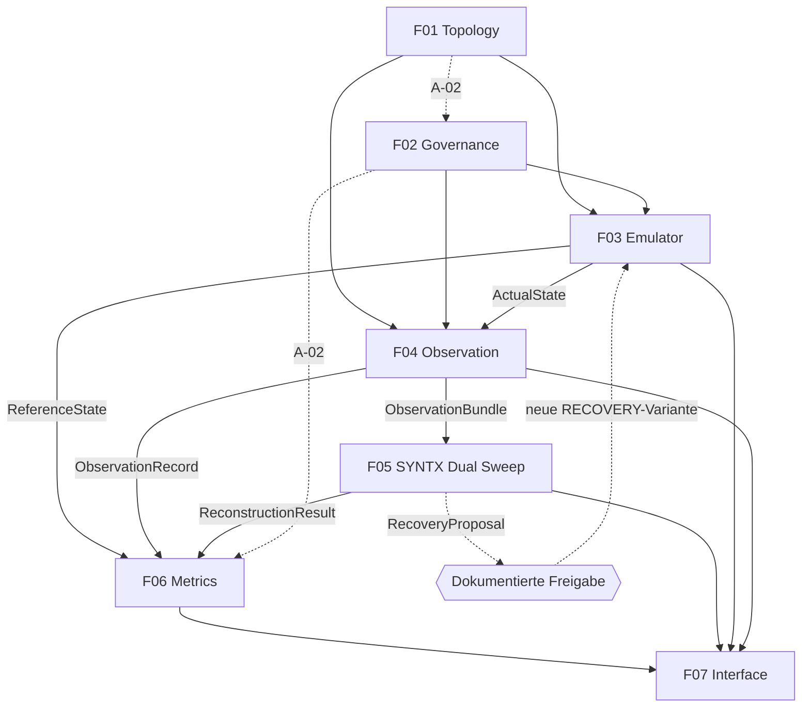
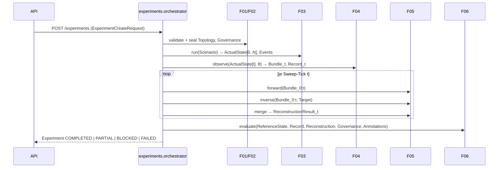
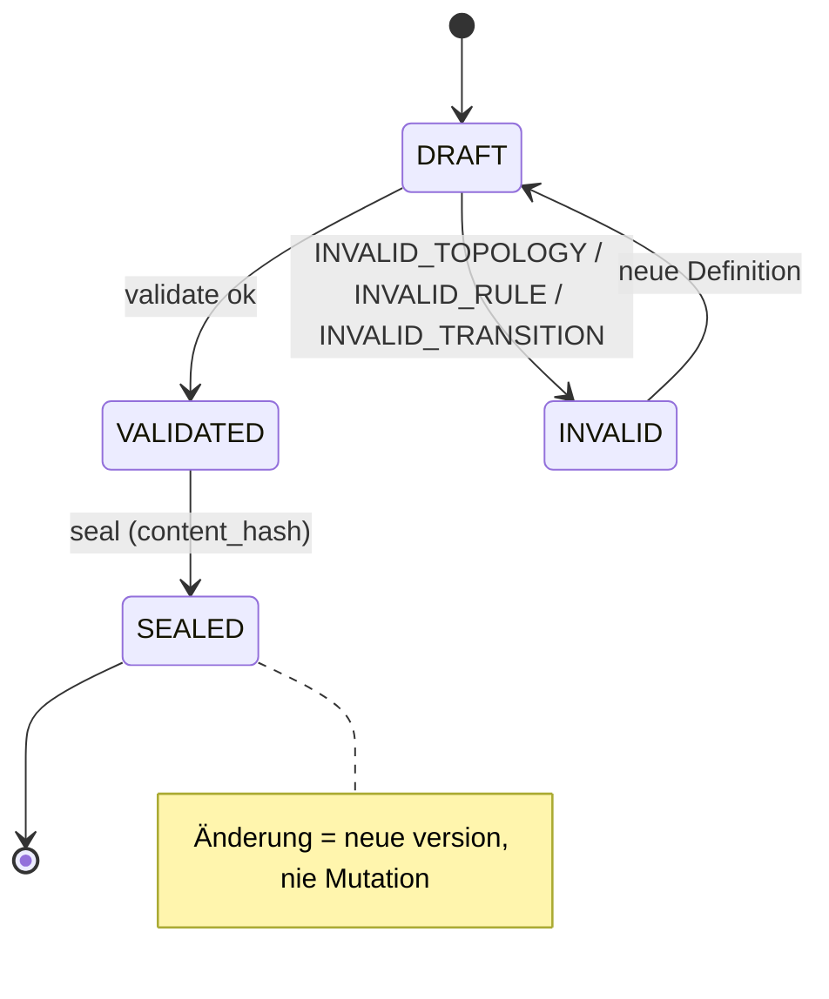
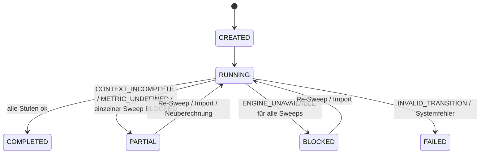
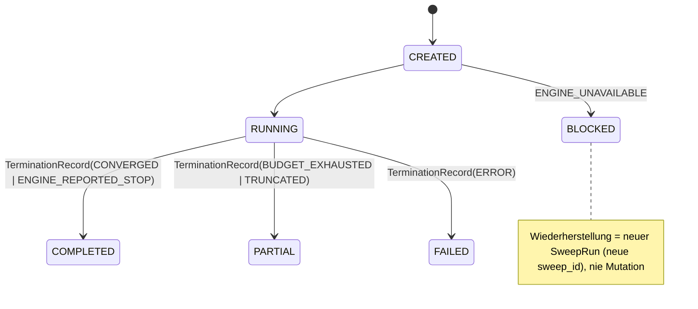
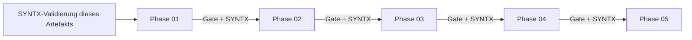

# SYNTX :: CIRA — Claude Implementation Architecture

**Structural Cognition and Resilience Engineering Architecture — implementierungsoptimierte System-Field-Architektur**

| Kopf | Wert |
|---|---|
| Artefakt | `SYNTX_CIRA_Claude_Implementation_Architecture_v1.0.0.md` |
| Artefakttyp | Claude-Architekturartefakt (Output) zur Referenzarchitektur |
| Referenz | SYNTX :: CIRA, Ottavio Braun — Kopfzeile „Version 1.0.1 — konsolidierter Architekturentwurf“, Dateiname `…_v1.0.0.md` (siehe Q02) |
| Kontext | European Defense Tech Hackathon, Berlin 2026 · Structural Intelligence / Civil Infrastructure Resilience |
| Umgebung | vollständig synthetisches, abstraktes Service-Labor; keine realen Standorte, keine realen Infrastrukturmodelle |
| Erstellt von | Claude (Opus 5.5), 2026-11-26 |
| Status | **ENTWURF — zur SYNTX-Validierung (Recursive Deep Sweep / Inverse Recursive Deep Sweep). Keine Implementierungsfreigabe.** |
| Code | keiner. Schemas sind Vertragsentwürfe in Notation, kein Anwendungscode. |

---

## 00 — Lesart und Kennzeichnung

Jedes Element dieses Artefakts trägt eine epistemische Herkunftsmarke. Die Marken trennen, was aus der Referenz übernommen ist, von dem, was Claude strukturell ergänzt oder verändert.

| Marke | Bedeutung |
|---|---|
| `[REF]` | aus der Referenz übernommen, Semantik unverändert |
| `[KON]` | Konkretisierung: Referenz nennt das Element, Claude legt die Implementierungsform fest |
| `[EXT]` | strukturelle Erweiterung durch Claude, in der Referenz nicht enthalten |
| `[DEV]` | Abweichung von einer Referenzaussage, mit dokumentierter struktureller Wirkung |
| `[OPEN]` | offene Entscheidung, Default-Vorschlag angegeben, Validierung erforderlich |
| `[DEP]` | externe Abhängigkeit (SYNTX, Engine, Bibliothek, Umgebung) |

Registerpräfixe: `Q` Quellbefund · `P` Prinzip · `D` Entscheidung · `A` Abweichung · `X` Erweiterung · `O` offener Punkt · `DEP` Abhängigkeit · `G` GAP · `REQ` Anforderung · `CIRA-T` Test.

Abgrenzung: Die Vorwärts-/Rückwärtsprüfung in Abschnitt 15 ist eine Claude-seitige strukturelle Prüfung. Sie ist **keine** Ausführung der MASTER ENGINE, kein Dual Sweep und ersetzt die SYNTX-Validierung nicht.

---

## 01 — Quellbefund der Referenz (Eingangsrekonstruktion)

Die Referenz wurde vollständig gelesen (372 Zeilen). Folgende Zustände der Quelle sind für die Implementierung strukturwirksam. Sie werden als Beobachtung beschrieben, nicht bewertet.

| ID | Quellstelle | Beobachtung | Strukturelle Wirkung | Behandlung |
|---|---|---|---|---|
| Q01 | Z. 174–331 (Abschnitt 07) | Zwischen Repository-Baum (`experiments/`) und Stack-Zeile steht ein vollständiger fremder Inhaltsblock: „FCSD arXiv Submission Package — Field Coherence Stress Diagnosis“ (LaTeX-README, März 2026). Die Leerzeilen Z. 174–175, 180–181, 186–188 deuten auf Umbruch im Repository-Baum hin. | Der Block definiert keine CIRA-Anforderung. Offen ist, ob beim Einfügen Zeilen des Repository-Baums verloren gingen. | Nicht als Anforderung übernommen. Repository-Baum aus den lesbaren Zeilen rekonstruiert und erweitert (Abschnitt 09). → O-12 |
| Q02 | Kopf Z. 6 / Dateiname | Kopfzeile „1.0.1“, Dateiname „v1.0.0“. Dieses Ausgabeartefakt trägt auf Anweisung denselben Dateinamen wie die Referenz. | Verwechslungsgefahr zwischen Referenz und Output. | Output trägt Artefakttyp „Claude-Architekturartefakt (Output)“ im Kopf. → O-13 |
| Q03 | Z. 74 | „Elf Sichten“, aufgezählt werden zwölf; die Referenz vermerkt dies selbst und erlaubt Export als gemeinsame Funktion. | Anzahl der View-Module. | D-21: elf Sichten + globale Exportfunktion. |
| Q04 | Z. 88–89 | Metriken 5 und 6: Definitionsspalte leer, Zielspalte enthält `D_det` bzw. `D_obs`. Spaltenverschiebung. | Definition von M05/M06 fehlt formal. | Rekonstruiert aus Fixture 04.11: `M05 = |D_det|/|D_ref|` (0.80), `M06 = |D_obs|/|D_ref|` (0.60), Ziel 1. Gewichtung → O-07. |
| Q05 | Z. 87 | Functional Continuity: `f(t)` „für abstrakte Servicefunktion“ — Quelle der Servicefunktion nicht definiert. | M04 ohne Auswertungsgrundlage. | X-06: Servicefunktion als F02-Regel `kind=FUNCTION`. → O-08 |
| Q06 | Z. 86 | Temporal State Consistency: „gültige Übergänge“ — Gültigkeitskriterium nicht definiert. | M03 ohne Auswertungsgrundlage. | A-03: F02-Regeln `kind=TRANSITION` über Zustandspaaren. |
| Q07 | Z. 92 | GAP Closure: „ursprüngliche Konsistenzabweichungen“ — Basis (Regeln auf Ω_A oder annotierte Fälle) und Zeitpunkt offen. | M09 ist experimentübergreifend. | X-09 ComparisonReport. → O-09 |
| Q08 | Z. 93 | Stability `d(R1,R2)` — Herkunft von R1, R2 nicht festgelegt. | M10 benötigt zwei Rekonstruktionen. | D-27 Default: wiederholter Sweep auf identischem ObservationBundle. → O-10 |
| Q09 | Z. 96 | „GAP-Matching und kanonische Relationsidentität sind noch zu spezifizieren.“ | M07/M08 und DeltaCoupling hängen daran. | Vorschläge D-28, D-29. → O-03, O-04 |
| Q10 | Z. 119–126 | Kopplungstabelle enthält keine Kante F02→F06, obwohl M02–M04 deklarierte Regeln auswerten. Keine Kante F01→F02, obwohl `applies_to` Topologieelemente referenziert. | Zwei Funktionsabhängigkeiten ohne Vertrag. | A-02: zwei Kopplungen ergänzt. |
| Q11 | Z. 334 | API-Liste enthält keine Endpunkte für Topologie, Ω_A-Zustände, Events, Traces, Vergleiche, obwohl elf Sichten diese visualisieren. | F07 nicht vollständig versorgbar. | A-04: Zusatzendpunkte, Referenzendpunkte unverändert. |
| Q12 | Z. 64, 78 | Zusammenführung `Q_F`, `Q_I` → ReconstructionResult: Mergesemantik nicht definiert; offen, ob Engine oder CIRA zusammenführt. | Ω_R-Bildung uneindeutig. | X-12 MergePolicy mit Engine-Vorrang. → O-05 |
| Q13 | Z. 74 | Semantik „Architectural Closure Inspector“ nicht beschrieben. | Inhalt der Sicht offen. | D-22 Default. → O-11 |
| Q14 | Z. 164 | Original-Dual-Sweep nicht abgeschlossen, Referenzrückgabe abgeschnitten. | Operator-/Σ-Zuordnung fehlt. | Adapter behandelt Operatoren opak; `ReferenceStatus.TRUNCATED` als Vertragszustand (X-14). → DEP-01, DEP-03 |

---

## 02 — Implementierungsprinzipien

| ID | Prinzip | Begründung | Herkunft |
|---|---|---|---|
| P01 | **Vertrag vor Modul.** Jedes Feld kommuniziert ausschließlich über versionierte, unveränderliche Vertragstypen. | Felder bleiben austauschbar; Kopplungen sind prüfbar. | [REF] 07 |
| P02 | **Zustandsräume sind Typen.** Ω_A, Ω_O, Ω_R sind disjunkte Typfamilien; kein gemeinsamer „State“-Obertyp. | Vermischung (G04) wird zum Typfehler statt zur Konvention. | [KON] |
| P03 | **Zugriff ist Capability.** Lese-/Schreibrechte je Feld und Artefakttyp stammen aus einer maschinenlesbaren Kopplungsmatrix; dieselbe Quelle erzeugt Import-Regeln, Store-Guards und Tests. | Eine Quelle für Zugriffsmatrix, Architekturtest und Laufzeitschutz. | [EXT] X-02 |
| P04 | **Determinismus ohne Uhr.** Keine Wanduhrzeit, kein ungeseedeter Zufall in Artefaktinhalten; IDs und Hashes aus kanonischem JSON. | Replay (T03) vergleicht Inhaltshashes. | [KON] |
| P05 | **Exakte Arithmetik.** Metriken werden mit rationalen Zahlen berechnet; `float` nur als abgeleitete Darstellung. | Nenner/Zähler bleiben nachvollziehbar; Fixture-Werte exakt prüfbar. | [EXT] X-04 |
| P06 | **Offenheit ist Zustand, kein Fehler.** UNKNOWN, UNDETERMINED, ⊥, UNDEFINED, OPEN sind gültige Vertragszustände mit eigener Zählung. | [REF] 02, 03, 04 |
| P07 | **Ausführungsstatus ≠ inhaltliche Offenheit.** `ExecutionStatus` und `ContentOpenness` sind getrennte Felder. | [REF] 07 |
| P08 | **Keine erfundene Engine.** Jede F05-Ausgabe trägt `data_origin` (FIXTURE / ENGINE / IMPORTED); Fixture-Werte sind nie Engine-Werte. | [REF] 03, 08 |
| P09 | **Laufzeitzustände über Artefakte, Anfragefehler über HTTP.** | Klare Fehlersemantik der API. | [EXT] |
| P10 | **Write-once.** Artefakte werden nie überschrieben; Änderung = neue Revision. | G10, Replay, Export. | [KON] |
| P11 | **Mensch als dokumentierte Instanz.** Rekonstruktionsvorschläge werden nie automatisch angewendet; Übergang zu einer Wiederherstellungsvariante nur über einen dokumentierten Freigabezustand. | [REF] 03 F02, F05 |
| P12 | **Ein Single Source of Truth je Information.** Pydantic → JSON Schema → TypeScript; Kopplungsmatrix-JSON → Capabilities, Import-Regeln, Tests. | [REF] 07, [EXT] |

### 02.1 — Zuschnitt auf Claude als implementierendes Modell

Die Architektur ist auf die Arbeitsweise zugeschnitten, mit der Claude zuverlässig implementiert und sich selbst prüft:

| Eigenschaft von Claude | Architekturantwort |
|---|---|
| Kein Gedächtnis zwischen Sitzungen | Das Repository trägt den Zustand: `docs/STATUS.md` (Phasenstand), `docs/adr/` (Entscheidungen), `docs/test-reports/phase-0N.json` (tatsächliche Testergebnisse). Jede Sitzung beginnt mit Lesen dieser Dateien. |
| Arbeitet am stärksten in begrenzten, klar umrissenen Einheiten | Kleine reine Module (Richtwert ≤ 300 Zeilen), eine Verantwortung je Datei, Funktionssignaturen nur mit Vertragstypen. |
| Prüft sich am besten gegen ausführbare Erwartungen | Golden Fixtures mit exakten Erwartungswerten (Abschnitt 12) vor jeder Metrikimplementierung; Test-zuerst für F06. |
| Kann Grenzen unbeabsichtigt durchlässig machen | Architekturtests (import-linter + AST-Prüfung + Store-Capability-Guard) erkennen Grenzverletzungen mechanisch, unabhängig von Claudes Aufmerksamkeit. |
| Drift zwischen Python und TypeScript bei manueller Pflege | Generierte Typen, Schema-Drift-Test (CIRA-TX02) im CI. |
| Braucht inspizierbaren Laufzeitzustand zum Debuggen | Dateibasierter Artefakt-Store (JSON/JSONL), direkt lesbar. |

---

## 03 — System-Field-Grundlage in Implementierungsform

### 03.1 — Kern

`[REF]` S = C(J,R); CIRA: S_t = C(J_t, R_t).

`[KON]` Abbildung: J_t = zum Tick t zugängliche Ströme (Beobachtungsquellen, Ereignisstrom); R_t = zum Tick t gültige Relationen (Topologie-Relationen, Regelrelationen, rekonstruierte Relationsaussagen); C = versionierte Konfiguration (θ, Regelversion, Gewichtsversion, Adapterkonfiguration). Ein `FieldConfigurationSnapshot` hält je Feld und Tick die Referenzen auf J_t, R_t und C.

### 03.2 — Strukturelle Unterscheidungen → Typen

| Unterscheidung [REF] | Implementierungsträger [KON] |
|---|---|
| Stream | `ObservationSource` (F04), `EventRecord`-Strom (F03) |
| Coupling | `Relation` (F01), `RelationAssertion` mit `CouplingStatus` (F05), Feldkopplungen der Kopplungsmatrix |
| Interface | Feldports: Ein-/Ausgabevertragstypen im Field Manifest |
| Weighting | `WeightSet` (F06), versioniert, Default 1 |
| Calibration | `ObservationConfig` θ (F04), `MetricConfig` (F06) — versioniert |
| Coherence State | `RuleEvaluationSet` je Raum und Tick (F02-Typ, ausgewertet durch F06) |
| Delta | `DeltaState`, `DeltaCoupling` (getrennt) |
| Recursion | (a) Re-Rekonstruktion versionierter Kontexte Ω_O(0:t); (b) vermittelte Rückkopplung F05 → Freigabe → neue Wiederherstellungsvariante F03 (Abschnitt 05.5) |

### 03.3 — Getrennte Kategorien als geschlossene Enums

| Enum | Werte | Quelle |
|---|---|---|
| `CouplingStatus` | `EFFECTIVE` (effektive Kopplung) · `POSSIBLE` (bekannte Kopplungsmöglichkeit) · `UNKNOWN_OPEN` (unbekannte Offenheit) | [REF] 02 |
| `EpistemicClass` | `SOURCE_OBSERVATION` · `SOURCE_STATEMENT` · `STRUCTURAL_DERIVATION` · `HYPOTHESIS` · `OPEN_REFERENCE` | [REF] 02 |
| `ObservationStatus` | `KNOWN` · `UNKNOWN` · `NOT_APPLICABLE` | [REF] F04 |
| `ReconstructionStatus` | `DETERMINED` · `UNDETERMINED` · `NOT_APPLICABLE` | [KON] |
| `RuleResult` | `TRUE` (1) · `FALSE` (0) · `UNEVALUABLE` (⊥) | [REF] F02 |
| `ReferenceStatus` | `RESOLVED` · `UNRESOLVED` · `TRUNCATED` · `EXTERNAL` | [EXT] X-14 |
| `ExecutionStatus` | `CREATED` · `RUNNING` · `COMPLETED` · `PARTIAL` · `FAILED` · `BLOCKED` | [REF] 07 |
| `DataOrigin` | `SYNTHETIC` · `FIXTURE` · `ENGINE` · `IMPORTED` · `ILLUSTRATIVE` | [EXT] X-08 |
| `StateSpace` | `A` · `O` · `R` | [REF] 04 |

### 03.4 — Softwarefelder vs. Σ-Felder vs. Operatoren

`[REF]` F01–F07 sind Softwarefelder. Σ-Felder der MASTER ENGINE und Operatoren R01–R18 / I01–I19 sind Engine-Gegenstände.
`[KON]` Sie erscheinen in CIRA ausschließlich als opake Referenztypen `SigmaRef` und `OperatorRef` im F05-Namensraum. CIRA prüft nur Syntax und Registrierung, nie Semantik. Die Bedeutung wird aus der `OperatorRegistry` des Adapters wörtlich übernommen (DEP-01). Keine Annahme, dass `R` Vorwärts und `I` Invers bedeutet.

---

## 04 — Feldverträge F01–F07

Tupel `[REF]`: F_i = ⟨C_i, R_i, X_i, U_i, Y_i, B_i, I_i, T_i, K_i, P_i⟩. Jeder Vertrag wird zusätzlich als maschinenlesbares Field Manifest `contracts/fields/F0N.field.json` geführt `[EXT]` X-01.

### F01_DOMAIN_TOPOLOGY

| Komponente | Inhalt |
|---|---|
| Identität / Zweck | Typisierter gerichteter Graph G=(V,E,τV,τE) abstrakter Servicekomponenten `[REF]` |
| C Träger | `Node`, `Relation`, `NodeTypeDecl`, `ValueDomain`, `AttributeDecl` |
| R Relationen | `depends_on`, `reports_to`, `provides` (geschlossene Menge in v1) `[REF]` |
| X Zustandsraum | Definitionszustände: `DRAFT → VALIDATED → SEALED`; `INVALID_TOPOLOGY` |
| U Eingabe | `TopologyDefinition` |
| Y Ausgabe | `ImmutableTopology` (versiegelt), `TopologyProjection` (F07) |
| B Grenze | Keine Zustandswerte, nur deklarierte Attribute und Wertedomänen; keine Geodaten, keine realen Namen (CIRA-TX09) |
| I Invarianten | I1 eindeutige IDs je Klasse; I2 alle Referenzen auflösbar; I3 Relationstyp ∈ deklarierter Menge; I4 pro Run unveränderlich; I5 Attributdomäne deklariert; I6 kanonische Relations-ID = f(Typ, Quelle, Ziel) (D-29) |
| T Transitionen | `validate`, `seal`; Änderung ⇒ neue `version` |
| K Kopplungen | → F02 (Referenzvalidierung, A-02), → F03, → F04, → F07 |
| P Provenienz | `topology_id@version`, `content_hash` |
| Zeitgültigkeit | gesamter Run |
| Fehler / Wiederherstellung | `INVALID_TOPOLOGY` mit Fehlerliste; Wiederherstellung nur durch gültige neue Definition |
| Serialisierung | JSON |

### F02_GOVERNANCE

| Komponente | Inhalt |
|---|---|
| Identität / Zweck | Dokumentierte Regeln, Rollen, Sollbedingungen `[REF]` |
| C Träger | `Rule`, `RoleDecl`, `ApprovalRecord`, `Predicate` |
| R Relationen | `applies_to` (Regel→Topologieelement), `requires` (Regel→Regel), `permits` (Regel→Rolle) `[REF]`; Semantik `requires` D-12 |
| X Zustandsraum | Definition: `DRAFT → VALIDATED → SEALED`; `INVALID_RULE`. Auswertung: g_j ∈ {TRUE, FALSE, UNEVALUABLE} |
| U Eingabe | `GovernanceDefinition` |
| Y Ausgabe | versiegelte `GovernanceDefinition`; `RuleEvaluation` (getrennter Typ, erzeugt durch den reinen Evaluator); `ObservableRules` (über F04); `GovernanceProjection` |
| B Grenze | Regeln sind Sollbedingungen; F03 erzwingt sie **nicht** (D-14). Regeln werden nie gegen Ω_A ausgeführt, außer in F06. |
| I Invarianten | eindeutige `rule_id@version`; `applies_to` auflösbar gegen F01; `requires`-Graph azyklisch; Prädikat referenziert nur deklarierte Attribute; Zeitgültigkeit `valid_from ≤ valid_until` |
| T Transitionen | Versionierte Regeländerung erzeugt neue `GovernanceDefinition`-Version |
| K Kopplungen | → F03 (Rollen/Freigabezustände), → F04 (ObservableRules), → F06 (Auswertung, A-02), → F07 |
| Regelsemantik | g_j: X → {0,1,⊥} `[REF]`; erweitert für `kind=TRANSITION`: g_j: X×X → {0,1,⊥} `[DEV]` A-03; Kleene-Dreiwertlogik (D-11) |
| Menschliche Freigaben | `ApprovalRecord` als dokumentierter experimenteller Zustand, eingespielt als Eingabeereignis u_t `[KON]` |
| Fehler / Wiederherstellung | `INVALID_RULE`; Rückkehr zur letzten gültigen Version |
| Serialisierung | JSON |

### F03_EMULATOR

| Komponente | Inhalt |
|---|---|
| Identität / Zweck | Deterministische Fortschreibung vorab definierter abstrakter Testzustände `[REF]` |
| C Träger | `Experiment`, `Snapshot` (= `ActualState` je Tick), `EventRecord` |
| X Zustandsraum | Ω_A(t) — vollständig bestimmt (keine UNKNOWN), Werte ∈ Domäne oder `NOT_APPLICABLE` |
| U Eingabe | `ScenarioDefinition` (inkl. u_t), `ImmutableTopology`, `GovernanceDefinition` |
| Y Ausgabe | `ActualState` je Tick, `EventRecord` (JSONL), `ConsistencyAnnotationSet` (Ground Truth, X-07), `ReferenceState` (F06), `StateProjection` (F07) |
| T Transition | Ω_A(t+1) = T(Ω_A(t), u_t) `[REF]`; T wendet u_t in Sequenzreihenfolge an (D-13) |
| B Grenze | **Keine Abhängigkeit von F04/F05** `[REF]` (CIRA-TX03) |
| I Invarianten | Tick und Sequenz streng monoton; Werte ∈ deklarierter Domäne; gleiche Eingaben ⇒ gleiche Hashes |
| Baseline / Recovery | `variant_kind ∈ {BASELINE, RECOVERY}`, gemeinsame `fixture_lineage_id`, gleiche Topologie-/Governance-Version für Vergleichbarkeit `[KON]` |
| P Provenienz | Szenario-, Topologie-, Governance-Version, Initialzustandshash, Ereignis-Seq |
| Fehler / Wiederherstellung | `INVALID_TRANSITION` (strukturell: Wert ∉ Domäne, unbekanntes Attribut, Tick nicht monoton, Setzen eines NOT_APPLICABLE-Attributs); Replay ab gültigem Initialzustand |
| Serialisierung | JSON (Snapshots), JSONL (Events) |

### F04_OBSERVATION

| Komponente | Inhalt |
|---|---|
| Identität / Zweck | Ω_O(t) = O_θ(Ω_A(t)), θ versioniert `[REF]` |
| C Träger | `Observation`, `ContextBundle`, `ObservationSource`, `SourceReferenceRegister` |
| R Relationen | `observes`, `references`, `derived_from` `[REF]` |
| U Eingabe | `ActualState`, `ObservationConfig` θ, `ImmutableTopology`, `GovernanceDefinition` |
| Y Ausgabe | `ObservationBundle` (F05-seitig, ohne Ω_A-Verweise), `ObservationRecord` (F06-seitig, mit Ω_A-Verknüpfung), `ObservableTopologyDefinition`, `ObservableRules`, `ObservationProjection` (F07) — Trennung Bundle/Record `[KON]` D-16 |
| Attribute | Source-ID, Tick, `observed_at_tick`, Referenz, Status `[REF]` + `observed_at_tick` `[EXT]` |
| I Invarianten | `KNOWN ⇔ value ≠ null`; `UNKNOWN`/`NOT_APPLICABLE ⇒ value = null`; UNKNOWN ≠ falsch ≠ abwesend; jedes Attribut der beobachtbaren Topologie erhält je Tick genau eine Observation; Kontextversion streng monoton; Quellenkontinuität im Register |
| Budget | `context_budget {max_observations, max_bytes}`; keine stille Kürzung (D-18) |
| Fehler / Wiederherstellung | `CONTEXT_INCOMPLETE`; erneute Serialisierung mit versioniertem Serialisierungsprofil |
| Serialisierung | JSON |

### F05_SYNTX_ENGINE

| Komponente | Inhalt |
|---|---|
| Identität / Zweck | Strukturelle Rekonstruktion Ω_R(t) = R(Ω_O(0:t)) über unabhängige Vorwärts-/Inversrekonstruktion `[REF]` |
| C Träger | `SweepRun`, `Reference`, `SweepTrace` |
| U Eingabe | **ausschließlich** `ObservationBundle` und beobachtungsbasierte `TargetDefinition` `[REF]` |
| Y Ausgabe | `ForwardResult` Q_F = R_F(O), `InverseResult` Q_I = R_I(O,Z) mit unabhängigen Ausführungshistorien; danach `ReconstructionResult` `[REF]`; `RecoveryProposal` (nie automatisch angewendet) |
| Attribute | Operator-ID, Σ-ID, Provenienz, Referenzstatus `[REF]` |
| R Relationen | `derives_from`, `references`, `depends_on` `[REF]` |
| Delta | `DeltaState`, `DeltaCoupling` getrennt `[REF]` |
| GAP | `StructuralGap` mit ≥1 Quellbezug, `OpenRelation`, `TerminationRecord` `[REF]` |
| B Grenze | Keine Kenntnis von Ω_A — weder Import noch Referenz noch indirekte Übergabe (CIRA-T04b, CIRA-TX04, CIRA-TX05) |
| I Invarianten | Forward erhält kein `target_ref`; Inverse erhält kein Forward-Artefakt; zwei getrennte `sweep_id` und Traces; jede Ausgabe trägt `AdapterDescriptor` und `data_origin` |
| Adapter | `FixtureAdapter` (`is_fixture=true`), `LocalAdapter`, `ApiAdapter` `[DEP]`, `ImportExportAdapter` `[REF]` |
| Kontinuierliche Beobachtung | Sweep-Zeitplan je Experiment; jede Rekonstruktion bezieht sich auf eine Kontextversion `[KON]` |
| Fehler / Wiederherstellung | `ENGINE_UNAVAILABLE` ⇒ SweepRun `BLOCKED`; erneuter Sweep oder Import eines tatsächlichen Ergebnisses |
| Serialisierung | JSON |

### F06_METRICS

| Komponente | Inhalt |
|---|---|
| Identität / Zweck | Mathematische Evaluation M_t = M(Ω_A(t), Ω_O(t), Ω_R(t)) `[REF]` |
| C Träger | `MetricDefinition`, `MetricResult`, `EvaluationReport` `[REF]`; `ReferenceSpace`, `WeightSet`, `GapMatch`, `ComparisonReport` `[EXT]` |
| U Eingabe | `ReferenceState`, `ObservationRecord` (+ Bundle), `ReconstructionResult`, `GovernanceDefinition` (A-02), `ConsistencyAnnotationSet` |
| Y Ausgabe | versionierter `EvaluationReport`, `ComparisonReport`, `RuleEvaluationSet` je Raum |
| I Invarianten | identischer Referenzraum je Auswertung; alle Werte ∈ [0,1] oder `null`; Nenner 0 ⇒ `UNDEFINED`/`null`; ⊥ und NOT_APPLICABLE separat gezählt; kein Gesamtindex `[REF]` |
| Fehler / Wiederherstellung | `METRIC_UNDEFINED` bei fehlenden Eingaben (Report `PARTIAL`), Neuberechnung nach Vervollständigung (D-25) |
| Serialisierung | JSON |

### F07_INTERFACE

| Komponente | Inhalt |
|---|---|
| Identität / Zweck | Darstellung und Experimentsteuerung `[REF]` |
| C Träger | `View`, `ExperimentSession` |
| Attribute | Run-ID, Tick, Ansicht `[REF]` |
| U / Y | API-Projektionen → Darstellungszustand, Experimentsteuerung |
| I Invarianten | eine gemeinsame (experiment_id, tick)-Referenz für alle Sichten (URL als Single Source, D-20); jede Projektion spiegelt experiment_id und tick zurück; Abweichung ⇒ `VIEW_DATA_UNAVAILABLE`; jeder Wert trägt sichtbar `data_origin` |
| B Grenze | Keine ausgehende Kopplung zu F05; keine Berechnung von Metriken im Frontend |
| Fehler / Wiederherstellung | `VIEW_DATA_UNAVAILABLE`; erneuter Abruf |
| Serialisierung | TypeScript (generiert) / JSON |

---

## 05 — Kopplung und Zugriff

### 05.1 — Kopplungsmatrix (Feld → Feld)

| von \ nach | F01 | F02 | F03 | F04 | F05 | F06 | F07 |
|---|---|---|---|---|---|---|---|
| **F01** | — | TopologyRefs `[DEV A-02]` | TopologyDefinition | TopologyDefinition → ObservableTopologyDefinition | — | — | TopologyProjection |
| **F02** | — | — | GovernanceDefinition | GovernanceDefinition → ObservableRules | — | GovernanceDefinition `[DEV A-02]` | GovernanceProjection |
| **F03** | — | — | — | ActualState | **verboten** | ReferenceState, ConsistencyAnnotationSet | StateProjection, EventProjection |
| **F04** | — | — | — | — | ObservationBundle (+ ObservableTopology, ObservableRules, SourceRegister) | ObservationRecord | ObservationProjection |
| **F05** | — | — | vermittelt über Freigabe (05.5) | — | — | ReconstructionResult | SweepTrace, Result-Projektionen |
| **F06** | — | — | — | — | **verboten** | — | EvaluationReport, ComparisonReport |
| **F07** | — | — | Experimentsteuerung (POST) | — | **verboten** | — | — |

Jede Kopplung trägt `experiment_id`, `schema_version`, `tick` (oder `null` für zeitlose Definitionen) und `provenance` `[REF]` — realisiert durch `ArtifactEnvelope`.



### 05.2 — Zustandsraumzugriff `[REF]`

| Feld | Ω_A | Ω_O | Ω_R |
|---|---|---|---|
| F03 | erzeugt | — | — |
| F04 | liest | erzeugt | — |
| F05 | — | liest | erzeugt |
| F06 | liest | liest | liest |
| F07 | visualisiert | visualisiert | visualisiert |

### 05.3 — Artefakt-Capability-Matrix `[EXT]` X-02

W = schreibt, R = liest, — = kein Zugriff. Quelle: `contracts/coupling_matrix.json`; daraus generiert: Store-Guards, import-linter-Konfiguration, Testfälle.

| Artefakttyp | F01 | F02 | F03 | F04 | F05 | F06 | F07 |
|---|---|---|---|---|---|---|---|
| TopologyDefinition / ImmutableTopology | W | R | R | R | — | R | R |
| GovernanceDefinition | — | W | R | R | — | R | R |
| ScenarioDefinition | — | — | W/R | — | — | R | R |
| ConsistencyAnnotationSet | — | — | W | — | **—** | R | R |
| ActualState (Snapshot) | — | — | W | R | **—** | R | R |
| EventRecord | — | — | W | — | **—** | R | R |
| ObservationConfig θ | — | — | — | W/R | — | R | R |
| ObservableTopologyDefinition | — | — | — | W | R | R | R |
| ObservableRules | — | — | — | W | R | R | R |
| SourceReferenceRegister | — | — | — | W | R | R | R |
| ObservationBundle | — | — | — | W | R | R | R |
| ObservationRecord | — | — | — | W | **—** | R | R |
| TargetDefinition | — | — | — | (Autorenschaft) | R | R | R |
| SweepRun / ForwardResult / InverseResult / SweepTrace | — | — | — | — | W | R | R |
| ReconstructionResult / RecoveryProposal | — | — | — | — | W | R | R |
| RuleEvaluationSet | — | — | — | — | — | W | R |
| EvaluationReport / ComparisonReport | — | — | — | — | **—** | W | R |
| AuthorityRecord | — | — | R | — | — | — | R (W über API, Mensch) |
| ExperimentBundle | Komposition (`experiments`) | | | | — | | R |

### 05.4 — Ausgeschlossene Flüsse und ihre Durchsetzung

| Fluss | Durchsetzung | Test |
|---|---|---|
| F05 importiert `emulator`, `observation`, `metrics`, `experiments`, `api` | import-linter `forbidden` | CIRA-T04b |
| F05 importiert `contracts.f03`, `contracts.f04_record`, `contracts.f06`, `contracts.f07` | import-linter `forbidden` + AST-Scan | CIRA-T04b |
| F05 liest ActualState/ObservationRecord/EvaluationReport/Annotation aus Store | `FieldReader(F05)` verweigert Typ ⇒ `ACCESS_VIOLATION` | CIRA-TX04 |
| Indirekt über generische Payloads | keine `dict`/`Any`-Payloads; diskriminierte Union über `artifact_type`; F05-Eingangssignatur nur `ObservationBundle`, `TargetDefinition` | CIRA-TX05 |
| Ω_A-Werte in `ObservationBundle` (z. B. Wert bei UNKNOWN) | Validator `UNKNOWN ⇒ value=null`; Bundle-Provenienz referenziert keine F03-Artefakte (I-F04) | CIRA-T04, CIRA-TX05 |
| Ground Truth über TargetDefinition | TargetDefinition-Provenienz darf keine F03/F06-Artefakte referenzieren; Ziele nur über beobachtbare Topologie-IDs | CIRA-TX06 |
| Ground Truth über Fixture-Verzeichnis | `FixtureAdapter` liest nur `synthetic_fixtures/f05_reconstructions/`; Pfad-Guard | CIRA-TX05 |
| Rückfluss F06/F07 → F05 | keine Kopplung; Orchestrator übergibt F05 nur Bundle + Target | CIRA-T04b, CIRA-TX05 |
| F03 → F04/F05 Abhängigkeit | import-linter `forbidden` | CIRA-TX03 |

### 05.5 — Vermittelte Rekursionskopplung `[EXT]` X-11

`[REF]` Keine automatische Anwendung von Rekonstruktionsvorschlägen; Wiederherstellungsvarianten sind separate Experimente.
`[KON]` Pfad: `RecoveryProposal` (F05) → `AuthorityRecord` (dokumentierte Freigabe durch Rolle aus F02, `decision ∈ {APPROVED, REJECTED}`) → neue `ScenarioDefinition` mit `variant_kind=RECOVERY`, `variant_of=<baseline>`, `derived_from_proposal=<ref>`, `authority_ref=<ref>` → neues Experiment. Die Richtung ist F05 → F03; Ω_A fließt dabei nie zu F05. Das neue Experiment rekonstruiert ausschließlich aus seinen eigenen Beobachtungen.

### 05.6 — Steuerungsfluss `[REF]`

initialisieren → Definitionen laden → synthetische Zustände → Beobachtung → unabhängige Sweeps → Zusammenführung → Evaluation → Visualisierung → Export.



---

## 06 — Zustandsmodelle

### 06.1 — Definitionen (F01, F02, ObservationConfig, Scenario, Target)



### 06.2 — Experiment



Experimentstatus ist eine Ableitung der Stufenstatus (D-24): FAILED dominiert, dann BLOCKED (wenn keine Rekonstruktion existiert), dann PARTIAL, sonst COMPLETED.

### 06.3 — SweepRun



### 06.4 — Kontext (F04)

`ctx_v(n)` → `ctx_v(n+1)` je beobachtetem Tick; Zustände `SERIALIZED`, `CONTEXT_INCOMPLETE` (Budget überschritten) → `SERIALIZED` mit neuem Profil. Kontextversion bleibt monoton; ein Profilwechsel erzeugt eine neue Kontextversion mit `previous_context_ref`.

### 06.5 — Attributwerte über die drei Räume

| Raum | Zustände je Attribut | Werte |
|---|---|---|
| Ω_A | APPLICABLE(value) · NOT_APPLICABLE | vollständig bestimmt |
| Ω_O | KNOWN(value) · UNKNOWN · NOT_APPLICABLE | `observed_at_tick ≤ tick` |
| Ω_R | DETERMINED(value, epistemic_class) · UNDETERMINED · NOT_APPLICABLE | Herkunft über `derived_from` |

### 06.6 — Strukturelle GAP / Relation (F05)

`StructuralGap.status ∈ {OPEN, CLOSED_IN_RESULT}`; `OpenRelation.reference_status ∈ ReferenceStatus`. Schließung ist immer an ein späteres Ergebnisartefakt gebunden, nie an eine Mutation.

### 06.7 — Sicht (F07)

`IDLE → LOADING → READY`; `LOADING → VIEW_DATA_UNAVAILABLE` (HTTP-Fehler oder Header-Abweichung experiment_id/tick); `READY → LOADING` bei Tick- oder Experimentwechsel; `VIEW_DATA_UNAVAILABLE → LOADING` bei erneutem Abruf.

---

## 07 — Mathematisches Modell in Implementierungsform

Alle Metriken sind CIRA-spezifische Entwürfe, keine Original-SYNTX-Operatoren `[REF]`.

### 07.1 — Mengen und Grundfunktionen

Für Tick t, Attributuniversum U(t) (alle deklarierten Attribute der Topologie):

- `D_ref(t) = { i ∈ U : Ω_A(t)[i] ≠ NOT_APPLICABLE }` `[REF]`
- `D_obs(t) = { i ∈ D_ref : Ω_O(t)[i].status = KNOWN }` `[REF]`
- `D_det(t) = { i ∈ D_ref : Ω_R(t)[i].status = DETERMINED ∧ class ∈ H }` — H gemäß Hypothesenpolitik (D-26, O-06), Default H = alle Klassen außer `OPEN_REFERENCE`
- `w_i ∈ ℚ_{>0}`, versioniertes `WeightSet`, Default 1 `[REF]`
- `δ(a,r) = 0` wenn a = r, sonst 1 `[REF]`
- `W(S) = Σ_{i∈S} w_i`
- `ratio(n, d) = n/d` wenn d ≠ 0, sonst `(status=UNDEFINED, value=null, undefined_reason=ZERO_DENOMINATOR)` `[REF]`
- `undetermined_count(t) = |D_ref \ D_det|` `[REF]`

### 07.2 — Metriken M01–M11

| ID | Metrik | Formel (Implementierung) | Räume | Ziel | Zusatzzähler |
|---|---|---|---|---|---|
| M01 | Reconstruction Distance | `ratio(Σ_{D_det} w·δ(a,r), W(D_det))` | A×R | 0 | undetermined_count |
| M02 | Relational Coherence | `ratio(#{j: g_j=TRUE}, #{j: g_j ∈ {TRUE,FALSE}})`, j über STATE-Regeln gültig in t | A, O, R (getrennt) | 1 | unevaluable_count, nicht anwendbare Regeln |
| M03 | Temporal State Consistency | `ratio(#{(j,t): g_j(s_t,s_{t+1})=TRUE}, #{(j,t): ∈{TRUE,FALSE}})`, j über TRANSITION-Regeln `[DEV A-03]` | A, O, R | 1 | unevaluable_count |
| M04 | Functional Continuity | `ratio(Σ_t f(t), N)`, f(t)=g_F(s_t) einer FUNCTION-Regel, N = #{t: f(t) ∈ {0,1}} `[KON X-06]` | A (Default), O, R optional | 1 | unevaluable_ticks |
| M05 | Reconstruction Coverage | `ratio(W(D_det), W(D_ref))` `[KON Q04]` | A×R | 1 | — |
| M06 | Observation Completeness | `ratio(W(D_obs), W(D_ref))` `[KON Q04]` | A×O | 1 | — |
| M07 | GAP Detection Coverage | `ratio(TP, TP+FN)` | Annotation×R | 1 | TP, FN |
| M08 | GAP Detection Precision | `ratio(TP, TP+FP)` | Annotation×R | 1 | TP, FP |
| M09 | GAP Closure | `ratio(#resolved, #original)` über Basis-Abweichungen | Baseline×Recovery | 1 | persisting, **new_inconsistencies** `[REF]` |
| M10 | Reconstruction Stability | `1 − ratio(Σ_{S} w·δ(r1,r2), W(S))`, S = D_det(R1) ∩ D_det(R2) | R1×R2 | 1 | **shared_coverage** = ratio(W(S), W(D_ref)) `[REF]` |
| M11 | Reconstruction Accuracy | `1 − M01`; UNDEFINED genau dann, wenn M01 UNDEFINED | A×R | 1 | — |

Präzisierungen:
- M01/M11 messen nur auf `D_det`; Coverage (M05) muss daneben berichtet werden, damit hohe Genauigkeit bei geringer Abdeckung sichtbar bleibt. Kein Gesamtindex `[REF]`.
- M02/M03 in Raum O und R: Prädikate über UNKNOWN bzw. UNDETERMINED Attribute liefern ⊥ (Kleene, D-11).
- M07/M08: TP/FN/FP über `GapMatcher` (D-28): ein annotierter Fall ist TP, wenn mindestens eine StructuralGap ihm zugeordnet ist; jede nicht zugeordnete StructuralGap ist FP; jeder Fall ohne Zuordnung FN. Eine Gap ordnet sich höchstens einem Fall zu.
- M09: original = Menge der STATE-Regel-Schlüssel (rule_id, scope) mit `FALSE` in Ω_A der Baseline am `comparison_tick`; resolved = davon `TRUE` in Ω_A der Recovery-Variante am selben Tick; new = Schlüssel `FALSE` in Recovery, nicht `FALSE` in Baseline (D-30, O-09).
- M10: Default R1, R2 = zwei SweepRun-Paare auf identischem `ObservationBundle` (D-27, O-10).

### 07.3 — Zeitaggregation `[REF]`

Für jede Metrik werden erzeugt: (a) `PER_TICK`-Ergebnisse mit Rohzähler und Nenner; (b) `POOLED` = ratio(Σ_t Zähler, Σ_t Nenner); (c) `TIME_MEAN_EXPLICIT` = arithmetisches Mittel der definierten Per-Tick-Werte, nur auf Anforderung und als solches gekennzeichnet, mit Zahl der eingeflossenen und ausgeschlossenen Ticks.

### 07.4 — Delta

- `Δ_S = D_S(S_t, S_{t+1})`: geordnete Liste der Attribute mit `(before, after)` je ValueState (Status + Wert); getrennt je Raum `[REF]`.
- `Δ_K = D_K(K_t, K_{t+1})`: geordnete Liste der kanonischen Relationsschlüssel mit `(before, after) ∈ (CouplingStatus ∪ {ABSENT})²` `[REF]`. K ist die Kopplung, nicht das Delta.
- D_S und D_K sind reine Funktionen in `core.delta`; deterministische Sortierung nach kanonischem Schlüssel.

### 07.5 — Regelauswertung (Kleene-Dreiwertlogik) `[EXT]` X-05

Geschlossenes Prädikat-AST (kein `eval`): `eq(attr, sym)`, `in(attr, syms)`, `not(p)`, `and(p…)`, `or(p…)`, `implies(p,q)`; für TRANSITION zusätzlich `transition_in(attr, ((from,to)…))`. Blattwert ⊥, wenn das Attribut im Raum UNKNOWN, UNDETERMINED oder NOT_APPLICABLE ist (D-11, O-21). Verknüpfung nach Kleene K3. Regel außerhalb ihrer Zeitgültigkeit wird nicht ausgewertet und als `not_in_validity` gezählt. `requires`: ist eine geforderte Regel ≠ TRUE, ist das Ergebnis ⊥ mit `reason=REQUIREMENT_NOT_MET` (D-12).

### 07.6 — Referenz-Fixture 04.11 (nachgerechnet)

Mit Gewicht 1 und allen zehn Attributen anwendbar: `D_ref=10`, `D_obs=6` (01–06), `D_det=8` (01–08), Abweichung nur bei 08 (NOMINAL vs. FAULTY).

| Größe | Rechnung | Erwartet [REF] | Nachgerechnet |
|---|---|---|---|
| C_obs (M06) | 6/10 | 0.60 | 0.60 ✓ |
| C_rec (M05) | 8/10 | 0.80 | 0.80 ✓ |
| d_R (M01) | 1/8 | 0.125 | 0.125 ✓ |
| A_R (M11) | 7/8 | 0.875 | 0.875 ✓ |
| undetermined_count | 10−8 | 2 | 2 ✓ |

Rechnerische Fixture-Werte, keine Engine-Messung `[REF]`. Attribut 07 (beobachtet UNKNOWN, rekonstruiert STANDBY) zählt zu D_det; damit geht die Fixture davon aus, dass eine aus UNKNOWN abgeleitete Bestimmung in D_det fällt (stützt D-26).

---

## 08 — Schemaentwürfe

Notation: `name : Typ  — Bedingung`. Alle Modelle `ConfigDict(extra='forbid', strict=True, frozen=True)` `[REF]`. Keine `list`/`dict`-Felder: Sequenzen als `tuple[...]`, Schlüssel-Wert-Strukturen als sortierte Tupel typisierter Einträge (D-05). Jedes Modell wird als JSON Schema mit `$schema`, `type`, `properties`, `required`, `$defs` exportiert `[REF]`.

### 08.1 — Kern (`contracts.common`)

```text
StableId        : str  — ^[a-z]+:[a-z0-9][a-z0-9_.\-/]{0,126}$  (Präfix je Klasse:
                  node, rel, attr, dom, rule, role, src, obs, ctx, sweep, gap, case,
                  metric, exp, art, scn, cfg, tgt, ws, rep, cmp, prop, auth, step)
SemVer          : str  — ^\d+\.\d+\.\d+$
SchemaVersion   : str  — ^cira\.[a-z_]+/\d+\.\d+\.\d+$
Tick            : int  — ≥ 0
Seq             : int  — ≥ 0
Symbol          : str  — ^[A-Z][A-Z0-9_]{0,63}$          (Wert einer ValueDomain)
Rational        : { n: int ≥ 0, d: int ≥ 1 }   — gekürzt (gcd(n,d)=1)
ContentHash     : str  — ^sha256:[0-9a-f]{64}$
FieldId         : enum F01 … F07
ArtifactType    : enum  (eine Konstante je Payload-Typ, s. 08.10)

ArtifactRef     : { artifact_id: StableId, artifact_type: ArtifactType,
                    revision: int ≥ 0, content_hash: ContentHash }

Provenance      : { source_field: FieldId,
                    source_refs: tuple[ArtifactRef, ...],
                    producer_id: str,                 — Modulname
                    producer_version: SemVer,
                    data_origin: DataOrigin }          [EXT]

ArtifactEnvelope[P] :
  schema_version : SchemaVersion
  experiment_id  : StableId | null        — null nur für experimentfreie Definitionen
  artifact_id    : StableId               — deterministisch, D-06
  artifact_type  : ArtifactType           — Diskriminator der Payload-Union
  revision       : int ≥ 0
  tick           : Tick | null
  provenance     : Provenance
  payload        : P                      — typisiert, keine Any/dict
  content_hash   : ContentHash            — sha256(kanonisches JSON von payload) [EXT]

ContentOpenness : { undetermined: int, unknown_observations: int, open_references: int,
                    open_relations: int, structural_gaps_open: int, unevaluable_rules: int }

ErrorCode       : enum INVALID_TOPOLOGY | INVALID_RULE | INVALID_TRANSITION |
                       CONTEXT_INCOMPLETE | ENGINE_UNAVAILABLE | METRIC_UNDEFINED |
                       VIEW_DATA_UNAVAILABLE                                  [REF]
                     | SCHEMA_VIOLATION | NOT_FOUND | CONFLICT | ACCESS_VIOLATION |
                       IMPORT_INVALID | COMPARISON_INCOMPATIBLE               [EXT]
RecoveryAction  : enum SUBMIT_VALID_DEFINITION | REVERT_TO_VERSION | REPLAY_FROM_INITIAL |
                       RESERIALIZE | RESWEEP | IMPORT_RESULT | RECOMPUTE | REFETCH
ErrorRecord     : { code: ErrorCode, field: FieldId, message: str,
                    subject_refs: tuple[StableId, ...], tick: Tick | null,
                    recovery: RecoveryAction }
```

### 08.2 — F01 (`contracts.f01`)

```text
ValueDomain     : { domain_id: StableId, version: SemVer, symbols: tuple[Symbol, ...] — ≥1, eindeutig }
NodeTypeDecl    : { type_id: StableId, label: str }
AttributeDecl   : { attribute_id: StableId (attr:<node>/<name>), name: str,
                    domain_ref: StableId, applicability: enum APPLICABLE | NOT_APPLICABLE }
Node            : { node_id: StableId, node_type: StableId, version: SemVer,
                    label: str — generisch, attributes: tuple[AttributeDecl, ...] }
RelationType    : enum depends_on | reports_to | provides
Relation        : { relation_id: StableId — = rel:<type>:<source>-><target> (D-29),
                    relation_type: RelationType, source: StableId, target: StableId, version: SemVer }
TopologyDefinition : { topology_id: StableId, version: SemVer,
                       node_types: tuple[NodeTypeDecl,...], value_domains: tuple[ValueDomain,...],
                       nodes: tuple[Node,...], relations: tuple[Relation,...] }
ImmutableTopology  : { definition: TopologyDefinition, topology_hash: ContentHash,
                       attribute_universe: tuple[StableId,...] — sortiert }
TopologyProjection : { topology_ref: ArtifactRef, nodes: tuple[NodeView,...], relations: tuple[RelationView,...] }
```

### 08.3 — F02 (`contracts.f02`)

```text
RuleKind        : enum STATE | TRANSITION | FUNCTION                            [DEV A-03 / X-06]
Predicate       : diskriminierte Union über `op`:
                  Eq{op:"eq", attr, value: Symbol} | In{op:"in", attr, values: tuple[Symbol,...]}
                  Not{op:"not", arg} | And{op:"and", args: tuple[Predicate,...] ≥2}
                  Or{op:"or", args ≥2} | Implies{op:"implies", if_, then}
                  TransitionIn{op:"transition_in", attr, allowed: tuple[SymbolPair,...]}  — nur kind=TRANSITION
RoleDecl        : { role_id: StableId, label: str }
Rule            : { rule_id: StableId, version: SemVer, kind: RuleKind,
                    scope: tuple[StableId,...], applies_to: tuple[StableId,...],
                    requires: tuple[StableId,...], permits: tuple[StableId,...],
                    valid_from_tick: Tick, valid_until_tick: Tick | null,
                    expression: Predicate, description: str }
ApprovalRecord  : { approval_id: StableId, role_ref: StableId, rule_ref: StableId | null,
                    subject_refs: tuple[StableId,...], decision: enum APPROVED | REJECTED | PENDING,
                    tick: Tick, rationale: str }
GovernanceDefinition : { governance_id, version, topology_ref: ArtifactRef,
                         roles: tuple[RoleDecl,...], rules: tuple[Rule,...] }
EvalReason      : enum OK | UNKNOWN_INPUT | UNDETERMINED_INPUT | NOT_APPLICABLE_INPUT | REQUIREMENT_NOT_MET
RuleEvaluation  : { rule_ref: StableId, rule_version: SemVer, space: StateSpace, tick: Tick,
                    tick_to: Tick | null — nur TRANSITION, result: RuleResult, reason: EvalReason,
                    input_attribute_refs: tuple[StableId,...] }
RuleEvaluationSet : { governance_ref: ArtifactRef, space: StateSpace, tick: Tick,
                      evaluations: tuple[RuleEvaluation,...], not_in_validity: int }
GovernanceProjection : { governance_ref, rules: tuple[RuleView,...], evaluations_by_space: tuple[RuleEvaluationSet,...] }
```

### 08.4 — F03 (`contracts.f03`)

```text
InputEventKind  : enum SET_ATTRIBUTE | APPLY_APPROVAL
InputEvent      : { event_id: StableId, tick: Tick, seq: Seq, kind: InputEventKind,
                    attribute_ref: StableId | null, value: Symbol | null,
                    approval: ApprovalRecord | null }       — Validator je kind
ActualValue     : { attribute_ref: StableId, applicability: APPLICABLE | NOT_APPLICABLE,
                    value: Symbol | null }                   — APPLICABLE ⇔ value ≠ null
ScenarioDefinition : { scenario_id, version, variant_kind: enum BASELINE | RECOVERY,
                       variant_of: ArtifactRef | null, derived_from_proposal: ArtifactRef | null,
                       authority_ref: ArtifactRef | null,    — RECOVERY ⇒ beide gesetzt oder Fixture-Kennzeichen
                       fixture_lineage_id: StableId, topology_ref, governance_ref,
                       initial_state: tuple[ActualValue,...], inputs: tuple[InputEvent,...],
                       tick_count: int ≥ 1, service_function_refs: tuple[StableId,...],
                       is_fixture: bool }
ConsistencyCase : { case_id: StableId, canonical_key: str (D-28), kind: str,
                    subject_refs: tuple[StableId,...], rule_ref: StableId | null,
                    tick_from: Tick, tick_to: Tick | null }
ConsistencyAnnotationSet : { scenario_ref: ArtifactRef, cases: tuple[ConsistencyCase,...] }   [EXT X-07]
AttributeChange : { attribute_ref, before: Symbol | null, after: Symbol | null }
EventRecord     : { seq: Seq, tick: Tick, event_ref: StableId, kind: InputEventKind,
                    status: enum APPLIED | REJECTED, effects: tuple[AttributeChange,...],
                    error: ErrorRecord | null }
ActualState     : { scenario_ref: ArtifactRef, tick: Tick, last_seq: Seq | null,
                    values: tuple[ActualValue,...] — sortiert, vollständig über attribute_universe,
                    state_hash: ContentHash }
ReferenceState  : { actual_state_ref: ArtifactRef, annotation_ref: ArtifactRef | null }
AdapterSelection: { kind: AdapterKind, config_ref: StableId }
MetricConfig    : { weight_set_ref: StableId, gap_matcher_id: str, hypothesis_policy: enum
                    INCLUDE_HYPOTHESES | EXCLUDE_HYPOTHESES, comparison_tick: Tick | null }
SweepSchedule   : { mode: enum FINAL | EVERY_TICK | EXPLICIT, ticks: tuple[Tick,...] }
ExperimentDefinition : { definition_version: SemVer, scenario_ref, observation_config_ref,
                         target_definition_ref: ArtifactRef | null, adapter: AdapterSelection,
                         sweep_schedule: SweepSchedule, metric_config: MetricConfig,
                         replay_of: StableId | null, label: str }
Experiment      : { experiment_id: StableId, definition: ExperimentDefinition,
                    status: ExecutionStatus, stage_status: tuple[StageStatus,...],
                    openness: ContentOpenness, errors: tuple[ErrorRecord,...] }
StageStatus     : { stage: enum DEFINITIONS | EMULATION | OBSERVATION | FORWARD | INVERSE |
                    MERGE | EVALUATION | EXPORT, status: ExecutionStatus }
StateProjection : { header: ProjectionHeader, values: tuple[ActualValue,...] }
```

### 08.5 — F04 (`contracts.f04_public` / `contracts.f04_record`)

`f04_public` (für F05 zulässig):

```text
TickRange       : { from_tick: Tick, to_tick: Tick | null }
ObservationSource : { source_id: StableId, label: str, observes: tuple[StableId,...],
                      active: tuple[TickRange,...], lag_ticks: int ≥ 0 }          [EXT lag]
ObservableTopologyDefinition : { nodes: tuple[Node,...], relations: tuple[Relation,...],
                                 value_domains: tuple[ValueDomain,...] }        — Teilmenge gemäß θ
ObservableRules : { rules: tuple[Rule,...] }                                      — Teilmenge gemäß θ
Observation     : { observation_id: StableId, source_id: StableId, tick: Tick,
                    observed_at_tick: Tick — ≤ tick, attribute_ref: StableId,
                    status: ObservationStatus, value: Symbol | null,
                    references: tuple[StableId,...] }   — KNOWN ⇔ value ≠ null
BudgetUsage     : { observations: int, bytes: int }
ContextBundle   : { context_version: StableId, sequence: int ≥ 0, tick: Tick,
                    previous_context_ref: StableId | null, serialization_profile: str,
                    observations: tuple[Observation,...], budget_usage: BudgetUsage }
SourceRegisterEntry : { source_id, first_tick: Tick, last_tick: Tick,
                        continuity: enum CONTINUOUS | INTERRUPTED, gaps: tuple[TickRange,...] }
SourceReferenceRegister : { entries: tuple[SourceRegisterEntry,...] }            [KON G08]
ObservationBundle : { bundle_id: StableId, up_to_tick: Tick,
                      contexts: tuple[ContextBundle,...] — 0..t, lückenlos nach sequence,
                      observable_topology: ObservableTopologyDefinition,
                      observable_rules: ObservableRules,
                      source_register: SourceReferenceRegister }
                    — Provenienz: keine ArtifactRef auf F03-Typen (Invariante)
TargetGoal      : { goal_id: StableId, subject_ref: StableId — ∈ observable_topology,
                    property: enum RULE_SATISFIED | ATTRIBUTE_EQUALS | GAP_CLOSED,
                    rule_ref: StableId | null, value: Symbol | null }
TargetDefinition : { target_id: StableId, version: SemVer, based_on_bundle: StableId | null,
                     goals: tuple[TargetGoal,...], authored_by: str }
                   — Provenienz: keine ArtifactRef auf F03/F06-Typen
```

`f04_record` (nicht für F05):

```text
ObservationConfig : { config_id, version, sources: tuple[ObservationSource,...],
                      visible_nodes: tuple[StableId,...], visible_relations: tuple[StableId,...],
                      visible_rules: tuple[StableId,...],
                      context_budget: { max_observations: int ≥ 1, max_bytes: int ≥ 1 },
                      serialization_profiles: tuple[str,...] ≥1 }
ObservationRecord : { bundle_ref: ArtifactRef, tick: Tick, actual_state_ref: ArtifactRef,
                      observation_config_ref: ArtifactRef }
ObservationProjection : { header: ProjectionHeader, context: ContextBundle,
                          register: SourceReferenceRegister }
```

### 08.6 — F05 (`contracts.f05`)

```text
AdapterKind     : enum FIXTURE | LOCAL | API | IMPORT
AdapterDescriptor : { adapter_id: str, kind: AdapterKind, adapter_version: SemVer,
                      engine_version: str | null, is_fixture: bool,
                      capabilities: { forward: bool, inverse: bool, merge: bool, trace: bool },
                      operator_registry_ref: StableId | null }
OperatorRef     : { namespace: enum R | I, code: str — ^[RI](0[1-9]|1[0-9])$ und R ≤ 18, I ≤ 19,
                    registry_version: str }
SigmaRef        : { sigma_id: str — opak, registry_version: str }
OperatorRegistry : { registry_id, version, source: str, operators: tuple[{ ref: OperatorRef,
                     label_from_source: str, description_from_source: str }],
                     sigma_fields: tuple[{ ref: SigmaRef, label_from_source: str }] }     [DEP-01]
TraceStep       : { step_id: StableId, step_seq: Seq, operator_ref: OperatorRef | null,
                    sigma_ref: SigmaRef | null, input_refs: tuple[StableId,...],
                    output_refs: tuple[StableId,...], epistemic_class: EpistemicClass,
                    engine_note: str | null }
SweepTrace      : { sweep_id: StableId, steps: tuple[TraceStep,...],
                    reference_status: ReferenceStatus }
TerminationReason : enum CONVERGED | ENGINE_REPORTED_STOP | BUDGET_EXHAUSTED | TRUNCATED | ERROR | CANCELLED
TerminationRecord : { reason: TerminationReason, steps_executed: int, budget: int | null,
                      last_step_seq: Seq | null, engine_message: str | null }      [KON G13]
SweepDirection  : enum FORWARD | INVERSE
SweepRun        : { sweep_id: StableId, direction: SweepDirection, adapter: AdapterDescriptor,
                    input_bundle_ref: ArtifactRef, target_ref: ArtifactRef | null
                    — FORWARD ⇒ null, INVERSE ⇒ gesetzt, up_to_tick: Tick, context_version: StableId,
                    execution_status: ExecutionStatus, termination: TerminationRecord | null,
                    error: ErrorRecord | null }
ReconstructedValue : { attribute_ref, status: ReconstructionStatus, value: Symbol | null,
                       epistemic_class: EpistemicClass | null,
                       derived_from: tuple[StableId,...] — obs:* oder step:*,
                       reference_status: ReferenceStatus }   — DETERMINED ⇔ value ≠ null
RelationAssertion  : { relation_key: str (D-29), relation_type: RelationType | null,
                       source: StableId, target: StableId, coupling_status: CouplingStatus,
                       epistemic_class: EpistemicClass, derived_from: tuple[StableId,...] }
StructuralGap   : { gap_id: StableId, canonical_key: str, kind: str — Engine-Bezeichnung,
                    subject_refs: tuple[StableId,...], source_refs: tuple[StableId,...] ≥1,
                    epistemic_class: EpistemicClass, status: enum OPEN | CLOSED_IN_RESULT }
OpenRelation    : { relation_key: str, subject_refs: tuple[StableId,...], reason: str,
                    reference_status: ReferenceStatus }
SweepOutput     : { values: tuple[ReconstructedValue,...], relations: tuple[RelationAssertion,...],
                    gaps: tuple[StructuralGap,...], open_relations: tuple[OpenRelation,...] }
ForwardResult   : { sweep: SweepRun, output: SweepOutput, trace: SweepTrace }
TargetAssessment : { goal_id: StableId, status: enum MET | NOT_MET | UNDETERMINED,
                     derived_from: tuple[StableId,...] }
InverseResult   : { sweep: SweepRun, output: SweepOutput,
                    target_assessment: tuple[TargetAssessment,...], trace: SweepTrace }
MergeConflict   : { attribute_ref, forward: Symbol | null, inverse: Symbol | null,
                    resolution: enum UNDETERMINED | ENGINE_RESOLVED }
MergeRecord     : { policy_id: str, policy_version: SemVer, engine_merged: bool,
                    forward_ref: ArtifactRef, inverse_ref: ArtifactRef,
                    conflicts: tuple[MergeConflict,...] }                         [EXT X-12]
ValueState      : { status: ReconstructionStatus | ObservationStatus | Applicability, value: Symbol | null }
DeltaState      : { space: StateSpace, from_tick: Tick, to_tick: Tick,
                    changes: tuple[{ attribute_ref, before: ValueState, after: ValueState }] }
DeltaCoupling   : { from_tick: Tick, to_tick: Tick,
                    changes: tuple[{ relation_key, before: CouplingStatus | "ABSENT",
                                     after: CouplingStatus | "ABSENT" }] }
ReconstructionResult : { reconstruction_id: StableId, up_to_tick: Tick, context_version: StableId,
                         merge: MergeRecord, output: SweepOutput,
                         previous_reconstruction_ref: ArtifactRef | null,
                         delta_state: DeltaState | null, delta_coupling: DeltaCoupling | null,
                         openness: ContentOpenness }
RecoveryProposal : { proposal_id: StableId, reconstruction_ref: ArtifactRef,
                     subject_refs: tuple[StableId,...], description_from_engine: str,
                     status: enum PROPOSED }                                     — nie automatisch angewendet
AuthorityRecord  : { decision_id: StableId, role_ref: StableId, proposal_ref: ArtifactRef,
                     decision: enum APPROVED | REJECTED, rationale: str,
                     created_scenario_ref: ArtifactRef | null }                 [EXT X-11]
```

### 08.7 — F06 (`contracts.f06`)

```text
MetricId        : enum M01 … M11
EvaluatedRelation : enum A | O | R | A_O | A_R | ANNOTATION_R | R1_R2 | BASELINE_RECOVERY
MetricDefinition : { metric_id, version: SemVer, name: str, formula: str,
                     target_value: Rational, relations: tuple[EvaluatedRelation,...],
                     unit: "ratio" }
WeightEntry     : { attribute_ref: StableId, weight: Rational — > 0 }
WeightSet       : { weight_set_id, version, default_weight: Rational = 1/1,
                    weights: tuple[WeightEntry,...] }
ReferenceSpace  : { reference_space_id: StableId, tick: Tick | null,
                    applicable: tuple[StableId,...] — D_ref, weight_set_ref: StableId,
                    space_hash: ContentHash }
Aggregation     : enum PER_TICK | POOLED | TIME_MEAN_EXPLICIT
MetricAux       : { undetermined_count: int | null, unevaluable_count: int | null,
                    not_applicable_excluded: int | null, tp: int | null, fp: int | null,
                    fn: int | null, shared_coverage: Rational | null,
                    persisting: int | null, new_inconsistencies: int | null,
                    ticks_included: int | null, ticks_excluded: int | null }
MetricResult    : { metric_id: MetricId, metric_version: SemVer,                 [REF]
                    value: float | null, status: enum EVALUATED | UNDEFINED,       [REF]
                    undefined_reason: enum ZERO_DENOMINATOR | INPUT_MISSING | null, [EXT D-25]
                    unit: str, version: SemVer, reference_space: StableId,         [REF]
                    numerator: Rational | null, denominator: Rational | null,      [REF Ergänzung]
                    tick: Tick | null,                                             [REF Ergänzung]
                    relation: EvaluatedRelation, aggregation: Aggregation,
                    exact_value: Rational | null, aux: MetricAux }
                  — EVALUATED ⇔ value ≠ null; value = float(exact_value); 0 ≤ value ≤ 1
GapMatch        : { case_id: StableId | null, gap_id: StableId | null,
                    verdict: enum TP | FN | FP, matcher_id: str }
EvaluationReport : { report_id: StableId, version: SemVer, experiment_id: StableId,
                     inputs: tuple[ArtifactRef,...], reference_spaces: tuple[ReferenceSpace,...],
                     results: tuple[MetricResult,...], rule_evaluations: tuple[ArtifactRef,...],
                     gap_matches: tuple[GapMatch,...], errors: tuple[ErrorRecord,...],
                     execution_status: ExecutionStatus, data_origin: DataOrigin }
ComparisonReport : { comparison_id: StableId, baseline_experiment_id, recovery_experiment_id,
                     fixture_lineage_id, comparison_tick: Tick, compatible: bool,
                     incompatibility: tuple[str,...], original: tuple[str,...],
                     resolved: tuple[str,...], persisting: tuple[str,...], new: tuple[str,...],
                     results: tuple[MetricResult,...] }                          [EXT X-09]
```

`data_origin` des Reports: `FIXTURE`, wenn irgendeine Eingabe FIXTURE ist; `ENGINE` nur, wenn alle F05-Eingaben ENGINE oder IMPORTED aus Engine sind (D-08).

### 08.8 — F07 / API-Projektionen (`contracts.f07`)

```text
ViewId          : enum SYSTEM_FIELD_OVERVIEW | TOPOLOGY_GRAPH | TEMPORAL_STATE_EXPLORER |
                       OBSERVATION_INSPECTOR | FORWARD_SWEEP_INSPECTOR | INVERSE_SWEEP_INSPECTOR |
                       STRUCTURAL_GAP_INSPECTOR | ARCHITECTURAL_CLOSURE_INSPECTOR |
                       STRUCTURAL_METRICS | SCENARIO_COMPARISON | EVENT_TIMELINE
ProjectionHeader : { experiment_id: StableId, tick: Tick | null, schema_version: SchemaVersion,
                     data_origin: DataOrigin, source_refs: tuple[ArtifactRef,...] }
ExperimentSession : { experiment_id: StableId, tick: Tick, view: ViewId,
                      comparison_id: StableId | null }
ViewState       : { status: enum IDLE | LOADING | READY | VIEW_DATA_UNAVAILABLE,
                    data_experiment_id: StableId | null, data_tick: Tick | null,
                    error: ErrorRecord | null }
```

### 08.9 — Experimente (`contracts.experiments`)

```text
ManifestEntry   : { artifact_id: StableId, artifact_type: ArtifactType, content_hash: ContentHash }
ExperimentBundle : { bundle_version: SemVer, experiment: Experiment,
                     definitions: { topology, governance, scenario, annotations | null,
                                    observation_config, target | null, weight_set,
                                    operator_registry | null } — jeweils ArtifactEnvelope,
                     artifacts: tuple[ArtifactEnvelope[AnyPayload],...] — sortiert (tick, type, id),
                     events: tuple[EventRecord,...], manifest: tuple[ManifestEntry,...],
                     bundle_hash: ContentHash }                                   [REF 09, KON]
ReplayMatch     : { artifact_type, logical_key: str, original_hash, replay_hash, equal: bool }
ReplayReport    : { original_experiment_id, replay_experiment_id, compared_types: tuple[ArtifactType,...],
                    matches: tuple[ReplayMatch,...], verdict: enum IDENTICAL | DIVERGENT }   [EXT]
```

`AnyPayload` ist die diskriminierte Union aller Payload-Typen über `artifact_type` — im Bundle zulässig, nie als F05-Eingang.

### 08.10 — Artefakttypen (Diskriminatorwerte)

`topology_definition, immutable_topology, governance_definition, scenario_definition, consistency_annotation_set, actual_state, event_record, observation_config, observable_topology, observable_rules, source_register, observation_bundle, observation_record, target_definition, sweep_run, forward_result, inverse_result, reconstruction_result, recovery_proposal, authority_record, rule_evaluation_set, evaluation_report, comparison_report, weight_set, operator_registry, replay_report`.

### 08.11 — Beispiel: exportiertes JSON Schema `MetricResult` (gekürzt auf Struktur)

```json
{
  "$schema": "https://json-schema.org/draft/2020-12/schema",
  "$id": "cira.metric_result/1.0.0",
  "type": "object",
  "additionalProperties": false,
  "required": ["metric_id","metric_version","value","status","undefined_reason","unit",
               "version","reference_space","numerator","denominator","tick",
               "relation","aggregation","exact_value","aux"],
  "properties": {
    "metric_id": {"$ref": "#/$defs/MetricId"},
    "value": {"anyOf": [{"type": "number","minimum": 0,"maximum": 1},{"type": "null"}]},
    "status": {"enum": ["EVALUATED","UNDEFINED"]},
    "numerator": {"anyOf": [{"$ref": "#/$defs/Rational"},{"type": "null"}]}
  },
  "$defs": {
    "MetricId": {"enum": ["M01","M02","M03","M04","M05","M06","M07","M08","M09","M10","M11"]},
    "Rational": {"type": "object","additionalProperties": false,"required": ["n","d"],
                 "properties": {"n": {"type": "integer","minimum": 0},
                                "d": {"type": "integer","minimum": 1}}}
  }
}
```

Hinweis: Kreuzfeld-Invarianten (z. B. `EVALUATED ⇔ value ≠ null`) liegen in Pydantic-Validatoren und sind im JSON Schema nur teilweise ausdrückbar; T02 prüft beide Ebenen.

---

## 09 — Modulbaum und Abhängigkeitsregeln

```text
syntx-cira/
├─ contracts/                         # generiert + Manifeste (versioniert, nie handgepflegt außer fields/)
│  ├─ schemas/*.schema.json           # aus export_schemas.py
│  ├─ fields/F01…F07.field.json       # [EXT X-01] Feldtupel ⟨C,R,X,U,Y,B,I,T,K,P⟩
│  └─ coupling_matrix.json            # [EXT X-02] Single Source der Zugriffs-/Capability-Matrix
├─ synthetic_fixtures/
│  ├─ f01_topology/  f02_governance/  f03_scenarios/  f03_annotations/
│  ├─ f04_observation_configs/  f04_targets/
│  ├─ f05_reconstructions/            # einziger Pfad, den FixtureAdapter lesen darf
│  ├─ f06_metric_fixtures/            # Golden Fixtures (Abschnitt 12)
│  └─ README.md                       # Kennzeichnung: Testdaten, keine Engine-Ergebnisse
├─ backend/
│  ├─ pyproject.toml                  # inkl. [tool.importlinter]
│  ├─ app/
│  │  ├─ core/            [EXT]       # ids, canonical_json, hashing, rational, logic3, delta, errors
│  │  ├─ contracts/                   # common, f01, f02, f03, f04_public, f04_record, f05, f06, f07, experiments, registry
│  │  ├─ store/           [EXT]       # artifact_store (write-once FS), capabilities (FieldReader/Writer)
│  │  ├─ topology/                    # validate, seal, project, canonical relation id
│  │  ├─ governance/                  # validate, evaluator (rein, K3), project
│  │  ├─ emulator/                    # transition T, runner, replay
│  │  ├─ observation/                 # observer O_θ, context builder, budget, register, target validation
│  │  ├─ syntx_adapter/
│  │  │  ├─ protocol.py               # Adaptervertrag
│  │  │  ├─ adapters/{fixture,local,api,import_export}.py
│  │  │  ├─ sweep.py                  # unabhängige Forward/Inverse-Ausführung
│  │  │  ├─ merge.py                  # MergePolicy
│  │  │  └─ delta.py                  # Ω_R-Deltas (nutzt core.delta)
│  │  ├─ metrics/
│  │  │  ├─ spaces.py                 # D_ref, D_obs, D_det, ReferenceSpace
│  │  │  ├─ m01…m11.py                # je Metrik eine reine Funktion
│  │  │  ├─ matching.py               # GapMatcher-Strategien
│  │  │  ├─ aggregation.py
│  │  │  └─ comparison.py
│  │  ├─ experiments/                 # orchestrator (Kompositionswurzel), bundle export/import, replay
│  │  └─ api/                         # routers, error mapping, projections
│  ├─ scripts/export_schemas.py       # [REF] Pydantic → contracts/schemas
│  └─ tests/{unit,architecture,fixtures,integration,regression}/
├─ frontend/
│  └─ src/
│     ├─ contracts/generated/         # aus JSON Schema generiert
│     ├─ api/                         # typisierte Fetcher + Header-Prüfung
│     ├─ state/                       # URL-Session (experiment_id, tick, view)
│     ├─ views/                       # elf Sichten
│     └─ components/                  # TickSelector, OriginBadge, StateTriptych, TraceList, GraphSvg, MetricChain, ExportAction, ErrorPanel
├─ experiments/                       # Laufzeit-Store (gitignored)
├─ docs/{adr/, test-reports/, STATUS.md, architecture/}   [EXT]
└─ docker-compose.yml
```

### 09.1 — Erlaubte Importe

| Modul | darf importieren | darf nicht importieren |
|---|---|---|
| `core` | stdlib | alles in `app` |
| `contracts.common` | core | übrige contracts |
| `contracts.f01`, `f02` | common (f02: + f01) | f03+ |
| `contracts.f03` | common, f01, f02 | f04+, f05 |
| `contracts.f04_public` | common, f01, f02 | f03, f04_record |
| `contracts.f04_record` | common, f03, f04_public | f05 |
| `contracts.f05` | common, f01, f02, f04_public | f03, f04_record, f06, f07 |
| `contracts.f06`, `f07`, `experiments` | alle contracts | — |
| `store` | core, contracts | Feldmodule |
| `topology` | core, contracts.f01 | übrige Felder |
| `governance` | core, contracts.f01/f02, topology | emulator+ |
| `emulator` | core, store, contracts.f01–f03, topology, governance(Validierung) | **observation, syntx_adapter**, metrics |
| `observation` | core, store, contracts.f01–f04, topology | emulator (nur Vertragstyp ActualState), syntx_adapter, metrics |
| `syntx_adapter` | core, store (F05-Capability), contracts.common/f01/f02/f04_public/f05 | **emulator, observation, metrics, experiments, api, contracts.f03/f04_record/f06/f07** |
| `metrics` | core, store, alle contracts, governance.evaluator | syntx_adapter (nur contracts.f05), emulator, observation |
| `experiments` | alles (Kompositionswurzel) | — |
| `api` | experiments, contracts, store (Projektionen) | Feldinterna direkt |

---

## 10 — API-Verträge

Grundregeln: JSON, UTF-8; Pfade exakt wie Referenz; Laufzeitzustände als Artefaktstatus mit HTTP 200; HTTP-Fehler nur für Anfragefehler (P09). Fehlerantwort einheitlich:

```text
ErrorResponse : { error: { code: ErrorCode, message: str, field: FieldId | null,
                           details: tuple[{ path: str, issue: str }], experiment_id: StableId | null } }
```

| HTTP | Code |
|---|---|
| 404 | `NOT_FOUND` (Experiment, Szenario, Sweep, Vergleich, Tick außerhalb) |
| 409 | `CONFLICT` (Import mit vorhandener ID, Re-Sweep während RUNNING) |
| 422 | `SCHEMA_VIOLATION`, `INVALID_TOPOLOGY`, `INVALID_RULE`, `INVALID_TRANSITION` (Vorprüfung), `IMPORT_INVALID`, `COMPARISON_INCOMPATIBLE` |
| 200 | Laufzeitzustände `CONTEXT_INCOMPLETE`, `ENGINE_UNAVAILABLE`, `METRIC_UNDEFINED` als `ErrorRecord` im Artefakt |

### 10.1 — Referenzendpunkte `[REF]`

| # | Endpunkt | Request | Response 2xx | Fehler |
|---|---|---|---|---|
| 1 | `GET /health` | — | 200 `{ status: "ok", service_version, schema_versions: tuple[SchemaVersion], adapters: tuple[{ descriptor: AdapterDescriptor, available: bool }] }` | — |
| 2 | `GET /scenarios` | Query `variant_kind?` | 200 `{ scenarios: tuple[{ scenario_id, version, variant_kind, variant_of, fixture_lineage_id, tick_count, is_fixture }] }` | — |
| 3 | `POST /experiments` | `ExperimentCreateRequest { scenario_id, scenario_version, observation_config_id, target_definition_id?, adapter: AdapterSelection, sweep_schedule?, metric_config?, label? }` | 202 `{ experiment_id, status: CREATED, links: { self, observations, results, metrics, export } }` | 404, 422 |
| 4 | `GET /experiments/{experiment_id}` | — | 200 `ExperimentView { experiment: Experiment, ticks: { first, last }, sweeps: tuple[{ sweep_id, direction, up_to_tick, execution_status, data_origin }], openness }` | 404 |
| 5 | `GET /experiments/{experiment_id}/observations` | Query `tick` (Pflicht) | 200 `ObservationProjection` | 404 |
| 6 | `GET /experiments/{experiment_id}/results` | Query `tick?` (Default letzter Sweep-Tick), `direction? ∈ {forward, inverse, merged}` | 200 `{ header, forward: ForwardResult \| null, inverse: InverseResult \| null, reconstruction: ReconstructionResult \| null, proposals: tuple[RecoveryProposal] }` (Traces nur als Referenz) | 404 |
| 7 | `GET /experiments/{experiment_id}/metrics` | Query `tick?`, `aggregation? ∈ PER_TICK \| POOLED \| TIME_MEAN_EXPLICIT` (Default POOLED) | 200 `{ header, report: EvaluationReport }` | 404 |
| 8 | `GET /experiments/{experiment_id}/export` | Query `format? = json` | 200 `ExperimentBundle` (`Content-Disposition: attachment`) | 404, 409 (RUNNING) |

### 10.2 — Ergänzende Endpunkte `[DEV A-04]`

| # | Endpunkt | Zweck / Sicht | Response |
|---|---|---|---|
| 9 | `GET /experiments` | Experimentauswahl | `{ experiments: tuple[{ experiment_id, label, scenario_id, status, data_origin }] }` |
| 10 | `GET /experiments/{id}/topology` | Topology Graph | `TopologyProjection` |
| 11 | `GET /experiments/{id}/governance?tick&space` | Regeln + Auswertungen | `GovernanceProjection` |
| 12 | `GET /experiments/{id}/states?tick` | Temporal State Explorer (Ω_A) | `StateProjection` |
| 13 | `GET /experiments/{id}/events?from&to` | Event Timeline | `{ header, events: tuple[EventRecord] }` |
| 14 | `GET /experiments/{id}/results/{sweep_id}/trace` | Sweep Inspectors | `{ header, sweep: SweepRun, trace: SweepTrace }` |
| 15 | `POST /experiments/{id}/sweeps` | Re-Sweep (ENGINE_UNAVAILABLE-Wiederherstellung, M10) | 202 `{ sweep_ids }` |
| 16 | `POST /experiments/{id}/results/import` | ImportExportAdapter: tatsächliches Engine-Ergebnis | 201 `{ artifact_refs }` |
| 17 | `POST /experiments/{id}/replay` · `GET /experiments/{id}/replay-report` | T03 | 202 `{ experiment_id }` · 200 `ReplayReport` |
| 18 | `POST /experiments/import` | T10 | 201 `{ experiment_id }` |
| 19 | `POST /comparisons` · `GET /comparisons/{comparison_id}` | Scenario Comparison, M09 | 201/200 `ComparisonReport` |
| 20 | `GET /fields` | System Field Overview | `{ manifests: tuple[FieldManifest], coupling_matrix }` |
| 21 | `POST /recovery-variants` `[OPEN O-19]` | AuthorityRecord → RECOVERY-Szenario | 201 `{ authority_ref, scenario_ref }` |

Ausführungsmodell: `POST /experiments` validiert synchron (422 bei ungültigen Definitionen) und führt die Pipeline in einem In-Process-Hintergrundworker aus (D-23). Mit FixtureAdapter ist das Experiment praktisch sofort COMPLETED; der Vertrag bleibt für langlaufende Engine-Sweeps gleich.

---

## 11 — F07 Sichtenarchitektur

| # | Sicht | Datenquelle | Kernkomponenten |
|---|---|---|---|
| 1 | System Field Overview | `/fields`, `/experiments/{id}` | Feldkette F01→F07 mit Stufenstatus |
| 2 | Interactive Topology Graph | `/topology` (+ `/states`, `/results` zur Einfärbung) | `GraphSvg` (deterministisches Layout, D-31) |
| 3 | Temporal State Explorer | `/states`, `/observations`, `/results` | `StateTriptych` Ω_A │ Ω_O │ Ω_R je Attribut |
| 4 | Observation Inspector | `/observations` | Kontextversion, Budget, Quellenregister |
| 5 | Forward Sweep Inspector | `/results?direction=forward`, `/trace` | `TraceList`, TerminationRecord |
| 6 | Inverse Sweep Inspector | `/results?direction=inverse`, `/trace` | TargetAssessment, `TraceList` |
| 7 | Structural GAP Inspector | `/results`, `/metrics` (GapMatch) | Gaps mit Quellbezug, Annotation-Abgleich |
| 8 | Architectural Closure Inspector | `/results`, `/comparisons` | Schließungszustand offener Gaps/Relationen, Terminierung, M09 (D-22, O-11) |
| 9 | Structural Metrics | `/metrics` | `MetricChain`: Kette Ω_A → Ω_O → Ω_R mit Zähler/Nenner, UNDEFINED sichtbar (D-32) |
| 10 | Scenario Comparison | `/comparisons` | Baseline │ Recovery, resolved/persisting/new |
| 11 | Event Timeline | `/events` | Ereignisse je Tick, verknüpft mit TickSelector |
| — | Export (global) | `/export` | `ExportAction` in der Kopfzeile jeder Sicht `[DEV A-01]` |

Gemeinsame Zeitreferenz: Route `/exp/:experimentId/:view?tick=n` ist die einzige Quelle für experiment_id, tick, view (D-20). Datenabruf ist nach `(experiment_id, tick)` geschlüsselt. Jede Antwort wird gegen den Header geprüft; Abweichung ⇒ `VIEW_DATA_UNAVAILABLE`. Jeder dargestellte Wert trägt `OriginBadge` (SYNTHETIC / FIXTURE / ENGINE / IMPORTED / ILLUSTRATIVE) `[REF 09]`.

---

## 12 — Fixture-Architektur

Alle Fixtures sind abstrakt, generisch benannt, ohne Geodaten und als Testdaten gekennzeichnet. Golden-Fixture-Format: `{ fixture_id, description, inputs, expected: tuple[{ metric_id, relation, status, exact_value, aux }] }`.

| Fixture | Zweck | Eingabe (Kurz) | Erwartet |
|---|---|---|---|
| FX-04.11 `[REF]` | M01, M05, M06, M11 | Tabelle 04.11, w=1 | M06=3/5, M05=4/5, M01=1/8, M11=7/8, undetermined=2 |
| FX-04.11-W `[EXT]` | Gewichtung | wie 04.11, w(08)=2 | M01=2/9≈0.2222, M11=7/9≈0.7778, M05=9/11≈0.8182, M06=6/11≈0.5455 (unter D-09 gewichtet) |
| FX-04.11-NA `[EXT]` | NOT_APPLICABLE-Ausschluss | wie 04.11, Attribut 10 in Ω_A NOT_APPLICABLE | D_ref=9: M06=2/3, M05=8/9, M01=1/8, undetermined=1, not_applicable_excluded=1 |
| FX-M02 | Relational Coherence | 7 STATE-Regeln: 4×TRUE, 1×FALSE, 2×⊥ | 4/5=0.8, unevaluable=2 |
| FX-M03 | Temporal Consistency | 4 TRANSITION-Auswertungen: 2×TRUE, 1×FALSE, 1×⊥ | 2/3≈0.6667, unevaluable=1 |
| FX-M04 | Functional Continuity | f über 6 Ticks: 1,1,0,⊥,1,0 | 3/5=0.6, ticks_excluded=1 |
| FX-M07/08 | GAP-Detektion | 4 Fälle, 6 Gaps; 3 Fälle zugeordnet | M07=3/4=0.75 (TP=3, FN=1); M08=3/6=0.5 (FP=3) |
| FX-M09 | GAP Closure | Baseline 5 Abweichungen; Recovery: 3 gelöst, 2 bestehend, 1 neu | 3/5=0.6, persisting=2, new_inconsistencies=1 |
| FX-M10 | Stability | D_det(R1)={01..08}, D_det(R2)={01..06,09}, Abweichung bei 03 | S=6: 1−1/6=5/6≈0.8333, shared_coverage=3/5 |
| FX-Z-M01/M11 | Nullnenner | D_det=∅ | beide UNDEFINED, value=null |
| FX-Z-M05/M06 | Nullnenner | alle Attribute NOT_APPLICABLE | UNDEFINED |
| FX-Z-M02/M03/M04 | Nullnenner | nur ⊥ bzw. keine anwendbaren Regeln/Ticks | UNDEFINED, unevaluable>0 |
| FX-Z-M07 | Nullnenner | keine annotierten Fälle | UNDEFINED |
| FX-Z-M08 | Nullnenner | keine Gaps | UNDEFINED |
| FX-Z-M09 | Nullnenner | Baseline ohne Abweichung | UNDEFINED |
| FX-Z-M10 | Nullnenner | S=∅ | UNDEFINED, shared_coverage=0 |
| FX-AGG | Zeitaggregation | 3 Ticks M01 mit (1/8, 0/0, 2/4) | PER_TICK: 0.125, UNDEFINED, 0.5; POOLED=3/12=0.25; TIME_MEAN_EXPLICIT=0.3125 (2 Ticks, 1 ausgeschlossen) |
| FX-SCN-BASE / FX-SCN-REC | Szenariopaar | gemeinsame lineage, 10 Attribute, 6 Ticks | Eingabe für Phase 02/03 und FX-M09 auf Emulatorebene |

Die Zahlen von FX-04.11, -W und -NA wurden für dieses Artefakt nachgerechnet; die übrigen Erwartungswerte ergeben sich direkt aus den angegebenen Zählern.

---

## 13 — Testzuordnung

| Test | Akzeptanzbedingung [REF] | Realisierung | Fixtures | Phase |
|---|---|---|---|---|
| CIRA-T01 | gültige Topologie; ungültige Referenzen zurückweisen | `tests/unit/topology/` — doppelte IDs, unauflösbare Relationen, unbekannter Typ, fehlende Domäne ⇒ INVALID_TOPOLOGY | f01 gültig/ungültig | 01 |
| CIRA-T02 | verlustfreier JSON-Roundtrip und Schemaexport | Property-Test je Vertragstyp: `model_validate_json(model_dump_json(x)) == x`; Schemaexport läuft; jede Fixture validiert gegen Schema | alle | 01 |
| CIRA-T03 | identische synthetische Replay-Ergebnisse | zwei Läufe gleicher Definition ⇒ identische `content_hash`-Folge je (type, logical_key); ReplayReport IDENTICAL | FX-SCN-* | 02 |
| CIRA-T04 | getrennte Zustandsmodelle | Typprüfung: kein gemeinsamer Obertyp Ω_A/Ω_O/Ω_R; Validatoren (UNKNOWN ⇒ null) | 04.11 | 01 |
| CIRA-T04b | F05 ohne ActualState-/Emulator-Abhängigkeit | import-linter-Vertrag + AST-Scan aller `syntx_adapter`-Module | — | 03 (Vertrag ab 01 aktiv, D-33) |
| CIRA-T05 | Adapter-Vertragstreue | gemeinsame Vertragstestsuite für jeden Adapter: Descriptor, Eingangssignatur, Ausgabetypen, ENGINE_UNAVAILABLE ⇒ BLOCKED, `is_fixture` korrekt | f05 | 03 |
| CIRA-T06 | auflösbare Quellenreferenzen | jede `source_refs`/`derived_from`/`references`-ID löst im Experiment auf; Register-Kontinuität | FX-SCN-* | 02 |
| CIRA-T07 | elf Metriken, Referenz-Fixtures, Nullnenner | Golden-Fixture-Runner über Abschnitt 12, exakter Vergleich auf `Rational` | f06 | 01 |
| CIRA-T08 | unabhängige Sweep-Artefakte | getrennte sweep_ids, Forward ohne target_ref, Inverse-Eingaben ohne Forward-Refs, Traces ohne Kreuzreferenz | f05 | 03 |
| CIRA-T09 | konsistente UI-Zeit- und Run-Referenzen | Vitest: Tickwechsel aktualisiert alle Sichten; Header-Abweichung ⇒ VIEW_DATA_UNAVAILABLE | API-Mocks aus Fixtures | 04 |
| CIRA-T10 | vollständiger Experimentexport-Roundtrip | export → import → export ⇒ gleicher `bundle_hash`; Manifest-Hashes prüfen | FX-SCN-BASE | 03 |
| CIRA-T11 | dokumentierte Regressionen | `tests/regression/` mit eingefrorenen Bundles; Abweichungen in `docs/test-reports/` | Bundles Phase 03/04 | 05 |
| CIRA-T12 | dokumentierte Terminierung | jeder SweepRun ≠ BLOCKED hat TerminationRecord; TRUNCATED ⇒ PARTIAL | f05 inkl. abgeschnittenem Trace | 03 |

Ergänzende Tests `[EXT]`:

| Test | Bedingung | Phase |
|---|---|---|
| CIRA-TX01 | Field-Manifeste vollständig (alle zehn Tupelkomponenten) und konsistent mit Kopplungsmatrix | 01 |
| CIRA-TX02 | Schema-Drift: generierte Schemas = eingecheckte Schemas; generierte TS-Typen aktuell | 01 / 04 |
| CIRA-TX03 | `emulator` ohne Import von `observation`/`syntx_adapter` | 02 |
| CIRA-TX04 | Store-Capability: F05-Reader verweigert ActualState, ObservationRecord, Annotation, EvaluationReport ⇒ ACCESS_VIOLATION | 01 (Store), 03 |
| CIRA-TX05 | Leckfreiheit: F05-Eingabebundle enthält keine Werte/Refs aus Ω_A (Mutationstest: Ω_A-Wert ändern ⇒ Bundle-Hash unverändert, solange Beobachtung UNKNOWN) | 03 |
| CIRA-TX06 | TargetDefinition beobachtungsbasiert (Subjekte ⊆ beobachtbare Topologie, keine F03/F06-Provenienz) | 02 |
| CIRA-TX07 | Kleene-Auswertung: Wahrheitstabellen K3, `requires`, Zeitgültigkeit | 01 |
| CIRA-TX08 | Determinismus: keine Wanduhr/kein Zufall in Payloads (AST-Scan auf `datetime.now`, `random`, `uuid4` in Feldmodulen) | 01 |
| CIRA-TX09 | Fixture-Lint: keine Geo-/Realnamen-Felder, `is_fixture` gesetzt | 01 |
| CIRA-TX10 | data_origin-Propagation: FIXTURE-Eingabe ⇒ Report FIXTURE | 03 |

Alle Tests: Status **NOT_EXECUTED** `[REF]`.

---

## 14 — GAP-Register

### 14.1 — Referenz-GAPs G01–G15

Status hier: **DESIGNED** = in diesem Artefakt architektonisch geschlossen, nicht implementiert, nicht getestet.

| GAP [REF] | Realisierung in dieser Architektur | Test | Status |
|---|---|---|---|
| G01 Experimentidentität | `experiment_id` in jedem `ArtifactEnvelope` und `ProjectionHeader` | T09, T10 | DESIGNED |
| G02 Zustandsreferenzen | `StableId` mit Klassenpräfix, `attr:<node>/<name>`, kanonische Relations-ID | T01, T06 | DESIGNED |
| G03 Schema-Versionierung | `SchemaVersion` je Artefakttyp, Drift-Test | T02, TX02 | DESIGNED |
| G04 Zustandsraumvermischung | disjunkte Typfamilien, Capability-Matrix, Import-Regeln | T04, T04b, TX04 | DESIGNED |
| G05 Engine-Schnittstelle | Adapterprotokoll + vier Adapter | T05 | DESIGNED (real offen → G15) |
| G06 Sweep-Vermischung | getrennte `ForwardResult`/`InverseResult`, Invarianten SweepRun | T08 | DESIGNED |
| G07 Nullnenner | `ratio()`, `UNDEFINED` + `undefined_reason` | T07 | DESIGNED |
| G08 Kontextprovenienz | `SourceReferenceRegister`, `derived_from` | T06 | DESIGNED |
| G09 Replay | versionierte `ExperimentDefinition`, `ReplayReport` | T03 | DESIGNED |
| G10 Ergebnisversionierung | write-once Store, `revision`, `content_hash` | T10 | DESIGNED |
| G11 UI-Zeitreferenz | URL-Session, Header-Prüfung | T09 | DESIGNED |
| G12 Export | `ExperimentBundle`, Import-Endpunkt | T10 | DESIGNED |
| G13 Terminierung | `TerminationRecord` | T12 | DESIGNED |
| G14 Delta-Unterscheidung | `DeltaState` / `DeltaCoupling`, `core.delta` | T08, Unit | DESIGNED |
| G15 Engine-Verfügbarkeit | Adaptervarianten; reale Schnittstelle | T05 | **OFFEN** (DEP-02) |

### 14.2 — Neu identifizierte GAPs (Claude-seitige Prüfung, keine Engine-Ausgabe)

| GAP | Felder | Beschreibung | Entwurfsschließung | Status |
|---|---|---|---|---|
| G16 Fremdinhalt in Referenz | — | Q01 | nicht übernommen; Rückfrage | OFFEN (O-12) |
| G17 Metrikdefinition M05/M06 | F06 | Q04 | rekonstruiert aus Fixture | DESIGNED, Gewichtung OFFEN (O-07) |
| G18 Übergangsgültigkeit | F02/F06 | Q06 | TRANSITION-Regeln | DESIGNED (A-03) |
| G19 Servicefunktion | F02/F06 | Q05 | FUNCTION-Regeln | DESIGNED, OFFEN (O-08) |
| G20 Closure-Basis | F06 | Q07 | ComparisonReport | DESIGNED, OFFEN (O-09) |
| G21 Mergesemantik | F05 | Q12 | MergePolicy, Engine-Vorrang | OFFEN (O-05) |
| G22 F07-Versorgung | F07/API | Q11 | Zusatzendpunkte | DESIGNED (A-04) |
| G23 Ground-Truth-Leck über Annotationen | F03/F05 | annotierte Konsistenzfälle tragen Ω_A-Wissen | eigenes Artefakt, F05-Capability „—“ | DESIGNED (X-07, TX04) |
| G24 Leck über TargetDefinition | F04/F05 | Zielwerte könnten aus Ω_A abgeleitet sein | Provenienz- und Subjektprüfung; Autorenschaft prozedural | DESIGNED teilweise, OFFEN (O-18) |
| G25 Leck über Fixture-Pfade | F05 | FixtureAdapter liest Dateisystem | Pfad-Guard auf `f05_reconstructions/` | DESIGNED (TX05) |
| G26 Leck über Bundle-Provenienz | F04/F05 | Bundle könnte ActualState-Refs tragen | Trennung Bundle / Record | DESIGNED (D-16) |
| G27 Abgeschnittene Referenzen | F05 | Q14 | `ReferenceStatus.TRUNCATED`, SweepRun PARTIAL | DESIGNED (X-14) |
| G28 Kopplungen ohne Vertrag | F01/F02/F06 | Q10 | A-02 | DESIGNED |
| G29 Semantik Closure-Sicht | F07 | Q13 | Default D-22 | OFFEN (O-11) |

---

## 15 — Claude-seitige Vorwärts-/Rückwärtsprüfung

### 15.1 — Vorwärts: Referenzkette → Realisierung

| Referenzstufe [REF 06] | Realisierung |
|---|---|
| Felder | sieben Pakete + Field Manifeste |
| Träger / Relationen | Vertragstypen 08.2–08.7, geschlossene Relationsenums |
| Verträge | Pydantic-SSOT → JSON Schema → TS |
| Provenienz / Versionierung | `Provenance`, `SchemaVersion`, `revision`, `content_hash` |
| Experimentidentität | `experiment_id`, deterministische `artifact_id` |
| Evaluation / Reproduzierbarkeit | F06 exakt, Golden Fixtures, ReplayReport |
| Selbstrekonstruktion | Field Manifeste + `/fields` + Kopplungsmatrix machen die Architektur zur Laufzeit selbst beschreibbar; SYNTX kann sie als Eingabe des Dual Sweeps nutzen |

### 15.2 — Rückwärts: Zielkonfiguration → tragende Komponenten

| Zieleigenschaft [REF] | Voraussetzung [REF] | Tragende Komponenten |
|---|---|---|
| ausführbar | implementierte Komponenten | Phasen 01–05, Docker Compose |
| reproduzierbar | versionierte Eingaben, deterministischer Emulator | ExperimentDefinition, P04, T03 |
| evaluierbar | getrennte Referenzräume | ReferenceSpace, Capability-Matrix, T07 |
| nachvollziehbar | stabile IDs | StableId, Provenance, derived_from, T06 |
| visualisierbar | serialisierbare Projektionen | ProjectionHeader, API 10.1/10.2, T09 |

Rückwärts identifizierte Engpässe: (1) Ohne reale Engine-Schnittstelle (G15) bleibt „ausführbar“ für F05 auf FIXTURE/IMPORT beschränkt; die Jury-Demo trägt dann sichtbar `FIXTURE`/`IMPORTED`. (2) Ohne Operator-Registry (DEP-01) zeigen die Sweep Inspectors Operator-IDs ohne Bezeichnung.

---

## 16 — Implementierungsphasen

Jede Phase endet mit einem Gate: Code, **tatsächliche** Testergebnisse (`docs/test-reports/phase-0N.json`), aktualisierte `docs/STATUS.md`, offene Abhängigkeiten → SYNTX-Validierung → Freigabe der nächsten Phase `[REF]`.

### Phase 01 — Verträge, F01/F02, F06, Fixtures `[REF]`

Arbeitsreihenfolge (Claude):
1. `core` (canonical_json, hashing, rational, logic3, ids, errors, delta)
2. `contracts.common` → `f01` → `f02` → `f03` (Typen nur) → `f04_public`/`f04_record` (Typen nur) → `f05` (Typen nur) → `f06` → `experiments`-Typen
3. `scripts/export_schemas.py`, `contracts/schemas/`, Drift-Test
4. `contracts/coupling_matrix.json`, Field Manifeste, `store` mit Capabilities, import-linter-Konfiguration (T04b-Vertrag bereits aktiv, leeres `syntx_adapter`)
5. `topology` (validate/seal), `governance` (validate, Evaluator K3)
6. Golden Fixtures schreiben (Abschnitt 12) **vor** den Metriken
7. `metrics` M01–M11, Aggregation, Matching, Comparison (auf Fixture-Tripeln, ohne Emulator)

Tests: T01, T02, T04, T07, TX01, TX02, TX04 (Store), TX07, TX08, TX09.
Ausgeschlossen: Emulator, Engine-Anbindung, Frontend `[REF]`.

### Phase 02 — F03/F04 `[REF]`

1. `emulator`: Transition T, Runner, EventRecord-JSONL, Snapshot je Tick
2. FX-SCN-BASE / FX-SCN-REC, ConsistencyAnnotationSet
3. `observation`: O_θ, Kontextaufbau, Budget/Profile, Register, ObservableTopology/Rules, Bundle/Record-Trennung, TargetDefinition-Validierung
4. Replay-Mechanik (ohne API)

Tests: T03, T06, TX03, TX06.

### Phase 03 — F05, Orchestrierung, API `[REF]`

1. Adapterprotokoll, FixtureAdapter, ImportExportAdapter; Local/Api als Stub mit `ENGINE_UNAVAILABLE`, bis DEP-02 erfüllt
2. `sweep` (unabhängig), `merge`, Ω_R-Delta, TerminationRecord, RecoveryProposal
3. `experiments.orchestrator`, Bundle-Export/-Import, ReplayReport
4. FastAPI: Referenzendpunkte, dann Ergänzungen; Fehlerabbildung

Tests: T04b, T05, T08, T10, T12, TX04, TX05, TX10.

### Phase 04 — F07 Frontend `[REF]`

1. TS-Typgenerierung, API-Client mit Header-Prüfung, URL-Session
2. Gemeinsame Komponenten (TickSelector, OriginBadge, StateTriptych, TraceList, GraphSvg, MetricChain, ExportAction)
3. Elf Sichten in Reihenfolge: 3, 4, 2, 5, 6, 7, 9, 11, 10, 8, 1

Tests: T09, TX02 (TS).

### Phase 05 — Integration, Regression, Release `[REF]`

Docker Compose (backend, frontend; optionales Profil `engine`), eingefrorene Regressionsbundles, Jury-Demo-Skript (Actual/Observable/Reconstructed, Zeitnavigation, getrennte Traces, Metriken, Export, Baseline vs. Recovery), Kennzeichnung illustrativer vs. gemessener Werte. Tests: T11, Gesamtlauf aller Tests.



---

## 17 — Requirement-to-Component-Mapping

| REQ | Anforderung (Quelle) | Komponente | Test | Phase | Status |
|---|---|---|---|---|---|
| REQ-001 | sieben Feldidentitäten (00, 02) | Pakete F01–F07, Manifeste | TX01 | 01 | DESIGNED |
| REQ-002 | drei Zustandsräume getrennt (04, 05) | contracts f03/f04/f05, P02 | T04 | 01 | DESIGNED |
| REQ-003 | S_t = C(J_t,R_t) (02) | FieldConfigurationSnapshot, 03.1 | TX01 | 01 | DESIGNED |
| REQ-004 | strukturelle Unterscheidungen (02) | Tabelle 03.2 | TX01 | 01 | DESIGNED |
| REQ-005 | Kopplungsstatus getrennt (02) | `CouplingStatus` | T02 | 01 | DESIGNED |
| REQ-006 | fünf epistemische Klassen getrennt (02) | `EpistemicClass` | T02 | 01 | DESIGNED |
| REQ-007 | Softwarefelder ≠ Σ-Felder (02) | `SigmaRef` opak | T05 | 03 | DESIGNED |
| REQ-008 | Operatoren über Adapter, Semantik unverändert (02) | `OperatorRef`, `OperatorRegistry` | T05 | 03 | DEP-01 |
| REQ-009 | Feldtupel + Vertragsinhalte (02) | Abschnitt 04, Manifeste | TX01 | 01 | DESIGNED |
| REQ-010 | typisierter gerichteter Graph (F01) | `contracts.f01`, `topology` | T01 | 01 | DESIGNED |
| REQ-011 | eindeutige IDs, auflösbare Refs (F01) | `topology.validate` | T01 | 01 | DESIGNED |
| REQ-012 | Topologie je Run unveränderlich, Versionen (F01) | `ImmutableTopology`, seal | T01, T10 | 01 | DESIGNED |
| REQ-013 | INVALID_TOPOLOGY + Wiederherstellung (F01) | ErrorRecord, 422 | T01 | 01 | DESIGNED |
| REQ-014 | g_j: X→{0,1,⊥} (F02) | `governance.evaluator` K3 | TX07 | 01 | DESIGNED (A-03) |
| REQ-015 | Definition ≠ Evaluation (F02) | `GovernanceDefinition` / `RuleEvaluation` | T02 | 01 | DESIGNED |
| REQ-016 | menschliche Freigaben als Zustände (F02) | `ApprovalRecord`, `APPLY_APPROVAL`, `AuthorityRecord` | T03 | 02 | DESIGNED |
| REQ-017 | versionierte Regeländerungen, INVALID_RULE (F02) | seal/version, ErrorRecord | T01-analog | 01 | DESIGNED |
| REQ-018 | diskrete Zeit, monotone Tick/Seq (F03) | `emulator.runner` | T03 | 02 | DESIGNED |
| REQ-019 | Ω_A(t+1)=T(Ω_A(t),u_t) deterministisch (F03) | `emulator.transition` | T03 | 02 | DESIGNED |
| REQ-020 | vergleichbare Baseline/Recovery-Fixtures (F03) | `fixture_lineage_id`, ComparisonReport | T07 (FX-M09) | 01/02 | DESIGNED |
| REQ-021 | Initialzustand, Konfiguration, Historie versioniert (F03) | ScenarioDefinition, EventRecord | T03, T10 | 02 | DESIGNED |
| REQ-022 | INVALID_TRANSITION + Replay (F03) | Runner-Validierung, Replay | T03 | 02 | DESIGNED |
| REQ-023 | F03 ohne Abhängigkeit zu F04/F05 | import-linter | TX03 | 02 | DESIGNED |
| REQ-024 | Ω_O = O_θ(Ω_A), θ versioniert (F04) | `observation.observer`, ObservationConfig | T06 | 02 | DESIGNED |
| REQ-025 | KNOWN/UNKNOWN/N.A., UNKNOWN ≠ falsch (F04) | Validatoren, K3 | T04, TX07 | 01 | DESIGNED |
| REQ-026 | Quellenkontinuität, Budget, Historie, Kontextversion (F04) | ContextBundle, Register | T06 | 02 | DESIGNED |
| REQ-027 | CONTEXT_INCOMPLETE + Re-Serialisierung (F04) | Budget, Profile | T06 | 02 | DESIGNED |
| REQ-028 | F05-Eingabe nur Bundle + Target (F05) | Adapterprotokoll | T04b, TX05 | 03 | DESIGNED |
| REQ-029 | unabhängige Forward/Inverse-Historien, dann Reconstruction (F05) | `sweep`, `merge` | T08 | 03 | DESIGNED (Merge O-05) |
| REQ-030 | Ω_R(t)=R(Ω_O(0:t)) (F05) | Bundle 0..t | T08 | 03 | DESIGNED |
| REQ-031 | DeltaState / DeltaCoupling getrennt (F05) | `core.delta` | Unit | 01/03 | DESIGNED |
| REQ-032 | GAPs mit Quellbezug, offene Relationen, TerminationRecord (F05) | `StructuralGap`, `OpenRelation`, `TerminationRecord` | T06, T12 | 03 | DESIGNED |
| REQ-033 | kontinuierliche Beobachtung durch Re-Rekonstruktion (F05) | SweepSchedule, context_version | T08 | 03 | DESIGNED |
| REQ-034 | ENGINE_UNAVAILABLE, Re-Sweep/Import (F05) | BLOCKED, Endpunkte 15/16 | T05 | 03 | DESIGNED |
| REQ-035 | keine Kenntnis des Actual State (F05, 05) | Abschnitt 05.4 | T04b, TX04, TX05 | 01–03 | DESIGNED |
| REQ-036 | Adaptervarianten (F05) | `adapters/*` | T05 | 03 | DESIGNED / DEP-02 |
| REQ-037 | keine erfundene Engine-Ausführung (F05) | `is_fixture`, `data_origin` | T05, TX10 | 03 | DESIGNED |
| REQ-038 | keine automatische Anwendung; Recovery als eigenes Experiment (F05) | RecoveryProposal, AuthorityRecord, 05.5 | T08 | 03/05 | DESIGNED (O-19) |
| REQ-039 | elf Metriken (04) | `metrics/m01…m11` | T07 | 01 | DESIGNED |
| REQ-040 | identischer Referenzraum je Auswertung (F06) | `ReferenceSpace`, `space_hash` | T07 | 01 | DESIGNED |
| REQ-041 | getrennte Metriken je Raum (F06) | `EvaluatedRelation` | T07 | 01 | DESIGNED |
| REQ-042 | Nullnenner ⇒ UNDEFINED/null (04) | `ratio()` | T07 | 01 | DESIGNED |
| REQ-043 | nicht auswertbare Regeln/Übergänge separat (04) | `aux.unevaluable_count` | T07 | 01 | DESIGNED |
| REQ-044 | NOT_APPLICABLE ausgeschlossen (04) | D_ref | T07 (FX-NA) | 01 | DESIGNED |
| REQ-045 | Gewichte versioniert, Default 1 (04) | `WeightSet` | T07 (FX-W) | 01 | DESIGNED |
| REQ-046 | Stability + gemeinsame Coverage (04) | M10 `shared_coverage` | T07 | 01 | DESIGNED (O-10) |
| REQ-047 | Closure + neue Inkonsistenzen separat (04) | M09 `new_inconsistencies` | T07 | 01 | DESIGNED (O-09) |
| REQ-048 | Zeitaggregation: Rohzähler, gepoolt, Mittel gekennzeichnet (04) | `aggregation` | T07 (FX-AGG) | 01 | DESIGNED |
| REQ-049 | kein Gesamtindex (04) | — (bewusst nicht vorhanden) | Review | — | DESIGNED |
| REQ-050 | MetricResult-Felder + numerator/denominator/tick (04) | `MetricResult` | T02 | 01 | DESIGNED |
| REQ-051 | Fixture 04.11 erwartete Werte (04) | FX-04.11 | T07 | 01 | DESIGNED, nachgerechnet |
| REQ-052 | Fixtures übrige Metriken + Nullnenner (04) | Abschnitt 12 | T07 | 01 | DESIGNED |
| REQ-053 | METRIC_UNDEFINED + Neuberechnung (F06) | `undefined_reason=INPUT_MISSING`, Report PARTIAL | T07 | 01/03 | DESIGNED (D-25) |
| REQ-054 | Sichten F07 | Abschnitt 11 | T09 | 04 | DESIGNED (A-01) |
| REQ-055 | gemeinsame Zeit- und Experimentreferenz (F07) | URL-Session, Header | T09 | 04 | DESIGNED |
| REQ-056 | VIEW_DATA_UNAVAILABLE + erneuter Abruf (F07) | ViewState | T09 | 04 | DESIGNED |
| REQ-057 | illustrativ vs. gemessen unterscheiden (09) | `DataOrigin`, OriginBadge | T09, TX10 | 03/04 | DESIGNED |
| REQ-058 | jede Kopplung mit Run-ID, Schema-Version, Zeit, Provenienz (05) | `ArtifactEnvelope` | T02, T06 | 01 | DESIGNED |
| REQ-059 | Steuerungsfluss (05) | `experiments.orchestrator` | Integration | 03 | DESIGNED |
| REQ-060 | Zugriffsmatrix (05) | Capability-Matrix | TX04 | 01 | DESIGNED |
| REQ-061 | kein indirekter Ω_A-Fluss über Payload/UI/Report (05) | 05.4 | TX05 | 03 | DESIGNED |
| REQ-062 | Pydantic-SSOT, keine Doppelschemas (07) | export_schemas, TS-Generierung | TX02 | 01/04 | DESIGNED |
| REQ-063 | forbid/strict/frozen, verschachtelt unveränderlich (07) | ConfigDict, Tupel statt list/dict | T02 | 01 | DESIGNED (D-05) |
| REQ-064 | JSON-Roundtrip (07) | Property-Test | T02 | 01 | DESIGNED |
| REQ-065 | JSON-Schema-Form (07) | export | T02 | 01 | DESIGNED |
| REQ-066 | ArtifactEnvelope-Felder (07) | 08.1 | T02 | 01 | DESIGNED (+ content_hash) |
| REQ-067 | typisierte Payloads (07) | diskriminierte Union | TX05 | 01 | DESIGNED |
| REQ-068 | Ergebnisstatus-Menge; Offenheit separat (07) | `ExecutionStatus`, `ContentOpenness` | T02 | 01 | DESIGNED |
| REQ-069 | Repository-Struktur (07) | Abschnitt 09 | Review | 01 | DESIGNED (O-12) |
| REQ-070 | Stack (07) | Abschnitt 18 D-01…D-04 | — | alle | DESIGNED |
| REQ-071 | API-Endpunkte mit Verträgen und Fehlersemantik (07) | Abschnitt 10 | Integration | 03 | DESIGNED |
| REQ-072 | T01–T12 (08) | Abschnitt 13 | — | 01–05 | DESIGNED |
| REQ-073 | Phasen mit Gates, tatsächliche Testergebnisse (08) | Abschnitt 16, `docs/test-reports` | — | alle | DESIGNED |
| REQ-074 | ExperimentBundle-Inhalt (09) | 08.9 | T10 | 03 | DESIGNED |
| REQ-075 | Replay synthetisch; externe Engine-Ausgaben als versionierte Artefakte (09) | Replay nur F03/F04; F05 IMPORTED/ENGINE-Artefakte unverändert übernommen | T03, T10 | 02/03 | DESIGNED (D-07) |
| REQ-076 | Jury-Demo-Inhalte (09) | Phase 05 Demo-Skript, Sichten 3, 5, 6, 9, 10 | T11 | 05 | DESIGNED |
| REQ-077 | Baseline vs. Recovery vergleichen (09) | ComparisonReport, Sicht 10 | T07 | 01/04 | DESIGNED |
| REQ-078 | separates Architekturartefakt mit Mapping, Register, offenen Punkten, Reihenfolge (00, 10) | dieses Dokument | SYNTX-Validierung | 00 | ERFÜLLT (Entwurf) |
| REQ-079 | keine Implementierung vor gemeinsamer Validierung (00, 10) | Gate V0 | — | 00 | EINGEHALTEN |
| REQ-080 | keine realen Standorte/Infrastrukturmodelle (01) | Fixture-Lint, keine Geofelder | TX09 | 01 | DESIGNED |
| REQ-081 | GAP-Register G01–G15 erhalten (06) | Abschnitt 14.1 | — | alle | DESIGNED |

---

## 18 — Entscheidungsregister

| ID | Entscheidung | Begründung / strukturelle Wirkung | Rücknehmbar |
|---|---|---|---|
| D-01 | Python 3.12, FastAPI, Pydantic v2, pytest, uvicorn `[REF]` + import-linter, hypothesis `[EXT]` | Architekturtests und Property-Tests mechanisch | ja |
| D-02 | React, TypeScript, Vite, Tailwind, SVG, Vitest `[REF]` + react-router, TanStack Query, json-schema-to-typescript `[EXT]` | URL-Session, schlüsselbasiertes Caching, generierte Typen | ja (O-22) |
| D-03 | Dateibasierter Store JSON/JSONL, write-once, Index-JSONL je Experiment; Wanduhrzeit nur im Index | inspizierbar, exportnah, keine DB-Abhängigkeit | ja |
| D-04 | Docker Compose: `backend`, `frontend` (statisch), Volume `experiments/`, Profil `engine` optional | lokaler Stack `[REF]` | ja |
| D-05 | keine `list`/`dict` in Verträgen; Tupel, sortierte Eintragstupel | echte Unveränderlichkeit verschachtelter Strukturen; kanonische Hashes | nein ohne Re-Hash |
| D-06 | `artifact_id` = Präfix + Hash(experiment_id, artifact_type, logical_key, revision) | stabile, reproduzierbare IDs | ja |
| D-07 | Replay vergleicht `content_hash` der Payloads je (type, logical_key); `experiment_id` ist neu je Lauf | Replay-Identität ohne ID-Kollision | ja |
| D-08 | `data_origin` propagiert konservativ (FIXTURE dominiert) | Fixture-Werte nie als Engine-Werte | nein |
| D-09 | M05/M06 gewichtet (konsistent zu M01) | Gleichheit zur ungewichteten Form bei w=1 (Fixture 04.11) | ja (O-07) |
| D-10 | v1 nur kategoriale Symbolwerte | Fixture enthält nur Symbole; δ exakt | ja |
| D-11 | Kleene K3; Blatt über UNKNOWN/UNDETERMINED/N.A. ⇒ ⊥ | ⊥ entsteht strukturell, nicht per Sonderfall | ja (O-21) |
| D-12 | `requires`: geforderte Regel ≠ TRUE ⇒ ⊥ (REQUIREMENT_NOT_MET) | Abhängigkeit statt Implikation | ja |
| D-13 | T wendet geplante u_t in Seq-Reihenfolge an; keine Propagationsregeln in v1 | „vorab definierte Testzustände“ `[REF]` | ja |
| D-14 | Emulator erzwingt Governance-Regeln nicht; INVALID_TRANSITION nur strukturell | Abweichungen in Ω_A müssen darstellbar sein (M02, M09) | nein |
| D-15 | jedes Attribut der beobachtbaren Topologie erhält je Tick eine Observation | UNKNOWN explizit statt abwesend | ja |
| D-16 | Trennung `ObservationBundle` (F05) / `ObservationRecord` (F06) | Ω_A-Verknüpfung nie im F05-Eingang | nein |
| D-17 | `contracts.f04_public` als einziger F04-Vertragsteil für F05 | geschlossene Importmenge | nein |
| D-18 | keine stille Kürzung bei Budgetüberschreitung | CONTEXT_INCOMPLETE ist sichtbarer Zustand | nein |
| D-19 | Ω_R-Werte tragen `epistemic_class`, Relationen `coupling_status` | getrennte Kategorien `[REF]` | nein |
| D-20 | URL ist Single Source für (experiment_id, tick, view) | T09 strukturell | ja |
| D-21 | elf Sichten + globale Exportfunktion | Referenz erlaubt dies (Q03) | ja |
| D-22 | Closure Inspector = Schließungszustand von Gaps/Relationen + Terminierung + M09 | Default bis O-11 | ja |
| D-23 | In-Process-Hintergrundworker, 202 + Polling | Engine-Laufzeiten unbekannt | ja |
| D-24 | Experimentstatus abgeleitet aus Stufenstatus (FAILED > BLOCKED > PARTIAL > COMPLETED) | eindeutige Statusbildung | ja |
| D-25 | `UNDEFINED` mit `undefined_reason`; Fehlercode METRIC_UNDEFINED nur bei INPUT_MISSING | trennt mathematische Undefiniertheit von fehlender Eingabe | ja |
| D-26 | D_det enthält DETERMINED aller Klassen außer OPEN_REFERENCE; Hypothesen per Politik ausschließbar | Fixture 04.11 stützt Einschluss abgeleiteter Werte | ja (O-06) |
| D-27 | M10 Default: zwei Sweep-Paare auf identischem Bundle | Stabilität der Rekonstruktion bei gleicher Information | ja (O-10) |
| D-28 | GapMatcher `M1-exact-key`: `canonical_key = kind‖sortierte subject_refs‖rule_ref`; strategisch austauschbar, `matcher_id` im Ergebnis | prüfbar, versionierbar | ja (O-03) |
| D-29 | kanonische Relations-ID `rel:<type>:<source>-><target>` | Δ_K und Relationsvergleich über Räume | ja (O-04) |
| D-30 | M09 Basis = STATE-Regelverletzungen in Ω_A am `comparison_tick` (Default letzter Tick) | unabhängig von Engine; misst Wiederherstellungsvariante | ja (O-09) |
| D-31 | deterministisches Graph-Layout (geschichtetes Layout, z. B. elkjs) | reproduzierbare Darstellung | ja (O-22) |
| D-32 | Metrik-Sicht als Kette Ω_A → Ω_O → Ω_R statt Kachelraster | Metriken sind Relationen zwischen Räumen | ja |
| D-33 | T04b-Importvertrag ab Phase 01 aktiv | Grenze besteht, bevor F05-Code entsteht | ja |

---

## 19 — Abweichungen und Erweiterungen

### 19.1 — Abweichungen `[DEV]`

| ID | Referenzaussage | Abweichung | Strukturelle Wirkung |
|---|---|---|---|
| A-01 | F07: elf bzw. zwölf benannte Sichten | Export als globale Funktion | View-Zahl 11; Exportfunktion in jeder Sicht erreichbar |
| A-02 | Kopplungstabelle 05 | ergänzt F01→F02 (Referenzvalidierung) und F02→F06 (Regelauswertung) | M02–M04 haben einen Vertrag; Zugriffsmatrix Ω unverändert (Definitionen sind keine Zustandsräume) |
| A-03 | g_j: X → {0,1,⊥} | für `kind=TRANSITION` g_j: X×X → {0,1,⊥} | M03 definierbar; Regelsignatur generalisiert, STATE-Regeln unverändert |
| A-04 | API-Liste 07 | zwölf ergänzende Endpunkte | F07 vollständig versorgbar; Referenzendpunkte unverändert |
| A-05 | Backend-Pakete `{contracts,topology,…,api}` | zusätzlich `core/`, `store/`; `contracts` je Feld geteilt | neutrale Module; `store` ist kein Vertragsmodul und wird durch Capabilities begrenzt |
| A-06 | MetricResult `{value,status,unit,version,reference_space}` (+ Vorschlag numerator/denominator/tick) | übernommen + `metric_id`, `relation`, `aggregation`, `exact_value`, `undefined_reason`, `aux` | Nachvollziehbarkeit; Schema größer |
| A-07 | ArtifactEnvelope-Felder | + `content_hash`; Provenienz + `producer_id`, `data_origin` | Replay-/Export-Prüfung über Hashes; Herkunft sichtbar |
| A-08 | Fehler METRIC_UNDEFINED vs. Status UNDEFINED | Trennung über `undefined_reason` | keine Doppeldeutigkeit zwischen Nullnenner und fehlender Eingabe |
| A-09 | T04b ab Phase 03 | Importvertrag ab Phase 01 aktiv, Testabnahme Phase 03 | frühere Grenzsicherung |
| A-10 | Dateiversion | Output trägt v1.0.0 wie angewiesen; Referenzkopf 1.0.1 | siehe O-13 |

### 19.2 — Erweiterungen `[EXT]`

| ID | Erweiterung | Zweck |
|---|---|---|
| X-01 | maschinenlesbare Field Manifeste | Feldtupel prüfbar; `/fields`; Selbstrekonstruktion |
| X-02 | Kopplungsmatrix-JSON als Single Source für Capabilities, Import-Regeln, Tests | Zugriffsmatrix mechanisch durchgesetzt |
| X-03 | kanonisches JSON + SHA-256 | Determinismus, Replay, Export |
| X-04 | exakte rationale Arithmetik | exakte Fixture-Prüfung |
| X-05 | geschlossenes Prädikat-AST mit K3 | g_j ohne `eval`, ⊥ strukturell |
| X-06 | FUNCTION-Regeln als Servicefunktion | M04 auswertbar |
| X-07 | ConsistencyAnnotationSet als eigenes Artefakt | Ground Truth für M07/M08, F05-unerreichbar |
| X-08 | `DataOrigin` | illustrativ / Fixture / Engine unterscheidbar |
| X-09 | ComparisonReport | experimentübergreifende M09 |
| X-10 | ReplayReport | T03 als Artefakt |
| X-11 | RecoveryProposal + AuthorityRecord + vermittelte Rekursion | keine automatische Anwendung, dokumentierter Übergang |
| X-12 | MergePolicy mit Engine-Vorrang | Ω_R-Bildung definiert, Konflikte sichtbar |
| X-13 | `observed_at_tick`, `lag_ticks` | veraltete Beobachtung ohne neuen Status darstellbar |
| X-14 | `ReferenceStatus` inkl. TRUNCATED | abgeschnittene Engine-Rückgaben als Zustand |
| X-15 | `docs/STATUS.md`, ADRs, Testreports | Sitzungsübergreifender Zustand für Claude |

---

## 20 — Offene Entscheidungen und Abhängigkeiten

### 20.1 — Offene Entscheidungen `[OPEN]`

| ID | Frage | Default in diesem Entwurf | Blockiert |
|---|---|---|---|
| O-01 | Vollständige Zuordnung R01–R18, I01–I19 und Σ-Felder | opake Refs, Registry vom Adapter | Sweep Inspectors (Bezeichnungen) |
| O-02 | Externe Engine-Schnittstelle: Transport, Format, Auth, Laufzeit | Adapterprotokoll; LocalAdapter/ApiAdapter als Stub | reale F05-Messung (G15) |
| O-03 | GAP-Matching-Regel | D-28 exakter kanonischer Schlüssel | M07/M08 |
| O-04 | kanonische Relationsidentität | D-29 | Δ_K, Relationsvergleich |
| O-05 | Mergesemantik Q_F + Q_I → Ω_R; wer führt zusammen | Engine-Merge, sonst Übereinstimmung ⇒ bestimmt, Konflikt ⇒ UNDETERMINED, einseitig ⇒ bestimmt mit Seitenprovenienz | Ω_R, alle R-Metriken |
| O-06 | Fallen HYPOTHESIS-Werte in D_det? | ja, abschaltbar | M01, M05, M10, M11 |
| O-07 | M05/M06 gewichtet oder ungewichtet | gewichtet (D-09) | FX-04.11-W |
| O-08 | Servicefunktion für M04; Räume O/R | FUNCTION-Regel; Default nur Ω_A | M04 |
| O-09 | M09-Basis und Vergleichstick | D-30 | M09, Sicht 10 |
| O-10 | Herkunft R1/R2 für M10 | D-27 | M10 |
| O-11 | Inhalt „Architectural Closure Inspector“ | D-22 | Sicht 8 |
| O-12 | Fremdinhalt Z. 174–331: bestätigen, dass er nicht zu CIRA gehört; fehlen Zeilen im Repository-Baum? | nicht übernommen | Modulbaum-Abgleich |
| O-13 | Versionsnummer der Referenz (1.0.0 / 1.0.1) | Referenz = 1.0.1 laut Kopf | Validierungsbezug |
| O-14 | Einheit Kontextbudget (Items, Bytes, Tokens der Engine) | Items + Bytes | CONTEXT_INCOMPLETE |
| O-15 | Reicht das Prädikat-AST (eq, in, not, and, or, implies, transition_in)? | ja für v1 | F02-Fixtures |
| O-16 | Default-Sweep-Zeitplan | FINAL für Fixture, EVERY_TICK für Demo | Laufzeit, Ω_R-Zeitreihe |
| O-17 | Sind numerische Attributwerte nötig? | nein in v1 (D-10) | δ-Definition |
| O-18 | Autorenschaft TargetDefinition Z: wer erstellt Z, wie wird „beobachtungsbasiert“ nachgewiesen? | Autor + Subjekt-/Provenienzprüfung | Inverse Sweep |
| O-19 | Wird die Freigabe (AuthorityRecord) in der Demo über API oder nur als Fixture modelliert? | Fixture in Phase 03, API optional Phase 05 | Endpunkt 21 |
| O-20 | Exportformat nur JSON oder zusätzlich ZIP | JSON | T10 |
| O-21 | Behandlung von NOT_APPLICABLE-Attributen in Regeln | ⊥ (D-11) | M02–M04 |
| O-22 | Frontend-Bibliotheken (Layout, Datenabruf) | elkjs, TanStack Query | Phase 04 |
| O-23 | Läuft die Jury-Umgebung offline; ist die Engine dort erreichbar? | offline-fähig mit FIXTURE/IMPORTED | Phase 05 |

### 20.2 — Abhängigkeiten `[DEP]`

| ID | Abhängigkeit | Von | Wirkung bei Ausbleiben |
|---|---|---|---|
| DEP-01 | Operator-/Σ-Registry (R01–R18, I01–I19, Σ) | SYNTX | IDs ohne Bezeichnung; Semantik bleibt opak |
| DEP-02 | reale MASTER-ENGINE-Schnittstelle oder exportierte Ergebnisse | SYNTX | F05 nur FIXTURE/IMPORTED; keine Engine-Messung |
| DEP-03 | Abschluss des Original-Dual-Sweeps (Referenzrückgabe war abgeschnitten) | SYNTX | GAP-Register bleibt Claude-/Entwurfsstand |
| DEP-04 | SYNTX-Validierung dieses Artefakts | SYNTX | keine Freigabe Phase 01 |
| DEP-05 | annotierte Konsistenzfälle für Szenarien (Ground Truth M07/M08) | SYNTX / Fixture-Autorenschaft | M07/M08 nur auf Claude-Fixtures |
| DEP-06 | Bibliotheksversionen | PyPI/npm | werden zu Beginn von Phase 01 gepinnt und geprüft; in diesem Artefakt nicht verifiziert |
| DEP-07 | Laufzeitumgebung Jury (Hardware, Netz) | Veranstaltung | Compose-Profil ohne Engine |

---

## 21 — Validierungsübergabe

Übergeben wird dieses Artefakt an die SYNTX MASTER ENGINE zur Untersuchung per Recursive Deep Sweep und Inverse Recursive Deep Sweep. Als Vergleichsgrundlagen sind maschinenlesbar vorbereitet: Feldverträge (04), Kopplungs- und Capability-Matrix (05), Zustandsmodelle (06), Metrikformeln (07), Schemas (08), Modul- und Importregeln (09), Requirement-Mapping (17), Entscheidungen (18), Abweichungen (19), offene Punkte (20).

Erwartete Rückgabe von SYNTX:
1. Feldrelationsvergleich Referenz ↔ dieses Artefakt, insbesondere zu A-02, A-03, D-14, D-16
2. GAPs und deren Schließung (Fortschreibung von Abschnitt 14)
3. Entscheidungen zu O-01 … O-23, vorrangig O-05, O-06, O-12, O-18
4. Freigabe oder Nicht-Freigabe von Phase 01

Bis zu dieser Rückgabe: **keine Implementierung.** Alle Tests NOT_EXECUTED. Alle Schließungen sind Entwurfsschließungen.

— Ende des Artefakts —
