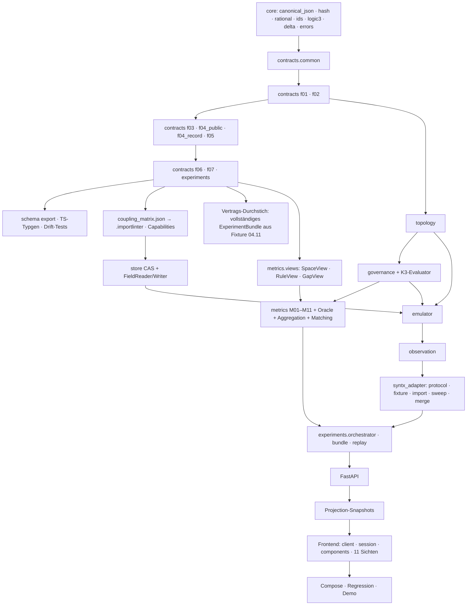
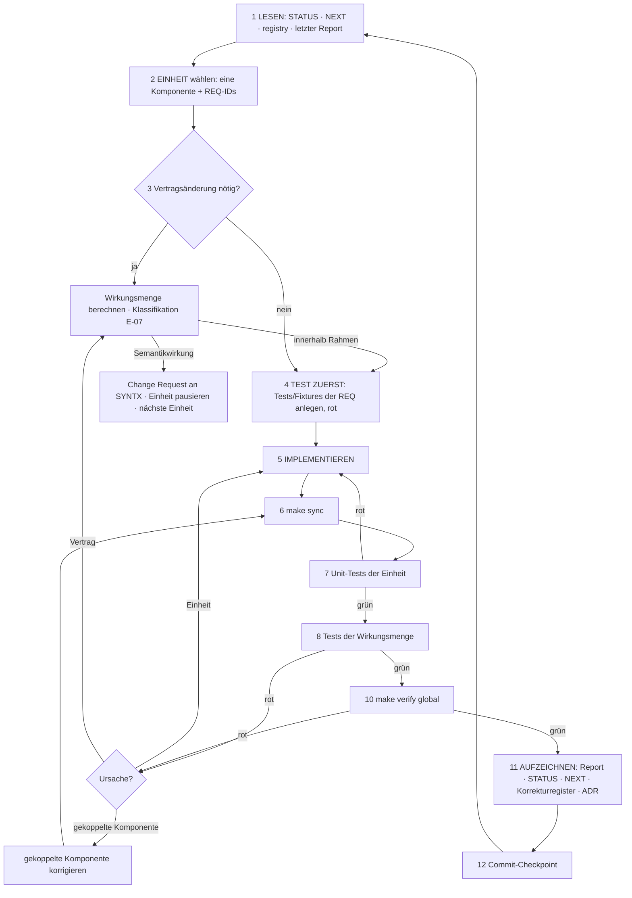

# SYNTX :: CIRA — Systemic Implementation Strategy

**Antwort auf den Implementation Preflight · Implementierungsstrategie und Execution Contract**

| Kopf | Wert |
|---|---|
| Artefakt | `SYNTX_CIRA_Claude_Implementation_Strategy_v1.0.0.md` |
| Bezug | `SYNTX_CIRA_Claude_Implementation_Architecture_v1.0.0.md` (im Folgenden **ARCH**) |
| Auslöser | SYNTX CIRA — Systemic Implementation Preflight, Fragen 01–10 |
| Erstellt von | Claude (Opus 5.5), 2026-11-26 |
| Status | **ENTWURF zur gemeinsamen Validierung. Keine Programmierung.** |

Marken wie in ARCH: `[REF]` Referenz · `[ARCH]` aus ARCH · `[EXT]` neue Erweiterung dieses Dokuments · `[KORR]` Korrektur an ARCH · `[OPEN]` · `[DEP]`.
Neue Registerpräfixe: `H` Befund des Pre-Implementation Sweeps (Abschnitt 09) · `E` Klausel des Execution Contracts (Abschnitt 10) · `AK` Abnahmekriterium (Abschnitt 08).

**Kernergebnis vorab.** Beim erneuten Durchlauf durch ARCH habe ich 34 Befunde gefunden (H-01 … H-34). Darunter sind sechs, die ohne Korrektur einen späteren Umbau erzwingen würden:
- H-01: Die Artefakt-IDs zerstören den Replay-Vergleich.
- H-02: Das ID-Muster verbietet die zusammengesetzten IDs, die ARCH selbst vorschreibt.
- H-14: Für M07/M08 zählt TP einmal Fälle und einmal Gaps, also in verschiedenen Einheiten.
- H-15: Das GAP-Matching vergleicht Vokabulare, die sich nicht treffen können.
- H-20: F03 würde einen F05-Vertragstyp importieren.
- H-26: Die Metriken in Phase 01 hängen an Vertragstypen, deren Instanzen erst Phase 02/03 erzeugt.

Alle 34 Befunde haben eine konkrete Schließung. 32 davon kann ich selbst schließen. Zwei (H-15, H-34) laufen mit einem Default, brauchen aber eine Bestätigung durch SYNTX. Dazu kommen acht offene SYNTX-Fragen (S-01 … S-08). Nichts davon blockiert Phase 01. Die Schließungen sind als Korrekturregister für eine ARCH v1.0.1 zusammengefasst (Abschnitt 09.3). ARCH selbst ändere ich vor der Freigabe nicht.

---

## 01 — Globales Architekturverständnis

### 01.1 — Die Architektur aus Sicht des implementierenden Modells

Ich lese ARCH als **drei ineinanderliegende Schichten**, die je eine andere Art von Konsistenz tragen:

| Schicht | Inhalt | Konsistenzart | Träger im Repository |
|---|---|---|---|
| S1 Vertragsfeld | sieben Felder, drei Zustandsräume, 26 Artefakttypen, Enums, Invarianten | **Typkonsistenz**: jede Kopplung ist ein Typ, jede Invariante ein Validator | `backend/app/contracts/` |
| S2 Kopplungsfeld | Kopplungsmatrix, Capability-Matrix, Importregeln, Steuerungsfluss | **Relationskonsistenz**: nur vorgesehene Kanten existieren | `contracts/coupling_matrix.json` → generiert `.importlinter`, Store-Capabilities |
| S3 Verhaltensfeld | Emulator T, Beobachtung O_θ, Sweeps, Merge, Metriken, Projektionen | **Wertkonsistenz**: gleiche Eingabe ⇒ gleiche Ausgabe, exakte Erwartungswerte | Feldpakete + Golden Fixtures + Oracle |

Darüber liegt eine vierte, nicht-funktionale Schicht **S4 Nachweisfeld**: Anforderungen, Entscheidungen, Status und Testresultate. Sie ist bei mir nicht Dokumentation neben dem Code. Sie ist ein maschinenlesbares Register, dessen Zustand aus Code und Testläufen berechnet wird (01.3).

Die Felder sind in S1 vollständig, bevor in S3 Verhalten entsteht. S2 wird ab dem ersten Commit mechanisch erzwungen. S4 wird nie von Hand auf „fertig“ gesetzt.

### 01.2 — Wie die Feldidentitäten während der gesamten Implementierung konsistent bleiben

| Element der Feldverträge | Mechanismus | Prüfung |
|---|---|---|
| Träger (C) | jeder Träger ist genau ein Pydantic-Typ in genau einem `contracts.fNN`-Modul | TX01: Manifest-Träger ⇔ existierende Typen |
| Relationen (R) | geschlossene Enums (`RelationType`, `CouplingStatus`, Relationsfelder `applies_to`, `observes` …) | T02 Roundtrip, Enum-Snapshot im Schema |
| Zustandsraum (X) | Lifecycle-Enums, Zustandsübergänge als reine Funktionen | Unit-Tests je Transition |
| Ein-/Ausgabe (U/Y) | Funktionssignaturen der Feldfassaden verwenden ausschließlich Manifest-Porttypen | TX01 + Signatur-Check per Introspektion |
| Grenze (B) | Importregeln, Store-Capabilities, Pfad-Guards | T04b, TX03, TX04, TX05 |
| Invarianten (I) | `model_validator` je Typ; Kreuzartefakt-Invarianten in `contracts/invariants.py` | Property-Tests (hypothesis) |
| Transitionen (T) | deterministische Funktionen ohne Uhr, ohne Zufall | TX08, T03 |
| Kopplungen (K) | nur über `ArtifactEnvelope` und Store | TX04, TX05 |
| Provenienz (P) | `Provenance` ist Pflichtfeld jedes Envelopes; Referenzen müssen auflösen | T06 |

Die Feldfassade ist die einzige öffentliche Schnittstelle eines Feldes. Je Feld gibt es ein Modul `app/<feld>/__init__.py`, das genau die Manifest-Ports exportiert. Alles andere im Paket ist intern (`_`-Präfix). So kann der Orchestrator nur über die Ports koppeln.

### 01.3 — Wie alle Register berücksichtigt werden: 81 REQ, 33 D, 15 X, 10 A

`[EXT]` X-16: ARCH führt die Register nur als Markdown. Ich überführe sie in eine maschinenlesbare Single Source:

```text
docs/traceability/registry.yaml
  requirements:  REQ-001 … REQ-081   { text, source, components[], tests[], phase, kind }
  decisions:     D-01 … D-33         { text, status, markers_expected, reversible }
  deviations:    A-01 … A-10         { text, effect, components[] }
  extensions:    X-01 … X-24         { text, components[] }
  open:          O-01 … O-23         { default, owner: SELF | SYNTX, strategy_point }
  dependencies:  DEP-01 … DEP-07     { status }
  gaps:          G01 … G29, H-01 … H-34  { closure, status }
```

Kopplung zum Code:
- Tests tragen `@pytest.mark.req("REQ-042")`, Vitest-Tests das Tag `[REQ-055]` im Testnamen.
- Code, der eine Entscheidung umsetzt, trägt einen Marker `# ADR: D-26`.
- `tools/trace_check.py` prüft:
  - jede REQ hat Komponenten und mindestens einen Test, außer sie ist als `kind: process` geführt (z. B. REQ-078, REQ-079)
  - jede Komponente existiert als Pfad
  - jeder Testmarker verweist auf eine existierende REQ
  - jede akzeptierte D mit `markers_expected: true` hat mindestens einen Marker
  - jede A und X ist mindestens einer Komponente zugeordnet
- Die Markdown-Tabellen (ARCH §17–20) werden aus `registry.yaml` erzeugt (`make docs`). Damit gibt es keine zweite gepflegte Fassung.

---

## 02 — Systemische Implementierungsreihenfolge

### 02.1 — Abhängigkeitsgraph der Bausteine

Die Reihenfolge folgt einem Grundsatz: **Vertragsvollständigkeit vor Verhalten, Verhalten vor Integration, Integration vor Darstellung.**



### 02.2 — Was vollständig vorliegen muss, bevor Abhängiges beginnt

| Baustein | muss vollständig vorliegen vor | „vollständig“ heißt |
|---|---|---|
| `core` | allem | canonical JSON, Hash, Rational, ID-Bildung, K3 und Delta mit Tests; keine Feldsemantik |
| **alle** Vertragstypen F01–F07 + experiments | jedem Feldverhalten | jeder Typ existiert, validiert, ist roundtrip-fähig und im Schema exportiert; Vertrags-Durchstich grün |
| Kopplungsmatrix + Importregeln + Store-Capabilities | erstem Feldverhalten | Regeln aktiv, TX04 grün auf Testdaten |
| `topology`, `governance`-Evaluator | Metriken M02–M04, Emulator, Beobachtung | T01, TX07 grün |
| `metrics.views` + Golden Fixtures + Oracle | Metrikimplementierung | Fixtures validieren gegen Schema; Oracle reproduziert alle Erwartungswerte |
| `emulator` | `observation` | T03 auf Emulatorebene grün |
| `observation` (inkl. Bundle/Record-Trennung) | `syntx_adapter` | T06, TX06 grün |
| Adapterprotokoll + FixtureAdapter | Orchestrator | T05 grün für FixtureAdapter |
| Orchestrator + API-Referenzendpunkte | Frontend | Integrationstest POST → COMPLETED; Projection-Snapshots erzeugt |

### 02.3 — Wie Phase 01 die Phasen 02–05 trägt

1. **Vertrags-Durchstich** `[EXT]` X-21, Test TX14: Am Ende von Phase 01 steht eine von Hand geschriebene, vollständige `ExperimentBundle`-Fixture auf Basis von 04.11. Sie enthält jeden der 26 Artefakttypen mindestens einmal mit realistischen Werten: Topologie, Governance, Szenario, Annotation, θ, zwei Ticks ActualState, Events, Bundle, Record, Target, beide SweepRuns mit Traces, Merge, Reconstruction, Proposal, Authority, RuleEvaluationSets, EvaluationReport, ComparisonReport, ReplayReport. Sie wird validiert, roundtrip-getestet und auf Referenzauflösung geprüft. Was Phase 02–05 an Feldern braucht und im Vertrag fehlt, scheitert hier und nicht in Phase 03. Das ist kein Emulator-Code, sondern Testdaten.
2. **Port-Vollständigkeit**: Jede Feldfassade aus Phase 02–05 wird in Phase 01 als typisierte Signatur angelegt, die `NotImplementedError` wirft. Der Architekturtest prüft damit schon in Phase 01 die Importgrenzen der späteren Felder.
3. **Strategiepunkte für provisorische Entscheidungen**: Alles, was SYNTX noch ändern kann, liegt hinter einer benannten, versionierten Strategie mit Default, nicht im Kern (09.2, Klasse B). Eine spätere Rückgabe ändert dann eine Strategie-ID, aber keine Struktur.
4. **Projektionstypen in Phase 01**: Die `contracts.f07`-Header und -Projektionen sind in Phase 01 fertig. Damit ist die TS-Typgenerierung ab Phase 01 prüfbar (TX02), obwohl das Frontend erst in Phase 04 kommt.

### 02.4 — Abhängigkeiten, die sonst spätere Umbauten verursachen würden

| ID | Strukturentscheidung | Warum sie früh fallen muss | Schließung | Befund |
|---|---|---|---|---|
| U-01 | ID-Bildung | Alle Referenzen, Hashes, Replays und Exporte hängen daran | inhaltsadressierte Artefakt-IDs | H-01 |
| U-02 | ID-Syntax zusammengesetzter IDs | Relation und Attribut sind zusammengesetzt | Muster mit `:` im lokalen Teil | H-02 |
| U-03 | Diskriminierung des Envelopes | Pydantic-Unions und TS-Typen hängen am Diskriminatorort | `artifact_type` als `Literal` je Envelope-Subtyp | H-21 |
| U-04 | Store-Layout | Export, Replay und Deduplizierung | CAS + Experimentindex | H-22 |
| U-05 | Metrik-Eingabeform | Phase-01-Metriken ohne Emulator | Sichttypen (`SpaceView` …) | H-26 |
| U-06 | Projektion Ω_O(t)[i] bei mehreren Quellen | M06 und M02(O) | definierte Projektionsregel | H-11 |
| U-07 | Ort von `AuthorityRecord` | Importgrenze F03 | nach `contracts.f02` | H-20 |
| U-08 | Pflichtigkeit der TargetDefinition | Mergevertrag | Pflichtfeld | H-12 |
| U-09 | Budgetebene | Fehlersemantik CONTEXT_INCOMPLETE | Bundle-Ebene | H-13 |
| U-10 | Referenzraumbegriff | MetricResult-Pflichtfeld | `ReferenceSpace.kind` | H-17 |
| U-11 | Zeitbezug in TRANSITION-Prädikaten | Regel-AST | `at: CURRENT \| NEXT` | H-07 |
| U-12 | Schema-Bündelung für TS | Generator-Kette | ein gebündeltes Schema mit `$defs` | H-23 |
| U-13 | Paartypen | TS-Generator und `prefixItems` | Objektpaare `{from, to}` | H-24 |
| U-14 | Strategieschnittstellen (Merge, Matching, Hypothesen, Gewichtung, M09-Basis, M10-Quelle, Budgeteinheit) | SYNTX-Rückgaben ohne Umbau | Strategy-Registry | 09.2 |

---

## 03 — Rekursive Konsistenz während der Programmierung

### 03.1 — Wirkungsanalyse nach jeder Komponente

`[EXT]` X-19: `tools/impact.py <Symbol|Datei>` berechnet die **Wirkungsmenge** einer Änderung aus vier Graphen:

| Graph | Quelle | liefert |
|---|---|---|
| Importgraph | statische Analyse von `backend/app` (AST) | abhängige Module |
| Vertragsgraph | Typreferenzen zwischen Pydantic-Modellen | abhängige Vertragstypen, Schemas, TS-Typen |
| Kopplungsgraph | `coupling_matrix.json` | abhängige Felder und Capabilities |
| Nachweisgraph | `registry.yaml` + Testmarker | betroffene REQ, Tests, Fixtures, ADRs |

Nach jeder Komponente laufen genau die Tests der Wirkungsmenge, danach der globale Gate-Lauf. Ändert sich ein Vertragstyp, gehören automatisch alle Fixtures dazu, die ihn enthalten (Schema-Validierung), sowie der Vertrags-Durchstich.

### 03.2 — Synchronität der Artefakte

| Artefakt | Single Source | abgeleitet durch | Drift-Prüfung | Test |
|---|---|---|---|---|
| Pydantic-Verträge | **ja**, Code in `contracts/` | — | Typprüfung (mypy strict) | T02 |
| JSON Schemas | nein | `scripts/export_schemas.py` → `contracts/schemas/cira.contracts.schema.json` (gebündelt) + je Typ | erneut generieren, Byte-Vergleich | TX02 |
| TypeScript-Verträge | nein | json-schema-to-typescript aus gebündeltem Schema | erneut generieren, Vergleich; `tsc --noEmit` | TX02 |
| Field Manifests | **ja**, Hand-SSOT für Tupel/Semantik | — | Typnamen, Ports und Kopplungen gegen Code und Matrix | TX01 |
| Kopplungs-/Capability-Matrix | **ja**, `coupling_matrix.json` | Store-Capability-Tabelle (Laufzeit), Markdown-Tabelle | Store lädt Matrix; Markdown regeneriert | TX04 |
| Importregeln | nein | `.importlinter` aus Matrix generiert | erneut generieren, Vergleich; lint-imports | T04b, TX03 |
| Golden Fixtures | **ja**, Dateien in `synthetic_fixtures/f06_metric_fixtures/` | Fixture-Tabelle in Docs | Schema-Validierung + Oracle-Gegenrechnung | T07, TX13 |
| Requirement-Mapping | **ja**, `registry.yaml` | Markdown, Statusspalte | `trace_check.py` | TX12 |
| Architekturentscheidungen | **ja**, `docs/adr/D-xx.md` + Registry-Status | Register-Markdown | Marker-Prüfung | TX12 |
| Implementierungsstatus | nein | aus Registry + letztem Testreport berechnet → `docs/STATUS.md` | erneute Berechnung, Vergleich | TX12 |
| Testresultate | nein, nur durch Runner | `pytest --junitxml` + `vitest --reporter=json` → `tools/report.py` → `docs/test-reports/<phase>-<lauf>.json` | Report-Hash im STATUS | — |

Ein einziger Befehl hält alles synchron: `make sync`. Er regeneriert Schemas, TS-Typen, Importregeln und Docs. `make verify` schlägt fehl, wenn nach `make sync` ein Unterschied im Arbeitsbaum bleibt.

### 03.3 — Verbindlicher rekursiver Implementierungs- und Validierungszyklus (RIVZ)



Abbruchregel: Scheitert derselbe Test nach drei Korrekturdurchläufen weiter, wird die Einheit `BLOCKED` mit Ursachenanalyse in `docs/blocked/<id>.md`. Ich wechsle dann zur nächsten unabhängigen Einheit und melde den Punkt in der Phasenübergabe. Kein Test wird deaktiviert, abgeschwächt oder auf `xfail` gesetzt, um ein Gate zu passieren.

---

## 04 — Vollständigkeit der Implementierung

### 04.1 — Statusleiter je Komponente und Anforderung

Der Status wird berechnet, nie gesetzt (X-16):

| Status | Bedingung (alle müssen gelten) |
|---|---|
| `DESIGNED` | Eintrag in registry.yaml mit Komponenten und Tests |
| `IMPLEMENTED` | alle zugeordneten Komponentenpfade existieren; keine `NotImplementedError` in den zugeordneten Ports; mypy strict grün |
| `INTEGRATED` | Komponente ist vom Kompositionspfad erreichbar (Orchestrator oder API); mindestens ein Integrationstest durchläuft sie |
| `VERIFIED` | alle zugeordneten Tests im **letzten** vollständigen Report grün; keine übersprungenen Tests |
| `BLOCKED_DEP` | zugeordnete DEP offen (z. B. REQ-008 → DEP-01) |
| `PROVISIONAL` | VERIFIED, aber auf einer Strategie mit `owner: SYNTX`, die noch nicht bestätigt ist |

Erreichbarkeit (`INTEGRATED`) wird mit Coverage-Daten aus dem Integrationslauf bestimmt: `coverage.py` mit Kontextzuordnung je Test. Eine Komponente ohne Zeilen im Integrationslauf ist nicht angebunden.

### 04.2 — Erkennung von Lücken

| Lückenart | Erkennung |
|---|---|
| fehlende Implementierung | `NotImplementedError`-Scan in Ports; Status ≠ IMPLEMENTED |
| unvollständige Schnittstelle | Manifest-Port ohne Implementierung; API-Endpunkt aus ARCH §10 ohne Route (Routenliste gegen Registry); Projektion ohne TS-Konsument (TS-Import-Scan) |
| nicht angebundene Komponente | 0 % Integrationscoverage; Feldfassade ohne Aufrufer im Orchestrator |
| unerfüllte Abhängigkeit | DEP offen ⇒ BLOCKED_DEP; Strategie `owner: SYNTX` unbestätigt ⇒ PROVISIONAL |
| Anforderung ohne Test | trace_check |
| Test ohne Anforderung | trace_check (Marker auf unbekannte REQ oder kein Marker in `tests/`) |
| Vertragsfeld nie befüllt | Vertrags-Durchstich + Mutationsprüfung: jedes optionale Feld kommt in mindestens einer Fixture nicht-null vor |

---

## 05 — Mathematische Integrität

### 05.1 — Implementierungsstrategie M01–M11

Eine Kette in fünf Stufen. Jede Stufe ist rein, deterministisch und einzeln getestet:

```text
Artefakte ──► Sichten ──► Mengen ──► Zähler ──► Ergebnisse ──► Aggregation
(Envelopes)   SpaceView    D_ref      (num, den,  MetricResult   PER_TICK
              RuleView     D_obs       aux)                      POOLED
              GapView      D_det                                 TIME_MEAN_EXPLICIT
              PairView     S, TP…
```

| Stufe | Modul | Inhalt |
|---|---|---|
| Sichten | `metrics/views.py` | `SpaceView{space, tick, values: Map[attr → ValueStatus, Symbol?]}` je Ω-Raum; `RuleView` (RuleEvaluationSet); `GapView` (Fälle, Gaps je Sweep-Tick); `PairView` (R1/R2). Interne Typen, keine Verträge. Erzeugt aus Artefakten **oder** direkt aus Golden Fixtures (H-26). |
| Mengen | `metrics/spaces.py` | D_ref, D_obs, D_det über **eine** `HypothesisPolicy`; `ReferenceSpace` mit `space_hash` |
| Zähler | `metrics/mNN.py` | genau eine Funktion je Metrik → `Counts{numerator: Rational, denominator: Rational, aux}` |
| Ergebnis | `metrics/result.py` | einzige Stelle mit `ratio()`, UNDEFINED, `undefined_reason`, float-Ableitung |
| Aggregation | `metrics/aggregation.py` | Summen von Zähler/Nenner; Mittel nur explizit |

Vereinheitlichung `[KORR]` H-16: Jede Metrik hat die Form `value = numerator / denominator`, auch die komplementären:
- M11: `num = W(D_det) − Σ w·δ`, `den = W(D_det)`.
- M10: `num = W(S) − Σ_S w·δ`, `den = W(S)`.

Damit ist POOLED für alle Metriken dieselbe Operation (Σnum/Σden), und `1 − pooled(M01) = pooled(M11)` gilt exakt.

### 05.2 — Konsistenzprüfung zwischen den Elementen

| Paar | Konsistenzbedingung | Durchsetzung |
|---|---|---|
| Definition ↔ Referenzraum | M01, M05, M06, M11 eines Ticks verwenden denselben `space_hash` | Assertion in `result.py`; Test |
| Referenzraum ↔ Gewichte | `W` nur über `WeightSet` derselben Version; alle Gewichte > 0 | Validator; Report trägt `weight_set_ref` |
| Rational ↔ float | `value == float(num/den)`; float nie zurückgeführt | Property-Test |
| Hypothesenpolitik ↔ Mengen | Politik wirkt **nur** in `D_det`; ausgeschlossene Hypothesen werden in `aux.hypotheses_excluded` gezählt und erhöhen `undetermined_count` | H-18; Test |
| GAP-Matching ↔ M07/M08 | TP sind Paare einer 1:1-Zuordnung; dieselbe Zuordnung speist beide Metriken | H-14; FX-M07/08 |
| Zeitaggregation ↔ Tickmengen | jede Metrik deklariert ihre Tickmenge (alle Ticks / Sweep-Ticks / Paare aufeinanderfolgender Ticks) | H-19; Test |
| Golden Fixtures ↔ Kern | Erwartungswerte sind exakte Rationals; der Kern und ein unabhängiges **Oracle** müssen sie reproduzieren | TX13 |

`[EXT]` X-18 **Oracle**: `tests/oracle/metrics_oracle.py` ist eine bewusst naive, schleifenbasierte Zweitimplementierung auf `fractions.Fraction`. Sie teilt mit dem Kern keinen Code außer den Sichttypen. Differenzielles Testen: hypothesis erzeugt zufällige Tripel (Ω_A, Ω_O, Ω_R, Gewichte, Politik), und Kern und Oracle müssen exakt übereinstimmen.

Zusätzliche Eigenschaftstests:
- Wertebereich [0,1]
- M11 = 1 − M01
- UNDEFINED genau bei Nenner 0
- Invarianz unter Permutation der Attribute
- Invarianz unter Skalierung aller Gewichte mit c > 0
- Monotonie: ein zusätzliches korrekt bestimmtes Attribut erhöht M01 nicht

### 05.3 — Mathematische und typbezogene Widersprüche in ARCH v1.0.0

Diese Befunde sind in 09.1 mit Schließung enthalten. Hier nur die mathematischen:

| Befund | Widerspruch | Schließung |
|---|---|---|
| H-14 | M07 zählt TP als Fälle, M08 rechnet TP gegen FP-Gaps; „Gap ordnet sich höchstens einem Fall zu“ lässt mehrere Gaps je Fall zu ⇒ Einheiten gemischt | deterministische 1:1-Zuordnung (maximales Matching, Tie-Break nach kanonischem Schlüssel); TP = Paare |
| H-15 | `canonical_key` enthält `kind`; Gap-`kind` ist Engine-Vokabular, Fall-`kind` CIRA-Vokabular ⇒ strukturell nie gleich | Matcher M1 vergleicht `subject_refs` (Mengengleichheit) + Tickfenster; `kind` erst mit Vokabularabbildung (DEP-01) |
| H-16 | `exact_value` redundant zu `numerator/denominator`; M10/M11 ohne definierten Zähler/Nenner | Einheitsform 05.1; `exact_value` entfällt |
| H-17 | `reference_space` Pflicht, aber M02/M03/M04/M07–M09 haben keinen Attributraum | `ReferenceSpace.kind ∈ {ATTRIBUTE, RULE, TRANSITION, TICK, CASE, RULE_KEY}` + `members` |
| H-18 | `DETERMINED` mit `OPEN_REFERENCE` ist widersprüchlich; Wirkung ausgeschlossener Hypothesen auf `undetermined_count` undefiniert | Invariante DETERMINED ⇒ Klasse ≠ OPEN_REFERENCE; Zählregel s. o. |
| H-19 | M03(R) bei Sweep-Zeitplan FINAL hat keine Übergänge; POOLED über Metriken mit verschiedenen Tickmengen ohne Deklaration | Tickmengen je Metrik deklariert; M03 nur über aufeinanderfolgende verfügbare Ticks; fehlende Paare ⇒ UNDEFINED mit `INPUT_MISSING` (nicht ZERO_DENOMINATOR) |
| H-08 | M04 bei mehreren Servicefunktionen: N unklar | Ergebnis je Funktion + POOLED über (Funktion, Tick)-Paare |
| H-07 | TRANSITION-Prädikate `eq/in` ohne Zeitindex (t oder t+1) | Blattfeld `at: CURRENT \| NEXT`, Pflicht bei kind=TRANSITION |
| H-09 | `valid_until_tick` inklusiv/exklusiv offen; Gültigkeit bei Paaren offen | inklusiv; TRANSITION gültig, wenn t und t+1 in Gültigkeit |
| H-10 | FX-Z-M10 „shared_coverage = 0“ gilt nur bei W(D_ref) > 0 | bei W(D_ref)=0 ist auch shared_coverage UNDEFINED |
| H-25 | `MetricResult.version` und `metric_version` doppelt | `version` (REF) = Version der MetricDefinition; `metric_version` entfällt |

Nachgerechnet und weiterhin konsistent: FX-04.11, FX-04.11-W, FX-04.11-NA, FX-AGG.
- FX-AGG: POOLED (1+0+2)/(8+0+4) = 1/4; Zeitmittel (1/8 + 1/2)/2 = 5/16.
- FX-M07/08: unter der 1:1-Regel stimmen TP=3, FN=1, FP=3 und 3/4 bzw. 1/2 weiterhin.

---

## 06 — Integrität der System-Field-Grenzen

### 06.1 — Mechanische Durchsetzung in fünf Schichten

| Schicht | Mechanismus | Erkennt | Test |
|---|---|---|---|
| L1 Typ | disjunkte Vertragsfamilien; keine `Any`/`dict`-Payloads; Feldfassaden nur mit Porttypen | falsche Eingabetypen | mypy strict, TX05 |
| L2 Import | `.importlinter` (generiert aus Matrix): `forbidden`- und `layers`-Verträge; ergänzend AST-Scan auf dynamische Importe (`importlib`, `__import__`) in Feldpaketen | statische und dynamische Grenzverletzungen | T04b, TX03 |
| L3 Store | `FieldReader(field)` / `FieldWriter(field)` laden die Capability-Matrix; nicht erlaubter Typ ⇒ `ACCESS_VIOLATION` | Laufzeitzugriff auf verbotene Artefakte | TX04 |
| L4 Daten | Invarianten: Bundle-Provenienz ohne F03-Refs; Observation-IDs = f(source, tick, attribute); UNKNOWN ⇒ value=null; ObservableRules referenzieren nur sichtbare Attribute (H-05) | indirektes Leck über Inhalte | TX05, TX06 |
| L5 Verhalten | Mutationstest: Ω_A-Werte unbeobachteter Attribute ändern ⇒ ObservationBundle-Hash unverändert ⇒ F05-Ausgabe (Fixture/Import) unverändert | jeder Informationsfluss Ω_A → F05 | TX05 |

L5 ist der stärkste Nachweis: Er prüft nicht, *wie* Information fließen könnte, sondern *ob* sie fließt. Für die Hash-Gleichheit dürfen IDs nicht von Ω_A-Artefakten abhängen, deshalb ist H-01 hier tragend.

### 06.2 — Kopplung ausschließlich über vorgesehene Verträge

- Der Orchestrator ist die einzige Kompositionswurzel. Er ruft Felder nur über ihre Fassaden auf.
- `tools/coupling_audit.py` `[EXT]` erzeugt aus dem Laufzeit-Store eines Integrationslaufs den **beobachteten** Kopplungsgraphen. Grundlage sind die Store-Zugriffe je Feld (Reader/Writer protokollieren Typ und Feld). Der Graph wird mit `coupling_matrix.json` verglichen. Jede beobachtete Kante muss in der Matrix stehen, und jede Matrixkante sollte im vollständigen Integrationslauf mindestens einmal vorkommen, sonst wird eine tote Kopplung gemeldet. Test TX18.

### 06.3 — Trennung SYNTX-Operatoren / Σ-Felder ↔ CIRA-Logik

| Regel | Durchsetzung |
|---|---|
| Operator- und Σ-IDs sind opake Werte (`OperatorRef`, `SigmaRef`) | Typ |
| CIRA-Code verzweigt nie auf eine Operator- oder Σ-ID | `[EXT]` TX11: AST-Lint verbietet String-Literale `^[RI](0[1-9]|1[0-9])$` und Σ-Muster außerhalb von `syntx_adapter/adapters/`, Fixtures und Tests; verbietet Vergleiche/Match auf `operator_ref.code` außerhalb der Registry |
| Bedeutung kommt nur aus der Registry des Adapters, wörtlich | Felder `label_from_source`, `description_from_source`; Anzeige in F07 nur aus diesen Feldern |
| Keine Ableitung „R = forward, I = invers“ | kein Code liest `namespace` für Steuerlogik (TX11) |
| Softwarefeld-IDs F01–F07 und Σ-IDs sind getrennte Typen | `FieldId` (Enum) vs. `SigmaRef` (opak) — keine gemeinsame Basis |

---

## 07 — Persistenter Entwicklungszustand

### 07.1 — Arbeitskontext im Repository

Ich habe zwischen Sitzungen kein Gedächtnis, also muss das Repository den Zustand vollständig tragen `[EXT]` X-20:

| Datei | Rolle | wer schreibt |
|---|---|---|
| `CLAUDE.md` (Repo-Wurzel) | Execution Contract in Kurzform, Sitzungsprotokoll, Befehle, verbotene Abkürzungen; wird zu Sitzungsbeginn automatisch geladen | Claude, nur über Change Request |
| `docs/STATUS.md` | berechneter Stand: Phase, Statusleiter je REQ, letzter Report-Hash, offene DEP/O | `make status` |
| `docs/NEXT.md` | exakt nächste Einheit: Komponente, REQ-IDs, erwarteter erster Test, bekannte Stolpersteine | Claude am Ende jeder Einheit |
| `docs/SESSION_LOG.md` | append-only: Datum, Einheiten, Ergebnisse, Abweichungen | Claude |
| `docs/traceability/registry.yaml` | Nachweisregister | Claude, geprüft durch trace_check |
| `docs/adr/` | Entscheidungen | Claude; SYNTX-Rückgaben als neue ADR |
| `docs/corrections.md` | Korrekturregister alt · neu · Begründung | Claude |
| `docs/blocked/` | blockierte Einheiten mit Analyse | Claude |
| `docs/change-requests/` | Architekturänderungen zur SYNTX-Validierung | Claude |
| `docs/test-reports/` | tatsächliche Testreports | nur Runner |

### 07.2 — Was bei jedem Schritt gelesen und aktualisiert wird

| RIVZ-Schritt | liest | aktualisiert |
|---|---|---|
| 1 Lesen | CLAUDE.md, STATUS, NEXT, letzter SESSION_LOG-Eintrag | — |
| 2 Einheit | registry.yaml (REQ, Komponenten, Tests) | — |
| 3 Vertrag | Wirkungsmenge, ADRs | ggf. change-requests/ |
| 4–8 | Tests, Fixtures, Code | Code, Tests, Fixtures |
| 9 | — | generierte Artefakte (make sync) |
| 10 | — | test-reports/ (Runner) |
| 11 | — | STATUS (berechnet), NEXT, SESSION_LOG, corrections, ADR |
| 12 | — | Git-Commit mit REQ-IDs in der Nachricht |

### 07.3 — Rekonstruktion nach Kontextunterbrechung

`make resume` `[EXT]` gibt in einer Ausgabe aus:
- aktuelle Phase und Einheit aus NEXT
- Git-Stand: letzter Commit, uncommittete Änderungen
- Ergebnis eines frischen `make verify`
- Differenz zum letzten Report: neu rot oder neu grün
- offene Blocked-Einträge und Change Requests

Regel: Bei uncommitteten Änderungen und rotem Verify gehe ich von einer unvollständigen Einheit aus. Ich setze dann bei Schritt 7 dieser Einheit wieder an und beginne nicht neu. Den Zustand rekonstruiere ich immer aus Dateien und einem frischen Testlauf, nie aus der Erinnerung an eine frühere Sitzung.

---

## 08 — Vollständige End-to-End-Integration

### 08.1 — Integrationsstrategie

1. **Vertikaler Durchstich früh**: Ab Phase 03 läuft ein Integrationstest `POST /experiments` (FX-SCN-BASE, FixtureAdapter) → COMPLETED → alle Referenzendpunkte → Export → Import → Export. Jede spätere Einheit hält ihn grün.
2. **Projection-Snapshots** `[EXT]` X-22: Der Backend-Integrationstest schreibt die tatsächlichen JSON-Antworten aller Endpunkte für FX-SCN-BASE/REC nach `frontend/test/snapshots/`. Die Frontend-Tests (Vitest) laufen gegen genau diese Snapshots, nicht gegen handgeschriebene Mocks. Ändert das Backend eine Projektion, wird der Frontend-Test rot (TX15). Damit sind Backend und Frontend ohne Browser gekoppelt geprüft.
3. **Typkette**: Pydantic → Schema → TS, Drift-Test auf beiden Seiten (TX02).
4. **Laufzeitkette**: Docker Compose mit Healthcheck. Ein Smoke-Skript `tools/smoke.sh` führt gegen den laufenden Stack `health → scenarios → create → poll → results → metrics → export` aus.
5. **Demo als Test**: Das Jury-Demo-Skript ist ein ausführbarer Test (`tests/integration/test_demo_flow.py`) über Baseline, Recovery, Vergleich und Export. Was in der Demo gezeigt wird, ist damit getestet.

### 08.2 — Abnahmekriterien des Gesamtsystems

| AK | Kriterium | Nachweis |
|---|---|---|
| AK-01 | `make verify` grün auf sauberem Checkout (Lint, mypy strict, tsc strict, Drift, Importregeln, trace_check, alle Tests) | Report |
| AK-02 | alle REQ mit `kind: implementable` mindestens `VERIFIED` oder `BLOCKED_DEP`/`PROVISIONAL` mit dokumentierter Ursache | STATUS |
| AK-03 | T01–T12 und TX01–TX18 grün, keine Skips | Report |
| AK-04 | Golden Fixtures exakt (Kern = Oracle = Erwartung) | T07, TX13 |
| AK-05 | Replay: ReplayReport `IDENTICAL` für FX-SCN-BASE und FX-SCN-REC | T03 |
| AK-06 | Export → Import → Export mit identischem `bundle_hash` | T10 |
| AK-07 | Leckfreiheit: Mutationstest L5 grün | TX05 |
| AK-08 | beobachteter Kopplungsgraph ⊆ Matrix, keine toten Kopplungen | TX18 |
| AK-09 | jede F05-Ausgabe und jeder angezeigte Wert trägt korrekte `data_origin` | TX10, T09 |
| AK-10 | `docker compose up` → Healthcheck grün → Smoke-Skript grün | Smoke-Report |
| AK-11 | Demo-Flow-Test grün | Report |
| AK-12 | alle elf Sichten rendern mit den Projection-Snapshots; Tickwechsel synchron | T09, TX15 |
| AK-13 | Regressionsbundles der Phasen 03/04 reproduzieren | T11 |
| AK-14 | Reports sind maschinell erzeugt, Hash in STATUS, kein handgeschriebenes Ergebnis | Report-Hash |
| AK-15 | offene DEP und SYNTX-Entscheidungen vollständig in STATUS und registry gelistet | STATUS |

Testreportformat: `{ report_id, phase, commit, started, environment {python, node, os}, suites: [{ name, tests, passed, failed, skipped }], failures: [...], req_coverage: { verified, blocked_dep, provisional, missing }, hash }`. Wanduhrzeit steht nur im Report, nie in Artefakten.

Umgebungsabhängigkeit `[DEP]`: Docker-Builds und der Compose-Smoke-Test brauchen eine Umgebung mit Docker. Steht sie in meiner Sitzung nicht zur Verfügung, laufen alle übrigen Tests trotzdem. AK-10 wird dann auf OBs Rechner ausgeführt, das Ergebnis als Report eingecheckt und im STATUS als „extern ausgeführt“ markiert.

---

## 09 — Globaler Pre-Implementation Sweep

Ich habe ARCH v1.0.0 noch einmal vollständig durchlaufen: vorwärts von den Verträgen zu Verhalten und Integration, rückwärts von den Abnahmekriterien zu den tragenden Verträgen. Das ist eine Claude-seitige Prüfung und keine Engine-Ausführung.

Klassen:
- **A**: eigenständig lösbar und endgültig.
- **B**: eigenständig lösbar mit Default. Liegt hinter einer Strategie, damit SYNTX das Ergebnis ohne Umbau ändern kann.
- **S**: braucht eine Rückgabe durch SYNTX.

### 09.1 — Befunde und Schließungen

| ID | Kategorie | Befund (Stelle in ARCH) | Schließung | Klasse |
|---|---|---|---|---|
| H-01 | Vertragswiderspruch | D-06 bildet `artifact_id` aus `experiment_id`; Payloads enthalten `ArtifactRef` mit dieser ID; D-07 vergleicht Payload-Hashes über Replays ⇒ Hashes können nie gleich sein | **inhaltsadressierte IDs**: `artifact_id = art:<sha256(artifact_type ‖ canonical(payload))[:32]>`; Experimentzugehörigkeit nur im Envelope/Index; `revision` bleibt im Envelope als logische Revision je `(experiment, type, logical_key)`, entfällt in `ArtifactRef` | A |
| H-02 | Typinkonsistenz | StableId-Muster erlaubt weder `:` noch `>` im lokalen Teil; ARCH fordert `rel:<type>:<src>-><tgt>` und `attr:<node>/<name>` mit präfixierten IDs | Muster `^[a-z]+:[a-z0-9][a-z0-9_.:/\-]{0,190}$`; zusammengesetzte IDs aus **lokalen** Teilen: `attr:n01/state`, `rel:depends_on:n01:n02` | A |
| H-03 | Typinkonsistenz | `ValueState.status` als Union dreier Enums mit gemeinsamem Wert `NOT_APPLICABLE` ⇒ im strict-Modus mehrdeutig | `DeltaState` raumspezifisch diskriminiert: `space` als Literal, Statustyp je Raum | A |
| H-04 | Vertragslücke | `AttributeDecl.applicability` (statisch) und `ActualValue.applicability` (Zustand) ohne Kopplungsinvariante | Invariante: Decl NOT_APPLICABLE ⇒ ActualValue NOT_APPLICABLE für alle t; Applicability in v1 zeitlich konstant | A |
| H-05 | Architektur-GAP (Leck) | `ObservableRules` trägt volle Regelausdrücke, die verborgene Attribute referenzieren können ⇒ Strukturinformation über nicht beobachtbare Teile erreicht F05 | θ-Validierung: sichtbare Regeln dürfen nur sichtbare Attribute referenzieren, sonst `INVALID_RULE` bei θ-Prüfung | A |
| H-06 | Architektur-GAP | Beobachtbarkeit auf Attributebene unklar: sichtbarer Knoten mit verborgenen Attributen? | Sichtbarkeit auf Knotenebene; Attribute sichtbarer Knoten sind deklariert bekannt, Werte nur über Quellen (sonst UNKNOWN) — entspricht Fixture 04.11 | A |
| H-07 | math./Typ | TRANSITION-Blätter ohne Zeitindex | `at: CURRENT \| NEXT`, Pflicht bei TRANSITION, verboten bei STATE/FUNCTION | A |
| H-08 | math. | M04 bei mehreren Servicefunktionen | je Funktion + POOLED über Paare | A |
| H-09 | math. | Gültigkeitsgrenzen | inklusiv; Paare beidseitig gültig | A |
| H-10 | math. | FX-Z-M10 | UNDEFINED bei W(D_ref)=0 | A |
| H-11 | Vertragslücke | „genau eine Observation je Attribut und Tick“ widerspricht mehreren Quellen je Attribut; UNKNOWN ohne aktive Quelle hat kein `source_id` | eine Observation je (Quelle, Attribut, Tick) aktiver Quellen + eine Platzhalter-Observation `UNKNOWN` mit `source_id = null` für Attribute ohne aktive Quelle; Projektion ω(i,t): KNOWN der frischesten Beobachtung (max `observed_at_tick`, Tie-Break `source_id`), sonst UNKNOWN; Invariante KNOWN ⇒ `source_id ≠ null` | A |
| H-12 | Vertragswiderspruch | `target_definition_ref` nullable, Merge und Dual Sweep setzen Inverse voraus; Referenz nennt Z als Eingabe | TargetDefinition Pflicht in ExperimentDefinition/Request | A |
| H-13 | Vertragslücke | Budget je ContextBundle, Engine sieht aber das kumulative Bundle 0..t | Budget auf **ObservationBundle-Ebene**; CONTEXT_INCOMPLETE ⇒ nächstes Profil; alle Profile erschöpft ⇒ SweepRuns dieses Ticks `BLOCKED` mit `CONTEXT_INCOMPLETE`, Experiment `PARTIAL` | A (Einheit: S, O-14) |
| H-14 | math. | TP-Einheiten M07/M08 (05.3) | 1:1-Zuordnung | A |
| H-15 | math. | Kind-Vokabulare unvereinbar (05.3) | Matcher M1 über subject_refs + Tickfenster; Kind-Abbildung später | B → S (Vokabular, DEP-01) |
| H-16 | Typ/math. | `exact_value` redundant; M10/M11 ohne Zähler/Nenner | Einheitsform | A |
| H-17 | Typ | `reference_space` für Nicht-Attributmetriken | `ReferenceSpace.kind` + `members` | A |
| H-18 | Typ/math. | DETERMINED + OPEN_REFERENCE; Zählung ausgeschlossener Hypothesen | Invariante + `aux.hypotheses_excluded` | A (Politik selbst: B/S, O-06) |
| H-19 | math. | Tickmengen und M03(R) | deklarierte Tickmengen, INPUT_MISSING | A |
| H-20 | fehlende/verbotene Kopplung | `AuthorityRecord` in `contracts.f05`, gelesen von F03 ⇒ F03 → F05-Abhängigkeit, verletzt REQ-023 | `AuthorityRecord` nach `contracts.f02` (Freigaben sind Governance); `ApprovalRecord` (synthetischer Zustand im Szenario) und `AuthorityRecord` (dokumentierte Entscheidung über eine Variante) bleiben getrennte Typen | A |
| H-21 | Typ/Implementierung | Envelope-Diskriminator liegt außerhalb der Payload; generische Union unklar | je Artefakttyp ein Envelope-Subtyp mit `artifact_type: Literal[...]`; `AnyEnvelope = Annotated[Union[…], Field(discriminator="artifact_type")]` | A |
| H-22 | Implementierungsabhängigkeit | Store je Experiment, Artefakte nach H-01 experimentübergreifend identisch | `store/objects/<artifact_id>.json` (CAS, write-once) + `experiments/<id>/index.jsonl` (Envelope-Metadaten, Wanduhrzeit) + `events.jsonl` | A |
| H-23 | Integrationsproblem | TS-Generierung aus vielen Einzelschemas mit dateiübergreifenden `$ref` ist fehleranfällig | ein gebündeltes Schema `cira.contracts.schema.json` mit allen `$defs` → eine TS-Datei; Einzelschemas zusätzlich für externe Nutzung | A |
| H-24 | Typ/Integration | `SymbolPair` als feste Tupel → `prefixItems`, vom TS-Generator unsicher unterstützt | `{from: Symbol, to: Symbol}` | A |
| H-25 | Typ | doppelte Versionsfelder in MetricResult | `version` = MetricDefinition-Version | A |
| H-26 | Implementierungsabhängigkeit | Phase 01 implementiert Metriken ohne Emulator, ARCH lässt die Metriken aber auf vollständigen Artefakten arbeiten, deren Konstruktion F03–F05-Instanzen voraussetzt | Sichtschicht `metrics.views`; Golden Fixtures liefern Sichten direkt; separater Test Artefakte → Sichten in Phase 02/03 | A |
| H-27 | Vertragslücke | `TargetDefinition.based_on_bundle` verweist auf ein Laufzeitartefakt, das zur Autorenzeit nicht existiert | Feld entfällt; Validierung gegen ObservableTopology aus θ vor Laufbeginn | A |
| H-28 | fehlende Kopplung | Capability-Matrix führt `OperatorRegistry`, `WeightSet`, `MetricConfig`, `ExperimentDefinition` nicht | ergänzt: OperatorRegistry W F05 / R F07; WeightSet Autorenschaft / R F06, F07; ExperimentDefinition W experiments / R alle außer F05 (F05 erhält nur Adapterkonfiguration) | A |
| H-29 | Integrationsproblem | Re-Sweep erzeugt eine zweite Rekonstruktion je Tick; welche ist Ω_R für M01? | `attempt` je (Tick, Richtung); Evaluation nutzt `attempt = 0` (erster COMPLETED), M10 nutzt Paare von Versuchen | A |
| H-30 | Integrationsproblem | Replay eines Experiments mit Engine-Ergebnissen: F05 nicht reproduzierbar | Replay-Modi: `SYNTHETIC` (F03/F04 neu, F05 nur bei FIXTURE neu) und `PRESERVED_ENGINE` (F03/F04 neu, Bundle-Hash muss gleich sein, Engine-Artefakte unverändert übernommen, F06 neu) — entspricht REF 09 | A |
| H-31 | Integrationsproblem | Sichten zeigen Ω_R an Ticks ohne Sweep | Content-Zustand `NOT_AVAILABLE_AT_TICK` in der Projektion (kein Fehler); `VIEW_DATA_UNAVAILABLE` bleibt Abruf-/Headerfehlern vorbehalten | A |
| H-32 | API | `/metrics?tick&aggregation=POOLED`: Bedeutung von `tick` | `tick` gilt nur für PER_TICK; POOLED/TIME_MEAN über alle Ticks der Metrik-Tickmenge, optional `to_tick` | A |
| H-33 | math. Aussagekraft | M10 mit FixtureAdapter ist trivial 1, weil die Fixture deterministisch ist | als solche gekennzeichnet (`data_origin=FIXTURE`); Aussagekraft erst mit Engine (DEP-02); FX-M10 prüft nur die Rechnung | A (Hinweis) |
| H-34 | Architektur-GAP | Annotierte Fälle können nicht beobachtbare Knoten betreffen ⇒ strukturelle FN, die F05 nie erkennen kann | Fallattribut `observable: bool` (aus θ berechnet); M07 zusätzlich als `M07_observable` über beobachtbare Fälle berichten (Zusatzwert, keine zwölfte Metrik) | B → S |

### 09.2 — Strategiepunkte für Klasse B und S

| Strategie-ID | Default | austauschbar durch SYNTX-Rückgabe zu |
|---|---|---|
| `merge.policy` | `engine_first/v1`: Engine-Merge, sonst Gleichheit ⇒ bestimmt, Konflikt ⇒ UNDETERMINED, einseitig ⇒ bestimmt mit Seitenprovenienz | O-05 |
| `metrics.hypothesis_policy` | `include/v1` | O-06 |
| `metrics.coverage_weighting` | `weighted/v1` | O-07 |
| `metrics.service_function_spaces` | `A_only/v1` | O-08 |
| `metrics.closure_basis` | `state_rules_A_final_tick/v1` | O-09 |
| `metrics.stability_source` | `resweep_same_bundle/v1` | O-10 |
| `metrics.gap_matcher` | `subjects_tickwindow_1to1/v1` | O-03, H-15 |
| `observation.budget_unit` | `items_bytes/v1` | O-14 |
| `ui.closure_view` | `gaps_relations_termination_m09/v1` | O-11 |

Jede Strategie ist eine registrierte Funktion mit ID und Version. Die verwendete ID steht in jedem Ergebnisartefakt. Ein Wechsel erzeugt neue Ergebnisse und überschreibt keine alten.

### 09.3 — Korrekturregister ARCH v1.0.0 → v1.0.1 (Vorschlag)

| # | Stelle in ARCH | alt | neu | Begründung |
|---|---|---|---|---|
| K-01 | §08.1 StableId | lokaler Teil ohne `:` | mit `:`, lokale Teile in Komposita | H-02 |
| K-02 | §08.1 ArtifactRef | mit `revision` | ohne `revision`; ID inhaltsadressiert | H-01 |
| K-03 | D-06 | ID aus experiment_id | ID aus Typ + Payload-Hash | H-01 |
| K-04 | D-03 | Store je Experiment | CAS + Index je Experiment | H-22 |
| K-05 | §08.1 Envelope | generisch, Diskriminator unspezifiziert | Envelope-Subtyp je Typ, Literal-Diskriminator | H-21 |
| K-06 | §08.3 Predicate | Blätter ohne Zeitindex | `at` bei TRANSITION; `SymbolPair` als Objekt | H-07, H-24 |
| K-07 | §08.3 Rule | Gültigkeit unspezifiziert | inklusiv, Paare beidseitig | H-09 |
| K-08 | §08.6 AuthorityRecord | `contracts.f05` | `contracts.f02` | H-20 |
| K-09 | §08.5 Observation | `source_id` Pflicht | `source_id` nullable bei Platzhalter-UNKNOWN; Projektion ω | H-11 |
| K-10 | §08.5 TargetDefinition | `based_on_bundle` | entfällt | H-27 |
| K-11 | §08.4 ExperimentDefinition | Target optional | Target Pflicht | H-12 |
| K-12 | §04 F04 / D-18 | Budget je Kontext | Budget je Bundle | H-13 |
| K-13 | §08.6 DeltaState | ValueState-Union | raumspezifisch diskriminiert | H-03 |
| K-14 | §08.6 ReconstructedValue | ohne Klasseninvariante | DETERMINED ⇒ Klasse ≠ OPEN_REFERENCE | H-18 |
| K-15 | §08.7 MetricResult | `exact_value`, `metric_version` | entfallen; Einheitsform num/den | H-16, H-25 |
| K-16 | §08.7 ReferenceSpace | nur Attribute | `kind` + `members` | H-17 |
| K-17 | §08.7 MetricAux | — | + `hypotheses_excluded`, `function_ref` | H-18, H-08 |
| K-18 | §07.2 M07/M08 | TP-Regel mehrdeutig | 1:1-Zuordnung, Matcher über subject_refs + Tickfenster | H-14, H-15 |
| K-19 | §07.2 M03/M04 | Tickmengen implizit | deklariert; INPUT_MISSING | H-19, H-08 |
| K-20 | §05.3 Capability-Matrix | 4 Typen fehlen | ergänzt | H-28 |
| K-21 | §04 F01/F04 | Applicability-/Sichtbarkeitsregeln implizit | Invarianten H-04, H-05, H-06 | H-04–H-06 |
| K-22 | §08.5 SweepRun / ReconstructionResult | ohne `attempt` | `attempt: int ≥ 0` | H-29 |
| K-23 | §16 Replay | ein Modus | zwei Replay-Modi | H-30 |
| K-24 | §08.8 Projektionen | — | Content-Zustand `NOT_AVAILABLE_AT_TICK` | H-31 |
| K-25 | §10.1 `/metrics` | `tick` mehrdeutig | Semantik je Aggregation | H-32 |
| K-26 | §08.4 ConsistencyCase | — | `observable: bool` | H-34 |
| K-27 | §13 | TX01–TX10 | + TX11–TX18 | 06, 08 |
| K-28 | §19.2 | X-01–X-15 | + X-16–X-24 | 01–08 |

Neue Erweiterungen dieses Dokuments:

| ID | Erweiterung |
|---|---|
| X-16 | maschinenlesbares Nachweisregister + berechneter Status |
| X-17 | `make sync` / `make verify` / `make resume` / `make status` als Gate-Befehle |
| X-18 | Metrik-Oracle und differenzielles Testen |
| X-19 | Wirkungsanalyse aus Import-, Vertrags-, Kopplungs- und Nachweisgraph |
| X-20 | CLAUDE.md, NEXT, SESSION_LOG, corrections, blocked, change-requests |
| X-21 | Vertrags-Durchstich (vollständiges ExperimentBundle in Phase 01) |
| X-22 | Projection-Snapshots als Backend↔Frontend-Vertrag |
| X-23 | Operator-/Σ-Literal-Lint |
| X-24 | statische Typprüfung strict (mypy, tsc) als Gate |

Neue Tests:

| ID | Bedingung |
|---|---|
| TX11 | Operator-/Σ-Literal-Lint |
| TX12 | trace_check (REQ ↔ Komponenten ↔ Tests ↔ ADR-Marker) |
| TX13 | Oracle-Differenztest + Golden-Gegenrechnung |
| TX14 | Vertrags-Durchstich |
| TX15 | Frontend gegen Projection-Snapshots |
| TX16 | Replay-Identität inhaltsadressierter IDs |
| TX17 | Envelope-Diskriminierung (jeder Typ roundtrip über AnyEnvelope) |
| TX18 | beobachteter Kopplungsgraph ⊆ Matrix, keine toten Kanten |

### 09.4 — Rückgaben, die SYNTX braucht

Keine davon blockiert Phase 01. Alle laufen bis zur Rückgabe auf Defaults hinter Strategien (09.2).

| # | Frage | Bezug | blockiert spätestens |
|---|---|---|---|
| S-01 | Operator-/Σ-Registry und Vokabular der Engine-Gap-Arten | O-01, DEP-01, H-15 | Phase 03 (Bezeichnungen), Matching mit `kind` |
| S-02 | Engine-Schnittstelle oder exportierte Engine-Ergebnisse | O-02, DEP-02, G15 | reale Messung; Demo läuft sonst auf FIXTURE/IMPORTED |
| S-03 | Mergesemantik Q_F + Q_I und wer zusammenführt | O-05 | Bedeutung von Ω_R (nicht Struktur) |
| S-04 | Zählen Hypothesen zu D_det? | O-06 | Bedeutung von M01, M05, M10, M11 |
| S-05 | Basis von M09: Regelverletzungen in Ω_A oder annotierte Fälle | O-09 | Bedeutung von M09 |
| S-06 | Herkunft von R1/R2 für M10 | O-10 | Bedeutung von M10 |
| S-07 | Wer erstellt Z, und wie wird „beobachtungsbasiert“ belegt? | O-18 | Inverse-Fixtures (Phase 02) |
| S-08 | Bestätigung Q01 (Fremdinhalt) und Referenzversion | O-12, O-13 | Modulbaum-Abgleich, Validierungsbezug |

Eigenständig entscheide ich mit Default und dokumentiere: O-03, O-04, O-07, O-08, O-11, O-14 (Einheit), O-15, O-16, O-17, O-19, O-20, O-21, O-22, O-23. SYNTX kann jeden davon über die Strategie oder eine ADR ändern.

---

## 10 — Verbindlicher Execution Contract

**SYNTX CIRA — Claude Execution Contract v1.0.0**
Geltung: ab gemeinsamer Freigabe von ARCH v1.0.1 (ARCH v1.0.0 + Korrekturregister 09.3) und dieser Strategie.

### Rahmen

- **E-01 Rahmen.** Ich implementiere ausschließlich innerhalb der freigegebenen Architektur: Felder, Zustandsräume, Verträge, Kopplungen, Metrikdefinitionen, Entscheidungen. Der Rahmen ist die freigegebene ARCH-Version plus angenommene ADRs.
- **E-02 Keine erfundenen Ergebnisse.** Ich gebe keine Engine-Ausführung, kein Testergebnis und keine Messung aus, die nicht tatsächlich entstanden ist. Fixture-Werte bleiben FIXTURE. Testreports entstehen nur durch den Runner.
- **E-03 Keine Programmierung vor Freigabe.** Phase 01 beginnt nach der Freigabe; jede weitere Phase nach ihrem Gate (E-14).

### Arbeitsreihenfolge

- **E-04 Phasenfolge** 01 → 05 wie ARCH §16, präzisiert durch 02.1–02.3 dieses Dokuments: Vertragsvollständigkeit inklusive Durchstich in Phase 01, Verhalten in 02–03, Integration in 03, Darstellung in 04, Release in 05.
- **E-05 Einheit.** Gearbeitet wird in Einheiten: eine Komponente, ihre REQ-IDs, ihre Tests. Jede Einheit durchläuft den RIVZ (03.3) vollständig. Eine Einheit gilt erst als abgeschlossen, wenn Schritt 11 erledigt ist.
- **E-06 Test zuerst.** Für jede Einheit existieren die zugeordneten Tests und Fixtures, bevor der Code entsteht. Für Metriken existieren Golden Fixtures und Oracle vor dem Kern.

### Konsistenz und Fehlerkorrektur

- **E-07 Klassifikation jedes Befunds während der Implementierung:**

  | Klasse | Kennzeichen | Handlung |
  |---|---|---|
  | F1 Implementierungsfehler | Code weicht vom Vertrag ab | sofort korrigieren, Wirkungsmenge und Gate neu testen, Eintrag im SESSION_LOG |
  | F2 Vertragslücke ohne Semantikwirkung | fehlendes Feld, Typpräzisierung, Invariante, die keine Feldrelation, keine Zustandsraumgrenze und keine Metrikbedeutung ändert | korrigieren, `make sync`, Wirkungsmenge neu testen, Eintrag im Korrekturregister (alt · neu · Begründung), kleine ADR |
  | F3 Architekturabweichung mit Semantikwirkung | ändert Feldrelation, Kopplung, Zugriffsmatrix, Zustandsraumtrennung, Metrikdefinition oder REF-Aussage | **nicht** selbst umsetzen; Change Request in `docs/change-requests/`, betroffene Einheit pausieren, unabhängige Einheiten weiterführen |
  | F4 externe Abhängigkeit | DEP offen | Default/Stub, `BLOCKED_DEP`, dokumentiert |

- **E-08 Rekursive Prüfung.** Nach jeder Einheit: Tests der Wirkungsmenge, danach `make verify` global. Ein rotes Gate wird vor der nächsten Einheit grün gemacht oder die Einheit wird BLOCKED (Abbruchregel 03.3).
- **E-09 Keine Abschwächung.** Kein Test wird gelöscht, übersprungen, auf xfail gesetzt oder in seiner Erwartung gelockert, damit er besteht. Eine Erwartung ändert sich nur, wenn eine F2-Korrektur oder ADR das begründet.
- **E-10 Single Source.** Generierte Artefakte werden nie von Hand bearbeitet. Jede Änderung geht über ihre Quelle und `make sync`.

### Kontextpersistenz

- **E-11 Sitzungsbeginn:** `CLAUDE.md` → `STATUS` → `NEXT` → `make resume` → Fortsetzung an der dort benannten Einheit.
- **E-12 Sitzungsende und Einheitsende:** NEXT, SESSION_LOG, Korrekturregister und STATUS (berechnet) aktualisieren, Commit-Checkpoint mit REQ-IDs.
- **E-13 Zustand aus Dateien.** Meinen Arbeitsstand rekonstruiere ich ausschließlich aus Repository und frischem Testlauf.

### Gates und Integration

- **E-14 Phasengate:** Code, tatsächlicher Testreport, STATUS, offene DEP, Change Requests und Korrekturregister gehen zur SYNTX-Validierung. Die nächste Phase beginnt nach Freigabe.
- **E-15 Durchgehende Integration:** Ab Phase 03 bleibt der End-to-End-Integrationstest bei jeder Einheit grün. Ab Phase 04 gilt das auch für die Projection-Snapshot-Kette.
- **E-16 Grenzen bleiben aktiv:** Importregeln, Store-Capabilities, Leck-Mutationstest und Operator-Lint laufen in jedem Gate. Keine Ausnahme, kein Ignore-Eintrag ohne ADR.

### Abnahme

- **E-17 Systemabnahme** ist erreicht, wenn AK-01 bis AK-15 erfüllt und durch eingecheckte, maschinell erzeugte Reports belegt sind.
- **E-18 Offene Punkte bleiben sichtbar:** Externe Abhängigkeiten und SYNTX-Entscheidungen stehen bis zur Abnahme in STATUS und Registry. Vorläufige Ergebnisse tragen `PROVISIONAL`.

### Änderung des Vertrags

- **E-19** Dieser Execution Contract ändert sich nur über einen Change Request mit SYNTX-Validierung.

---

## Übergabe

Zur Validierung durch SYNTX:
1. die Implementierungsstrategie (01–08)
2. die 34 Befunde mit Schließungen (09.1)
3. das Korrekturregister K-01 bis K-28 für ARCH v1.0.1 (09.3)
4. die acht SYNTX-Fragen S-01 bis S-08 (09.4)
5. den Execution Contract E-01 bis E-19 (10)

Nach Freigabe arbeite ich zuerst die Korrekturen in ARCH v1.0.1 ein und beginne dann mit Phase 01, Einheit 1: `core.canonical_json` und `core.hashing` mit TX16-Vorbereitung.

— Ende —
