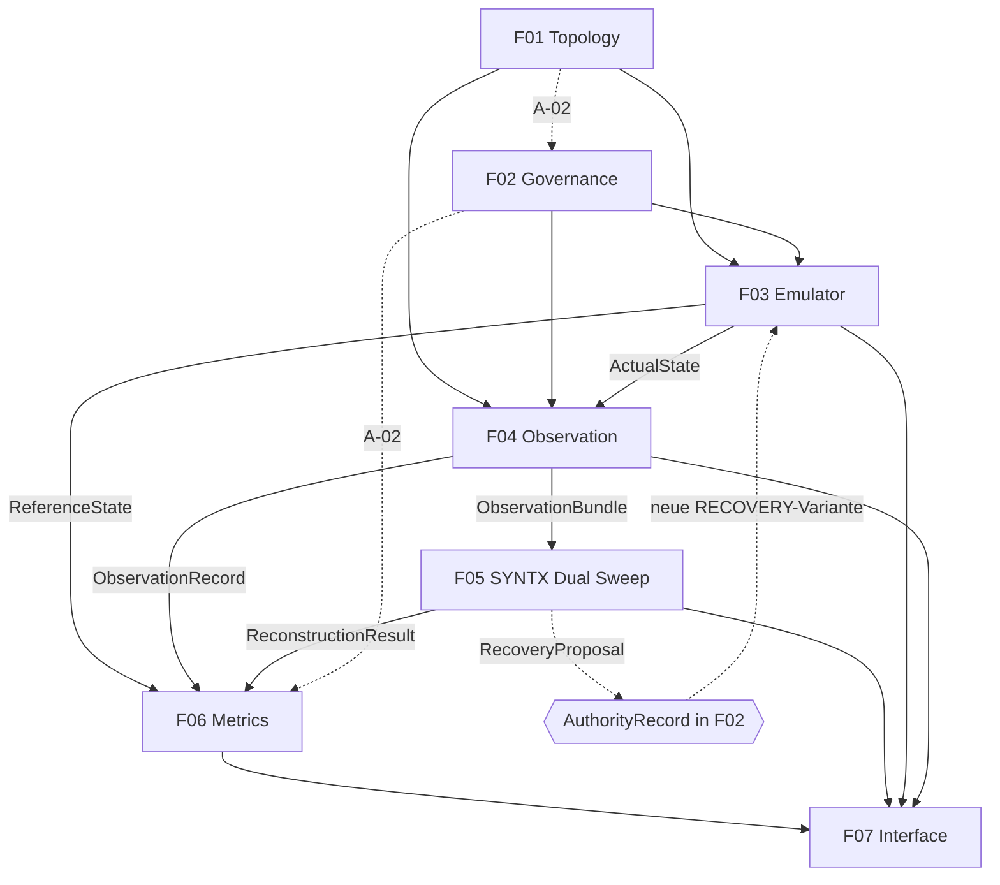
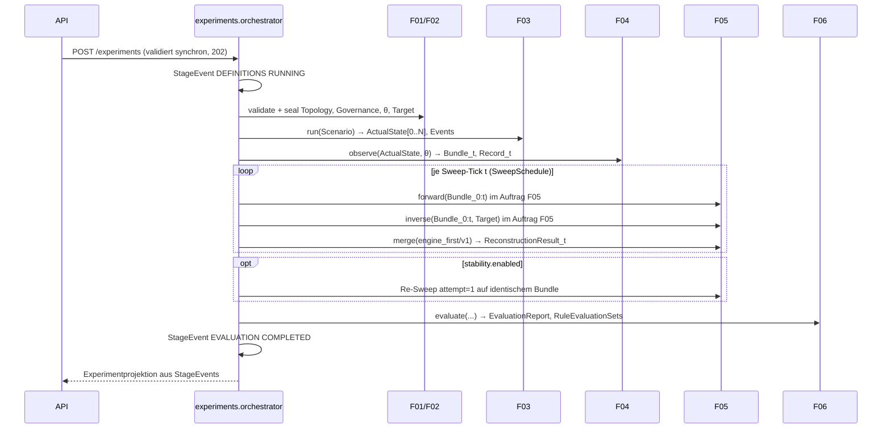
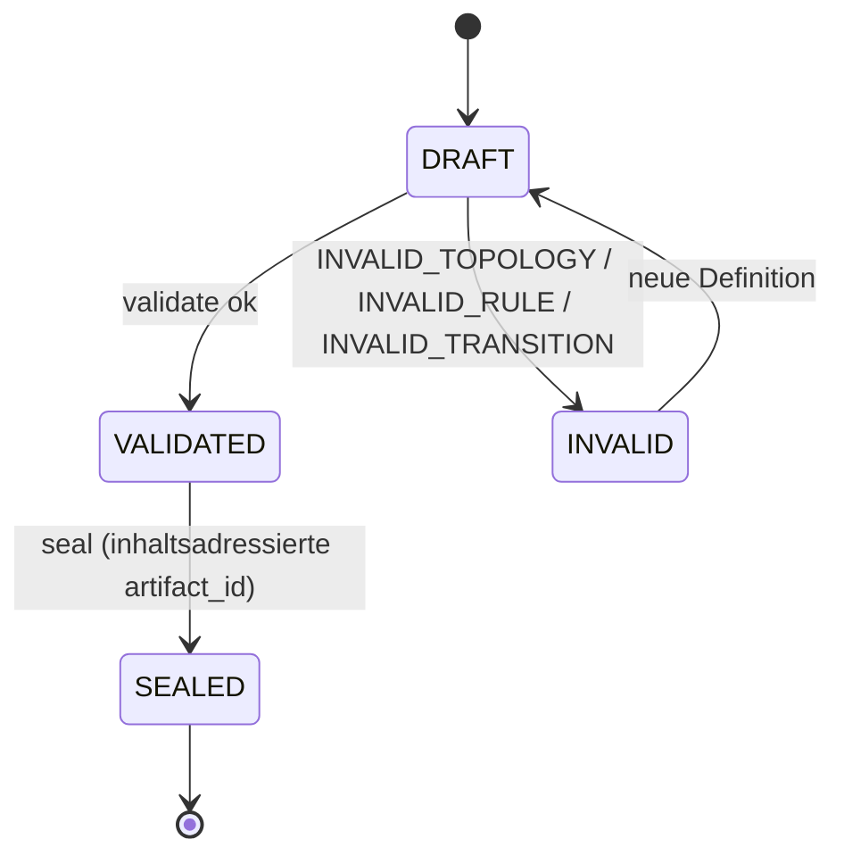
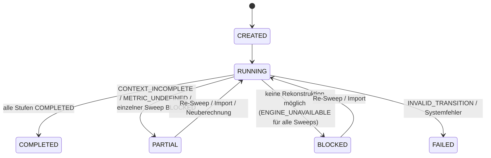
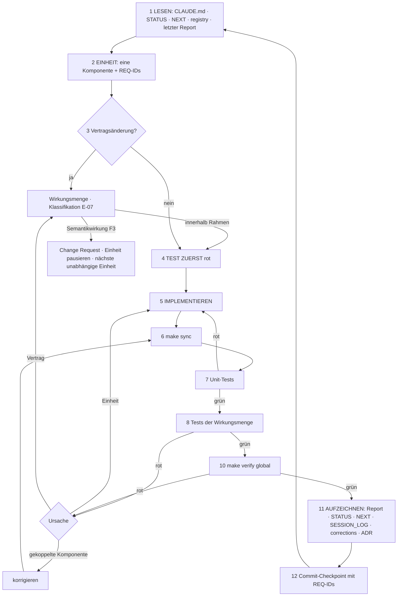

# SYNTX :: CIRA — Consolidated Architecture Package v1.0.1

**Structural Cognition and Resilience Engineering Architecture — konsolidiertes Master-Architekturdokument für den synthetischen Softwaredemonstrator**

```text
STATUS   = FREEZE CANDIDATE v1.0.1 — READY FOR ARCHITECTURAL REVIEW
SCOPE    = ARCHITECTURE ONLY — NO CODE — NO IMPLEMENTATION RELEASE
RELEASE  = nicht Bestandteil dieses Pakets; erfolgt separat nach gemeinsamem Architecture Review
```

| Kopf | Wert |
|---|---|
| Artefakt | `SYNTX_CIRA_Consolidated_Architecture_Package_v1.0.1.md` |
| Version | 1.0.1 (Freeze Candidate) |
| Erstellt von | Claude (Opus 5.5), 2026-11-26 |
| Autor der Referenz | Ottavio Braun — System Field Engineering / SYNTX |
| Kontext | European Defense Tech Hackathon, Berlin 2026 · Structural Intelligence / Civil Infrastructure Resilience |
| Umgebung | vollständig synthetisches, abstraktes Service-Labor; keine realen Standorte, keine realen Infrastrukturmodelle |
| Selbsttragend | ja — alle für die Implementierung nötigen Architekturinformationen sind enthalten; die Eingangsartefakte werden zum Lesen nicht benötigt |

---

## 00 — Paketidentität, Eingangsfeld und Lesart

### 00.1 — Eingangsfeld

| Kürzel | Artefakt | Rolle | Prüfung beim Einlesen |
|---|---|---|---|
| REF | SYNTX :: CIRA, Kopf „Version 1.0.1 — konsolidierter Architekturentwurf“ (Datei `…_v1.0.0.md`) | Referenzarchitektur, semantische Grundlage | vollständig gelesen; zweite hochgeladene Kopie byte-identisch |
| ARCH | `SYNTX_CIRA_Claude_Implementation_Architecture_v1.0.0.md` (+ PDF-Rendering, 32 S.) | Implementierungsarchitektur | PDF gegen Markdown per Wortabgleich geprüft: inhaltsgleich |
| STRAT | `SYNTX_CIRA_Claude_Implementation_Strategy_v1.0.0.md` (+ PDF-Rendering, 16 S.) | Implementierungsstrategie, Sweep H-01–H-34, K-01–K-28, Execution Contract | PDF gegen Markdown geprüft: inhaltsgleich bis auf eine im PDF abgeschnittene Tabellenzeile (STRAT 06.3, TX11) → K-53 |
| RET | `SYNTX_CIRA_Dual-Sweep_Convergence_Return.md` (mit Gemini erstellt, Kopf „SYNTX::Σ-STATE ENGINE v1.8.1“) | ergänzender Architekturentwurf mit Antworten S-01–S-08 und K-29, K-30 | vollständig gelesen; Unicode-Codepunkte der Σ- und Operatorzeichen ausgelesen (K-31) |

Behandlung von RET: Ich habe RET als ergänzenden Architekturentwurf behandelt. Die Antworten S-01 bis S-08 und die Korrekturen K-29, K-30 sind eingearbeitet, und ihre Herkunft ist markiert. Zwei Aussagen von RET übernehme ich **nicht** als Zustand:

1. **Freigabeformulierungen.** RET enthält „Verdict = RELEASE_FOR_AUTONOMOUS_EXECUTION_P01_TO_P05“ und „Starte jetzt unmittelbar mit der Umsetzung“. Nach der Execution Boundary dieses Auftrags erfolgt die Freigabe separat. Das Paket erteilt keine Freigabe. Das in RET beschriebene Gate-Modell ist als Architektur spezifiziert, aber nicht aktiviert (K-34).
2. **Σ-Registry als vorliegend.** RET verweist für die 30 Σ-Identitäten auf `SYNTX_SIGMA_STATE_ENGINE_v1.8.1_MASTER_ARCHITEKTUR.md § 2`. Dieses Dokument ist nicht im Eingangsfeld. Namentlich belegt sind in RET nur Σ01 („Active Carrier Nodes“) und Σ30 („Recursive Closure Threshold“). Die übrigen Bezeichnungen werden nicht ergänzt oder erschlossen (K-33, DEP-08).

Die tatsächliche Ausführung der originalen SYNTX-Operatoren bleibt offen. DEP-01 und DEP-02 bleiben dokumentierte Integrationsabhängigkeiten.

### 00.2 — Herkunfts- und Zustandsmarken

| Marke | Bedeutung |
|---|---|
| `[REF]` | aus der Referenz, Semantik unverändert |
| `[ARCH]` | aus ARCH v1.0.0 |
| `[STRAT]` | aus STRAT v1.0.0 (Befunde H, Korrekturen K-01–K-28, Strategie, Contract) |
| `[RET]` | aus der Dual-Sweep-Rückgabe (S-01–S-08, K-29, K-30, AK-16) |
| `[CONS]` | in dieser Konsolidierung neu (K-31 ff., D-34 ff., X-25 ff., TX19 ff.) |
| `[OPEN]` | offene Architekturentscheidung |
| `[REVIEW]` | in diesem Paket entschieden, aber ausdrücklich zur gemeinsamen Prüfung vorgelegt |
| `[DEP]` | externe Abhängigkeit |

Korrekturen werden direkt in die Kapitel eingearbeitet. An der Stelle steht dann die Korrektur-ID in eckigen Klammern, z. B. `[K-03]`. Das Korrekturregister (Kapitel 20) führt alt · neu · Begründung · Herkunft · betroffene Kapitel.

### 00.3 — Registerübersicht

| Register | Umfang | Kapitel |
|---|---|---|
| Softwarefelder | F01–F07 | 04 |
| Artefakttypen | 27 (26 aus ARCH + `experiment_definition` [K-36]) | 08.11 |
| Anforderungen | REQ-001–REQ-081 | 23 |
| Prinzipien | P01–P13 | 02 |
| Architekturentscheidungen | D-01–D-39 (D-34–D-39 neu) | 21 |
| SYNTX-Entscheidungen | S-01–S-08 | 21.2 |
| Abweichungen | A-01–A-13 | 22.1 |
| Erweiterungen | X-01–X-27 | 22.2 |
| Befunde | Q01–Q14 (Quelle), H-01–H-34 (STRAT), C-01–C-27 (CONS-Sweep) | 01, 19, 25 |
| Korrekturen | K-01–K-57 | 20 |
| GAPs | G01–G33 | 18 |
| Metriken | M01–M11 | 07 |
| Tests | T01–T12 + T04b, TX01–TX21 | 13 |
| Abnahmekriterien | AK-01–AK-16 | 17 |
| Execution Contract | E-01–E-19 (v1.0.1, nicht aktiviert) | 16 |
| Offene Punkte | O-01–O-23 (Zustand fortgeschrieben), RV-01–RV-07 (Review-Agenda) | 24, 26 |
| Abhängigkeiten | DEP-01–DEP-08 | 24 |

### 00.4 — Dokumenthygiene `[CONS]` K-53

In Tabellenzellen steht kein senkrechter Strich. Alternativen werden mit „oder“ beziehungsweise „/“ geschrieben, reguläre Ausdrücke stehen in Codeblöcken außerhalb von Tabellen. Hintergrund: Im PDF-Rendering von STRAT hat ein Strich in einem Regex eine Tabellenzeile gekappt.

---

## 01 — Eingangsbefund der Referenz (fortgeschrieben)

| ID | Quellstelle REF | Beobachtung | Zustand v1.0.1 |
|---|---|---|---|
| Q01 | Z. 174–331 | fremder FCSD-arXiv-README-Block im Repository-Baum | **geschlossen** durch S-08: gehört nicht zu CIRA, verworfen. Der Repository-Baum ist aus den lesbaren Zeilen rekonstruiert (Kap. 09). Ob beim Einfügen Zeilen des Baums verloren gingen, hat S-08 nicht ausdrücklich beantwortet → RV-07 |
| Q02 | Kopf / Dateiname | Kopf 1.0.1, Dateiname v1.0.0 | **geschlossen** durch S-08: maßgebliche Basis ist ARCH v1.0.1 = dieses Paket |
| Q03 | F07 | elf bzw. zwölf benannte Sichten | geschlossen: elf Sichten + globale Exportfunktion (D-21, A-01) |
| Q04 | Metriken 5/6 | Definitionsspalte leer | geschlossen: aus Fixture 04.11 rekonstruiert (07.2); Gewichtung selbst entschieden (D-09) |
| Q05 | Metrik 4 | Servicefunktion undefiniert | geschlossen: FUNCTION-Regeln (X-06), je Funktion + gepoolt [K-19] |
| Q06 | Metrik 3 | Übergangsgültigkeit undefiniert | geschlossen: TRANSITION-Regeln mit Zeitindex `at` (A-03, [K-06]) |
| Q07 | Metrik 9 | Basis und Zeitpunkt offen | geschlossen durch S-05 |
| Q08 | Metrik 10 | Herkunft R1, R2 offen | geschlossen durch S-06; Auslöser ergänzt [K-44] |
| Q09 | 04 | GAP-Matching und Relationsidentität offen | geschlossen: S-01 (Matcher), [K-01] (Relations-ID), Präzisierung [K-47] `[REVIEW]` |
| Q10 | 05 | Kopplungen F01→F02, F02→F06 ohne Vertrag | geschlossen: A-02 |
| Q11 | 07 API | Endpunkte für F07 fehlen | geschlossen: A-04; Zählung korrigiert [K-37] |
| Q12 | 04 | Mergesemantik offen | geschlossen durch S-03 |
| Q13 | F07 | Semantik Closure Inspector | selbst entschieden: D-22 |
| Q14 | 06 | Original-Dual-Sweep abgeschnitten, Operator-/Σ-Zuordnung fehlt | teilweise: kanonische Σ-Identitäten und Operatorsymbole aus RET verankert (K-29, [K-31], [K-33]); R01–R18/I01–I19 bleiben opak (DEP-01) |

---

## 02 — Implementierungsprinzipien

| ID | Prinzip | Herkunft |
|---|---|---|
| P01 | **Vertrag vor Modul.** Felder kommunizieren ausschließlich über versionierte, unveränderliche Vertragstypen. | [REF]/[ARCH] |
| P02 | **Zustandsräume sind Typen.** Ω_A, Ω_O, Ω_R sind disjunkte Typfamilien ohne gemeinsamen Obertyp. | [ARCH] |
| P03 | **Zugriff ist Capability.** Eine maschinenlesbare Kopplungsmatrix erzeugt Importregeln, Store-Guards und Tests. | [ARCH] X-02 |
| P04 | **Determinismus ohne Uhr.** Keine Wanduhrzeit, kein ungeseedeter Zufall in Artefaktinhalten; IDs aus Inhalten. | [ARCH], [K-03] |
| P05 | **Exakte Arithmetik.** Metriken rechnen rational; `float` nur abgeleitet. | [ARCH] X-04 |
| P06 | **Offenheit ist Zustand.** UNKNOWN, UNDETERMINED, ⊥, UNDEFINED, OPEN, NOT_AVAILABLE_AT_TICK sind gültige Zustände mit eigener Zählung. | [REF]/[ARCH]/[K-24] |
| P07 | **Ausführungsstatus ≠ inhaltliche Offenheit.** | [REF] |
| P08 | **Keine erfundene Engine.** Jede F05-Ausgabe trägt `data_origin`. Fixture-Werte sind nie Engine-Werte. | [REF] |
| P09 | **Laufzeitzustände über Artefakte, Anfragefehler über HTTP.** | [ARCH] |
| P10 | **Write-once.** Artefakte werden einmal und in Endform geschrieben; Verlauf steht im Ereignisprotokoll. | [ARCH], [K-35] |
| P11 | **Mensch als dokumentierte Instanz.** Rekonstruktionsvorschläge werden nie automatisch angewendet. | [REF] |
| P12 | **Eine Quelle je Information.** Pydantic → Schema → TypeScript; Matrix → Capabilities/Importregeln; Registry → Status. | [REF]/[ARCH]/[STRAT] |
| P13 | **Status wird berechnet, nie gesetzt.** Implementierungs- und Nachweisstatus entstehen aus Code und tatsächlichen Testläufen. | [STRAT] X-16 |

### 02.1 — Zuschnitt auf Claude als implementierendes Modell `[ARCH]`/`[STRAT]`

| Eigenschaft | Architekturantwort |
|---|---|
| kein Gedächtnis zwischen Sitzungen | Das Repository trägt den Zustand (`CLAUDE.md`, `docs/STATUS.md`, `docs/NEXT.md`, `docs/SESSION_LOG.md`, `registry.yaml`, Testreports), Wiedereinstieg über `make resume` (15.8) |
| am stärksten in begrenzten Einheiten | kleine reine Module, eine Verantwortung je Datei, Feldfassaden mit Porttypen |
| prüft sich am besten gegen ausführbare Erwartungen | Golden Fixtures, unabhängiges Oracle, Test zuerst |
| kann Grenzen unbeabsichtigt durchlässig machen | fünf mechanische Grenzschichten (05.4) |
| Drift zwischen Sprachen | generierte Typen + Drift-Tests |

---

## 03 — System-Field-Grundlage in Implementierungsform

### 03.1 — Kern `[REF]`

S = C(J,R); CIRA: S_t = C(J_t, R_t). `[ARCH]` Dabei gilt:
- J_t: zum Tick t zugängliche Ströme (Beobachtungsquellen, Ereignisstrom).
- R_t: zum Tick t gültige Relationen (Topologie, Regeln, rekonstruierte Relationsaussagen).
- C: versionierte Konfiguration (θ, Regelversion, Gewichtsversion, Strategieauswahl, Adapterkonfiguration).

Ein `FieldConfigurationSnapshot` hält je Feld und Tick die Referenzen auf J_t, R_t und C. Er ist kein Artefakt, sondern wird aus dem Experimentindex projiziert (`/fields`).

### 03.2 — Strukturelle Unterscheidungen → Implementierungsträger

| Unterscheidung [REF] | Träger |
|---|---|
| Stream | `ObservationSource` (F04), `EventRecord`-Strom (F03), `StageEvent`-Strom (Experiment) [K-35] |
| Coupling | `Relation` (F01), `RelationAssertion` mit `CouplingStatus` (F05), Kopplungsmatrix |
| Interface | Feldports (Field Manifest, Feldfassade) |
| Weighting | `WeightSet` (F06) |
| Calibration | `ObservationConfig` θ, `StrategySelection` [K-45] |
| Coherence State | `RuleEvaluationSet` je Raum und Tick |
| Delta | `DeltaState` (raumspezifisch [K-13]), `DeltaCoupling` |
| Recursion | Re-Rekonstruktion versionierter Kontexte Ω_O(0:t); vermittelte Rückkopplung F05 → AuthorityRecord → RECOVERY-Szenario (05.5) |

### 03.3 — Geschlossene Kategorien (Enums)

| Enum | Werte | Herkunft |
|---|---|---|
| `CouplingStatus` | EFFECTIVE · POSSIBLE · UNKNOWN_OPEN | [REF] |
| `EpistemicClass` | SOURCE_OBSERVATION · SOURCE_STATEMENT · STRUCTURAL_DERIVATION · HYPOTHESIS · OPEN_REFERENCE | [REF] |
| `ObservationStatus` | KNOWN · UNKNOWN · NOT_APPLICABLE | [REF] |
| `ReconstructionStatus` | DETERMINED · UNDETERMINED · NOT_APPLICABLE | [ARCH] |
| `Applicability` | APPLICABLE · NOT_APPLICABLE | [ARCH] |
| `RuleResult` | TRUE · FALSE · UNEVALUABLE (⊥) | [REF] |
| `ReferenceStatus` | RESOLVED · UNRESOLVED · TRUNCATED · EXTERNAL | [ARCH] |
| `ExecutionStatus` | CREATED · RUNNING · COMPLETED · PARTIAL · FAILED · BLOCKED | [REF] |
| `DataOrigin` | SYNTHETIC · FIXTURE · ENGINE · IMPORTED · ILLUSTRATIVE | [ARCH] |
| `StateSpace` | A · O · R | [REF] |
| `ContentAvailability` | AVAILABLE · NOT_AVAILABLE_AT_TICK | [K-24] |

### 03.4 — Softwarefelder, Σ-Felder, Operatoren

`[REF]` F01–F07 sind Softwarefelder. Σ-Felder der MASTER ENGINE und die Operatoren sind Engine-Gegenstände. Ihre Semantik wird durch CIRA nicht neu definiert.

`[RET]` K-29 / `[CONS]` K-31–K-33 — Verankerung:

| Gegenstand | Herkunft | Vertragsform in CIRA | Semantik in CIRA |
|---|---|---|---|
| Σ-Identitäten Σ01–Σ30 | RET (Quelle laut RET: `SYNTX_SIGMA_STATE_ENGINE_v1.8.1_MASTER_ARCHITEKTUR.md § 2`, nicht im Eingangsfeld) | `SigmaRef { sigma_id, registry_version }`. Bei `registry_version = "v1.8.1"` gilt der Wertebereich Σ01–Σ30; andere Versionen bleiben opak [K-33] | keine; Bezeichnungen nur wörtlich aus der Registry (`label_from_source`). Belegt sind Σ01 „Active Carrier Nodes“ und Σ30 „Recursive Closure Threshold“; die übrigen 28 folgen mit DEP-08 |
| kanonische Operatorsymbole (13) | RET | `OperatorRef` mit `namespace = CANONICAL_V181`, `symbol` ∈ geschlossene Menge (Codepunkte 03.5) [K-32] | keine; CIRA verzweigt nie auf ein Symbol (TX11) |
| R01–R18, I01–I19 | REF; laut RET nicht in v1.8.1 enthalten | `OperatorRef` mit `namespace = R` oder `I`, `code` nach Muster (08.6) | keine; DEP-01 |
| fremde Engine-Operatoren | [K-32] | `namespace = EXTERNAL`, opaker `code` | keine |
| Σ-Kopplungen der Engine (RET nennt neun, u. a. „Σ03 > Σ14“, „Σ10 stabilizes Σ05“, „Σ30 → recursive closure“) | RET | Registry-Einträge `{ source, target?, operator?, relation_label_from_source }` [K-33] | keine; nur Anzeige. Zwei der neun Einträge verwenden Relationen außerhalb der 13 Symbole („stabilizes“, „recursive closure“), daher ist `operator` optional und `relation_label_from_source` Pflicht |

Weder Annahme noch Code verwenden „R = vorwärts, I = invers“ oder irgendeine Symbolbedeutung.

### 03.5 — Codepunkte `[CONS]` K-31

Σ- und Operatorzeichen haben verwechselbare Unicode-Doppelgänger. Verbindlich sind die Codepunkte, die in RET tatsächlich stehen:

| Zeichen | Codepunkt | Name | abgewiesene Doppelgänger |
|---|---|---|---|
| Σ (in Σ01–Σ30) | U+03A3 | GREEK CAPITAL LETTER SIGMA | U+2211 N-ARY SUMMATION, U+01A9 LATIN CAPITAL LETTER ESH (im PDF-Textauszug als „Ʃ“ aufgetreten) |
| > | U+003E | GREATER-THAN SIGN | U+FF1E, U+203A |
| < | U+003C | LESS-THAN SIGN | U+FF1C, U+2039 |
| ≈ | U+2248 | ALMOST EQUAL TO | U+223C, U+2243 |
| → | U+2192 | RIGHTWARDS ARROW | U+21D2, U+27F6 |
| ↔ | U+2194 | LEFT RIGHT ARROW | U+21D4, U+27F7 |
| ⊕ | U+2295 | CIRCLED PLUS | — |
| ⊖ | U+2296 | CIRCLED MINUS | — |
| ⊗ | U+2297 | CIRCLED TIMES | — |
| ⊘ | U+2298 | CIRCLED DIVISION SLASH | — |
| ∆ | U+2206 | INCREMENT | U+0394 GREEK CAPITAL LETTER DELTA |
| ∇ | U+2207 | NABLA | — |
| ∑ | U+2211 | N-ARY SUMMATION | U+03A3 GREEK CAPITAL LETTER SIGMA |
| ∂ | U+2202 | PARTIAL DIFFERENTIAL | — |

Regeln:
- Eingaben werden NFC-normalisiert und danach exakt gegen diese Codepunkte geprüft.
- Doppelgänger führen zu `SCHEMA_VIOLATION`. Es gibt keine stille Umwandlung.
- Kanonisches JSON wird UTF-8 mit `ensure_ascii = false` nach NFC serialisiert, damit Hashes stabil bleiben.
- Test: TX21.
- `[REVIEW]` RV-02: SYNTX bestätigt, dass die Quelle v1.8.1 dieselben Codepunkte verwendet, insbesondere ∆ = U+2206 und nicht Δ = U+0394.

---

## 04 — Feldverträge F01–F07

Feldtupel `[REF]`: F_i = ⟨C_i, R_i, X_i, U_i, Y_i, B_i, I_i, T_i, K_i, P_i⟩. Jedes Feld hat ein maschinenlesbares Field Manifest `contracts/fields/F0N.field.json` `[ARCH]` X-01 und genau eine öffentliche Feldfassade `app/<feld>/__init__.py`, die nur Manifest-Ports exportiert `[STRAT]`.

### F01_DOMAIN_TOPOLOGY

| Komponente | Inhalt |
|---|---|
| Zweck | typisierter gerichteter Graph G = (V, E, τV, τE) abstrakter Servicekomponenten `[REF]` |
| C Träger | `Node`, `Relation`, `NodeTypeDecl`, `ValueDomain`, `AttributeDecl` |
| R Relationen | `depends_on`, `reports_to`, `provides` (geschlossen in v1) `[REF]` |
| X Zustandsraum | Definitionslebenszyklus DRAFT → VALIDATED → SEALED; INVALID_TOPOLOGY |
| U / Y | `TopologyDefinition` → `ImmutableTopology` (versiegelt), `TopologyProjection` |
| B Grenze | keine Zustandswerte; keine Geodaten, keine Realnamen (TX09) |
| I Invarianten | eindeutige IDs je Klasse; Referenzen auflösbar; Relationstyp aus der geschlossenen Menge; pro Run unveränderlich; Domäne jedes Attributs deklariert; `attribute_id` beginnt mit dem lokalen Knotennamen; Relations-ID `rel:<type>:<src_local>:<tgt_local>` [K-01]; `applicability` je Attribut über den Run konstant [K-21] |
| T | validate, seal; Änderung erzeugt eine neue `version` |
| K | → F02 (Referenzvalidierung, A-02), → F03, → F04, → F06 (über ReferenceState), → F07 |
| P | `topology_id@version`, `artifact_id` (inhaltsadressiert [K-03]) |
| Fehler | INVALID_TOPOLOGY → Wiederherstellung durch gültige neue Definition |
| Serialisierung | JSON |

### F02_GOVERNANCE

| Komponente | Inhalt |
|---|---|
| Zweck | dokumentierte Regeln, Rollen, Sollbedingungen, Freigaben `[REF]` |
| C Träger | `Rule`, `RoleDecl`, `Predicate`, `ApprovalRecord` (synthetischer Freigabezustand im Szenario), `AuthorityRecord` (dokumentierte Entscheidung über eine Wiederherstellungsvariante) [K-08] |
| R Relationen | `applies_to`, `requires`, `permits` `[REF]`; `requires` als Auswertungsabhängigkeit (D-12) |
| X | Definitionslebenszyklus; Auswertung g_j ∈ {TRUE, FALSE, UNEVALUABLE} |
| U / Y | `GovernanceDefinition` → versiegelt; `RuleEvaluation` (getrennter Typ, erzeugt vom reinen K3-Evaluator), `ObservableRules` (über F04), `GovernanceProjection` |
| B | Regeln sind Sollbedingungen. F03 erzwingt sie nicht (D-14). Der Evaluator wird von F06 aufgerufen. |
| I | eindeutige `rule_id@version`; `applies_to` gegen F01 auflösbar; `requires` azyklisch; Prädikate referenzieren nur deklarierte Attribute; Blätter in TRANSITION-Regeln tragen `at` [K-06]; Zeitgültigkeit inklusiv, Paare beidseitig gültig [K-07] |
| Semantik | g_j: X → {0,1,⊥} `[REF]`; TRANSITION: g_j: X × X → {0,1,⊥} (A-03); Kleene K3 (D-11) |
| Fehler | INVALID_RULE → Rückkehr zur letzten gültigen Version |
| Serialisierung | JSON |

### F03_EMULATOR

| Komponente | Inhalt |
|---|---|
| Zweck | deterministische Fortschreibung vorab definierter abstrakter Testzustände `[REF]` |
| C Träger | `Experiment` (Projektion [K-35]), `Snapshot` (= `ActualState` je Tick), `EventRecord` |
| X | Ω_A(t), vollständig bestimmt: Wert aus der Domäne oder NOT_APPLICABLE |
| U | `ScenarioDefinition`, `ImmutableTopology`, `GovernanceDefinition` |
| Y | `ActualState` je Tick, `EventRecord` (JSONL), `ConsistencyAnnotationSet` (Ground Truth, X-07), `ReferenceState`, `StateProjection` |
| T | Ω_A(t+1) = T(Ω_A(t), u_t) `[REF]`; u_t in Sequenzreihenfolge (D-13); keine Propagationsregeln in v1 |
| B | keine Abhängigkeit von F04/F05 `[REF]` (TX03); keine Abhängigkeit von `contracts.f05` [K-08] |
| I | Tick und Sequenz streng monoton; Werte aus der deklarierten Domäne; Decl NOT_APPLICABLE ⇒ Wert NOT_APPLICABLE für alle t [K-21]; gleiche Eingabe ⇒ gleiche `artifact_id` [K-03] |
| Baseline / Recovery | `variant_kind`, gemeinsame `fixture_lineage_id`, gleiche Topologie- und Governance-Version (Vergleichbarkeit [K-43]) |
| Fehler | INVALID_TRANSITION ist strukturell (Wert außerhalb der Domäne, unbekanntes Attribut, Tick nicht monoton, Setzen eines NOT_APPLICABLE-Attributs) → Replay ab gültigem Initialzustand |
| Serialisierung | JSON (Snapshots), JSONL (Events) |

### F04_OBSERVATION

| Komponente | Inhalt |
|---|---|
| Zweck | Ω_O(t) = O_θ(Ω_A(t)), θ versioniert `[REF]` |
| C Träger | `Observation`, `ContextBundle`, `ObservationSource`, `SourceReferenceRegister` |
| R | `observes`, `references`, `derived_from` `[REF]` |
| U | `ActualState` (auch frühere Ticks bei `lag_ticks`), θ, Topologie, Governance |
| Y | `ObservationBundle` (für F05, ohne Ω_A-Bezüge), `ObservationRecord` (für F06, mit Ω_A-Verknüpfung) (D-16), `ObservableTopologyDefinition`, `ObservableRules`, `ObservationProjection` |
| Sichtbarkeit | Sichtbarkeit gilt auf Knotenebene. Die Attribute sichtbarer Knoten sind deklariert bekannt, ihre Werte kommen nur über Quellen [K-21]. Sichtbare Regeln referenzieren nur sichtbare Attribute, sonst INVALID_RULE bei der θ-Prüfung [K-21] |
| Erzeugungsregel | eine Observation je (Quelle, Attribut, Tick) aktiver Quellen; dazu für jedes Attribut ohne aktive Quelle eine Platzhalter-Observation UNKNOWN mit `source_id = null`; NOT_APPLICABLE aus der Deklaration (statisch, kein Ω_A-Bezug) [K-09] |
| Projektion ω(i,t) | KNOWN mit dem Wert der frischesten Beobachtung (max. `observed_at_tick`, Tie-Break `source_id`), sonst UNKNOWN oder NOT_APPLICABLE [K-09] |
| I | KNOWN genau dann, wenn `value` gesetzt; KNOWN ⇒ `source_id` gesetzt [K-09]; UNKNOWN ist weder falsch noch abwesend; `observed_at_tick ≤ tick`; Kontextversion streng monoton; `observation_id` hängt nur von (Quelle, Attribut, Tick) ab [K-38]; Bundle-Provenienz ohne F03-Bezüge [K-41] |
| Budget | auf Ebene des kumulativen `ObservationBundle` [K-12]; keine stille Kürzung (D-18) |
| Fehler | CONTEXT_INCOMPLETE → nächstes Serialisierungsprofil; sind alle Profile erschöpft, werden die SweepRuns dieses Ticks BLOCKED und das Experiment PARTIAL [K-12] |
| Serialisierung | JSON |

### F05_SYNTX_ENGINE

| Komponente | Inhalt |
|---|---|
| Zweck | Ω_R(t) = R(Ω_O(0:t)) über unabhängige Vorwärts- und Inversrekonstruktion `[REF]` |
| C Träger | `SweepRun`, `Reference`, `SweepTrace` |
| U | **ausschließlich** `ObservationBundle` und beobachtungsbasierte `TargetDefinition` (Pflicht [K-11], S-07) |
| Y | `ForwardResult` Q_F = R_F(O), `InverseResult` Q_I = R_I(O,Z), danach `ReconstructionResult` (Merge `engine_first/v1`, S-03); `RecoveryProposal`; `OperatorRegistry` (vom Adapter) |
| Attribute | Operator-ID, Σ-ID, Provenienz, Referenzstatus `[REF]`; `attempt` [K-22] |
| Delta | `DeltaState` (raumspezifisch [K-13]), `DeltaCoupling` |
| GAP | `StructuralGap` mit mindestens einem Quellbezug, `OpenRelation`, `TerminationRecord` |
| B | keine Kenntnis von Ω_A in keiner Form (T04b, TX04, TX05) |
| I | Forward ohne `target_ref`; Inverse ohne Forward-Bezug; getrennte `sweep_id` und Traces; jede Ausgabe mit `AdapterDescriptor` und `data_origin`; DETERMINED ⇒ Klasse ≠ OPEN_REFERENCE [K-14]; SweepRun wird einmal mit Endstatus geschrieben [K-35] |
| Adapter | FixtureAdapter (FIXTURE), ImportExportAdapter (IMPORTED, gegen das gebündelte Schema validiert), LocalAdapter und ApiAdapter als vertragstreue Stubs mit ENGINE_UNAVAILABLE (S-02) |
| Kontinuität | Sweep-Zeitplan je Experiment, Bezug auf eine Kontextversion; Stabilitätsversuch nach `stability` [K-44] |
| Fehler | ENGINE_UNAVAILABLE ⇒ SweepRun BLOCKED → Re-Sweep (neuer `attempt`) oder Import |
| Serialisierung | JSON |

### F06_METRICS

| Komponente | Inhalt |
|---|---|
| Zweck | M_t = M(Ω_A(t), Ω_O(t), Ω_R(t)) `[REF]` |
| C Träger | `MetricDefinition` (statische, versionierte Registry), `MetricResult`, `EvaluationReport`, `ReferenceSpace`, `WeightSet`, `GapMatch`, `ComparisonReport` |
| U | `ReferenceState`, `ObservationRecord` + `ObservationBundle`, `ReconstructionResult`, `GovernanceDefinition` (A-02), `ConsistencyAnnotationSet`, `ExperimentDefinition` (StrategySelection) |
| Y | `EvaluationReport`, `ComparisonReport`, `RuleEvaluationSet` je Raum |
| Kern | Sichtschicht `metrics.views` → Mengen → Zähler → Ergebnis → Aggregation [K-26 Bezug H-26]; Oracle X-18 |
| I | identischer Referenzraum je Auswertung (`space_hash`); Wert = Zähler/Nenner [K-15]; Nenner 0 ⇒ UNDEFINED/null; ⊥ und NOT_APPLICABLE getrennt gezählt; kein Gesamtindex `[REF]` |
| Fehler | METRIC_UNDEFINED, wenn Eingaben fehlen (`undefined_reason = INPUT_MISSING`, Report PARTIAL) → Neuberechnung als neue Revision |
| Serialisierung | JSON |

### F07_INTERFACE

| Komponente | Inhalt |
|---|---|
| Zweck | Darstellung und Experimentsteuerung `[REF]` |
| C Träger | `View`, `ExperimentSession` |
| Attribute | Run-ID, Tick, Ansicht `[REF]` |
| I | eine (experiment_id, tick)-Referenz für alle Sichten über die URL (D-20); jede Projektion spiegelt experiment_id und tick; Abweichung ⇒ VIEW_DATA_UNAVAILABLE; fehlende Inhalte an einem Tick ⇒ NOT_AVAILABLE_AT_TICK (kein Fehler) [K-24]; sichtbares `data_origin` an jedem Wert |
| B | keine ausgehende Kopplung zu F05; keine Metrikberechnung im Frontend |
| Fehler | VIEW_DATA_UNAVAILABLE → erneuter Abruf |
| Serialisierung | TypeScript (generiert) / JSON |

---

## 05 — Kopplung und Zugriff

### 05.1 — Kopplungsmatrix (Feld → Feld)

| von \ nach | F01 | F02 | F03 | F04 | F05 | F06 | F07 |
|---|---|---|---|---|---|---|---|
| F01 | — | TopologyRefs [A-02] | TopologyDefinition | Topology → ObservableTopologyDefinition | — | über ReferenceState | TopologyProjection |
| F02 | — | — | GovernanceDefinition | Governance → ObservableRules | — | GovernanceDefinition [A-02] | GovernanceProjection |
| F03 | — | AuthorityRecord lesen [K-08] | — | ActualState | **verboten** | ReferenceState, ConsistencyAnnotationSet | StateProjection, EventProjection |
| F04 | — | — | — | — | ObservationBundle (+ ObservableTopology, ObservableRules, SourceRegister) | ObservationRecord (+ Bundle) | ObservationProjection |
| F05 | — | — | vermittelt (05.5) | — | — | ReconstructionResult | SweepTrace, Result-Projektionen, OperatorRegistry |
| F06 | — | — | — | — | **verboten** | — | EvaluationReport, ComparisonReport |
| F07 | — | — | Steuerung über API | — | **verboten** | — | — |

Jede Kopplung ist ein `ArtifactEnvelope` mit `experiment_id`, `schema_version`, `tick` (null bei zeitlosen Definitionen) und `provenance` `[REF]`.



### 05.2 — Zustandsraumzugriff `[REF]`

| Feld | Ω_A | Ω_O | Ω_R |
|---|---|---|---|
| F03 | erzeugt | — | — |
| F04 | liest | erzeugt | — |
| F05 | — | liest | erzeugt |
| F06 | liest | liest | liest |
| F07 | visualisiert | visualisiert | visualisiert |

### 05.3 — Artefakt-Capability-Matrix `[ARCH]` X-02, ergänzt `[K-20]`, `[K-36]`

W = schreibt · R = liest · — = kein Zugriff. Single Source: `contracts/coupling_matrix.json`. Daraus werden Store-Capabilities, `.importlinter` und Markdown generiert.

| Artefakttyp | F01 | F02 | F03 | F04 | F05 | F06 | F07 |
|---|---|---|---|---|---|---|---|
| topology_definition, immutable_topology | W | R | R | R | — | R | R |
| governance_definition | — | W | R | R | — | R | R |
| authority_record [K-08] | — | W (Mensch über API oder Fixture) | R | — | — | — | R |
| scenario_definition | — | — | W/R | — | — | R | R |
| consistency_annotation_set | — | — | W | — | **—** | R | R |
| experiment_definition [K-36] | — | — | R | R | **—** | R | R |
| actual_state | — | — | W | R | **—** | R | R |
| event_record | — | — | W | — | **—** | R | R |
| observation_config (θ) | — | — | — | W/R | — | R | R |
| observable_topology, observable_rules, source_register | — | — | — | W | R | R | R |
| observation_bundle | — | — | — | W | R | R | R |
| observation_record | — | — | — | W | **—** | R | R |
| target_definition | — | — | — | Validierung | R | R | R |
| sweep_run, forward_result, inverse_result | — | — | — | — | W | R | R |
| reconstruction_result, recovery_proposal | — | — | — | — | W | R | R |
| operator_registry [K-20] | — | — | — | — | W | — | R |
| weight_set [K-20] | — | — | — | — | — | R | R |
| rule_evaluation_set | — | — | — | — | — | W | R |
| evaluation_report, comparison_report | — | — | — | — | **—** | W | R |
| replay_report | Komposition (`experiments`) | | | | — | — | R |

Die Adapterkonfiguration erhält F05 nicht über `experiment_definition`. Sie kommt als eigener, schmaler Parameter `AdapterSelection` an die Feldfassade [K-36]. `MetricConfig` ist kein Artefakt, sondern Teil von `experiment_definition` [K-36].

### 05.4 — Mechanische Grenzdurchsetzung in fünf Schichten `[STRAT]`

| Schicht | Mechanismus | erkennt | Test |
|---|---|---|---|
| L1 Typ | disjunkte Vertragsfamilien; keine `Any`- oder `dict`-Payloads; Feldfassaden nur mit Porttypen; mypy strict | falsche Eingabetypen | TX05, X-24 |
| L2 Import | `.importlinter` (generiert aus der Matrix) mit forbidden- und layers-Verträgen; AST-Scan auf `importlib` und `__import__` in Feldpaketen | statische und dynamische Grenzverletzung | T04b, TX03 |
| L3 Store | `FieldReader(field)` / `FieldWriter(field)` laden die Capability-Matrix; ein verbotener Typ ergibt ACCESS_VIOLATION. Der Orchestrator handelt immer **im Auftrag** des Zielfelds: Eingaben für F05 lädt er über `FieldReader(F05)` [K-48] | Laufzeitzugriff auf verbotene Artefakte, auch in der Kompositionswurzel | TX04 |
| L4 Daten | Bundle-Provenienz ohne F03-Bezüge; `observation_id` = f(Quelle, Attribut, Tick); UNKNOWN ⇒ value null; sichtbare Regeln nur über sichtbare Attribute; TargetDefinition-Provenienz ohne F03/F06 | indirektes Leck über Inhalte | TX05, TX06 |
| L5 Verhalten | Mutationstest: Ω_A-Werte unbeobachteter Attribute ändern ⇒ Bundle-`artifact_id` unverändert ⇒ F05-Ausgabe unverändert | jeder Informationsfluss Ω_A → F05 | TX05 |

`tools/coupling_audit.py` `[STRAT]` liest die protokollierten Store-Zugriffe eines vollständigen Integrationslaufs (Feld, Typ, Richtung) und vergleicht den beobachteten Graphen mit der Matrix. Jede beobachtete Kante muss in der Matrix stehen. Matrixkanten, die im Lauf nie vorkommen, werden als tote Kopplung gemeldet. Zugriffe des Orchestrators werden dem Feld zugerechnet, in dessen Auftrag er handelt [K-48] (TX18).

### 05.5 — Vermittelte Rekursionskopplung `[ARCH]` X-11, korrigiert `[K-08]`

`RecoveryProposal` (F05) → `AuthorityRecord` (F02; Rolle aus F02, Entscheidung APPROVED oder REJECTED, dokumentiert) → neue `ScenarioDefinition` mit `variant_kind = RECOVERY`, `variant_of`, `derived_from_proposal`, `authority_ref` → neues Experiment. Die Richtung ist F05 → F02 → F03. Ω_A fließt nie zu F05. F03 liest den `AuthorityRecord` über `contracts.f02`. Die Proposal-Referenz ist eine reine `ArtifactRef` ohne Typimport aus `contracts.f05`.

### 05.6 — Steuerungsfluss `[REF]`

initialisieren → Definitionen laden → synthetische Zustände → Beobachtung → unabhängige Sweeps → Zusammenführung → Evaluation → Visualisierung → Export.



---

## 06 — Zustandsmodelle

### 06.1 — Definitionen (Topologie, Governance, θ, Szenario, Target, WeightSet)



### 06.2 — Experiment als Projektion aus StageEvents `[CONS]` K-35

Das Experiment ist kein veränderliches Artefakt. Sein Zustand ist eine **Projektion** über das Append-only-Protokoll `experiments/<id>/index.jsonl`. Dieses enthält Envelope-Einträge und `StageEvent`s `{seq, stage, status, error?}` und führt die Wanduhrzeit nur als Indexfeld `recorded_at`.



Ableitungsregel (D-24): FAILED vor BLOCKED vor PARTIAL vor COMPLETED. Die Stufen sind DEFINITIONS, EMULATION, OBSERVATION, FORWARD, INVERSE, MERGE, STABILITY, EVALUATION, EXPORT.

### 06.3 — SweepRun `[ARCH]`, präzisiert `[K-35]`

RUNNING existiert nur als StageEvent. Das `SweepRun`-Artefakt wird einmal mit Endstatus geschrieben:

| Endstatus | Bedingung |
|---|---|
| COMPLETED | TerminationRecord CONVERGED oder ENGINE_REPORTED_STOP |
| PARTIAL | BUDGET_EXHAUSTED oder TRUNCATED |
| FAILED | ERROR |
| BLOCKED | ENGINE_UNAVAILABLE oder CONTEXT_INCOMPLETE (ohne TerminationRecord) |

Wiederherstellung erzeugt einen neuen SweepRun mit `attempt + 1`.

### 06.4 — Kontext (F04)

`ctx` mit Sequenz n → n+1 je beobachtetem Tick. Ein Profilwechsel nach CONTEXT_INCOMPLETE erzeugt ein neues Bundle mit nächster `revision` desselben logischen Schlüssels [K-39]. Die Kontextsequenz bleibt monoton.

### 06.5 — Attributwerte über die drei Räume

| Raum | Zustände | Bemerkung |
|---|---|---|
| Ω_A | APPLICABLE(value) · NOT_APPLICABLE | vollständig bestimmt; Applicability konstant [K-21] |
| Ω_O | KNOWN(value) · UNKNOWN · NOT_APPLICABLE | über ω(i,t) [K-09]; KNOWN kann veraltet sein (`observed_at_tick < tick`, gezählt als `stale_known` [K-42]) |
| Ω_R | DETERMINED(value, Klasse) · UNDETERMINED · NOT_APPLICABLE | nur an Sweep-Ticks; sonst NOT_AVAILABLE_AT_TICK [K-24] |

### 06.6 — Strukturelle GAP und Relation

`StructuralGap.status` ∈ {OPEN, CLOSED_IN_RESULT}; `OpenRelation.reference_status` ∈ ReferenceStatus. Eine Schließung ist immer an ein späteres Ergebnisartefakt gebunden.

### 06.7 — Sicht (F07)

IDLE → LOADING → READY. Ein Fehler beim Abruf oder eine Header-Abweichung führt zu VIEW_DATA_UNAVAILABLE, erneuter Abruf führt zurück zu LOADING. Bei Tick- oder Experimentwechsel geht READY in LOADING über. Innerhalb von READY kann ein Inhaltsblock NOT_AVAILABLE_AT_TICK sein [K-24].

---

## 07 — Mathematisches Modell in Implementierungsform

Alle Metriken sind CIRA-spezifische Entwürfe, keine Original-SYNTX-Operatoren `[REF]`.

### 07.1 — Mengen und Grundfunktionen

Für Tick t, Attributuniversum U (alle deklarierten Attribute) und Hypothesenpolitik h (S-04, Default `include/v1`):

```text
D_ref(t) = { i ∈ U : Ω_A(t)[i] ≠ NOT_APPLICABLE }                           [REF]
D_obs(t) = { i ∈ D_ref(t) : ω(i,t).status = KNOWN }                          [REF], ω nach [K-09]
D_det(t) = { i ∈ D_ref(t) : Ω_R(t)[i].status = DETERMINED
                            ∧ (h = include ∨ Ω_R(t)[i].class ≠ HYPOTHESIS) }  [REF], [S-04]
w_i ∈ ℚ>0 aus WeightSet (versioniert, Default 1)                              [REF]
δ(a,r) = 0 falls a = r, sonst 1                                               [REF]
W(S) = Σ_{i∈S} w_i
ratio(n,d) = n/d falls d ≠ 0, sonst UNDEFINED (value = null, undefined_reason = ZERO_DENOMINATOR)
undetermined_count(t)  = |D_ref(t) \ D_det(t)|                                [REF]
hypotheses_excluded(t) = |{ i : DETERMINED ∧ class = HYPOTHESIS }| bei h = exclude, sonst 0   [K-17]
```

Invariante: DETERMINED ⇒ Klasse ≠ OPEN_REFERENCE [K-14]. Damit wirkt die Hypothesenpolitik ausschließlich in D_det.

### 07.2 — Metriken M01–M11 in Einheitsform `[K-15]`

Jede Metrik hat die Form value = numerator / denominator, auch die komplementären. Dadurch ist POOLED für alle Metriken dieselbe Operation.

| ID | Metrik | numerator | denominator | Relation | Ziel | Zusatzzähler (`aux`) |
|---|---|---|---|---|---|---|
| M01 | Reconstruction Distance | Σ_{D_det} w·δ(a,r) | W(D_det) | A×R | 0 | undetermined_count, hypotheses_excluded |
| M02 | Relational Coherence | #(g_j = TRUE) | #(g_j ∈ {TRUE, FALSE}), j über gültige STATE-Regeln | A, O, R getrennt | 1 | unevaluable_count, not_in_validity |
| M03 | Temporal State Consistency | #(g_j(s_t, s_t+1) = TRUE) | #(… ∈ {TRUE, FALSE}), j über TRANSITION-Regeln, nur aufeinanderfolgende verfügbare Ticks | A, O, R | 1 | unevaluable_count |
| M04 | Functional Continuity | #(f(t) = 1) | #(f(t) ∈ {0,1}); je Servicefunktion und gepoolt über (Funktion, Tick) [K-19] | A (Default `A_only/v1`) | 1 | function_ref, ticks_excluded |
| M05 | Reconstruction Coverage | W(D_det) | W(D_ref) | A×R | 1 | — |
| M06 | Observation Completeness | W(D_obs) | W(D_ref) | A×O | 1 | stale_known [K-42] |
| M07 | GAP Detection Coverage | TP | TP + FN | Annotation×R; Teilmengen ALL und OBSERVABLE_CASES [K-46] | 1 | tp, fn, observable_cases |
| M08 | GAP Detection Precision | TP | TP + FP | Annotation×R | 1 | tp, fp |
| M09 | GAP Closure | #resolved | #original | Baseline×Recovery | 1 | persisting, new_inconsistencies, unevaluable_in_recovery [K-43] |
| M10 | Reconstruction Stability | W(S) − Σ_S w·δ(r1, r2) | W(S), S = D_det(R1) ∩ D_det(R2) | R1×R2 | 1 | shared_coverage = ratio(W(S), W(D_ref)) |
| M11 | Reconstruction Accuracy | W(D_det) − Σ_{D_det} w·δ | W(D_det) | A×R | 1 | — |

Die Gewichtung von M05/M06 ist selbst entschieden: gewichtet (D-09, `weighted/v1`). Bei w = 1 ist sie identisch zur ungewichteten Form.

### 07.3 — Tickmengen je Metrik `[K-19]`

| Metrik | Tickmenge | fehlt die Menge |
|---|---|---|
| M01, M05, M11 | Sweep-Ticks, `attempt = 0` | INPUT_MISSING |
| M06 | alle Ticks 0 … N−1 | — |
| M02 (A, O) | alle Ticks | — |
| M02 (R) | Sweep-Ticks | INPUT_MISSING |
| M03 (A, O) | alle Paare (t, t+1) | INPUT_MISSING bei N = 1 |
| M03 (R) | Paare (t, t+1), beide Sweep-Ticks | INPUT_MISSING (z. B. Zeitplan FINAL) |
| M04 | alle Ticks des gewählten Raums | — |
| M07, M08 | Sweep-Ticks; aktive Fälle je Tick | INPUT_MISSING ohne Rekonstruktion |
| M09 | `comparison_tick` (ein Wert) | COMPARISON_INCOMPATIBLE bei unvergleichbaren Experimenten |
| M10 | `stability.tick` (ein Wert) | INPUT_MISSING ohne `attempt = 1` |

### 07.4 — GAP-Matching `subjects_tickwindow_1to1/v1` (S-01), präzisiert `[K-47]` `[REVIEW]`

```text
N(x): Normalisierung eines Subjektbezugs auf Knotenebene
      attr:<n>/<a> → node:<n> ; node:<n> → node:<n> ; rule:<r> → applies_to-Knoten von r
      obs:…:<n>/<a>:t… → node:<n>
active(c, t) ⇔ c.tick_from ≤ t ∧ (c.tick_to = null ∨ t ≤ c.tick_to)
Klasse k(t) = { Fälle c aktiv in t mit N(c) = K } ∪ { Gaps g der Rekonstruktion an t mit N(g) = K }
in jeder Klasse: Fälle nach case_id, Gaps nach gap_id sortieren; i-ter Fall ↔ i-te Gap
TP = Σ_Klassen min(#Fälle, #Gaps) ; überzählige Fälle FN ; überzählige Gaps FP
```

Da die Zulässigkeit eine Äquivalenzrelation über die Knotenmengen ist, ist diese Zuordnung eine maximale 1:1-Zuordnung und deterministisch. TP hat für M07 und M08 dieselbe Einheit: Paare [K-18]. Gap-`kind` und Fall-`kind` werden nicht verglichen, bis ein Vokabular der Engine vorliegt (DEP-01).

`M07_observable` [K-46]: ein Fall ist beobachtbar, wenn alle Knoten aus N(c) unter θ sichtbar sind. Das berechnet F06 aus θ zur Auswertungszeit [K-57], nicht die Annotation.

### 07.5 — M09 `state_rules_A_final_tick/v1` (S-05), Vergleichbarkeit `[K-43]`

```text
original     = { (rule_id, scope) : g = FALSE in Ω_A(Baseline, τ) }    τ = comparison_tick (Default: letzter gemeinsamer Tick)
resolved     = { k ∈ original : g = TRUE  in Ω_A(Recovery, τ) }
persisting   = { k ∈ original : g = FALSE in Ω_A(Recovery, τ) }
unevaluable_in_recovery = { k ∈ original : g = ⊥ in Ω_A(Recovery, τ) }
new          = { k ∉ original : g = FALSE in Ω_A(Recovery, τ) }
M09 = ratio(|resolved|, |original|)
```

Vergleichbar heißt:
- gleiche `fixture_lineage_id`, gleiche Topologie- und Governance-Version
- Baseline mit `variant_kind = BASELINE`, Recovery mit `variant_kind = RECOVERY` und `variant_of` = Baseline-Szenario
- τ kleiner als beide `tick_count`

Sonst gibt es keine Berechnung, sondern COMPARISON_INCOMPATIBLE mit Liste der Gründe.

### 07.6 — M10 `resweep_same_bundle/v1` (S-06), Auslöser `[K-44]`

`ExperimentDefinition.stability = { enabled: true, tick: null }`. Default ist der letzte Sweep-Tick. Der Orchestrator führt an diesem Tick einen zweiten Versuch (`attempt = 1`) auf dem identischen `ObservationBundle` aus. Bei W(D_ref) = 0 sind M10 und `shared_coverage` UNDEFINED. Mit FixtureAdapter ist M10 deterministisch 1 und als FIXTURE gekennzeichnet. Aussagekraft hat der Wert erst mit einer Engine (DEP-02).

### 07.7 — Zeitaggregation `[REF]`

- **PER_TICK**: Zähler und Nenner je Tick der Metrik-Tickmenge.
- **POOLED**: Σ numerator / Σ denominator über die Tickmenge.
- **TIME_MEAN_EXPLICIT**: Mittel der definierten Per-Tick-Werte, nur auf Anforderung und gekennzeichnet, mit `ticks_included` und `ticks_excluded`.

Für alle Metriken gilt exakt 1 − POOLED(M01) = POOLED(M11) [K-15].

### 07.8 — Delta

- Δ_S = D_S(S_t, S_t+1): raumspezifisch diskriminiert (`DeltaStateA`, `DeltaStateO`, `DeltaStateR`) mit Statustyp des Raums [K-13].
- Δ_K = D_K(K_t, K_t+1): kanonische Relationsschlüssel mit (before, after) ∈ (CouplingStatus ∪ {ABSENT})².
- Beide sind reine Funktionen in `core.delta`, sortiert nach Schlüssel. K bezeichnet die Kopplung, nicht das Delta `[REF]`.

### 07.9 — Regelauswertung (Kleene K3) `[ARCH]` X-05, korrigiert `[K-06]`, `[K-07]`

- **Prädikat-AST**: eq, in, not, and, or, implies; bei TRANSITION zusätzlich `transition_in` mit Paaren `{from, to}`.
- **Zeitindex**: Blätter in TRANSITION-Regeln tragen `at` ∈ {CURRENT, NEXT}. In STATE- und FUNCTION-Regeln ist `at` verboten.
- **⊥ entsteht** an jedem Blatt über einem UNKNOWN-, UNDETERMINED- oder NOT_APPLICABLE-Attribut (D-11).
- **requires**: Ist eine geforderte Regel ≠ TRUE, ergibt das ⊥ mit `reason = REQUIREMENT_NOT_MET` (D-12).
- **Gültigkeit** ist inklusiv. Paare gelten nur, wenn beide Ticks gültig sind. Ungültige Regeln werden nicht ausgewertet und als `not_in_validity` gezählt.

### 07.10 — Referenz-Fixture 04.11 (nachgerechnet)

| Größe | Rechnung | erwartet [REF] | nachgerechnet |
|---|---|---|---|
| C_obs (M06) | 6/10 | 0.60 | 0.60 ✓ |
| C_rec (M05) | 8/10 | 0.80 | 0.80 ✓ |
| d_R (M01) | 1/8 | 0.125 | 0.125 ✓ |
| A_R (M11) | 7/8 | 0.875 | 0.875 ✓ |
| undetermined_count | 10 − 8 | 2 | 2 ✓ |

Attribut 07 ist beobachtet UNKNOWN und rekonstruiert STANDBY und zählt zu D_det. Das stützt S-04. Die Fixture-Topologie zu 04.11 ist in 12.1 festgelegt [K-55].

### 07.11 — Oracle und Eigenschaftstests `[STRAT]` X-18

`tests/oracle/metrics_oracle.py` ist eine naive Zweitimplementierung auf `fractions.Fraction` ohne gemeinsamen Code außer den Sichttypen. Differenzielles Testen mit hypothesis: Kern = Oracle, exakt.

Eigenschaften:
- Wertebereich [0,1]
- M11 = 1 − M01
- UNDEFINED genau bei Nenner 0
- Permutationsinvarianz
- Skalierungsinvarianz der Gewichte (c > 0)
- Monotonie: ein zusätzliches korrekt bestimmtes Attribut erhöht M01 nicht
- POOLED-Identität 07.7
- Matching-Maximalität: kein weiteres zulässiges Paar bleibt ungebunden

---

## 08 — Schemaentwürfe (v1.0.1, alle Korrekturen eingearbeitet)

Notation: `name : Typ — Bedingung`. Alle Modelle verwenden `ConfigDict(extra='forbid', strict=True, frozen=True)` `[REF]`. Sequenzen sind `tuple[...]`, Zuordnungen sortierte Eintragstupel. `list` und `dict` kommen nicht vor (D-05). Export als gebündeltes Schema `contracts/schemas/cira.contracts.schema.json` mit allen `$defs` und zusätzlich je Typ [K-23 Bezug H-23].

Hinweise zur Implementierung:
- Strikter Modus: Enums aus Strings und Tupel aus Arrays werden im JSON-Modus akzeptiert, im Python-Modus nicht. Import und Export laufen deshalb ausschließlich über `model_validate_json`. T02 prüft beide Modi.
- Feldnamen, die Python-Schlüsselwörter sind (`from`), heißen intern `from_` mit Alias `from`. Serialisiert wird `by_alias=True`.

### 08.1 — Kern (`contracts.common`)

```text
LocalName       : str  — ^[a-z0-9][a-z0-9_\-]{0,62}$
StableId        : str  — ^[a-z]+:[a-z0-9][a-z0-9_.:/\-]{0,190}$                    [K-01]
                  Komposita aus lokalen Teilen (08.10):
                  node:<n> · attr:<n>/<a> · rel:<type>:<n1>:<n2> · rule:<r> · role:<r> · dom:<d>
                  src:<s> · obs:<s|none>:<n>/<a>:t<tick> · ctx:<seq> · tgt:<t> · scn:<s> · cfg:<c>
                  sweep:<fwd|inv>:t<tick>:a<attempt> · recon:t<tick>:a<attempt> · gap:<engine-local>
                  case:<c> · prop:<p> · auth:<d> · step:<sweep-local>:<n> · ws:<w> · exp:<e>
ArtifactId      : str  — ^art:[0-9a-f]{32}$ ; = art: + sha256(artifact_type ‖ 0x00 ‖ canonical(payload))[:32]   [K-03]
SemVer          : str  — ^\d+\.\d+\.\d+$
SchemaVersion   : str  — ^cira\.[a-z_]+/\d+\.\d+\.\d+$
Tick, Seq       : int  — ≥ 0
Symbol          : str  — ^[A-Z][A-Z0-9_]{0,63}$
Rational        : { n: int ≥ 0, d: int ≥ 1 } — gekürzt
ContentHash     : str  — ^sha256:[0-9a-f]{64}$
FieldId         : enum F01 … F07
ArtifactType    : enum (27 Werte, 08.11)
ArtifactRef     : { artifact_id: ArtifactId, artifact_type: ArtifactType, content_hash: ContentHash }   [K-02]
Provenance      : { source_field: FieldId, source_refs: tuple[ArtifactRef,...], producer_id: str,
                    producer_version: SemVer, data_origin: DataOrigin }
StrategyRef     : { point: str — ^[a-z_]+\.[a-z_]+$, variant: str — ^[a-z0-9_]+$, version: int ≥ 1 }   [K-45]
                  Schreibweise: <point>:<variant>/v<version>, z. B. metrics.hypothesis_policy:include/v1

Envelope_<T>    : { schema_version: SchemaVersion, experiment_id: StableId | null,
                    artifact_id: ArtifactId, artifact_type: Literal["<t>"],                          [K-05]
                    revision: int ≥ 0  — logische Revision je (experiment, type, logical_key),
                    logical_key: str   — nach Tabelle 08.10,                                         [K-39]
                    tick: Tick | null  — gleich payload.tick, wo vorhanden,                           [K-40]
                    provenance: Provenance, payload: T, content_hash: ContentHash }
AnyEnvelope     : Annotated[Union[Envelope_<T> …], Field(discriminator="artifact_type")]

StageName       : enum DEFINITIONS | EMULATION | OBSERVATION | FORWARD | INVERSE | MERGE |
                       STABILITY | EVALUATION | EXPORT
StageEvent      : { seq: Seq, stage: StageName, status: ExecutionStatus,
                    tick: Tick | null, error: ErrorRecord | null }                                  [K-35]
                  — im Index zusätzlich recorded_at (Wanduhr), nie im Export [K-52]
ContentOpenness : { undetermined, unknown_observations, open_references, open_relations,
                    structural_gaps_open, unevaluable_rules : int }
ErrorCode       : INVALID_TOPOLOGY | INVALID_RULE | INVALID_TRANSITION | CONTEXT_INCOMPLETE |
                  ENGINE_UNAVAILABLE | METRIC_UNDEFINED | VIEW_DATA_UNAVAILABLE          [REF]
                  SCHEMA_VIOLATION | NOT_FOUND | CONFLICT | ACCESS_VIOLATION |
                  IMPORT_INVALID | COMPARISON_INCOMPATIBLE                                 [ARCH]
RecoveryAction  : SUBMIT_VALID_DEFINITION | REVERT_TO_VERSION | REPLAY_FROM_INITIAL | RESERIALIZE |
                  RESWEEP | IMPORT_RESULT | RECOMPUTE | REFETCH
ErrorRecord     : { code, field: FieldId, message: str, subject_refs: tuple[StableId,...],
                    tick: Tick | null, recovery: RecoveryAction }
```

### 08.2 — F01 (`contracts.f01`)

```text
ValueDomain     : { domain_id: StableId, version: SemVer, symbols: tuple[Symbol,...] — ≥1, eindeutig }
NodeTypeDecl    : { type_id: StableId, label: str }
AttributeDecl   : { attribute_id: StableId (attr:<n>/<a>), name: LocalName, domain_ref: StableId,
                    applicability: Applicability }      — <n> = lokaler Name des umgebenden Knotens
Node            : { node_id: StableId (node:<n>), node_type: StableId, version: SemVer,
                    label: str — generisch, attributes: tuple[AttributeDecl,...] }
RelationType    : enum depends_on | reports_to | provides
Relation        : { relation_id: StableId = rel:<type>:<src_local>:<tgt_local>,                    [K-01]
                    relation_type, source: StableId, target: StableId, version: SemVer }
TopologyDefinition : { topology_id, version, node_types, value_domains, nodes, relations }
ImmutableTopology  : { definition: TopologyDefinition, attribute_universe: tuple[StableId,...] — sortiert }
TopologyProjection : { header: ProjectionHeader, nodes: tuple[NodeView,...], relations: tuple[RelationView,...] }
```

### 08.3 — F02 (`contracts.f02`)

```text
RuleKind        : enum STATE | TRANSITION | FUNCTION
TimeIndex       : enum CURRENT | NEXT                                                               [K-06]
SymbolPair      : { from: Symbol, to: Symbol }                                                      [K-06]
Predicate       : Union über op:
                  Eq{op:"eq", attr, value: Symbol, at: TimeIndex | null}
                  In{op:"in", attr, values: tuple[Symbol,...], at: TimeIndex | null}
                  Not{op:"not", arg} · And{op:"and", args ≥2} · Or{op:"or", args ≥2}
                  Implies{op:"implies", if_, then}
                  TransitionIn{op:"transition_in", attr, allowed: tuple[SymbolPair,...]}
                  — Invariante: kind=TRANSITION ⇒ alle Eq/In mit at ≠ null; sonst at = null; TransitionIn nur bei TRANSITION
RoleDecl        : { role_id: StableId, label: str }
Rule            : { rule_id, version, kind, scope: tuple[StableId,...], applies_to: tuple[StableId,...],
                    requires: tuple[StableId,...], permits: tuple[StableId,...],
                    valid_from_tick: Tick, valid_until_tick: Tick | null — inklusiv [K-07],
                    expression: Predicate, description: str }
ApprovalRecord  : { approval_id, role_ref, rule_ref | null, subject_refs, decision: APPROVED | REJECTED | PENDING,
                    tick, rationale }                — synthetischer Zustand im Szenario
AuthorityRecord : { decision_id: StableId (auth:<d>), role_ref: StableId, proposal_ref: ArtifactRef,
                    decision: APPROVED | REJECTED, rationale: str,
                    created_scenario_ref: ArtifactRef | null }      — verschoben aus f05 [K-08]
GovernanceDefinition : { governance_id, version, topology_ref: ArtifactRef, roles, rules }
EvalReason      : OK | UNKNOWN_INPUT | UNDETERMINED_INPUT | NOT_APPLICABLE_INPUT | REQUIREMENT_NOT_MET
RuleEvaluation  : { rule_ref, rule_version, space: StateSpace, tick, tick_to: Tick | null,
                    result: RuleResult, reason: EvalReason, input_attribute_refs }
RuleEvaluationSet : { governance_ref: ArtifactRef, space, tick, evaluations, not_in_validity: int }
GovernanceProjection : { header, rules: tuple[RuleView,...], evaluations_by_space: tuple[RuleEvaluationSet,...] }
```

### 08.4 — F03 und Experimentdefinition (`contracts.f03`)

```text
InputEventKind  : SET_ATTRIBUTE | APPLY_APPROVAL
InputEvent      : { event_id, tick, seq, kind, attribute_ref | null, value: Symbol | null,
                    approval: ApprovalRecord | null }
ActualValue     : { attribute_ref, applicability: Applicability, value: Symbol | null }  — APPLICABLE ⇔ value ≠ null
ScenarioDefinition : { scenario_id, version, variant_kind: BASELINE | RECOVERY, variant_of: ArtifactRef | null,
                       derived_from_proposal: ArtifactRef | null, authority_ref: ArtifactRef | null,
                       fixture_lineage_id: StableId, topology_ref, governance_ref,
                       initial_state: tuple[ActualValue,...], inputs: tuple[InputEvent,...],
                       tick_count: int ≥ 1, service_function_refs: tuple[StableId,...], is_fixture: bool }
                     — RECOVERY ⇒ variant_of gesetzt; ohne is_fixture zusätzlich authority_ref gesetzt
ConsistencyCase : { case_id, kind: str, subject_refs: tuple[StableId,...], rule_ref | null,
                    tick_from: Tick, tick_to: Tick | null }          — ohne observable-Feld [K-57]
ConsistencyAnnotationSet : { scenario_ref: ArtifactRef, cases: tuple[ConsistencyCase,...] }
AttributeChange : { attribute_ref, before: Symbol | null, after: Symbol | null }
EventRecord     : { seq, tick, event_ref, kind, status: APPLIED | REJECTED,
                    effects: tuple[AttributeChange,...], error: ErrorRecord | null }
ActualState     : { scenario_ref: ArtifactRef, tick, last_seq: Seq | null,
                    values: tuple[ActualValue,...] — sortiert, vollständig über attribute_universe }
ReferenceState  : { actual_state_ref: ArtifactRef, annotation_ref: ArtifactRef | null }
StateProjection : { header: ProjectionHeader, values: tuple[ActualValue,...] }

AdapterSelection : { kind: AdapterKind, config_ref: StableId, merge_policy: StrategyRef }          [K-45]
SweepSchedule   : { mode: FINAL | EVERY_TICK | EXPLICIT, ticks: tuple[Tick,...] }
StabilityConfig : { enabled: bool = true, tick: Tick | null = null }                                [K-44]
MetricConfig    : { weight_set_ref: StableId, comparison_tick: Tick | null,
                    hypothesis_policy: StrategyRef, coverage_weighting: StrategyRef,
                    service_function_spaces: StrategyRef, closure_basis: StrategyRef,
                    stability_source: StrategyRef, gap_matcher: StrategyRef }                       [K-45]
ObservationStrategy : { budget_unit: StrategyRef }                                                  [K-45]
ExperimentDefinition : { definition_version: SemVer, scenario_ref: ArtifactRef,
                         observation_config_ref: ArtifactRef, target_definition_ref: ArtifactRef — Pflicht [K-11],
                         adapter: AdapterSelection, sweep_schedule: SweepSchedule, stability: StabilityConfig,
                         metric_config: MetricConfig, observation_strategy: ObservationStrategy,
                         replay_of: StableId | null, replay_mode: SYNTHETIC | PRESERVED_ENGINE | null,     [K-23]
                         label: str }                                                               — Artefakttyp [K-36]
                       — Invariante: kein F03–F06-Payload referenziert experiment_definition [K-56]
ExperimentView  : { experiment_id, definition_ref: ArtifactRef, status: ExecutionStatus,
                    stage_status: tuple[{stage, status}], openness: ContentOpenness,
                    errors: tuple[ErrorRecord,...] }      — Projektion aus StageEvents, kein Artefakt [K-35]
```

### 08.5 — F04 (`contracts.f04_public`, `contracts.f04_record`)

`f04_public` (für F05 zulässig):

```text
TickRange       : { from_tick: Tick, to_tick: Tick | null }
ObservationSource : { source_id, label, observes: tuple[StableId,...], active: tuple[TickRange,...], lag_ticks: int ≥ 0 }
ObservableTopologyDefinition : { nodes, relations, value_domains }      — Knotensichtbarkeit [K-21]
ObservableRules : { rules: tuple[Rule,...] }                             — nur über sichtbare Attribute [K-21]
Observation     : { observation_id: StableId (obs:<s|none>:<n>/<a>:t<tick>), source_id: StableId | null,
                    tick, observed_at_tick: Tick — ≤ tick, attribute_ref, status: ObservationStatus,
                    value: Symbol | null, references: tuple[StableId,...] }
                  — KNOWN ⇔ value ≠ null ; KNOWN ⇒ source_id ≠ null ; source_id = null ⇒ status ≠ KNOWN   [K-09]
ContextBundle   : { context_version: StableId (ctx:<seq>), sequence: int, tick,
                    previous_context_ref: StableId | null, observations: tuple[Observation,...] }
SourceRegisterEntry : { source_id, first_tick, last_tick, continuity: CONTINUOUS | INTERRUPTED, gaps: tuple[TickRange,...] }
SourceReferenceRegister : { entries: tuple[SourceRegisterEntry,...] }
BudgetUsage     : { observations: int, bytes: int }
ObservationBundle : { bundle_key: StableId, up_to_tick: Tick, contexts: tuple[ContextBundle,...] — 0..t lückenlos,
                      observable_topology, observable_rules, source_register,
                      serialization_profile: str, budget_usage: BudgetUsage }                         [K-12]
                    — Provenienz nur F01/F02/F04-Refs; Ω_A-Verknüpfung nur im ObservationRecord [K-41]
TargetGoal      : { goal_id, subject_ref — ∈ observable_topology, property: RULE_SATISFIED | ATTRIBUTE_EQUALS | GAP_CLOSED,
                    rule_ref | null, value: Symbol | null }
TargetDefinition : { target_id, version, goals: tuple[TargetGoal,...], authored_by: str }           [K-10]
                   — Provenienz ohne F03/F06-Refs; Validierung gegen ObservableTopology aus θ vor Laufbeginn (S-07)
```

`f04_record` (nicht für F05):

```text
ObservationConfig : { config_id, version, sources, visible_nodes, visible_relations, visible_rules,
                      bundle_budget: { max_observations: int ≥ 1, max_bytes: int ≥ 1 },                [K-12]
                      serialization_profiles: tuple[str,...] ≥1 }
ObservationRecord : { bundle_ref: ArtifactRef, tick, actual_state_refs: tuple[ArtifactRef,...] — inkl. lag-Ticks,
                      observation_config_ref: ArtifactRef }
ObservationProjection : { header, context: ContextBundle, projected: tuple[{attribute_ref, status, value, stale: bool}],
                          register: SourceReferenceRegister }
```

### 08.6 — F05 (`contracts.f05`)

```text
AdapterKind     : FIXTURE | LOCAL | API | IMPORT
AdapterDescriptor : { adapter_id, kind, adapter_version: SemVer, engine_version: str | null, is_fixture: bool,
                      capabilities: { forward, inverse, merge, trace : bool }, operator_registry_ref: ArtifactRef | null }
CanonicalSymbol : enum der 13 Zeichen aus 03.5 (Codepunkte verbindlich)                               [K-29][K-31]
OperatorRef     : Union über namespace                                                               [K-32]
                  { namespace: "CANONICAL_V181", symbol: CanonicalSymbol, registry_version: "v1.8.1" }
                  { namespace: "R", code: str — Muster unten, registry_version: str }
                  { namespace: "I", code: str — Muster unten, registry_version: str }
                  { namespace: "EXTERNAL", code: str — 1..64 Zeichen, registry_version: str }
SigmaRef        : { sigma_id: str, registry_version: str }
                  — registry_version = "v1.8.1" ⇒ sigma_id nach SigmaId-Muster; sonst opak, 1..64 Zeichen   [K-29][K-33]
OperatorRegistry : { registry_id, version, source: str,
                     operators: tuple[{ ref: OperatorRef, label_from_source: str, description_from_source: str }],
                     sigma_fields: tuple[{ ref: SigmaRef, label_from_source: str }],
                     sigma_couplings: tuple[{ source: SigmaRef, target: SigmaRef | null, operator: OperatorRef | null,
                                              relation_label_from_source: str }] }                    [K-33]
TraceStep       : { step_id, step_seq, operator_ref | null, sigma_ref | null, input_refs, output_refs,
                    epistemic_class, engine_note: str | null }
SweepTrace      : { sweep_id, steps, reference_status }
TerminationRecord : { reason: CONVERGED | ENGINE_REPORTED_STOP | BUDGET_EXHAUSTED | TRUNCATED | ERROR | CANCELLED,
                      steps_executed, budget | null, last_step_seq | null, engine_message | null }
SweepRun        : { sweep_id (sweep:<fwd|inv>:t<tick>:a<attempt>), direction: FORWARD | INVERSE, attempt: int ≥ 0,   [K-22]
                    adapter: AdapterDescriptor, input_bundle_ref: ArtifactRef,
                    target_ref: ArtifactRef | null — FORWARD ⇒ null, INVERSE ⇒ gesetzt,
                    up_to_tick, context_version, execution_status — nur Endstatus [K-35],
                    termination: TerminationRecord | null, error: ErrorRecord | null }
ReconstructedValue : { attribute_ref, status: ReconstructionStatus, value: Symbol | null,
                       epistemic_class: EpistemicClass | null, derived_from: tuple[StableId,...], reference_status }
                     — DETERMINED ⇔ value ≠ null ; DETERMINED ⇒ class ∉ {null, OPEN_REFERENCE}        [K-14]
RelationAssertion : { relation_key: StableId (rel-Format), relation_type | null, source, target,
                      coupling_status, epistemic_class, derived_from }
StructuralGap   : { gap_id, kind: str — Engine-Bezeichnung, subject_refs, source_refs — ≥1,
                    epistemic_class, status: OPEN | CLOSED_IN_RESULT }
OpenRelation    : { relation_key, subject_refs, reason, reference_status }
SweepOutput     : { values, relations, gaps, open_relations }
ForwardResult   : { sweep: SweepRun, output: SweepOutput, trace: SweepTrace }
InverseResult   : { sweep: SweepRun, output: SweepOutput,
                    target_assessment: tuple[{ goal_id, status: MET | NOT_MET | UNDETERMINED, derived_from }], trace }
MergeConflict   : { attribute_ref, forward: Symbol | null, inverse: Symbol | null, resolution: UNDETERMINED | ENGINE_RESOLVED }
MergeRecord     : { policy: StrategyRef — Default merge.policy:engine_first/v1 (S-03), engine_merged: bool,
                    forward_ref: ArtifactRef, inverse_ref: ArtifactRef — Pflicht [K-11], conflicts }
DeltaStateA/O/R : { space: Literal["A"/"O"/"R"], from_tick, to_tick,
                    changes: tuple[{ attribute_ref, before: <Status des Raums, value>, after: … }] }       [K-13]
DeltaCoupling   : { from_tick, to_tick, changes: tuple[{ relation_key, before: CouplingStatus | "ABSENT", after: … }] }
ReconstructionResult : { reconstruction_id (recon:t<tick>:a<attempt>), attempt, up_to_tick, context_version,
                         merge: MergeRecord, output: SweepOutput, previous_reconstruction_ref | null,
                         delta_state: DeltaStateR | null, delta_coupling: DeltaCoupling | null, openness }
RecoveryProposal : { proposal_id, reconstruction_ref, subject_refs, description_from_engine, status: PROPOSED }
```

Muster:

```text
SigmaId (v1.8.1) : ^Σ(0[1-9]|[12][0-9]|30)$        Σ = U+03A3
R-Code           : ^R(0[1-9]|1[0-8])$
I-Code           : ^I(0[1-9]|1[0-9])$
```

### 08.7 — F06 (`contracts.f06`)

```text
MetricId        : M01 … M11
EvaluatedRelation : A | O | R | A_O | A_R | ANNOTATION_R | R1_R2 | BASELINE_RECOVERY
CaseSubset      : ALL | OBSERVABLE_CASES                                                           [K-46]
MetricDefinition : { metric_id, version: SemVer, name, formula, target_value: Rational,
                     relations: tuple[EvaluatedRelation,...], tick_set: str — nach 07.3, unit: "ratio" }
WeightEntry     : { attribute_ref, weight: Rational — > 0 }
WeightSet       : { weight_set_id, version, default_weight: Rational = 1/1, weights }
ReferenceSpaceKind : ATTRIBUTE | RULE | TRANSITION | TICK | CASE | RULE_KEY                          [K-16]
ReferenceSpace  : { reference_space_id, kind, tick: Tick | null, members: tuple[str,...] — sortiert,
                    weight_set_ref: StableId | null, space_hash: ContentHash }
Aggregation     : PER_TICK | POOLED | TIME_MEAN_EXPLICIT
MetricAux       : { undetermined_count, hypotheses_excluded, unevaluable_count, not_in_validity,
                    not_applicable_excluded, stale_known, tp, fp, fn, observable_cases, shared_coverage: Rational,
                    persisting, new_inconsistencies, unevaluable_in_recovery, function_ref: StableId,
                    ticks_included, ticks_excluded }   — alle Felder optional (null)            [K-17][K-42][K-43]
MetricResult    : { metric_id, value: float | null, status: EVALUATED | UNDEFINED,                  [REF]
                    undefined_reason: ZERO_DENOMINATOR | INPUT_MISSING | null, unit, version: SemVer, [REF]
                    reference_space: StableId, numerator: Rational | null, denominator: Rational | null,
                    tick: Tick | null, relation: EvaluatedRelation, case_subset: CaseSubset | null,
                    aggregation: Aggregation, aux: MetricAux }                                         [K-15][K-25]
                  — EVALUATED ⇔ value ≠ null ⇔ denominator > 0 ; value = float(numerator/denominator) ∈ [0,1]
GapMatch        : { tick, case_id | null, gap_id | null, verdict: TP | FN | FP, observable: bool | null,
                    matcher: StrategyRef }
EvaluationReport : { report_key: StableId, version, inputs: tuple[ArtifactRef,...],
                     reference_spaces, results, rule_evaluations: tuple[ArtifactRef,...], gap_matches,
                     strategies: tuple[StrategyRef,...], errors, execution_status, data_origin }
                   — ohne experiment_id (steht im Envelope) [K-56]
ComparisonReport : { comparison_key, baseline_experiment_id, recovery_experiment_id, fixture_lineage_id,
                     comparison_tick, compatible: bool, incompatibility: tuple[str,...],
                     original, resolved, persisting, unevaluable_in_recovery, new : tuple[str,...],
                     results: tuple[MetricResult,...], basis: StrategyRef }
```

`data_origin` eines Reports ist FIXTURE, sobald irgendeine F05-Eingabe FIXTURE ist (D-08).

### 08.8 — F07 und Projektionen (`contracts.f07`)

```text
ViewId          : SYSTEM_FIELD_OVERVIEW | TOPOLOGY_GRAPH | TEMPORAL_STATE_EXPLORER | OBSERVATION_INSPECTOR |
                  FORWARD_SWEEP_INSPECTOR | INVERSE_SWEEP_INSPECTOR | STRUCTURAL_GAP_INSPECTOR |
                  ARCHITECTURAL_CLOSURE_INSPECTOR | STRUCTURAL_METRICS | SCENARIO_COMPARISON | EVENT_TIMELINE
ProjectionHeader : { experiment_id, tick: Tick | null, schema_version, data_origin, source_refs: tuple[ArtifactRef,...] }
Block<T>        : { availability: ContentAvailability, content: T | null }                          [K-24]
ExperimentSession : { experiment_id, tick, view: ViewId, comparison_id: StableId | null }
ViewState       : { status: IDLE | LOADING | READY | VIEW_DATA_UNAVAILABLE, data_experiment_id | null,
                    data_tick | null, error: ErrorRecord | null }
```

### 08.9 — Experimente (`contracts.experiments`)

```text
ManifestEntry   : { artifact_id, artifact_type, content_hash }
ExperimentBundle : { bundle_version: SemVer, experiment_id,
                     definitions: { topology, governance, scenario, annotations | null, observation_config,
                                    target, weight_set, experiment_definition, operator_registry | null },  [K-36]
                     artifacts: tuple[AnyEnvelope,...] — sortiert (tick, artifact_type, logical_key, revision),
                     stage_events: tuple[StageEvent,...] — ohne recorded_at,                             [K-52]
                     events: tuple[EventRecord,...], manifest: tuple[ManifestEntry,...], bundle_hash: ContentHash }
ReplayMatch     : { artifact_type, logical_key, original_id: ArtifactId, replay_id: ArtifactId, equal: bool }
ReplayReport    : { original_experiment_id, replay_experiment_id, mode: SYNTHETIC | PRESERVED_ENGINE,      [K-23]
                    compared_types, matches, verdict: IDENTICAL | DIVERGENT }
```

### 08.10 — Logische Schlüssel und ID-Ableitung `[CONS]` K-38, K-39

`artifact_id` ist inhaltsadressiert. IDs innerhalb von Payloads hängen nur von strukturellen Größen ab, nie von Ω_A-Werten oder von der `experiment_id`.

| Artefakttyp | logical_key | payload-interne ID |
|---|---|---|
| topology_definition, immutable_topology | topology_id@version | — |
| governance_definition | governance_id@version | — |
| authority_record | decision_id | auth:<d> |
| scenario_definition | scenario_id@version | — |
| consistency_annotation_set | scenario_id@version | case:<c> |
| experiment_definition | „definition“ (eine je Experiment) | — |
| actual_state | t<tick> | — |
| event_record | s<seq> | — |
| observation_config | config_id@version | — |
| observable_topology, observable_rules | config_id@version | — |
| source_register | t<up_to_tick> | — |
| observation_bundle | t<up_to_tick> (Revision bei Profilwechsel) | obs:… nach 08.1, ctx:<seq> |
| observation_record | t<tick> | — |
| target_definition | target_id@version | — |
| sweep_run, forward_result, inverse_result | <fwd/inv>:t<tick>:a<attempt> | sweep:… ; step:<sweep-local>:<n> |
| reconstruction_result | t<tick>:a<attempt> | recon:… |
| recovery_proposal | proposal_id | prop:<p> |
| operator_registry | registry_id@version | — |
| weight_set | weight_set_id@version | — |
| rule_evaluation_set | <space>:t<tick> | — |
| evaluation_report | „report“ (Revision bei Neuberechnung) | — |
| comparison_report | baseline:recovery:τ | — |
| replay_report | original:replay | — |

`revision` zählt je (experiment, type, logical_key) ab 0. Maßgeblich ist die höchste Revision. Ältere bleiben erhalten. Die API liest die höchste, außer `revision` wird angegeben.

### 08.11 — Artefakttypen (27)

`topology_definition, immutable_topology, governance_definition, authority_record, scenario_definition, consistency_annotation_set, experiment_definition, actual_state, event_record, observation_config, observable_topology, observable_rules, source_register, observation_bundle, observation_record, target_definition, sweep_run, forward_result, inverse_result, reconstruction_result, recovery_proposal, rule_evaluation_set, evaluation_report, comparison_report, weight_set, operator_registry, replay_report`

26 davon stammen aus ARCH v1.0.0. `experiment_definition` ist durch K-36 hinzugekommen, weil H-28 es als lesbares Artefakt voraussetzt.

### 08.12 — Beispiel: exportiertes JSON Schema `MetricResult` (Struktur, gekürzt)

```json
{
  "$schema": "https://json-schema.org/draft/2020-12/schema",
  "$id": "cira.metric_result/1.0.1",
  "type": "object",
  "additionalProperties": false,
  "required": ["metric_id","value","status","undefined_reason","unit","version","reference_space",
               "numerator","denominator","tick","relation","case_subset","aggregation","aux"],
  "properties": {
    "metric_id": {"$ref": "#/$defs/MetricId"},
    "value": {"anyOf": [{"type": "number","minimum": 0,"maximum": 1},{"type": "null"}]},
    "status": {"enum": ["EVALUATED","UNDEFINED"]},
    "numerator": {"anyOf": [{"$ref": "#/$defs/Rational"},{"type": "null"}]},
    "denominator": {"anyOf": [{"$ref": "#/$defs/Rational"},{"type": "null"}]}
  },
  "$defs": {
    "MetricId": {"enum": ["M01","M02","M03","M04","M05","M06","M07","M08","M09","M10","M11"]},
    "Rational": {"type": "object","additionalProperties": false,"required": ["n","d"],
                 "properties": {"n": {"type": "integer","minimum": 0},"d": {"type": "integer","minimum": 1}}}
  }
}
```

Kreuzfeld-Invarianten liegen in Pydantic-Validatoren. T02 prüft Schema und Validatoren.

---

## 09 — Modulbaum und Abhängigkeitsregeln

```text
syntx-cira/
├─ CLAUDE.md                          # Execution Contract (Kurzform), Sitzungsprotokoll, Befehle        [STRAT X-20]
├─ Makefile                           # sync · verify · resume · status · docs · gate                     [STRAT X-17]
├─ contracts/
│  ├─ schemas/cira.contracts.schema.json   # gebündelt, generiert
│  ├─ schemas/*.schema.json                # je Typ, generiert
│  ├─ fields/F01…F07.field.json            # Hand-SSOT Feldtupel                                     [ARCH X-01]
│  └─ coupling_matrix.json                 # Hand-SSOT Kopplung/Capabilities                          [ARCH X-02]
├─ synthetic_fixtures/
│  ├─ f01_topology/ f02_governance/ f03_scenarios/ f03_annotations/
│  ├─ f04_observation_configs/ f04_targets/
│  ├─ f05_reconstructions/            # einziger Pfad des FixtureAdapters (Pfad-Guard)
│  ├─ f05_imports/                    # Importbeispiele (IMPORTED)
│  ├─ f05_registries/                 # OperatorRegistry-Fixtures (Σ01, Σ30 belegt; Rest nach DEP-08)
│  ├─ f06_metric_fixtures/            # Golden Fixtures (12)
│  ├─ bundles/                        # Vertrags-Durchstich (TX14), Regressionsbundles (T11)
│  └─ README.md                       # Kennzeichnung: Testdaten, keine Engine-Ergebnisse
├─ backend/
│  ├─ pyproject.toml
│  ├─ .importlinter                   # generiert aus coupling_matrix.json
│  ├─ app/
│  │  ├─ core/                        # canonical_json · hashing · rational · ids · logic3 · delta · errors · unicode [K-31]
│  │  ├─ contracts/                   # common · f01 · f02 · f03 · f04_public · f04_record · f05 · f06 · f07 · experiments · registry · invariants
│  │  ├─ store/                       # cas (objects/) · index (StageEvents, Envelopes) · capabilities (FieldReader/Writer, Zugriffsprotokoll)
│  │  ├─ strategies/                  # Strategie-Registry (14)                                       [CONS X-26]
│  │  ├─ topology/ governance/ emulator/ observation/
│  │  ├─ syntx_adapter/{protocol, adapters/{fixture,local,api,import_export}, sweep, merge, delta, registry}
│  │  ├─ metrics/{views, spaces, m01…m11, matching, aggregation, comparison, result}
│  │  ├─ experiments/{orchestrator, bundle, replay}
│  │  └─ api/{routers, errors, projections}
│  ├─ scripts/export_schemas.py
│  └─ tests/{unit, architecture, fixtures, oracle, integration, regression}/
├─ frontend/
│  ├─ src/{contracts/generated, api, state, views, components}/
│  └─ test/{snapshots, views, e2e}/   # snapshots aus Backend-Integrationslauf [STRAT X-22]; e2e für AK-16b
├─ tools/                             # trace_check · impact · report · coupling_audit · status · resume · smoke.sh · lint_operators
├─ docs/
│  ├─ traceability/registry.yaml      # Nachweisregister (Hand-SSOT)                                    [STRAT X-16]
│  ├─ adr/ change-requests/ blocked/
│  ├─ STATUS.md (berechnet) · NEXT.md · SESSION_LOG.md · corrections.md
│  ├─ test-reports/                   # nur Runner
│  └─ architecture/                   # dieses Paket
├─ experiments/                       # Laufzeit (gitignored): store/objects/, <experiment_id>/index.jsonl, events.jsonl
└─ docker-compose.yml
```

### 09.1 — Erlaubte Importe

| Modul | darf importieren | darf nicht importieren |
|---|---|---|
| core | stdlib | alles in `app` |
| contracts.common | core | übrige contracts |
| contracts.f01 | common | f02 ff. |
| contracts.f02 (inkl. AuthorityRecord) | common, f01 | f03 ff. |
| contracts.f03 | common, f01, f02 | f04_record, f05, f06, f07 |
| contracts.f04_public | common, f01, f02 | f03, f04_record, f05 |
| contracts.f04_record | common, f01, f02, f03, f04_public | f05, f06 |
| contracts.f05 | common, f01, f02, f04_public | f03, f04_record, f06, f07 |
| contracts.f06, f07, experiments | alle contracts | — |
| store, strategies | core, contracts | Feldmodule |
| topology | core, contracts.f01 | übrige Felder |
| governance | core, contracts.f01/f02, topology | emulator ff. |
| emulator | core, store, strategies, contracts.f01–f03, topology, governance | **observation, syntx_adapter, metrics, contracts.f05** |
| observation | core, store, strategies, contracts.f01–f04, topology, governance | emulator (nur Vertragstyp), syntx_adapter, metrics |
| syntx_adapter | core, store (F05-Capability), strategies, contracts.common/f01/f02/f04_public/f05 | **emulator, observation, metrics, experiments, api, contracts.f03/f04_record/f06/f07** |
| metrics | core, store, strategies, alle contracts, governance (Evaluator) | syntx_adapter, emulator, observation |
| experiments | alles (Kompositionswurzel, handelt im Auftrag [K-48]) | — |
| api | experiments, contracts, store (Projektionen) | Feldinterna |

---

## 10 — API-Verträge

Grundregeln: JSON in UTF-8; Pfade exakt wie in der Referenz. Laufzeitzustände kommen als Artefakt- oder Projektionsstatus mit HTTP 200, HTTP-Fehler nur bei Anfragefehlern (P09).

```text
ErrorResponse : { error: { code: ErrorCode, message: str, field: FieldId | null,
                           details: tuple[{ path: str, issue: str }], experiment_id: StableId | null } }
```

| HTTP | Code |
|---|---|
| 404 | NOT_FOUND |
| 409 | CONFLICT (Import mit vorhandener ID, Re-Sweep oder Export während RUNNING) |
| 422 | SCHEMA_VIOLATION, INVALID_TOPOLOGY, INVALID_RULE, INVALID_TRANSITION (Vorprüfung), IMPORT_INVALID, COMPARISON_INCOMPATIBLE |
| 200 | Laufzeitzustände CONTEXT_INCOMPLETE, ENGINE_UNAVAILABLE, METRIC_UNDEFINED als ErrorRecord im Artefakt bzw. in der Projektion |

Umfang `[K-37]`: **21 Einträge mit 23 Operationen**. Die Einträge 17 und 19 umfassen je zwei Operationen. Eintrag 21 ist optional (O-19).

### 10.1 — Referenzendpunkte `[REF]`

| # | Endpunkt | Request | Response 2xx | Fehler |
|---|---|---|---|---|
| 1 | GET /health | — | 200 `{ status, service_version, schema_versions, adapters: [{ descriptor, available }] }` | — |
| 2 | GET /scenarios | `variant_kind?` | 200 `{ scenarios: [{ scenario_id, version, variant_kind, variant_of, fixture_lineage_id, tick_count, is_fixture }] }` | — |
| 3 | POST /experiments | `ExperimentCreateRequest { scenario_id, scenario_version, observation_config_id, target_definition_id (Pflicht [K-11]), adapter, sweep_schedule?, stability?, metric_config?, label? }` | 202 `{ experiment_id, status: CREATED, links }` | 404, 422 |
| 4 | GET /experiments/{experiment_id} | — | 200 `ExperimentView` (Projektion aus StageEvents [K-35]) | 404 |
| 5 | GET /experiments/{experiment_id}/observations | `tick` (Pflicht), `revision?` | 200 `ObservationProjection` | 404 |
| 6 | GET /experiments/{experiment_id}/results | `tick?` (Default letzter Sweep-Tick), `direction?` (forward, inverse, merged), `attempt?` (Default 0) | 200 `{ header, forward: Block, inverse: Block, reconstruction: Block, proposals }` | 404 |
| 7 | GET /experiments/{experiment_id}/metrics | `aggregation?` (Default POOLED); `tick` nur bei PER_TICK; `to_tick?` bei POOLED/TIME_MEAN [K-25] | 200 `{ header, report: EvaluationReport }` | 404, 422 bei `tick` ohne PER_TICK |
| 8 | GET /experiments/{experiment_id}/export | `format?` = json | 200 `ExperimentBundle` | 404, 409 |

### 10.2 — Ergänzende Endpunkte `[ARCH]` A-04

| # | Endpunkt | Zweck | Response |
|---|---|---|---|
| 9 | GET /experiments | Auswahl | `{ experiments: [{ experiment_id, label, scenario_id, status, data_origin }] }` |
| 10 | GET /experiments/{id}/topology | Sicht 2 | `TopologyProjection` |
| 11 | GET /experiments/{id}/governance?tick&space | Regeln + Auswertungen | `GovernanceProjection` |
| 12 | GET /experiments/{id}/states?tick | Sicht 3 (Ω_A) | `StateProjection` |
| 13 | GET /experiments/{id}/events?from&to | Sicht 11 | `{ header, events, stage_events }` |
| 14 | GET /experiments/{id}/results/{sweep_id}/trace | Sichten 5/6 | `{ header, sweep, trace, registry_labels }` |
| 15 | POST /experiments/{id}/sweeps | Re-Sweep (neuer `attempt`) | 202 `{ sweep_ids }` |
| 16 | POST /experiments/{id}/results/import | ImportExportAdapter | 201 `{ artifact_refs }` |
| 17 | POST /experiments/{id}/replay · GET /experiments/{id}/replay-report | T03, Modus SYNTHETIC oder PRESERVED_ENGINE | 202 `{ experiment_id }` · 200 `ReplayReport` |
| 18 | POST /experiments/import | T10 | 201 `{ experiment_id }` |
| 19 | POST /comparisons · GET /comparisons/{comparison_id} | Sicht 10, M09 | 201/200 `ComparisonReport` |
| 20 | GET /fields | Sicht 1 | `{ manifests, coupling_matrix, configuration_snapshot }` |
| 21 | POST /recovery-variants (optional) | AuthorityRecord → RECOVERY-Szenario | 201 `{ authority_ref, scenario_ref }` |

Ausführung: `POST /experiments` validiert synchron und führt die Pipeline in einem In-Process-Hintergrundworker aus (D-23). Der Fortschritt ist als StageEvent über Endpunkt 4 sichtbar.

---

## 11 — F07 Sichtenarchitektur

| # | Sicht | Datenquelle | Komponenten |
|---|---|---|---|
| 1 | System Field Overview | /fields, /experiments/{id} | Feldkette F01 → F07 mit Stufenstatus |
| 2 | Interactive Topology Graph | /topology (+ /states, /results) | GraphSvg, deterministisches Layout (D-31) |
| 3 | Temporal State Explorer | /states, /observations, /results | StateTriptych Ω_A, Ω_O, Ω_R; Ω_R-Block NOT_AVAILABLE_AT_TICK außerhalb der Sweep-Ticks |
| 4 | Observation Inspector | /observations | Kontext, Budget, Register, veraltete Werte |
| 5 | Forward Sweep Inspector | /results (forward), /trace | TraceList mit Registry-Bezeichnungen (wörtlich), TerminationRecord |
| 6 | Inverse Sweep Inspector | /results (inverse), /trace | TargetAssessment, TraceList |
| 7 | Structural GAP Inspector | /results, /metrics (GapMatch) | Gaps mit Quellbezug, Klassen des Matchings, beobachtbare Fälle |
| 8 | Architectural Closure Inspector | /results, /comparisons | Schließungszustand von Gaps und Relationen, Terminierung, M09 (D-22) |
| 9 | Structural Metrics | /metrics | MetricChain Ω_A → Ω_O → Ω_R mit Zähler/Nenner; UNDEFINED mit Grund (D-32) |
| 10 | Scenario Comparison | /comparisons | Baseline / Recovery: resolved, persisting, unevaluable, new |
| 11 | Event Timeline | /events | Ereignisse und StageEvents je Tick, gekoppelt an den TickSelector |
| — | Export (global) | /export | ExportAction in jeder Sicht (A-01) |

Die Route `/exp/:experimentId/:view?tick=n` ist die einzige Quelle für die Session (D-20). OriginBadge zeigt SYNTHETIC, FIXTURE, ENGINE, IMPORTED oder ILLUSTRATIVE.

---

## 12 — Fixture-Architektur

### 12.1 — Fixture-Topologie zu 04.11 `[CONS]` K-55

| Attribut 04.11 | Knoten | attribute_id | Domäne | Actual | Quelle |
|---|---|---|---|---|---|
| 01 | node:n01 | attr:n01/state | dom:health | NOMINAL | src:s01 |
| 02 | node:n02 | attr:n02/state | dom:health | NOMINAL | src:s01 |
| 03 | node:n03 | attr:n03/state | dom:health | DEGRADED | src:s01 |
| 04 | node:n04 | attr:n04/state | dom:mode | ACTIVE | src:s01 |
| 05 | node:n05 | attr:n05/state | dom:gate | CLOSED | src:s01 |
| 06 | node:n06 | attr:n06/state | dom:health | NOMINAL | src:s01 |
| 07 | node:n07 | attr:n07/state | dom:mode | STANDBY | keine → UNKNOWN |
| 08 | node:n08 | attr:n08/state | dom:health | NOMINAL | keine → UNKNOWN |
| 09 | node:n09 | attr:n09/state | dom:authorization | AUTHORIZED | keine → UNKNOWN |
| 10 | node:n10 | attr:n10/state | dom:health | CRITICAL | keine → UNKNOWN |

Domänen:
- `dom:health` = {NOMINAL, DEGRADED, FAULTY, CRITICAL}
- `dom:mode` = {ACTIVE, STANDBY}
- `dom:gate` = {OPEN, CLOSED}
- `dom:authorization` = {AUTHORIZED, PENDING, DENIED}

Alle Knoten sind vom generischen Typ `type:component` mit Bezeichnung „Komponente NN“. Die rekonstruierten Werte kommen aus `f05_reconstructions/fx_04_11.json` (FIXTURE).

### 12.2 — Golden Fixtures

| Fixture | Zweck | Eingabe | Erwartet (exakt) |
|---|---|---|---|
| FX-04.11 [REF] | M01, M05, M06, M11 | 12.1, w = 1 | M06 = 3/5, M05 = 4/5, M01 = 1/8, M11 = 7/8, undetermined = 2 |
| FX-04.11-W | Gewichtung | w(n08) = 2 | M01 = 2/9, M11 = 7/9, M05 = 9/11, M06 = 6/11 |
| FX-04.11-NA | NOT_APPLICABLE | n10 NOT_APPLICABLE (Deklaration + Ω_A) | M06 = 2/3, M05 = 8/9, M01 = 1/8, undetermined = 1 |
| FX-04.11-HX | Hypothesenpolitik | wie 04.11, n07 rekonstruiert mit HYPOTHESIS, Politik exclude | D_det = 7: M05 = 7/10, M01 = 1/7, undetermined = 3, hypotheses_excluded = 1 |
| FX-M02 | Relational Coherence | 7 STATE-Regeln: 4 TRUE, 1 FALSE, 2 ⊥ | 4/5, unevaluable = 2 |
| FX-M03 | Temporal Consistency | 4 Paarauswertungen: 2 TRUE, 1 FALSE, 1 ⊥ | 2/3, unevaluable = 1 |
| FX-M03-R-FINAL | Tickmenge | Zeitplan FINAL | M03(R) UNDEFINED, INPUT_MISSING |
| FX-M04 | Functional Continuity | f über 6 Ticks: 1, 1, 0, ⊥, 1, 0 | 3/5, ticks_excluded = 1 |
| FX-M04-2F | zwei Funktionen | f1 wie FX-M04, f2: 1, 1, 1, 1, 1, 1 | f1 = 3/5, f2 = 6/6, gepoolt 9/11 |
| FX-M07/08 | GAP-Detektion | 4 Fälle, 6 Gaps, 3 Klassenpaare | M07 = 3/4 (TP 3, FN 1), M08 = 1/2 (FP 3) |
| FX-MATCH-CLASS | Klassenzuordnung [K-47] | eine Knotenmenge: 2 Fälle, 3 Gaps | TP 2, FP 1, FN 0 |
| FX-M07-OBS | beobachtbare Fälle | 4 Fälle, davon 1 auf unsichtbarem Knoten | M07(ALL) = 3/4, M07(OBSERVABLE_CASES) = 3/3 |
| FX-M09 | GAP Closure | Baseline 5 Verletzungen; Recovery: 3 gelöst, 2 bestehend, 1 neu | 3/5, persisting = 2, new = 1 |
| FX-M09-INCOMP | Vergleichbarkeit [K-43] | verschiedene Governance-Version | COMPARISON_INCOMPATIBLE |
| FX-M10 | Stability | D_det(R1) = {01..08}, D_det(R2) = {01..06, 09}, Abweichung bei 03 | 5/6, shared_coverage = 3/5 |
| FX-Z-M01/M11 | Nullnenner | D_det = ∅ | UNDEFINED |
| FX-Z-M05/M06 | Nullnenner | alle NOT_APPLICABLE | UNDEFINED |
| FX-Z-M02/M03/M04 | Nullnenner | nur ⊥ bzw. nichts anwendbar | UNDEFINED, unevaluable > 0 |
| FX-Z-M07 / FX-Z-M08 / FX-Z-M09 | Nullnenner | keine Fälle / keine Gaps / keine Basisverletzung | UNDEFINED |
| FX-Z-M10 | Nullnenner | S = ∅ bei W(D_ref) > 0; zusätzlich W(D_ref) = 0 | UNDEFINED, shared_coverage = 0 bzw. UNDEFINED |
| FX-AGG | Aggregation | M01 über 3 Ticks (1/8, 0/0, 2/4) | PER_TICK 1/8, UNDEFINED, 1/2; POOLED 1/4; TIME_MEAN 5/16 (2 Ticks, 1 ausgeschlossen) |
| FX-SIGMA [K-31] | Codepunkte | Σ01, Σ30 gültig; Σ00, Σ31, „∑01“ (U+2211), „Ʃ01“ (U+01A9) ungültig; ∆ (U+2206) gültig, Δ (U+0394) ungültig | Validierungsergebnisse wie angegeben |
| FX-SCN-BASE / FX-SCN-REC | Szenariopaar | gemeinsame lineage, 12.1-Topologie, 6 Ticks | Eingabe für Phase 02/03 |
| FX-BUNDLE-TX14 | Vertrags-Durchstich | alle 27 Artefakttypen | valide, roundtrip-fähig, alle Referenzen auflösbar |

Nachgerechnet für dieses Paket: FX-04.11, -W, -NA, -HX, FX-AGG, FX-M04-2F.
- FX-04.11-HX: D_det = {01–06, 08}, Abweichung bei 08, also 1/7; Coverage 7/10.
- FX-M04-2F: (3 + 6) / (5 + 6) = 9/11.

---

## 13 — Testzuordnung

### 13.1 — Referenztests (13 Tests: T01–T12 und T04b) `[REF]`, Zählung korrigiert `[K-50]`

| Test | Akzeptanzbedingung | Realisierung | Phase |
|---|---|---|---|
| T01 | gültige Topologie; ungültige Referenzen zurückweisen | topology/validate, ID-Format [K-01] | 01 |
| T02 | verlustfreier JSON-Roundtrip und Schemaexport | Property-Test je Typ; JSON- und Python-Modus; gebündeltes Schema | 01 |
| T03 | identische synthetische Replay-Ergebnisse | gleiche `artifact_id`-Folge je logical_key; ReplayReport IDENTICAL in beiden Modi | 02 (SYNTHETIC), 03 (PRESERVED_ENGINE) |
| T04 | getrennte Zustandsmodelle | kein gemeinsamer Obertyp; Validatoren | 01 |
| T04b | F05 ohne ActualState-/Emulator-Abhängigkeit | import-linter + AST-Scan; Vertrag ab 01 aktiv (D-33) | Abnahme 03 |
| T05 | Adapter-Vertragstreue | Suite je Adapter; Stubs liefern ENGINE_UNAVAILABLE ⇒ BLOCKED | 03 |
| T06 | auflösbare Quellenreferenzen | Auflösung über Bundle **und** Record (Split-Provenienz [K-41]) | 02 |
| T07 | elf Metriken, Referenz-Fixtures, Nullnenner | Golden-Fixture-Runner über 12.2 | 01 |
| T08 | unabhängige Sweep-Artefakte | getrennte sweep_ids, keine Kreuzreferenzen, attempt-Trennung | 03 |
| T09 | konsistente UI-Zeit- und Run-Referenzen | Vitest, Header-Prüfung | 04 |
| T10 | Experimentexport-Roundtrip | export → import → export mit gleichem bundle_hash, ohne Wanduhrzeit [K-52] | 03 |
| T11 | dokumentierte Regressionen | eingefrorene Bundles | 05 |
| T12 | dokumentierte Terminierung | jeder nicht-BLOCKED SweepRun hat einen TerminationRecord | 03 |

### 13.2 — Ergänzende Tests (TX01–TX21)

| Test | Bedingung | Herkunft | Phase |
|---|---|---|---|
| TX01 | Field Manifests vollständig und konsistent mit Code und Matrix | ARCH | 01 |
| TX02 | Schema- und TS-Drift | ARCH | 01 / 04 |
| TX03 | emulator ohne observation, syntx_adapter, contracts.f05 | ARCH, [K-08] | 02 |
| TX04 | Store-Capabilities inkl. Orchestrator im Auftrag | ARCH, [K-48] | 01 / 03 |
| TX05 | Leckfreiheit (Mutationstest L5) | ARCH | 03 |
| TX06 | TargetDefinition beobachtungsbasiert | ARCH, S-07 | 02 |
| TX07 | K3-Wahrheitstabellen, `requires`, Gültigkeit, `at` | ARCH, [K-06] | 01 |
| TX08 | keine Wanduhr und kein Zufall in Feldmodulen | ARCH | 01 |
| TX09 | Fixture-Lint (keine Geo- oder Realnamen, is_fixture) | ARCH | 01 |
| TX10 | data_origin-Propagation | ARCH | 03 |
| TX11 | Operator-/Σ-Lint: kein Vergleich oder Match auf `OperatorRef.symbol`, `.code`, `.namespace` oder `SigmaRef.sigma_id` außerhalb von `syntx_adapter/registry` und Tests (attributbasiert, nicht literalbasiert) | STRAT, [K-32] | 01 |
| TX12 | trace_check (REQ, Komponenten, Tests, ADR-Marker) | STRAT | 01 |
| TX13 | Oracle-Differenztest + Golden-Gegenrechnung | STRAT | 01 |
| TX14 | Vertrags-Durchstich über alle 27 Typen | STRAT, [K-36], [K-54] | 01 |
| TX15 | Frontend gegen Projection-Snapshots | STRAT | 04 |
| TX16 | Replay-Identität inhaltsadressierter IDs | STRAT | 02 |
| TX17 | Envelope-Diskriminierung über AnyEnvelope | STRAT | 01 |
| TX18 | beobachteter Kopplungsgraph ⊆ Matrix, keine toten Kanten | STRAT, [K-48] | 03 |
| TX19 | DOM-Render aller elf Sichten gegen Snapshots inkl. Tick-Synchronisation und OriginBadge | [K-49] | 04 |
| TX20 | Headless-Browser-End-to-End gegen laufendes Backend (AK-16b) | [K-49] | 05, umgebungsabhängig (DEP-07) |
| TX21 | Codepunkte, NFC und Hash-Stabilität (FX-SIGMA) | [K-31] | 01 |

Alle Tests: **NOT_EXECUTED**.

---

## 14 — Strategie-Registry (`app/strategies`) `[STRAT]` 09.2, Zustand v1.0.1

| Strategie | Variante v1 | Entscheidung | Zustand |
|---|---|---|---|
| merge.policy | engine_first/v1 | S-03 | bestätigt |
| metrics.hypothesis_policy | include/v1 (umschaltbar auf exclude/v1) | S-04 | bestätigt |
| metrics.coverage_weighting | weighted/v1 | D-09 | selbst entschieden |
| metrics.service_function_spaces | A_only/v1 | O-08 | selbst entschieden |
| metrics.closure_basis | state_rules_A_final_tick/v1 | S-05 | bestätigt |
| metrics.stability_source | resweep_same_bundle/v1 | S-06 | bestätigt |
| metrics.gap_matcher | subjects_tickwindow_1to1/v1 (Präzisierung 07.4) | S-01, [K-47] | bestätigt; Präzisierung `[REVIEW]` RV-04 |
| observation.budget_unit | items_bytes/v1 | O-14 | selbst entschieden |
| ui.closure_view | gaps_relations_termination_m09/v1 | O-11 | selbst entschieden |

Jede verwendete Strategie steht als `StrategyRef` in den Ergebnisartefakten. Ein Wechsel erzeugt neue Revisionen und überschreibt keine alten.

---

## 15 — Implementierungsstrategie

Leitsatz `[STRAT]`: Vertragsvollständigkeit vor Verhalten, Verhalten vor Integration, Integration vor Darstellung.

### 15.1 — Abhängigkeitsgraph und verbindliche Reihenfolge `[STRAT]` 02.1, harmonisiert `[K-54]`

```mermaid
flowchart TD
  N0[Nachweisfeld: CLAUDE.md · registry.yaml · Makefile · trace_check · impact · report · coupling_audit] --> K0
  K0[core: canonical_json · hashing · rational · ids · unicode · logic3 · delta · errors] --> C1[contracts.common]
  C1 --> C2[contracts f01 · f02 inkl. AuthorityRecord]
  C2 --> C3[contracts f03 · f04_public · f04_record · f05]
  C3 --> C4[contracts f06 · f07 · experiments]
  C4 --> SX[export_schemas · gebündeltes Schema · TX02 · TX17]
  SX --> WB[Vertrags-Durchstich TX14 über 27 Typen]
  WB --> CM[coupling_matrix → .importlinter · Capabilities · CAS-Store]
  CM --> TG[topology · governance K3]
  TG --> GF[Golden Fixtures · Oracle]
  GF --> MV[metrics.views → spaces → m01…m11 → aggregation · matching · comparison]
  MV --> G1{{Gate Phase 01}}
  G1 --> EM[emulator] --> OB[observation] --> G2{{Gate Phase 02}}
  G2 --> AD[syntx_adapter · sweep · merge · registry] --> ORC[orchestrator · bundle · replay] --> API[FastAPI 21 Einträge] --> SN[Projection-Snapshots] --> G3{{Gate Phase 03}}
  G3 --> FE[TS-Typen · Client · Session · Komponenten · 11 Sichten] --> G4{{Gate Phase 04}}
  G4 --> REL[Compose · Smoke · Demo-Flow · Regression · Browser-Abnahme] --> G5{{Systemabnahme}}
```



[K-54]: STRAT setzte den Vertrags-Durchstich ans Ende von Phase 01, RET direkt nach dem Schemaexport. Verbindlich ist jetzt die Stelle direkt nach dem Schemaexport, weil TX14 nur die Verträge braucht. TX14 läuft danach in jedem Gate erneut.

### 15.2 — Was vollständig vorliegen muss

| Baustein | vor | vollständig heißt |
|---|---|---|
| Nachweisfeld | allem | registry.yaml enthält alle Register dieses Pakets; trace_check läuft |
| core | allen Verträgen | canonical JSON (NFC, UTF-8), Hash, Rational, IDs, K3, Delta mit Tests |
| alle 27 Vertragstypen | jedem Feldverhalten | validiert, roundtrip-fähig, exportiert, TX14 und TX17 grün |
| Matrix, Importregeln, Store | erstem Feldverhalten | Regeln aktiv, TX04 grün auf Testdaten |
| topology, governance | Metriken M02–M04, Emulator, Beobachtung | T01, TX07 grün |
| Golden Fixtures + Oracle | Metrikkern | Oracle reproduziert alle Erwartungen exakt |
| emulator | observation | T03 (SYNTHETIC) auf Emulatorebene |
| observation | syntx_adapter | T06, TX06 |
| Adapterprotokoll + FixtureAdapter | Orchestrator | T05 für FixtureAdapter |
| Orchestrator + Referenzendpunkte | Frontend | POST → COMPLETED; Snapshots erzeugt |

### 15.3 — Wie Phase 01 die Phasen 02–05 trägt `[STRAT]`

1. **Vertrags-Durchstich** (TX14): Ein handgeschriebenes, vollständiges ExperimentBundle mit allen 27 Typen wird validiert, roundtrip-getestet und auf Referenzauflösung geprüft.
2. **Port-Vollständigkeit**: Die Feldfassaden der Phasen 02–05 existieren in Phase 01 als typisierte Signaturen, die NotImplementedError werfen. Die Importregeln greifen damit schon.
3. **Strategiepunkte**: Alles Umschaltbare liegt in der Strategie-Registry (Kap. 14).
4. **Projektionstypen**: `contracts.f07` ist in Phase 01 fertig. Die TS-Generierung ist ab Phase 01 prüfbar.

### 15.4 — Strukturentscheidungen, die früh fallen mussten (alle geschlossen)

| ID | Entscheidung | Schließung |
|---|---|---|
| U-01 | ID-Bildung | inhaltsadressiert [K-03] |
| U-02 | ID-Syntax | Komposita aus lokalen Teilen [K-01] |
| U-03 | Envelope-Diskriminator | Literal je Subtyp [K-05] |
| U-04 | Store-Layout | CAS + Index [K-04] |
| U-05 | Metrik-Eingabeform | Sichtschicht [STRAT H-26] |
| U-06 | Ω_O bei mehreren Quellen | ω(i,t) [K-09] |
| U-07 | Ort von AuthorityRecord | contracts.f02 [K-08] |
| U-08 | Pflichtigkeit Target | Pflicht [K-11] |
| U-09 | Budgetebene | Bundle [K-12] |
| U-10 | Referenzraum | kind + members [K-16] |
| U-11 | Zeitindex in TRANSITION | `at` [K-06] |
| U-12 | Schema-Bündelung | gebündelt [STRAT H-23] |
| U-13 | Paartypen | Objekt [K-06] |
| U-14 | Strategieschnittstellen | Registry [K-45] |
| U-15 | Experimentstatus bei write-once | StageEvents [K-35] |
| U-16 | Unicode der Σ/Operatoren | Codepunkte + NFC [K-31] |

### 15.5 — Rekursiver Implementierungs- und Validierungszyklus (RIVZ) `[STRAT]`



Wirkungsmenge (`tools/impact.py`) aus vier Graphen: Import, Vertragstypen, Kopplungsmatrix, Nachweis (REQ, Tests, Fixtures, ADR).

Abbruchregel: Scheitert derselbe Test nach drei Korrekturdurchläufen weiter, wird die Einheit BLOCKED mit Analyse in `docs/blocked/`. Kein Test wird abgeschwächt (E-09).

### 15.6 — Synchronität der Artefakte `[STRAT]`

| Artefakt | Single Source | abgeleitet durch | Drift-Prüfung |
|---|---|---|---|
| Pydantic-Verträge | ja | — | mypy strict, T02 |
| JSON Schemas | nein | export_schemas | Regeneration + Byte-Vergleich (TX02) |
| TypeScript-Verträge | nein | json-schema-to-typescript aus gebündeltem Schema | Regeneration + `tsc --noEmit` (TX02) |
| Field Manifests | ja (Semantik) | — | gegen Code und Matrix (TX01) |
| Kopplungs-/Capability-Matrix | ja | Store-Capabilities, Markdown | TX04, TX18 |
| Importregeln | nein | aus Matrix | Regeneration + lint-imports (T04b, TX03) |
| Golden Fixtures | ja | Doku-Tabelle | Schema + Oracle (T07, TX13) |
| Requirement-Mapping | ja (registry.yaml) | Markdown, Status | TX12 |
| Architekturentscheidungen | ja (docs/adr) | Register | Marker-Prüfung (TX12) |
| Implementierungsstatus | nein | aus Registry + letztem Report | Neuberechnung (TX12) |
| Testresultate | nein | nur Runner | Report-Hash im STATUS |

`make sync` regeneriert alles. `make verify` schlägt fehl, wenn danach noch Unterschiede im Arbeitsbaum bleiben.

### 15.7 — Statusleiter (berechnet) `[STRAT]`, angepasst `[K-51]`

| Status | Bedingung |
|---|---|
| DESIGNED | in registry.yaml mit Komponenten und Tests |
| IMPLEMENTED | alle Komponentenpfade existieren; kein NotImplementedError in zugeordneten Ports; mypy strict grün |
| INTEGRATED | vom Orchestrator oder der API erreichbar, belegt durch Integrationscoverage |
| VERIFIED | alle zugeordneten Tests im letzten vollständigen Report grün, keine Skips |
| BLOCKED_DEP | zugeordnete DEP offen |
| PROVISIONAL | VERIFIED, beruht aber auf einem Punkt, der im Architecture Review noch offen ist (RV-Liste, Kap. 26). Durch S-01 bis S-08 bestätigte Strategien sind nicht mehr PROVISIONAL [K-51] |

### 15.8 — Persistenter Entwicklungszustand und Wiedereinstieg `[STRAT]`

| Datei | Rolle | schreibt |
|---|---|---|
| CLAUDE.md | Contract-Kurzform, Sitzungsprotokoll, Befehle, verbotene Abkürzungen | Claude, nur über Change Request |
| docs/STATUS.md | berechneter Stand | `make status` |
| docs/NEXT.md | exakt nächste Einheit | Claude |
| docs/SESSION_LOG.md | append-only Verlauf | Claude |
| docs/traceability/registry.yaml | Nachweisregister | Claude, geprüft durch TX12 |
| docs/adr/, corrections.md, blocked/, change-requests/ | Entscheidungen, Korrekturen, Blockaden, Änderungsanträge | Claude |
| docs/test-reports/ | tatsächliche Testreports | nur Runner |

Sitzungsbeginn: CLAUDE.md → STATUS → NEXT → `make resume`. `make resume` zeigt Phase und Einheit, Git-Stand, frisches `make verify`, die Differenz zum letzten Report und offene Blocked- und Change-Request-Einträge. Uncommittete Änderungen bei rotem Verify bedeuten eine unvollständige Einheit; Wiedereinstieg bei RIVZ-Schritt 7. Der Zustand wird nur aus Dateien und einem frischen Testlauf rekonstruiert.

### 15.9 — Lückenerkennung `[STRAT]`

| Lücke | Erkennung |
|---|---|
| fehlende Implementierung | NotImplementedError-Scan in Ports |
| unvollständige Schnittstelle | Manifest-Port ohne Implementierung; Endpunktliste (Kap. 10) gegen Routen; Projektion ohne TS-Konsument |
| nicht angebundene Komponente | 0 % Integrationscoverage; Fassade ohne Aufrufer |
| unerfüllte Abhängigkeit | BLOCKED_DEP, PROVISIONAL |
| REQ ohne Test, Test ohne REQ | TX12 |
| Vertragsfeld nie befüllt | TX14: jedes optionale Feld in mindestens einer Fixture nicht null |

### 15.10 — End-to-End-Integration `[STRAT]`

1. Vertikaler Durchstich ab Phase 03: POST → COMPLETED → alle Referenzendpunkte → Export → Import → Export.
2. Projection-Snapshots: Der Backend-Integrationstest schreibt die echten Antworten. Die Frontend-Tests laufen nur gegen diese Snapshots (TX15, TX19).
3. Typkette Pydantic → Schema → TS mit Drift-Tests.
4. Laufzeitkette: Compose mit Healthcheck, `tools/smoke.sh`.
5. Demo als Test: `tests/integration/test_demo_flow.py` über Baseline, Recovery, Vergleich, Stabilität und Export.
6. Browser-Abnahme: AK-16a (DOM-Render, immer ausführbar) und AK-16b (Headless-Browser, umgebungsabhängig) [K-49].

### 15.11 — Phasen

| Phase | Inhalt | Tests im Gate (zusätzlich zu allen früheren) |
|---|---|---|
| 01 | Nachweisfeld, core, 27 Verträge, Schemaexport, Durchstich, Matrix/Store, topology, governance, Fixtures, Oracle, M01–M11 | T01, T02, T04, T07, TX01, TX02, TX04 (Store), TX07, TX08, TX09, TX11, TX12, TX13, TX14, TX17, TX21 |
| 02 | emulator, Szenariopaar, Annotationen, observation (ω, Budget, Bundle/Record), Target-Validierung, Replay SYNTHETIC | T03, T06, TX03, TX06, TX16 |
| 03 | Adapter (Fixture, ImportExport, Stubs), Registry, Sweeps, Merge, Stabilitätsversuch, Orchestrator, Bundle, Replay PRESERVED_ENGINE, 21 API-Einträge, Snapshots | T04b, T05, T08, T10, T12, TX04, TX05, TX10, TX18 |
| 04 | TS-Typen, Client, Session, Komponenten, 11 Sichten + Export | T09, TX02 (TS), TX15, TX19 |
| 05 | Compose, Smoke, Demo-Flow, Regression, Browser-Abnahme, Gesamtabnahme | T11, TX20, AK-01–AK-16 |

### 15.12 — Phasengates `[RET]` K-30, eingeordnet `[CONS]` K-34 `[REVIEW]`

Ein Gate ist bestanden, wenn alle folgenden Bedingungen gelten (`[RET]`):

1. `make sync` hinterlässt keine Drift.
2. `make verify` läuft mit 0 Fehlern und 0 Skips über alle Tests dieser und früherer Phasen. Dazu gehören mypy strict, tsc strict, import-linter, AST-Scans und trace_check.
3. Ein maschineller Report `docs/test-reports/phase-0N.json` mit Hash ist erzeugt, `docs/STATUS.md` ist neu berechnet.
4. Es gibt keine offenen F1- oder F2-Befunde.

Gate-Modus `gate_mode`:

| Modus | Verhalten nach bestandenem Gate | Herkunft |
|---|---|---|
| AUTO_INTERNAL | nächste Phase beginnt automatisch; Phasenreports werden gesammelt und am Ende übergeben | RET (K-30) |
| MANUAL_SYNTX | Phasenreport geht zur SYNTX-Validierung; nächste Phase nach Freigabe | REF §08 |

Die Referenz verlangt nach jeder Phase eine SYNTX-Validierung (REF §08, Z. 362). K-30 ersetzt das durch automatische Gates. Das ist eine Abweichung von der Referenz im Prozess (A-11). Sie bleibt der gemeinsamen Entscheidung vorbehalten (RV-01). Beide Modi sind vollständig spezifiziert. Welcher gilt, legt die separate Freigabe fest. In beiden Modi werden F3-Befunde als Change Request isoliert.

---

## 16 — Execution Contract v1.0.1 `[STRAT]` E-01–E-19, ergänzt `[RET]`, eingeordnet `[CONS]`

**Zustand: SPEZIFIZIERT — NICHT AKTIVIERT.** Der Contract wird mit der separaten Implementierungsfreigabe wirksam. Dieses Paket erteilt keine Freigabe.

### Rahmen

- **E-01 Rahmen.** Implementiert wird ausschließlich innerhalb der freigegebenen Architektur, also dieses Pakets nach Review, plus angenommener ADRs.
- **E-02 Keine erfundenen Ergebnisse.** Keine Engine-Ausführung, kein Testergebnis und keine Messung, die nicht tatsächlich entstanden ist. FIXTURE bleibt FIXTURE. Reports entstehen nur durch den Runner.
- **E-03 Beginn nur nach Freigabe.** Programmierung beginnt erst nach der separaten Implementierungsfreigabe. Die Freigabe legt den `gate_mode` fest (15.12). `[CONS]`: In RET enthaltene Freigabeformulierungen gelten nicht als Freigabe.

### Arbeitsreihenfolge

- **E-04 Phasenfolge** nach 15.1 und 15.11.
- **E-05 Einheit.** Gearbeitet wird in Einheiten (Komponente + REQ-IDs + Tests). Jede Einheit durchläuft den RIVZ vollständig.
- **E-06 Test zuerst.** Für Metriken gibt es Golden Fixtures und Oracle vor dem Kern.

### Konsistenz und Fehlerkorrektur

- **E-07 Klassifikation jedes Befunds:**

  | Klasse | Kennzeichen | Handlung |
  |---|---|---|
  | F1 Implementierungsfehler | Code weicht vom Vertrag ab | sofort korrigieren, Wirkungsmenge und Gate neu testen, SESSION_LOG |
  | F2 Vertragslücke ohne Semantikwirkung | Feld, Typpräzisierung oder Invariante, ohne Änderung an Feldrelation, Zustandsraumgrenze, Metrikbedeutung oder REF-Aussage | korrigieren, `make sync`, neu testen, Korrekturregister + kleine ADR |
  | F3 Abweichung mit Semantikwirkung | ändert Feldrelation, Kopplung, Zugriffsmatrix, Zustandsraumtrennung, Metrikdefinition, REF-Aussage oder Forschungsziel | nicht selbst umsetzen; Change Request; Einheit pausieren; unabhängige Einheiten fortsetzen |
  | F4 externe Abhängigkeit | DEP offen | Default oder Stub, BLOCKED_DEP, dokumentiert |

- **E-08 Rekursive Prüfung.** Nach jeder Einheit laufen die Wirkungsmenge und `make verify`.
- **E-09 Keine Abschwächung.** Kein Löschen, Überspringen oder xfail und keine gelockerte Erwartung ohne F2-Korrektur oder ADR.
- **E-10 Single Source.** Generierte Artefakte werden nie von Hand bearbeitet.

### Kontextpersistenz

- **E-11 Sitzungsbeginn** nach 15.8.
- **E-12 Einheits- und Sitzungsende:** NEXT, SESSION_LOG, corrections, STATUS (berechnet), Commit-Checkpoint.
- **E-13 Zustand aus Dateien,** nie aus Erinnerung.

### Gates und Integration

- **E-14 Phasengate** nach 15.12 im freigegebenen `gate_mode`. Der Phasenreport wird in beiden Modi erzeugt.
- **E-15 Durchgehende Integration.** Ab Phase 03 bleibt der End-to-End-Test grün, ab Phase 04 auch die Snapshot-Kette.
- **E-16 Grenzen bleiben aktiv.** Importregeln, Capabilities, Leck-Mutationstest, Operator-Lint und Codepunkt-Test laufen in jedem Gate, ohne Ignore-Einträge ohne ADR.

### Abnahme

- **E-17 Systemabnahme** = AK-01 bis AK-16, belegt durch maschinell erzeugte Reports.
- **E-18 Offene Punkte bleiben sichtbar.** DEP und offene Review-Punkte stehen in STATUS und Registry.
- **E-19 Vertragsänderung** nur über Change Request mit gemeinsamer Entscheidung.

Abschlussübergabe nach Phase 05 `[RET]`:
1. STATUS und Registry-Zusammenfassung
2. gebündeltes Schema
3. alle Phasenreports mit Hash und AK-Status
4. End-to-End-Ergebnis einschließlich Browser- und Docker-Status bzw. DEP-07-Vermerk
5. Change Requests und offene DEP

---

## 17 — Abnahmekriterien AK-01–AK-16

| AK | Kriterium | Nachweis | Herkunft |
|---|---|---|---|
| AK-01 | `make verify` grün auf sauberem Checkout | Report | STRAT |
| AK-02 | alle umsetzbaren REQ VERIFIED, sonst BLOCKED_DEP oder PROVISIONAL mit Ursache | STATUS | STRAT, [K-51] |
| AK-03 | T01–T12, T04b und TX01–TX21 grün, keine Skips; TX20 nur bei verfügbarer Umgebung (sonst AK-16b-Vermerk) | Report | STRAT, [K-49], [K-50] |
| AK-04 | Golden Fixtures exakt (Kern = Oracle = Erwartung) | T07, TX13 | STRAT |
| AK-05 | Replay IDENTICAL für FX-SCN-BASE und FX-SCN-REC in beiden Modi | T03, TX16 | STRAT, [K-23] |
| AK-06 | Export → Import → Export mit identischem bundle_hash | T10 | STRAT |
| AK-07 | Leckfreiheit (L5) | TX05 | STRAT |
| AK-08 | beobachteter Kopplungsgraph ⊆ Matrix, keine toten Kanten | TX18 | STRAT |
| AK-09 | korrektes data_origin an jeder F05-Ausgabe und jedem angezeigten Wert | TX10, T09 | STRAT |
| AK-10 | `docker compose up` → Healthcheck → `tools/smoke.sh` grün. Fehlt Docker in der Ausführungsumgebung, wird im Report „DEP-07 / EXTERN_AUSZUFÜHREN“ vermerkt, ohne die übrigen AK zu blockieren | Smoke-Report | STRAT, RET |
| AK-11 | Demo-Flow-Test grün | Report | STRAT |
| AK-12 | elf Sichten rendern mit Snapshots, Tickwechsel synchron | T09, TX15 | STRAT |
| AK-13 | Regressionsbundles reproduzieren | T11 | STRAT |
| AK-14 | Reports maschinell erzeugt, Hash im STATUS | Report | STRAT |
| AK-15 | offene DEP und Review-Punkte vollständig gelistet | STATUS | STRAT |
| AK-16a | DOM-Render aller elf Sichten gegen Snapshots inkl. Tick-Synchronisation und OriginBadge | TX19 | RET, [K-49] |
| AK-16b | Headless-Browser-Lauf aller elf Sichten gegen laufendes Backend; bei fehlender Browser-Laufzeit Vermerk DEP-07 wie AK-10 | TX20 | RET, [K-49] |

Testreportformat `[STRAT]`: `{ report_id, phase, commit, started, environment { python, node, os, docker, browser }, suites [...], failures [...], req_coverage { verified, blocked_dep, provisional, missing }, ak_status [...], hash }`. Wanduhrzeit steht nur im Report.

---

## 18 — GAP-Register G01–G33

Zustände: **GESCHLOSSEN (Entwurf)** heißt architektonisch geschlossen, aber nicht implementiert und nicht getestet. **OFFEN** heißt, eine externe Abhängigkeit oder eine Review-Entscheidung steht aus.

| GAP | Herkunft | Schließung in v1.0.1 | Test | Zustand |
|---|---|---|---|---|
| G01 Experimentidentität | REF | experiment_id in Envelope, Index, ProjectionHeader | T09, T10 | GESCHLOSSEN (Entwurf) |
| G02 Zustandsreferenzen | REF | StableId-Komposita [K-01], ID-Ableitung [K-38] | T01, T06 | GESCHLOSSEN (Entwurf) |
| G03 Schema-Versionierung | REF | SchemaVersion je Typ, gebündeltes Schema | T02, TX02 | GESCHLOSSEN (Entwurf) |
| G04 Zustandsraumvermischung | REF | disjunkte Typen, fünf Grenzschichten | T04, T04b, TX04, TX05 | GESCHLOSSEN (Entwurf) |
| G05 Engine-Schnittstelle | REF | Adapterprotokoll (S-02) | T05 | GESCHLOSSEN (Entwurf), real → G15 |
| G06 Sweep-Vermischung | REF | getrennte Result-Typen, attempt | T08 | GESCHLOSSEN (Entwurf) |
| G07 Nullnenner | REF | Einheitsform, ratio(), undefined_reason | T07 | GESCHLOSSEN (Entwurf) |
| G08 Kontextprovenienz | REF | SourceReferenceRegister, Split-Provenienz [K-41] | T06 | GESCHLOSSEN (Entwurf) |
| G09 Replay | REF | inhaltsadressierte IDs, zwei Modi | T03, TX16 | GESCHLOSSEN (Entwurf) |
| G10 Ergebnisversionierung | REF | CAS, logical_key, revision [K-39] | T10 | GESCHLOSSEN (Entwurf) |
| G11 UI-Zeitreferenz | REF | URL-Session, Header-Prüfung | T09, TX19 | GESCHLOSSEN (Entwurf) |
| G12 Export | REF | ExperimentBundle, deterministisch [K-52] | T10 | GESCHLOSSEN (Entwurf) |
| G13 Terminierung | REF | TerminationRecord, terminale SweepRuns [K-35] | T12 | GESCHLOSSEN (Entwurf) |
| G14 Delta-Unterscheidung | REF | DeltaStateA/O/R, DeltaCoupling | Unit, T08 | GESCHLOSSEN (Entwurf) |
| G15 Engine-Verfügbarkeit | REF | Stubs mit ENGINE_UNAVAILABLE | T05 | **OFFEN** (DEP-02) |
| G16 Fremdinhalt | ARCH | verworfen (S-08) | — | GESCHLOSSEN; Restfrage RV-07 |
| G17 Definition M05/M06 | ARCH | rekonstruiert, gewichtet (D-09) | T07 | GESCHLOSSEN (Entwurf) |
| G18 Übergangsgültigkeit | ARCH | TRANSITION-Regeln mit `at` | TX07, T07 | GESCHLOSSEN (Entwurf) |
| G19 Servicefunktion | ARCH | FUNCTION-Regeln, je Funktion + gepoolt | T07 | GESCHLOSSEN (Entwurf) |
| G20 Closure-Basis | ARCH | S-05, Vergleichbarkeit [K-43] | T07 | GESCHLOSSEN (Entwurf) |
| G21 Mergesemantik | ARCH | S-03 | T08 | GESCHLOSSEN (Entwurf) |
| G22 F07-Versorgung | ARCH | 21 Einträge, 23 Operationen | Integration | GESCHLOSSEN (Entwurf) |
| G23 Leck über Annotationen | ARCH | eigenes Artefakt, F05 ohne Zugriff | TX04 | GESCHLOSSEN (Entwurf) |
| G24 Leck über Target | ARCH | S-07 (Subjekte + Provenienz) | TX06 | GESCHLOSSEN (Entwurf) |
| G25 Leck über Fixture-Pfade | ARCH | Pfad-Guard | TX05 | GESCHLOSSEN (Entwurf) |
| G26 Leck über Bundle-Provenienz | ARCH | Bundle/Record-Trennung | TX05, T06 | GESCHLOSSEN (Entwurf) |
| G27 abgeschnittene Referenzen | ARCH | ReferenceStatus TRUNCATED | T12 | GESCHLOSSEN (Entwurf) |
| G28 Kopplungen ohne Vertrag | ARCH | A-02 | TX18 | GESCHLOSSEN (Entwurf) |
| G29 Semantik Closure-Sicht | ARCH | D-22 | TX19 | GESCHLOSSEN (Entwurf) |
| G30 Operator-/Σ-Divergenz (DS-GAP-01) | RET | kanonische Σ01–Σ30 und 13 Symbole verankert (K-29, K-31–K-33); R/I opak | TX11, TX21 | teilweise: R/I **OFFEN** (DEP-01) |
| G31 Phasengate-Modus (DS-GAP-02) | RET | beide Modi spezifiziert (K-34) | — | **OFFEN** (RV-01) |
| G32 Σ-Bezeichnungen Σ02–Σ29 | CONS | Registry übernimmt nur Quellbezeichnungen | — | **OFFEN** (DEP-08) |
| G33 Unicode-Doppelgänger | CONS | Codepunkte + NFC (K-31) | TX21 | GESCHLOSSEN (Entwurf), Bestätigung RV-02 |

---

## 19 — Befundregister H-01–H-34 `[STRAT]` (eingearbeitet)

| H | Befund (Kurzform) | Korrektur | eingearbeitet in |
|---|---|---|---|
| H-01 | artifact_id aus experiment_id verhindert Replay-Gleichheit | K-02, K-03 | 08.1, 08.10 |
| H-02 | ID-Muster verbietet geforderte Komposita | K-01 | 08.1 |
| H-03 | ValueState-Union mehrdeutig | K-13 | 08.6 |
| H-04 | Applicability statisch/dynamisch ohne Kopplung | K-21 | 04 F01/F03 |
| H-05 | ObservableRules können verborgene Attribute verraten | K-21 | 04 F04 |
| H-06 | Beobachtbarkeit auf Attributebene unklar | K-21 | 04 F04 |
| H-07 | TRANSITION-Blätter ohne Zeitindex | K-06 | 07.9, 08.3 |
| H-08 | M04 bei mehreren Funktionen | K-17, K-19 | 07.2 |
| H-09 | Gültigkeitsgrenzen offen | K-07 | 07.9, 08.3 |
| H-10 | FX-Z-M10 bei W(D_ref) = 0 | (Fixture) | 12.2 |
| H-11 | eine Observation je Attribut vs. mehrere Quellen | K-09 | 04 F04, 08.5 |
| H-12 | Target optional vs. Dual Sweep | K-11 | 08.4 |
| H-13 | Budget je Kontext vs. kumulatives Bundle | K-12 | 04 F04, 08.5 |
| H-14 | TP-Einheiten M07/M08 | K-18 | 07.4 |
| H-15 | Kind-Vokabulare unvereinbar | K-18, K-47 | 07.4 |
| H-16 | exact_value redundant, M10/M11 ohne Zähler | K-15 | 07.2, 08.7 |
| H-17 | reference_space für Nicht-Attributmetriken | K-16 | 08.7 |
| H-18 | DETERMINED + OPEN_REFERENCE; Hypothesenzählung | K-14, K-17 | 07.1, 08.6 |
| H-19 | Tickmengen, M03(R) | K-19 | 07.3 |
| H-20 | F03 → contracts.f05 | K-08 | 05, 08.3, 09.1 |
| H-21 | Envelope-Diskriminator | K-05 | 08.1 |
| H-22 | Store-Layout bei experimentübergreifenden IDs | K-04 | 09 |
| H-23 | TS-Generierung aus Einzelschemas | (gebündeltes Schema) | 08 |
| H-24 | SymbolPair als festes Tupel | K-06 | 08.3 |
| H-25 | doppelte Versionsfelder | K-15 | 08.7 |
| H-26 | Phase-01-Metriken hängen an späteren Artefakten | (Sichtschicht) | 07, 09 |
| H-27 | based_on_bundle zur Autorenzeit unmöglich | K-10 | 08.5 |
| H-28 | Capability-Matrix unvollständig | K-20, K-36 | 05.3 |
| H-29 | Re-Sweep vs. Ω_R für M01 | K-22 | 08.6 |
| H-30 | Replay mit Engine-Ergebnissen | K-23 | 08.4, 08.9 |
| H-31 | Ω_R an Ticks ohne Sweep | K-24 | 06.5, 08.8 |
| H-32 | /metrics `tick` mehrdeutig | K-25 | 10.1 |
| H-33 | M10 mit Fixture trivial | (Hinweis) | 07.6 |
| H-34 | nicht beobachtbare Fälle ⇒ strukturelle FN | K-26 → ersetzt durch K-57, K-46 | 07.4, 08.4 |

---

## 20 — Korrekturregister K-01–K-57

Spalten: alt · neu · Begründung · Herkunft · Kapitel. Für K-01 bis K-28 ist die Begründung der jeweilige H-Befund aus Kapitel 19.

| K | alt | neu | Begründung | Herkunft | Kap. |
|---|---|---|---|---|---|
| K-01 | lokaler ID-Teil ohne `:`; `rel:<t>:<s>-><t>` | `:` erlaubt; Komposita aus lokalen Teilen; `rel:<type>:<src>:<tgt>` | H-02 | STRAT | 08.1 |
| K-02 | ArtifactRef mit revision | ohne revision | H-01 | STRAT | 08.1 |
| K-03 | artifact_id aus experiment_id | inhaltsadressiert | H-01 | STRAT | 08.1 |
| K-04 | Store je Experiment | CAS + Index | H-22 | STRAT | 09 |
| K-05 | generischer Envelope | Subtyp je Typ, Literal-Diskriminator | H-21 | STRAT | 08.1 |
| K-06 | Blätter ohne Zeitindex; Paare als Tupel | `at`; `{from, to}` | H-07, H-24 | STRAT | 08.3 |
| K-07 | Gültigkeit unspezifiziert | inklusiv, Paare beidseitig | H-09 | STRAT | 07.9 |
| K-08 | AuthorityRecord in f05 | in f02 | H-20 | STRAT | 08.3 |
| K-09 | source_id Pflicht; eine Observation je Attribut | nullable bei Platzhalter; je Quelle; Projektion ω | H-11 | STRAT | 04, 08.5 |
| K-10 | based_on_bundle | entfällt | H-27 | STRAT | 08.5 |
| K-11 | Target optional | Pflicht; MergeRecord.inverse_ref Pflicht | H-12 | STRAT | 08.4, 08.6 |
| K-12 | Budget je Kontext | je Bundle; BLOCKED bei erschöpften Profilen | H-13 | STRAT | 04, 08.5 |
| K-13 | ValueState-Union | DeltaStateA/O/R | H-03 | STRAT | 08.6 |
| K-14 | ohne Klasseninvariante | DETERMINED ⇒ Klasse ≠ OPEN_REFERENCE | H-18 | STRAT | 07.1 |
| K-15 | exact_value, metric_version | entfallen; Einheitsform | H-16, H-25 | STRAT | 07.2, 08.7 |
| K-16 | Referenzraum nur Attribute | kind + members | H-17 | STRAT | 08.7 |
| K-17 | MetricAux ohne Hypothesen-/Funktionszähler | + hypotheses_excluded, function_ref | H-18, H-08 | STRAT | 08.7 |
| K-18 | TP-Regel mehrdeutig | 1:1-Zuordnung über Subjekte + Tickfenster | H-14, H-15 | STRAT | 07.4 |
| K-19 | Tickmengen implizit | deklariert; INPUT_MISSING | H-19, H-08 | STRAT | 07.3 |
| K-20 | vier Typen fehlen in Matrix | ergänzt | H-28 | STRAT | 05.3 |
| K-21 | Applicability-/Sichtbarkeitsregeln implizit | Invarianten | H-04–H-06 | STRAT | 04 |
| K-22 | kein attempt | attempt ≥ 0 | H-29 | STRAT | 08.6 |
| K-23 | ein Replay-Modus | SYNTHETIC, PRESERVED_ENGINE | H-30 | STRAT | 08.4, 08.9 |
| K-24 | — | NOT_AVAILABLE_AT_TICK | H-31 | STRAT | 08.8 |
| K-25 | `tick` mehrdeutig | Semantik je Aggregation | H-32 | STRAT | 10.1 |
| K-26 | — | ConsistencyCase.observable | H-34 | STRAT | **ersetzt durch K-57** |
| K-27 | TX01–TX10 | + TX11–TX18 | STRAT 06, 08 | STRAT | 13 |
| K-28 | X-01–X-15 | + X-16–X-24 | STRAT 01–08 | STRAT | 22 |
| K-29 | OperatorRef nur R/I; SigmaRef opak | kanonische 13 Symbole + Σ01–Σ30 (v1.8.1) | S-01, DS-GAP-01 | RET | 03.4, 08.6 |
| K-30 | manuelle Phasenfreigabe (E-14) | automatische interne Gates; AK-16 | DS-GAP-02 | RET | 15.12, 17 |
| K-31 | Zeichen ohne Codepunktfestlegung | verbindliche Codepunkte, NFC, Doppelgänger abweisen | C-01 | CONS | 03.5 |
| K-32 | OperatorRef mit einem `code`-Feld | diskriminierte Union nach namespace; TX11 attributbasiert | C-02 | CONS | 08.6, 13 |
| K-33 | Registry nur Operatoren/Σ | + sigma_couplings mit freiem relation_label; Bereich nur bei v1.8.1 | C-03 | CONS | 03.4, 08.6 |
| K-34 | K-30 als Ersatz von E-14 | gate_mode mit zwei Modi; Freigabe außerhalb des Pakets | C-04 | CONS | 15.12, 16 |
| K-35 | Experiment und Status-Lebenszyklen als Artefakte | StageEvents; Projektion; Artefakte nur mit Endstatus | C-05 | CONS | 06, 08.1 |
| K-36 | 26 Typen; MetricConfig als Matrixeintrag | experiment_definition als 27. Typ; MetricConfig eingebettet; AdapterSelection als schmaler Parameter | C-06 | CONS | 05.3, 08.11 |
| K-37 | „21 Endpunkte“ | 21 Einträge, 23 Operationen, Nr. 21 optional | C-07 | CONS | 10 |
| K-38 | payload-interne IDs unspezifiziert | Ableitungstabelle | C-08 | CONS | 08.10 |
| K-39 | revision ohne Bezugsschlüssel | logical_key je Typ; höchste Revision maßgeblich | C-09 | CONS | 08.10 |
| K-40 | tick doppelt (Envelope, Payload) | Gleichheitsinvariante | C-10 | CONS | 08.1 |
| K-41 | Provenienz implizit vollständig | Split-Provenienz Bundle/Record; T06 über beide; actual_state_refs inkl. lag | C-11 | CONS | 04, 08.5 |
| K-42 | veraltete Werte in M06 ungezählt | aux.stale_known | C-12 | CONS | 07.2 |
| K-43 | M09 ohne Vergleichbarkeitsregel | Kriterien, COMPARISON_INCOMPATIBLE, unevaluable_in_recovery | C-13 | CONS | 07.5 |
| K-44 | M10 ohne Auslöser | StabilityConfig | C-14 | CONS | 07.6, 08.4 |
| K-45 | Politik als Enum, Strategien uneinheitlich | StrategyRef; MetricConfig/AdapterSelection/ObservationStrategy | C-15 | CONS | 08.1, 08.4 |
| K-46 | M07_observable ohne Ort im Vertrag | MetricResult.case_subset | C-16 | CONS | 07.2, 08.7 |
| K-47 | Matcher-Details offen | Knotennormalisierung, Klassen, Sortierpaarung | C-17 | CONS | 07.4 |
| K-48 | Orchestrator mit Vollzugriff | handelt im Auftrag; FieldReader des Zielfelds; TX18-Zuordnung | C-18 | CONS | 05.4 |
| K-49 | AK-16 einstufig | AK-16a DOM, AK-16b Browser; TX19, TX20 | C-19 | CONS | 13, 17 |
| K-50 | „12 Referenztests“ | 13 (inkl. T04b) | C-20 | CONS | 13.1 |
| K-51 | PROVISIONAL für unbestätigte SYNTX-Strategien | PROVISIONAL nur für offene Review-Punkte | C-21 | CONS | 15.7 |
| K-52 | Bundle-Hash-Determinismus nicht gesichert | StageEvents ohne recorded_at im Export | C-22 | CONS | 08.9 |
| K-53 | Regex mit senkrechtem Strich in Tabellenzellen | keine senkrechten Striche in Zellen | C-23 | CONS | 00.4 |
| K-54 | TX14-Position uneinheitlich | direkt nach Schemaexport, in jedem Gate wiederholt | C-24 | CONS | 15.1 |
| K-55 | 04.11 ohne Topologie | Fixture-Topologie 12.1 | C-25 | CONS | 12.1 |
| K-56 | EvaluationReport mit experiment_id | ohne; kein Payload referenziert experiment_definition | C-26 | CONS | 08.4, 08.7 |
| K-57 | ConsistencyCase.observable (K-26) | Beobachtbarkeit zur Auswertung aus θ berechnet | C-27 | CONS | 07.4, 08.4 |

---

## 21 — Entscheidungsregister

### 21.1 — Architekturentscheidungen D-01–D-39

| D | Entscheidung (Stand v1.0.1) | Zustand |
|---|---|---|
| D-01 | Python 3.12, FastAPI, Pydantic v2, pytest, uvicorn + import-linter, hypothesis, mypy strict, coverage.py | gültig (Versionen DEP-06) |
| D-02 | React, TS, Vite, Tailwind, SVG, Vitest + react-router, TanStack Query, json-schema-to-typescript, elkjs; optional Playwright | gültig; Playwright RV-05 |
| D-03 | Store je Experiment | **ersetzt** durch K-04 |
| D-04 | Docker Compose: backend, frontend, Volume, Profil engine | gültig |
| D-05 | keine list/dict in Verträgen | gültig |
| D-06 | artifact_id aus experiment_id | **ersetzt** durch K-03 |
| D-07 | Replay-Vergleich | **geändert**: artifact_id je logical_key, zwei Modi (K-23, K-39) |
| D-08 | data_origin konservativ | gültig |
| D-09 | M05/M06 gewichtet | gültig (selbst entschieden) |
| D-10 | kategoriale Symbolwerte | gültig |
| D-11 | Kleene K3, ⊥ über offene Attribute | gültig |
| D-12 | requires ⇒ ⊥ | gültig |
| D-13 | T wendet geplante u_t an | gültig |
| D-14 | Emulator erzwingt Governance nicht | gültig |
| D-15 | eine Observation je Attribut und Tick | **geändert** durch K-09 |
| D-16 | Bundle/Record-Trennung | gültig; ergänzt K-41 |
| D-17 | f04_public als F05-Vertragsteil | gültig |
| D-18 | keine stille Kürzung | gültig; Ebene K-12 |
| D-19 | epistemic_class / coupling_status | gültig |
| D-20 | URL als Session-Quelle | gültig |
| D-21 | elf Sichten + Export | gültig |
| D-22 | Inhalt Closure Inspector | gültig (selbst) |
| D-23 | Hintergrundworker, 202 + Polling | gültig |
| D-24 | Statusableitung FAILED > BLOCKED > PARTIAL > COMPLETED | gültig; Basis StageEvents (K-35) |
| D-25 | undefined_reason | gültig |
| D-26 | Hypothesen in D_det | **bestätigt** S-04; Invariante K-14 |
| D-27 | M10 über Re-Sweep | **bestätigt** S-06; Auslöser K-44 |
| D-28 | Matcher über exakten Schlüssel | **ersetzt** durch K-18, S-01, K-47 |
| D-29 | Relations-ID mit `->` | **geändert** durch K-01 |
| D-30 | M09-Basis | **bestätigt** S-05; K-43 |
| D-31 | deterministisches Layout | gültig |
| D-32 | Metrik-Sicht als Kette | gültig |
| D-33 | T04b-Vertrag ab Phase 01 | gültig |
| D-34 | Codepunkte und NFC für Σ/Operatoren | neu (K-31); RV-02 |
| D-35 | Experiment als StageEvent-Projektion | neu (K-35) |
| D-36 | Matcher-Präzisierung (Knoten, Klassen, Sortierung) | neu (K-47); RV-04 |
| D-37 | Fixture-Topologie 04.11 | neu (K-55) |
| D-38 | TX14 direkt nach Schemaexport | neu (K-54) |
| D-39 | zweistufige Browser-Abnahme | neu (K-49); RV-05 |

### 21.2 — SYNTX-Entscheidungen S-01–S-08 `[RET]`

| S | Entscheidung | eingearbeitet in |
|---|---|---|
| S-01 | kanonische Σ01–Σ30 und 13 Operatoren aus v1.8.1; R01–I19 und Engine-Gap-Vokabular opak (DEP-01); Matcher subjects_tickwindow_1to1/v1 + M07_observable | 03.4, 03.5, 07.4, 08.6 |
| S-02 | AdapterProtocol; FixtureAdapter (FIXTURE), ImportExportAdapter (IMPORTED, validiert gegen gebündeltes Schema), Local/Api als ENGINE_UNAVAILABLE-Stubs | 04 F05, 13 T05 |
| S-03 | merge engine_first/v1 | 08.6, 14 |
| S-04 | include/v1, umschaltbar; aux.hypotheses_excluded; OPEN_REFERENCE bei DETERMINED verboten | 07.1, 14 |
| S-05 | state_rules_A_final_tick/v1 | 07.5, 14 |
| S-06 | resweep_same_bundle/v1 (attempt 0 vs. 1) | 07.6, 14 |
| S-07 | Target Pflicht, ohne based_on_bundle; Subjekt- und Provenienzprüfung | 04 F05, 08.5 |
| S-08 | FCSD-Block verworfen; Basis ARCH v1.0.1 | 01, dieses Paket |

---

## 22 — Abweichungen und Erweiterungen

### 22.1 — Abweichungen von der Referenz A-01–A-13

| A | Referenzaussage | Abweichung | strukturelle Wirkung | Herkunft |
|---|---|---|---|---|
| A-01 | elf bzw. zwölf Sichten | Export global | 11 View-Module | ARCH |
| A-02 | Kopplungstabelle | + F01→F02, F02→F06 | M02–M04 vertraglich versorgt | ARCH |
| A-03 | g_j: X → {0,1,⊥} | TRANSITION über X × X | M03 definierbar | ARCH |
| A-04 | API-Liste | 13 ergänzende Einträge | F07 versorgbar | ARCH |
| A-05 | Backend-Pakete | + core, store, strategies; contracts je Feld | neutrale Module, begrenzt durch Capabilities | ARCH, [K-45] |
| A-06 | MetricResult-Felder | + metric_id, relation, case_subset, aggregation, undefined_reason, aux, numerator/denominator/tick | Nachvollziehbarkeit | ARCH, [K-15], [K-46] |
| A-07 | ArtifactEnvelope-Felder | + content_hash, logical_key; Provenienz + producer_id, data_origin | Replay-, Export-, Herkunftsprüfung | ARCH, [K-39] |
| A-08 | METRIC_UNDEFINED / UNDEFINED | über undefined_reason getrennt | eindeutige Semantik | ARCH |
| A-09 | T04b ab Phase 03 | Vertrag ab 01 aktiv | frühere Sicherung | ARCH |
| A-10 | Dateiversion | Basis v1.0.1 (S-08) | — | ARCH |
| A-11 | REF §08: SYNTX-Validierung nach jeder Phase | gate_mode AUTO_INTERNAL möglich | Prozessänderung | RET, [K-34]; **RV-01** |
| A-12 | Stack REF §07 | + mypy, import-linter, hypothesis, coverage.py, json-schema-to-typescript, react-router, TanStack Query, elkjs, optional Playwright | Werkzeuge ohne Semantikwirkung | ARCH/STRAT/RET; RV-05 |
| A-13 | REF §02: Operatoren R01–R18, I01–I19 | + Namensräume CANONICAL_V181, EXTERNAL | Engine-Bezug erweitert, Semantik weiter opak | RET, [K-32] |

### 22.2 — Erweiterungen X-01–X-27

| X | Erweiterung | Herkunft |
|---|---|---|
| X-01 | maschinenlesbare Field Manifests | ARCH |
| X-02 | Kopplungsmatrix als Single Source | ARCH |
| X-03 | kanonisches JSON (NFC, UTF-8) + SHA-256 | ARCH, [K-31] |
| X-04 | exakte rationale Arithmetik | ARCH |
| X-05 | geschlossenes Prädikat-AST mit K3 | ARCH |
| X-06 | FUNCTION-Regeln als Servicefunktion | ARCH |
| X-07 | ConsistencyAnnotationSet | ARCH |
| X-08 | DataOrigin | ARCH |
| X-09 | ComparisonReport | ARCH |
| X-10 | ReplayReport | ARCH |
| X-11 | RecoveryProposal + AuthorityRecord, vermittelte Rekursion | ARCH, [K-08] |
| X-12 | MergePolicy | ARCH |
| X-13 | observed_at_tick, lag_ticks | ARCH |
| X-14 | ReferenceStatus inkl. TRUNCATED | ARCH |
| X-15 | STATUS, ADR, Testreports | ARCH |
| X-16 | maschinenlesbares Nachweisregister, berechneter Status | STRAT |
| X-17 | Gate-Befehle sync, verify, resume, status | STRAT |
| X-18 | Metrik-Oracle, differenzielles Testen | STRAT |
| X-19 | Wirkungsanalyse über vier Graphen | STRAT |
| X-20 | CLAUDE.md, NEXT, SESSION_LOG, corrections, blocked, change-requests | STRAT |
| X-21 | Vertrags-Durchstich | STRAT |
| X-22 | Projection-Snapshots | STRAT |
| X-23 | Operator-/Σ-Lint | STRAT, [K-32] |
| X-24 | statische Typprüfung strict | STRAT |
| X-25 | StageEvent-Protokoll | CONS, [K-35] |
| X-26 | Strategie-Registry als Modul | CONS, [K-45] |
| X-27 | zweistufige Browser-Abnahme | CONS, [K-49] |

---

## 23 — Requirement-to-Component-Mapping (REQ-001–REQ-081)

Zustand im Architekturstand: **D** = DESIGNED (in v1.0.1 architektonisch realisiert) · **D·DEP** = DESIGNED mit offener Abhängigkeit · **D·RV** = DESIGNED mit offenem Review-Punkt · **P** = Prozessanforderung. Ab der Freigabe gilt die berechnete Statusleiter (15.7).

| REQ | Anforderung (Quelle REF) | Realisierung | Tests | Ph. | Zust. |
|---|---|---|---|---|---|
| 001 | sieben Feldidentitäten | Pakete F01–F07, Manifeste, Fassaden | TX01 | 01 | D |
| 002 | drei Zustandsräume getrennt | contracts f03/f04/f05, P02 | T04 | 01 | D |
| 003 | S_t = C(J_t,R_t) | 03.1, /fields | TX01 | 01 | D |
| 004 | strukturelle Unterscheidungen | 03.2 | TX01 | 01 | D |
| 005 | Kopplungsstatus getrennt | CouplingStatus | T02 | 01 | D |
| 006 | fünf epistemische Klassen | EpistemicClass, K-14 | T02 | 01 | D |
| 007 | Softwarefelder ≠ Σ-Felder | FieldId vs. SigmaRef, K-29/K-33 | TX11, TX21 | 01 | D·DEP (DEP-08) |
| 008 | Operatoren über Adapter, Semantik unverändert | OperatorRef-Union, Registry | T05, TX11 | 03 | D·DEP (DEP-01) |
| 009 | Feldtupel + Vertragsinhalte | 04, Manifeste | TX01 | 01 | D |
| 010 | typisierter gerichteter Graph | contracts.f01, topology | T01 | 01 | D |
| 011 | eindeutige IDs, auflösbare Referenzen | topology.validate, K-01 | T01 | 01 | D |
| 012 | Topologie je Run unveränderlich, Versionen | ImmutableTopology, CAS | T01, T10 | 01 | D |
| 013 | INVALID_TOPOLOGY + Wiederherstellung | ErrorRecord, 422 | T01 | 01 | D |
| 014 | g_j: X → {0,1,⊥} | governance.evaluator (K3) | TX07 | 01 | D |
| 015 | Definition ≠ Evaluation | GovernanceDefinition / RuleEvaluation | T02 | 01 | D |
| 016 | menschliche Freigaben als Zustände | ApprovalRecord, AuthorityRecord (f02) | T03 | 02 | D |
| 017 | versionierte Regeländerungen, INVALID_RULE | seal/version | TX07 | 01 | D |
| 018 | diskrete Zeit, monotone Tick/Seq | emulator.runner | T03 | 02 | D |
| 019 | Ω_A(t+1) = T(Ω_A(t), u_t) deterministisch | emulator.transition | T03, TX16 | 02 | D |
| 020 | vergleichbare Baseline-/Recovery-Fixtures | lineage, K-43 | T07 | 01/02 | D |
| 021 | Initialzustand, Konfiguration, Historie versioniert | ScenarioDefinition, EventRecord, StageEvents | T03, T10 | 02 | D |
| 022 | INVALID_TRANSITION + Replay | Runner-Validierung, Replay | T03 | 02 | D |
| 023 | F03 ohne F04/F05-Abhängigkeit | Importregeln, K-08 | TX03 | 02 | D |
| 024 | Ω_O = O_θ(Ω_A), θ versioniert | observation.observer | T06 | 02 | D |
| 025 | KNOWN/UNKNOWN/N.A.; UNKNOWN ≠ falsch | Validatoren, ω, K3 | T04, TX07 | 01 | D |
| 026 | Quellenkontinuität, Budget, Historie, Kontextversion | ContextBundle, Register, K-12 | T06 | 02 | D |
| 027 | CONTEXT_INCOMPLETE + Re-Serialisierung | Profile, Revision | T06 | 02 | D |
| 028 | F05-Eingabe nur Bundle + Target | Fassade, K-11, K-48 | T04b, TX05 | 03 | D |
| 029 | unabhängige Forward/Inverse, dann Reconstruction | sweep, merge (S-03) | T08 | 03 | D |
| 030 | Ω_R(t) = R(Ω_O(0:t)) | Bundle 0..t | T08 | 03 | D |
| 031 | DeltaState / DeltaCoupling getrennt | core.delta, K-13 | Unit | 01/03 | D |
| 032 | GAPs mit Quellbezug, offene Relationen, Terminierung | StructuralGap, OpenRelation, TerminationRecord | T06, T12 | 03 | D |
| 033 | kontinuierliche Beobachtung | SweepSchedule, context_version | T08 | 03 | D |
| 034 | ENGINE_UNAVAILABLE, Re-Sweep/Import | BLOCKED, Endpunkte 15/16 | T05 | 03 | D |
| 035 | keine Kenntnis des Actual State | 05.4 | T04b, TX04, TX05 | 01–03 | D |
| 036 | Adaptervarianten | adapters/* (S-02) | T05 | 03 | D·DEP (DEP-02) |
| 037 | keine erfundene Engine-Ausführung | is_fixture, data_origin | T05, TX10 | 03 | D |
| 038 | keine automatische Anwendung; Recovery separat | RecoveryProposal, AuthorityRecord, 05.5 | T08 | 03/05 | D |
| 039 | elf Metriken | metrics/m01…m11 | T07 | 01 | D |
| 040 | identischer Referenzraum | ReferenceSpace, space_hash | T07 | 01 | D |
| 041 | getrennte Metriken je Raum | EvaluatedRelation | T07 | 01 | D |
| 042 | Nullnenner ⇒ UNDEFINED/null | ratio() | T07 | 01 | D |
| 043 | Nicht auswertbares separat | aux | T07 | 01 | D |
| 044 | NOT_APPLICABLE ausgeschlossen | D_ref | T07 (FX-NA) | 01 | D |
| 045 | Gewichte versioniert, Default 1 | WeightSet | T07 (FX-W) | 01 | D |
| 046 | Stability + gemeinsame Coverage | M10 (S-06, K-44) | T07 | 01/03 | D |
| 047 | Closure + neue Inkonsistenzen | M09 (S-05, K-43) | T07 | 01 | D |
| 048 | Zeitaggregation | aggregation | T07 (FX-AGG) | 01 | D |
| 049 | kein Gesamtindex | bewusst nicht vorhanden | Review | — | D |
| 050 | MetricResult-Felder + numerator/denominator/tick | 08.7 | T02 | 01 | D |
| 051 | Fixture 04.11 | FX-04.11, 12.1 | T07 | 01 | D (nachgerechnet) |
| 052 | Fixtures übrige Metriken + Nullnenner | 12.2 | T07 | 01 | D |
| 053 | METRIC_UNDEFINED + Neuberechnung | undefined_reason, Revision | T07 | 01/03 | D |
| 054 | Sichten F07 | 11 | T09, TX19 | 04 | D |
| 055 | gemeinsame Zeit- und Experimentreferenz | URL-Session, Header | T09 | 04 | D |
| 056 | VIEW_DATA_UNAVAILABLE + erneuter Abruf | ViewState | T09 | 04 | D |
| 057 | illustrativ vs. gemessen | DataOrigin, OriginBadge | T09, TX10, TX19 | 03/04 | D |
| 058 | Kopplung mit Run-ID, Schema, Zeit, Provenienz | ArtifactEnvelope, K-40 | T02, T06 | 01 | D |
| 059 | Steuerungsfluss | orchestrator, StageEvents | Integration | 03 | D |
| 060 | Zugriffsmatrix | Capability-Matrix | TX04, TX18 | 01/03 | D |
| 061 | kein indirekter Ω_A-Fluss | 05.4, K-56 | TX05 | 03 | D |
| 062 | Pydantic-SSOT, keine Doppelschemas | export_schemas, TS-Generierung | TX02 | 01/04 | D |
| 063 | forbid/strict/frozen, tief unveränderlich | ConfigDict, Tupel | T02 | 01 | D |
| 064 | JSON-Roundtrip | Property-Test | T02 | 01 | D |
| 065 | JSON-Schema-Form | gebündelter Export | T02 | 01 | D |
| 066 | ArtifactEnvelope-Felder | 08.1 | T02, TX17 | 01 | D |
| 067 | typisierte Payloads | diskriminierte Union | TX17 | 01 | D |
| 068 | Ergebnisstatus; Offenheit separat | ExecutionStatus, ContentOpenness, K-35 | T02 | 01 | D |
| 069 | Repository-Struktur | 09 | Review | 01 | D·RV (RV-07) |
| 070 | Stack | D-01, D-02, A-12 | — | alle | D·RV (RV-05) |
| 071 | API-Verträge und Fehlersemantik | 10 | Integration | 03 | D |
| 072 | Tests T01–T12 | 13.1 | — | 01–05 | D |
| 073 | Phasen mit Gates und tatsächlichen Ergebnissen | 15.11, 15.12 | — | alle | D·RV (RV-01) |
| 074 | ExperimentBundle-Inhalt | 08.9 | T10 | 03 | D |
| 075 | Replay synthetisch; Engine-Ausgaben erhalten | Replay-Modi | T03, T10 | 02/03 | D |
| 076 | Jury-Demo-Inhalte | Demo-Flow-Test, Sichten 3/5/6/9/10 | T11, AK-11 | 05 | D |
| 077 | Baseline vs. Recovery | ComparisonReport, Sicht 10 | T07 | 01/04 | D |
| 078 | separates Architekturartefakt mit Mapping, Register, Reihenfolge | ARCH, STRAT, dieses Paket | Review | 00 | P (erfüllt) |
| 079 | keine Implementierung vor Validierung | Execution Boundary, E-03 | — | 00 | P (eingehalten) |
| 080 | keine realen Standorte/Infrastrukturmodelle | Fixture-Lint, generische Namen | TX09 | 01 | D |
| 081 | GAP-Register erhalten | 18 | — | alle | D |

---

## 24 — Offene Punkte und Abhängigkeiten

### 24.1 — Offene Punkte O-01–O-23 (fortgeschrieben)

| O | Thema | Zustand v1.0.1 |
|---|---|---|
| O-01 | Operator-/Σ-Zuordnung | teilweise: kanonisch verankert (K-29); R/I offen (DEP-01); Σ-Bezeichnungen offen (DEP-08) |
| O-02 | Engine-Schnittstelle | Vertrag entschieden (S-02); reale Engine offen (DEP-02) |
| O-03 | GAP-Matching | entschieden (S-01); Präzisierung RV-04 |
| O-04 | Relationsidentität | geschlossen (K-01) |
| O-05 | Mergesemantik | geschlossen (S-03) |
| O-06 | Hypothesen in D_det | geschlossen (S-04) |
| O-07 | Gewichtung M05/M06 | geschlossen, selbst (D-09) |
| O-08 | Servicefunktion, Räume | geschlossen, selbst (A_only/v1) |
| O-09 | M09-Basis | geschlossen (S-05) |
| O-10 | M10-Herkunft | geschlossen (S-06, K-44) |
| O-11 | Closure-Sicht | geschlossen, selbst (D-22) |
| O-12 | Fremdinhalt | geschlossen (S-08); Restfrage RV-07 |
| O-13 | Referenzversion | geschlossen (S-08) |
| O-14 | Budgeteinheit | geschlossen, selbst (items_bytes/v1) |
| O-15 | Ausdrucksstärke des Prädikat-AST | geschlossen, selbst (ausreichend für v1) |
| O-16 | Sweep-Zeitplan | geschlossen, selbst: FINAL in Fixture-Tests, EVERY_TICK in Demo und Integration |
| O-17 | numerische Werte | geschlossen, selbst: nicht in v1 |
| O-18 | Target-Autorenschaft | geschlossen (S-07) |
| O-19 | Freigabe über API | geschlossen, selbst: Fixture in Phase 03, Endpunkt 21 optional |
| O-20 | Exportformat | geschlossen, selbst: JSON |
| O-21 | NOT_APPLICABLE in Regeln | geschlossen, selbst: ⊥ |
| O-22 | Frontend-Bibliotheken | geschlossen, selbst (D-02) |
| O-23 | Jury-Umgebung | geschlossen, selbst: offline-fähig mit FIXTURE und IMPORTED; Laufzeit DEP-07 |

### 24.2 — Externe Abhängigkeiten DEP-01–DEP-08

| DEP | Abhängigkeit | Zustand | Wirkung bei Ausbleiben |
|---|---|---|---|
| DEP-01 | Semantik und Registry R01–R18 / I01–I19; Vokabular der Engine-Gap-Arten | **offen** (laut RET nicht in v1.8.1) | Codes opak; Matching ohne `kind` |
| DEP-02 | reale MASTER-ENGINE-Schnittstelle | **offen** | F05 nur FIXTURE und IMPORTED; keine Engine-Messung |
| DEP-03 | Abschluss des ursprünglichen Dual Sweeps (R/I-Zuordnung) | teilweise: RET liefert einen Sweep über die Architekturartefakte; die ursprüngliche R/I-Rückgabe bleibt offen | wie DEP-01 |
| DEP-04 | SYNTX-Validierung | v1.0.0 durch RET validiert; **Review dieses Pakets ausstehend** | keine Freigabe |
| DEP-05 | annotierte Konsistenzfälle | Fixture-Autorenschaft durch Claude; SYNTX-Annotation optional | M07/M08 nur auf Fixtures |
| DEP-06 | Bibliotheksversionen | werden zu Beginn von Phase 01 gepinnt und geprüft; hier nicht verifiziert | — |
| DEP-07 | Laufzeitumgebung (Docker-Daemon, Headless-Browser, Netzzugang für Browser-Binaries) | **offen**, umgebungsabhängig | AK-10, AK-16b als EXTERN_AUSZUFÜHREN |
| DEP-08 | Quelldokument `SYNTX_SIGMA_STATE_ENGINE_v1.8.1_MASTER_ARCHITEKTUR.md` (Σ02–Σ29-Bezeichnungen, Codepunkte) | **offen** [CONS] | Registry enthält nur Σ01, Σ30 mit Bezeichnung |

---

## 25 — Globale rekonstruktive Abschlussprüfung `[CONS]`

Das ist eine Claude-seitige strukturelle Prüfung. Sie ist keine Ausführung der MASTER ENGINE und ersetzt das Architecture Review nicht. Die Aussagen von RET zu K1–K4 und Σ30 („14 CLOSED, 5 OPEN“) sind Zustände der RET-Prüfung. Ich habe sie hier nicht nachvollzogen und übernehme sie nicht als eigene Feststellung.

Vorgehen: drei Durchläufe.
1. Vorwärts über ARCH + STRAT + RET.
2. Rückwärts von den Abnahmekriterien.
3. Erneut vorwärts über das korrigierte Paket.

Nach jeder Korrektur wurde das betroffene Abhängigkeitsfeld neu durchlaufen. Das Ergebnis steht in Spalte „Nachprüfung“ von 25.3. Durchlauf 3 hat keine weiteren Widersprüche ergeben.

### 25.1 — Vorwärts: Verträge → Kopplungen → Verhalten → Integration → Abnahme

| Übergang | geprüft | Ergebnis |
|---|---|---|
| Verträge intern | jedes Feld jedes Typs gegen Invarianten, Enums, Muster; Unicode | C-01, C-02, C-08, C-10, C-15, C-26, C-27 |
| Verträge → Kopplungen | jeder Kopplungsvertrag existiert als Typ; jeder Typ in Capability-Matrix und Schlüsseltabelle | C-06, C-09 |
| Kopplungen → Verhalten | jede Feldfassade erhält nur ihre Porttypen; Orchestratorzugriff | C-18, C-11 |
| Verhalten intern | Lebenszyklen versus write-once; Metrikdefinitionen versus Tickmengen; Matching; Vergleichbarkeit | C-05, C-12, C-13, C-14, C-16, C-17 |
| Verhalten → Integration | Export-Determinismus, Replay, API-Umfang | C-07, C-22 |
| Integration → Abnahme | AK gegen Tests und Umgebung | C-19, C-20 |
| Herkunft und Prozess | RET-Aussagen gegen REF und Execution Boundary; Registry-Quelle; Reihenfolgen | C-03, C-04, C-21, C-24 |
| Dokumentform | Rendering der Eingangsartefakte | C-23 |
| Fixtures | Ausführbarkeit von FX-04.11 als vollständiges Szenario | C-25 |

### 25.2 — Rückwärts: Abnahme → Systemzustände → Abhängigkeiten → Verträge → Invarianten

| Abnahme | erforderlicher Systemzustand | Abhängigkeiten | tragende Verträge | fundamentale Invarianten |
|---|---|---|---|---|
| AK-05 Replay | gleiche artifact_id-Folge | CAS, deterministische IDs, kein experiment_id im Payload | ArtifactId, ID-Tabelle 08.10 | P04; K-03, K-38, K-56 |
| AK-06 Export-Roundtrip | identischer bundle_hash | Bundle ohne Wanduhrzeit; geordnete Artefakte | ExperimentBundle, StageEvent | K-52, K-39 |
| AK-07 Leckfreiheit | Bundle unabhängig von Ω_A unbeobachteter Attribute | ω-Regel, Observation-IDs, Split-Provenienz | Observation, ObservationBundle | K-09, K-38, K-41 |
| AK-08 Kopplungsgraph | protokollierte Zugriffe je Feld | Orchestrator im Auftrag | FieldReader/Writer, Matrix | K-48 |
| AK-04 Golden | exakte Rationals, Oracle | Sichtschicht, Einheitsform | MetricResult, ReferenceSpace | K-15, K-16, K-19 |
| M07/M08 in AK-04 | eindeutige TP-Einheit | Matcher-Klassen, Beobachtbarkeit aus θ | GapMatch, CaseSubset | K-18, K-47, K-57 |
| M09 in AK-04 | vergleichbare Experimente | Lineage, Versionen | ComparisonReport | K-43 |
| M10 in AK-04/AK-11 | attempt = 1 vorhanden | Stabilitätsauslöser | StabilityConfig, attempt | K-22, K-44 |
| AK-12/AK-16a Sichten | Projektionen mit Header und Verfügbarkeit | Snapshots | ProjectionHeader, Block | K-24 |
| AK-16b Browser | laufender Stack, Browser-Laufzeit | DEP-07 | — | K-49 |
| AK-01 verify | Drift-frei, Importregeln, Lint | generierte Artefakte, attributbasierter Lint | OperatorRef-Union | K-32, K-53 |
| AK-02 Traceability | Registry vollständig | alle Register dieses Pakets | registry.yaml | P13, K-51 |
| AK-09 data_origin | konservative Propagation | Adapter-Descriptor | DataOrigin | D-08 |
| Σ-/Operatoranzeige (Sichten 5/6) | Registry-Bezeichnungen | DEP-08, DEP-01 | OperatorRegistry | K-31, K-33 |

### 25.3 — Befunde der Konsolidierung C-01–C-27

| C | Kategorie | Befund | K | Nachprüfung des betroffenen Feldes |
|---|---|---|---|---|
| C-01 | Typkonsistenz | Σ und ∑, ∆ und Δ sind verwechselbare Codepunkte; RET legt sie nicht fest; im PDF-Textauszug erschien Σ als Ʃ (U+01A9) | K-31 | core.unicode, SigmaRef, CanonicalSymbol, Hashing, TX21 → konsistent |
| C-02 | Vertragswiderspruch | K-29 erweitert OperatorRef um Symbole, das Schema hatte nur `code`; der literalbasierte Lint (TX11) würde Zeichen wie „>“ im gesamten Code treffen | K-32 | OperatorRef-Union, TX11 attributbasiert, Registry → konsistent |
| C-03 | Architektur-GAP | Σ-Bezeichnungen Σ02–Σ29 liegen nicht vor; zwei der neun RET-Kopplungen liegen außerhalb der 13 Symbole | K-33 | Registry-Schema, Sichten 5/6, DEP-08 → konsistent |
| C-04 | Prozesswiderspruch | K-30 ersetzt die von REF §08 geforderte Validierung je Phase; RET enthält Freigabeformulierungen entgegen der Execution Boundary | K-34 | 15.12, E-03, E-14, A-11 → konsistent, Entscheidung RV-01 |
| C-05 | Vertragswiderspruch | ExecutionStatus-Lebenszyklen (Experiment, SweepRun, Report) widersprechen write-once und frozen | K-35 | Store-Index, Projektion, 06.2/06.3, API 4 → konsistent |
| C-06 | fehlende Kopplung | H-28 fordert ExperimentDefinition als lesbares Artefakt, die Typliste hatte es nicht; MetricConfig ist kein Artefakt | K-36 | 08.11, 05.3, TX14, Bundle → konsistent |
| C-07 | Integrationsproblem | RET nennt „21 API-Endpunkte“, tatsächlich 21 Einträge mit 23 Operationen | K-37 | 10, Routenprüfung 15.9 → konsistent |
| C-08 | Implementierungsabhängigkeit | payload-interne IDs (sweep_id, observation_id, context_version) unspezifiziert, aber tragend für CAS und L5 | K-38 | 08.10, TX05, TX16 → konsistent |
| C-09 | Vertragslücke | `revision` ohne Bezugsschlüssel unter CAS | K-39 | Envelope, API `revision`, Replay → konsistent |
| C-10 | Typkonsistenz | tick in Envelope und Payload ohne Gleichheitsregel | K-40 | Envelope-Validator → konsistent |
| C-11 | Vertragslücke | Bundle-Provenienz bewusst unvollständig; T06 hätte sie als nicht auflösbar gewertet; lag-Ticks im Record fehlten | K-41 | T06, ObservationRecord → konsistent |
| C-12 | math. Inkonsistenz | M06 zählt veraltete KNOWN-Werte ohne Ausweis | K-42 | MetricAux, ObservationProjection → konsistent |
| C-13 | math. Inkonsistenz | M09 ohne Vergleichbarkeitsregel; ⊥ in Recovery weder gelöst noch bestehend | K-43 | 07.5, FX-M09-INCOMP → konsistent |
| C-14 | Integrationsproblem | M10 setzt attempt = 1 voraus, nichts löst ihn aus | K-44 | StabilityConfig, Sequenz 05.6 → konsistent |
| C-15 | Typkonsistenz | hypothesis_policy als Enum, Strategie-IDs als Strings, Merge-Politik ohne Ort | K-45 | StrategyRef, MetricConfig, AdapterSelection, 14 → konsistent |
| C-16 | Vertragslücke | M07_observable ohne Platz im MetricResult | K-46 | case_subset, FX-M07-OBS → konsistent |
| C-17 | math. Inkonsistenz | „Subjekt-Mengengleichheit“ über verschiedene Bezugsebenen (Attribut, Knoten, Regel) trifft nie; Maximalität offen | K-47 | 07.4, FX-MATCH-CLASS, Oracle-Eigenschaft → konsistent, Review RV-04 |
| C-18 | Grenzintegrität | Kompositionswurzel mit Vollzugriff schwächt L3; TX18 ohne Zurechnungsregel | K-48 | 05.4, TX04, TX18 → konsistent |
| C-19 | Integrationsproblem | AK-16 verlangt Browser; Browser-Binaries brauchen Netz und Laufzeit | K-49 | AK-16a/b, TX19/TX20, DEP-07 → konsistent |
| C-20 | Zählfehler | „12 Referenztests“; mit T04b sind es 13 | K-50 | 13.1, AK-03 → konsistent |
| C-21 | Statussemantik | PROVISIONAL bezog sich auf unbestätigte SYNTX-Strategien, die nach S-01–S-08 bestätigt sind | K-51 | 15.7, AK-02 → konsistent |
| C-22 | Integrationsproblem | Bundle hätte Wanduhrzeiten aus dem Index übernehmen können | K-52 | 08.9, T10 → konsistent |
| C-23 | Dokumentform | ein senkrechter Strich in Tabellenzellen schneidet beim Rendern Text ab (STRAT 06.3) | K-53 | ganzes Paket ohne Striche in Zellen (maschinell geprüft) |
| C-24 | Reihenfolge | TX14 am Ende von Phase 01 (STRAT) vs. direkt nach dem Schemaexport (RET) | K-54 | 15.1, 15.11 → konsistent |
| C-25 | Fixture-GAP | 04.11 hat keine Topologie und kann so kein vollständiges Szenario sein | K-55 | 12.1, TX14, FX-SCN-* → konsistent |
| C-26 | Replay-Leck | EvaluationReport trug experiment_id im Payload, dadurch wäre die Report-ID je Replay verschieden | K-56 | 08.7, 08.4, AK-05 → konsistent |
| C-27 | Vertragswiderspruch | K-26 legt `observable` in die szenariobezogene Annotation, Beobachtbarkeit hängt aber von θ (experimentbezogen) ab | K-57 | 07.4, GapMatch, FX-M07-OBS → konsistent |

### 25.4 — Konsistenzbilanz (maschinell geprüft am fertigen Paket)

Die folgenden Zählungen wurden am zusammengesetzten Dokument per Skript erhoben. Abweichungen hätten eine weitere Korrektur ausgelöst.

| Prüfung | Soll | Ergebnis |
|---|---|---|
| REQ-Zeilen im Mapping (Kap. 23) | 81 | 81 ✓ |
| K-Zeilen im Korrekturregister (Kap. 20) | 57 | 57 ✓ |
| H-Zeilen im Befundregister (Kap. 19) | 34 | 34 ✓ |
| C-Zeilen (25.3) | 27 | 27 ✓ |
| D-Zeilen (21.1) | 39 | 39 ✓ |
| A-Zeilen / X-Zeilen (Kap. 22) | 13 / 27 | 13 / 27 ✓ |
| GAP-Zeilen (Kap. 18) | 33 | 33 ✓ |
| Referenztests / TX-Tests (Kap. 13) | 13 / 21 | 13 / 21 ✓ |
| Abnahmekriterien (Kap. 17) | AK-01–AK-15, AK-16a, AK-16b | 17 Zeilen ✓ |
| Artefakttypen in 08.11 | 27 | 27 ✓ |
| jeder Typ in Capability-Matrix (05.3) | 27 | 27 ✓ (keiner fehlt) |
| jeder Typ in Schlüsseltabelle (08.10) | 27 | 27 ✓ (keiner fehlt) |
| Tabellen mit einheitlicher Spaltenzahl | alle | alle ✓ (zwei Abweichungen gefunden und korrigiert, beide durch senkrechte Striche in den Zeilen zu K-53/C-23 selbst) |
| Vorkommen von U+01A9 (Ʃ) | nur als dokumentierter Doppelgänger | 3 Stellen: 03.5, FX-SIGMA, C-01 ✓ |

---

## 26 — Freeze-Status und Review-Agenda

```text
FREEZE CANDIDATE v1.0.1 — READY FOR ARCHITECTURAL REVIEW

Architekturraum:      konsolidiert (REF + ARCH + STRAT + RET + CONS)
Korrekturen:          K-01 … K-57 eingearbeitet
SYNTX-Entscheidungen: S-01 … S-08 eingearbeitet
Forschungsziel:       unverändert (keine semantische Änderung durch CONS)
Implementierung:      nicht freigegeben · kein Code · keine Programmierung
Offen (extern):       DEP-01 · DEP-02 · DEP-07 · DEP-08 (DEP-03 teilweise)
Offen (Review):       RV-01 … RV-07
```

### 26.1 — Review-Agenda

| RV | Gegenstand | Bezug | Charakter |
|---|---|---|---|
| RV-01 | gate_mode: AUTO_INTERNAL (RET) oder MANUAL_SYNTX (REF §08) | K-30, K-34, A-11, E-03, E-14 | gemeinsame Entscheidung; Prozess, nicht Forschungsziel |
| RV-02 | Bestätigung der Codepunkte für Σ und die 13 Symbole, insbesondere ∆ = U+2206 und ∑ = U+2211 | K-31, D-34, DEP-08 | Bestätigung gegen Quelle v1.8.1 |
| RV-03 | Typzahl 27 statt 26 (`experiment_definition`) | K-36 | Kenntnisnahme |
| RV-04 | Präzisierung des bestätigten Matchers (Knotenebene, Klassen, Sortierpaarung) | K-47, D-36 | Bestätigung |
| RV-05 | Werkzeugerweiterungen, insbesondere optional Playwright für AK-16b | A-12, K-49, D-02, D-39 | Bestätigung |
| RV-06 | K-57 ersetzt K-26 (Beobachtbarkeit aus θ statt Annotationsfeld) | K-26, K-57 | Bestätigung |
| RV-07 | Reicht der aus den lesbaren REF-Zeilen rekonstruierte Repository-Baum, oder gingen beim Einfügen des FCSD-Blocks Zeilen verloren? | Q01, S-08 | Rückfrage |

### 26.2 — Execution Boundary

Dieses Paket enthält ausschließlich Architektur. Es erteilt keine Implementierungsfreigabe, enthält keinen Quellcode und startet keine Programmierung. Der Execution Contract v1.0.1 (Kap. 16) und das Gate-Modell (15.12) sind spezifiziert und werden erst durch die separate Freigabe nach dem gemeinsamen Architecture Review wirksam.

— Ende des Architekturpakets —
